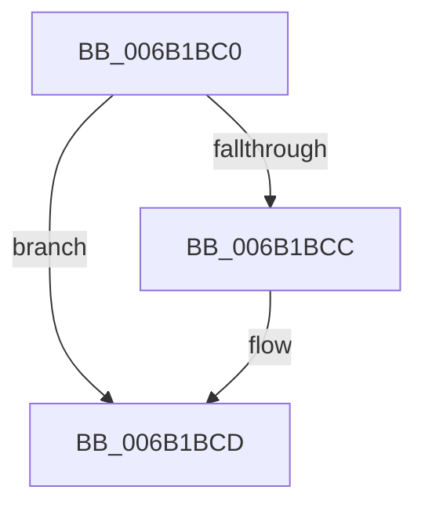

# KxExceptionDispatchOnExceptionStack

- RVA: `0x006B1BC0`–`0x006B1BDA` (길이 `26` bytes)
- VA: `0x00000001406B1BC0`
- 실행 섹션: `.text`
- PDB 이름 있음: `예`; PDB Function 태그: `아니요`
- unwind 정보 RVA: `0x000C16C0`
- 디코드: `7`개 명령, `26/26` bytes 표시
- 미해석 바이트: `0` (있으면 어셈블리에 `.byte`로 보존)

> 이 문서는 커널 이미지의 기계어와 PDB 기호를 분석해 생성했습니다. 4번과 5번은 함수 원형과 자료형을 바이너리 사용 방식에서 추정한 C 해석이며 원본 소스 복구 결과는 아닙니다.

## 1. Dependencies

- 직접 호출 지점: **1**; 고유 호출 대상: **1**
- 직접 호출자로 확인된 함수: **0**
- RIP 상대 이미지 참조: **0**

### Outgoing calls
- `0x006B1BCD` → [KiDispatchException](../3D/KiDispatchException_function_003D7650.md) (function, `0x003D7650`)

### Direct callers
- 이 함수 시작 RVA로 연결되는 직접 call은 확인되지 않았습니다. 간접 호출은 완전히 역산할 수 없습니다.

### Static image references
- 디코드된 RIP-relative 메모리 참조가 없습니다.

## 2. Other-region calls and transfers

- 다른 실행 섹션으로 향하는 call: **0**
- call이 아닌 외부 분기/꼬리 이동: **1**
  - `0x006B1BD8` → [KiExceptionDispatchOnExceptionStack + 0x20](KiExceptionDispatchOnExceptionStack_function_006B1B80.md) (`tail-transfer`)

## 3. Assembly (complete function range)

```asm
006B1BC0  F7 85 F8 00 00 00 00 02 00 00   test dword ptr [rbp + 0xf8], 0x200
006B1BCA  74 01                           je 0x1406b1bcd
006B1BCC  FB                              sti
006B1BCD  E8 7E 5A D2 FF                  call 0x1403d7650
006B1BD2  FA                              cli
006B1BD3  48 8B 64 24 40                  mov rsp, qword ptr [rsp + 0x40]
006B1BD8  EB C6                           jmp 0x1406b1ba0
```

## 4. C-style interpretation (structured pseudocode)

```c
__int64 __fastcall KxExceptionDispatchOnExceptionStack(__int64 a1, __int64 a2, __int64 a3, __int64 a4, __int64 a5, __int64 a6, __int64 a7, __int64 a8)
{
    __int64 result;

    if (((*(unsigned int *)(v_rbp + 248)) & (512)) != 0) {
    }
    result = KiDispatchException(a1, a2, a3, a4);
}
```

## 5. (Beta) C Style

```c
int64_t KxExceptionDispatchOnExceptionStack(int64_t Arg1, int64_t Arg2, int64_t Arg3, int64_t Arg4, uint64_t Arg5, uint64_t Arg6, uint64_t Arg7, int64_t Arg8)
{
    int64_t result;

    if (((*(uint32_t *)(local_rbp + 0xF8)) & (512)) != 0) {
    }
    result = KiDispatchException(Arg1, Arg2, Arg3, Arg4);
}
```

## 6. Execution-region graph

[열기: 2D/3D 그래프와 함수 탐색 컨트롤 패널](../../../control-panel.html?section=text&rva=0x006B1BC0&view=graph)

- 2D 그래프는 위에서 아래로 흐르고, 3D 그래프는 빈 공간을 드래그해 회전합니다. Shift+드래그는 이동, 휠은 확대·축소, 함수 노드 선택은 대상 보고서 이동입니다.

### Static fallback


