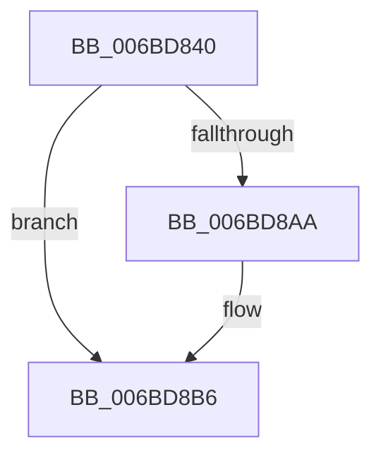

# KxNmiInterrupt

- RVA: `0x006BD840`–`0x006BD922` (길이 `226` bytes)
- VA: `0x00000001406BD840`
- 실행 섹션: `.text`
- PDB 이름 있음: `예`; PDB Function 태그: `아니요`
- unwind 정보 RVA: `0x000C1B48`
- 디코드: `47`개 명령, `226/226` bytes 표시
- 미해석 바이트: `0` (있으면 어셈블리에 `.byte`로 보존)

> 이 문서는 커널 이미지의 기계어와 PDB 기호를 분석해 생성했습니다. 4번과 5번은 함수 원형과 자료형을 바이너리 사용 방식에서 추정한 C 해석이며 원본 소스 복구 결과는 아닙니다.

## 1. Dependencies

- 직접 호출 지점: **2**; 고유 호출 대상: **2**
- 직접 호출자로 확인된 함수: **1**
- RIP 상대 이미지 참조: **0**

### Outgoing calls
- `0x006BD8B1` → [KiSaveProcessorState](../5C/KiSaveProcessorState_function_005CB940.md) (function, `0x005CB940`)
- `0x006BD8BD` → [KiProcessNMI](../5B/KiProcessNMI_function_005B8950.md) (function, `0x005B8950`)

### Direct callers
- [KiNmiInterrupt](KiNmiInterrupt_function_006BD3C0.md) at `0x006BD629`

### Static image references
- 디코드된 RIP-relative 메모리 참조가 없습니다.

## 2. Other-region calls and transfers

- 다른 실행 섹션으로 향하는 call: **0**
- 별도 외부 분기/꼬리 이동을 확인하지 못했습니다.

## 3. Assembly (complete function range)

```asm
006BD840  48 81 EC 38 01 00 00            sub rsp, 0x138
006BD847  48 8D 84 24 00 01 00 00         lea rax, [rsp + 0x100]
006BD84F  0F 29 74 24 30                  movaps xmmword ptr [rsp + 0x30], xmm6
006BD854  0F 29 7C 24 40                  movaps xmmword ptr [rsp + 0x40], xmm7
006BD859  44 0F 29 44 24 50               movaps xmmword ptr [rsp + 0x50], xmm8
006BD85F  44 0F 29 4C 24 60               movaps xmmword ptr [rsp + 0x60], xmm9
006BD865  44 0F 29 54 24 70               movaps xmmword ptr [rsp + 0x70], xmm10
006BD86B  44 0F 29 58 80                  movaps xmmword ptr [rax - 0x80], xmm11
006BD870  44 0F 29 60 90                  movaps xmmword ptr [rax - 0x70], xmm12
006BD875  44 0F 29 68 A0                  movaps xmmword ptr [rax - 0x60], xmm13
006BD87A  44 0F 29 70 B0                  movaps xmmword ptr [rax - 0x50], xmm14
006BD87F  44 0F 29 78 C0                  movaps xmmword ptr [rax - 0x40], xmm15
006BD884  48 89 18                        mov qword ptr [rax], rbx
006BD887  48 89 78 08                     mov qword ptr [rax + 8], rdi
006BD88B  48 89 70 10                     mov qword ptr [rax + 0x10], rsi
006BD88F  4C 89 60 18                     mov qword ptr [rax + 0x18], r12
006BD893  4C 89 68 20                     mov qword ptr [rax + 0x20], r13
006BD897  4C 89 70 28                     mov qword ptr [rax + 0x28], r14
006BD89B  4C 89 78 30                     mov qword ptr [rax + 0x30], r15
006BD89F  65 83 3C 25 08 2F 00 00 05      cmp dword ptr gs:[0x2f08], 5
006BD8A8  74 0C                           je 0x1406bd8b6
006BD8AA  48 8D 4D 80                     lea rcx, [rbp - 0x80]
006BD8AE  48 8B D4                        mov rdx, rsp
006BD8B1  E8 8A E0 F0 FF                  call 0x1405cb940
006BD8B6  48 8D 4D 80                     lea rcx, [rbp - 0x80]
006BD8BA  48 8B D4                        mov rdx, rsp
006BD8BD  E8 8E B0 EF FF                  call 0x1405b8950
006BD8C2  48 8D 8C 24 00 01 00 00         lea rcx, [rsp + 0x100]
006BD8CA  0F 28 74 24 30                  movaps xmm6, xmmword ptr [rsp + 0x30]
006BD8CF  0F 28 7C 24 40                  movaps xmm7, xmmword ptr [rsp + 0x40]
006BD8D4  44 0F 28 44 24 50               movaps xmm8, xmmword ptr [rsp + 0x50]
006BD8DA  44 0F 28 4C 24 60               movaps xmm9, xmmword ptr [rsp + 0x60]
006BD8E0  44 0F 28 54 24 70               movaps xmm10, xmmword ptr [rsp + 0x70]
006BD8E6  44 0F 28 59 80                  movaps xmm11, xmmword ptr [rcx - 0x80]
006BD8EB  44 0F 28 61 90                  movaps xmm12, xmmword ptr [rcx - 0x70]
006BD8F0  44 0F 28 69 A0                  movaps xmm13, xmmword ptr [rcx - 0x60]
006BD8F5  44 0F 28 71 B0                  movaps xmm14, xmmword ptr [rcx - 0x50]
006BD8FA  44 0F 28 79 C0                  movaps xmm15, xmmword ptr [rcx - 0x40]
006BD8FF  48 8B 19                        mov rbx, qword ptr [rcx]
006BD902  48 8B 79 08                     mov rdi, qword ptr [rcx + 8]
006BD906  48 8B 71 10                     mov rsi, qword ptr [rcx + 0x10]
006BD90A  4C 8B 61 18                     mov r12, qword ptr [rcx + 0x18]
006BD90E  4C 8B 69 20                     mov r13, qword ptr [rcx + 0x20]
006BD912  4C 8B 71 28                     mov r14, qword ptr [rcx + 0x28]
006BD916  4C 8B 79 30                     mov r15, qword ptr [rcx + 0x30]
006BD91A  48 81 C4 38 01 00 00            add rsp, 0x138
006BD921  C3                              ret
```

## 4. C-style interpretation (structured pseudocode)

```c
__int64 __fastcall KxNmiInterrupt(void)
{
    __int64 result;
    __int64 v_rsp;
    unsigned __int64 v_stack_m108;
    unsigned __int64 v_stack_m38;
    unsigned __int64 v_stack_mC8;
    unsigned __int64 v_stack_mD8;
    unsigned __int64 v_stack_mE8;
    unsigned __int64 v_stack_mF8;

    v_rsp = (v_rsp) - (312);
    v_stack_m108 = v_xmm6;
    v_stack_mF8 = v_xmm7;
    v_stack_mE8 = v_xmm8;
    v_stack_mD8 = v_xmm9;
    v_stack_mC8 = v_xmm10;
    *(unsigned __int64 *)(v_stack_m38 - 128) = v_xmm11;
    *(unsigned __int64 *)(v_stack_m38 - 112) = v_xmm12;
    *(unsigned __int64 *)(v_stack_m38 - 96) = v_xmm13;
    *(unsigned __int64 *)(v_stack_m38 - 80) = v_xmm14;
    *(unsigned __int64 *)(v_stack_m38 - 64) = v_xmm15;
    *(unsigned __int64 *)(v_stack_m38) = v_rbx;
    *(unsigned __int64 *)(v_stack_m38 + 8) = v_rdi;
    *(unsigned __int64 *)(v_stack_m38 + 16) = v_rsi;
    *(unsigned __int64 *)(v_stack_m38 + 24) = v_r12;
    *(unsigned __int64 *)(v_stack_m38 + 32) = v_r13;
    *(unsigned __int64 *)(v_stack_m38 + 40) = v_r14;
    *(unsigned __int64 *)(v_stack_m38 + 48) = v_r15;
    result = v_stack_m38;
    if ((*(unsigned int *)(gs_base + (0 + 12040))) != 5) {
        a1 = v_rbp - 128;
        a2 = v_rsp;
        result = KiSaveProcessorState(a1, a2, a3, a4);
    }
    result = KiProcessNMI(v_rbp - 128, v_rsp, a3, a4);
    v_rsp = (v_rsp) + (312);
    return result;
}
```

## 5. (Beta) C Style

```c
void KxNmiInterrupt(void)
{
    int64_t result;
    int64_t local_rsp;
    uint64_t v_stack_m108;
    uint64_t v_stack_m38;
    uint64_t v_stack_mC8;
    uint64_t v_stack_mD8;
    uint64_t v_stack_mE8;
    uint64_t v_stack_mF8;

    local_rsp = (local_rsp) - (312);
    v_stack_m108 = v_xmm6;
    v_stack_mF8 = v_xmm7;
    v_stack_mE8 = v_xmm8;
    v_stack_mD8 = v_xmm9;
    v_stack_mC8 = v_xmm10;
    *(uint64_t *)(v_stack_m38 - 0x80) = v_xmm11;
    *(uint64_t *)(v_stack_m38 - 0x70) = v_xmm12;
    *(uint64_t *)(v_stack_m38 - 0x60) = v_xmm13;
    *(uint64_t *)(v_stack_m38 - 0x50) = v_xmm14;
    *(uint64_t *)(v_stack_m38 - 0x40) = v_xmm15;
    *(uint64_t *)(v_stack_m38) = local_rbx;
    *(uint64_t *)(v_stack_m38 + 0x8) = local_rdi;
    *(uint64_t *)(v_stack_m38 + 0x10) = local_rsi;
    *(uint64_t *)(v_stack_m38 + 0x18) = local_r12;
    *(uint64_t *)(v_stack_m38 + 0x20) = local_r13;
    *(uint64_t *)(v_stack_m38 + 0x28) = local_r14;
    *(uint64_t *)(v_stack_m38 + 0x30) = local_r15;
    result = v_stack_m38;
    if ((*(uint32_t *)(gs_base + (0 + 0x2F08))) != 5) {
        a1 = local_rbp - 128;
        a2 = local_rsp;
        result = KiSaveProcessorState(a1, a2, a3, a4);
    }
    result = KiProcessNMI(local_rbp - 128, local_rsp, a3, a4);
    local_rsp = (local_rsp) + (312);
    return result;
}
```

## 6. Execution-region graph

[열기: 2D/3D 그래프와 함수 탐색 컨트롤 패널](../../../control-panel.html?section=text&rva=0x006BD840&view=graph)

- 2D 그래프는 위에서 아래로 흐르고, 3D 그래프는 빈 공간을 드래그해 회전합니다. Shift+드래그는 이동, 휠은 확대·축소, 함수 노드 선택은 대상 보고서 이동입니다.

### Static fallback


