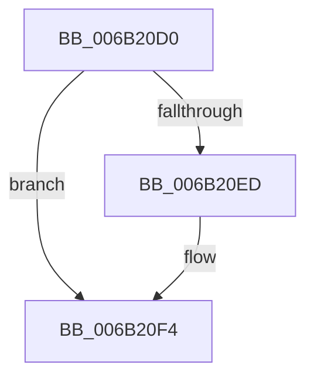

# KxSetAddressPolicy

- RVA: `0x006B20D0`–`0x006B20F5` (길이 `37` bytes)
- VA: `0x00000001406B20D0`
- 실행 섹션: `.text`
- PDB 이름 있음: `예`; PDB Function 태그: `아니요`
- unwind 정보 RVA: `0x000C1750`
- 디코드: `7`개 명령, `37/37` bytes 표시
- 미해석 바이트: `0` (있으면 어셈블리에 `.byte`로 보존)

> 이 문서는 커널 이미지의 기계어와 PDB 기호를 분석해 생성했습니다. 4번과 5번은 함수 원형과 자료형을 바이너리 사용 방식에서 추정한 C 해석이며 원본 소스 복구 결과는 아닙니다.

## 1. Dependencies

- 직접 호출 지점: **0**; 고유 호출 대상: **0**
- 직접 호출자로 확인된 함수: **1**
- RIP 상대 이미지 참조: **0**

### Outgoing calls
- 직접 디코드된 call 명령이 없습니다.

### Direct callers
- [KiSetAddressPolicy](../21/KiSetAddressPolicy_function_002178A0.md) at `0x002178B4`

### Static image references
- 디코드된 RIP-relative 메모리 참조가 없습니다.

## 2. Other-region calls and transfers

- 다른 실행 섹션으로 향하는 call: **0**
- 별도 외부 분기/꼬리 이동을 확인하지 못했습니다.

## 3. Assembly (complete function range)

```asm
006B20D0  65 48 8B 04 25 20 00 00 00      mov rax, qword ptr gs:[0x20]
006B20D9  83 88 98 AE 00 00 01            or dword ptr [rax + 0xae98], 1
006B20E0  83 A0 98 AE 00 00 FD            and dword ptr [rax + 0xae98], 0xfffffffd
006B20E7  0F BA E1 00                     bt ecx, 0
006B20EB  73 07                           jae 0x1406b20f4
006B20ED  83 B0 98 AE 00 00 03            xor dword ptr [rax + 0xae98], 3
006B20F4  C3                              ret
```

## 4. C-style interpretation (structured pseudocode)

```c
__int64 __fastcall KxSetAddressPolicy(int a1)
{
    if (!(condition_is_above_or_equal)) {
    }
    return *(unsigned __int64 *)(gs_base + (0 + 32));
}
```

## 5. (Beta) C Style

```c
int64_t KxSetAddressPolicy(int32_t Arg1)
{
    if (!(condition_is_above_or_equal)) {
    }
    return *(uint64_t *)(gs_base + (0 + 0x20));
}
```

## 6. Execution-region graph

[열기: 2D/3D 그래프와 함수 탐색 컨트롤 패널](../../../control-panel.html?section=text&rva=0x006B20D0&view=graph)

- 2D 그래프는 위에서 아래로 흐르고, 3D 그래프는 빈 공간을 드래그해 회전합니다. Shift+드래그는 이동, 휠은 확대·축소, 함수 노드 선택은 대상 보고서 이동입니다.

### Static fallback


