# KxStartUserThread

- RVA: `0x006B2E50`–`0x006B327E` (길이 `1,070` bytes)
- VA: `0x00000001406B2E50`
- 실행 섹션: `.text`
- PDB 이름 있음: `예`; PDB Function 태그: `아니요`
- unwind 정보 RVA: `0x000C1A70`
- 디코드: `232`개 명령, `1,070/1,070` bytes 표시
- 미해석 바이트: `0` (있으면 어셈블리에 `.byte`로 보존)

> 이 문서는 커널 이미지의 기계어와 PDB 기호를 분석해 생성했습니다. 4번과 5번은 함수 원형과 자료형을 바이너리 사용 방식에서 추정한 C 해석이며 원본 소스 복구 결과는 아닙니다.

## 1. Dependencies

- 직접 호출 지점: **39**; 고유 호출 대상: **39**
- 직접 호출자로 확인된 함수: **2**
- RIP 상대 이미지 참조: **2**

### Outgoing calls
- `0x006B2ED3` → [guard_dispatch_icall](guard_dispatch_icall_function_006BAAD0.md) (function, `0x006BAAD0`)
- `0x006B2F66` → [KiInitiateUserApc](KiInitiateUserApc_function_006B6540.md) (function, `0x006B6540`)
- `0x006B2F77` → [KiSynchronizeUserIsolationDomainEntry](../26/KiSynchronizeUserIsolationDomainEntry_function_00263F60.md) (function, `0x00263F60`)
- `0x006B2F91` → [KiUpdateStibpPairing](../3E/KiUpdateStibpPairing_function_003E71C0.md) (function, `0x003E71C0`)
- `0x006B2FA7` → [KiRestoreSetContextState](KiRestoreSetContextState_function_006B1CA0.md) (function, `0x006B1CA0`)
- `0x006B2FC3` → [KiCopyCounters](../5C/KiCopyCounters_function_005C0710.md) (function, `0x005C0710`)
- `0x006B2FDF` → [KiRestoreDebugRegisterState](../4F/KiRestoreDebugRegisterState_function_004FD8E0.md) (function, `0x004FD8E0`)
- `0x006B3079` → [KxStartUserThread + 0x33C](KxStartUserThread_function_006B2E50.md) (inside-function, `0x006B318C`)
- `0x006B3082` → [KxStartUserThread + 0x345](KxStartUserThread_function_006B2E50.md) (inside-function, `0x006B3195`)
- `0x006B308B` → [KxStartUserThread + 0x22E](KxStartUserThread_function_006B2E50.md) (inside-function, `0x006B307E`)
- `0x006B3094` → [KxStartUserThread + 0x237](KxStartUserThread_function_006B2E50.md) (inside-function, `0x006B3087`)
- `0x006B309D` → [KxStartUserThread + 0x240](KxStartUserThread_function_006B2E50.md) (inside-function, `0x006B3090`)
- `0x006B30A6` → [KxStartUserThread + 0x249](KxStartUserThread_function_006B2E50.md) (inside-function, `0x006B3099`)
- `0x006B30AF` → [KxStartUserThread + 0x252](KxStartUserThread_function_006B2E50.md) (inside-function, `0x006B30A2`)
- `0x006B30B8` → [KxStartUserThread + 0x25B](KxStartUserThread_function_006B2E50.md) (inside-function, `0x006B30AB`)
- `0x006B30C1` → [KxStartUserThread + 0x264](KxStartUserThread_function_006B2E50.md) (inside-function, `0x006B30B4`)
- `0x006B30CA` → [KxStartUserThread + 0x26D](KxStartUserThread_function_006B2E50.md) (inside-function, `0x006B30BD`)
- `0x006B30D3` → [KxStartUserThread + 0x276](KxStartUserThread_function_006B2E50.md) (inside-function, `0x006B30C6`)
- `0x006B30DC` → [KxStartUserThread + 0x27F](KxStartUserThread_function_006B2E50.md) (inside-function, `0x006B30CF`)
- `0x006B30E5` → [KxStartUserThread + 0x288](KxStartUserThread_function_006B2E50.md) (inside-function, `0x006B30D8`)
- `0x006B30EE` → [KxStartUserThread + 0x291](KxStartUserThread_function_006B2E50.md) (inside-function, `0x006B30E1`)
- `0x006B30F7` → [KxStartUserThread + 0x29A](KxStartUserThread_function_006B2E50.md) (inside-function, `0x006B30EA`)
- `0x006B3100` → [KxStartUserThread + 0x2A3](KxStartUserThread_function_006B2E50.md) (inside-function, `0x006B30F3`)
- `0x006B3109` → [KxStartUserThread + 0x2AC](KxStartUserThread_function_006B2E50.md) (inside-function, `0x006B30FC`)
- `0x006B3112` → [KxStartUserThread + 0x2B5](KxStartUserThread_function_006B2E50.md) (inside-function, `0x006B3105`)
- `0x006B311B` → [KxStartUserThread + 0x2BE](KxStartUserThread_function_006B2E50.md) (inside-function, `0x006B310E`)
- `0x006B3124` → [KxStartUserThread + 0x2C7](KxStartUserThread_function_006B2E50.md) (inside-function, `0x006B3117`)
- `0x006B312D` → [KxStartUserThread + 0x2D0](KxStartUserThread_function_006B2E50.md) (inside-function, `0x006B3120`)
- `0x006B3136` → [KxStartUserThread + 0x2D9](KxStartUserThread_function_006B2E50.md) (inside-function, `0x006B3129`)
- `0x006B313F` → [KxStartUserThread + 0x2E2](KxStartUserThread_function_006B2E50.md) (inside-function, `0x006B3132`)
- `0x006B3148` → [KxStartUserThread + 0x2EB](KxStartUserThread_function_006B2E50.md) (inside-function, `0x006B313B`)
- `0x006B3151` → [KxStartUserThread + 0x2F4](KxStartUserThread_function_006B2E50.md) (inside-function, `0x006B3144`)
- `0x006B315A` → [KxStartUserThread + 0x2FD](KxStartUserThread_function_006B2E50.md) (inside-function, `0x006B314D`)
- `0x006B3163` → [KxStartUserThread + 0x306](KxStartUserThread_function_006B2E50.md) (inside-function, `0x006B3156`)
- `0x006B316C` → [KxStartUserThread + 0x30F](KxStartUserThread_function_006B2E50.md) (inside-function, `0x006B315F`)
- `0x006B3175` → [KxStartUserThread + 0x318](KxStartUserThread_function_006B2E50.md) (inside-function, `0x006B3168`)
- `0x006B317E` → [KxStartUserThread + 0x321](KxStartUserThread_function_006B2E50.md) (inside-function, `0x006B3171`)
- `0x006B3187` → [KxStartUserThread + 0x32A](KxStartUserThread_function_006B2E50.md) (inside-function, `0x006B317A`)
- `0x006B3190` → [KxStartUserThread + 0x333](KxStartUserThread_function_006B2E50.md) (inside-function, `0x006B3183`)

### Direct callers
- [KyStartUserThread](KyStartUserThread_function_006B2AF0.md) at `0x006B2E2C`
- [KxStartUserThread](KxStartUserThread_function_006B2E50.md) at `0x006B3079`
- [KxStartUserThread](KxStartUserThread_function_006B2E50.md) at `0x006B3082`
- [KxStartUserThread](KxStartUserThread_function_006B2E50.md) at `0x006B308B`
- [KxStartUserThread](KxStartUserThread_function_006B2E50.md) at `0x006B3094`
- [KxStartUserThread](KxStartUserThread_function_006B2E50.md) at `0x006B309D`
- [KxStartUserThread](KxStartUserThread_function_006B2E50.md) at `0x006B30A6`
- [KxStartUserThread](KxStartUserThread_function_006B2E50.md) at `0x006B30AF`
- [KxStartUserThread](KxStartUserThread_function_006B2E50.md) at `0x006B30B8`
- [KxStartUserThread](KxStartUserThread_function_006B2E50.md) at `0x006B30C1`
- [KxStartUserThread](KxStartUserThread_function_006B2E50.md) at `0x006B30CA`
- [KxStartUserThread](KxStartUserThread_function_006B2E50.md) at `0x006B30D3`
- [KxStartUserThread](KxStartUserThread_function_006B2E50.md) at `0x006B30DC`
- [KxStartUserThread](KxStartUserThread_function_006B2E50.md) at `0x006B30E5`
- [KxStartUserThread](KxStartUserThread_function_006B2E50.md) at `0x006B30EE`
- [KxStartUserThread](KxStartUserThread_function_006B2E50.md) at `0x006B30F7`
- [KxStartUserThread](KxStartUserThread_function_006B2E50.md) at `0x006B3100`
- [KxStartUserThread](KxStartUserThread_function_006B2E50.md) at `0x006B3109`
- [KxStartUserThread](KxStartUserThread_function_006B2E50.md) at `0x006B3112`
- [KxStartUserThread](KxStartUserThread_function_006B2E50.md) at `0x006B311B`
- [KxStartUserThread](KxStartUserThread_function_006B2E50.md) at `0x006B3124`
- [KxStartUserThread](KxStartUserThread_function_006B2E50.md) at `0x006B312D`
- [KxStartUserThread](KxStartUserThread_function_006B2E50.md) at `0x006B3136`
- [KxStartUserThread](KxStartUserThread_function_006B2E50.md) at `0x006B313F`
- [KxStartUserThread](KxStartUserThread_function_006B2E50.md) at `0x006B3148`
- [KxStartUserThread](KxStartUserThread_function_006B2E50.md) at `0x006B3151`
- [KxStartUserThread](KxStartUserThread_function_006B2E50.md) at `0x006B315A`
- [KxStartUserThread](KxStartUserThread_function_006B2E50.md) at `0x006B3163`
- [KxStartUserThread](KxStartUserThread_function_006B2E50.md) at `0x006B316C`
- [KxStartUserThread](KxStartUserThread_function_006B2E50.md) at `0x006B3175`
- [KxStartUserThread](KxStartUserThread_function_006B2E50.md) at `0x006B317E`
- [KxStartUserThread](KxStartUserThread_function_006B2E50.md) at `0x006B3187`
- [KxStartUserThread](KxStartUserThread_function_006B2E50.md) at `0x006B3190`

### Static image references
- `0x006B2EB0` → RVA `0x00FC6BF0` (`ALMOSTRO`; read)
- `0x006B320E` → RVA `0x01201840` (`CFGRO`; read)

## 2. Other-region calls and transfers

- 다른 실행 섹션으로 향하는 call: **0**
- call이 아닌 외부 분기/꼬리 이동: **1**
  - `0x006B3217` → [KiKernelExit](../../kvascode/BC/KiKernelExit_function_00BCCB80.md) (`tail-transfer`)

## 3. Assembly (complete function range)

```asm
006B2E50  48 81 EC 38 01 00 00            sub rsp, 0x138
006B2E57  48 8D 84 24 00 01 00 00         lea rax, [rsp + 0x100]
006B2E5F  0F 29 74 24 30                  movaps xmmword ptr [rsp + 0x30], xmm6
006B2E64  0F 29 7C 24 40                  movaps xmmword ptr [rsp + 0x40], xmm7
006B2E69  44 0F 29 44 24 50               movaps xmmword ptr [rsp + 0x50], xmm8
006B2E6F  44 0F 29 4C 24 60               movaps xmmword ptr [rsp + 0x60], xmm9
006B2E75  44 0F 29 54 24 70               movaps xmmword ptr [rsp + 0x70], xmm10
006B2E7B  44 0F 29 58 80                  movaps xmmword ptr [rax - 0x80], xmm11
006B2E80  44 0F 29 60 90                  movaps xmmword ptr [rax - 0x70], xmm12
006B2E85  44 0F 29 68 A0                  movaps xmmword ptr [rax - 0x60], xmm13
006B2E8A  44 0F 29 70 B0                  movaps xmmword ptr [rax - 0x50], xmm14
006B2E8F  44 0F 29 78 C0                  movaps xmmword ptr [rax - 0x40], xmm15
006B2E94  48 89 18                        mov qword ptr [rax], rbx
006B2E97  48 89 78 08                     mov qword ptr [rax + 8], rdi
006B2E9B  48 89 70 10                     mov qword ptr [rax + 0x10], rsi
006B2E9F  4C 89 60 18                     mov qword ptr [rax + 0x18], r12
006B2EA3  4C 89 68 20                     mov qword ptr [rax + 0x20], r13
006B2EA7  4C 89 70 28                     mov qword ptr [rax + 0x28], r14
006B2EAB  4C 89 78 30                     mov qword ptr [rax + 0x30], r15
006B2EAF  90                              nop
006B2EB0  F6 05 39 3D 91 00 FF            test byte ptr [rip + 0x913d39], 0xff
006B2EB7  74 03                           je 0x1406b2ebc
006B2EB9  0F 01 CB                        stac
006B2EBC  B9 01 00 00 00                  mov ecx, 1
006B2EC1  44 0F 22 C1                     mov cr8, rcx
006B2EC5  48 8B 14 24                     mov rdx, qword ptr [rsp]
006B2EC9  48 8B 4C 24 08                  mov rcx, qword ptr [rsp + 8]
006B2ECE  48 8B 44 24 10                  mov rax, qword ptr [rsp + 0x10]
006B2ED3  E8 F8 7B 00 00                  call 0x1406baad0
006B2ED8  48 8D 8C 24 00 01 00 00         lea rcx, [rsp + 0x100]
006B2EE0  0F 28 74 24 30                  movaps xmm6, xmmword ptr [rsp + 0x30]
006B2EE5  0F 28 7C 24 40                  movaps xmm7, xmmword ptr [rsp + 0x40]
006B2EEA  44 0F 28 44 24 50               movaps xmm8, xmmword ptr [rsp + 0x50]
006B2EF0  44 0F 28 4C 24 60               movaps xmm9, xmmword ptr [rsp + 0x60]
006B2EF6  44 0F 28 54 24 70               movaps xmm10, xmmword ptr [rsp + 0x70]
006B2EFC  44 0F 28 59 80                  movaps xmm11, xmmword ptr [rcx - 0x80]
006B2F01  44 0F 28 61 90                  movaps xmm12, xmmword ptr [rcx - 0x70]
006B2F06  44 0F 28 69 A0                  movaps xmm13, xmmword ptr [rcx - 0x60]
006B2F0B  44 0F 28 71 B0                  movaps xmm14, xmmword ptr [rcx - 0x50]
006B2F10  44 0F 28 79 C0                  movaps xmm15, xmmword ptr [rcx - 0x40]
006B2F15  48 8B 19                        mov rbx, qword ptr [rcx]
006B2F18  48 8B 79 08                     mov rdi, qword ptr [rcx + 8]
006B2F1C  48 8B 71 10                     mov rsi, qword ptr [rcx + 0x10]
006B2F20  4C 8B 61 18                     mov r12, qword ptr [rcx + 0x18]
006B2F24  4C 8B 69 20                     mov r13, qword ptr [rcx + 0x20]
006B2F28  4C 8B 71 28                     mov r14, qword ptr [rcx + 0x28]
006B2F2C  4C 8B 79 30                     mov r15, qword ptr [rcx + 0x30]
006B2F30  FA                              cli
006B2F31  F6 85 F0 00 00 00 01            test byte ptr [rbp + 0xf0], 1
006B2F38  0F 84 F5 02 00 00               je 0x1406b3233
006B2F3E  F6 05 AB 3C 91 00 FF            test byte ptr [rip + 0x913cab], 0xff
006B2F45  74 03                           je 0x1406b2f4a
006B2F47  0F 01 CB                        stac
006B2F4A  65 48 8B 0C 25 88 01 00 00      mov rcx, qword ptr gs:[0x188]
006B2F53  F6 81 C2 00 00 00 03            test byte ptr [rcx + 0xc2], 3
006B2F5A  74 1B                           je 0x1406b2f77
006B2F5C  B9 01 00 00 00                  mov ecx, 1
006B2F61  44 0F 22 C1                     mov cr8, rcx
006B2F65  FB                              sti
006B2F66  E8 D5 35 00 00                  call 0x1406b6540
006B2F6B  FA                              cli
006B2F6C  B9 00 00 00 00                  mov ecx, 0
006B2F71  44 0F 22 C1                     mov cr8, rcx
006B2F75  EB D3                           jmp 0x1406b2f4a
006B2F77  E8 E4 0F BB FF                  call 0x140263f60
006B2F7C  85 C0                           test eax, eax
006B2F7E  48 8B 45 B0                     mov rax, qword ptr [rbp - 0x50]
006B2F82  75 C6                           jne 0x1406b2f4a
006B2F84  65 F6 04 25 60 08 00 00 02      test byte ptr gs:[0x860], 2
006B2F8D  74 07                           je 0x1406b2f96
006B2F8F  33 C9                           xor ecx, ecx
006B2F91  E8 2A 42 D3 FF                  call 0x1403e71c0
006B2F96  65 48 8B 0C 25 88 01 00 00      mov rcx, qword ptr gs:[0x188]
006B2F9F  F7 01 00 00 00 08               test dword ptr [rcx], 0x8000000
006B2FA5  74 05                           je 0x1406b2fac
006B2FA7  E8 F4 EC FF FF                  call 0x1406b1ca0
006B2FAC  65 48 8B 0C 25 88 01 00 00      mov rcx, qword ptr gs:[0x188]
006B2FB5  F7 01 00 00 01 00               test dword ptr [rcx], 0x10000
006B2FBB  74 14                           je 0x1406b2fd1
006B2FBD  F6 41 02 01                     test byte ptr [rcx + 2], 1
006B2FC1  74 0E                           je 0x1406b2fd1
006B2FC3  E8 48 D7 F0 FF                  call 0x1405c0710
006B2FC8  65 48 8B 0C 25 88 01 00 00      mov rcx, qword ptr gs:[0x188]
006B2FD1  0F AE 55 AC                     ldmxcsr dword ptr [rbp - 0x54]
006B2FD5  66 83 BD 80 00 00 00 00         cmp word ptr [rbp + 0x80], 0
006B2FDD  74 05                           je 0x1406b2fe4
006B2FDF  E8 FC A8 E4 FF                  call 0x1404fd8e0
006B2FE4  65 48 8B 0C 25 88 01 00 00      mov rcx, qword ptr gs:[0x188]
006B2FED  0F BA 61 74 16                  bt dword ptr [rcx + 0x74], 0x16
006B2FF2  73 2A                           jae 0x1406b301e
006B2FF4  33 C9                           xor ecx, ecx
006B2FF6  F3 48 0F 1E C9                  rdsspq rcx
006B2FFB  65 4C 8B 04 25 28 9D 00 00      mov r8, qword ptr gs:[0x9d28]
006B3004  49 83 C0 08                     add r8, 8
006B3008  49 3B C8                        cmp rcx, r8
006B300B  75 11                           jne 0x1406b301e
006B300D  65 48 8B 0C 25 20 9D 00 00      mov rcx, qword ptr gs:[0x9d20]
006B3016  F3 0F 01 29                     rstorssp dword ptr [rcx]
006B301A  F3 0F 01 EA                     saveprevssp
006B301E  65 C6 04 25 5E 08 00 00 00      mov byte ptr gs:[0x85e], 0
006B3027  65 0F B7 04 25 6C 08 00 00      movzx eax, word ptr gs:[0x86c]
006B3030  66 65 39 04 25 66 08 00 00      cmp word ptr gs:[0x866], ax
006B3039  74 12                           je 0x1406b304d
006B303B  66 65 89 04 25 66 08 00 00      mov word ptr gs:[0x866], ax
006B3044  B9 48 00 00 00                  mov ecx, 0x48
006B3049  33 D2                           xor edx, edx
006B304B  0F 30                           wrmsr
006B304D  66 65 0F BA 34 25 58 08 00 00 02  btr word ptr gs:[0x858], 2
006B3058  73 0E                           jae 0x1406b3068
006B305A  B8 01 00 00 00                  mov eax, 1
006B305F  33 D2                           xor edx, edx
006B3061  B9 49 00 00 00                  mov ecx, 0x49
006B3066  0F 30                           wrmsr
006B3068  66 65 0F BA 34 25 58 08 00 00 05  btr word ptr gs:[0x858], 5
006B3073  0F 83 37 01 00 00               jae 0x1406b31b0
006B3079  E8 0E 01 00 00                  call 0x1406b318c
006B307E  48 83 C4 08                     add rsp, 8
006B3082  E8 0E 01 00 00                  call 0x1406b3195
006B3087  48 83 C4 08                     add rsp, 8
006B308B  E8 EE FF FF FF                  call 0x1406b307e
006B3090  48 83 C4 08                     add rsp, 8
006B3094  E8 EE FF FF FF                  call 0x1406b3087
006B3099  48 83 C4 08                     add rsp, 8
006B309D  E8 EE FF FF FF                  call 0x1406b3090
006B30A2  48 83 C4 08                     add rsp, 8
006B30A6  E8 EE FF FF FF                  call 0x1406b3099
006B30AB  48 83 C4 08                     add rsp, 8
006B30AF  E8 EE FF FF FF                  call 0x1406b30a2
006B30B4  48 83 C4 08                     add rsp, 8
006B30B8  E8 EE FF FF FF                  call 0x1406b30ab
006B30BD  48 83 C4 08                     add rsp, 8
006B30C1  E8 EE FF FF FF                  call 0x1406b30b4
006B30C6  48 83 C4 08                     add rsp, 8
006B30CA  E8 EE FF FF FF                  call 0x1406b30bd
006B30CF  48 83 C4 08                     add rsp, 8
006B30D3  E8 EE FF FF FF                  call 0x1406b30c6
006B30D8  48 83 C4 08                     add rsp, 8
006B30DC  E8 EE FF FF FF                  call 0x1406b30cf
006B30E1  48 83 C4 08                     add rsp, 8
006B30E5  E8 EE FF FF FF                  call 0x1406b30d8
006B30EA  48 83 C4 08                     add rsp, 8
006B30EE  E8 EE FF FF FF                  call 0x1406b30e1
006B30F3  48 83 C4 08                     add rsp, 8
006B30F7  E8 EE FF FF FF                  call 0x1406b30ea
006B30FC  48 83 C4 08                     add rsp, 8
006B3100  E8 EE FF FF FF                  call 0x1406b30f3
006B3105  48 83 C4 08                     add rsp, 8
006B3109  E8 EE FF FF FF                  call 0x1406b30fc
006B310E  48 83 C4 08                     add rsp, 8
006B3112  E8 EE FF FF FF                  call 0x1406b3105
006B3117  48 83 C4 08                     add rsp, 8
006B311B  E8 EE FF FF FF                  call 0x1406b310e
006B3120  48 83 C4 08                     add rsp, 8
006B3124  E8 EE FF FF FF                  call 0x1406b3117
006B3129  48 83 C4 08                     add rsp, 8
006B312D  E8 EE FF FF FF                  call 0x1406b3120
006B3132  48 83 C4 08                     add rsp, 8
006B3136  E8 EE FF FF FF                  call 0x1406b3129
006B313B  48 83 C4 08                     add rsp, 8
006B313F  E8 EE FF FF FF                  call 0x1406b3132
006B3144  48 83 C4 08                     add rsp, 8
006B3148  E8 EE FF FF FF                  call 0x1406b313b
006B314D  48 83 C4 08                     add rsp, 8
006B3151  E8 EE FF FF FF                  call 0x1406b3144
006B3156  48 83 C4 08                     add rsp, 8
006B315A  E8 EE FF FF FF                  call 0x1406b314d
006B315F  48 83 C4 08                     add rsp, 8
006B3163  E8 EE FF FF FF                  call 0x1406b3156
006B3168  48 83 C4 08                     add rsp, 8
006B316C  E8 EE FF FF FF                  call 0x1406b315f
006B3171  48 83 C4 08                     add rsp, 8
006B3175  E8 EE FF FF FF                  call 0x1406b3168
006B317A  48 83 C4 08                     add rsp, 8
006B317E  E8 EE FF FF FF                  call 0x1406b3171
006B3183  48 83 C4 08                     add rsp, 8
006B3187  E8 EE FF FF FF                  call 0x1406b317a
006B318C  48 83 C4 08                     add rsp, 8
006B3190  E8 EE FF FF FF                  call 0x1406b3183
006B3195  48 83 C4 08                     add rsp, 8
006B3199  B8 DA DA 00 00                  mov eax, 0xdada
006B319E  65 F6 04 25 5C 08 00 00 08      test byte ptr gs:[0x85c], 8
006B31A7  74 07                           je 0x1406b31b0
006B31A9  B0 20                           mov al, 0x20
006B31AB  F3 48 0F AE E8                  incsspq rax
006B31B0  66 65 F7 04 25 58 08 00 00 00 01  test word ptr gs:[0x858], 0x100
006B31BB  74 0C                           je 0x1406b31c9
006B31BD  33 C0                           xor eax, eax
006B31BF  33 D2                           xor edx, edx
006B31C1  B9 01 00 00 00                  mov ecx, 1
006B31C6  48 F7 F1                        div rcx
006B31C9  0F 28 45 F0                     movaps xmm0, xmmword ptr [rbp - 0x10]
006B31CD  0F 28 4D 00                     movaps xmm1, xmmword ptr [rbp]
006B31D1  0F 28 55 10                     movaps xmm2, xmmword ptr [rbp + 0x10]
006B31D5  0F 28 5D 20                     movaps xmm3, xmmword ptr [rbp + 0x20]
006B31D9  0F 28 65 30                     movaps xmm4, xmmword ptr [rbp + 0x30]
006B31DD  0F 28 6D 40                     movaps xmm5, xmmword ptr [rbp + 0x40]
006B31E1  4C 8B 5D E0                     mov r11, qword ptr [rbp - 0x20]
006B31E5  4C 8B 55 D8                     mov r10, qword ptr [rbp - 0x28]
006B31E9  4C 8B 4D D0                     mov r9, qword ptr [rbp - 0x30]
006B31ED  4C 8B 45 C8                     mov r8, qword ptr [rbp - 0x38]
006B31F1  48 8B 55 C0                     mov rdx, qword ptr [rbp - 0x40]
006B31F5  48 8B 4D B8                     mov rcx, qword ptr [rbp - 0x48]
006B31F9  48 8B 45 B0                     mov rax, qword ptr [rbp - 0x50]
006B31FD  48 8B E5                        mov rsp, rbp
006B3200  48 8B AD D8 00 00 00            mov rbp, qword ptr [rbp + 0xd8]
006B3207  48 81 C4 E8 00 00 00            add rsp, 0xe8
006B320E  F6 05 2B E6 B4 00 01            test byte ptr [rip + 0xb4e62b], 1
006B3215  74 05                           je 0x1406b321c
006B3217  E9 64 99 51 00                  jmp 0x140bccb80
006B321C  66 65 F7 04 25 58 08 00 00 00 02  test word ptr gs:[0x858], 0x200
006B3227  74 05                           je 0x1406b322e
006B3229  0F 00 6C 24 20                  verw word ptr [rsp + 0x20]
006B322E  0F 01 F8                        swapgs
006B3231  48 CF                           iretq
006B3233  0F AE 55 AC                     ldmxcsr dword ptr [rbp - 0x54]
006B3237  0F 28 45 F0                     movaps xmm0, xmmword ptr [rbp - 0x10]
006B323B  0F 28 4D 00                     movaps xmm1, xmmword ptr [rbp]
006B323F  0F 28 55 10                     movaps xmm2, xmmword ptr [rbp + 0x10]
006B3243  0F 28 5D 20                     movaps xmm3, xmmword ptr [rbp + 0x20]
006B3247  0F 28 65 30                     movaps xmm4, xmmword ptr [rbp + 0x30]
006B324B  0F 28 6D 40                     movaps xmm5, xmmword ptr [rbp + 0x40]
006B324F  4C 8B 5D E0                     mov r11, qword ptr [rbp - 0x20]
006B3253  4C 8B 55 D8                     mov r10, qword ptr [rbp - 0x28]
006B3257  4C 8B 4D D0                     mov r9, qword ptr [rbp - 0x30]
006B325B  4C 8B 45 C8                     mov r8, qword ptr [rbp - 0x38]
006B325F  48 8B 55 C0                     mov rdx, qword ptr [rbp - 0x40]
006B3263  48 8B 4D B8                     mov rcx, qword ptr [rbp - 0x48]
006B3267  48 8B 45 B0                     mov rax, qword ptr [rbp - 0x50]
006B326B  48 8B E5                        mov rsp, rbp
006B326E  48 8B AD D8 00 00 00            mov rbp, qword ptr [rbp + 0xd8]
006B3275  48 81 C4 E8 00 00 00            add rsp, 0xe8
006B327C  48 CF                           iretq
```

## 4. C-style interpretation (structured pseudocode)

```c
__int64 __fastcall KxStartUserThread(void)
{
    __int64 result;
    __int64 v_rsp;
    unsigned __int64 v_stack_m108;
    unsigned __int64 v_stack_m128;
    unsigned __int64 v_stack_m130;
    unsigned __int64 v_stack_m138;
    unsigned __int64 v_stack_m38;
    unsigned __int64 v_stack_mC8;
    unsigned __int64 v_stack_mD8;
    unsigned __int64 v_stack_mE8;
    unsigned __int64 v_stack_mF8;
    unsigned __int16 v_stack_pD0;

    v_rsp = (v_rsp) - (312);
    v_stack_m108 = v_xmm6;
    v_stack_mF8 = v_xmm7;
    v_stack_mE8 = v_xmm8;
    v_stack_mD8 = v_xmm9;
    v_stack_mC8 = v_xmm10;
    *(unsigned __int64 *)(v_stack_m38 - 128) = v_xmm11;
    *(unsigned __int64 *)(v_stack_m38 - 112) = v_xmm12;
    *(unsigned __int64 *)(v_stack_m38 - 96) = v_xmm13;
    *(unsigned __int64 *)(v_stack_m38 - 80) = v_xmm14;
    *(unsigned __int64 *)(v_stack_m38 - 64) = v_xmm15;
    *(unsigned __int64 *)(v_stack_m38) = v_rbx;
    *(unsigned __int64 *)(v_stack_m38 + 8) = v_rdi;
    *(unsigned __int64 *)(v_stack_m38 + 16) = v_rsi;
    *(unsigned __int64 *)(v_stack_m38 + 24) = v_r12;
    *(unsigned __int64 *)(v_stack_m38 + 32) = v_r13;
    *(unsigned __int64 *)(v_stack_m38 + 40) = v_r14;
    *(unsigned __int64 *)(v_stack_m38 + 48) = v_r15;
    if (((*(unsigned __int8 *)(v_rip + 9518393)) & (255)) != 0) {
    }
    result = guard_dispatch_icall(v_stack_m130, v_stack_m138, a3, a4);
    if (((*(unsigned __int8 *)(v_rbp + 240)) & (1)) == 0) goto loc_006B3233;
    if (((*(unsigned __int8 *)(v_rip + 9518251)) & (255)) != 0) {
    }
    if (((*(unsigned __int8 *)(*(unsigned __int64 *)(gs_base + (0 + 392)) + 194)) & (3)) == 0) goto loc_006B2F77;
    result = KiInitiateUserApc(1, v_stack_m138, a3, a4);
    goto loc_006B2F4A;
loc_006B2F77:
    result = KiSynchronizeUserIsolationDomainEntry(0, v_stack_m138, a3, a4);
    if ((unsigned int)(result) != 0) goto loc_006B2F4A;
    result = *(unsigned __int64 *)(v_rbp - 80);
    if (((*(unsigned __int8 *)(gs_base + (0 + 2144))) & (2)) != 0) {
        a1 = 0;
        result = KiUpdateStibpPairing(a1, v_stack_m138, a3, a4);
    }
    if (((*(unsigned int *)(*(unsigned __int64 *)(gs_base + (0 + 392)))) & (0x8000000ULL)) != 0) {
        result = KiRestoreSetContextState(*(unsigned __int64 *)(gs_base + (0 + 392)), v_stack_m138, a3, a4);
    }
    if (((*(unsigned int *)(*(unsigned __int64 *)(gs_base + (0 + 392)))) & (0x10000ULL)) == 0) goto loc_006B2FD1;
    if (((*(unsigned __int8 *)(*(unsigned __int64 *)(gs_base + (0 + 392)) + 2)) & (1)) != 0) {
        result = KiCopyCounters(*(unsigned __int64 *)(gs_base + (0 + 392)), v_stack_m138, a3, a4);
        a1 = *(unsigned __int64 *)(gs_base + (0 + 392));
    }
    if ((*(unsigned __int16 *)(v_rbp + 128)) != 0) {
        result = KiRestoreDebugRegisterState(a1, v_stack_m138, a3, a4);
    }
    if ((*(unsigned __int16 *)(v_rbp + 128)) >= 0) goto loc_006B301E;
    a1 = 0;
    a3 = (*(unsigned __int64 *)(gs_base + (0 + 40232))) + (8);
    if (0 == a3) {
        a1 = *(unsigned __int64 *)(gs_base + (0 + 40224));
    }
    *(unsigned __int8 *)(gs_base + (0 + 2142)) = 0;
    if ((*(unsigned __int16 *)(gs_base + (0 + 2150))) != ((unsigned __int16)(*(unsigned __int16 *)(gs_base + (0 + 2156))))) {
        *(unsigned __int16 *)(gs_base + (0 + 2150)) = (unsigned __int16)(*(unsigned __int16 *)(gs_base + (0 + 2156)));
        a1 = 72;
        a2 = 0;
    }
    result = *(unsigned __int16 *)(gs_base + (0 + 2156));
    if (!(condition_is_above_or_equal)) {
        result = 1;
        a2 = 0;
        a1 = 73;
    }
    if (condition_is_above_or_equal) goto loc_006B31B0;
    result = KxStartUserThread___0x33C(a1, a2, a3, a4);
    v_rsp = (v_rsp) + (8);
    result = KxStartUserThread___0x345(a1, a2, a3, a4);
    v_rsp = (v_rsp) + (8);
    result = KxStartUserThread___0x22E(a1, a2, a3, a4);
    v_rsp = (v_rsp) + (8);
    result = KxStartUserThread___0x237(a1, a2, a3, a4);
    v_rsp = (v_rsp) + (8);
    result = KxStartUserThread___0x240(a1, a2, a3, a4);
    v_rsp = (v_rsp) + (8);
    result = KxStartUserThread___0x249(a1, a2, a3, a4);
    v_rsp = (v_rsp) + (8);
    result = KxStartUserThread___0x252(a1, a2, a3, a4);
    v_rsp = (v_rsp) + (8);
    result = KxStartUserThread___0x25B(a1, a2, a3, a4);
    v_rsp = (v_rsp) + (8);
    result = KxStartUserThread___0x264(a1, a2, a3, a4);
    v_rsp = (v_rsp) + (8);
    result = KxStartUserThread___0x26D(a1, a2, a3, a4);
    v_rsp = (v_rsp) + (8);
    result = KxStartUserThread___0x276(a1, a2, a3, a4);
    v_rsp = (v_rsp) + (8);
    result = KxStartUserThread___0x27F(a1, a2, a3, a4);
    v_rsp = (v_rsp) + (8);
    result = KxStartUserThread___0x288(a1, a2, a3, a4);
    v_rsp = (v_rsp) + (8);
    result = KxStartUserThread___0x291(a1, a2, a3, a4);
    v_rsp = (v_rsp) + (8);
    result = KxStartUserThread___0x29A(a1, a2, a3, a4);
    v_rsp = (v_rsp) + (8);
    result = KxStartUserThread___0x2A3(a1, a2, a3, a4);
    v_rsp = (v_rsp) + (8);
    result = KxStartUserThread___0x2AC(a1, a2, a3, a4);
    v_rsp = (v_rsp) + (8);
    result = KxStartUserThread___0x2B5(a1, a2, a3, a4);
    v_rsp = (v_rsp) + (8);
    result = KxStartUserThread___0x2BE(a1, a2, a3, a4);
    v_rsp = (v_rsp) + (8);
    result = KxStartUserThread___0x2C7(a1, a2, a3, a4);
    v_rsp = (v_rsp) + (8);
    result = KxStartUserThread___0x2D0(a1, a2, a3, a4);
    v_rsp = (v_rsp) + (8);
    result = KxStartUserThread___0x2D9(a1, a2, a3, a4);
    v_rsp = (v_rsp) + (8);
    result = KxStartUserThread___0x2E2(a1, a2, a3, a4);
    v_rsp = (v_rsp) + (8);
    result = KxStartUserThread___0x2EB(a1, a2, a3, a4);
    v_rsp = (v_rsp) + (8);
    result = KxStartUserThread___0x2F4(a1, a2, a3, a4);
    v_rsp = (v_rsp) + (8);
    result = KxStartUserThread___0x2FD(a1, a2, a3, a4);
    v_rsp = (v_rsp) + (8);
    result = KxStartUserThread___0x306(a1, a2, a3, a4);
    v_rsp = (v_rsp) + (8);
    result = KxStartUserThread___0x30F(a1, a2, a3, a4);
    v_rsp = (v_rsp) + (8);
    result = KxStartUserThread___0x318(a1, a2, a3, a4);
    v_rsp = (v_rsp) + (8);
    result = KxStartUserThread___0x321(a1, a2, a3, a4);
    v_rsp = (v_rsp) + (8);
    result = KxStartUserThread___0x32A(a1, a2, a3, a4);
    v_rsp = (v_rsp) + (8);
    result = KxStartUserThread___0x333(a1, a2, a3, a4);
    v_rsp = (v_rsp) + (8);
    result = (unsigned int)(0xDADAULL);
    if (((*(unsigned __int8 *)(gs_base + (0 + 2140))) & (8)) != 0) {
        result = 32;
    }
    if (((*(unsigned __int16 *)(gs_base + (0 + 2136))) & (256)) != 0) {
        result = 0;
        a2 = 0;
        a1 = 1;
    }
    v_rsp = (v_rbp) + (232);
    if (((*(unsigned __int8 *)(v_rip + 11855403)) & (1)) == 0) goto loc_006B321C;
loc_006B321C:
    if (((*(unsigned __int16 *)(gs_base + (0 + 2136))) & (512)) != 0) {
    }
loc_006B3233:
    v_rsp = (*(unsigned __int64 *)(v_rbp + 216)) + (232);
    return *(unsigned __int64 *)(*(unsigned __int64 *)(v_rbp + 216) - 80);
}
```

## 5. (Beta) C Style

```c
void KxStartUserThread(void)
{
    int64_t result;
    int64_t local_rsp;
    uint64_t v_stack_m108;
    uint64_t v_stack_m128;
    uint64_t v_stack_m130;
    uint64_t v_stack_m138;
    uint64_t v_stack_m38;
    uint64_t v_stack_mC8;
    uint64_t v_stack_mD8;
    uint64_t v_stack_mE8;
    uint64_t v_stack_mF8;
    uint16_t v_stack_pD0;

    local_rsp = (local_rsp) - (312);
    v_stack_m108 = v_xmm6;
    v_stack_mF8 = v_xmm7;
    v_stack_mE8 = v_xmm8;
    v_stack_mD8 = v_xmm9;
    v_stack_mC8 = v_xmm10;
    *(uint64_t *)(v_stack_m38 - 0x80) = v_xmm11;
    *(uint64_t *)(v_stack_m38 - 0x70) = v_xmm12;
    *(uint64_t *)(v_stack_m38 - 0x60) = v_xmm13;
    *(uint64_t *)(v_stack_m38 - 0x50) = v_xmm14;
    *(uint64_t *)(v_stack_m38 - 0x40) = v_xmm15;
    *(uint64_t *)(v_stack_m38) = local_rbx;
    *(uint64_t *)(v_stack_m38 + 0x8) = local_rdi;
    *(uint64_t *)(v_stack_m38 + 0x10) = local_rsi;
    *(uint64_t *)(v_stack_m38 + 0x18) = local_r12;
    *(uint64_t *)(v_stack_m38 + 0x20) = local_r13;
    *(uint64_t *)(v_stack_m38 + 0x28) = local_r14;
    *(uint64_t *)(v_stack_m38 + 0x30) = local_r15;
    if (((*(uint8_t *)(v_rip + 0x913D39)) & (255)) != 0) {
    }
    result = guard_dispatch_icall(v_stack_m130, v_stack_m138, a3, a4);
    if (((*(uint8_t *)(local_rbp + 0xF0)) & (1)) == 0) goto loc_006B3233;
    if (((*(uint8_t *)(v_rip + 0x913CAB)) & (255)) != 0) {
    }
    if (((*(uint8_t *)(*(uint64_t *)(gs_base + (0 + 0x188)) + 0xC2)) & (3)) == 0) goto loc_006B2F77;
    result = KiInitiateUserApc(1, v_stack_m138, a3, a4);
    goto loc_006B2F4A;
loc_006B2F77:
    result = KiSynchronizeUserIsolationDomainEntry(0, v_stack_m138, a3, a4);
    if ((uint32_t)(result) != 0) goto loc_006B2F4A;
    result = *(uint64_t *)(local_rbp - 0x50);
    if (((*(uint8_t *)(gs_base + (0 + 0x860))) & (2)) != 0) {
        a1 = 0;
        result = KiUpdateStibpPairing(a1, v_stack_m138, a3, a4);
    }
    if (((*(uint32_t *)(*(uint64_t *)(gs_base + (0 + 0x188)))) & (0x8000000ULL)) != 0) {
        result = KiRestoreSetContextState(*(uint64_t *)(gs_base + (0 + 0x188)), v_stack_m138, a3, a4);
    }
    if (((*(uint32_t *)(*(uint64_t *)(gs_base + (0 + 0x188)))) & (0x10000ULL)) == 0) goto loc_006B2FD1;
    if (((*(uint8_t *)(*(uint64_t *)(gs_base + (0 + 0x188)) + 0x2)) & (1)) != 0) {
        result = KiCopyCounters(*(uint64_t *)(gs_base + (0 + 0x188)), v_stack_m138, a3, a4);
        a1 = *(uint64_t *)(gs_base + (0 + 0x188));
    }
    if ((*(uint16_t *)(local_rbp + 0x80)) != 0) {
        result = KiRestoreDebugRegisterState(a1, v_stack_m138, a3, a4);
    }
    if ((*(uint16_t *)(local_rbp + 0x80)) >= 0) goto loc_006B301E;
    a1 = 0;
    a3 = (*(uint64_t *)(gs_base + (0 + 0x9D28))) + (8);
    if (0 == a3) {
        a1 = *(uint64_t *)(gs_base + (0 + 0x9D20));
    }
    *(uint8_t *)(gs_base + (0 + 0x85E)) = 0;
    if ((*(uint16_t *)(gs_base + (0 + 0x866))) != ((uint16_t)(*(uint16_t *)(gs_base + (0 + 0x86C))))) {
        *(uint16_t *)(gs_base + (0 + 0x866)) = (uint16_t)(*(uint16_t *)(gs_base + (0 + 0x86C)));
        a1 = 72;
        a2 = 0;
    }
    result = *(uint16_t *)(gs_base + (0 + 0x86C));
    if (!(condition_is_above_or_equal)) {
        result = 1;
        a2 = 0;
        a1 = 73;
    }
    if (condition_is_above_or_equal) goto loc_006B31B0;
    result = KxStartUserThread___0x33C(a1, a2, a3, a4);
    local_rsp = (local_rsp) + (8);
    result = KxStartUserThread___0x345(a1, a2, a3, a4);
    local_rsp = (local_rsp) + (8);
    result = KxStartUserThread___0x22E(a1, a2, a3, a4);
    local_rsp = (local_rsp) + (8);
    result = KxStartUserThread___0x237(a1, a2, a3, a4);
    local_rsp = (local_rsp) + (8);
    result = KxStartUserThread___0x240(a1, a2, a3, a4);
    local_rsp = (local_rsp) + (8);
    result = KxStartUserThread___0x249(a1, a2, a3, a4);
    local_rsp = (local_rsp) + (8);
    result = KxStartUserThread___0x252(a1, a2, a3, a4);
    local_rsp = (local_rsp) + (8);
    result = KxStartUserThread___0x25B(a1, a2, a3, a4);
    local_rsp = (local_rsp) + (8);
    result = KxStartUserThread___0x264(a1, a2, a3, a4);
    local_rsp = (local_rsp) + (8);
    result = KxStartUserThread___0x26D(a1, a2, a3, a4);
    local_rsp = (local_rsp) + (8);
    result = KxStartUserThread___0x276(a1, a2, a3, a4);
    local_rsp = (local_rsp) + (8);
    result = KxStartUserThread___0x27F(a1, a2, a3, a4);
    local_rsp = (local_rsp) + (8);
    result = KxStartUserThread___0x288(a1, a2, a3, a4);
    local_rsp = (local_rsp) + (8);
    result = KxStartUserThread___0x291(a1, a2, a3, a4);
    local_rsp = (local_rsp) + (8);
    result = KxStartUserThread___0x29A(a1, a2, a3, a4);
    local_rsp = (local_rsp) + (8);
    result = KxStartUserThread___0x2A3(a1, a2, a3, a4);
    local_rsp = (local_rsp) + (8);
    result = KxStartUserThread___0x2AC(a1, a2, a3, a4);
    local_rsp = (local_rsp) + (8);
    result = KxStartUserThread___0x2B5(a1, a2, a3, a4);
    local_rsp = (local_rsp) + (8);
    result = KxStartUserThread___0x2BE(a1, a2, a3, a4);
    local_rsp = (local_rsp) + (8);
    result = KxStartUserThread___0x2C7(a1, a2, a3, a4);
    local_rsp = (local_rsp) + (8);
    result = KxStartUserThread___0x2D0(a1, a2, a3, a4);
    local_rsp = (local_rsp) + (8);
    result = KxStartUserThread___0x2D9(a1, a2, a3, a4);
    local_rsp = (local_rsp) + (8);
    result = KxStartUserThread___0x2E2(a1, a2, a3, a4);
    local_rsp = (local_rsp) + (8);
    result = KxStartUserThread___0x2EB(a1, a2, a3, a4);
    local_rsp = (local_rsp) + (8);
    result = KxStartUserThread___0x2F4(a1, a2, a3, a4);
    local_rsp = (local_rsp) + (8);
    result = KxStartUserThread___0x2FD(a1, a2, a3, a4);
    local_rsp = (local_rsp) + (8);
    result = KxStartUserThread___0x306(a1, a2, a3, a4);
    local_rsp = (local_rsp) + (8);
    result = KxStartUserThread___0x30F(a1, a2, a3, a4);
    local_rsp = (local_rsp) + (8);
    result = KxStartUserThread___0x318(a1, a2, a3, a4);
    local_rsp = (local_rsp) + (8);
    result = KxStartUserThread___0x321(a1, a2, a3, a4);
    local_rsp = (local_rsp) + (8);
    result = KxStartUserThread___0x32A(a1, a2, a3, a4);
    local_rsp = (local_rsp) + (8);
    result = KxStartUserThread___0x333(a1, a2, a3, a4);
    local_rsp = (local_rsp) + (8);
    result = (uint32_t)(0xDADAULL);
    if (((*(uint8_t *)(gs_base + (0 + 0x85C))) & (8)) != 0) {
        result = 32;
    }
    if (((*(uint16_t *)(gs_base + (0 + 0x858))) & (256)) != 0) {
        result = 0;
        a2 = 0;
        a1 = 1;
    }
    local_rsp = (local_rbp) + (232);
    if (((*(uint8_t *)(v_rip + 0xB4E62B)) & (1)) == 0) goto loc_006B321C;
loc_006B321C:
    if (((*(uint16_t *)(gs_base + (0 + 0x858))) & (512)) != 0) {
    }
loc_006B3233:
    local_rsp = (*(uint64_t *)(local_rbp + 0xD8)) + (232);
    return *(uint64_t *)(*(uint64_t *)(local_rbp + 0xD8) - 0x50);
}
```

## 6. Execution-region graph

[열기: 2D/3D 그래프와 함수 탐색 컨트롤 패널](../../../control-panel.html?section=text&rva=0x006B2E50&view=graph)

- 2D 그래프는 위에서 아래로 흐르고, 3D 그래프는 빈 공간을 드래그해 회전합니다. Shift+드래그는 이동, 휠은 확대·축소, 함수 노드 선택은 대상 보고서 이동입니다.

### Static fallback

```mermaid
flowchart TD
  bb_006B2E50[BB_006B2E50]
  bb_006B2EB9[BB_006B2EB9]
  bb_006B2EBC[BB_006B2EBC]
  bb_006B2F3E[BB_006B2F3E]
  bb_006B2F47[BB_006B2F47]
  bb_006B2F4A[BB_006B2F4A]
  bb_006B2F5C[BB_006B2F5C]
  bb_006B2F77[BB_006B2F77]
  bb_006B2F84[BB_006B2F84]
  bb_006B2F8F[BB_006B2F8F]
  bb_006B2F96[BB_006B2F96]
  bb_006B2FA7[BB_006B2FA7]
  bb_006B2FAC[BB_006B2FAC]
  bb_006B2FBD[BB_006B2FBD]
  bb_006B2FC3[BB_006B2FC3]
  bb_006B2FD1[BB_006B2FD1]
  bb_006B2FDF[BB_006B2FDF]
  bb_006B2FE4[BB_006B2FE4]
  bb_006B2FF4[BB_006B2FF4]
  bb_006B300D[BB_006B300D]
  bb_006B301E[BB_006B301E]
  bb_006B303B[BB_006B303B]
  bb_006B304D[BB_006B304D]
  bb_006B305A[BB_006B305A]
  bb_006B3068[BB_006B3068]
  bb_006B3079[BB_006B3079]
  bb_006B31A9[BB_006B31A9]
  bb_006B31B0[BB_006B31B0]
  bb_006B31BD[BB_006B31BD]
  bb_006B31C9[BB_006B31C9]
  bb_006B3217[BB_006B3217]
  bb_006B321C[BB_006B321C]
  bb_006B3229[BB_006B3229]
  bb_006B322E[BB_006B322E]
  bb_006B3233[BB_006B3233]
  bb_006B2E50 -->|branch| bb_006B2EBC
  bb_006B2E50 -->|fallthrough| bb_006B2EB9
  bb_006B2EB9 -->|flow| bb_006B2EBC
  bb_006B2EBC -->|branch| bb_006B3233
  bb_006B2EBC -->|fallthrough| bb_006B2F3E
  bb_006B2F3E -->|branch| bb_006B2F4A
  bb_006B2F3E -->|fallthrough| bb_006B2F47
  bb_006B2F47 -->|flow| bb_006B2F4A
  bb_006B2F4A -->|branch| bb_006B2F77
  bb_006B2F4A -->|fallthrough| bb_006B2F5C
  bb_006B2F5C -->|branch| bb_006B2F4A
  bb_006B2F77 -->|branch| bb_006B2F4A
  bb_006B2F77 -->|fallthrough| bb_006B2F84
  bb_006B2F84 -->|branch| bb_006B2F96
  bb_006B2F84 -->|fallthrough| bb_006B2F8F
  bb_006B2F8F -->|flow| bb_006B2F96
  bb_006B2F96 -->|branch| bb_006B2FAC
  bb_006B2F96 -->|fallthrough| bb_006B2FA7
  bb_006B2FA7 -->|flow| bb_006B2FAC
  bb_006B2FAC -->|branch| bb_006B2FD1
  bb_006B2FAC -->|fallthrough| bb_006B2FBD
  bb_006B2FBD -->|branch| bb_006B2FD1
  bb_006B2FBD -->|fallthrough| bb_006B2FC3
  bb_006B2FC3 -->|flow| bb_006B2FD1
  bb_006B2FD1 -->|branch| bb_006B2FE4
  bb_006B2FD1 -->|fallthrough| bb_006B2FDF
  bb_006B2FDF -->|flow| bb_006B2FE4
  bb_006B2FE4 -->|branch| bb_006B301E
  bb_006B2FE4 -->|fallthrough| bb_006B2FF4
  bb_006B2FF4 -->|branch| bb_006B301E
  bb_006B2FF4 -->|fallthrough| bb_006B300D
  bb_006B300D -->|flow| bb_006B301E
  bb_006B301E -->|branch| bb_006B304D
  bb_006B301E -->|fallthrough| bb_006B303B
  bb_006B303B -->|flow| bb_006B304D
  bb_006B304D -->|branch| bb_006B3068
  bb_006B304D -->|fallthrough| bb_006B305A
  bb_006B305A -->|flow| bb_006B3068
  bb_006B3068 -->|branch| bb_006B31B0
  bb_006B3068 -->|fallthrough| bb_006B3079
  bb_006B3079 -->|branch| bb_006B31B0
  bb_006B3079 -->|fallthrough| bb_006B31A9
  bb_006B31A9 -->|flow| bb_006B31B0
  bb_006B31B0 -->|branch| bb_006B31C9
  bb_006B31B0 -->|fallthrough| bb_006B31BD
  bb_006B31BD -->|flow| bb_006B31C9
  bb_006B31C9 -->|branch| bb_006B321C
  bb_006B31C9 -->|fallthrough| bb_006B3217
  bb_006B321C -->|branch| bb_006B322E
  bb_006B321C -->|fallthrough| bb_006B3229
  bb_006B3229 -->|flow| bb_006B322E
  bb_006B322E -->|flow| bb_006B3233
```


