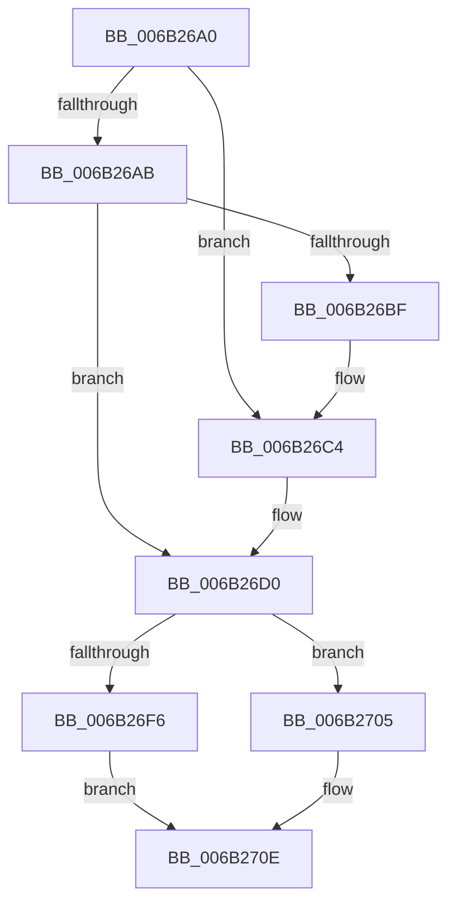

# KxSwitchKernelStackCallout

- RVA: `0x006B26A0`–`0x006B271F` (길이 `127` bytes)
- VA: `0x00000001406B26A0`
- 실행 섹션: `.text`
- PDB 이름 있음: `예`; PDB Function 태그: `아니요`
- unwind 정보 RVA: `0x000C17D8`
- 디코드: `31`개 명령, `127/127` bytes 표시
- 미해석 바이트: `0` (있으면 어셈블리에 `.byte`로 보존)

> 이 문서는 커널 이미지의 기계어와 PDB 기호를 분석해 생성했습니다. 4번과 5번은 함수 원형과 자료형을 바이너리 사용 방식에서 추정한 C 해석이며 원본 소스 복구 결과는 아닙니다.

## 1. Dependencies

- 직접 호출 지점: **2**; 고유 호출 대상: **2**
- 직접 호출자로 확인된 함수: **0**
- RIP 상대 이미지 참조: **1**

### Outgoing calls
- `0x006B26B6` → [MmGrowKernelStackEx](../2A/MmGrowKernelStackEx_function_002A04E0.md) (function, `0x002A04E0`)
- `0x006B26C9` → [guard_dispatch_icall](guard_dispatch_icall_function_006BAAD0.md) (function, `0x006BAAD0`)

### Direct callers
- 이 함수 시작 RVA로 연결되는 직접 call은 확인되지 않았습니다. 간접 호출은 완전히 역산할 수 없습니다.

### Static image references
- `0x006B26ED` → RVA `0x01201840` (`CFGRO`; read)

## 2. Other-region calls and transfers

- 다른 실행 섹션으로 향하는 call: **0**
- call이 아닌 외부 분기/꼬리 이동: **1**
  - `0x006B271A` → [KiSwitchKernelStackAndCallout + 0x7B](KiSwitchKernelStackAndCallout_function_006B2610.md) (`tail-transfer`)

## 3. Assembly (complete function range)

```asm
006B26A0  FB                              sti
006B26A1  48 89 54 24 38                  mov qword ptr [rsp + 0x38], rdx
006B26A6  4D 85 C9                        test r9, r9
006B26A9  74 19                           je 0x1406b26c4
006B26AB  48 89 4C 24 20                  mov qword ptr [rsp + 0x20], rcx
006B26B0  48 8B CC                        mov rcx, rsp
006B26B3  49 8B D1                        mov rdx, r9
006B26B6  E8 25 DE BE FF                  call 0x1402a04e0
006B26BB  85 C0                           test eax, eax
006B26BD  75 11                           jne 0x1406b26d0
006B26BF  48 8B 4C 24 20                  mov rcx, qword ptr [rsp + 0x20]
006B26C4  48 8B 44 24 38                  mov rax, qword ptr [rsp + 0x38]
006B26C9  E8 02 84 00 00                  call 0x1406baad0
006B26CE  33 C0                           xor eax, eax
006B26D0  48 8B 4E 28                     mov rcx, qword ptr [rsi + 0x28]
006B26D4  FA                              cli
006B26D5  4C 8B 51 10                     mov r10, qword ptr [rcx + 0x10]
006B26D9  4C 89 56 38                     mov qword ptr [rsi + 0x38], r10
006B26DD  4C 8B 51 18                     mov r10, qword ptr [rcx + 0x18]
006B26E1  4C 89 56 30                     mov qword ptr [rsi + 0x30], r10
006B26E5  4C 8B 51 28                     mov r10, qword ptr [rcx + 0x28]
006B26E9  4C 89 56 28                     mov qword ptr [rsi + 0x28], r10
006B26ED  F6 05 4C F1 B4 00 01            test byte ptr [rip + 0xb4f14c], 1
006B26F4  75 0F                           jne 0x1406b2705
006B26F6  65 48 8B 14 25 08 00 00 00      mov rdx, qword ptr gs:[8]
006B26FF  4C 89 52 04                     mov qword ptr [rdx + 4], r10
006B2703  EB 09                           jmp 0x1406b270e
006B2705  65 4C 89 14 25 08 B0 00 00      mov qword ptr gs:[0xb008], r10
006B270E  65 4C 89 14 25 A8 01 00 00      mov qword ptr gs:[0x1a8], r10
006B2717  48 8B E7                        mov rsp, rdi
006B271A  E9 6C FF FF FF                  jmp 0x1406b268b
```

## 4. C-style interpretation (structured pseudocode)

```c
__int64 __fastcall KxSwitchKernelStackCallout(__int64 a1, __int64 a2, __int64 a3, __int64 a4, __int64 a5, __int64 a6, __int64 a7)
{
    __int64 result;
    unsigned __int64 v_stack_p20;
    unsigned __int64 v_stack_p38;

    v_stack_p38 = a2;
    if (a4 == 0) goto loc_006B26C4;
    v_stack_p20 = a1;
    result = MmGrowKernelStackEx(v_rsp, a4, a3, a4);
    if ((unsigned int)(result) != 0) goto loc_006B26D0;
loc_006B26C4:
    result = guard_dispatch_icall(v_stack_p20, a4, a3, a4);
    result = 0;
loc_006B26D0:
    *(unsigned __int64 *)(v_rsi + 56) = *(unsigned __int64 *)(*(unsigned __int64 *)(v_rsi + 40) + 16);
    *(unsigned __int64 *)(v_rsi + 48) = *(unsigned __int64 *)(*(unsigned __int64 *)(v_rsi + 40) + 24);
    *(unsigned __int64 *)(v_rsi + 40) = *(unsigned __int64 *)(*(unsigned __int64 *)(v_rsi + 40) + 40);
    if (((*(unsigned __int8 *)(v_rip + 11858252)) & (1)) != 0) goto loc_006B2705;
    *(unsigned __int64 *)(*(unsigned __int64 *)(gs_base + (0 + 8)) + 4) = *(unsigned __int64 *)(*(unsigned __int64 *)(v_rsi + 40) + 40);
    goto loc_006B270E;
loc_006B2705:
    *(unsigned __int64 *)(gs_base + (0 + 45064)) = *(unsigned __int64 *)(*(unsigned __int64 *)(v_rsi + 40) + 40);
loc_006B270E:
    *(unsigned __int64 *)(gs_base + (0 + 424)) = *(unsigned __int64 *)(*(unsigned __int64 *)(v_rsi + 40) + 40);
}
```

## 5. (Beta) C Style

```c
int64_t KxSwitchKernelStackCallout(int64_t Arg1, int64_t Arg2, int64_t Arg3, int64_t Arg4, uint64_t Arg5, uint64_t Arg6, int64_t Arg7)
{
    int64_t result;
    uint64_t v_stack_p20;
    uint64_t v_stack_p38;

    v_stack_p38 = Arg2;
    if (Arg4 == 0) goto loc_006B26C4;
    v_stack_p20 = Arg1;
    result = MmGrowKernelStackEx(local_rsp, Arg4, Arg3, Arg4);
    if ((uint32_t)(result) != 0) goto loc_006B26D0;
loc_006B26C4:
    result = guard_dispatch_icall(v_stack_p20, Arg4, Arg3, Arg4);
    result = 0;
loc_006B26D0:
    *(uint64_t *)(local_rsi + 0x38) = *(uint64_t *)(*(uint64_t *)(local_rsi + 0x28) + 0x10);
    *(uint64_t *)(local_rsi + 0x30) = *(uint64_t *)(*(uint64_t *)(local_rsi + 0x28) + 0x18);
    *(uint64_t *)(local_rsi + 0x28) = *(uint64_t *)(*(uint64_t *)(local_rsi + 0x28) + 0x28);
    if (((*(uint8_t *)(v_rip + 0xB4F14C)) & (1)) != 0) goto loc_006B2705;
    *(uint64_t *)(*(uint64_t *)(gs_base + (0 + 0x8)) + 0x4) = *(uint64_t *)(*(uint64_t *)(local_rsi + 0x28) + 0x28);
    goto loc_006B270E;
loc_006B2705:
    *(uint64_t *)(gs_base + (0 + 0xB008)) = *(uint64_t *)(*(uint64_t *)(local_rsi + 0x28) + 0x28);
loc_006B270E:
    *(uint64_t *)(gs_base + (0 + 0x1A8)) = *(uint64_t *)(*(uint64_t *)(local_rsi + 0x28) + 0x28);
}
```

## 6. Execution-region graph

[열기: 2D/3D 그래프와 함수 탐색 컨트롤 패널](../../../control-panel.html?section=text&rva=0x006B26A0&view=graph)

- 2D 그래프는 위에서 아래로 흐르고, 3D 그래프는 빈 공간을 드래그해 회전합니다. Shift+드래그는 이동, 휠은 확대·축소, 함수 노드 선택은 대상 보고서 이동입니다.

### Static fallback


