# KyStartUserThread

- RVA: `0x006B2AF0`–`0x006B2E42` (길이 `850` bytes)
- VA: `0x00000001406B2AF0`
- 실행 섹션: `.text`
- PDB 이름 있음: `예`; PDB Function 태그: `아니요`
- unwind 정보 RVA: `0x000C1A5C`
- 디코드: `182`개 명령, `850/850` bytes 표시
- 미해석 바이트: `0` (있으면 어셈블리에 `.byte`로 보존)

> 이 문서는 커널 이미지의 기계어와 PDB 기호를 분석해 생성했습니다. 4번과 5번은 함수 원형과 자료형을 바이너리 사용 방식에서 추정한 C 해석이며 원본 소스 복구 결과는 아닙니다.

## 1. Dependencies

- 직접 호출 지점: **36**; 고유 호출 대상: **36**
- 직접 호출자로 확인된 함수: **1**
- RIP 상대 이미지 참조: **3**

### Outgoing calls
- `0x006B2C46` → [KyStartUserThread + 0x269](KyStartUserThread_function_006B2AF0.md) (inside-function, `0x006B2D59`)
- `0x006B2C4F` → [KyStartUserThread + 0x272](KyStartUserThread_function_006B2AF0.md) (inside-function, `0x006B2D62`)
- `0x006B2C58` → [KyStartUserThread + 0x15B](KyStartUserThread_function_006B2AF0.md) (inside-function, `0x006B2C4B`)
- `0x006B2C61` → [KyStartUserThread + 0x164](KyStartUserThread_function_006B2AF0.md) (inside-function, `0x006B2C54`)
- `0x006B2C6A` → [KyStartUserThread + 0x16D](KyStartUserThread_function_006B2AF0.md) (inside-function, `0x006B2C5D`)
- `0x006B2C73` → [KyStartUserThread + 0x176](KyStartUserThread_function_006B2AF0.md) (inside-function, `0x006B2C66`)
- `0x006B2C7C` → [KyStartUserThread + 0x17F](KyStartUserThread_function_006B2AF0.md) (inside-function, `0x006B2C6F`)
- `0x006B2C85` → [KyStartUserThread + 0x188](KyStartUserThread_function_006B2AF0.md) (inside-function, `0x006B2C78`)
- `0x006B2C8E` → [KyStartUserThread + 0x191](KyStartUserThread_function_006B2AF0.md) (inside-function, `0x006B2C81`)
- `0x006B2C97` → [KyStartUserThread + 0x19A](KyStartUserThread_function_006B2AF0.md) (inside-function, `0x006B2C8A`)
- `0x006B2CA0` → [KyStartUserThread + 0x1A3](KyStartUserThread_function_006B2AF0.md) (inside-function, `0x006B2C93`)
- `0x006B2CA9` → [KyStartUserThread + 0x1AC](KyStartUserThread_function_006B2AF0.md) (inside-function, `0x006B2C9C`)
- `0x006B2CB2` → [KyStartUserThread + 0x1B5](KyStartUserThread_function_006B2AF0.md) (inside-function, `0x006B2CA5`)
- `0x006B2CBB` → [KyStartUserThread + 0x1BE](KyStartUserThread_function_006B2AF0.md) (inside-function, `0x006B2CAE`)
- `0x006B2CC4` → [KyStartUserThread + 0x1C7](KyStartUserThread_function_006B2AF0.md) (inside-function, `0x006B2CB7`)
- `0x006B2CCD` → [KyStartUserThread + 0x1D0](KyStartUserThread_function_006B2AF0.md) (inside-function, `0x006B2CC0`)
- `0x006B2CD6` → [KyStartUserThread + 0x1D9](KyStartUserThread_function_006B2AF0.md) (inside-function, `0x006B2CC9`)
- `0x006B2CDF` → [KyStartUserThread + 0x1E2](KyStartUserThread_function_006B2AF0.md) (inside-function, `0x006B2CD2`)
- `0x006B2CE8` → [KyStartUserThread + 0x1EB](KyStartUserThread_function_006B2AF0.md) (inside-function, `0x006B2CDB`)
- `0x006B2CF1` → [KyStartUserThread + 0x1F4](KyStartUserThread_function_006B2AF0.md) (inside-function, `0x006B2CE4`)
- `0x006B2CFA` → [KyStartUserThread + 0x1FD](KyStartUserThread_function_006B2AF0.md) (inside-function, `0x006B2CED`)
- `0x006B2D03` → [KyStartUserThread + 0x206](KyStartUserThread_function_006B2AF0.md) (inside-function, `0x006B2CF6`)
- `0x006B2D0C` → [KyStartUserThread + 0x20F](KyStartUserThread_function_006B2AF0.md) (inside-function, `0x006B2CFF`)
- `0x006B2D15` → [KyStartUserThread + 0x218](KyStartUserThread_function_006B2AF0.md) (inside-function, `0x006B2D08`)
- `0x006B2D1E` → [KyStartUserThread + 0x221](KyStartUserThread_function_006B2AF0.md) (inside-function, `0x006B2D11`)
- `0x006B2D27` → [KyStartUserThread + 0x22A](KyStartUserThread_function_006B2AF0.md) (inside-function, `0x006B2D1A`)
- `0x006B2D30` → [KyStartUserThread + 0x233](KyStartUserThread_function_006B2AF0.md) (inside-function, `0x006B2D23`)
- `0x006B2D39` → [KyStartUserThread + 0x23C](KyStartUserThread_function_006B2AF0.md) (inside-function, `0x006B2D2C`)
- `0x006B2D42` → [KyStartUserThread + 0x245](KyStartUserThread_function_006B2AF0.md) (inside-function, `0x006B2D35`)
- `0x006B2D4B` → [KyStartUserThread + 0x24E](KyStartUserThread_function_006B2AF0.md) (inside-function, `0x006B2D3E`)
- `0x006B2D54` → [KyStartUserThread + 0x257](KyStartUserThread_function_006B2AF0.md) (inside-function, `0x006B2D47`)
- `0x006B2D5D` → [KyStartUserThread + 0x260](KyStartUserThread_function_006B2AF0.md) (inside-function, `0x006B2D50`)
- `0x006B2D88` → [KiFlushBhbDuringTrapEntryOrExit](../6C/KiFlushBhbDuringTrapEntryOrExit_function_006C6340.md) (function, `0x006C6340`)
- `0x006B2DD1` → [KiSaveDebugRegisterState](../4F/KiSaveDebugRegisterState_function_004FD960.md) (function, `0x004FD960`)
- `0x006B2E05` → [KiSynchronizeUserIsolationDomainExit](../41/KiSynchronizeUserIsolationDomainExit_function_0041BFA0.md) (function, `0x0041BFA0`)
- `0x006B2E2C` → [KxStartUserThread](KxStartUserThread_function_006B2E50.md) (function, `0x006B2E50`)

### Direct callers
- [KyStartUserThread](KyStartUserThread_function_006B2AF0.md) at `0x006B2C46`
- [KyStartUserThread](KyStartUserThread_function_006B2AF0.md) at `0x006B2C4F`
- [KyStartUserThread](KyStartUserThread_function_006B2AF0.md) at `0x006B2C58`
- [KyStartUserThread](KyStartUserThread_function_006B2AF0.md) at `0x006B2C61`
- [KyStartUserThread](KyStartUserThread_function_006B2AF0.md) at `0x006B2C6A`
- [KyStartUserThread](KyStartUserThread_function_006B2AF0.md) at `0x006B2C73`
- [KyStartUserThread](KyStartUserThread_function_006B2AF0.md) at `0x006B2C7C`
- [KyStartUserThread](KyStartUserThread_function_006B2AF0.md) at `0x006B2C85`
- [KyStartUserThread](KyStartUserThread_function_006B2AF0.md) at `0x006B2C8E`
- [KyStartUserThread](KyStartUserThread_function_006B2AF0.md) at `0x006B2C97`
- [KyStartUserThread](KyStartUserThread_function_006B2AF0.md) at `0x006B2CA0`
- [KyStartUserThread](KyStartUserThread_function_006B2AF0.md) at `0x006B2CA9`
- [KyStartUserThread](KyStartUserThread_function_006B2AF0.md) at `0x006B2CB2`
- [KyStartUserThread](KyStartUserThread_function_006B2AF0.md) at `0x006B2CBB`
- [KyStartUserThread](KyStartUserThread_function_006B2AF0.md) at `0x006B2CC4`
- [KyStartUserThread](KyStartUserThread_function_006B2AF0.md) at `0x006B2CCD`
- [KyStartUserThread](KyStartUserThread_function_006B2AF0.md) at `0x006B2CD6`
- [KyStartUserThread](KyStartUserThread_function_006B2AF0.md) at `0x006B2CDF`
- [KyStartUserThread](KyStartUserThread_function_006B2AF0.md) at `0x006B2CE8`
- [KyStartUserThread](KyStartUserThread_function_006B2AF0.md) at `0x006B2CF1`
- [KyStartUserThread](KyStartUserThread_function_006B2AF0.md) at `0x006B2CFA`
- [KyStartUserThread](KyStartUserThread_function_006B2AF0.md) at `0x006B2D03`
- [KyStartUserThread](KyStartUserThread_function_006B2AF0.md) at `0x006B2D0C`
- [KyStartUserThread](KyStartUserThread_function_006B2AF0.md) at `0x006B2D15`
- [KyStartUserThread](KyStartUserThread_function_006B2AF0.md) at `0x006B2D1E`
- [KyStartUserThread](KyStartUserThread_function_006B2AF0.md) at `0x006B2D27`
- [KyStartUserThread](KyStartUserThread_function_006B2AF0.md) at `0x006B2D30`
- [KyStartUserThread](KyStartUserThread_function_006B2AF0.md) at `0x006B2D39`
- [KyStartUserThread](KyStartUserThread_function_006B2AF0.md) at `0x006B2D42`
- [KyStartUserThread](KyStartUserThread_function_006B2AF0.md) at `0x006B2D4B`
- [KyStartUserThread](KyStartUserThread_function_006B2AF0.md) at `0x006B2D54`
- [KyStartUserThread](KyStartUserThread_function_006B2AF0.md) at `0x006B2D5D`

### Static image references
- `0x006B2B65` → RVA `0x01201840` (`CFGRO`; read)
- `0x006B2D99` → RVA `0x00FC7264` (`ALMOSTRO`; read)
- `0x006B2E0A` → RVA `0x00FC6BF0` (`ALMOSTRO`; read)

## 2. Other-region calls and transfers

- 다른 실행 섹션으로 향하는 call: **0**
- 별도 외부 분기/꼬리 이동을 확인하지 못했습니다.

## 3. Assembly (complete function range)

```asm
006B2AF0  48 83 EC 08                     sub rsp, 8
006B2AF4  55                              push rbp
006B2AF5  48 81 EC 58 01 00 00            sub rsp, 0x158
006B2AFC  48 8D AC 24 80 00 00 00         lea rbp, [rsp + 0x80]
006B2B04  C6 45 AB 01                     mov byte ptr [rbp - 0x55], 1
006B2B08  48 89 45 B0                     mov qword ptr [rbp - 0x50], rax
006B2B0C  48 89 4D B8                     mov qword ptr [rbp - 0x48], rcx
006B2B10  48 89 55 C0                     mov qword ptr [rbp - 0x40], rdx
006B2B14  4C 89 45 C8                     mov qword ptr [rbp - 0x38], r8
006B2B18  4C 89 4D D0                     mov qword ptr [rbp - 0x30], r9
006B2B1C  4C 89 55 D8                     mov qword ptr [rbp - 0x28], r10
006B2B20  4C 89 5D E0                     mov qword ptr [rbp - 0x20], r11
006B2B24  F6 85 F0 00 00 00 01            test byte ptr [rbp + 0xf0], 1
006B2B2B  75 38                           jne 0x1406b2b65
006B2B2D  33 D2                           xor edx, edx
006B2B2F  F3 48 0F 1E CA                  rdsspq rdx
006B2B34  48 89 55 58                     mov qword ptr [rbp + 0x58], rdx
006B2B38  0F AE E8                        lfence
006B2B3B  65 F6 04 25 58 08 00 00 01      test byte ptr gs:[0x858], 1
006B2B44  75 08                           jne 0x1406b2b4e
006B2B46  0F AE E8                        lfence
006B2B49  E9 88 02 00 00                  jmp 0x1406b2dd6
006B2B4E  65 0F B7 04 25 66 08 00 00      movzx eax, word ptr gs:[0x866]
006B2B57  B9 48 00 00 00                  mov ecx, 0x48
006B2B5C  33 D2                           xor edx, edx
006B2B5E  0F 30                           wrmsr
006B2B60  E9 71 02 00 00                  jmp 0x1406b2dd6
006B2B65  F6 05 D4 EC B4 00 01            test byte ptr [rip + 0xb4ecd4], 1
006B2B6C  75 03                           jne 0x1406b2b71
006B2B6E  0F 01 F8                        swapgs
006B2B71  0F AE E8                        lfence
006B2B74  65 48 8B 0C 25 28 9D 00 00      mov rcx, qword ptr gs:[0x9d28]
006B2B7D  48 85 C9                        test rcx, rcx
006B2B80  74 1F                           je 0x1406b2ba1
006B2B82  F3 48 0F 1E CA                  rdsspq rdx
006B2B87  65 4C 8B 14 25 20 9D 00 00      mov r10, qword ptr gs:[0x9d20]
006B2B90  49 83 C2 08                     add r10, 8
006B2B94  49 3B D2                        cmp rdx, r10
006B2B97  75 08                           jne 0x1406b2ba1
006B2B99  F3 0F 01 29                     rstorssp dword ptr [rcx]
006B2B9D  F3 0F 01 EA                     saveprevssp
006B2BA1  65 4C 8B 14 25 88 01 00 00      mov r10, qword ptr gs:[0x188]
006B2BAA  65 48 8B 0C 25 88 01 00 00      mov rcx, qword ptr gs:[0x188]
006B2BB3  48 8B 89 20 02 00 00            mov rcx, qword ptr [rcx + 0x220]
006B2BBA  48 8B 89 60 07 00 00            mov rcx, qword ptr [rcx + 0x760]
006B2BC1  65 48 89 0C 25 50 08 00 00      mov qword ptr gs:[0x850], rcx
006B2BCA  66 65 8B 0C 25 62 08 00 00      mov cx, word ptr gs:[0x862]
006B2BD3  66 65 89 0C 25 64 08 00 00      mov word ptr gs:[0x864], cx
006B2BDC  65 8A 0C 25 58 08 00 00         mov cl, byte ptr gs:[0x858]
006B2BE4  65 88 0C 25 5A 08 00 00         mov byte ptr gs:[0x85a], cl
006B2BEC  65 0F B7 04 25 68 08 00 00      movzx eax, word ptr gs:[0x868]
006B2BF5  66 65 39 04 25 66 08 00 00      cmp word ptr gs:[0x866], ax
006B2BFE  74 12                           je 0x1406b2c12
006B2C00  66 65 89 04 25 66 08 00 00      mov word ptr gs:[0x866], ax
006B2C09  B9 48 00 00 00                  mov ecx, 0x48
006B2C0E  33 D2                           xor edx, edx
006B2C10  0F 30                           wrmsr
006B2C12  65 0F B6 14 25 58 08 00 00      movzx edx, byte ptr gs:[0x858]
006B2C1B  F7 C2 08 00 00 00               test edx, 8
006B2C21  74 17                           je 0x1406b2c3a
006B2C23  B8 01 00 00 00                  mov eax, 1
006B2C28  33 D2                           xor edx, edx
006B2C2A  B9 49 00 00 00                  mov ecx, 0x49
006B2C2F  0F 30                           wrmsr
006B2C31  65 0F B6 14 25 58 08 00 00      movzx edx, byte ptr gs:[0x858]
006B2C3A  F7 C2 02 00 00 00               test edx, 2
006B2C40  0F 84 37 01 00 00               je 0x1406b2d7d
006B2C46  E8 0E 01 00 00                  call 0x1406b2d59
006B2C4B  48 83 C4 08                     add rsp, 8
006B2C4F  E8 0E 01 00 00                  call 0x1406b2d62
006B2C54  48 83 C4 08                     add rsp, 8
006B2C58  E8 EE FF FF FF                  call 0x1406b2c4b
006B2C5D  48 83 C4 08                     add rsp, 8
006B2C61  E8 EE FF FF FF                  call 0x1406b2c54
006B2C66  48 83 C4 08                     add rsp, 8
006B2C6A  E8 EE FF FF FF                  call 0x1406b2c5d
006B2C6F  48 83 C4 08                     add rsp, 8
006B2C73  E8 EE FF FF FF                  call 0x1406b2c66
006B2C78  48 83 C4 08                     add rsp, 8
006B2C7C  E8 EE FF FF FF                  call 0x1406b2c6f
006B2C81  48 83 C4 08                     add rsp, 8
006B2C85  E8 EE FF FF FF                  call 0x1406b2c78
006B2C8A  48 83 C4 08                     add rsp, 8
006B2C8E  E8 EE FF FF FF                  call 0x1406b2c81
006B2C93  48 83 C4 08                     add rsp, 8
006B2C97  E8 EE FF FF FF                  call 0x1406b2c8a
006B2C9C  48 83 C4 08                     add rsp, 8
006B2CA0  E8 EE FF FF FF                  call 0x1406b2c93
006B2CA5  48 83 C4 08                     add rsp, 8
006B2CA9  E8 EE FF FF FF                  call 0x1406b2c9c
006B2CAE  48 83 C4 08                     add rsp, 8
006B2CB2  E8 EE FF FF FF                  call 0x1406b2ca5
006B2CB7  48 83 C4 08                     add rsp, 8
006B2CBB  E8 EE FF FF FF                  call 0x1406b2cae
006B2CC0  48 83 C4 08                     add rsp, 8
006B2CC4  E8 EE FF FF FF                  call 0x1406b2cb7
006B2CC9  48 83 C4 08                     add rsp, 8
006B2CCD  E8 EE FF FF FF                  call 0x1406b2cc0
006B2CD2  48 83 C4 08                     add rsp, 8
006B2CD6  E8 EE FF FF FF                  call 0x1406b2cc9
006B2CDB  48 83 C4 08                     add rsp, 8
006B2CDF  E8 EE FF FF FF                  call 0x1406b2cd2
006B2CE4  48 83 C4 08                     add rsp, 8
006B2CE8  E8 EE FF FF FF                  call 0x1406b2cdb
006B2CED  48 83 C4 08                     add rsp, 8
006B2CF1  E8 EE FF FF FF                  call 0x1406b2ce4
006B2CF6  48 83 C4 08                     add rsp, 8
006B2CFA  E8 EE FF FF FF                  call 0x1406b2ced
006B2CFF  48 83 C4 08                     add rsp, 8
006B2D03  E8 EE FF FF FF                  call 0x1406b2cf6
006B2D08  48 83 C4 08                     add rsp, 8
006B2D0C  E8 EE FF FF FF                  call 0x1406b2cff
006B2D11  48 83 C4 08                     add rsp, 8
006B2D15  E8 EE FF FF FF                  call 0x1406b2d08
006B2D1A  48 83 C4 08                     add rsp, 8
006B2D1E  E8 EE FF FF FF                  call 0x1406b2d11
006B2D23  48 83 C4 08                     add rsp, 8
006B2D27  E8 EE FF FF FF                  call 0x1406b2d1a
006B2D2C  48 83 C4 08                     add rsp, 8
006B2D30  E8 EE FF FF FF                  call 0x1406b2d23
006B2D35  48 83 C4 08                     add rsp, 8
006B2D39  E8 EE FF FF FF                  call 0x1406b2d2c
006B2D3E  48 83 C4 08                     add rsp, 8
006B2D42  E8 EE FF FF FF                  call 0x1406b2d35
006B2D47  48 83 C4 08                     add rsp, 8
006B2D4B  E8 EE FF FF FF                  call 0x1406b2d3e
006B2D50  48 83 C4 08                     add rsp, 8
006B2D54  E8 EE FF FF FF                  call 0x1406b2d47
006B2D59  48 83 C4 08                     add rsp, 8
006B2D5D  E8 EE FF FF FF                  call 0x1406b2d50
006B2D62  48 83 C4 08                     add rsp, 8
006B2D66  B8 DA DA 00 00                  mov eax, 0xdada
006B2D6B  65 F6 04 25 5C 08 00 00 08      test byte ptr gs:[0x85c], 8
006B2D74  74 07                           je 0x1406b2d7d
006B2D76  B0 20                           mov al, 0x20
006B2D78  F3 48 0F AE E8                  incsspq rax
006B2D7D  F7 C2 80 00 00 00               test edx, 0x80
006B2D83  74 08                           je 0x1406b2d8d
006B2D85  0F AE E8                        lfence
006B2D88  E8 B3 35 01 00                  call 0x1406c6340
006B2D8D  0F AE E8                        lfence
006B2D90  65 C6 04 25 5E 08 00 00 00      mov byte ptr gs:[0x85e], 0
006B2D99  83 3D C4 44 91 00 00            cmp dword ptr [rip + 0x9144c4], 0
006B2DA0  74 1F                           je 0x1406b2dc1
006B2DA2  B9 A7 06 00 00                  mov ecx, 0x6a7
006B2DA7  0F 32                           rdmsr
006B2DA9  83 FA 00                        cmp edx, 0
006B2DAC  74 13                           je 0x1406b2dc1
006B2DAE  8B CA                           mov ecx, edx
006B2DB0  23 15 AE 44 91 00               and edx, dword ptr [rip + 0x9144ae]
006B2DB6  3B D1                           cmp edx, ecx
006B2DB8  74 07                           je 0x1406b2dc1
006B2DBA  B9 A7 06 00 00                  mov ecx, 0x6a7
006B2DBF  0F 30                           wrmsr
006B2DC1  41 F6 42 03 03                  test byte ptr [r10 + 3], 3
006B2DC6  66 C7 85 80 00 00 00 00 00      mov word ptr [rbp + 0x80], 0
006B2DCF  74 05                           je 0x1406b2dd6
006B2DD1  E8 8A AB E4 FF                  call 0x1404fd960
006B2DD6  FC                              cld
006B2DD7  0F AE 5D AC                     stmxcsr dword ptr [rbp - 0x54]
006B2DDB  65 0F AE 14 25 80 01 00 00      ldmxcsr dword ptr gs:[0x180]
006B2DE4  0F 29 45 F0                     movaps xmmword ptr [rbp - 0x10], xmm0
006B2DE8  0F 29 4D 00                     movaps xmmword ptr [rbp], xmm1
006B2DEC  0F 29 55 10                     movaps xmmword ptr [rbp + 0x10], xmm2
006B2DF0  0F 29 5D 20                     movaps xmmword ptr [rbp + 0x20], xmm3
006B2DF4  0F 29 65 30                     movaps xmmword ptr [rbp + 0x30], xmm4
006B2DF8  0F 29 6D 40                     movaps xmmword ptr [rbp + 0x40], xmm5
006B2DFC  F6 85 F0 00 00 00 01            test byte ptr [rbp + 0xf0], 1
006B2E03  74 05                           je 0x1406b2e0a
006B2E05  E8 96 91 D6 FF                  call 0x14041bfa0
006B2E0A  F6 05 DF 3D 91 00 FF            test byte ptr [rip + 0x913ddf], 0xff
006B2E11  74 0C                           je 0x1406b2e1f
006B2E13  F6 85 F0 00 00 00 01            test byte ptr [rbp + 0xf0], 1
006B2E1A  74 03                           je 0x1406b2e1f
006B2E1C  0F 01 CB                        stac
006B2E1F  F7 85 F8 00 00 00 00 02 00 00   test dword ptr [rbp + 0xf8], 0x200
006B2E29  74 01                           je 0x1406b2e2c
006B2E2B  FB                              sti
006B2E2C  E8 1F 00 00 00                  call 0x1406b2e50
006B2E31  66 66 66 66 66 66 66 0F 1F 84 00 00 00 00 00  nop word ptr [rax + rax]
006B2E40  90                              nop
006B2E41  C3                              ret
```

## 4. C-style interpretation (structured pseudocode)

```c
__int64 __fastcall KyStartUserThread(__int64 a1, __int64 a2, __int64 a3, __int64 a4)
{
    __int64 result;
    __int64 v_r10;
    __int64 v_rsp;
    unsigned __int64 v_stack_m108;
    unsigned __int64 v_stack_m110;
    unsigned __int64 v_stack_m118;
    unsigned __int64 v_stack_m120;
    unsigned __int64 v_stack_m128;
    unsigned __int64 v_stack_m130;
    unsigned __int64 v_stack_m138;
    unsigned int v_stack_m13C;
    unsigned __int8 v_stack_m13D;
    unsigned __int16 v_stack_m68;
    unsigned __int64 v_stack_m90;
    unsigned __int64 v_stack_mA8;
    unsigned __int64 v_stack_mB8;
    unsigned __int64 v_stack_mC8;
    unsigned __int64 v_stack_mD8;
    unsigned __int64 v_stack_mE8;
    unsigned __int64 v_stack_mF8;
    unsigned int v_stack_p10;
    unsigned __int8 v_stack_p8;

    v_rsp = (v_rsp) - (8);
    v_rsp = (v_rsp) - (344);
    v_stack_m13D = 1;
    v_stack_m138 = result;
    v_stack_m130 = a1;
    v_stack_m128 = a2;
    v_stack_m120 = a3;
    v_stack_m118 = a4;
    v_stack_m110 = v_r10;
    v_stack_m108 = v_r11;
    if (((v_stack_p8) & (1)) != 0) goto loc_006B2B65;
    a2 = 0;
    v_stack_m90 = 0;
    if (((*(unsigned __int8 *)(gs_base + (0 + 2136))) & (1)) != 0) goto loc_006B2B4E;
    goto loc_006B2DD6;
loc_006B2B4E:
    a2 = 0;
    goto loc_006B2DD6;
loc_006B2B65:
    if (((*(unsigned __int8 *)(v_rip + 11857108)) & (1)) == 0) {
    }
    if (*(unsigned __int64 *)(gs_base + (0 + 40232)) == 0) goto loc_006B2BA1;
    v_r10 = (*(unsigned __int64 *)(gs_base + (0 + 40224))) + (8);
    if (0 == v_r10) {
    }
    *(unsigned __int64 *)(gs_base + (0 + 2128)) = *(unsigned __int64 *)(*(unsigned __int64 *)(*(unsigned __int64 *)(gs_base + (0 + 392)) + 544) + 1888);
    *(unsigned __int16 *)(gs_base + (0 + 2148)) = (unsigned __int16)(*(unsigned __int16 *)(gs_base + (0 + 2146)));
    *(unsigned __int8 *)(gs_base + (0 + 2138)) = (unsigned __int8)(*(unsigned __int8 *)(gs_base + (0 + 2136)));
    if ((*(unsigned __int16 *)(gs_base + (0 + 2150))) != ((unsigned __int16)(*(unsigned __int16 *)(gs_base + (0 + 2152))))) {
        *(unsigned __int16 *)(gs_base + (0 + 2150)) = (unsigned __int16)(*(unsigned __int16 *)(gs_base + (0 + 2152)));
        a1 = 72;
        a2 = 0;
    }
    result = *(unsigned __int16 *)(gs_base + (0 + 2152));
    if ((((unsigned int)(*(unsigned __int8 *)(gs_base + (0 + 2136)))) & (8)) != 0) {
        result = 1;
        a2 = 0;
        a1 = 73;
        a2 = *(unsigned __int8 *)(gs_base + (0 + 2136));
    }
    if ((((unsigned int)(a2)) & (2)) == 0) goto loc_006B2D7D;
    result = KyStartUserThread___0x269(a1, a2, a3, a4);
    v_rsp = (v_rsp) + (8);
    result = KyStartUserThread___0x272(a1, a2, a3, a4);
    v_rsp = (v_rsp) + (8);
    result = KyStartUserThread___0x15B(a1, a2, a3, a4);
    v_rsp = (v_rsp) + (8);
    result = KyStartUserThread___0x164(a1, a2, a3, a4);
    v_rsp = (v_rsp) + (8);
    result = KyStartUserThread___0x16D(a1, a2, a3, a4);
    v_rsp = (v_rsp) + (8);
    result = KyStartUserThread___0x176(a1, a2, a3, a4);
    v_rsp = (v_rsp) + (8);
    result = KyStartUserThread___0x17F(a1, a2, a3, a4);
    v_rsp = (v_rsp) + (8);
    result = KyStartUserThread___0x188(a1, a2, a3, a4);
    v_rsp = (v_rsp) + (8);
    result = KyStartUserThread___0x191(a1, a2, a3, a4);
    v_rsp = (v_rsp) + (8);
    result = KyStartUserThread___0x19A(a1, a2, a3, a4);
    v_rsp = (v_rsp) + (8);
    result = KyStartUserThread___0x1A3(a1, a2, a3, a4);
    v_rsp = (v_rsp) + (8);
    result = KyStartUserThread___0x1AC(a1, a2, a3, a4);
    v_rsp = (v_rsp) + (8);
    result = KyStartUserThread___0x1B5(a1, a2, a3, a4);
    v_rsp = (v_rsp) + (8);
    result = KyStartUserThread___0x1BE(a1, a2, a3, a4);
    v_rsp = (v_rsp) + (8);
    result = KyStartUserThread___0x1C7(a1, a2, a3, a4);
    v_rsp = (v_rsp) + (8);
    result = KyStartUserThread___0x1D0(a1, a2, a3, a4);
    v_rsp = (v_rsp) + (8);
    result = KyStartUserThread___0x1D9(a1, a2, a3, a4);
    v_rsp = (v_rsp) + (8);
    result = KyStartUserThread___0x1E2(a1, a2, a3, a4);
    v_rsp = (v_rsp) + (8);
    result = KyStartUserThread___0x1EB(a1, a2, a3, a4);
    v_rsp = (v_rsp) + (8);
    result = KyStartUserThread___0x1F4(a1, a2, a3, a4);
    v_rsp = (v_rsp) + (8);
    result = KyStartUserThread___0x1FD(a1, a2, a3, a4);
    v_rsp = (v_rsp) + (8);
    result = KyStartUserThread___0x206(a1, a2, a3, a4);
    v_rsp = (v_rsp) + (8);
    result = KyStartUserThread___0x20F(a1, a2, a3, a4);
    v_rsp = (v_rsp) + (8);
    result = KyStartUserThread___0x218(a1, a2, a3, a4);
    v_rsp = (v_rsp) + (8);
    result = KyStartUserThread___0x221(a1, a2, a3, a4);
    v_rsp = (v_rsp) + (8);
    result = KyStartUserThread___0x22A(a1, a2, a3, a4);
    v_rsp = (v_rsp) + (8);
    result = KyStartUserThread___0x233(a1, a2, a3, a4);
    v_rsp = (v_rsp) + (8);
    result = KyStartUserThread___0x23C(a1, a2, a3, a4);
    v_rsp = (v_rsp) + (8);
    result = KyStartUserThread___0x245(a1, a2, a3, a4);
    v_rsp = (v_rsp) + (8);
    result = KyStartUserThread___0x24E(a1, a2, a3, a4);
    v_rsp = (v_rsp) + (8);
    result = KyStartUserThread___0x257(a1, a2, a3, a4);
    v_rsp = (v_rsp) + (8);
    result = KyStartUserThread___0x260(a1, a2, a3, a4);
    v_rsp = (v_rsp) + (8);
    result = (unsigned int)(0xDADAULL);
    if (((*(unsigned __int8 *)(gs_base + (0 + 2140))) & (8)) != 0) {
        result = 32;
    }
    if ((((unsigned int)(a2)) & (128)) != 0) {
        result = KiFlushBhbDuringTrapEntryOrExit(a1, a2, a3, a4);
    }
    *(unsigned __int8 *)(gs_base + (0 + 2142)) = 0;
    if ((*(unsigned int *)(v_rip + 9520324)) == 0) goto loc_006B2DC1;
    if (((unsigned int)(a2)) == 0) goto loc_006B2DC1;
    a2 = (unsigned int)((a2) & (*(unsigned int *)(v_rip + 9520302)));
    if (((unsigned int)(a2)) != ((unsigned int)((unsigned int)((unsigned int)(a2))))) {
        a1 = 0x6A7ULL;
    }
    v_stack_m68 = 0;
    if (((*(unsigned __int8 *)(*(unsigned __int64 *)(gs_base + (0 + 392)) + 3)) & (3)) != 0) {
        result = KiSaveDebugRegisterState(a1, a2, a3, a4);
    }
    v_stack_mF8 = v_xmm0;
    v_stack_mE8 = v_xmm1;
    v_stack_mD8 = v_xmm2;
    v_stack_mC8 = v_xmm3;
    v_stack_mB8 = v_xmm4;
    v_stack_mA8 = v_xmm5;
    if (((v_stack_p8) & (1)) != 0) {
        result = KiSynchronizeUserIsolationDomainExit(a1, a2, a3, a4);
    }
    if (((*(unsigned __int8 *)(v_rip + 9518559)) & (255)) == 0) goto loc_006B2E1F;
    if (((v_stack_p8) & (1)) != 0) {
    }
    if (((v_stack_p10) & (512)) != 0) {
    }
    result = KxStartUserThread(a1, a2, a3, a4);
    return result;
}
```

## 5. (Beta) C Style

```c
int64_t KyStartUserThread(int64_t Arg1, int64_t Arg2, int64_t Arg3, int64_t Arg4)
{
    int64_t result;
    int64_t local_r10;
    int64_t local_rsp;
    uint64_t v_stack_m108;
    uint64_t v_stack_m110;
    uint64_t v_stack_m118;
    uint64_t v_stack_m120;
    uint64_t v_stack_m128;
    uint64_t v_stack_m130;
    uint64_t v_stack_m138;
    uint32_t v_stack_m13C;
    uint8_t v_stack_m13D;
    uint16_t v_stack_m68;
    uint64_t v_stack_m90;
    uint64_t v_stack_mA8;
    uint64_t v_stack_mB8;
    uint64_t v_stack_mC8;
    uint64_t v_stack_mD8;
    uint64_t v_stack_mE8;
    uint64_t v_stack_mF8;
    uint32_t v_stack_p10;
    uint8_t v_stack_p8;

    local_rsp = (local_rsp) - (8);
    local_rsp = (local_rsp) - (344);
    v_stack_m13D = 1;
    v_stack_m138 = result;
    v_stack_m130 = Arg1;
    v_stack_m128 = Arg2;
    v_stack_m120 = Arg3;
    v_stack_m118 = Arg4;
    v_stack_m110 = local_r10;
    v_stack_m108 = local_r11;
    if (((v_stack_p8) & (1)) != 0) goto loc_006B2B65;
    Arg2 = 0;
    v_stack_m90 = 0;
    if (((*(uint8_t *)(gs_base + (0 + 0x858))) & (1)) != 0) goto loc_006B2B4E;
    goto loc_006B2DD6;
loc_006B2B4E:
    Arg2 = 0;
    goto loc_006B2DD6;
loc_006B2B65:
    if (((*(uint8_t *)(v_rip + 0xB4ECD4)) & (1)) == 0) {
    }
    if (*(uint64_t *)(gs_base + (0 + 0x9D28)) == 0) goto loc_006B2BA1;
    local_r10 = (*(uint64_t *)(gs_base + (0 + 0x9D20))) + (8);
    if (0 == local_r10) {
    }
    *(uint64_t *)(gs_base + (0 + 0x850)) = *(uint64_t *)(*(uint64_t *)(*(uint64_t *)(gs_base + (0 + 0x188)) + 0x220) + 0x760);
    *(uint16_t *)(gs_base + (0 + 0x864)) = (uint16_t)(*(uint16_t *)(gs_base + (0 + 0x862)));
    *(uint8_t *)(gs_base + (0 + 0x85A)) = (uint8_t)(*(uint8_t *)(gs_base + (0 + 0x858)));
    if ((*(uint16_t *)(gs_base + (0 + 0x866))) != ((uint16_t)(*(uint16_t *)(gs_base + (0 + 0x868))))) {
        *(uint16_t *)(gs_base + (0 + 0x866)) = (uint16_t)(*(uint16_t *)(gs_base + (0 + 0x868)));
        Arg1 = 72;
        Arg2 = 0;
    }
    result = *(uint16_t *)(gs_base + (0 + 0x868));
    if ((((uint32_t)(*(uint8_t *)(gs_base + (0 + 0x858)))) & (8)) != 0) {
        result = 1;
        Arg2 = 0;
        Arg1 = 73;
        Arg2 = *(uint8_t *)(gs_base + (0 + 0x858));
    }
    if ((((uint32_t)(Arg2)) & (2)) == 0) goto loc_006B2D7D;
    result = KyStartUserThread___0x269(Arg1, Arg2, Arg3, Arg4);
    local_rsp = (local_rsp) + (8);
    result = KyStartUserThread___0x272(Arg1, Arg2, Arg3, Arg4);
    local_rsp = (local_rsp) + (8);
    result = KyStartUserThread___0x15B(Arg1, Arg2, Arg3, Arg4);
    local_rsp = (local_rsp) + (8);
    result = KyStartUserThread___0x164(Arg1, Arg2, Arg3, Arg4);
    local_rsp = (local_rsp) + (8);
    result = KyStartUserThread___0x16D(Arg1, Arg2, Arg3, Arg4);
    local_rsp = (local_rsp) + (8);
    result = KyStartUserThread___0x176(Arg1, Arg2, Arg3, Arg4);
    local_rsp = (local_rsp) + (8);
    result = KyStartUserThread___0x17F(Arg1, Arg2, Arg3, Arg4);
    local_rsp = (local_rsp) + (8);
    result = KyStartUserThread___0x188(Arg1, Arg2, Arg3, Arg4);
    local_rsp = (local_rsp) + (8);
    result = KyStartUserThread___0x191(Arg1, Arg2, Arg3, Arg4);
    local_rsp = (local_rsp) + (8);
    result = KyStartUserThread___0x19A(Arg1, Arg2, Arg3, Arg4);
    local_rsp = (local_rsp) + (8);
    result = KyStartUserThread___0x1A3(Arg1, Arg2, Arg3, Arg4);
    local_rsp = (local_rsp) + (8);
    result = KyStartUserThread___0x1AC(Arg1, Arg2, Arg3, Arg4);
    local_rsp = (local_rsp) + (8);
    result = KyStartUserThread___0x1B5(Arg1, Arg2, Arg3, Arg4);
    local_rsp = (local_rsp) + (8);
    result = KyStartUserThread___0x1BE(Arg1, Arg2, Arg3, Arg4);
    local_rsp = (local_rsp) + (8);
    result = KyStartUserThread___0x1C7(Arg1, Arg2, Arg3, Arg4);
    local_rsp = (local_rsp) + (8);
    result = KyStartUserThread___0x1D0(Arg1, Arg2, Arg3, Arg4);
    local_rsp = (local_rsp) + (8);
    result = KyStartUserThread___0x1D9(Arg1, Arg2, Arg3, Arg4);
    local_rsp = (local_rsp) + (8);
    result = KyStartUserThread___0x1E2(Arg1, Arg2, Arg3, Arg4);
    local_rsp = (local_rsp) + (8);
    result = KyStartUserThread___0x1EB(Arg1, Arg2, Arg3, Arg4);
    local_rsp = (local_rsp) + (8);
    result = KyStartUserThread___0x1F4(Arg1, Arg2, Arg3, Arg4);
    local_rsp = (local_rsp) + (8);
    result = KyStartUserThread___0x1FD(Arg1, Arg2, Arg3, Arg4);
    local_rsp = (local_rsp) + (8);
    result = KyStartUserThread___0x206(Arg1, Arg2, Arg3, Arg4);
    local_rsp = (local_rsp) + (8);
    result = KyStartUserThread___0x20F(Arg1, Arg2, Arg3, Arg4);
    local_rsp = (local_rsp) + (8);
    result = KyStartUserThread___0x218(Arg1, Arg2, Arg3, Arg4);
    local_rsp = (local_rsp) + (8);
    result = KyStartUserThread___0x221(Arg1, Arg2, Arg3, Arg4);
    local_rsp = (local_rsp) + (8);
    result = KyStartUserThread___0x22A(Arg1, Arg2, Arg3, Arg4);
    local_rsp = (local_rsp) + (8);
    result = KyStartUserThread___0x233(Arg1, Arg2, Arg3, Arg4);
    local_rsp = (local_rsp) + (8);
    result = KyStartUserThread___0x23C(Arg1, Arg2, Arg3, Arg4);
    local_rsp = (local_rsp) + (8);
    result = KyStartUserThread___0x245(Arg1, Arg2, Arg3, Arg4);
    local_rsp = (local_rsp) + (8);
    result = KyStartUserThread___0x24E(Arg1, Arg2, Arg3, Arg4);
    local_rsp = (local_rsp) + (8);
    result = KyStartUserThread___0x257(Arg1, Arg2, Arg3, Arg4);
    local_rsp = (local_rsp) + (8);
    result = KyStartUserThread___0x260(Arg1, Arg2, Arg3, Arg4);
    local_rsp = (local_rsp) + (8);
    result = (uint32_t)(0xDADAULL);
    if (((*(uint8_t *)(gs_base + (0 + 0x85C))) & (8)) != 0) {
        result = 32;
    }
    if ((((uint32_t)(Arg2)) & (128)) != 0) {
        result = KiFlushBhbDuringTrapEntryOrExit(Arg1, Arg2, Arg3, Arg4);
    }
    *(uint8_t *)(gs_base + (0 + 0x85E)) = 0;
    if ((*(uint32_t *)(v_rip + 0x9144C4)) == 0) goto loc_006B2DC1;
    if (((uint32_t)(Arg2)) == 0) goto loc_006B2DC1;
    Arg2 = (uint32_t)((Arg2) & (*(uint32_t *)(v_rip + 0x9144AE)));
    if (((uint32_t)(Arg2)) != ((uint32_t)((uint32_t)((uint32_t)(Arg2))))) {
        Arg1 = 0x6A7ULL;
    }
    v_stack_m68 = 0;
    if (((*(uint8_t *)(*(uint64_t *)(gs_base + (0 + 0x188)) + 0x3)) & (3)) != 0) {
        result = KiSaveDebugRegisterState(Arg1, Arg2, Arg3, Arg4);
    }
    v_stack_mF8 = v_xmm0;
    v_stack_mE8 = v_xmm1;
    v_stack_mD8 = v_xmm2;
    v_stack_mC8 = v_xmm3;
    v_stack_mB8 = v_xmm4;
    v_stack_mA8 = v_xmm5;
    if (((v_stack_p8) & (1)) != 0) {
        result = KiSynchronizeUserIsolationDomainExit(Arg1, Arg2, Arg3, Arg4);
    }
    if (((*(uint8_t *)(v_rip + 0x913DDF)) & (255)) == 0) goto loc_006B2E1F;
    if (((v_stack_p8) & (1)) != 0) {
    }
    if (((v_stack_p10) & (512)) != 0) {
    }
    result = KxStartUserThread(Arg1, Arg2, Arg3, Arg4);
    return result;
}
```

## 6. Execution-region graph

[열기: 2D/3D 그래프와 함수 탐색 컨트롤 패널](../../../control-panel.html?section=text&rva=0x006B2AF0&view=graph)

- 2D 그래프는 위에서 아래로 흐르고, 3D 그래프는 빈 공간을 드래그해 회전합니다. Shift+드래그는 이동, 휠은 확대·축소, 함수 노드 선택은 대상 보고서 이동입니다.

### Static fallback

```mermaid
flowchart TD
  bb_006B2AF0[BB_006B2AF0]
  bb_006B2B2D[BB_006B2B2D]
  bb_006B2B46[BB_006B2B46]
  bb_006B2B4E[BB_006B2B4E]
  bb_006B2B65[BB_006B2B65]
  bb_006B2B6E[BB_006B2B6E]
  bb_006B2B71[BB_006B2B71]
  bb_006B2B82[BB_006B2B82]
  bb_006B2B99[BB_006B2B99]
  bb_006B2BA1[BB_006B2BA1]
  bb_006B2C00[BB_006B2C00]
  bb_006B2C12[BB_006B2C12]
  bb_006B2C23[BB_006B2C23]
  bb_006B2C3A[BB_006B2C3A]
  bb_006B2C46[BB_006B2C46]
  bb_006B2D76[BB_006B2D76]
  bb_006B2D7D[BB_006B2D7D]
  bb_006B2D85[BB_006B2D85]
  bb_006B2D8D[BB_006B2D8D]
  bb_006B2DA2[BB_006B2DA2]
  bb_006B2DAE[BB_006B2DAE]
  bb_006B2DBA[BB_006B2DBA]
  bb_006B2DC1[BB_006B2DC1]
  bb_006B2DD1[BB_006B2DD1]
  bb_006B2DD6[BB_006B2DD6]
  bb_006B2E05[BB_006B2E05]
  bb_006B2E0A[BB_006B2E0A]
  bb_006B2E13[BB_006B2E13]
  bb_006B2E1C[BB_006B2E1C]
  bb_006B2E1F[BB_006B2E1F]
  bb_006B2E2B[BB_006B2E2B]
  bb_006B2E2C[BB_006B2E2C]
  bb_006B2AF0 -->|branch| bb_006B2B65
  bb_006B2AF0 -->|fallthrough| bb_006B2B2D
  bb_006B2B2D -->|branch| bb_006B2B4E
  bb_006B2B2D -->|fallthrough| bb_006B2B46
  bb_006B2B46 -->|branch| bb_006B2DD6
  bb_006B2B4E -->|branch| bb_006B2DD6
  bb_006B2B65 -->|branch| bb_006B2B71
  bb_006B2B65 -->|fallthrough| bb_006B2B6E
  bb_006B2B6E -->|flow| bb_006B2B71
  bb_006B2B71 -->|branch| bb_006B2BA1
  bb_006B2B71 -->|fallthrough| bb_006B2B82
  bb_006B2B82 -->|branch| bb_006B2BA1
  bb_006B2B82 -->|fallthrough| bb_006B2B99
  bb_006B2B99 -->|flow| bb_006B2BA1
  bb_006B2BA1 -->|branch| bb_006B2C12
  bb_006B2BA1 -->|fallthrough| bb_006B2C00
  bb_006B2C00 -->|flow| bb_006B2C12
  bb_006B2C12 -->|branch| bb_006B2C3A
  bb_006B2C12 -->|fallthrough| bb_006B2C23
  bb_006B2C23 -->|flow| bb_006B2C3A
  bb_006B2C3A -->|branch| bb_006B2D7D
  bb_006B2C3A -->|fallthrough| bb_006B2C46
  bb_006B2C46 -->|branch| bb_006B2D7D
  bb_006B2C46 -->|fallthrough| bb_006B2D76
  bb_006B2D76 -->|flow| bb_006B2D7D
  bb_006B2D7D -->|branch| bb_006B2D8D
  bb_006B2D7D -->|fallthrough| bb_006B2D85
  bb_006B2D85 -->|flow| bb_006B2D8D
  bb_006B2D8D -->|branch| bb_006B2DC1
  bb_006B2D8D -->|fallthrough| bb_006B2DA2
  bb_006B2DA2 -->|branch| bb_006B2DC1
  bb_006B2DA2 -->|fallthrough| bb_006B2DAE
  bb_006B2DAE -->|branch| bb_006B2DC1
  bb_006B2DAE -->|fallthrough| bb_006B2DBA
  bb_006B2DBA -->|flow| bb_006B2DC1
  bb_006B2DC1 -->|branch| bb_006B2DD6
  bb_006B2DC1 -->|fallthrough| bb_006B2DD1
  bb_006B2DD1 -->|flow| bb_006B2DD6
  bb_006B2DD6 -->|branch| bb_006B2E0A
  bb_006B2DD6 -->|fallthrough| bb_006B2E05
  bb_006B2E05 -->|flow| bb_006B2E0A
  bb_006B2E0A -->|branch| bb_006B2E1F
  bb_006B2E0A -->|fallthrough| bb_006B2E13
  bb_006B2E13 -->|branch| bb_006B2E1F
  bb_006B2E13 -->|fallthrough| bb_006B2E1C
  bb_006B2E1C -->|flow| bb_006B2E1F
  bb_006B2E1F -->|branch| bb_006B2E2C
  bb_006B2E1F -->|fallthrough| bb_006B2E2B
  bb_006B2E2B -->|flow| bb_006B2E2C
```


