# NtCallEnclave

- RVA: `0x006BABA0`–`0x006BAF55` (길이 `949` bytes)
- VA: `0x00000001406BABA0`
- 실행 섹션: `.text`
- PDB 이름 있음: `예`; PDB Function 태그: `아니요`
- unwind 정보 RVA: `0x000C2598`
- 디코드: `211`개 명령, `949/949` bytes 표시
- 미해석 바이트: `0` (있으면 어셈블리에 `.byte`로 보존)

> 이 문서는 커널 이미지의 기계어와 PDB 기호를 분석해 생성했습니다. 4번과 5번은 함수 원형과 자료형을 바이너리 사용 방식에서 추정한 C 해석이며 원본 소스 복구 결과는 아닙니다.

## 1. Dependencies

- 직접 호출 지점: **39**; 고유 호출 대상: **39**
- 직접 호출자로 확인된 함수: **1**
- RIP 상대 이미지 참조: **2**

### Outgoing calls
- `0x006BABD3` → [PsCallEnclave](../../page/A0/PsCallEnclave_function_00A0CF50.md) (function, `0x00A0CF50`)
- `0x006BAC3D` → [KiInitiateUserApc](KiInitiateUserApc_function_006B6540.md) (function, `0x006B6540`)
- `0x006BAC4E` → [KiSynchronizeUserIsolationDomainEntry](../26/KiSynchronizeUserIsolationDomainEntry_function_00263F60.md) (function, `0x00263F60`)
- `0x006BAC68` → [KiUpdateStibpPairing](../3E/KiUpdateStibpPairing_function_003E71C0.md) (function, `0x003E71C0`)
- `0x006BAC7E` → [KiRestoreSetContextState](KiRestoreSetContextState_function_006B1CA0.md) (function, `0x006B1CA0`)
- `0x006BAC9A` → [KiCopyCounters](../5C/KiCopyCounters_function_005C0710.md) (function, `0x005C0710`)
- `0x006BACB6` → [KiRestoreDebugRegisterState](../4F/KiRestoreDebugRegisterState_function_004FD8E0.md) (function, `0x004FD8E0`)
- `0x006BAD50` → [NtCallEnclave + 0x2C3](NtCallEnclave_function_006BABA0.md) (inside-function, `0x006BAE63`)
- `0x006BAD59` → [NtCallEnclave + 0x2CC](NtCallEnclave_function_006BABA0.md) (inside-function, `0x006BAE6C`)
- `0x006BAD62` → [NtCallEnclave + 0x1B5](NtCallEnclave_function_006BABA0.md) (inside-function, `0x006BAD55`)
- `0x006BAD6B` → [NtCallEnclave + 0x1BE](NtCallEnclave_function_006BABA0.md) (inside-function, `0x006BAD5E`)
- `0x006BAD74` → [NtCallEnclave + 0x1C7](NtCallEnclave_function_006BABA0.md) (inside-function, `0x006BAD67`)
- `0x006BAD7D` → [NtCallEnclave + 0x1D0](NtCallEnclave_function_006BABA0.md) (inside-function, `0x006BAD70`)
- `0x006BAD86` → [NtCallEnclave + 0x1D9](NtCallEnclave_function_006BABA0.md) (inside-function, `0x006BAD79`)
- `0x006BAD8F` → [NtCallEnclave + 0x1E2](NtCallEnclave_function_006BABA0.md) (inside-function, `0x006BAD82`)
- `0x006BAD98` → [NtCallEnclave + 0x1EB](NtCallEnclave_function_006BABA0.md) (inside-function, `0x006BAD8B`)
- `0x006BADA1` → [NtCallEnclave + 0x1F4](NtCallEnclave_function_006BABA0.md) (inside-function, `0x006BAD94`)
- `0x006BADAA` → [NtCallEnclave + 0x1FD](NtCallEnclave_function_006BABA0.md) (inside-function, `0x006BAD9D`)
- `0x006BADB3` → [NtCallEnclave + 0x206](NtCallEnclave_function_006BABA0.md) (inside-function, `0x006BADA6`)
- `0x006BADBC` → [NtCallEnclave + 0x20F](NtCallEnclave_function_006BABA0.md) (inside-function, `0x006BADAF`)
- `0x006BADC5` → [NtCallEnclave + 0x218](NtCallEnclave_function_006BABA0.md) (inside-function, `0x006BADB8`)
- `0x006BADCE` → [NtCallEnclave + 0x221](NtCallEnclave_function_006BABA0.md) (inside-function, `0x006BADC1`)
- `0x006BADD7` → [NtCallEnclave + 0x22A](NtCallEnclave_function_006BABA0.md) (inside-function, `0x006BADCA`)
- `0x006BADE0` → [NtCallEnclave + 0x233](NtCallEnclave_function_006BABA0.md) (inside-function, `0x006BADD3`)
- `0x006BADE9` → [NtCallEnclave + 0x23C](NtCallEnclave_function_006BABA0.md) (inside-function, `0x006BADDC`)
- `0x006BADF2` → [NtCallEnclave + 0x245](NtCallEnclave_function_006BABA0.md) (inside-function, `0x006BADE5`)
- `0x006BADFB` → [NtCallEnclave + 0x24E](NtCallEnclave_function_006BABA0.md) (inside-function, `0x006BADEE`)
- `0x006BAE04` → [NtCallEnclave + 0x257](NtCallEnclave_function_006BABA0.md) (inside-function, `0x006BADF7`)
- `0x006BAE0D` → [NtCallEnclave + 0x260](NtCallEnclave_function_006BABA0.md) (inside-function, `0x006BAE00`)
- `0x006BAE16` → [NtCallEnclave + 0x269](NtCallEnclave_function_006BABA0.md) (inside-function, `0x006BAE09`)
- `0x006BAE1F` → [NtCallEnclave + 0x272](NtCallEnclave_function_006BABA0.md) (inside-function, `0x006BAE12`)
- `0x006BAE28` → [NtCallEnclave + 0x27B](NtCallEnclave_function_006BABA0.md) (inside-function, `0x006BAE1B`)
- `0x006BAE31` → [NtCallEnclave + 0x284](NtCallEnclave_function_006BABA0.md) (inside-function, `0x006BAE24`)
- `0x006BAE3A` → [NtCallEnclave + 0x28D](NtCallEnclave_function_006BABA0.md) (inside-function, `0x006BAE2D`)
- `0x006BAE43` → [NtCallEnclave + 0x296](NtCallEnclave_function_006BABA0.md) (inside-function, `0x006BAE36`)
- `0x006BAE4C` → [NtCallEnclave + 0x29F](NtCallEnclave_function_006BABA0.md) (inside-function, `0x006BAE3F`)
- `0x006BAE55` → [NtCallEnclave + 0x2A8](NtCallEnclave_function_006BABA0.md) (inside-function, `0x006BAE48`)
- `0x006BAE5E` → [NtCallEnclave + 0x2B1](NtCallEnclave_function_006BABA0.md) (inside-function, `0x006BAE51`)
- `0x006BAE67` → [NtCallEnclave + 0x2BA](NtCallEnclave_function_006BABA0.md) (inside-function, `0x006BAE5A`)

### Direct callers
- [NtCallEnclave](NtCallEnclave_function_006BABA0.md) at `0x006BAD50`
- [NtCallEnclave](NtCallEnclave_function_006BABA0.md) at `0x006BAD59`
- [NtCallEnclave](NtCallEnclave_function_006BABA0.md) at `0x006BAD62`
- [NtCallEnclave](NtCallEnclave_function_006BABA0.md) at `0x006BAD6B`
- [NtCallEnclave](NtCallEnclave_function_006BABA0.md) at `0x006BAD74`
- [NtCallEnclave](NtCallEnclave_function_006BABA0.md) at `0x006BAD7D`
- [NtCallEnclave](NtCallEnclave_function_006BABA0.md) at `0x006BAD86`
- [NtCallEnclave](NtCallEnclave_function_006BABA0.md) at `0x006BAD8F`
- [NtCallEnclave](NtCallEnclave_function_006BABA0.md) at `0x006BAD98`
- [NtCallEnclave](NtCallEnclave_function_006BABA0.md) at `0x006BADA1`
- [NtCallEnclave](NtCallEnclave_function_006BABA0.md) at `0x006BADAA`
- [NtCallEnclave](NtCallEnclave_function_006BABA0.md) at `0x006BADB3`
- [NtCallEnclave](NtCallEnclave_function_006BABA0.md) at `0x006BADBC`
- [NtCallEnclave](NtCallEnclave_function_006BABA0.md) at `0x006BADC5`
- [NtCallEnclave](NtCallEnclave_function_006BABA0.md) at `0x006BADCE`
- [NtCallEnclave](NtCallEnclave_function_006BABA0.md) at `0x006BADD7`
- [NtCallEnclave](NtCallEnclave_function_006BABA0.md) at `0x006BADE0`
- [NtCallEnclave](NtCallEnclave_function_006BABA0.md) at `0x006BADE9`
- [NtCallEnclave](NtCallEnclave_function_006BABA0.md) at `0x006BADF2`
- [NtCallEnclave](NtCallEnclave_function_006BABA0.md) at `0x006BADFB`
- [NtCallEnclave](NtCallEnclave_function_006BABA0.md) at `0x006BAE04`
- [NtCallEnclave](NtCallEnclave_function_006BABA0.md) at `0x006BAE0D`
- [NtCallEnclave](NtCallEnclave_function_006BABA0.md) at `0x006BAE16`
- [NtCallEnclave](NtCallEnclave_function_006BABA0.md) at `0x006BAE1F`
- [NtCallEnclave](NtCallEnclave_function_006BABA0.md) at `0x006BAE28`
- [NtCallEnclave](NtCallEnclave_function_006BABA0.md) at `0x006BAE31`
- [NtCallEnclave](NtCallEnclave_function_006BABA0.md) at `0x006BAE3A`
- [NtCallEnclave](NtCallEnclave_function_006BABA0.md) at `0x006BAE43`
- [NtCallEnclave](NtCallEnclave_function_006BABA0.md) at `0x006BAE4C`
- [NtCallEnclave](NtCallEnclave_function_006BABA0.md) at `0x006BAE55`
- [NtCallEnclave](NtCallEnclave_function_006BABA0.md) at `0x006BAE5E`
- [NtCallEnclave](NtCallEnclave_function_006BABA0.md) at `0x006BAE67`

### Static image references
- `0x006BAC15` → RVA `0x00FC6BF0` (`ALMOSTRO`; read)
- `0x006BAEE5` → RVA `0x01201840` (`CFGRO`; read)

## 2. Other-region calls and transfers

- 다른 실행 섹션으로 향하는 call: **1**
  - `0x006BABD3` → [PsCallEnclave](../../page/A0/PsCallEnclave_function_00A0CF50.md) (`.text` → `PAGE`)
- call이 아닌 외부 분기/꼬리 이동: **1**
  - `0x006BAEEE` → [KiKernelExit](../../kvascode/BC/KiKernelExit_function_00BCCB80.md) (`tail-transfer`)

## 3. Assembly (complete function range)

```asm
006BABA0  48 83 EC 28                     sub rsp, 0x28
006BABA4  33 C0                           xor eax, eax
006BABA6  0F 57 C0                        xorps xmm0, xmm0
006BABA9  89 45 B8                        mov dword ptr [rbp - 0x48], eax
006BABAC  89 45 C0                        mov dword ptr [rbp - 0x40], eax
006BABAF  89 45 C8                        mov dword ptr [rbp - 0x38], eax
006BABB2  89 45 D0                        mov dword ptr [rbp - 0x30], eax
006BABB5  89 45 D8                        mov dword ptr [rbp - 0x28], eax
006BABB8  89 45 E0                        mov dword ptr [rbp - 0x20], eax
006BABBB  0F 29 45 F0                     movaps xmmword ptr [rbp - 0x10], xmm0
006BABBF  0F 29 45 00                     movaps xmmword ptr [rbp], xmm0
006BABC3  0F 29 45 10                     movaps xmmword ptr [rbp + 0x10], xmm0
006BABC7  0F 29 45 20                     movaps xmmword ptr [rbp + 0x20], xmm0
006BABCB  0F 29 45 30                     movaps xmmword ptr [rbp + 0x30], xmm0
006BABCF  0F 29 45 40                     movaps xmmword ptr [rbp + 0x40], xmm0
006BABD3  E8 78 23 35 00                  call 0x140a0cf50
006BABD8  48 89 45 B0                     mov qword ptr [rbp - 0x50], rax
006BABDC  48 8B 9D C0 00 00 00            mov rbx, qword ptr [rbp + 0xc0]
006BABE3  48 8B BD C8 00 00 00            mov rdi, qword ptr [rbp + 0xc8]
006BABEA  48 8B B5 D0 00 00 00            mov rsi, qword ptr [rbp + 0xd0]
006BABF1  FA                              cli
006BABF2  33 C9                           xor ecx, ecx
006BABF4  F3 48 0F 1E C9                  rdsspq rcx
006BABF9  48 85 C9                        test rcx, rcx
006BABFC  74 0A                           je 0x1406bac08
006BABFE  B9 01 00 00 00                  mov ecx, 1
006BAC03  F3 48 0F AE E9                  incsspq rcx
006BAC08  F6 85 F0 00 00 00 01            test byte ptr [rbp + 0xf0], 1
006BAC0F  0F 84 F5 02 00 00               je 0x1406baf0a
006BAC15  F6 05 D4 BF 90 00 FF            test byte ptr [rip + 0x90bfd4], 0xff
006BAC1C  74 03                           je 0x1406bac21
006BAC1E  0F 01 CB                        stac
006BAC21  65 48 8B 0C 25 88 01 00 00      mov rcx, qword ptr gs:[0x188]
006BAC2A  F6 81 C2 00 00 00 03            test byte ptr [rcx + 0xc2], 3
006BAC31  74 1B                           je 0x1406bac4e
006BAC33  B9 01 00 00 00                  mov ecx, 1
006BAC38  44 0F 22 C1                     mov cr8, rcx
006BAC3C  FB                              sti
006BAC3D  E8 FE B8 FF FF                  call 0x1406b6540
006BAC42  FA                              cli
006BAC43  B9 00 00 00 00                  mov ecx, 0
006BAC48  44 0F 22 C1                     mov cr8, rcx
006BAC4C  EB D3                           jmp 0x1406bac21
006BAC4E  E8 0D 93 BA FF                  call 0x140263f60
006BAC53  85 C0                           test eax, eax
006BAC55  48 8B 45 B0                     mov rax, qword ptr [rbp - 0x50]
006BAC59  75 C6                           jne 0x1406bac21
006BAC5B  65 F6 04 25 60 08 00 00 02      test byte ptr gs:[0x860], 2
006BAC64  74 07                           je 0x1406bac6d
006BAC66  33 C9                           xor ecx, ecx
006BAC68  E8 53 C5 D2 FF                  call 0x1403e71c0
006BAC6D  65 48 8B 0C 25 88 01 00 00      mov rcx, qword ptr gs:[0x188]
006BAC76  F7 01 00 00 00 08               test dword ptr [rcx], 0x8000000
006BAC7C  74 05                           je 0x1406bac83
006BAC7E  E8 1D 70 FF FF                  call 0x1406b1ca0
006BAC83  65 48 8B 0C 25 88 01 00 00      mov rcx, qword ptr gs:[0x188]
006BAC8C  F7 01 00 00 01 00               test dword ptr [rcx], 0x10000
006BAC92  74 14                           je 0x1406baca8
006BAC94  F6 41 02 01                     test byte ptr [rcx + 2], 1
006BAC98  74 0E                           je 0x1406baca8
006BAC9A  E8 71 5A F0 FF                  call 0x1405c0710
006BAC9F  65 48 8B 0C 25 88 01 00 00      mov rcx, qword ptr gs:[0x188]
006BACA8  0F AE 55 AC                     ldmxcsr dword ptr [rbp - 0x54]
006BACAC  66 83 BD 80 00 00 00 00         cmp word ptr [rbp + 0x80], 0
006BACB4  74 05                           je 0x1406bacbb
006BACB6  E8 25 2C E4 FF                  call 0x1404fd8e0
006BACBB  65 48 8B 0C 25 88 01 00 00      mov rcx, qword ptr gs:[0x188]
006BACC4  0F BA 61 74 16                  bt dword ptr [rcx + 0x74], 0x16
006BACC9  73 2A                           jae 0x1406bacf5
006BACCB  33 C9                           xor ecx, ecx
006BACCD  F3 48 0F 1E C9                  rdsspq rcx
006BACD2  65 4C 8B 04 25 28 9D 00 00      mov r8, qword ptr gs:[0x9d28]
006BACDB  49 83 C0 08                     add r8, 8
006BACDF  49 3B C8                        cmp rcx, r8
006BACE2  75 11                           jne 0x1406bacf5
006BACE4  65 48 8B 0C 25 20 9D 00 00      mov rcx, qword ptr gs:[0x9d20]
006BACED  F3 0F 01 29                     rstorssp dword ptr [rcx]
006BACF1  F3 0F 01 EA                     saveprevssp
006BACF5  65 C6 04 25 5E 08 00 00 00      mov byte ptr gs:[0x85e], 0
006BACFE  65 0F B7 04 25 6C 08 00 00      movzx eax, word ptr gs:[0x86c]
006BAD07  66 65 39 04 25 66 08 00 00      cmp word ptr gs:[0x866], ax
006BAD10  74 12                           je 0x1406bad24
006BAD12  66 65 89 04 25 66 08 00 00      mov word ptr gs:[0x866], ax
006BAD1B  B9 48 00 00 00                  mov ecx, 0x48
006BAD20  33 D2                           xor edx, edx
006BAD22  0F 30                           wrmsr
006BAD24  66 65 0F BA 34 25 58 08 00 00 02  btr word ptr gs:[0x858], 2
006BAD2F  73 0E                           jae 0x1406bad3f
006BAD31  B8 01 00 00 00                  mov eax, 1
006BAD36  33 D2                           xor edx, edx
006BAD38  B9 49 00 00 00                  mov ecx, 0x49
006BAD3D  0F 30                           wrmsr
006BAD3F  66 65 0F BA 34 25 58 08 00 00 05  btr word ptr gs:[0x858], 5
006BAD4A  0F 83 37 01 00 00               jae 0x1406bae87
006BAD50  E8 0E 01 00 00                  call 0x1406bae63
006BAD55  48 83 C4 08                     add rsp, 8
006BAD59  E8 0E 01 00 00                  call 0x1406bae6c
006BAD5E  48 83 C4 08                     add rsp, 8
006BAD62  E8 EE FF FF FF                  call 0x1406bad55
006BAD67  48 83 C4 08                     add rsp, 8
006BAD6B  E8 EE FF FF FF                  call 0x1406bad5e
006BAD70  48 83 C4 08                     add rsp, 8
006BAD74  E8 EE FF FF FF                  call 0x1406bad67
006BAD79  48 83 C4 08                     add rsp, 8
006BAD7D  E8 EE FF FF FF                  call 0x1406bad70
006BAD82  48 83 C4 08                     add rsp, 8
006BAD86  E8 EE FF FF FF                  call 0x1406bad79
006BAD8B  48 83 C4 08                     add rsp, 8
006BAD8F  E8 EE FF FF FF                  call 0x1406bad82
006BAD94  48 83 C4 08                     add rsp, 8
006BAD98  E8 EE FF FF FF                  call 0x1406bad8b
006BAD9D  48 83 C4 08                     add rsp, 8
006BADA1  E8 EE FF FF FF                  call 0x1406bad94
006BADA6  48 83 C4 08                     add rsp, 8
006BADAA  E8 EE FF FF FF                  call 0x1406bad9d
006BADAF  48 83 C4 08                     add rsp, 8
006BADB3  E8 EE FF FF FF                  call 0x1406bada6
006BADB8  48 83 C4 08                     add rsp, 8
006BADBC  E8 EE FF FF FF                  call 0x1406badaf
006BADC1  48 83 C4 08                     add rsp, 8
006BADC5  E8 EE FF FF FF                  call 0x1406badb8
006BADCA  48 83 C4 08                     add rsp, 8
006BADCE  E8 EE FF FF FF                  call 0x1406badc1
006BADD3  48 83 C4 08                     add rsp, 8
006BADD7  E8 EE FF FF FF                  call 0x1406badca
006BADDC  48 83 C4 08                     add rsp, 8
006BADE0  E8 EE FF FF FF                  call 0x1406badd3
006BADE5  48 83 C4 08                     add rsp, 8
006BADE9  E8 EE FF FF FF                  call 0x1406baddc
006BADEE  48 83 C4 08                     add rsp, 8
006BADF2  E8 EE FF FF FF                  call 0x1406bade5
006BADF7  48 83 C4 08                     add rsp, 8
006BADFB  E8 EE FF FF FF                  call 0x1406badee
006BAE00  48 83 C4 08                     add rsp, 8
006BAE04  E8 EE FF FF FF                  call 0x1406badf7
006BAE09  48 83 C4 08                     add rsp, 8
006BAE0D  E8 EE FF FF FF                  call 0x1406bae00
006BAE12  48 83 C4 08                     add rsp, 8
006BAE16  E8 EE FF FF FF                  call 0x1406bae09
006BAE1B  48 83 C4 08                     add rsp, 8
006BAE1F  E8 EE FF FF FF                  call 0x1406bae12
006BAE24  48 83 C4 08                     add rsp, 8
006BAE28  E8 EE FF FF FF                  call 0x1406bae1b
006BAE2D  48 83 C4 08                     add rsp, 8
006BAE31  E8 EE FF FF FF                  call 0x1406bae24
006BAE36  48 83 C4 08                     add rsp, 8
006BAE3A  E8 EE FF FF FF                  call 0x1406bae2d
006BAE3F  48 83 C4 08                     add rsp, 8
006BAE43  E8 EE FF FF FF                  call 0x1406bae36
006BAE48  48 83 C4 08                     add rsp, 8
006BAE4C  E8 EE FF FF FF                  call 0x1406bae3f
006BAE51  48 83 C4 08                     add rsp, 8
006BAE55  E8 EE FF FF FF                  call 0x1406bae48
006BAE5A  48 83 C4 08                     add rsp, 8
006BAE5E  E8 EE FF FF FF                  call 0x1406bae51
006BAE63  48 83 C4 08                     add rsp, 8
006BAE67  E8 EE FF FF FF                  call 0x1406bae5a
006BAE6C  48 83 C4 08                     add rsp, 8
006BAE70  B8 DA DA 00 00                  mov eax, 0xdada
006BAE75  65 F6 04 25 5C 08 00 00 08      test byte ptr gs:[0x85c], 8
006BAE7E  74 07                           je 0x1406bae87
006BAE80  B0 20                           mov al, 0x20
006BAE82  F3 48 0F AE E8                  incsspq rax
006BAE87  66 65 F7 04 25 58 08 00 00 00 01  test word ptr gs:[0x858], 0x100
006BAE92  74 0C                           je 0x1406baea0
006BAE94  33 C0                           xor eax, eax
006BAE96  33 D2                           xor edx, edx
006BAE98  B9 01 00 00 00                  mov ecx, 1
006BAE9D  48 F7 F1                        div rcx
006BAEA0  0F 28 45 F0                     movaps xmm0, xmmword ptr [rbp - 0x10]
006BAEA4  0F 28 4D 00                     movaps xmm1, xmmword ptr [rbp]
006BAEA8  0F 28 55 10                     movaps xmm2, xmmword ptr [rbp + 0x10]
006BAEAC  0F 28 5D 20                     movaps xmm3, xmmword ptr [rbp + 0x20]
006BAEB0  0F 28 65 30                     movaps xmm4, xmmword ptr [rbp + 0x30]
006BAEB4  0F 28 6D 40                     movaps xmm5, xmmword ptr [rbp + 0x40]
006BAEB8  4C 8B 5D E0                     mov r11, qword ptr [rbp - 0x20]
006BAEBC  4C 8B 55 D8                     mov r10, qword ptr [rbp - 0x28]
006BAEC0  4C 8B 4D D0                     mov r9, qword ptr [rbp - 0x30]
006BAEC4  4C 8B 45 C8                     mov r8, qword ptr [rbp - 0x38]
006BAEC8  48 8B 55 C0                     mov rdx, qword ptr [rbp - 0x40]
006BAECC  48 8B 4D B8                     mov rcx, qword ptr [rbp - 0x48]
006BAED0  48 8B 45 B0                     mov rax, qword ptr [rbp - 0x50]
006BAED4  48 8B E5                        mov rsp, rbp
006BAED7  48 8B AD D8 00 00 00            mov rbp, qword ptr [rbp + 0xd8]
006BAEDE  48 81 C4 E8 00 00 00            add rsp, 0xe8
006BAEE5  F6 05 54 69 B4 00 01            test byte ptr [rip + 0xb46954], 1
006BAEEC  74 05                           je 0x1406baef3
006BAEEE  E9 8D 1C 51 00                  jmp 0x140bccb80
006BAEF3  66 65 F7 04 25 58 08 00 00 00 02  test word ptr gs:[0x858], 0x200
006BAEFE  74 05                           je 0x1406baf05
006BAF00  0F 00 6C 24 20                  verw word ptr [rsp + 0x20]
006BAF05  0F 01 F8                        swapgs
006BAF08  48 CF                           iretq
006BAF0A  0F AE 55 AC                     ldmxcsr dword ptr [rbp - 0x54]
006BAF0E  0F 28 45 F0                     movaps xmm0, xmmword ptr [rbp - 0x10]
006BAF12  0F 28 4D 00                     movaps xmm1, xmmword ptr [rbp]
006BAF16  0F 28 55 10                     movaps xmm2, xmmword ptr [rbp + 0x10]
006BAF1A  0F 28 5D 20                     movaps xmm3, xmmword ptr [rbp + 0x20]
006BAF1E  0F 28 65 30                     movaps xmm4, xmmword ptr [rbp + 0x30]
006BAF22  0F 28 6D 40                     movaps xmm5, xmmword ptr [rbp + 0x40]
006BAF26  4C 8B 5D E0                     mov r11, qword ptr [rbp - 0x20]
006BAF2A  4C 8B 55 D8                     mov r10, qword ptr [rbp - 0x28]
006BAF2E  4C 8B 4D D0                     mov r9, qword ptr [rbp - 0x30]
006BAF32  4C 8B 45 C8                     mov r8, qword ptr [rbp - 0x38]
006BAF36  48 8B 55 C0                     mov rdx, qword ptr [rbp - 0x40]
006BAF3A  48 8B 4D B8                     mov rcx, qword ptr [rbp - 0x48]
006BAF3E  48 8B 45 B0                     mov rax, qword ptr [rbp - 0x50]
006BAF42  48 8B E5                        mov rsp, rbp
006BAF45  48 8B AD D8 00 00 00            mov rbp, qword ptr [rbp + 0xd8]
006BAF4C  48 81 C4 E8 00 00 00            add rsp, 0xe8
006BAF53  48 CF                           iretq
```

## 4. C-style interpretation (structured pseudocode)

```c
__int64 __fastcall NtCallEnclave(int a1, int a2)
{
    __int64 result;
    __int64 v_rsp;
    unsigned __int16 v_stack_p1E0;

    v_rsp = (v_rsp) - (40);
    result = 0;
    *(unsigned int *)(v_rbp - 72) = 0;
    *(unsigned int *)(v_rbp - 64) = 0;
    *(unsigned int *)(v_rbp - 56) = 0;
    *(unsigned int *)(v_rbp - 48) = 0;
    *(unsigned int *)(v_rbp - 40) = 0;
    *(unsigned int *)(v_rbp - 32) = 0;
    *(unsigned __int64 *)(v_rbp - 16) = v_xmm0;
    *(unsigned __int64 *)(v_rbp) = v_xmm0;
    *(unsigned __int64 *)(v_rbp + 16) = v_xmm0;
    *(unsigned __int64 *)(v_rbp + 32) = v_xmm0;
    *(unsigned __int64 *)(v_rbp + 48) = v_xmm0;
    *(unsigned __int64 *)(v_rbp + 64) = v_xmm0;
    result = PsCallEnclave(a1, a2, a3, a4);
    *(unsigned __int64 *)(v_rbp - 80) = result;
    a1 = 0;
    if (0 != 0) {
        a1 = 1;
    }
    if (((*(unsigned __int8 *)(v_rbp + 240)) & (1)) == 0) goto loc_006BAF0A;
    if (((*(unsigned __int8 *)(v_rip + 9486292)) & (255)) != 0) {
    }
    if (((*(unsigned __int8 *)(*(unsigned __int64 *)(gs_base + (0 + 392)) + 194)) & (3)) == 0) goto loc_006BAC4E;
    result = KiInitiateUserApc(1, a2, a3, a4);
    goto loc_006BAC21;
loc_006BAC4E:
    result = KiSynchronizeUserIsolationDomainEntry(0, a2, a3, a4);
    if ((unsigned int)(result) != 0) goto loc_006BAC21;
    result = *(unsigned __int64 *)(v_rbp - 80);
    if (((*(unsigned __int8 *)(gs_base + (0 + 2144))) & (2)) != 0) {
        a1 = 0;
        result = KiUpdateStibpPairing(a1, a2, a3, a4);
    }
    if (((*(unsigned int *)(*(unsigned __int64 *)(gs_base + (0 + 392)))) & (0x8000000ULL)) != 0) {
        result = KiRestoreSetContextState(*(unsigned __int64 *)(gs_base + (0 + 392)), a2, a3, a4);
    }
    if (((*(unsigned int *)(*(unsigned __int64 *)(gs_base + (0 + 392)))) & (0x10000ULL)) == 0) goto loc_006BACA8;
    if (((*(unsigned __int8 *)(*(unsigned __int64 *)(gs_base + (0 + 392)) + 2)) & (1)) != 0) {
        result = KiCopyCounters(*(unsigned __int64 *)(gs_base + (0 + 392)), a2, a3, a4);
        a1 = *(unsigned __int64 *)(gs_base + (0 + 392));
    }
    if ((*(unsigned __int16 *)(v_rbp + 128)) != 0) {
        result = KiRestoreDebugRegisterState(a1, a2, a3, a4);
    }
    if ((*(unsigned __int16 *)(v_rbp + 128)) >= 0) goto loc_006BACF5;
    a1 = 0;
    a3 = (*(unsigned __int64 *)(gs_base + (0 + 40232))) + (8);
    if (0 == a3) {
        a1 = *(unsigned __int64 *)(gs_base + (0 + 40224));
    }
    *(unsigned __int8 *)(gs_base + (0 + 2142)) = 0;
    if ((*(unsigned __int16 *)(gs_base + (0 + 2150))) != ((unsigned __int16)(*(unsigned __int16 *)(gs_base + (0 + 2156))))) {
        *(unsigned __int16 *)(gs_base + (0 + 2150)) = (unsigned __int16)(*(unsigned __int16 *)(gs_base + (0 + 2156)));
        a1 = 72;
        a2 = 0;
    }
    result = *(unsigned __int16 *)(gs_base + (0 + 2156));
    if (!(condition_is_above_or_equal)) {
        result = 1;
        a2 = 0;
        a1 = 73;
    }
    if (condition_is_above_or_equal) goto loc_006BAE87;
    result = NtCallEnclave___0x2C3(a1, a2, a3, a4);
    v_rsp = (v_rsp) + (8);
    result = NtCallEnclave___0x2CC(a1, a2, a3, a4);
    v_rsp = (v_rsp) + (8);
    result = NtCallEnclave___0x1B5(a1, a2, a3, a4);
    v_rsp = (v_rsp) + (8);
    result = NtCallEnclave___0x1BE(a1, a2, a3, a4);
    v_rsp = (v_rsp) + (8);
    result = NtCallEnclave___0x1C7(a1, a2, a3, a4);
    v_rsp = (v_rsp) + (8);
    result = NtCallEnclave___0x1D0(a1, a2, a3, a4);
    v_rsp = (v_rsp) + (8);
    result = NtCallEnclave___0x1D9(a1, a2, a3, a4);
    v_rsp = (v_rsp) + (8);
    result = NtCallEnclave___0x1E2(a1, a2, a3, a4);
    v_rsp = (v_rsp) + (8);
    result = NtCallEnclave___0x1EB(a1, a2, a3, a4);
    v_rsp = (v_rsp) + (8);
    result = NtCallEnclave___0x1F4(a1, a2, a3, a4);
    v_rsp = (v_rsp) + (8);
    result = NtCallEnclave___0x1FD(a1, a2, a3, a4);
    v_rsp = (v_rsp) + (8);
    result = NtCallEnclave___0x206(a1, a2, a3, a4);
    v_rsp = (v_rsp) + (8);
    result = NtCallEnclave___0x20F(a1, a2, a3, a4);
    v_rsp = (v_rsp) + (8);
    result = NtCallEnclave___0x218(a1, a2, a3, a4);
    v_rsp = (v_rsp) + (8);
    result = NtCallEnclave___0x221(a1, a2, a3, a4);
    v_rsp = (v_rsp) + (8);
    result = NtCallEnclave___0x22A(a1, a2, a3, a4);
    v_rsp = (v_rsp) + (8);
    result = NtCallEnclave___0x233(a1, a2, a3, a4);
    v_rsp = (v_rsp) + (8);
    result = NtCallEnclave___0x23C(a1, a2, a3, a4);
    v_rsp = (v_rsp) + (8);
    result = NtCallEnclave___0x245(a1, a2, a3, a4);
    v_rsp = (v_rsp) + (8);
    result = NtCallEnclave___0x24E(a1, a2, a3, a4);
    v_rsp = (v_rsp) + (8);
    result = NtCallEnclave___0x257(a1, a2, a3, a4);
    v_rsp = (v_rsp) + (8);
    result = NtCallEnclave___0x260(a1, a2, a3, a4);
    v_rsp = (v_rsp) + (8);
    result = NtCallEnclave___0x269(a1, a2, a3, a4);
    v_rsp = (v_rsp) + (8);
    result = NtCallEnclave___0x272(a1, a2, a3, a4);
    v_rsp = (v_rsp) + (8);
    result = NtCallEnclave___0x27B(a1, a2, a3, a4);
    v_rsp = (v_rsp) + (8);
    result = NtCallEnclave___0x284(a1, a2, a3, a4);
    v_rsp = (v_rsp) + (8);
    result = NtCallEnclave___0x28D(a1, a2, a3, a4);
    v_rsp = (v_rsp) + (8);
    result = NtCallEnclave___0x296(a1, a2, a3, a4);
    v_rsp = (v_rsp) + (8);
    result = NtCallEnclave___0x29F(a1, a2, a3, a4);
    v_rsp = (v_rsp) + (8);
    result = NtCallEnclave___0x2A8(a1, a2, a3, a4);
    v_rsp = (v_rsp) + (8);
    result = NtCallEnclave___0x2B1(a1, a2, a3, a4);
    v_rsp = (v_rsp) + (8);
    result = NtCallEnclave___0x2BA(a1, a2, a3, a4);
    v_rsp = (v_rsp) + (8);
    result = (unsigned int)(0xDADAULL);
    if (((*(unsigned __int8 *)(gs_base + (0 + 2140))) & (8)) != 0) {
        result = 32;
    }
    if (((*(unsigned __int16 *)(gs_base + (0 + 2136))) & (256)) != 0) {
        result = 0;
        a2 = 0;
        a1 = 1;
    }
    v_rsp = (v_rbp) + (232);
    if (((*(unsigned __int8 *)(v_rip + 11823444)) & (1)) == 0) goto loc_006BAEF3;
loc_006BAEF3:
    if (((*(unsigned __int16 *)(gs_base + (0 + 2136))) & (512)) != 0) {
    }
loc_006BAF0A:
    v_rsp = (*(unsigned __int64 *)(v_rbp + 216)) + (232);
    return *(unsigned __int64 *)(*(unsigned __int64 *)(v_rbp + 216) - 80);
}
```

## 5. (Beta) C Style

```c
int64_t NtCallEnclave(int32_t Arg1, int32_t Arg2)
{
    int64_t result;
    int64_t local_rsp;
    uint16_t v_stack_p1E0;

    local_rsp = (local_rsp) - (40);
    result = 0;
    *(uint32_t *)(local_rbp - 0x48) = 0;
    *(uint32_t *)(local_rbp - 0x40) = 0;
    *(uint32_t *)(local_rbp - 0x38) = 0;
    *(uint32_t *)(local_rbp - 0x30) = 0;
    *(uint32_t *)(local_rbp - 0x28) = 0;
    *(uint32_t *)(local_rbp - 0x20) = 0;
    *(uint64_t *)(local_rbp - 0x10) = v_xmm0;
    *(uint64_t *)(local_rbp) = v_xmm0;
    *(uint64_t *)(local_rbp + 0x10) = v_xmm0;
    *(uint64_t *)(local_rbp + 0x20) = v_xmm0;
    *(uint64_t *)(local_rbp + 0x30) = v_xmm0;
    *(uint64_t *)(local_rbp + 0x40) = v_xmm0;
    result = PsCallEnclave(Arg1, Arg2, a3, a4);
    *(uint64_t *)(local_rbp - 0x50) = result;
    Arg1 = 0;
    if (0 != 0) {
        Arg1 = 1;
    }
    if (((*(uint8_t *)(local_rbp + 0xF0)) & (1)) == 0) goto loc_006BAF0A;
    if (((*(uint8_t *)(v_rip + 0x90BFD4)) & (255)) != 0) {
    }
    if (((*(uint8_t *)(*(uint64_t *)(gs_base + (0 + 0x188)) + 0xC2)) & (3)) == 0) goto loc_006BAC4E;
    result = KiInitiateUserApc(1, Arg2, a3, a4);
    goto loc_006BAC21;
loc_006BAC4E:
    result = KiSynchronizeUserIsolationDomainEntry(0, Arg2, a3, a4);
    if ((uint32_t)(result) != 0) goto loc_006BAC21;
    result = *(uint64_t *)(local_rbp - 0x50);
    if (((*(uint8_t *)(gs_base + (0 + 0x860))) & (2)) != 0) {
        Arg1 = 0;
        result = KiUpdateStibpPairing(Arg1, Arg2, a3, a4);
    }
    if (((*(uint32_t *)(*(uint64_t *)(gs_base + (0 + 0x188)))) & (0x8000000ULL)) != 0) {
        result = KiRestoreSetContextState(*(uint64_t *)(gs_base + (0 + 0x188)), Arg2, a3, a4);
    }
    if (((*(uint32_t *)(*(uint64_t *)(gs_base + (0 + 0x188)))) & (0x10000ULL)) == 0) goto loc_006BACA8;
    if (((*(uint8_t *)(*(uint64_t *)(gs_base + (0 + 0x188)) + 0x2)) & (1)) != 0) {
        result = KiCopyCounters(*(uint64_t *)(gs_base + (0 + 0x188)), Arg2, a3, a4);
        Arg1 = *(uint64_t *)(gs_base + (0 + 0x188));
    }
    if ((*(uint16_t *)(local_rbp + 0x80)) != 0) {
        result = KiRestoreDebugRegisterState(Arg1, Arg2, a3, a4);
    }
    if ((*(uint16_t *)(local_rbp + 0x80)) >= 0) goto loc_006BACF5;
    Arg1 = 0;
    a3 = (*(uint64_t *)(gs_base + (0 + 0x9D28))) + (8);
    if (0 == a3) {
        Arg1 = *(uint64_t *)(gs_base + (0 + 0x9D20));
    }
    *(uint8_t *)(gs_base + (0 + 0x85E)) = 0;
    if ((*(uint16_t *)(gs_base + (0 + 0x866))) != ((uint16_t)(*(uint16_t *)(gs_base + (0 + 0x86C))))) {
        *(uint16_t *)(gs_base + (0 + 0x866)) = (uint16_t)(*(uint16_t *)(gs_base + (0 + 0x86C)));
        Arg1 = 72;
        Arg2 = 0;
    }
    result = *(uint16_t *)(gs_base + (0 + 0x86C));
    if (!(condition_is_above_or_equal)) {
        result = 1;
        Arg2 = 0;
        Arg1 = 73;
    }
    if (condition_is_above_or_equal) goto loc_006BAE87;
    result = NtCallEnclave___0x2C3(Arg1, Arg2, a3, a4);
    local_rsp = (local_rsp) + (8);
    result = NtCallEnclave___0x2CC(Arg1, Arg2, a3, a4);
    local_rsp = (local_rsp) + (8);
    result = NtCallEnclave___0x1B5(Arg1, Arg2, a3, a4);
    local_rsp = (local_rsp) + (8);
    result = NtCallEnclave___0x1BE(Arg1, Arg2, a3, a4);
    local_rsp = (local_rsp) + (8);
    result = NtCallEnclave___0x1C7(Arg1, Arg2, a3, a4);
    local_rsp = (local_rsp) + (8);
    result = NtCallEnclave___0x1D0(Arg1, Arg2, a3, a4);
    local_rsp = (local_rsp) + (8);
    result = NtCallEnclave___0x1D9(Arg1, Arg2, a3, a4);
    local_rsp = (local_rsp) + (8);
    result = NtCallEnclave___0x1E2(Arg1, Arg2, a3, a4);
    local_rsp = (local_rsp) + (8);
    result = NtCallEnclave___0x1EB(Arg1, Arg2, a3, a4);
    local_rsp = (local_rsp) + (8);
    result = NtCallEnclave___0x1F4(Arg1, Arg2, a3, a4);
    local_rsp = (local_rsp) + (8);
    result = NtCallEnclave___0x1FD(Arg1, Arg2, a3, a4);
    local_rsp = (local_rsp) + (8);
    result = NtCallEnclave___0x206(Arg1, Arg2, a3, a4);
    local_rsp = (local_rsp) + (8);
    result = NtCallEnclave___0x20F(Arg1, Arg2, a3, a4);
    local_rsp = (local_rsp) + (8);
    result = NtCallEnclave___0x218(Arg1, Arg2, a3, a4);
    local_rsp = (local_rsp) + (8);
    result = NtCallEnclave___0x221(Arg1, Arg2, a3, a4);
    local_rsp = (local_rsp) + (8);
    result = NtCallEnclave___0x22A(Arg1, Arg2, a3, a4);
    local_rsp = (local_rsp) + (8);
    result = NtCallEnclave___0x233(Arg1, Arg2, a3, a4);
    local_rsp = (local_rsp) + (8);
    result = NtCallEnclave___0x23C(Arg1, Arg2, a3, a4);
    local_rsp = (local_rsp) + (8);
    result = NtCallEnclave___0x245(Arg1, Arg2, a3, a4);
    local_rsp = (local_rsp) + (8);
    result = NtCallEnclave___0x24E(Arg1, Arg2, a3, a4);
    local_rsp = (local_rsp) + (8);
    result = NtCallEnclave___0x257(Arg1, Arg2, a3, a4);
    local_rsp = (local_rsp) + (8);
    result = NtCallEnclave___0x260(Arg1, Arg2, a3, a4);
    local_rsp = (local_rsp) + (8);
    result = NtCallEnclave___0x269(Arg1, Arg2, a3, a4);
    local_rsp = (local_rsp) + (8);
    result = NtCallEnclave___0x272(Arg1, Arg2, a3, a4);
    local_rsp = (local_rsp) + (8);
    result = NtCallEnclave___0x27B(Arg1, Arg2, a3, a4);
    local_rsp = (local_rsp) + (8);
    result = NtCallEnclave___0x284(Arg1, Arg2, a3, a4);
    local_rsp = (local_rsp) + (8);
    result = NtCallEnclave___0x28D(Arg1, Arg2, a3, a4);
    local_rsp = (local_rsp) + (8);
    result = NtCallEnclave___0x296(Arg1, Arg2, a3, a4);
    local_rsp = (local_rsp) + (8);
    result = NtCallEnclave___0x29F(Arg1, Arg2, a3, a4);
    local_rsp = (local_rsp) + (8);
    result = NtCallEnclave___0x2A8(Arg1, Arg2, a3, a4);
    local_rsp = (local_rsp) + (8);
    result = NtCallEnclave___0x2B1(Arg1, Arg2, a3, a4);
    local_rsp = (local_rsp) + (8);
    result = NtCallEnclave___0x2BA(Arg1, Arg2, a3, a4);
    local_rsp = (local_rsp) + (8);
    result = (uint32_t)(0xDADAULL);
    if (((*(uint8_t *)(gs_base + (0 + 0x85C))) & (8)) != 0) {
        result = 32;
    }
    if (((*(uint16_t *)(gs_base + (0 + 0x858))) & (256)) != 0) {
        result = 0;
        Arg2 = 0;
        Arg1 = 1;
    }
    local_rsp = (local_rbp) + (232);
    if (((*(uint8_t *)(v_rip + 0xB46954)) & (1)) == 0) goto loc_006BAEF3;
loc_006BAEF3:
    if (((*(uint16_t *)(gs_base + (0 + 0x858))) & (512)) != 0) {
    }
loc_006BAF0A:
    local_rsp = (*(uint64_t *)(local_rbp + 0xD8)) + (232);
    return *(uint64_t *)(*(uint64_t *)(local_rbp + 0xD8) - 0x50);
}
```

## 6. Execution-region graph

[열기: 2D/3D 그래프와 함수 탐색 컨트롤 패널](../../../control-panel.html?section=text&rva=0x006BABA0&view=graph)

- 2D 그래프는 위에서 아래로 흐르고, 3D 그래프는 빈 공간을 드래그해 회전합니다. Shift+드래그는 이동, 휠은 확대·축소, 함수 노드 선택은 대상 보고서 이동입니다.

### Static fallback

```mermaid
flowchart TD
  bb_006BABA0[BB_006BABA0]
  bb_006BABFE[BB_006BABFE]
  bb_006BAC08[BB_006BAC08]
  bb_006BAC15[BB_006BAC15]
  bb_006BAC1E[BB_006BAC1E]
  bb_006BAC21[BB_006BAC21]
  bb_006BAC33[BB_006BAC33]
  bb_006BAC4E[BB_006BAC4E]
  bb_006BAC5B[BB_006BAC5B]
  bb_006BAC66[BB_006BAC66]
  bb_006BAC6D[BB_006BAC6D]
  bb_006BAC7E[BB_006BAC7E]
  bb_006BAC83[BB_006BAC83]
  bb_006BAC94[BB_006BAC94]
  bb_006BAC9A[BB_006BAC9A]
  bb_006BACA8[BB_006BACA8]
  bb_006BACB6[BB_006BACB6]
  bb_006BACBB[BB_006BACBB]
  bb_006BACCB[BB_006BACCB]
  bb_006BACE4[BB_006BACE4]
  bb_006BACF5[BB_006BACF5]
  bb_006BAD12[BB_006BAD12]
  bb_006BAD24[BB_006BAD24]
  bb_006BAD31[BB_006BAD31]
  bb_006BAD3F[BB_006BAD3F]
  bb_006BAD50[BB_006BAD50]
  bb_006BAE80[BB_006BAE80]
  bb_006BAE87[BB_006BAE87]
  bb_006BAE94[BB_006BAE94]
  bb_006BAEA0[BB_006BAEA0]
  bb_006BAEEE[BB_006BAEEE]
  bb_006BAEF3[BB_006BAEF3]
  bb_006BAF00[BB_006BAF00]
  bb_006BAF05[BB_006BAF05]
  bb_006BAF0A[BB_006BAF0A]
  bb_006BABA0 -->|branch| bb_006BAC08
  bb_006BABA0 -->|fallthrough| bb_006BABFE
  bb_006BABFE -->|flow| bb_006BAC08
  bb_006BAC08 -->|branch| bb_006BAF0A
  bb_006BAC08 -->|fallthrough| bb_006BAC15
  bb_006BAC15 -->|branch| bb_006BAC21
  bb_006BAC15 -->|fallthrough| bb_006BAC1E
  bb_006BAC1E -->|flow| bb_006BAC21
  bb_006BAC21 -->|branch| bb_006BAC4E
  bb_006BAC21 -->|fallthrough| bb_006BAC33
  bb_006BAC33 -->|branch| bb_006BAC21
  bb_006BAC4E -->|branch| bb_006BAC21
  bb_006BAC4E -->|fallthrough| bb_006BAC5B
  bb_006BAC5B -->|branch| bb_006BAC6D
  bb_006BAC5B -->|fallthrough| bb_006BAC66
  bb_006BAC66 -->|flow| bb_006BAC6D
  bb_006BAC6D -->|branch| bb_006BAC83
  bb_006BAC6D -->|fallthrough| bb_006BAC7E
  bb_006BAC7E -->|flow| bb_006BAC83
  bb_006BAC83 -->|branch| bb_006BACA8
  bb_006BAC83 -->|fallthrough| bb_006BAC94
  bb_006BAC94 -->|branch| bb_006BACA8
  bb_006BAC94 -->|fallthrough| bb_006BAC9A
  bb_006BAC9A -->|flow| bb_006BACA8
  bb_006BACA8 -->|branch| bb_006BACBB
  bb_006BACA8 -->|fallthrough| bb_006BACB6
  bb_006BACB6 -->|flow| bb_006BACBB
  bb_006BACBB -->|branch| bb_006BACF5
  bb_006BACBB -->|fallthrough| bb_006BACCB
  bb_006BACCB -->|branch| bb_006BACF5
  bb_006BACCB -->|fallthrough| bb_006BACE4
  bb_006BACE4 -->|flow| bb_006BACF5
  bb_006BACF5 -->|branch| bb_006BAD24
  bb_006BACF5 -->|fallthrough| bb_006BAD12
  bb_006BAD12 -->|flow| bb_006BAD24
  bb_006BAD24 -->|branch| bb_006BAD3F
  bb_006BAD24 -->|fallthrough| bb_006BAD31
  bb_006BAD31 -->|flow| bb_006BAD3F
  bb_006BAD3F -->|branch| bb_006BAE87
  bb_006BAD3F -->|fallthrough| bb_006BAD50
  bb_006BAD50 -->|branch| bb_006BAE87
  bb_006BAD50 -->|fallthrough| bb_006BAE80
  bb_006BAE80 -->|flow| bb_006BAE87
  bb_006BAE87 -->|branch| bb_006BAEA0
  bb_006BAE87 -->|fallthrough| bb_006BAE94
  bb_006BAE94 -->|flow| bb_006BAEA0
  bb_006BAEA0 -->|branch| bb_006BAEF3
  bb_006BAEA0 -->|fallthrough| bb_006BAEEE
  bb_006BAEF3 -->|branch| bb_006BAF05
  bb_006BAEF3 -->|fallthrough| bb_006BAF00
  bb_006BAF00 -->|flow| bb_006BAF05
  bb_006BAF05 -->|flow| bb_006BAF0A
```


