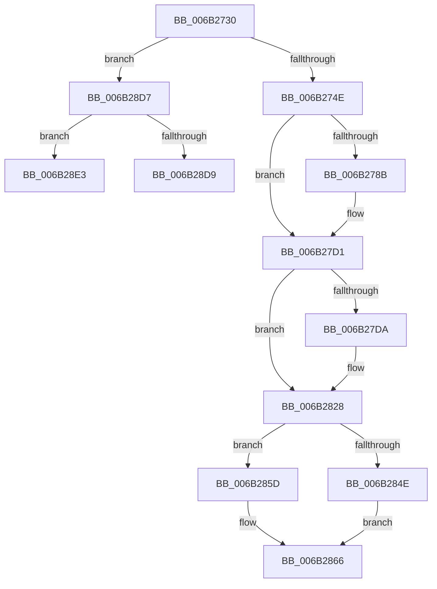

# NtCallbackReturn

- RVA: `0x006B2730`–`0x006B28FF` (길이 `463` bytes)
- VA: `0x00000001406B2730`
- 실행 섹션: `.text`
- PDB 이름 있음: `예`; PDB Function 태그: `아니요`
- unwind 정보 RVA: `0x000C17EC`
- 디코드: `95`개 명령, `463/463` bytes 표시
- 미해석 바이트: `0` (있으면 어셈블리에 `.byte`로 보존)

> 이 문서는 커널 이미지의 기계어와 PDB 기호를 분석해 생성했습니다. 4번과 5번은 함수 원형과 자료형을 바이너리 사용 방식에서 추정한 C 해석이며 원본 소스 복구 결과는 아닙니다.

## 1. Dependencies

- 직접 호출 지점: **1**; 고유 호출 대상: **1**
- 직접 호출자로 확인된 함수: **0**
- RIP 상대 이미지 참조: **2**

### Outgoing calls
- `0x006B28F8` → [KeBugCheckEx](../4F/KeBugCheckEx_function_004FD660.md) (function, `0x004FD660`)

### Direct callers
- 이 함수 시작 RVA로 연결되는 직접 call은 확인되지 않았습니다. 간접 호출은 완전히 역산할 수 없습니다.

### Static image references
- `0x006B2830` → RVA `0x00FC5020` (`ALMOSTRO`; read)
- `0x006B2845` → RVA `0x01201840` (`CFGRO`; read)

## 2. Other-region calls and transfers

- 다른 실행 섹션으로 향하는 call: **0**
- 별도 외부 분기/꼬리 이동을 확인하지 못했습니다.

## 3. Assembly (complete function range)

```asm
006B2730  48 83 EC 28                     sub rsp, 0x28
006B2734  65 4C 8B 1C 25 88 01 00 00      mov r11, qword ptr gs:[0x188]
006B273D  4D 8B 53 28                     mov r10, qword ptr [r11 + 0x28]
006B2741  4D 8B 4A 20                     mov r9, qword ptr [r10 + 0x20]
006B2745  4D 85 C9                        test r9, r9
006B2748  0F 8D 89 01 00 00               jge 0x1406b28d7
006B274E  41 8B C0                        mov eax, r8d
006B2751  49 8B 99 D8 00 00 00            mov rbx, qword ptr [r9 + 0xd8]
006B2758  48 89 0B                        mov qword ptr [rbx], rcx
006B275B  49 8B 99 E0 00 00 00            mov rbx, qword ptr [r9 + 0xe0]
006B2762  89 13                           mov dword ptr [rbx], edx
006B2764  FA                              cli
006B2765  4D 8B 81 D0 00 00 00            mov r8, qword ptr [r9 + 0xd0]
006B276C  49 8B 9B 90 00 00 00            mov rbx, qword ptr [r11 + 0x90]
006B2773  4D 89 83 90 00 00 00            mov qword ptr [r11 + 0x90], r8
006B277A  41 F6 43 03 03                  test byte ptr [r11 + 3], 3
006B277F  66 41 C7 80 00 01 00 00 00 00   mov word ptr [r8 + 0x100], 0
006B2789  74 46                           je 0x1406b27d1
006B278B  48 8B 8B D8 00 00 00            mov rcx, qword ptr [rbx + 0xd8]
006B2792  48 8B 93 E0 00 00 00            mov rdx, qword ptr [rbx + 0xe0]
006B2799  49 89 88 D8 00 00 00            mov qword ptr [r8 + 0xd8], rcx
006B27A0  49 89 90 E0 00 00 00            mov qword ptr [r8 + 0xe0], rdx
006B27A7  48 8B 8B E8 00 00 00            mov rcx, qword ptr [rbx + 0xe8]
006B27AE  48 8B 93 F0 00 00 00            mov rdx, qword ptr [rbx + 0xf0]
006B27B5  49 89 88 E8 00 00 00            mov qword ptr [r8 + 0xe8], rcx
006B27BC  49 89 90 F0 00 00 00            mov qword ptr [r8 + 0xf0], rdx
006B27C3  48 8B 8B 00 01 00 00            mov rcx, qword ptr [rbx + 0x100]
006B27CA  49 89 88 00 01 00 00            mov qword ptr [r8 + 0x100], rcx
006B27D1  49 8B 4A 30                     mov rcx, qword ptr [r10 + 0x30]
006B27D5  48 85 C9                        test rcx, rcx
006B27D8  74 4E                           je 0x1406b2828
006B27DA  49 89 8B 18 04 00 00            mov qword ptr [r11 + 0x418], rcx
006B27E1  49 8B 4A 38                     mov rcx, qword ptr [r10 + 0x38]
006B27E5  49 89 8B 20 04 00 00            mov qword ptr [r11 + 0x420], rcx
006B27EC  49 8B 93 10 04 00 00            mov rdx, qword ptr [r11 + 0x410]
006B27F3  49 8B 4A 48                     mov rcx, qword ptr [r10 + 0x48]
006B27F7  49 89 8B 10 04 00 00            mov qword ptr [r11 + 0x410], rcx
006B27FE  65 48 89 0C 25 28 9D 00 00      mov qword ptr gs:[0x9d28], rcx
006B2807  48 83 C2 08                     add rdx, 8
006B280B  F3 48 0F 1E C9                  rdsspq rcx
006B2810  48 2B D1                        sub rdx, rcx
006B2813  48 C1 EA 03                     shr rdx, 3
006B2817  F3 48 0F AE EA                  incsspq rdx
006B281C  49 8B 4A 40                     mov rcx, qword ptr [r10 + 0x40]
006B2820  F3 0F 01 29                     rstorssp dword ptr [rcx]
006B2824  F3 0F 01 EA                     saveprevssp
006B2828  49 8B 4A 10                     mov rcx, qword ptr [r10 + 0x10]
006B282C  49 89 4B 38                     mov qword ptr [r11 + 0x38], rcx
006B2830  8B 15 EA 27 91 00               mov edx, dword ptr [rip + 0x9127ea]
006B2836  48 2B CA                        sub rcx, rdx
006B2839  49 89 4B 30                     mov qword ptr [r11 + 0x30], rcx
006B283D  49 8B 4A 28                     mov rcx, qword ptr [r10 + 0x28]
006B2841  49 89 4B 28                     mov qword ptr [r11 + 0x28], rcx
006B2845  F6 05 F4 EF B4 00 01            test byte ptr [rip + 0xb4eff4], 1
006B284C  75 0F                           jne 0x1406b285d
006B284E  65 4C 8B 04 25 08 00 00 00      mov r8, qword ptr gs:[8]
006B2857  49 89 48 04                     mov qword ptr [r8 + 4], rcx
006B285B  EB 09                           jmp 0x1406b2866
006B285D  65 48 89 0C 25 08 B0 00 00      mov qword ptr gs:[0xb008], rcx
006B2866  65 48 89 0C 25 A8 01 00 00      mov qword ptr gs:[0x1a8], rcx
006B286F  49 8B E1                        mov rsp, r9
006B2872  48 8D 8C 24 00 01 00 00         lea rcx, [rsp + 0x100]
006B287A  0F 28 74 24 30                  movaps xmm6, xmmword ptr [rsp + 0x30]
006B287F  0F 28 7C 24 40                  movaps xmm7, xmmword ptr [rsp + 0x40]
006B2884  44 0F 28 44 24 50               movaps xmm8, xmmword ptr [rsp + 0x50]
006B288A  44 0F 28 4C 24 60               movaps xmm9, xmmword ptr [rsp + 0x60]
006B2890  44 0F 28 54 24 70               movaps xmm10, xmmword ptr [rsp + 0x70]
006B2896  44 0F 28 59 80                  movaps xmm11, xmmword ptr [rcx - 0x80]
006B289B  44 0F 28 61 90                  movaps xmm12, xmmword ptr [rcx - 0x70]
006B28A0  44 0F 28 69 A0                  movaps xmm13, xmmword ptr [rcx - 0x60]
006B28A5  44 0F 28 71 B0                  movaps xmm14, xmmword ptr [rcx - 0x50]
006B28AA  44 0F 28 79 C0                  movaps xmm15, xmmword ptr [rcx - 0x40]
006B28AF  48 8B 19                        mov rbx, qword ptr [rcx]
006B28B2  48 8B 79 08                     mov rdi, qword ptr [rcx + 8]
006B28B6  48 8B 71 10                     mov rsi, qword ptr [rcx + 0x10]
006B28BA  4C 8B 61 18                     mov r12, qword ptr [rcx + 0x18]
006B28BE  4C 8B 69 20                     mov r13, qword ptr [rcx + 0x20]
006B28C2  4C 8B 71 28                     mov r14, qword ptr [rcx + 0x28]
006B28C6  4C 8B 79 30                     mov r15, qword ptr [rcx + 0x30]
006B28CA  48 8B 69 F8                     mov rbp, qword ptr [rcx - 8]
006B28CE  48 81 C4 38 01 00 00            add rsp, 0x138
006B28D5  FB                              sti
006B28D6  C3                              ret
006B28D7  7F 0A                           jg 0x1406b28e3
006B28D9  B8 58 02 00 C0                  mov eax, 0xc0000258
006B28DE  48 83 C4 28                     add rsp, 0x28
006B28E2  C3                              ret
006B28E3  48 C7 C1 CD 01 00 00            mov rcx, 0x1cd
006B28EA  49 8B D3                        mov rdx, r11
006B28ED  4D 8B C1                        mov r8, r9
006B28F0  4D 33 C9                        xor r9, r9
006B28F3  4C 89 4C 24 20                  mov qword ptr [rsp + 0x20], r9
006B28F8  E8 63 AD E4 FF                  call 0x1404fd660
006B28FD  90                              nop
006B28FE  C3                              ret
```

## 4. C-style interpretation (structured pseudocode)

```c
__int64 __fastcall NtCallbackReturn(__int64 a1, int a2, int a3)
{
    __int64 result;
    __int64 v_rsp;
    unsigned __int64 v_stack_p158;
    unsigned __int64 v_stack_p18;
    unsigned __int64 v_stack_p28;
    unsigned __int64 v_stack_p38;
    unsigned __int64 v_stack_p48;
    unsigned __int64 v_stack_p8;
    unsigned __int64 v_stack_pD8;

    v_rsp = (v_rsp) - (40);
    if (condition_is_greater_or_equal) goto loc_006B28D7;
    *(unsigned __int64 *)(*(unsigned __int64 *)(*(unsigned __int64 *)(*(unsigned __int64 *)(*(unsigned __int64 *)(gs_base + (0 + 392)) + 40) + 32) + 216)) = a1;
    *(unsigned int *)(*(unsigned __int64 *)(*(unsigned __int64 *)(*(unsigned __int64 *)(*(unsigned __int64 *)(gs_base + (0 + 392)) + 40) + 32) + 224)) = a2;
    *(unsigned __int64 *)(*(unsigned __int64 *)(gs_base + (0 + 392)) + 144) = *(unsigned __int64 *)(*(unsigned __int64 *)(*(unsigned __int64 *)(*(unsigned __int64 *)(gs_base + (0 + 392)) + 40) + 32) + 208);
    *(unsigned __int16 *)(*(unsigned __int64 *)(*(unsigned __int64 *)(*(unsigned __int64 *)(*(unsigned __int64 *)(gs_base + (0 + 392)) + 40) + 32) + 208) + 256) = 0;
    if (((*(unsigned __int8 *)(*(unsigned __int64 *)(gs_base + (0 + 392)) + 3)) & (3)) != 0) {
        a1 = *(unsigned __int64 *)(*(unsigned __int64 *)(*(unsigned __int64 *)(gs_base + (0 + 392)) + 144) + 216);
        a2 = *(unsigned __int64 *)(*(unsigned __int64 *)(*(unsigned __int64 *)(gs_base + (0 + 392)) + 144) + 224);
        *(unsigned __int64 *)(*(unsigned __int64 *)(*(unsigned __int64 *)(*(unsigned __int64 *)(*(unsigned __int64 *)(gs_base + (0 + 392)) + 40) + 32) + 208) + 216) = a1;
        *(unsigned __int64 *)(*(unsigned __int64 *)(*(unsigned __int64 *)(*(unsigned __int64 *)(*(unsigned __int64 *)(gs_base + (0 + 392)) + 40) + 32) + 208) + 224) = a2;
        a1 = *(unsigned __int64 *)(*(unsigned __int64 *)(*(unsigned __int64 *)(gs_base + (0 + 392)) + 144) + 232);
        a2 = *(unsigned __int64 *)(*(unsigned __int64 *)(*(unsigned __int64 *)(gs_base + (0 + 392)) + 144) + 240);
        *(unsigned __int64 *)(*(unsigned __int64 *)(*(unsigned __int64 *)(*(unsigned __int64 *)(*(unsigned __int64 *)(gs_base + (0 + 392)) + 40) + 32) + 208) + 232) = a1;
        *(unsigned __int64 *)(*(unsigned __int64 *)(*(unsigned __int64 *)(*(unsigned __int64 *)(*(unsigned __int64 *)(gs_base + (0 + 392)) + 40) + 32) + 208) + 240) = a2;
        a1 = *(unsigned __int64 *)(*(unsigned __int64 *)(*(unsigned __int64 *)(gs_base + (0 + 392)) + 144) + 256);
        *(unsigned __int64 *)(*(unsigned __int64 *)(*(unsigned __int64 *)(*(unsigned __int64 *)(*(unsigned __int64 *)(gs_base + (0 + 392)) + 40) + 32) + 208) + 256) = a1;
    }
    if (*(unsigned __int64 *)(*(unsigned __int64 *)(*(unsigned __int64 *)(gs_base + (0 + 392)) + 40) + 48) != 0) {
        *(unsigned __int64 *)(*(unsigned __int64 *)(gs_base + (0 + 392)) + 1048) = *(unsigned __int64 *)(*(unsigned __int64 *)(*(unsigned __int64 *)(gs_base + (0 + 392)) + 40) + 48);
        a1 = *(unsigned __int64 *)(*(unsigned __int64 *)(*(unsigned __int64 *)(gs_base + (0 + 392)) + 40) + 56);
        *(unsigned __int64 *)(*(unsigned __int64 *)(gs_base + (0 + 392)) + 1056) = a1;
        a2 = *(unsigned __int64 *)(*(unsigned __int64 *)(gs_base + (0 + 392)) + 1040);
        a1 = *(unsigned __int64 *)(*(unsigned __int64 *)(*(unsigned __int64 *)(gs_base + (0 + 392)) + 40) + 72);
        *(unsigned __int64 *)(*(unsigned __int64 *)(gs_base + (0 + 392)) + 1040) = a1;
        *(unsigned __int64 *)(gs_base + (0 + 40232)) = a1;
        a2 = (a2) + (8);
        a2 = (a2) - (a1);
        a2 = (a2) >> (3);
        a1 = *(unsigned __int64 *)(*(unsigned __int64 *)(*(unsigned __int64 *)(gs_base + (0 + 392)) + 40) + 64);
    }
    *(unsigned __int64 *)(*(unsigned __int64 *)(gs_base + (0 + 392)) + 56) = *(unsigned __int64 *)(*(unsigned __int64 *)(*(unsigned __int64 *)(gs_base + (0 + 392)) + 40) + 16);
    a1 = (*(unsigned __int64 *)(*(unsigned __int64 *)(*(unsigned __int64 *)(gs_base + (0 + 392)) + 40) + 16)) - ((unsigned int)(*(unsigned int *)(v_rip + 9512938)));
    *(unsigned __int64 *)(*(unsigned __int64 *)(gs_base + (0 + 392)) + 48) = a1;
    *(unsigned __int64 *)(*(unsigned __int64 *)(gs_base + (0 + 392)) + 40) = *(unsigned __int64 *)(*(unsigned __int64 *)(*(unsigned __int64 *)(gs_base + (0 + 392)) + 40) + 40);
    if (((*(unsigned __int8 *)(v_rip + 11857908)) & (1)) != 0) goto loc_006B285D;
    *(unsigned __int64 *)(*(unsigned __int64 *)(gs_base + (0 + 8)) + 4) = *(unsigned __int64 *)(*(unsigned __int64 *)(*(unsigned __int64 *)(gs_base + (0 + 392)) + 40) + 40);
    goto loc_006B2866;
loc_006B285D:
    *(unsigned __int64 *)(gs_base + (0 + 45064)) = *(unsigned __int64 *)(*(unsigned __int64 *)(*(unsigned __int64 *)(gs_base + (0 + 392)) + 40) + 40);
loc_006B2866:
    *(unsigned __int64 *)(gs_base + (0 + 424)) = *(unsigned __int64 *)(*(unsigned __int64 *)(*(unsigned __int64 *)(gs_base + (0 + 392)) + 40) + 40);
    v_rsp = (*(unsigned __int64 *)(*(unsigned __int64 *)(*(unsigned __int64 *)(gs_base + (0 + 392)) + 40) + 32)) + (312);
    return (unsigned int)(a3);
loc_006B28D7:
    if (condition_is_greater) goto loc_006B28E3;
    v_rsp = (v_rsp) + (40);
    return (unsigned int)(0xC0000258ULL);
loc_006B28E3:
    a4 = 0;
    v_stack_p158 = 0;
    result = KeBugCheckEx(461, *(unsigned __int64 *)(gs_base + (0 + 392)), *(unsigned __int64 *)(*(unsigned __int64 *)(*(unsigned __int64 *)(gs_base + (0 + 392)) + 40) + 32), a4);
    return result;
}
```

## 5. (Beta) C Style

```c
int64_t NtCallbackReturn(int64_t Arg1, int32_t Arg2, int32_t Arg3)
{
    int64_t result;
    int64_t local_rsp;
    uint64_t v_stack_p158;
    uint64_t v_stack_p18;
    uint64_t v_stack_p28;
    uint64_t v_stack_p38;
    uint64_t v_stack_p48;
    uint64_t v_stack_p8;
    uint64_t v_stack_pD8;

    local_rsp = (local_rsp) - (40);
    if (condition_is_greater_or_equal) goto loc_006B28D7;
    *(uint64_t *)(*(uint64_t *)(*(uint64_t *)(*(uint64_t *)(*(uint64_t *)(gs_base + (0 + 0x188)) + 0x28) + 0x20) + 0xD8)) = Arg1;
    *(uint32_t *)(*(uint64_t *)(*(uint64_t *)(*(uint64_t *)(*(uint64_t *)(gs_base + (0 + 0x188)) + 0x28) + 0x20) + 0xE0)) = Arg2;
    *(uint64_t *)(*(uint64_t *)(gs_base + (0 + 0x188)) + 0x90) = *(uint64_t *)(*(uint64_t *)(*(uint64_t *)(*(uint64_t *)(gs_base + (0 + 0x188)) + 0x28) + 0x20) + 0xD0);
    *(uint16_t *)(*(uint64_t *)(*(uint64_t *)(*(uint64_t *)(*(uint64_t *)(gs_base + (0 + 0x188)) + 0x28) + 0x20) + 0xD0) + 0x100) = 0;
    if (((*(uint8_t *)(*(uint64_t *)(gs_base + (0 + 0x188)) + 0x3)) & (3)) != 0) {
        Arg1 = *(uint64_t *)(*(uint64_t *)(*(uint64_t *)(gs_base + (0 + 0x188)) + 0x90) + 0xD8);
        Arg2 = *(uint64_t *)(*(uint64_t *)(*(uint64_t *)(gs_base + (0 + 0x188)) + 0x90) + 0xE0);
        *(uint64_t *)(*(uint64_t *)(*(uint64_t *)(*(uint64_t *)(*(uint64_t *)(gs_base + (0 + 0x188)) + 0x28) + 0x20) + 0xD0) + 0xD8) = Arg1;
        *(uint64_t *)(*(uint64_t *)(*(uint64_t *)(*(uint64_t *)(*(uint64_t *)(gs_base + (0 + 0x188)) + 0x28) + 0x20) + 0xD0) + 0xE0) = Arg2;
        Arg1 = *(uint64_t *)(*(uint64_t *)(*(uint64_t *)(gs_base + (0 + 0x188)) + 0x90) + 0xE8);
        Arg2 = *(uint64_t *)(*(uint64_t *)(*(uint64_t *)(gs_base + (0 + 0x188)) + 0x90) + 0xF0);
        *(uint64_t *)(*(uint64_t *)(*(uint64_t *)(*(uint64_t *)(*(uint64_t *)(gs_base + (0 + 0x188)) + 0x28) + 0x20) + 0xD0) + 0xE8) = Arg1;
        *(uint64_t *)(*(uint64_t *)(*(uint64_t *)(*(uint64_t *)(*(uint64_t *)(gs_base + (0 + 0x188)) + 0x28) + 0x20) + 0xD0) + 0xF0) = Arg2;
        Arg1 = *(uint64_t *)(*(uint64_t *)(*(uint64_t *)(gs_base + (0 + 0x188)) + 0x90) + 0x100);
        *(uint64_t *)(*(uint64_t *)(*(uint64_t *)(*(uint64_t *)(*(uint64_t *)(gs_base + (0 + 0x188)) + 0x28) + 0x20) + 0xD0) + 0x100) = Arg1;
    }
    if (*(uint64_t *)(*(uint64_t *)(*(uint64_t *)(gs_base + (0 + 0x188)) + 0x28) + 0x30) != 0) {
        *(uint64_t *)(*(uint64_t *)(gs_base + (0 + 0x188)) + 0x418) = *(uint64_t *)(*(uint64_t *)(*(uint64_t *)(gs_base + (0 + 0x188)) + 0x28) + 0x30);
        Arg1 = *(uint64_t *)(*(uint64_t *)(*(uint64_t *)(gs_base + (0 + 0x188)) + 0x28) + 0x38);
        *(uint64_t *)(*(uint64_t *)(gs_base + (0 + 0x188)) + 0x420) = Arg1;
        Arg2 = *(uint64_t *)(*(uint64_t *)(gs_base + (0 + 0x188)) + 0x410);
        Arg1 = *(uint64_t *)(*(uint64_t *)(*(uint64_t *)(gs_base + (0 + 0x188)) + 0x28) + 0x48);
        *(uint64_t *)(*(uint64_t *)(gs_base + (0 + 0x188)) + 0x410) = Arg1;
        *(uint64_t *)(gs_base + (0 + 0x9D28)) = Arg1;
        Arg2 = (Arg2) + (8);
        Arg2 = (Arg2) - (Arg1);
        Arg2 = (Arg2) >> (3);
        Arg1 = *(uint64_t *)(*(uint64_t *)(*(uint64_t *)(gs_base + (0 + 0x188)) + 0x28) + 0x40);
    }
    *(uint64_t *)(*(uint64_t *)(gs_base + (0 + 0x188)) + 0x38) = *(uint64_t *)(*(uint64_t *)(*(uint64_t *)(gs_base + (0 + 0x188)) + 0x28) + 0x10);
    Arg1 = (*(uint64_t *)(*(uint64_t *)(*(uint64_t *)(gs_base + (0 + 0x188)) + 0x28) + 0x10)) - ((uint32_t)(*(uint32_t *)(v_rip + 0x9127EA)));
    *(uint64_t *)(*(uint64_t *)(gs_base + (0 + 0x188)) + 0x30) = Arg1;
    *(uint64_t *)(*(uint64_t *)(gs_base + (0 + 0x188)) + 0x28) = *(uint64_t *)(*(uint64_t *)(*(uint64_t *)(gs_base + (0 + 0x188)) + 0x28) + 0x28);
    if (((*(uint8_t *)(v_rip + 0xB4EFF4)) & (1)) != 0) goto loc_006B285D;
    *(uint64_t *)(*(uint64_t *)(gs_base + (0 + 0x8)) + 0x4) = *(uint64_t *)(*(uint64_t *)(*(uint64_t *)(gs_base + (0 + 0x188)) + 0x28) + 0x28);
    goto loc_006B2866;
loc_006B285D:
    *(uint64_t *)(gs_base + (0 + 0xB008)) = *(uint64_t *)(*(uint64_t *)(*(uint64_t *)(gs_base + (0 + 0x188)) + 0x28) + 0x28);
loc_006B2866:
    *(uint64_t *)(gs_base + (0 + 0x1A8)) = *(uint64_t *)(*(uint64_t *)(*(uint64_t *)(gs_base + (0 + 0x188)) + 0x28) + 0x28);
    local_rsp = (*(uint64_t *)(*(uint64_t *)(*(uint64_t *)(gs_base + (0 + 0x188)) + 0x28) + 0x20)) + (312);
    return (uint32_t)(Arg3);
loc_006B28D7:
    if (condition_is_greater) goto loc_006B28E3;
    local_rsp = (local_rsp) + (40);
    return (uint32_t)(0xC0000258ULL);
loc_006B28E3:
    a4 = 0;
    v_stack_p158 = 0;
    result = KeBugCheckEx(461, *(uint64_t *)(gs_base + (0 + 0x188)), *(uint64_t *)(*(uint64_t *)(*(uint64_t *)(gs_base + (0 + 0x188)) + 0x28) + 0x20), a4);
    return result;
}
```

## 6. Execution-region graph

[열기: 2D/3D 그래프와 함수 탐색 컨트롤 패널](../../../control-panel.html?section=text&rva=0x006B2730&view=graph)

- 2D 그래프는 위에서 아래로 흐르고, 3D 그래프는 빈 공간을 드래그해 회전합니다. Shift+드래그는 이동, 휠은 확대·축소, 함수 노드 선택은 대상 보고서 이동입니다.

### Static fallback


