# NtContinueEx

- RVA: `0x006B10D0`–`0x006B154B` (길이 `1,147` bytes)
- VA: `0x00000001406B10D0`
- 실행 섹션: `.text`
- PDB 이름 있음: `예`; PDB Function 태그: `아니요`
- unwind 정보 RVA: `0x000C1604`
- 디코드: `247`개 명령, `1,147/1,147` bytes 표시
- 미해석 바이트: `0` (있으면 어셈블리에 `.byte`로 보존)

> 이 문서는 커널 이미지의 기계어와 PDB 기호를 분석해 생성했습니다. 4번과 5번은 함수 원형과 자료형을 바이너리 사용 방식에서 추정한 C 해석이며 원본 소스 복구 결과는 아닙니다.

## 1. Dependencies

- 직접 호출 지점: **39**; 고유 호출 대상: **39**
- 직접 호출자로 확인된 함수: **1**
- RIP 상대 이미지 참조: **2**

### Outgoing calls
- `0x006B1151` → [KiContinueEx](../41/KiContinueEx_function_0041C370.md) (function, `0x0041C370`)
- `0x006B122B` → [KiInitiateUserApc](KiInitiateUserApc_function_006B6540.md) (function, `0x006B6540`)
- `0x006B123C` → [KiSynchronizeUserIsolationDomainEntry](../26/KiSynchronizeUserIsolationDomainEntry_function_00263F60.md) (function, `0x00263F60`)
- `0x006B1256` → [KiUpdateStibpPairing](../3E/KiUpdateStibpPairing_function_003E71C0.md) (function, `0x003E71C0`)
- `0x006B126C` → [KiRestoreSetContextState](KiRestoreSetContextState_function_006B1CA0.md) (function, `0x006B1CA0`)
- `0x006B1288` → [KiCopyCounters](../5C/KiCopyCounters_function_005C0710.md) (function, `0x005C0710`)
- `0x006B12A4` → [KiRestoreDebugRegisterState](../4F/KiRestoreDebugRegisterState_function_004FD8E0.md) (function, `0x004FD8E0`)
- `0x006B133E` → [NtContinueEx + 0x381](NtContinueEx_function_006B10D0.md) (inside-function, `0x006B1451`)
- `0x006B1347` → [NtContinueEx + 0x38A](NtContinueEx_function_006B10D0.md) (inside-function, `0x006B145A`)
- `0x006B1350` → [NtContinueEx + 0x273](NtContinueEx_function_006B10D0.md) (inside-function, `0x006B1343`)
- `0x006B1359` → [NtContinueEx + 0x27C](NtContinueEx_function_006B10D0.md) (inside-function, `0x006B134C`)
- `0x006B1362` → [NtContinueEx + 0x285](NtContinueEx_function_006B10D0.md) (inside-function, `0x006B1355`)
- `0x006B136B` → [NtContinueEx + 0x28E](NtContinueEx_function_006B10D0.md) (inside-function, `0x006B135E`)
- `0x006B1374` → [NtContinueEx + 0x297](NtContinueEx_function_006B10D0.md) (inside-function, `0x006B1367`)
- `0x006B137D` → [NtContinueEx + 0x2A0](NtContinueEx_function_006B10D0.md) (inside-function, `0x006B1370`)
- `0x006B1386` → [NtContinueEx + 0x2A9](NtContinueEx_function_006B10D0.md) (inside-function, `0x006B1379`)
- `0x006B138F` → [NtContinueEx + 0x2B2](NtContinueEx_function_006B10D0.md) (inside-function, `0x006B1382`)
- `0x006B1398` → [NtContinueEx + 0x2BB](NtContinueEx_function_006B10D0.md) (inside-function, `0x006B138B`)
- `0x006B13A1` → [NtContinueEx + 0x2C4](NtContinueEx_function_006B10D0.md) (inside-function, `0x006B1394`)
- `0x006B13AA` → [NtContinueEx + 0x2CD](NtContinueEx_function_006B10D0.md) (inside-function, `0x006B139D`)
- `0x006B13B3` → [NtContinueEx + 0x2D6](NtContinueEx_function_006B10D0.md) (inside-function, `0x006B13A6`)
- `0x006B13BC` → [NtContinueEx + 0x2DF](NtContinueEx_function_006B10D0.md) (inside-function, `0x006B13AF`)
- `0x006B13C5` → [NtContinueEx + 0x2E8](NtContinueEx_function_006B10D0.md) (inside-function, `0x006B13B8`)
- `0x006B13CE` → [NtContinueEx + 0x2F1](NtContinueEx_function_006B10D0.md) (inside-function, `0x006B13C1`)
- `0x006B13D7` → [NtContinueEx + 0x2FA](NtContinueEx_function_006B10D0.md) (inside-function, `0x006B13CA`)
- `0x006B13E0` → [NtContinueEx + 0x303](NtContinueEx_function_006B10D0.md) (inside-function, `0x006B13D3`)
- `0x006B13E9` → [NtContinueEx + 0x30C](NtContinueEx_function_006B10D0.md) (inside-function, `0x006B13DC`)
- `0x006B13F2` → [NtContinueEx + 0x315](NtContinueEx_function_006B10D0.md) (inside-function, `0x006B13E5`)
- `0x006B13FB` → [NtContinueEx + 0x31E](NtContinueEx_function_006B10D0.md) (inside-function, `0x006B13EE`)
- `0x006B1404` → [NtContinueEx + 0x327](NtContinueEx_function_006B10D0.md) (inside-function, `0x006B13F7`)
- `0x006B140D` → [NtContinueEx + 0x330](NtContinueEx_function_006B10D0.md) (inside-function, `0x006B1400`)
- `0x006B1416` → [NtContinueEx + 0x339](NtContinueEx_function_006B10D0.md) (inside-function, `0x006B1409`)
- `0x006B141F` → [NtContinueEx + 0x342](NtContinueEx_function_006B10D0.md) (inside-function, `0x006B1412`)
- `0x006B1428` → [NtContinueEx + 0x34B](NtContinueEx_function_006B10D0.md) (inside-function, `0x006B141B`)
- `0x006B1431` → [NtContinueEx + 0x354](NtContinueEx_function_006B10D0.md) (inside-function, `0x006B1424`)
- `0x006B143A` → [NtContinueEx + 0x35D](NtContinueEx_function_006B10D0.md) (inside-function, `0x006B142D`)
- `0x006B1443` → [NtContinueEx + 0x366](NtContinueEx_function_006B10D0.md) (inside-function, `0x006B1436`)
- `0x006B144C` → [NtContinueEx + 0x36F](NtContinueEx_function_006B10D0.md) (inside-function, `0x006B143F`)
- `0x006B1455` → [NtContinueEx + 0x378](NtContinueEx_function_006B10D0.md) (inside-function, `0x006B1448`)

### Direct callers
- [NtContinueEx](NtContinueEx_function_006B10D0.md) at `0x006B133E`
- [NtContinueEx](NtContinueEx_function_006B10D0.md) at `0x006B1347`
- [NtContinueEx](NtContinueEx_function_006B10D0.md) at `0x006B1350`
- [NtContinueEx](NtContinueEx_function_006B10D0.md) at `0x006B1359`
- [NtContinueEx](NtContinueEx_function_006B10D0.md) at `0x006B1362`
- [NtContinueEx](NtContinueEx_function_006B10D0.md) at `0x006B136B`
- [NtContinueEx](NtContinueEx_function_006B10D0.md) at `0x006B1374`
- [NtContinueEx](NtContinueEx_function_006B10D0.md) at `0x006B137D`
- [NtContinueEx](NtContinueEx_function_006B10D0.md) at `0x006B1386`
- [NtContinueEx](NtContinueEx_function_006B10D0.md) at `0x006B138F`
- [NtContinueEx](NtContinueEx_function_006B10D0.md) at `0x006B1398`
- [NtContinueEx](NtContinueEx_function_006B10D0.md) at `0x006B13A1`
- [NtContinueEx](NtContinueEx_function_006B10D0.md) at `0x006B13AA`
- [NtContinueEx](NtContinueEx_function_006B10D0.md) at `0x006B13B3`
- [NtContinueEx](NtContinueEx_function_006B10D0.md) at `0x006B13BC`
- [NtContinueEx](NtContinueEx_function_006B10D0.md) at `0x006B13C5`
- [NtContinueEx](NtContinueEx_function_006B10D0.md) at `0x006B13CE`
- [NtContinueEx](NtContinueEx_function_006B10D0.md) at `0x006B13D7`
- [NtContinueEx](NtContinueEx_function_006B10D0.md) at `0x006B13E0`
- [NtContinueEx](NtContinueEx_function_006B10D0.md) at `0x006B13E9`
- [NtContinueEx](NtContinueEx_function_006B10D0.md) at `0x006B13F2`
- [NtContinueEx](NtContinueEx_function_006B10D0.md) at `0x006B13FB`
- [NtContinueEx](NtContinueEx_function_006B10D0.md) at `0x006B1404`
- [NtContinueEx](NtContinueEx_function_006B10D0.md) at `0x006B140D`
- [NtContinueEx](NtContinueEx_function_006B10D0.md) at `0x006B1416`
- [NtContinueEx](NtContinueEx_function_006B10D0.md) at `0x006B141F`
- [NtContinueEx](NtContinueEx_function_006B10D0.md) at `0x006B1428`
- [NtContinueEx](NtContinueEx_function_006B10D0.md) at `0x006B1431`
- [NtContinueEx](NtContinueEx_function_006B10D0.md) at `0x006B143A`
- [NtContinueEx](NtContinueEx_function_006B10D0.md) at `0x006B1443`
- [NtContinueEx](NtContinueEx_function_006B10D0.md) at `0x006B144C`
- [NtContinueEx](NtContinueEx_function_006B10D0.md) at `0x006B1455`

### Static image references
- `0x006B1203` → RVA `0x00FC6BF0` (`ALMOSTRO`; read)
- `0x006B14D3` → RVA `0x01201840` (`CFGRO`; read)

## 2. Other-region calls and transfers

- 다른 실행 섹션으로 향하는 call: **0**
- call이 아닌 외부 분기/꼬리 이동: **1**
  - `0x006B14DC` → [KiKernelExit](../../kvascode/BC/KiKernelExit_function_00BCCB80.md) (`tail-transfer`)

## 3. Assembly (complete function range)

```asm
006B10D0  48 8B 9D C0 00 00 00            mov rbx, qword ptr [rbp + 0xc0]
006B10D7  48 8B BD C8 00 00 00            mov rdi, qword ptr [rbp + 0xc8]
006B10DE  48 8B B5 D0 00 00 00            mov rsi, qword ptr [rbp + 0xd0]
006B10E5  33 C0                           xor eax, eax
006B10E7  48 89 45 B0                     mov qword ptr [rbp - 0x50], rax
006B10EB  48 81 EC 38 01 00 00            sub rsp, 0x138
006B10F2  48 8D 84 24 00 01 00 00         lea rax, [rsp + 0x100]
006B10FA  0F 29 74 24 30                  movaps xmmword ptr [rsp + 0x30], xmm6
006B10FF  0F 29 7C 24 40                  movaps xmmword ptr [rsp + 0x40], xmm7
006B1104  44 0F 29 44 24 50               movaps xmmword ptr [rsp + 0x50], xmm8
006B110A  44 0F 29 4C 24 60               movaps xmmword ptr [rsp + 0x60], xmm9
006B1110  44 0F 29 54 24 70               movaps xmmword ptr [rsp + 0x70], xmm10
006B1116  44 0F 29 58 80                  movaps xmmword ptr [rax - 0x80], xmm11
006B111B  44 0F 29 60 90                  movaps xmmword ptr [rax - 0x70], xmm12
006B1120  44 0F 29 68 A0                  movaps xmmword ptr [rax - 0x60], xmm13
006B1125  44 0F 29 70 B0                  movaps xmmword ptr [rax - 0x50], xmm14
006B112A  44 0F 29 78 C0                  movaps xmmword ptr [rax - 0x40], xmm15
006B112F  48 89 18                        mov qword ptr [rax], rbx
006B1132  48 89 78 08                     mov qword ptr [rax + 8], rdi
006B1136  48 89 70 10                     mov qword ptr [rax + 0x10], rsi
006B113A  4C 89 60 18                     mov qword ptr [rax + 0x18], r12
006B113E  4C 89 68 20                     mov qword ptr [rax + 0x20], r13
006B1142  4C 89 70 28                     mov qword ptr [rax + 0x28], r14
006B1146  4C 89 78 30                     mov qword ptr [rax + 0x30], r15
006B114A  4C 8B C4                        mov r8, rsp
006B114D  4C 8D 4D 80                     lea r9, [rbp - 0x80]
006B1151  E8 1A B2 D6 FF                  call 0x14041c370
006B1156  85 C0                           test eax, eax
006B1158  0F 8E E5 03 00 00               jle 0x1406b1543
006B115E  65 48 8B 0C 25 88 01 00 00      mov rcx, qword ptr gs:[0x188]
006B1167  F6 85 F0 00 00 00 01            test byte ptr [rbp + 0xf0], 1
006B116E  75 17                           jne 0x1406b1187
006B1170  48 8B 95 B8 00 00 00            mov rdx, qword ptr [rbp + 0xb8]
006B1177  48 89 91 90 00 00 00            mov qword ptr [rcx + 0x90], rdx
006B117E  8A 55 A8                        mov dl, byte ptr [rbp - 0x58]
006B1181  88 91 32 02 00 00               mov byte ptr [rcx + 0x232], dl
006B1187  48 8D 8C 24 00 01 00 00         lea rcx, [rsp + 0x100]
006B118F  0F 28 74 24 30                  movaps xmm6, xmmword ptr [rsp + 0x30]
006B1194  0F 28 7C 24 40                  movaps xmm7, xmmword ptr [rsp + 0x40]
006B1199  44 0F 28 44 24 50               movaps xmm8, xmmword ptr [rsp + 0x50]
006B119F  44 0F 28 4C 24 60               movaps xmm9, xmmword ptr [rsp + 0x60]
006B11A5  44 0F 28 54 24 70               movaps xmm10, xmmword ptr [rsp + 0x70]
006B11AB  44 0F 28 59 80                  movaps xmm11, xmmword ptr [rcx - 0x80]
006B11B0  44 0F 28 61 90                  movaps xmm12, xmmword ptr [rcx - 0x70]
006B11B5  44 0F 28 69 A0                  movaps xmm13, xmmword ptr [rcx - 0x60]
006B11BA  44 0F 28 71 B0                  movaps xmm14, xmmword ptr [rcx - 0x50]
006B11BF  44 0F 28 79 C0                  movaps xmm15, xmmword ptr [rcx - 0x40]
006B11C4  48 8B 19                        mov rbx, qword ptr [rcx]
006B11C7  48 8B 79 08                     mov rdi, qword ptr [rcx + 8]
006B11CB  48 8B 71 10                     mov rsi, qword ptr [rcx + 0x10]
006B11CF  4C 8B 61 18                     mov r12, qword ptr [rcx + 0x18]
006B11D3  4C 8B 69 20                     mov r13, qword ptr [rcx + 0x20]
006B11D7  4C 8B 71 28                     mov r14, qword ptr [rcx + 0x28]
006B11DB  4C 8B 79 30                     mov r15, qword ptr [rcx + 0x30]
006B11DF  FA                              cli
006B11E0  33 C9                           xor ecx, ecx
006B11E2  F3 48 0F 1E C9                  rdsspq rcx
006B11E7  48 85 C9                        test rcx, rcx
006B11EA  74 0A                           je 0x1406b11f6
006B11EC  B9 01 00 00 00                  mov ecx, 1
006B11F1  F3 48 0F AE E9                  incsspq rcx
006B11F6  F6 85 F0 00 00 00 01            test byte ptr [rbp + 0xf0], 1
006B11FD  0F 84 F5 02 00 00               je 0x1406b14f8
006B1203  F6 05 E6 59 91 00 FF            test byte ptr [rip + 0x9159e6], 0xff
006B120A  74 03                           je 0x1406b120f
006B120C  0F 01 CB                        stac
006B120F  65 48 8B 0C 25 88 01 00 00      mov rcx, qword ptr gs:[0x188]
006B1218  F6 81 C2 00 00 00 03            test byte ptr [rcx + 0xc2], 3
006B121F  74 1B                           je 0x1406b123c
006B1221  B9 01 00 00 00                  mov ecx, 1
006B1226  44 0F 22 C1                     mov cr8, rcx
006B122A  FB                              sti
006B122B  E8 10 53 00 00                  call 0x1406b6540
006B1230  FA                              cli
006B1231  B9 00 00 00 00                  mov ecx, 0
006B1236  44 0F 22 C1                     mov cr8, rcx
006B123A  EB D3                           jmp 0x1406b120f
006B123C  E8 1F 2D BB FF                  call 0x140263f60
006B1241  85 C0                           test eax, eax
006B1243  48 8B 45 B0                     mov rax, qword ptr [rbp - 0x50]
006B1247  75 C6                           jne 0x1406b120f
006B1249  65 F6 04 25 60 08 00 00 02      test byte ptr gs:[0x860], 2
006B1252  74 07                           je 0x1406b125b
006B1254  33 C9                           xor ecx, ecx
006B1256  E8 65 5F D3 FF                  call 0x1403e71c0
006B125B  65 48 8B 0C 25 88 01 00 00      mov rcx, qword ptr gs:[0x188]
006B1264  F7 01 00 00 00 08               test dword ptr [rcx], 0x8000000
006B126A  74 05                           je 0x1406b1271
006B126C  E8 2F 0A 00 00                  call 0x1406b1ca0
006B1271  65 48 8B 0C 25 88 01 00 00      mov rcx, qword ptr gs:[0x188]
006B127A  F7 01 00 00 01 00               test dword ptr [rcx], 0x10000
006B1280  74 14                           je 0x1406b1296
006B1282  F6 41 02 01                     test byte ptr [rcx + 2], 1
006B1286  74 0E                           je 0x1406b1296
006B1288  E8 83 F4 F0 FF                  call 0x1405c0710
006B128D  65 48 8B 0C 25 88 01 00 00      mov rcx, qword ptr gs:[0x188]
006B1296  0F AE 55 AC                     ldmxcsr dword ptr [rbp - 0x54]
006B129A  66 83 BD 80 00 00 00 00         cmp word ptr [rbp + 0x80], 0
006B12A2  74 05                           je 0x1406b12a9
006B12A4  E8 37 C6 E4 FF                  call 0x1404fd8e0
006B12A9  65 48 8B 0C 25 88 01 00 00      mov rcx, qword ptr gs:[0x188]
006B12B2  0F BA 61 74 16                  bt dword ptr [rcx + 0x74], 0x16
006B12B7  73 2A                           jae 0x1406b12e3
006B12B9  33 C9                           xor ecx, ecx
006B12BB  F3 48 0F 1E C9                  rdsspq rcx
006B12C0  65 4C 8B 04 25 28 9D 00 00      mov r8, qword ptr gs:[0x9d28]
006B12C9  49 83 C0 08                     add r8, 8
006B12CD  49 3B C8                        cmp rcx, r8
006B12D0  75 11                           jne 0x1406b12e3
006B12D2  65 48 8B 0C 25 20 9D 00 00      mov rcx, qword ptr gs:[0x9d20]
006B12DB  F3 0F 01 29                     rstorssp dword ptr [rcx]
006B12DF  F3 0F 01 EA                     saveprevssp
006B12E3  65 C6 04 25 5E 08 00 00 00      mov byte ptr gs:[0x85e], 0
006B12EC  65 0F B7 04 25 6C 08 00 00      movzx eax, word ptr gs:[0x86c]
006B12F5  66 65 39 04 25 66 08 00 00      cmp word ptr gs:[0x866], ax
006B12FE  74 12                           je 0x1406b1312
006B1300  66 65 89 04 25 66 08 00 00      mov word ptr gs:[0x866], ax
006B1309  B9 48 00 00 00                  mov ecx, 0x48
006B130E  33 D2                           xor edx, edx
006B1310  0F 30                           wrmsr
006B1312  66 65 0F BA 34 25 58 08 00 00 02  btr word ptr gs:[0x858], 2
006B131D  73 0E                           jae 0x1406b132d
006B131F  B8 01 00 00 00                  mov eax, 1
006B1324  33 D2                           xor edx, edx
006B1326  B9 49 00 00 00                  mov ecx, 0x49
006B132B  0F 30                           wrmsr
006B132D  66 65 0F BA 34 25 58 08 00 00 05  btr word ptr gs:[0x858], 5
006B1338  0F 83 37 01 00 00               jae 0x1406b1475
006B133E  E8 0E 01 00 00                  call 0x1406b1451
006B1343  48 83 C4 08                     add rsp, 8
006B1347  E8 0E 01 00 00                  call 0x1406b145a
006B134C  48 83 C4 08                     add rsp, 8
006B1350  E8 EE FF FF FF                  call 0x1406b1343
006B1355  48 83 C4 08                     add rsp, 8
006B1359  E8 EE FF FF FF                  call 0x1406b134c
006B135E  48 83 C4 08                     add rsp, 8
006B1362  E8 EE FF FF FF                  call 0x1406b1355
006B1367  48 83 C4 08                     add rsp, 8
006B136B  E8 EE FF FF FF                  call 0x1406b135e
006B1370  48 83 C4 08                     add rsp, 8
006B1374  E8 EE FF FF FF                  call 0x1406b1367
006B1379  48 83 C4 08                     add rsp, 8
006B137D  E8 EE FF FF FF                  call 0x1406b1370
006B1382  48 83 C4 08                     add rsp, 8
006B1386  E8 EE FF FF FF                  call 0x1406b1379
006B138B  48 83 C4 08                     add rsp, 8
006B138F  E8 EE FF FF FF                  call 0x1406b1382
006B1394  48 83 C4 08                     add rsp, 8
006B1398  E8 EE FF FF FF                  call 0x1406b138b
006B139D  48 83 C4 08                     add rsp, 8
006B13A1  E8 EE FF FF FF                  call 0x1406b1394
006B13A6  48 83 C4 08                     add rsp, 8
006B13AA  E8 EE FF FF FF                  call 0x1406b139d
006B13AF  48 83 C4 08                     add rsp, 8
006B13B3  E8 EE FF FF FF                  call 0x1406b13a6
006B13B8  48 83 C4 08                     add rsp, 8
006B13BC  E8 EE FF FF FF                  call 0x1406b13af
006B13C1  48 83 C4 08                     add rsp, 8
006B13C5  E8 EE FF FF FF                  call 0x1406b13b8
006B13CA  48 83 C4 08                     add rsp, 8
006B13CE  E8 EE FF FF FF                  call 0x1406b13c1
006B13D3  48 83 C4 08                     add rsp, 8
006B13D7  E8 EE FF FF FF                  call 0x1406b13ca
006B13DC  48 83 C4 08                     add rsp, 8
006B13E0  E8 EE FF FF FF                  call 0x1406b13d3
006B13E5  48 83 C4 08                     add rsp, 8
006B13E9  E8 EE FF FF FF                  call 0x1406b13dc
006B13EE  48 83 C4 08                     add rsp, 8
006B13F2  E8 EE FF FF FF                  call 0x1406b13e5
006B13F7  48 83 C4 08                     add rsp, 8
006B13FB  E8 EE FF FF FF                  call 0x1406b13ee
006B1400  48 83 C4 08                     add rsp, 8
006B1404  E8 EE FF FF FF                  call 0x1406b13f7
006B1409  48 83 C4 08                     add rsp, 8
006B140D  E8 EE FF FF FF                  call 0x1406b1400
006B1412  48 83 C4 08                     add rsp, 8
006B1416  E8 EE FF FF FF                  call 0x1406b1409
006B141B  48 83 C4 08                     add rsp, 8
006B141F  E8 EE FF FF FF                  call 0x1406b1412
006B1424  48 83 C4 08                     add rsp, 8
006B1428  E8 EE FF FF FF                  call 0x1406b141b
006B142D  48 83 C4 08                     add rsp, 8
006B1431  E8 EE FF FF FF                  call 0x1406b1424
006B1436  48 83 C4 08                     add rsp, 8
006B143A  E8 EE FF FF FF                  call 0x1406b142d
006B143F  48 83 C4 08                     add rsp, 8
006B1443  E8 EE FF FF FF                  call 0x1406b1436
006B1448  48 83 C4 08                     add rsp, 8
006B144C  E8 EE FF FF FF                  call 0x1406b143f
006B1451  48 83 C4 08                     add rsp, 8
006B1455  E8 EE FF FF FF                  call 0x1406b1448
006B145A  48 83 C4 08                     add rsp, 8
006B145E  B8 DA DA 00 00                  mov eax, 0xdada
006B1463  65 F6 04 25 5C 08 00 00 08      test byte ptr gs:[0x85c], 8
006B146C  74 07                           je 0x1406b1475
006B146E  B0 20                           mov al, 0x20
006B1470  F3 48 0F AE E8                  incsspq rax
006B1475  66 65 F7 04 25 58 08 00 00 00 01  test word ptr gs:[0x858], 0x100
006B1480  74 0C                           je 0x1406b148e
006B1482  33 C0                           xor eax, eax
006B1484  33 D2                           xor edx, edx
006B1486  B9 01 00 00 00                  mov ecx, 1
006B148B  48 F7 F1                        div rcx
006B148E  0F 28 45 F0                     movaps xmm0, xmmword ptr [rbp - 0x10]
006B1492  0F 28 4D 00                     movaps xmm1, xmmword ptr [rbp]
006B1496  0F 28 55 10                     movaps xmm2, xmmword ptr [rbp + 0x10]
006B149A  0F 28 5D 20                     movaps xmm3, xmmword ptr [rbp + 0x20]
006B149E  0F 28 65 30                     movaps xmm4, xmmword ptr [rbp + 0x30]
006B14A2  0F 28 6D 40                     movaps xmm5, xmmword ptr [rbp + 0x40]
006B14A6  4C 8B 5D E0                     mov r11, qword ptr [rbp - 0x20]
006B14AA  4C 8B 55 D8                     mov r10, qword ptr [rbp - 0x28]
006B14AE  4C 8B 4D D0                     mov r9, qword ptr [rbp - 0x30]
006B14B2  4C 8B 45 C8                     mov r8, qword ptr [rbp - 0x38]
006B14B6  48 8B 55 C0                     mov rdx, qword ptr [rbp - 0x40]
006B14BA  48 8B 4D B8                     mov rcx, qword ptr [rbp - 0x48]
006B14BE  48 8B 45 B0                     mov rax, qword ptr [rbp - 0x50]
006B14C2  48 8B E5                        mov rsp, rbp
006B14C5  48 8B AD D8 00 00 00            mov rbp, qword ptr [rbp + 0xd8]
006B14CC  48 81 C4 E8 00 00 00            add rsp, 0xe8
006B14D3  F6 05 66 03 B5 00 01            test byte ptr [rip + 0xb50366], 1
006B14DA  74 05                           je 0x1406b14e1
006B14DC  E9 9F B6 51 00                  jmp 0x140bccb80
006B14E1  66 65 F7 04 25 58 08 00 00 00 02  test word ptr gs:[0x858], 0x200
006B14EC  74 05                           je 0x1406b14f3
006B14EE  0F 00 6C 24 20                  verw word ptr [rsp + 0x20]
006B14F3  0F 01 F8                        swapgs
006B14F6  48 CF                           iretq
006B14F8  0F AE 55 AC                     ldmxcsr dword ptr [rbp - 0x54]
006B14FC  0F 28 45 F0                     movaps xmm0, xmmword ptr [rbp - 0x10]
006B1500  0F 28 4D 00                     movaps xmm1, xmmword ptr [rbp]
006B1504  0F 28 55 10                     movaps xmm2, xmmword ptr [rbp + 0x10]
006B1508  0F 28 5D 20                     movaps xmm3, xmmword ptr [rbp + 0x20]
006B150C  0F 28 65 30                     movaps xmm4, xmmword ptr [rbp + 0x30]
006B1510  0F 28 6D 40                     movaps xmm5, xmmword ptr [rbp + 0x40]
006B1514  4C 8B 5D E0                     mov r11, qword ptr [rbp - 0x20]
006B1518  4C 8B 55 D8                     mov r10, qword ptr [rbp - 0x28]
006B151C  4C 8B 4D D0                     mov r9, qword ptr [rbp - 0x30]
006B1520  4C 8B 45 C8                     mov r8, qword ptr [rbp - 0x38]
006B1524  48 8B 55 C0                     mov rdx, qword ptr [rbp - 0x40]
006B1528  48 8B 4D B8                     mov rcx, qword ptr [rbp - 0x48]
006B152C  48 8B 45 B0                     mov rax, qword ptr [rbp - 0x50]
006B1530  48 8B E5                        mov rsp, rbp
006B1533  48 8B AD D8 00 00 00            mov rbp, qword ptr [rbp + 0xd8]
006B153A  48 81 C4 E8 00 00 00            add rsp, 0xe8
006B1541  48 CF                           iretq
006B1543  48 81 C4 38 01 00 00            add rsp, 0x138
006B154A  C3                              ret
```

## 4. C-style interpretation (structured pseudocode)

```c
__int64 __fastcall NtContinueEx(void)
{
    __int64 result;
    __int64 v_rsp;
    unsigned __int64 v_stack_m108;
    unsigned __int64 v_stack_m38;
    unsigned __int64 v_stack_mC8;
    unsigned __int64 v_stack_mD8;
    unsigned __int64 v_stack_mE8;
    unsigned __int64 v_stack_mF8;
    unsigned __int16 v_stack_pD0;

    result = 0;
    *(unsigned __int64 *)(v_rbp - 80) = 0;
    v_rsp = (v_rsp) - (312);
    v_stack_m108 = v_xmm6;
    v_stack_mF8 = v_xmm7;
    v_stack_mE8 = v_xmm8;
    v_stack_mD8 = v_xmm9;
    v_stack_mC8 = v_xmm10;
    *(unsigned __int64 *)(v_stack_m38 - 128) = v_xmm11;
    *(unsigned __int64 *)(v_stack_m38 - 112) = v_xmm12;
    *(unsigned __int64 *)(v_stack_m38 - 96) = v_xmm13;
    *(unsigned __int64 *)(v_stack_m38 - 80) = v_xmm14;
    *(unsigned __int64 *)(v_stack_m38 - 64) = v_xmm15;
    *(unsigned __int64 *)(v_stack_m38) = *(unsigned __int64 *)(v_rbp + 192);
    *(unsigned __int64 *)(v_stack_m38 + 8) = *(unsigned __int64 *)(v_rbp + 200);
    *(unsigned __int64 *)(v_stack_m38 + 16) = *(unsigned __int64 *)(v_rbp + 208);
    *(unsigned __int64 *)(v_stack_m38 + 24) = v_r12;
    *(unsigned __int64 *)(v_stack_m38 + 32) = v_r13;
    *(unsigned __int64 *)(v_stack_m38 + 40) = v_r14;
    *(unsigned __int64 *)(v_stack_m38 + 48) = v_r15;
    result = KiContinueEx(a1, a2, v_rsp, v_rbp - 128);
    if (condition_is_less_or_equal) goto loc_006B1543;
    if (((*(unsigned __int8 *)(v_rbp + 240)) & (1)) == 0) {
        a2 = *(unsigned __int64 *)(v_rbp + 184);
        *(unsigned __int64 *)(*(unsigned __int64 *)(gs_base + (0 + 392)) + 144) = a2;
        a2 = *(unsigned __int8 *)(v_rbp - 88);
        *(unsigned __int8 *)(*(unsigned __int64 *)(gs_base + (0 + 392)) + 562) = (unsigned __int8)(a2);
    }
    a1 = 0;
    if (0 != 0) {
        a1 = 1;
    }
    if (((*(unsigned __int8 *)(v_rbp + 240)) & (1)) == 0) goto loc_006B14F8;
    if (((*(unsigned __int8 *)(v_rip + 9525734)) & (255)) != 0) {
    }
    if (((*(unsigned __int8 *)(*(unsigned __int64 *)(gs_base + (0 + 392)) + 194)) & (3)) == 0) goto loc_006B123C;
    result = KiInitiateUserApc(1, a2, v_rsp, v_rbp - 128);
    goto loc_006B120F;
loc_006B123C:
    result = KiSynchronizeUserIsolationDomainEntry(0, a2, v_rsp, v_rbp - 128);
    if ((unsigned int)(result) != 0) goto loc_006B120F;
    result = *(unsigned __int64 *)(v_rbp - 80);
    if (((*(unsigned __int8 *)(gs_base + (0 + 2144))) & (2)) != 0) {
        a1 = 0;
        result = KiUpdateStibpPairing(a1, a2, v_rsp, v_rbp - 128);
    }
    if (((*(unsigned int *)(*(unsigned __int64 *)(gs_base + (0 + 392)))) & (0x8000000ULL)) != 0) {
        result = KiRestoreSetContextState(*(unsigned __int64 *)(gs_base + (0 + 392)), a2, v_rsp, v_rbp - 128);
    }
    if (((*(unsigned int *)(*(unsigned __int64 *)(gs_base + (0 + 392)))) & (0x10000ULL)) == 0) goto loc_006B1296;
    if (((*(unsigned __int8 *)(*(unsigned __int64 *)(gs_base + (0 + 392)) + 2)) & (1)) != 0) {
        result = KiCopyCounters(*(unsigned __int64 *)(gs_base + (0 + 392)), a2, v_rsp, v_rbp - 128);
        a1 = *(unsigned __int64 *)(gs_base + (0 + 392));
    }
    if ((*(unsigned __int16 *)(v_rbp + 128)) != 0) {
        result = KiRestoreDebugRegisterState(a1, a2, v_rsp, v_rbp - 128);
    }
    if ((*(unsigned __int16 *)(v_rbp + 128)) >= 0) goto loc_006B12E3;
    a1 = 0;
    a3 = (*(unsigned __int64 *)(gs_base + (0 + 40232))) + (8);
    if (0 == a3) {
        a1 = *(unsigned __int64 *)(gs_base + (0 + 40224));
    }
    *(unsigned __int8 *)(gs_base + (0 + 2142)) = 0;
    if ((*(unsigned __int16 *)(gs_base + (0 + 2150))) != ((unsigned __int16)(*(unsigned __int16 *)(gs_base + (0 + 2156))))) {
        *(unsigned __int16 *)(gs_base + (0 + 2150)) = (unsigned __int16)(*(unsigned __int16 *)(gs_base + (0 + 2156)));
        a1 = 72;
        a2 = 0;
    }
    result = *(unsigned __int16 *)(gs_base + (0 + 2156));
    if (!(condition_is_above_or_equal)) {
        result = 1;
        a2 = 0;
        a1 = 73;
    }
    if (condition_is_above_or_equal) goto loc_006B1475;
    result = NtContinueEx___0x381(a1, a2, a3, v_rbp - 128);
    v_rsp = (v_rsp) + (8);
    result = NtContinueEx___0x38A(a1, a2, a3, v_rbp - 128);
    v_rsp = (v_rsp) + (8);
    result = NtContinueEx___0x273(a1, a2, a3, v_rbp - 128);
    v_rsp = (v_rsp) + (8);
    result = NtContinueEx___0x27C(a1, a2, a3, v_rbp - 128);
    v_rsp = (v_rsp) + (8);
    result = NtContinueEx___0x285(a1, a2, a3, v_rbp - 128);
    v_rsp = (v_rsp) + (8);
    result = NtContinueEx___0x28E(a1, a2, a3, v_rbp - 128);
    v_rsp = (v_rsp) + (8);
    result = NtContinueEx___0x297(a1, a2, a3, v_rbp - 128);
    v_rsp = (v_rsp) + (8);
    result = NtContinueEx___0x2A0(a1, a2, a3, v_rbp - 128);
    v_rsp = (v_rsp) + (8);
    result = NtContinueEx___0x2A9(a1, a2, a3, v_rbp - 128);
    v_rsp = (v_rsp) + (8);
    result = NtContinueEx___0x2B2(a1, a2, a3, v_rbp - 128);
    v_rsp = (v_rsp) + (8);
    result = NtContinueEx___0x2BB(a1, a2, a3, v_rbp - 128);
    v_rsp = (v_rsp) + (8);
    result = NtContinueEx___0x2C4(a1, a2, a3, v_rbp - 128);
    v_rsp = (v_rsp) + (8);
    result = NtContinueEx___0x2CD(a1, a2, a3, v_rbp - 128);
    v_rsp = (v_rsp) + (8);
    result = NtContinueEx___0x2D6(a1, a2, a3, v_rbp - 128);
    v_rsp = (v_rsp) + (8);
    result = NtContinueEx___0x2DF(a1, a2, a3, v_rbp - 128);
    v_rsp = (v_rsp) + (8);
    result = NtContinueEx___0x2E8(a1, a2, a3, v_rbp - 128);
    v_rsp = (v_rsp) + (8);
    result = NtContinueEx___0x2F1(a1, a2, a3, v_rbp - 128);
    v_rsp = (v_rsp) + (8);
    result = NtContinueEx___0x2FA(a1, a2, a3, v_rbp - 128);
    v_rsp = (v_rsp) + (8);
    result = NtContinueEx___0x303(a1, a2, a3, v_rbp - 128);
    v_rsp = (v_rsp) + (8);
    result = NtContinueEx___0x30C(a1, a2, a3, v_rbp - 128);
    v_rsp = (v_rsp) + (8);
    result = NtContinueEx___0x315(a1, a2, a3, v_rbp - 128);
    v_rsp = (v_rsp) + (8);
    result = NtContinueEx___0x31E(a1, a2, a3, v_rbp - 128);
    v_rsp = (v_rsp) + (8);
    result = NtContinueEx___0x327(a1, a2, a3, v_rbp - 128);
    v_rsp = (v_rsp) + (8);
    result = NtContinueEx___0x330(a1, a2, a3, v_rbp - 128);
    v_rsp = (v_rsp) + (8);
    result = NtContinueEx___0x339(a1, a2, a3, v_rbp - 128);
    v_rsp = (v_rsp) + (8);
    result = NtContinueEx___0x342(a1, a2, a3, v_rbp - 128);
    v_rsp = (v_rsp) + (8);
    result = NtContinueEx___0x34B(a1, a2, a3, v_rbp - 128);
    v_rsp = (v_rsp) + (8);
    result = NtContinueEx___0x354(a1, a2, a3, v_rbp - 128);
    v_rsp = (v_rsp) + (8);
    result = NtContinueEx___0x35D(a1, a2, a3, v_rbp - 128);
    v_rsp = (v_rsp) + (8);
    result = NtContinueEx___0x366(a1, a2, a3, v_rbp - 128);
    v_rsp = (v_rsp) + (8);
    result = NtContinueEx___0x36F(a1, a2, a3, v_rbp - 128);
    v_rsp = (v_rsp) + (8);
    result = NtContinueEx___0x378(a1, a2, a3, v_rbp - 128);
    v_rsp = (v_rsp) + (8);
    result = (unsigned int)(0xDADAULL);
    if (((*(unsigned __int8 *)(gs_base + (0 + 2140))) & (8)) != 0) {
        result = 32;
    }
    if (((*(unsigned __int16 *)(gs_base + (0 + 2136))) & (256)) != 0) {
        result = 0;
        a2 = 0;
        a1 = 1;
    }
    v_rsp = (v_rbp) + (232);
    if (((*(unsigned __int8 *)(v_rip + 11862886)) & (1)) == 0) goto loc_006B14E1;
loc_006B14E1:
    if (((*(unsigned __int16 *)(gs_base + (0 + 2136))) & (512)) != 0) {
    }
loc_006B14F8:
    v_rsp = (*(unsigned __int64 *)(v_rbp + 216)) + (232);
loc_006B1543:
    v_rsp = (v_rsp) + (312);
    return *(unsigned __int64 *)(*(unsigned __int64 *)(v_rbp + 216) - 80);
}
```

## 5. (Beta) C Style

```c
void NtContinueEx(void)
{
    int64_t result;
    int64_t local_rsp;
    uint64_t v_stack_m108;
    uint64_t v_stack_m38;
    uint64_t v_stack_mC8;
    uint64_t v_stack_mD8;
    uint64_t v_stack_mE8;
    uint64_t v_stack_mF8;
    uint16_t v_stack_pD0;

    result = 0;
    *(uint64_t *)(local_rbp - 0x50) = 0;
    local_rsp = (local_rsp) - (312);
    v_stack_m108 = v_xmm6;
    v_stack_mF8 = v_xmm7;
    v_stack_mE8 = v_xmm8;
    v_stack_mD8 = v_xmm9;
    v_stack_mC8 = v_xmm10;
    *(uint64_t *)(v_stack_m38 - 0x80) = v_xmm11;
    *(uint64_t *)(v_stack_m38 - 0x70) = v_xmm12;
    *(uint64_t *)(v_stack_m38 - 0x60) = v_xmm13;
    *(uint64_t *)(v_stack_m38 - 0x50) = v_xmm14;
    *(uint64_t *)(v_stack_m38 - 0x40) = v_xmm15;
    *(uint64_t *)(v_stack_m38) = *(uint64_t *)(local_rbp + 0xC0);
    *(uint64_t *)(v_stack_m38 + 0x8) = *(uint64_t *)(local_rbp + 0xC8);
    *(uint64_t *)(v_stack_m38 + 0x10) = *(uint64_t *)(local_rbp + 0xD0);
    *(uint64_t *)(v_stack_m38 + 0x18) = local_r12;
    *(uint64_t *)(v_stack_m38 + 0x20) = local_r13;
    *(uint64_t *)(v_stack_m38 + 0x28) = local_r14;
    *(uint64_t *)(v_stack_m38 + 0x30) = local_r15;
    result = KiContinueEx(a1, a2, local_rsp, local_rbp - 128);
    if (condition_is_less_or_equal) goto loc_006B1543;
    if (((*(uint8_t *)(local_rbp + 0xF0)) & (1)) == 0) {
        a2 = *(uint64_t *)(local_rbp + 0xB8);
        *(uint64_t *)(*(uint64_t *)(gs_base + (0 + 0x188)) + 0x90) = a2;
        a2 = *(uint8_t *)(local_rbp - 0x58);
        *(uint8_t *)(*(uint64_t *)(gs_base + (0 + 0x188)) + 0x232) = (uint8_t)(a2);
    }
    a1 = 0;
    if (0 != 0) {
        a1 = 1;
    }
    if (((*(uint8_t *)(local_rbp + 0xF0)) & (1)) == 0) goto loc_006B14F8;
    if (((*(uint8_t *)(v_rip + 0x9159E6)) & (255)) != 0) {
    }
    if (((*(uint8_t *)(*(uint64_t *)(gs_base + (0 + 0x188)) + 0xC2)) & (3)) == 0) goto loc_006B123C;
    result = KiInitiateUserApc(1, a2, local_rsp, local_rbp - 128);
    goto loc_006B120F;
loc_006B123C:
    result = KiSynchronizeUserIsolationDomainEntry(0, a2, local_rsp, local_rbp - 128);
    if ((uint32_t)(result) != 0) goto loc_006B120F;
    result = *(uint64_t *)(local_rbp - 0x50);
    if (((*(uint8_t *)(gs_base + (0 + 0x860))) & (2)) != 0) {
        a1 = 0;
        result = KiUpdateStibpPairing(a1, a2, local_rsp, local_rbp - 128);
    }
    if (((*(uint32_t *)(*(uint64_t *)(gs_base + (0 + 0x188)))) & (0x8000000ULL)) != 0) {
        result = KiRestoreSetContextState(*(uint64_t *)(gs_base + (0 + 0x188)), a2, local_rsp, local_rbp - 128);
    }
    if (((*(uint32_t *)(*(uint64_t *)(gs_base + (0 + 0x188)))) & (0x10000ULL)) == 0) goto loc_006B1296;
    if (((*(uint8_t *)(*(uint64_t *)(gs_base + (0 + 0x188)) + 0x2)) & (1)) != 0) {
        result = KiCopyCounters(*(uint64_t *)(gs_base + (0 + 0x188)), a2, local_rsp, local_rbp - 128);
        a1 = *(uint64_t *)(gs_base + (0 + 0x188));
    }
    if ((*(uint16_t *)(local_rbp + 0x80)) != 0) {
        result = KiRestoreDebugRegisterState(a1, a2, local_rsp, local_rbp - 128);
    }
    if ((*(uint16_t *)(local_rbp + 0x80)) >= 0) goto loc_006B12E3;
    a1 = 0;
    a3 = (*(uint64_t *)(gs_base + (0 + 0x9D28))) + (8);
    if (0 == a3) {
        a1 = *(uint64_t *)(gs_base + (0 + 0x9D20));
    }
    *(uint8_t *)(gs_base + (0 + 0x85E)) = 0;
    if ((*(uint16_t *)(gs_base + (0 + 0x866))) != ((uint16_t)(*(uint16_t *)(gs_base + (0 + 0x86C))))) {
        *(uint16_t *)(gs_base + (0 + 0x866)) = (uint16_t)(*(uint16_t *)(gs_base + (0 + 0x86C)));
        a1 = 72;
        a2 = 0;
    }
    result = *(uint16_t *)(gs_base + (0 + 0x86C));
    if (!(condition_is_above_or_equal)) {
        result = 1;
        a2 = 0;
        a1 = 73;
    }
    if (condition_is_above_or_equal) goto loc_006B1475;
    result = NtContinueEx___0x381(a1, a2, a3, local_rbp - 128);
    local_rsp = (local_rsp) + (8);
    result = NtContinueEx___0x38A(a1, a2, a3, local_rbp - 128);
    local_rsp = (local_rsp) + (8);
    result = NtContinueEx___0x273(a1, a2, a3, local_rbp - 128);
    local_rsp = (local_rsp) + (8);
    result = NtContinueEx___0x27C(a1, a2, a3, local_rbp - 128);
    local_rsp = (local_rsp) + (8);
    result = NtContinueEx___0x285(a1, a2, a3, local_rbp - 128);
    local_rsp = (local_rsp) + (8);
    result = NtContinueEx___0x28E(a1, a2, a3, local_rbp - 128);
    local_rsp = (local_rsp) + (8);
    result = NtContinueEx___0x297(a1, a2, a3, local_rbp - 128);
    local_rsp = (local_rsp) + (8);
    result = NtContinueEx___0x2A0(a1, a2, a3, local_rbp - 128);
    local_rsp = (local_rsp) + (8);
    result = NtContinueEx___0x2A9(a1, a2, a3, local_rbp - 128);
    local_rsp = (local_rsp) + (8);
    result = NtContinueEx___0x2B2(a1, a2, a3, local_rbp - 128);
    local_rsp = (local_rsp) + (8);
    result = NtContinueEx___0x2BB(a1, a2, a3, local_rbp - 128);
    local_rsp = (local_rsp) + (8);
    result = NtContinueEx___0x2C4(a1, a2, a3, local_rbp - 128);
    local_rsp = (local_rsp) + (8);
    result = NtContinueEx___0x2CD(a1, a2, a3, local_rbp - 128);
    local_rsp = (local_rsp) + (8);
    result = NtContinueEx___0x2D6(a1, a2, a3, local_rbp - 128);
    local_rsp = (local_rsp) + (8);
    result = NtContinueEx___0x2DF(a1, a2, a3, local_rbp - 128);
    local_rsp = (local_rsp) + (8);
    result = NtContinueEx___0x2E8(a1, a2, a3, local_rbp - 128);
    local_rsp = (local_rsp) + (8);
    result = NtContinueEx___0x2F1(a1, a2, a3, local_rbp - 128);
    local_rsp = (local_rsp) + (8);
    result = NtContinueEx___0x2FA(a1, a2, a3, local_rbp - 128);
    local_rsp = (local_rsp) + (8);
    result = NtContinueEx___0x303(a1, a2, a3, local_rbp - 128);
    local_rsp = (local_rsp) + (8);
    result = NtContinueEx___0x30C(a1, a2, a3, local_rbp - 128);
    local_rsp = (local_rsp) + (8);
    result = NtContinueEx___0x315(a1, a2, a3, local_rbp - 128);
    local_rsp = (local_rsp) + (8);
    result = NtContinueEx___0x31E(a1, a2, a3, local_rbp - 128);
    local_rsp = (local_rsp) + (8);
    result = NtContinueEx___0x327(a1, a2, a3, local_rbp - 128);
    local_rsp = (local_rsp) + (8);
    result = NtContinueEx___0x330(a1, a2, a3, local_rbp - 128);
    local_rsp = (local_rsp) + (8);
    result = NtContinueEx___0x339(a1, a2, a3, local_rbp - 128);
    local_rsp = (local_rsp) + (8);
    result = NtContinueEx___0x342(a1, a2, a3, local_rbp - 128);
    local_rsp = (local_rsp) + (8);
    result = NtContinueEx___0x34B(a1, a2, a3, local_rbp - 128);
    local_rsp = (local_rsp) + (8);
    result = NtContinueEx___0x354(a1, a2, a3, local_rbp - 128);
    local_rsp = (local_rsp) + (8);
    result = NtContinueEx___0x35D(a1, a2, a3, local_rbp - 128);
    local_rsp = (local_rsp) + (8);
    result = NtContinueEx___0x366(a1, a2, a3, local_rbp - 128);
    local_rsp = (local_rsp) + (8);
    result = NtContinueEx___0x36F(a1, a2, a3, local_rbp - 128);
    local_rsp = (local_rsp) + (8);
    result = NtContinueEx___0x378(a1, a2, a3, local_rbp - 128);
    local_rsp = (local_rsp) + (8);
    result = (uint32_t)(0xDADAULL);
    if (((*(uint8_t *)(gs_base + (0 + 0x85C))) & (8)) != 0) {
        result = 32;
    }
    if (((*(uint16_t *)(gs_base + (0 + 0x858))) & (256)) != 0) {
        result = 0;
        a2 = 0;
        a1 = 1;
    }
    local_rsp = (local_rbp) + (232);
    if (((*(uint8_t *)(v_rip + 0xB50366)) & (1)) == 0) goto loc_006B14E1;
loc_006B14E1:
    if (((*(uint16_t *)(gs_base + (0 + 0x858))) & (512)) != 0) {
    }
loc_006B14F8:
    local_rsp = (*(uint64_t *)(local_rbp + 0xD8)) + (232);
loc_006B1543:
    local_rsp = (local_rsp) + (312);
    return *(uint64_t *)(*(uint64_t *)(local_rbp + 0xD8) - 0x50);
}
```

## 6. Execution-region graph

[열기: 2D/3D 그래프와 함수 탐색 컨트롤 패널](../../../control-panel.html?section=text&rva=0x006B10D0&view=graph)

- 2D 그래프는 위에서 아래로 흐르고, 3D 그래프는 빈 공간을 드래그해 회전합니다. Shift+드래그는 이동, 휠은 확대·축소, 함수 노드 선택은 대상 보고서 이동입니다.

### Static fallback

```mermaid
flowchart TD
  bb_006B10D0[BB_006B10D0]
  bb_006B115E[BB_006B115E]
  bb_006B1170[BB_006B1170]
  bb_006B1187[BB_006B1187]
  bb_006B11EC[BB_006B11EC]
  bb_006B11F6[BB_006B11F6]
  bb_006B1203[BB_006B1203]
  bb_006B120C[BB_006B120C]
  bb_006B120F[BB_006B120F]
  bb_006B1221[BB_006B1221]
  bb_006B123C[BB_006B123C]
  bb_006B1249[BB_006B1249]
  bb_006B1254[BB_006B1254]
  bb_006B125B[BB_006B125B]
  bb_006B126C[BB_006B126C]
  bb_006B1271[BB_006B1271]
  bb_006B1282[BB_006B1282]
  bb_006B1288[BB_006B1288]
  bb_006B1296[BB_006B1296]
  bb_006B12A4[BB_006B12A4]
  bb_006B12A9[BB_006B12A9]
  bb_006B12B9[BB_006B12B9]
  bb_006B12D2[BB_006B12D2]
  bb_006B12E3[BB_006B12E3]
  bb_006B1300[BB_006B1300]
  bb_006B1312[BB_006B1312]
  bb_006B131F[BB_006B131F]
  bb_006B132D[BB_006B132D]
  bb_006B133E[BB_006B133E]
  bb_006B146E[BB_006B146E]
  bb_006B1475[BB_006B1475]
  bb_006B1482[BB_006B1482]
  bb_006B148E[BB_006B148E]
  bb_006B14DC[BB_006B14DC]
  bb_006B14E1[BB_006B14E1]
  bb_006B14EE[BB_006B14EE]
  bb_006B14F3[BB_006B14F3]
  bb_006B14F8[BB_006B14F8]
  bb_006B1543[BB_006B1543]
  bb_006B10D0 -->|branch| bb_006B1543
  bb_006B10D0 -->|fallthrough| bb_006B115E
  bb_006B115E -->|branch| bb_006B1187
  bb_006B115E -->|fallthrough| bb_006B1170
  bb_006B1170 -->|flow| bb_006B1187
  bb_006B1187 -->|branch| bb_006B11F6
  bb_006B1187 -->|fallthrough| bb_006B11EC
  bb_006B11EC -->|flow| bb_006B11F6
  bb_006B11F6 -->|branch| bb_006B14F8
  bb_006B11F6 -->|fallthrough| bb_006B1203
  bb_006B1203 -->|branch| bb_006B120F
  bb_006B1203 -->|fallthrough| bb_006B120C
  bb_006B120C -->|flow| bb_006B120F
  bb_006B120F -->|branch| bb_006B123C
  bb_006B120F -->|fallthrough| bb_006B1221
  bb_006B1221 -->|branch| bb_006B120F
  bb_006B123C -->|branch| bb_006B120F
  bb_006B123C -->|fallthrough| bb_006B1249
  bb_006B1249 -->|branch| bb_006B125B
  bb_006B1249 -->|fallthrough| bb_006B1254
  bb_006B1254 -->|flow| bb_006B125B
  bb_006B125B -->|branch| bb_006B1271
  bb_006B125B -->|fallthrough| bb_006B126C
  bb_006B126C -->|flow| bb_006B1271
  bb_006B1271 -->|branch| bb_006B1296
  bb_006B1271 -->|fallthrough| bb_006B1282
  bb_006B1282 -->|branch| bb_006B1296
  bb_006B1282 -->|fallthrough| bb_006B1288
  bb_006B1288 -->|flow| bb_006B1296
  bb_006B1296 -->|branch| bb_006B12A9
  bb_006B1296 -->|fallthrough| bb_006B12A4
  bb_006B12A4 -->|flow| bb_006B12A9
  bb_006B12A9 -->|branch| bb_006B12E3
  bb_006B12A9 -->|fallthrough| bb_006B12B9
  bb_006B12B9 -->|branch| bb_006B12E3
  bb_006B12B9 -->|fallthrough| bb_006B12D2
  bb_006B12D2 -->|flow| bb_006B12E3
  bb_006B12E3 -->|branch| bb_006B1312
  bb_006B12E3 -->|fallthrough| bb_006B1300
  bb_006B1300 -->|flow| bb_006B1312
  bb_006B1312 -->|branch| bb_006B132D
  bb_006B1312 -->|fallthrough| bb_006B131F
  bb_006B131F -->|flow| bb_006B132D
  bb_006B132D -->|branch| bb_006B1475
  bb_006B132D -->|fallthrough| bb_006B133E
  bb_006B133E -->|branch| bb_006B1475
  bb_006B133E -->|fallthrough| bb_006B146E
  bb_006B146E -->|flow| bb_006B1475
  bb_006B1475 -->|branch| bb_006B148E
  bb_006B1475 -->|fallthrough| bb_006B1482
  bb_006B1482 -->|flow| bb_006B148E
  bb_006B148E -->|branch| bb_006B14E1
  bb_006B148E -->|fallthrough| bb_006B14DC
  bb_006B14E1 -->|branch| bb_006B14F3
  bb_006B14E1 -->|fallthrough| bb_006B14EE
  bb_006B14EE -->|flow| bb_006B14F3
  bb_006B14F3 -->|flow| bb_006B14F8
  bb_006B14F8 -->|flow| bb_006B1543
```


