# NtRaiseException

- RVA: `0x006B1560`–`0x006B1A43` (길이 `1,251` bytes)
- VA: `0x00000001406B1560`
- 실행 섹션: `.text`
- PDB 이름 있음: `예`; PDB Function 태그: `아니요`
- unwind 정보 RVA: `0x000C1658`
- 디코드: `268`개 명령, `1,251/1,251` bytes 표시
- 미해석 바이트: `0` (있으면 어셈블리에 `.byte`로 보존)

> 이 문서는 커널 이미지의 기계어와 PDB 기호를 분석해 생성했습니다. 4번과 5번은 함수 원형과 자료형을 바이너리 사용 방식에서 추정한 C 해석이며 원본 소스 복구 결과는 아닙니다.

## 1. Dependencies

- 직접 호출 지점: **39**; 고유 호출 대상: **39**
- 직접 호출자로 확인된 함수: **1**
- RIP 상대 이미지 참조: **2**

### Outgoing calls
- `0x006B15F1` → [KiRaiseException](../3D/KiRaiseException_function_003D5CA0.md) (function, `0x003D5CA0`)
- `0x006B16CB` → [KiInitiateUserApc](KiInitiateUserApc_function_006B6540.md) (function, `0x006B6540`)
- `0x006B16DC` → [KiSynchronizeUserIsolationDomainEntry](../26/KiSynchronizeUserIsolationDomainEntry_function_00263F60.md) (function, `0x00263F60`)
- `0x006B16F6` → [KiUpdateStibpPairing](../3E/KiUpdateStibpPairing_function_003E71C0.md) (function, `0x003E71C0`)
- `0x006B170C` → [KiRestoreSetContextState](KiRestoreSetContextState_function_006B1CA0.md) (function, `0x006B1CA0`)
- `0x006B1728` → [KiCopyCounters](../5C/KiCopyCounters_function_005C0710.md) (function, `0x005C0710`)
- `0x006B1744` → [KiRestoreDebugRegisterState](../4F/KiRestoreDebugRegisterState_function_004FD8E0.md) (function, `0x004FD8E0`)
- `0x006B17DE` → [NtRaiseException + 0x391](NtRaiseException_function_006B1560.md) (inside-function, `0x006B18F1`)
- `0x006B17E7` → [NtRaiseException + 0x39A](NtRaiseException_function_006B1560.md) (inside-function, `0x006B18FA`)
- `0x006B17F0` → [NtRaiseException + 0x283](NtRaiseException_function_006B1560.md) (inside-function, `0x006B17E3`)
- `0x006B17F9` → [NtRaiseException + 0x28C](NtRaiseException_function_006B1560.md) (inside-function, `0x006B17EC`)
- `0x006B1802` → [NtRaiseException + 0x295](NtRaiseException_function_006B1560.md) (inside-function, `0x006B17F5`)
- `0x006B180B` → [NtRaiseException + 0x29E](NtRaiseException_function_006B1560.md) (inside-function, `0x006B17FE`)
- `0x006B1814` → [NtRaiseException + 0x2A7](NtRaiseException_function_006B1560.md) (inside-function, `0x006B1807`)
- `0x006B181D` → [NtRaiseException + 0x2B0](NtRaiseException_function_006B1560.md) (inside-function, `0x006B1810`)
- `0x006B1826` → [NtRaiseException + 0x2B9](NtRaiseException_function_006B1560.md) (inside-function, `0x006B1819`)
- `0x006B182F` → [NtRaiseException + 0x2C2](NtRaiseException_function_006B1560.md) (inside-function, `0x006B1822`)
- `0x006B1838` → [NtRaiseException + 0x2CB](NtRaiseException_function_006B1560.md) (inside-function, `0x006B182B`)
- `0x006B1841` → [NtRaiseException + 0x2D4](NtRaiseException_function_006B1560.md) (inside-function, `0x006B1834`)
- `0x006B184A` → [NtRaiseException + 0x2DD](NtRaiseException_function_006B1560.md) (inside-function, `0x006B183D`)
- `0x006B1853` → [NtRaiseException + 0x2E6](NtRaiseException_function_006B1560.md) (inside-function, `0x006B1846`)
- `0x006B185C` → [NtRaiseException + 0x2EF](NtRaiseException_function_006B1560.md) (inside-function, `0x006B184F`)
- `0x006B1865` → [NtRaiseException + 0x2F8](NtRaiseException_function_006B1560.md) (inside-function, `0x006B1858`)
- `0x006B186E` → [NtRaiseException + 0x301](NtRaiseException_function_006B1560.md) (inside-function, `0x006B1861`)
- `0x006B1877` → [NtRaiseException + 0x30A](NtRaiseException_function_006B1560.md) (inside-function, `0x006B186A`)
- `0x006B1880` → [NtRaiseException + 0x313](NtRaiseException_function_006B1560.md) (inside-function, `0x006B1873`)
- `0x006B1889` → [NtRaiseException + 0x31C](NtRaiseException_function_006B1560.md) (inside-function, `0x006B187C`)
- `0x006B1892` → [NtRaiseException + 0x325](NtRaiseException_function_006B1560.md) (inside-function, `0x006B1885`)
- `0x006B189B` → [NtRaiseException + 0x32E](NtRaiseException_function_006B1560.md) (inside-function, `0x006B188E`)
- `0x006B18A4` → [NtRaiseException + 0x337](NtRaiseException_function_006B1560.md) (inside-function, `0x006B1897`)
- `0x006B18AD` → [NtRaiseException + 0x340](NtRaiseException_function_006B1560.md) (inside-function, `0x006B18A0`)
- `0x006B18B6` → [NtRaiseException + 0x349](NtRaiseException_function_006B1560.md) (inside-function, `0x006B18A9`)
- `0x006B18BF` → [NtRaiseException + 0x352](NtRaiseException_function_006B1560.md) (inside-function, `0x006B18B2`)
- `0x006B18C8` → [NtRaiseException + 0x35B](NtRaiseException_function_006B1560.md) (inside-function, `0x006B18BB`)
- `0x006B18D1` → [NtRaiseException + 0x364](NtRaiseException_function_006B1560.md) (inside-function, `0x006B18C4`)
- `0x006B18DA` → [NtRaiseException + 0x36D](NtRaiseException_function_006B1560.md) (inside-function, `0x006B18CD`)
- `0x006B18E3` → [NtRaiseException + 0x376](NtRaiseException_function_006B1560.md) (inside-function, `0x006B18D6`)
- `0x006B18EC` → [NtRaiseException + 0x37F](NtRaiseException_function_006B1560.md) (inside-function, `0x006B18DF`)
- `0x006B18F5` → [NtRaiseException + 0x388](NtRaiseException_function_006B1560.md) (inside-function, `0x006B18E8`)

### Direct callers
- [NtRaiseException](NtRaiseException_function_006B1560.md) at `0x006B17DE`
- [NtRaiseException](NtRaiseException_function_006B1560.md) at `0x006B17E7`
- [NtRaiseException](NtRaiseException_function_006B1560.md) at `0x006B17F0`
- [NtRaiseException](NtRaiseException_function_006B1560.md) at `0x006B17F9`
- [NtRaiseException](NtRaiseException_function_006B1560.md) at `0x006B1802`
- [NtRaiseException](NtRaiseException_function_006B1560.md) at `0x006B180B`
- [NtRaiseException](NtRaiseException_function_006B1560.md) at `0x006B1814`
- [NtRaiseException](NtRaiseException_function_006B1560.md) at `0x006B181D`
- [NtRaiseException](NtRaiseException_function_006B1560.md) at `0x006B1826`
- [NtRaiseException](NtRaiseException_function_006B1560.md) at `0x006B182F`
- [NtRaiseException](NtRaiseException_function_006B1560.md) at `0x006B1838`
- [NtRaiseException](NtRaiseException_function_006B1560.md) at `0x006B1841`
- [NtRaiseException](NtRaiseException_function_006B1560.md) at `0x006B184A`
- [NtRaiseException](NtRaiseException_function_006B1560.md) at `0x006B1853`
- [NtRaiseException](NtRaiseException_function_006B1560.md) at `0x006B185C`
- [NtRaiseException](NtRaiseException_function_006B1560.md) at `0x006B1865`
- [NtRaiseException](NtRaiseException_function_006B1560.md) at `0x006B186E`
- [NtRaiseException](NtRaiseException_function_006B1560.md) at `0x006B1877`
- [NtRaiseException](NtRaiseException_function_006B1560.md) at `0x006B1880`
- [NtRaiseException](NtRaiseException_function_006B1560.md) at `0x006B1889`
- [NtRaiseException](NtRaiseException_function_006B1560.md) at `0x006B1892`
- [NtRaiseException](NtRaiseException_function_006B1560.md) at `0x006B189B`
- [NtRaiseException](NtRaiseException_function_006B1560.md) at `0x006B18A4`
- [NtRaiseException](NtRaiseException_function_006B1560.md) at `0x006B18AD`
- [NtRaiseException](NtRaiseException_function_006B1560.md) at `0x006B18B6`
- [NtRaiseException](NtRaiseException_function_006B1560.md) at `0x006B18BF`
- [NtRaiseException](NtRaiseException_function_006B1560.md) at `0x006B18C8`
- [NtRaiseException](NtRaiseException_function_006B1560.md) at `0x006B18D1`
- [NtRaiseException](NtRaiseException_function_006B1560.md) at `0x006B18DA`
- [NtRaiseException](NtRaiseException_function_006B1560.md) at `0x006B18E3`
- [NtRaiseException](NtRaiseException_function_006B1560.md) at `0x006B18EC`
- [NtRaiseException](NtRaiseException_function_006B1560.md) at `0x006B18F5`

### Static image references
- `0x006B16A3` → RVA `0x00FC6BF0` (`ALMOSTRO`; read)
- `0x006B1973` → RVA `0x01201840` (`CFGRO`; read)

## 2. Other-region calls and transfers

- 다른 실행 섹션으로 향하는 call: **0**
- call이 아닌 외부 분기/꼬리 이동: **1**
  - `0x006B197C` → [KiKernelExit](../../kvascode/BC/KiKernelExit_function_00BCCB80.md) (`tail-transfer`)

## 3. Assembly (complete function range)

```asm
006B1560  48 8B 9D C0 00 00 00            mov rbx, qword ptr [rbp + 0xc0]
006B1567  48 8B BD C8 00 00 00            mov rdi, qword ptr [rbp + 0xc8]
006B156E  48 8B B5 D0 00 00 00            mov rsi, qword ptr [rbp + 0xd0]
006B1575  33 C0                           xor eax, eax
006B1577  48 89 45 B0                     mov qword ptr [rbp - 0x50], rax
006B157B  48 81 EC 38 01 00 00            sub rsp, 0x138
006B1582  48 8D 84 24 00 01 00 00         lea rax, [rsp + 0x100]
006B158A  0F 29 74 24 30                  movaps xmmword ptr [rsp + 0x30], xmm6
006B158F  0F 29 7C 24 40                  movaps xmmword ptr [rsp + 0x40], xmm7
006B1594  44 0F 29 44 24 50               movaps xmmword ptr [rsp + 0x50], xmm8
006B159A  44 0F 29 4C 24 60               movaps xmmword ptr [rsp + 0x60], xmm9
006B15A0  44 0F 29 54 24 70               movaps xmmword ptr [rsp + 0x70], xmm10
006B15A6  44 0F 29 58 80                  movaps xmmword ptr [rax - 0x80], xmm11
006B15AB  44 0F 29 60 90                  movaps xmmword ptr [rax - 0x70], xmm12
006B15B0  44 0F 29 68 A0                  movaps xmmword ptr [rax - 0x60], xmm13
006B15B5  44 0F 29 70 B0                  movaps xmmword ptr [rax - 0x50], xmm14
006B15BA  44 0F 29 78 C0                  movaps xmmword ptr [rax - 0x40], xmm15
006B15BF  48 89 18                        mov qword ptr [rax], rbx
006B15C2  48 89 78 08                     mov qword ptr [rax + 8], rdi
006B15C6  48 89 70 10                     mov qword ptr [rax + 0x10], rsi
006B15CA  4C 89 60 18                     mov qword ptr [rax + 0x18], r12
006B15CE  4C 89 68 20                     mov qword ptr [rax + 0x20], r13
006B15D2  4C 89 70 28                     mov qword ptr [rax + 0x28], r14
006B15D6  4C 89 78 30                     mov qword ptr [rax + 0x30], r15
006B15DA  48 8B 85 E8 00 00 00            mov rax, qword ptr [rbp + 0xe8]
006B15E1  48 89 45 50                     mov qword ptr [rbp + 0x50], rax
006B15E5  44 88 44 24 20                  mov byte ptr [rsp + 0x20], r8b
006B15EA  4C 8B C4                        mov r8, rsp
006B15ED  4C 8D 4D 80                     lea r9, [rbp - 0x80]
006B15F1  E8 AA 46 D2 FF                  call 0x1403d5ca0
006B15F6  85 C0                           test eax, eax
006B15F8  0F 85 E5 03 00 00               jne 0x1406b19e3
006B15FE  F6 85 F0 00 00 00 01            test byte ptr [rbp + 0xf0], 1
006B1605  75 20                           jne 0x1406b1627
006B1607  65 48 8B 1C 25 88 01 00 00      mov rbx, qword ptr gs:[0x188]
006B1610  48 8B 95 B8 00 00 00            mov rdx, qword ptr [rbp + 0xb8]
006B1617  48 89 93 90 00 00 00            mov qword ptr [rbx + 0x90], rdx
006B161E  8A 55 A8                        mov dl, byte ptr [rbp - 0x58]
006B1621  88 93 32 02 00 00               mov byte ptr [rbx + 0x232], dl
006B1627  48 8D 8C 24 00 01 00 00         lea rcx, [rsp + 0x100]
006B162F  0F 28 74 24 30                  movaps xmm6, xmmword ptr [rsp + 0x30]
006B1634  0F 28 7C 24 40                  movaps xmm7, xmmword ptr [rsp + 0x40]
006B1639  44 0F 28 44 24 50               movaps xmm8, xmmword ptr [rsp + 0x50]
006B163F  44 0F 28 4C 24 60               movaps xmm9, xmmword ptr [rsp + 0x60]
006B1645  44 0F 28 54 24 70               movaps xmm10, xmmword ptr [rsp + 0x70]
006B164B  44 0F 28 59 80                  movaps xmm11, xmmword ptr [rcx - 0x80]
006B1650  44 0F 28 61 90                  movaps xmm12, xmmword ptr [rcx - 0x70]
006B1655  44 0F 28 69 A0                  movaps xmm13, xmmword ptr [rcx - 0x60]
006B165A  44 0F 28 71 B0                  movaps xmm14, xmmword ptr [rcx - 0x50]
006B165F  44 0F 28 79 C0                  movaps xmm15, xmmword ptr [rcx - 0x40]
006B1664  48 8B 19                        mov rbx, qword ptr [rcx]
006B1667  48 8B 79 08                     mov rdi, qword ptr [rcx + 8]
006B166B  48 8B 71 10                     mov rsi, qword ptr [rcx + 0x10]
006B166F  4C 8B 61 18                     mov r12, qword ptr [rcx + 0x18]
006B1673  4C 8B 69 20                     mov r13, qword ptr [rcx + 0x20]
006B1677  4C 8B 71 28                     mov r14, qword ptr [rcx + 0x28]
006B167B  4C 8B 79 30                     mov r15, qword ptr [rcx + 0x30]
006B167F  FA                              cli
006B1680  33 C9                           xor ecx, ecx
006B1682  F3 48 0F 1E C9                  rdsspq rcx
006B1687  48 85 C9                        test rcx, rcx
006B168A  74 0A                           je 0x1406b1696
006B168C  B9 01 00 00 00                  mov ecx, 1
006B1691  F3 48 0F AE E9                  incsspq rcx
006B1696  F6 85 F0 00 00 00 01            test byte ptr [rbp + 0xf0], 1
006B169D  0F 84 F5 02 00 00               je 0x1406b1998
006B16A3  F6 05 46 55 91 00 FF            test byte ptr [rip + 0x915546], 0xff
006B16AA  74 03                           je 0x1406b16af
006B16AC  0F 01 CB                        stac
006B16AF  65 48 8B 0C 25 88 01 00 00      mov rcx, qword ptr gs:[0x188]
006B16B8  F6 81 C2 00 00 00 03            test byte ptr [rcx + 0xc2], 3
006B16BF  74 1B                           je 0x1406b16dc
006B16C1  B9 01 00 00 00                  mov ecx, 1
006B16C6  44 0F 22 C1                     mov cr8, rcx
006B16CA  FB                              sti
006B16CB  E8 70 4E 00 00                  call 0x1406b6540
006B16D0  FA                              cli
006B16D1  B9 00 00 00 00                  mov ecx, 0
006B16D6  44 0F 22 C1                     mov cr8, rcx
006B16DA  EB D3                           jmp 0x1406b16af
006B16DC  E8 7F 28 BB FF                  call 0x140263f60
006B16E1  85 C0                           test eax, eax
006B16E3  48 8B 45 B0                     mov rax, qword ptr [rbp - 0x50]
006B16E7  75 C6                           jne 0x1406b16af
006B16E9  65 F6 04 25 60 08 00 00 02      test byte ptr gs:[0x860], 2
006B16F2  74 07                           je 0x1406b16fb
006B16F4  33 C9                           xor ecx, ecx
006B16F6  E8 C5 5A D3 FF                  call 0x1403e71c0
006B16FB  65 48 8B 0C 25 88 01 00 00      mov rcx, qword ptr gs:[0x188]
006B1704  F7 01 00 00 00 08               test dword ptr [rcx], 0x8000000
006B170A  74 05                           je 0x1406b1711
006B170C  E8 8F 05 00 00                  call 0x1406b1ca0
006B1711  65 48 8B 0C 25 88 01 00 00      mov rcx, qword ptr gs:[0x188]
006B171A  F7 01 00 00 01 00               test dword ptr [rcx], 0x10000
006B1720  74 14                           je 0x1406b1736
006B1722  F6 41 02 01                     test byte ptr [rcx + 2], 1
006B1726  74 0E                           je 0x1406b1736
006B1728  E8 E3 EF F0 FF                  call 0x1405c0710
006B172D  65 48 8B 0C 25 88 01 00 00      mov rcx, qword ptr gs:[0x188]
006B1736  0F AE 55 AC                     ldmxcsr dword ptr [rbp - 0x54]
006B173A  66 83 BD 80 00 00 00 00         cmp word ptr [rbp + 0x80], 0
006B1742  74 05                           je 0x1406b1749
006B1744  E8 97 C1 E4 FF                  call 0x1404fd8e0
006B1749  65 48 8B 0C 25 88 01 00 00      mov rcx, qword ptr gs:[0x188]
006B1752  0F BA 61 74 16                  bt dword ptr [rcx + 0x74], 0x16
006B1757  73 2A                           jae 0x1406b1783
006B1759  33 C9                           xor ecx, ecx
006B175B  F3 48 0F 1E C9                  rdsspq rcx
006B1760  65 4C 8B 04 25 28 9D 00 00      mov r8, qword ptr gs:[0x9d28]
006B1769  49 83 C0 08                     add r8, 8
006B176D  49 3B C8                        cmp rcx, r8
006B1770  75 11                           jne 0x1406b1783
006B1772  65 48 8B 0C 25 20 9D 00 00      mov rcx, qword ptr gs:[0x9d20]
006B177B  F3 0F 01 29                     rstorssp dword ptr [rcx]
006B177F  F3 0F 01 EA                     saveprevssp
006B1783  65 C6 04 25 5E 08 00 00 00      mov byte ptr gs:[0x85e], 0
006B178C  65 0F B7 04 25 6C 08 00 00      movzx eax, word ptr gs:[0x86c]
006B1795  66 65 39 04 25 66 08 00 00      cmp word ptr gs:[0x866], ax
006B179E  74 12                           je 0x1406b17b2
006B17A0  66 65 89 04 25 66 08 00 00      mov word ptr gs:[0x866], ax
006B17A9  B9 48 00 00 00                  mov ecx, 0x48
006B17AE  33 D2                           xor edx, edx
006B17B0  0F 30                           wrmsr
006B17B2  66 65 0F BA 34 25 58 08 00 00 02  btr word ptr gs:[0x858], 2
006B17BD  73 0E                           jae 0x1406b17cd
006B17BF  B8 01 00 00 00                  mov eax, 1
006B17C4  33 D2                           xor edx, edx
006B17C6  B9 49 00 00 00                  mov ecx, 0x49
006B17CB  0F 30                           wrmsr
006B17CD  66 65 0F BA 34 25 58 08 00 00 05  btr word ptr gs:[0x858], 5
006B17D8  0F 83 37 01 00 00               jae 0x1406b1915
006B17DE  E8 0E 01 00 00                  call 0x1406b18f1
006B17E3  48 83 C4 08                     add rsp, 8
006B17E7  E8 0E 01 00 00                  call 0x1406b18fa
006B17EC  48 83 C4 08                     add rsp, 8
006B17F0  E8 EE FF FF FF                  call 0x1406b17e3
006B17F5  48 83 C4 08                     add rsp, 8
006B17F9  E8 EE FF FF FF                  call 0x1406b17ec
006B17FE  48 83 C4 08                     add rsp, 8
006B1802  E8 EE FF FF FF                  call 0x1406b17f5
006B1807  48 83 C4 08                     add rsp, 8
006B180B  E8 EE FF FF FF                  call 0x1406b17fe
006B1810  48 83 C4 08                     add rsp, 8
006B1814  E8 EE FF FF FF                  call 0x1406b1807
006B1819  48 83 C4 08                     add rsp, 8
006B181D  E8 EE FF FF FF                  call 0x1406b1810
006B1822  48 83 C4 08                     add rsp, 8
006B1826  E8 EE FF FF FF                  call 0x1406b1819
006B182B  48 83 C4 08                     add rsp, 8
006B182F  E8 EE FF FF FF                  call 0x1406b1822
006B1834  48 83 C4 08                     add rsp, 8
006B1838  E8 EE FF FF FF                  call 0x1406b182b
006B183D  48 83 C4 08                     add rsp, 8
006B1841  E8 EE FF FF FF                  call 0x1406b1834
006B1846  48 83 C4 08                     add rsp, 8
006B184A  E8 EE FF FF FF                  call 0x1406b183d
006B184F  48 83 C4 08                     add rsp, 8
006B1853  E8 EE FF FF FF                  call 0x1406b1846
006B1858  48 83 C4 08                     add rsp, 8
006B185C  E8 EE FF FF FF                  call 0x1406b184f
006B1861  48 83 C4 08                     add rsp, 8
006B1865  E8 EE FF FF FF                  call 0x1406b1858
006B186A  48 83 C4 08                     add rsp, 8
006B186E  E8 EE FF FF FF                  call 0x1406b1861
006B1873  48 83 C4 08                     add rsp, 8
006B1877  E8 EE FF FF FF                  call 0x1406b186a
006B187C  48 83 C4 08                     add rsp, 8
006B1880  E8 EE FF FF FF                  call 0x1406b1873
006B1885  48 83 C4 08                     add rsp, 8
006B1889  E8 EE FF FF FF                  call 0x1406b187c
006B188E  48 83 C4 08                     add rsp, 8
006B1892  E8 EE FF FF FF                  call 0x1406b1885
006B1897  48 83 C4 08                     add rsp, 8
006B189B  E8 EE FF FF FF                  call 0x1406b188e
006B18A0  48 83 C4 08                     add rsp, 8
006B18A4  E8 EE FF FF FF                  call 0x1406b1897
006B18A9  48 83 C4 08                     add rsp, 8
006B18AD  E8 EE FF FF FF                  call 0x1406b18a0
006B18B2  48 83 C4 08                     add rsp, 8
006B18B6  E8 EE FF FF FF                  call 0x1406b18a9
006B18BB  48 83 C4 08                     add rsp, 8
006B18BF  E8 EE FF FF FF                  call 0x1406b18b2
006B18C4  48 83 C4 08                     add rsp, 8
006B18C8  E8 EE FF FF FF                  call 0x1406b18bb
006B18CD  48 83 C4 08                     add rsp, 8
006B18D1  E8 EE FF FF FF                  call 0x1406b18c4
006B18D6  48 83 C4 08                     add rsp, 8
006B18DA  E8 EE FF FF FF                  call 0x1406b18cd
006B18DF  48 83 C4 08                     add rsp, 8
006B18E3  E8 EE FF FF FF                  call 0x1406b18d6
006B18E8  48 83 C4 08                     add rsp, 8
006B18EC  E8 EE FF FF FF                  call 0x1406b18df
006B18F1  48 83 C4 08                     add rsp, 8
006B18F5  E8 EE FF FF FF                  call 0x1406b18e8
006B18FA  48 83 C4 08                     add rsp, 8
006B18FE  B8 DA DA 00 00                  mov eax, 0xdada
006B1903  65 F6 04 25 5C 08 00 00 08      test byte ptr gs:[0x85c], 8
006B190C  74 07                           je 0x1406b1915
006B190E  B0 20                           mov al, 0x20
006B1910  F3 48 0F AE E8                  incsspq rax
006B1915  66 65 F7 04 25 58 08 00 00 00 01  test word ptr gs:[0x858], 0x100
006B1920  74 0C                           je 0x1406b192e
006B1922  33 C0                           xor eax, eax
006B1924  33 D2                           xor edx, edx
006B1926  B9 01 00 00 00                  mov ecx, 1
006B192B  48 F7 F1                        div rcx
006B192E  0F 28 45 F0                     movaps xmm0, xmmword ptr [rbp - 0x10]
006B1932  0F 28 4D 00                     movaps xmm1, xmmword ptr [rbp]
006B1936  0F 28 55 10                     movaps xmm2, xmmword ptr [rbp + 0x10]
006B193A  0F 28 5D 20                     movaps xmm3, xmmword ptr [rbp + 0x20]
006B193E  0F 28 65 30                     movaps xmm4, xmmword ptr [rbp + 0x30]
006B1942  0F 28 6D 40                     movaps xmm5, xmmword ptr [rbp + 0x40]
006B1946  4C 8B 5D E0                     mov r11, qword ptr [rbp - 0x20]
006B194A  4C 8B 55 D8                     mov r10, qword ptr [rbp - 0x28]
006B194E  4C 8B 4D D0                     mov r9, qword ptr [rbp - 0x30]
006B1952  4C 8B 45 C8                     mov r8, qword ptr [rbp - 0x38]
006B1956  48 8B 55 C0                     mov rdx, qword ptr [rbp - 0x40]
006B195A  48 8B 4D B8                     mov rcx, qword ptr [rbp - 0x48]
006B195E  48 8B 45 B0                     mov rax, qword ptr [rbp - 0x50]
006B1962  48 8B E5                        mov rsp, rbp
006B1965  48 8B AD D8 00 00 00            mov rbp, qword ptr [rbp + 0xd8]
006B196C  48 81 C4 E8 00 00 00            add rsp, 0xe8
006B1973  F6 05 C6 FE B4 00 01            test byte ptr [rip + 0xb4fec6], 1
006B197A  74 05                           je 0x1406b1981
006B197C  E9 FF B1 51 00                  jmp 0x140bccb80
006B1981  66 65 F7 04 25 58 08 00 00 00 02  test word ptr gs:[0x858], 0x200
006B198C  74 05                           je 0x1406b1993
006B198E  0F 00 6C 24 20                  verw word ptr [rsp + 0x20]
006B1993  0F 01 F8                        swapgs
006B1996  48 CF                           iretq
006B1998  0F AE 55 AC                     ldmxcsr dword ptr [rbp - 0x54]
006B199C  0F 28 45 F0                     movaps xmm0, xmmword ptr [rbp - 0x10]
006B19A0  0F 28 4D 00                     movaps xmm1, xmmword ptr [rbp]
006B19A4  0F 28 55 10                     movaps xmm2, xmmword ptr [rbp + 0x10]
006B19A8  0F 28 5D 20                     movaps xmm3, xmmword ptr [rbp + 0x20]
006B19AC  0F 28 65 30                     movaps xmm4, xmmword ptr [rbp + 0x30]
006B19B0  0F 28 6D 40                     movaps xmm5, xmmword ptr [rbp + 0x40]
006B19B4  4C 8B 5D E0                     mov r11, qword ptr [rbp - 0x20]
006B19B8  4C 8B 55 D8                     mov r10, qword ptr [rbp - 0x28]
006B19BC  4C 8B 4D D0                     mov r9, qword ptr [rbp - 0x30]
006B19C0  4C 8B 45 C8                     mov r8, qword ptr [rbp - 0x38]
006B19C4  48 8B 55 C0                     mov rdx, qword ptr [rbp - 0x40]
006B19C8  48 8B 4D B8                     mov rcx, qword ptr [rbp - 0x48]
006B19CC  48 8B 45 B0                     mov rax, qword ptr [rbp - 0x50]
006B19D0  48 8B E5                        mov rsp, rbp
006B19D3  48 8B AD D8 00 00 00            mov rbp, qword ptr [rbp + 0xd8]
006B19DA  48 81 C4 E8 00 00 00            add rsp, 0xe8
006B19E1  48 CF                           iretq
006B19E3  48 8D 8C 24 00 01 00 00         lea rcx, [rsp + 0x100]
006B19EB  0F 28 74 24 30                  movaps xmm6, xmmword ptr [rsp + 0x30]
006B19F0  0F 28 7C 24 40                  movaps xmm7, xmmword ptr [rsp + 0x40]
006B19F5  44 0F 28 44 24 50               movaps xmm8, xmmword ptr [rsp + 0x50]
006B19FB  44 0F 28 4C 24 60               movaps xmm9, xmmword ptr [rsp + 0x60]
006B1A01  44 0F 28 54 24 70               movaps xmm10, xmmword ptr [rsp + 0x70]
006B1A07  44 0F 28 59 80                  movaps xmm11, xmmword ptr [rcx - 0x80]
006B1A0C  44 0F 28 61 90                  movaps xmm12, xmmword ptr [rcx - 0x70]
006B1A11  44 0F 28 69 A0                  movaps xmm13, xmmword ptr [rcx - 0x60]
006B1A16  44 0F 28 71 B0                  movaps xmm14, xmmword ptr [rcx - 0x50]
006B1A1B  44 0F 28 79 C0                  movaps xmm15, xmmword ptr [rcx - 0x40]
006B1A20  48 8B 19                        mov rbx, qword ptr [rcx]
006B1A23  48 8B 79 08                     mov rdi, qword ptr [rcx + 8]
006B1A27  48 8B 71 10                     mov rsi, qword ptr [rcx + 0x10]
006B1A2B  4C 8B 61 18                     mov r12, qword ptr [rcx + 0x18]
006B1A2F  4C 8B 69 20                     mov r13, qword ptr [rcx + 0x20]
006B1A33  4C 8B 71 28                     mov r14, qword ptr [rcx + 0x28]
006B1A37  4C 8B 79 30                     mov r15, qword ptr [rcx + 0x30]
006B1A3B  48 81 C4 38 01 00 00            add rsp, 0x138
006B1A42  C3                              ret
```

## 4. C-style interpretation (structured pseudocode)

```c
__int64 __fastcall NtRaiseException(__int64 a1, __int64 a2, unsigned __int8 a3)
{
    __int64 result;
    __int64 v_rbx;
    __int64 v_rsp;
    unsigned __int64 v_stack_m108;
    unsigned __int8 v_stack_m118;
    unsigned __int64 v_stack_m38;
    unsigned __int64 v_stack_mC8;
    unsigned __int64 v_stack_mD8;
    unsigned __int64 v_stack_mE8;
    unsigned __int64 v_stack_mF8;
    unsigned __int64 v_stack_p1C8;
    unsigned __int64 v_stack_p1D8;
    unsigned __int64 v_stack_p1E8;
    unsigned __int64 v_stack_p1F8;
    unsigned __int64 v_stack_p208;
    unsigned __int64 v_stack_p298;
    unsigned __int16 v_stack_pD0;

    result = 0;
    *(unsigned __int64 *)(v_rbp - 80) = 0;
    v_rsp = (v_rsp) - (312);
    v_stack_m108 = v_xmm6;
    v_stack_mF8 = v_xmm7;
    v_stack_mE8 = v_xmm8;
    v_stack_mD8 = v_xmm9;
    v_stack_mC8 = v_xmm10;
    *(unsigned __int64 *)(v_stack_m38 - 128) = v_xmm11;
    *(unsigned __int64 *)(v_stack_m38 - 112) = v_xmm12;
    *(unsigned __int64 *)(v_stack_m38 - 96) = v_xmm13;
    *(unsigned __int64 *)(v_stack_m38 - 80) = v_xmm14;
    *(unsigned __int64 *)(v_stack_m38 - 64) = v_xmm15;
    *(unsigned __int64 *)(v_stack_m38) = *(unsigned __int64 *)(v_rbp + 192);
    *(unsigned __int64 *)(v_stack_m38 + 8) = *(unsigned __int64 *)(v_rbp + 200);
    *(unsigned __int64 *)(v_stack_m38 + 16) = *(unsigned __int64 *)(v_rbp + 208);
    *(unsigned __int64 *)(v_stack_m38 + 24) = v_r12;
    *(unsigned __int64 *)(v_stack_m38 + 32) = v_r13;
    *(unsigned __int64 *)(v_stack_m38 + 40) = v_r14;
    *(unsigned __int64 *)(v_stack_m38 + 48) = v_r15;
    *(unsigned __int64 *)(v_rbp + 80) = *(unsigned __int64 *)(v_rbp + 232);
    v_stack_m118 = a3;
    result = KiRaiseException(a1, a2, v_rsp, v_rbp - 128);
    if ((unsigned int)(result) != 0) goto loc_006B19E3;
    v_rbx = *(unsigned __int64 *)(v_rbp + 192);
    if (((*(unsigned __int8 *)(v_rbp + 240)) & (1)) == 0) {
        v_rbx = *(unsigned __int64 *)(gs_base + (0 + 392));
        a2 = *(unsigned __int64 *)(v_rbp + 184);
        *(unsigned __int64 *)(v_rbx + 144) = a2;
        a2 = *(unsigned __int8 *)(v_rbp - 88);
        *(unsigned __int8 *)(v_rbx + 562) = (unsigned __int8)(a2);
    }
    a1 = 0;
    if (0 != 0) {
        a1 = 1;
    }
    if (((*(unsigned __int8 *)(v_rbp + 240)) & (1)) == 0) goto loc_006B1998;
    if (((*(unsigned __int8 *)(v_rip + 9524550)) & (255)) != 0) {
    }
    if (((*(unsigned __int8 *)(*(unsigned __int64 *)(gs_base + (0 + 392)) + 194)) & (3)) == 0) goto loc_006B16DC;
    result = KiInitiateUserApc(1, a2, v_rsp, v_rbp - 128);
    goto loc_006B16AF;
loc_006B16DC:
    result = KiSynchronizeUserIsolationDomainEntry(0, a2, v_rsp, v_rbp - 128);
    if ((unsigned int)(result) != 0) goto loc_006B16AF;
    result = *(unsigned __int64 *)(v_rbp - 80);
    if (((*(unsigned __int8 *)(gs_base + (0 + 2144))) & (2)) != 0) {
        a1 = 0;
        result = KiUpdateStibpPairing(a1, a2, v_rsp, v_rbp - 128);
    }
    if (((*(unsigned int *)(*(unsigned __int64 *)(gs_base + (0 + 392)))) & (0x8000000ULL)) != 0) {
        result = KiRestoreSetContextState(*(unsigned __int64 *)(gs_base + (0 + 392)), a2, v_rsp, v_rbp - 128);
    }
    if (((*(unsigned int *)(*(unsigned __int64 *)(gs_base + (0 + 392)))) & (0x10000ULL)) == 0) goto loc_006B1736;
    if (((*(unsigned __int8 *)(*(unsigned __int64 *)(gs_base + (0 + 392)) + 2)) & (1)) != 0) {
        result = KiCopyCounters(*(unsigned __int64 *)(gs_base + (0 + 392)), a2, v_rsp, v_rbp - 128);
        a1 = *(unsigned __int64 *)(gs_base + (0 + 392));
    }
    if ((*(unsigned __int16 *)(v_rbp + 128)) != 0) {
        result = KiRestoreDebugRegisterState(a1, a2, v_rsp, v_rbp - 128);
    }
    if ((*(unsigned __int16 *)(v_rbp + 128)) >= 0) goto loc_006B1783;
    a1 = 0;
    a3 = (*(unsigned __int64 *)(gs_base + (0 + 40232))) + (8);
    if (0 == a3) {
        a1 = *(unsigned __int64 *)(gs_base + (0 + 40224));
    }
    *(unsigned __int8 *)(gs_base + (0 + 2142)) = 0;
    if ((*(unsigned __int16 *)(gs_base + (0 + 2150))) != ((unsigned __int16)(*(unsigned __int16 *)(gs_base + (0 + 2156))))) {
        *(unsigned __int16 *)(gs_base + (0 + 2150)) = (unsigned __int16)(*(unsigned __int16 *)(gs_base + (0 + 2156)));
        a1 = 72;
        a2 = 0;
    }
    result = *(unsigned __int16 *)(gs_base + (0 + 2156));
    if (!(condition_is_above_or_equal)) {
        result = 1;
        a2 = 0;
        a1 = 73;
    }
    if (condition_is_above_or_equal) goto loc_006B1915;
    result = NtRaiseException___0x391(a1, a2, a3, v_rbp - 128);
    v_rsp = (v_rsp) + (8);
    result = NtRaiseException___0x39A(a1, a2, a3, v_rbp - 128);
    v_rsp = (v_rsp) + (8);
    result = NtRaiseException___0x283(a1, a2, a3, v_rbp - 128);
    v_rsp = (v_rsp) + (8);
    result = NtRaiseException___0x28C(a1, a2, a3, v_rbp - 128);
    v_rsp = (v_rsp) + (8);
    result = NtRaiseException___0x295(a1, a2, a3, v_rbp - 128);
    v_rsp = (v_rsp) + (8);
    result = NtRaiseException___0x29E(a1, a2, a3, v_rbp - 128);
    v_rsp = (v_rsp) + (8);
    result = NtRaiseException___0x2A7(a1, a2, a3, v_rbp - 128);
    v_rsp = (v_rsp) + (8);
    result = NtRaiseException___0x2B0(a1, a2, a3, v_rbp - 128);
    v_rsp = (v_rsp) + (8);
    result = NtRaiseException___0x2B9(a1, a2, a3, v_rbp - 128);
    v_rsp = (v_rsp) + (8);
    result = NtRaiseException___0x2C2(a1, a2, a3, v_rbp - 128);
    v_rsp = (v_rsp) + (8);
    result = NtRaiseException___0x2CB(a1, a2, a3, v_rbp - 128);
    v_rsp = (v_rsp) + (8);
    result = NtRaiseException___0x2D4(a1, a2, a3, v_rbp - 128);
    v_rsp = (v_rsp) + (8);
    result = NtRaiseException___0x2DD(a1, a2, a3, v_rbp - 128);
    v_rsp = (v_rsp) + (8);
    result = NtRaiseException___0x2E6(a1, a2, a3, v_rbp - 128);
    v_rsp = (v_rsp) + (8);
    result = NtRaiseException___0x2EF(a1, a2, a3, v_rbp - 128);
    v_rsp = (v_rsp) + (8);
    result = NtRaiseException___0x2F8(a1, a2, a3, v_rbp - 128);
    v_rsp = (v_rsp) + (8);
    result = NtRaiseException___0x301(a1, a2, a3, v_rbp - 128);
    v_rsp = (v_rsp) + (8);
    result = NtRaiseException___0x30A(a1, a2, a3, v_rbp - 128);
    v_rsp = (v_rsp) + (8);
    result = NtRaiseException___0x313(a1, a2, a3, v_rbp - 128);
    v_rsp = (v_rsp) + (8);
    result = NtRaiseException___0x31C(a1, a2, a3, v_rbp - 128);
    v_rsp = (v_rsp) + (8);
    result = NtRaiseException___0x325(a1, a2, a3, v_rbp - 128);
    v_rsp = (v_rsp) + (8);
    result = NtRaiseException___0x32E(a1, a2, a3, v_rbp - 128);
    v_rsp = (v_rsp) + (8);
    result = NtRaiseException___0x337(a1, a2, a3, v_rbp - 128);
    v_rsp = (v_rsp) + (8);
    result = NtRaiseException___0x340(a1, a2, a3, v_rbp - 128);
    v_rsp = (v_rsp) + (8);
    result = NtRaiseException___0x349(a1, a2, a3, v_rbp - 128);
    v_rsp = (v_rsp) + (8);
    result = NtRaiseException___0x352(a1, a2, a3, v_rbp - 128);
    v_rsp = (v_rsp) + (8);
    result = NtRaiseException___0x35B(a1, a2, a3, v_rbp - 128);
    v_rsp = (v_rsp) + (8);
    result = NtRaiseException___0x364(a1, a2, a3, v_rbp - 128);
    v_rsp = (v_rsp) + (8);
    result = NtRaiseException___0x36D(a1, a2, a3, v_rbp - 128);
    v_rsp = (v_rsp) + (8);
    result = NtRaiseException___0x376(a1, a2, a3, v_rbp - 128);
    v_rsp = (v_rsp) + (8);
    result = NtRaiseException___0x37F(a1, a2, a3, v_rbp - 128);
    v_rsp = (v_rsp) + (8);
    result = NtRaiseException___0x388(a1, a2, a3, v_rbp - 128);
    v_rsp = (v_rsp) + (8);
    result = (unsigned int)(0xDADAULL);
    if (((*(unsigned __int8 *)(gs_base + (0 + 2140))) & (8)) != 0) {
        result = 32;
    }
    if (((*(unsigned __int16 *)(gs_base + (0 + 2136))) & (256)) != 0) {
        result = 0;
        a2 = 0;
        a1 = 1;
    }
    v_rsp = (v_rbp) + (232);
    if (((*(unsigned __int8 *)(v_rip + 11861702)) & (1)) == 0) goto loc_006B1981;
loc_006B1981:
    if (((*(unsigned __int16 *)(gs_base + (0 + 2136))) & (512)) != 0) {
    }
loc_006B1998:
    v_rsp = (*(unsigned __int64 *)(v_rbp + 216)) + (232);
loc_006B19E3:
    v_rsp = (v_rsp) + (312);
    return *(unsigned __int64 *)(*(unsigned __int64 *)(v_rbp + 216) - 80);
}
```

## 5. (Beta) C Style

```c
int64_t NtRaiseException(int64_t Arg1, int64_t Arg2, uint8_t Arg3)
{
    int64_t result;
    int64_t local_rbx;
    int64_t local_rsp;
    uint64_t v_stack_m108;
    uint8_t v_stack_m118;
    uint64_t v_stack_m38;
    uint64_t v_stack_mC8;
    uint64_t v_stack_mD8;
    uint64_t v_stack_mE8;
    uint64_t v_stack_mF8;
    uint64_t v_stack_p1C8;
    uint64_t v_stack_p1D8;
    uint64_t v_stack_p1E8;
    uint64_t v_stack_p1F8;
    uint64_t v_stack_p208;
    uint64_t v_stack_p298;
    uint16_t v_stack_pD0;

    result = 0;
    *(uint64_t *)(local_rbp - 0x50) = 0;
    local_rsp = (local_rsp) - (312);
    v_stack_m108 = v_xmm6;
    v_stack_mF8 = v_xmm7;
    v_stack_mE8 = v_xmm8;
    v_stack_mD8 = v_xmm9;
    v_stack_mC8 = v_xmm10;
    *(uint64_t *)(v_stack_m38 - 0x80) = v_xmm11;
    *(uint64_t *)(v_stack_m38 - 0x70) = v_xmm12;
    *(uint64_t *)(v_stack_m38 - 0x60) = v_xmm13;
    *(uint64_t *)(v_stack_m38 - 0x50) = v_xmm14;
    *(uint64_t *)(v_stack_m38 - 0x40) = v_xmm15;
    *(uint64_t *)(v_stack_m38) = *(uint64_t *)(local_rbp + 0xC0);
    *(uint64_t *)(v_stack_m38 + 0x8) = *(uint64_t *)(local_rbp + 0xC8);
    *(uint64_t *)(v_stack_m38 + 0x10) = *(uint64_t *)(local_rbp + 0xD0);
    *(uint64_t *)(v_stack_m38 + 0x18) = local_r12;
    *(uint64_t *)(v_stack_m38 + 0x20) = local_r13;
    *(uint64_t *)(v_stack_m38 + 0x28) = local_r14;
    *(uint64_t *)(v_stack_m38 + 0x30) = local_r15;
    *(uint64_t *)(local_rbp + 0x50) = *(uint64_t *)(local_rbp + 0xE8);
    v_stack_m118 = Arg3;
    result = KiRaiseException(Arg1, Arg2, local_rsp, local_rbp - 128);
    if ((uint32_t)(result) != 0) goto loc_006B19E3;
    local_rbx = *(uint64_t *)(local_rbp + 0xC0);
    if (((*(uint8_t *)(local_rbp + 0xF0)) & (1)) == 0) {
        local_rbx = *(uint64_t *)(gs_base + (0 + 0x188));
        Arg2 = *(uint64_t *)(local_rbp + 0xB8);
        *(uint64_t *)(local_rbx + 0x90) = Arg2;
        Arg2 = *(uint8_t *)(local_rbp - 0x58);
        *(uint8_t *)(local_rbx + 0x232) = (uint8_t)(Arg2);
    }
    Arg1 = 0;
    if (0 != 0) {
        Arg1 = 1;
    }
    if (((*(uint8_t *)(local_rbp + 0xF0)) & (1)) == 0) goto loc_006B1998;
    if (((*(uint8_t *)(v_rip + 0x915546)) & (255)) != 0) {
    }
    if (((*(uint8_t *)(*(uint64_t *)(gs_base + (0 + 0x188)) + 0xC2)) & (3)) == 0) goto loc_006B16DC;
    result = KiInitiateUserApc(1, Arg2, local_rsp, local_rbp - 128);
    goto loc_006B16AF;
loc_006B16DC:
    result = KiSynchronizeUserIsolationDomainEntry(0, Arg2, local_rsp, local_rbp - 128);
    if ((uint32_t)(result) != 0) goto loc_006B16AF;
    result = *(uint64_t *)(local_rbp - 0x50);
    if (((*(uint8_t *)(gs_base + (0 + 0x860))) & (2)) != 0) {
        Arg1 = 0;
        result = KiUpdateStibpPairing(Arg1, Arg2, local_rsp, local_rbp - 128);
    }
    if (((*(uint32_t *)(*(uint64_t *)(gs_base + (0 + 0x188)))) & (0x8000000ULL)) != 0) {
        result = KiRestoreSetContextState(*(uint64_t *)(gs_base + (0 + 0x188)), Arg2, local_rsp, local_rbp - 128);
    }
    if (((*(uint32_t *)(*(uint64_t *)(gs_base + (0 + 0x188)))) & (0x10000ULL)) == 0) goto loc_006B1736;
    if (((*(uint8_t *)(*(uint64_t *)(gs_base + (0 + 0x188)) + 0x2)) & (1)) != 0) {
        result = KiCopyCounters(*(uint64_t *)(gs_base + (0 + 0x188)), Arg2, local_rsp, local_rbp - 128);
        Arg1 = *(uint64_t *)(gs_base + (0 + 0x188));
    }
    if ((*(uint16_t *)(local_rbp + 0x80)) != 0) {
        result = KiRestoreDebugRegisterState(Arg1, Arg2, local_rsp, local_rbp - 128);
    }
    if ((*(uint16_t *)(local_rbp + 0x80)) >= 0) goto loc_006B1783;
    Arg1 = 0;
    Arg3 = (*(uint64_t *)(gs_base + (0 + 0x9D28))) + (8);
    if (0 == Arg3) {
        Arg1 = *(uint64_t *)(gs_base + (0 + 0x9D20));
    }
    *(uint8_t *)(gs_base + (0 + 0x85E)) = 0;
    if ((*(uint16_t *)(gs_base + (0 + 0x866))) != ((uint16_t)(*(uint16_t *)(gs_base + (0 + 0x86C))))) {
        *(uint16_t *)(gs_base + (0 + 0x866)) = (uint16_t)(*(uint16_t *)(gs_base + (0 + 0x86C)));
        Arg1 = 72;
        Arg2 = 0;
    }
    result = *(uint16_t *)(gs_base + (0 + 0x86C));
    if (!(condition_is_above_or_equal)) {
        result = 1;
        Arg2 = 0;
        Arg1 = 73;
    }
    if (condition_is_above_or_equal) goto loc_006B1915;
    result = NtRaiseException___0x391(Arg1, Arg2, Arg3, local_rbp - 128);
    local_rsp = (local_rsp) + (8);
    result = NtRaiseException___0x39A(Arg1, Arg2, Arg3, local_rbp - 128);
    local_rsp = (local_rsp) + (8);
    result = NtRaiseException___0x283(Arg1, Arg2, Arg3, local_rbp - 128);
    local_rsp = (local_rsp) + (8);
    result = NtRaiseException___0x28C(Arg1, Arg2, Arg3, local_rbp - 128);
    local_rsp = (local_rsp) + (8);
    result = NtRaiseException___0x295(Arg1, Arg2, Arg3, local_rbp - 128);
    local_rsp = (local_rsp) + (8);
    result = NtRaiseException___0x29E(Arg1, Arg2, Arg3, local_rbp - 128);
    local_rsp = (local_rsp) + (8);
    result = NtRaiseException___0x2A7(Arg1, Arg2, Arg3, local_rbp - 128);
    local_rsp = (local_rsp) + (8);
    result = NtRaiseException___0x2B0(Arg1, Arg2, Arg3, local_rbp - 128);
    local_rsp = (local_rsp) + (8);
    result = NtRaiseException___0x2B9(Arg1, Arg2, Arg3, local_rbp - 128);
    local_rsp = (local_rsp) + (8);
    result = NtRaiseException___0x2C2(Arg1, Arg2, Arg3, local_rbp - 128);
    local_rsp = (local_rsp) + (8);
    result = NtRaiseException___0x2CB(Arg1, Arg2, Arg3, local_rbp - 128);
    local_rsp = (local_rsp) + (8);
    result = NtRaiseException___0x2D4(Arg1, Arg2, Arg3, local_rbp - 128);
    local_rsp = (local_rsp) + (8);
    result = NtRaiseException___0x2DD(Arg1, Arg2, Arg3, local_rbp - 128);
    local_rsp = (local_rsp) + (8);
    result = NtRaiseException___0x2E6(Arg1, Arg2, Arg3, local_rbp - 128);
    local_rsp = (local_rsp) + (8);
    result = NtRaiseException___0x2EF(Arg1, Arg2, Arg3, local_rbp - 128);
    local_rsp = (local_rsp) + (8);
    result = NtRaiseException___0x2F8(Arg1, Arg2, Arg3, local_rbp - 128);
    local_rsp = (local_rsp) + (8);
    result = NtRaiseException___0x301(Arg1, Arg2, Arg3, local_rbp - 128);
    local_rsp = (local_rsp) + (8);
    result = NtRaiseException___0x30A(Arg1, Arg2, Arg3, local_rbp - 128);
    local_rsp = (local_rsp) + (8);
    result = NtRaiseException___0x313(Arg1, Arg2, Arg3, local_rbp - 128);
    local_rsp = (local_rsp) + (8);
    result = NtRaiseException___0x31C(Arg1, Arg2, Arg3, local_rbp - 128);
    local_rsp = (local_rsp) + (8);
    result = NtRaiseException___0x325(Arg1, Arg2, Arg3, local_rbp - 128);
    local_rsp = (local_rsp) + (8);
    result = NtRaiseException___0x32E(Arg1, Arg2, Arg3, local_rbp - 128);
    local_rsp = (local_rsp) + (8);
    result = NtRaiseException___0x337(Arg1, Arg2, Arg3, local_rbp - 128);
    local_rsp = (local_rsp) + (8);
    result = NtRaiseException___0x340(Arg1, Arg2, Arg3, local_rbp - 128);
    local_rsp = (local_rsp) + (8);
    result = NtRaiseException___0x349(Arg1, Arg2, Arg3, local_rbp - 128);
    local_rsp = (local_rsp) + (8);
    result = NtRaiseException___0x352(Arg1, Arg2, Arg3, local_rbp - 128);
    local_rsp = (local_rsp) + (8);
    result = NtRaiseException___0x35B(Arg1, Arg2, Arg3, local_rbp - 128);
    local_rsp = (local_rsp) + (8);
    result = NtRaiseException___0x364(Arg1, Arg2, Arg3, local_rbp - 128);
    local_rsp = (local_rsp) + (8);
    result = NtRaiseException___0x36D(Arg1, Arg2, Arg3, local_rbp - 128);
    local_rsp = (local_rsp) + (8);
    result = NtRaiseException___0x376(Arg1, Arg2, Arg3, local_rbp - 128);
    local_rsp = (local_rsp) + (8);
    result = NtRaiseException___0x37F(Arg1, Arg2, Arg3, local_rbp - 128);
    local_rsp = (local_rsp) + (8);
    result = NtRaiseException___0x388(Arg1, Arg2, Arg3, local_rbp - 128);
    local_rsp = (local_rsp) + (8);
    result = (uint32_t)(0xDADAULL);
    if (((*(uint8_t *)(gs_base + (0 + 0x85C))) & (8)) != 0) {
        result = 32;
    }
    if (((*(uint16_t *)(gs_base + (0 + 0x858))) & (256)) != 0) {
        result = 0;
        Arg2 = 0;
        Arg1 = 1;
    }
    local_rsp = (local_rbp) + (232);
    if (((*(uint8_t *)(v_rip + 0xB4FEC6)) & (1)) == 0) goto loc_006B1981;
loc_006B1981:
    if (((*(uint16_t *)(gs_base + (0 + 0x858))) & (512)) != 0) {
    }
loc_006B1998:
    local_rsp = (*(uint64_t *)(local_rbp + 0xD8)) + (232);
loc_006B19E3:
    local_rsp = (local_rsp) + (312);
    return *(uint64_t *)(*(uint64_t *)(local_rbp + 0xD8) - 0x50);
}
```

## 6. Execution-region graph

[열기: 2D/3D 그래프와 함수 탐색 컨트롤 패널](../../../control-panel.html?section=text&rva=0x006B1560&view=graph)

- 2D 그래프는 위에서 아래로 흐르고, 3D 그래프는 빈 공간을 드래그해 회전합니다. Shift+드래그는 이동, 휠은 확대·축소, 함수 노드 선택은 대상 보고서 이동입니다.

### Static fallback

```mermaid
flowchart TD
  bb_006B1560[BB_006B1560]
  bb_006B15FE[BB_006B15FE]
  bb_006B1607[BB_006B1607]
  bb_006B1627[BB_006B1627]
  bb_006B168C[BB_006B168C]
  bb_006B1696[BB_006B1696]
  bb_006B16A3[BB_006B16A3]
  bb_006B16AC[BB_006B16AC]
  bb_006B16AF[BB_006B16AF]
  bb_006B16C1[BB_006B16C1]
  bb_006B16DC[BB_006B16DC]
  bb_006B16E9[BB_006B16E9]
  bb_006B16F4[BB_006B16F4]
  bb_006B16FB[BB_006B16FB]
  bb_006B170C[BB_006B170C]
  bb_006B1711[BB_006B1711]
  bb_006B1722[BB_006B1722]
  bb_006B1728[BB_006B1728]
  bb_006B1736[BB_006B1736]
  bb_006B1744[BB_006B1744]
  bb_006B1749[BB_006B1749]
  bb_006B1759[BB_006B1759]
  bb_006B1772[BB_006B1772]
  bb_006B1783[BB_006B1783]
  bb_006B17A0[BB_006B17A0]
  bb_006B17B2[BB_006B17B2]
  bb_006B17BF[BB_006B17BF]
  bb_006B17CD[BB_006B17CD]
  bb_006B17DE[BB_006B17DE]
  bb_006B190E[BB_006B190E]
  bb_006B1915[BB_006B1915]
  bb_006B1922[BB_006B1922]
  bb_006B192E[BB_006B192E]
  bb_006B197C[BB_006B197C]
  bb_006B1981[BB_006B1981]
  bb_006B198E[BB_006B198E]
  bb_006B1993[BB_006B1993]
  bb_006B1998[BB_006B1998]
  bb_006B19E3[BB_006B19E3]
  bb_006B1560 -->|branch| bb_006B19E3
  bb_006B1560 -->|fallthrough| bb_006B15FE
  bb_006B15FE -->|branch| bb_006B1627
  bb_006B15FE -->|fallthrough| bb_006B1607
  bb_006B1607 -->|flow| bb_006B1627
  bb_006B1627 -->|branch| bb_006B1696
  bb_006B1627 -->|fallthrough| bb_006B168C
  bb_006B168C -->|flow| bb_006B1696
  bb_006B1696 -->|branch| bb_006B1998
  bb_006B1696 -->|fallthrough| bb_006B16A3
  bb_006B16A3 -->|branch| bb_006B16AF
  bb_006B16A3 -->|fallthrough| bb_006B16AC
  bb_006B16AC -->|flow| bb_006B16AF
  bb_006B16AF -->|branch| bb_006B16DC
  bb_006B16AF -->|fallthrough| bb_006B16C1
  bb_006B16C1 -->|branch| bb_006B16AF
  bb_006B16DC -->|branch| bb_006B16AF
  bb_006B16DC -->|fallthrough| bb_006B16E9
  bb_006B16E9 -->|branch| bb_006B16FB
  bb_006B16E9 -->|fallthrough| bb_006B16F4
  bb_006B16F4 -->|flow| bb_006B16FB
  bb_006B16FB -->|branch| bb_006B1711
  bb_006B16FB -->|fallthrough| bb_006B170C
  bb_006B170C -->|flow| bb_006B1711
  bb_006B1711 -->|branch| bb_006B1736
  bb_006B1711 -->|fallthrough| bb_006B1722
  bb_006B1722 -->|branch| bb_006B1736
  bb_006B1722 -->|fallthrough| bb_006B1728
  bb_006B1728 -->|flow| bb_006B1736
  bb_006B1736 -->|branch| bb_006B1749
  bb_006B1736 -->|fallthrough| bb_006B1744
  bb_006B1744 -->|flow| bb_006B1749
  bb_006B1749 -->|branch| bb_006B1783
  bb_006B1749 -->|fallthrough| bb_006B1759
  bb_006B1759 -->|branch| bb_006B1783
  bb_006B1759 -->|fallthrough| bb_006B1772
  bb_006B1772 -->|flow| bb_006B1783
  bb_006B1783 -->|branch| bb_006B17B2
  bb_006B1783 -->|fallthrough| bb_006B17A0
  bb_006B17A0 -->|flow| bb_006B17B2
  bb_006B17B2 -->|branch| bb_006B17CD
  bb_006B17B2 -->|fallthrough| bb_006B17BF
  bb_006B17BF -->|flow| bb_006B17CD
  bb_006B17CD -->|branch| bb_006B1915
  bb_006B17CD -->|fallthrough| bb_006B17DE
  bb_006B17DE -->|branch| bb_006B1915
  bb_006B17DE -->|fallthrough| bb_006B190E
  bb_006B190E -->|flow| bb_006B1915
  bb_006B1915 -->|branch| bb_006B192E
  bb_006B1915 -->|fallthrough| bb_006B1922
  bb_006B1922 -->|flow| bb_006B192E
  bb_006B192E -->|branch| bb_006B1981
  bb_006B192E -->|fallthrough| bb_006B197C
  bb_006B1981 -->|branch| bb_006B1993
  bb_006B1981 -->|fallthrough| bb_006B198E
  bb_006B198E -->|flow| bb_006B1993
  bb_006B1993 -->|flow| bb_006B1998
  bb_006B1998 -->|flow| bb_006B19E3
```


