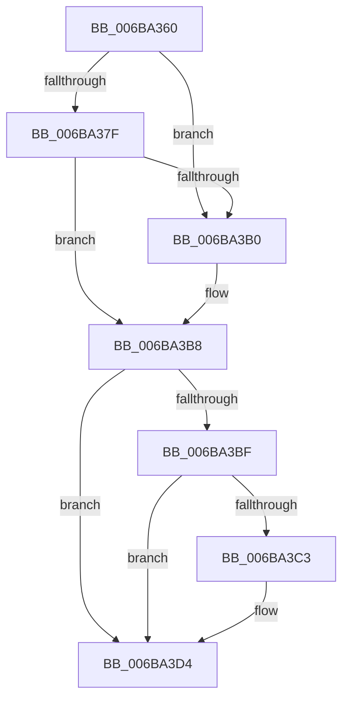

# PopSaveHiberContextWrapper

- RVA: `0x006BA360`–`0x006BA3DA` (길이 `122` bytes)
- VA: `0x00000001406BA360`
- 실행 섹션: `.text`
- PDB 이름 있음: `예`; PDB Function 태그: `아니요`
- unwind 정보 RVA: `0x000C23D0`
- 디코드: `32`개 명령, `122/122` bytes 표시
- 미해석 바이트: `0` (있으면 어셈블리에 `.byte`로 보존)

> 이 문서는 커널 이미지의 기계어와 PDB 기호를 분석해 생성했습니다. 4번과 5번은 함수 원형과 자료형을 바이너리 사용 방식에서 추정한 C 해석이며 원본 소스 복구 결과는 아닙니다.

## 1. Dependencies

- 직접 호출 지점: **7**; 고유 호출 대상: **6**
- 직접 호출자로 확인된 함수: **0**
- RIP 상대 이미지 참조: **1**

### Outgoing calls
- `0x006BA36F` → [VslSwapHiberShadowStacks](../58/VslSwapHiberShadowStacks_function_0058F750.md) (function, `0x0058F750`)
- `0x006BA37F` → [KasanHibernationGetStackLow](../5A/KasanHibernationGetStackLow_function_005AAC30.md) (function, `0x005AAC30`)
- `0x006BA390` → [KeSaveStateForHibernate](KeSaveStateForHibernate_function_006B1A50.md) (function, `0x006B1A50`)
- `0x006BA39D` → [KasanHibernationResume](../5A/KasanHibernationResume_function_005AACE0.md) (function, `0x005AACE0`)
- `0x006BA3A2` → [PopHiberCheckResume](../../pagelk/B6/PopHiberCheckResume_function_00B6D840.md) (function, `0x00B6D840`)
- `0x006BA3B3` → [PopSaveHiberContext](../../pagelk/B6/PopSaveHiberContext_function_00B6F050.md) (function, `0x00B6F050`)
- `0x006BA3CA` → [VslSwapHiberShadowStacks](../58/VslSwapHiberShadowStacks_function_0058F750.md) (function, `0x0058F750`)

### Direct callers
- 이 함수 시작 RVA로 연결되는 직접 call은 확인되지 않았습니다. 간접 호출은 완전히 역산할 수 없습니다.

### Static image references
- `0x006BA389` → RVA `0x00E27710` (`.data`; read)

## 2. Other-region calls and transfers

- 다른 실행 섹션으로 향하는 call: **2**
  - `0x006BA3A2` → [PopHiberCheckResume](../../pagelk/B6/PopHiberCheckResume_function_00B6D840.md) (`.text` → `PAGELK`)
  - `0x006BA3B3` → [PopSaveHiberContext](../../pagelk/B6/PopSaveHiberContext_function_00B6F050.md) (`.text` → `PAGELK`)
- 별도 외부 분기/꼬리 이동을 확인하지 못했습니다.

## 3. Assembly (complete function range)

```asm
006BA360  55                              push rbp
006BA361  48 83 EC 30                     sub rsp, 0x30
006BA365  48 8B E9                        mov rbp, rcx
006BA368  33 C9                           xor ecx, ecx
006BA36A  F3 48 0F 1E C9                  rdsspq rcx
006BA36F  E8 DC 53 ED FF                  call 0x14058f750
006BA374  65 83 3C 25 A4 01 00 00 00      cmp dword ptr gs:[0x1a4], 0
006BA37D  75 31                           jne 0x1406ba3b0
006BA37F  E8 AC 08 EF FF                  call 0x1405aac30
006BA384  48 89 44 24 20                  mov qword ptr [rsp + 0x20], rax
006BA389  48 8D 0D 80 D3 76 00            lea rcx, [rip + 0x76d380]
006BA390  E8 BB 76 FF FF                  call 0x1406b1a50
006BA395  48 8B 4C 24 20                  mov rcx, qword ptr [rsp + 0x20]
006BA39A  48 8B D4                        mov rdx, rsp
006BA39D  E8 3E 09 EF FF                  call 0x1405aace0
006BA3A2  E8 99 34 4B 00                  call 0x140b6d840
006BA3A7  84 C0                           test al, al
006BA3A9  B8 94 02 00 40                  mov eax, 0x40000294
006BA3AE  75 08                           jne 0x1406ba3b8
006BA3B0  48 8B CD                        mov rcx, rbp
006BA3B3  E8 98 4C 4B 00                  call 0x140b6f050
006BA3B8  3D 94 02 00 40                  cmp eax, 0x40000294
006BA3BD  74 15                           je 0x1406ba3d4
006BA3BF  85 C0                           test eax, eax
006BA3C1  79 11                           jns 0x1406ba3d4
006BA3C3  48 89 44 24 20                  mov qword ptr [rsp + 0x20], rax
006BA3C8  33 C9                           xor ecx, ecx
006BA3CA  E8 81 53 ED FF                  call 0x14058f750
006BA3CF  48 8B 44 24 20                  mov rax, qword ptr [rsp + 0x20]
006BA3D4  48 83 C4 30                     add rsp, 0x30
006BA3D8  5D                              pop rbp
006BA3D9  C3                              ret
```

## 4. C-style interpretation (structured pseudocode)

```c
__int64 __fastcall PopSaveHiberContextWrapper(__int64 a1)
{
    __int64 result;
    __int64 v_rsp;
    unsigned __int64 v_stack_m18;

    v_rsp = (v_rsp) - (48);
    a1 = 0;
    result = VslSwapHiberShadowStacks(a1, a2, a3, a4);
    if ((*(unsigned int *)(gs_base + (0 + 420))) != 0) goto loc_006BA3B0;
    result = KasanHibernationGetStackLow(a1, a2, a3, a4);
    v_stack_m18 = result;
    result = KeSaveStateForHibernate(v_rip + 7787392, a2, a3, a4);
    result = KasanHibernationResume(v_stack_m18, v_rsp, a3, a4);
    result = PopHiberCheckResume(v_stack_m18, v_rsp, a3, a4);
    result = (unsigned int)(0x40000294ULL);
    if ((unsigned __int8)(result) == 0) {
        a1 = 0;
        result = PopSaveHiberContext(a1, v_rsp, a3, a4);
    }
    if (((unsigned int)(result)) == 0x40000294ULL) goto loc_006BA3D4;
    if (sign_flag) {
        v_stack_m18 = result;
        a1 = 0;
        result = VslSwapHiberShadowStacks(a1, v_rsp, a3, a4);
        result = v_stack_m18;
    }
    v_rsp = (v_rsp) + (48);
    return result;
}
```

## 5. (Beta) C Style

```c
int64_t PopSaveHiberContextWrapper(int64_t Arg1)
{
    int64_t result;
    int64_t local_rsp;
    uint64_t v_stack_m18;

    local_rsp = (local_rsp) - (48);
    Arg1 = 0;
    result = VslSwapHiberShadowStacks(Arg1, a2, a3, a4);
    if ((*(uint32_t *)(gs_base + (0 + 0x1A4))) != 0) goto loc_006BA3B0;
    result = KasanHibernationGetStackLow(Arg1, a2, a3, a4);
    v_stack_m18 = result;
    result = KeSaveStateForHibernate(v_rip + 7787392, a2, a3, a4);
    result = KasanHibernationResume(v_stack_m18, local_rsp, a3, a4);
    result = PopHiberCheckResume(v_stack_m18, local_rsp, a3, a4);
    result = (uint32_t)(0x40000294ULL);
    if ((uint8_t)(result) == 0) {
        Arg1 = 0;
        result = PopSaveHiberContext(Arg1, local_rsp, a3, a4);
    }
    if (((uint32_t)(result)) == 0x40000294ULL) goto loc_006BA3D4;
    if (sign_flag) {
        v_stack_m18 = result;
        Arg1 = 0;
        result = VslSwapHiberShadowStacks(Arg1, local_rsp, a3, a4);
        result = v_stack_m18;
    }
    local_rsp = (local_rsp) + (48);
    return result;
}
```

## 6. Execution-region graph

[열기: 2D/3D 그래프와 함수 탐색 컨트롤 패널](../../../control-panel.html?section=text&rva=0x006BA360&view=graph)

- 2D 그래프는 위에서 아래로 흐르고, 3D 그래프는 빈 공간을 드래그해 회전합니다. Shift+드래그는 이동, 휠은 확대·축소, 함수 노드 선택은 대상 보고서 이동입니다.

### Static fallback


