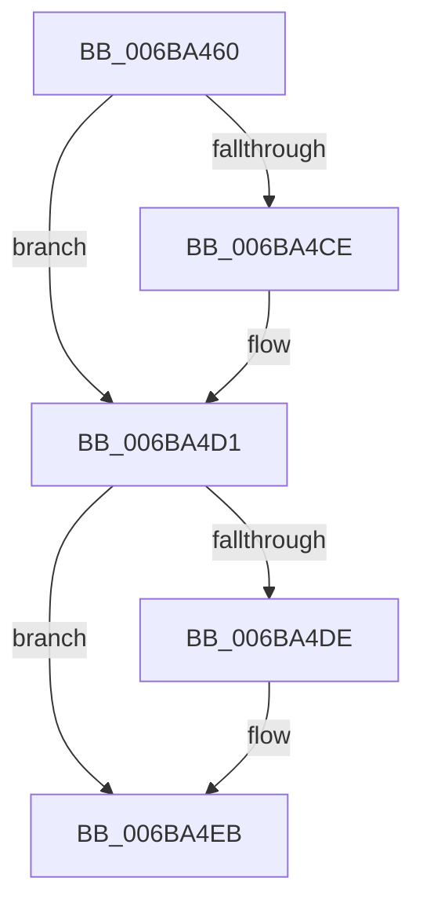

# PspGetSetContextSpecialApc

- RVA: `0x006BA460`–`0x006BA545` (길이 `229` bytes)
- VA: `0x00000001406BA460`
- 실행 섹션: `.text`
- PDB 이름 있음: `예`; PDB Function 태그: `아니요`
- unwind 정보 RVA: `0x000C23F0`
- 디코드: `51`개 명령, `229/229` bytes 표시
- 미해석 바이트: `0` (있으면 어셈블리에 `.byte`로 보존)

> 이 문서는 커널 이미지의 기계어와 PDB 기호를 분석해 생성했습니다. 4번과 5번은 함수 원형과 자료형을 바이너리 사용 방식에서 추정한 C 해석이며 원본 소스 복구 결과는 아닙니다.

## 1. Dependencies

- 직접 호출 지점: **2**; 고유 호출 대상: **2**
- 직접 호출자로 확인된 함수: **2**
- RIP 상대 이미지 참조: **0**

### Outgoing calls
- `0x006BA4C4` → [PspGetSetContextInternal](../../page/9A/PspGetSetContextInternal_function_009A61C0.md) (function, `0x009A61C0`)
- `0x006BA4E6` → [KeSetEvent](../33/KeSetEvent_function_0033F310.md) (function, `0x0033F310`)

### Direct callers
- [PspSetContextThreadInternal](../../page/8D/PspSetContextThreadInternal_function_008D4420.md) at `0x008D4551`
- [PspGetContextThreadInternal](../../page/8D/PspGetContextThreadInternal_function_008D4770.md) at `0x008D488E`

### Static image references
- 디코드된 RIP-relative 메모리 참조가 없습니다.

## 2. Other-region calls and transfers

- 다른 실행 섹션으로 향하는 call: **1**
  - `0x006BA4C4` → [PspGetSetContextInternal](../../page/9A/PspGetSetContextInternal_function_009A61C0.md) (`.text` → `PAGE`)
- 별도 외부 분기/꼬리 이동을 확인하지 못했습니다.

## 3. Assembly (complete function range)

```asm
006BA460  41 57                           push r15
006BA462  41 56                           push r14
006BA464  41 55                           push r13
006BA466  41 54                           push r12
006BA468  57                              push rdi
006BA469  56                              push rsi
006BA46A  55                              push rbp
006BA46B  53                              push rbx
006BA46C  48 81 EC C8 00 00 00            sub rsp, 0xc8
006BA473  0F 29 74 24 20                  movaps xmmword ptr [rsp + 0x20], xmm6
006BA478  0F 29 7C 24 30                  movaps xmmword ptr [rsp + 0x30], xmm7
006BA47D  44 0F 29 44 24 40               movaps xmmword ptr [rsp + 0x40], xmm8
006BA483  44 0F 29 4C 24 50               movaps xmmword ptr [rsp + 0x50], xmm9
006BA489  44 0F 29 54 24 60               movaps xmmword ptr [rsp + 0x60], xmm10
006BA48F  44 0F 29 5C 24 70               movaps xmmword ptr [rsp + 0x70], xmm11
006BA495  44 0F 29 A4 24 80 00 00 00      movaps xmmword ptr [rsp + 0x80], xmm12
006BA49E  44 0F 29 AC 24 90 00 00 00      movaps xmmword ptr [rsp + 0x90], xmm13
006BA4A7  44 0F 29 B4 24 A0 00 00 00      movaps xmmword ptr [rsp + 0xa0], xmm14
006BA4B0  44 0F 29 BC 24 B0 00 00 00      movaps xmmword ptr [rsp + 0xb0], xmm15
006BA4B9  49 8B 11                        mov rdx, qword ptr [r9]
006BA4BC  4C 8D 84 24 C0 00 00 00         lea r8, [rsp + 0xc0]
006BA4C4  E8 F7 BC 2E 00                  call 0x1409a61c0
006BA4C9  48 85 C0                        test rax, rax
006BA4CC  74 03                           je 0x1406ba4d1
006BA4CE  0F AE 08                        fxrstor [rax]
006BA4D1  48 8B 8C 24 C0 00 00 00         mov rcx, qword ptr [rsp + 0xc0]
006BA4D9  48 85 C9                        test rcx, rcx
006BA4DC  74 0D                           je 0x1406ba4eb
006BA4DE  BA 01 00 00 00                  mov edx, 1
006BA4E3  4D 33 C0                        xor r8, r8
006BA4E6  E8 25 4E C8 FF                  call 0x14033f310
006BA4EB  0F 28 74 24 20                  movaps xmm6, xmmword ptr [rsp + 0x20]
006BA4F0  0F 28 7C 24 30                  movaps xmm7, xmmword ptr [rsp + 0x30]
006BA4F5  44 0F 28 44 24 40               movaps xmm8, xmmword ptr [rsp + 0x40]
006BA4FB  44 0F 28 4C 24 50               movaps xmm9, xmmword ptr [rsp + 0x50]
006BA501  44 0F 28 54 24 60               movaps xmm10, xmmword ptr [rsp + 0x60]
006BA507  44 0F 28 5C 24 70               movaps xmm11, xmmword ptr [rsp + 0x70]
006BA50D  44 0F 28 A4 24 80 00 00 00      movaps xmm12, xmmword ptr [rsp + 0x80]
006BA516  44 0F 28 AC 24 90 00 00 00      movaps xmm13, xmmword ptr [rsp + 0x90]
006BA51F  44 0F 28 B4 24 A0 00 00 00      movaps xmm14, xmmword ptr [rsp + 0xa0]
006BA528  44 0F 28 BC 24 B0 00 00 00      movaps xmm15, xmmword ptr [rsp + 0xb0]
006BA531  48 81 C4 C8 00 00 00            add rsp, 0xc8
006BA538  5B                              pop rbx
006BA539  5D                              pop rbp
006BA53A  5E                              pop rsi
006BA53B  5F                              pop rdi
006BA53C  41 5C                           pop r12
006BA53E  41 5D                           pop r13
006BA540  41 5E                           pop r14
006BA542  41 5F                           pop r15
006BA544  C3                              ret
```

## 4. C-style interpretation (structured pseudocode)

```c
__int64 __fastcall PspGetSetContextSpecialApc(__int64 a1, __int64 a2, __int64 a3, __int64 a4)
{
    __int64 result;
    __int64 v_rsp;
    unsigned __int64 v_stack_m48;
    unsigned __int64 v_stack_m58;
    unsigned __int64 v_stack_m68;
    unsigned __int64 v_stack_m78;
    unsigned __int64 v_stack_m88;
    unsigned __int64 v_stack_m98;
    unsigned __int64 v_stack_mA8;
    unsigned __int64 v_stack_mB8;
    unsigned __int64 v_stack_mC8;
    unsigned __int64 v_stack_mD8;
    unsigned __int64 v_stack_mE8;

    v_rsp = (v_rsp) - (200);
    v_stack_mE8 = v_xmm6;
    v_stack_mD8 = v_xmm7;
    v_stack_mC8 = v_xmm8;
    v_stack_mB8 = v_xmm9;
    v_stack_mA8 = v_xmm10;
    v_stack_m98 = v_xmm11;
    v_stack_m88 = v_xmm12;
    v_stack_m78 = v_xmm13;
    v_stack_m68 = v_xmm14;
    v_stack_m58 = v_xmm15;
    result = PspGetSetContextInternal(a1, *(unsigned __int64 *)(a4), v_stack_m48, a4);
    if (result != 0) {
    }
    if (v_stack_m48 != 0) {
        a2 = 1;
        a3 = 0;
        result = KeSetEvent(v_stack_m48, a2, a3, a4);
    }
    v_rsp = (v_rsp) + (200);
    return result;
}
```

## 5. (Beta) C Style

```c
int64_t PspGetSetContextSpecialApc(int64_t Arg1, int64_t Arg2, int64_t Arg3, void *Arg4)
{
    uint8_t *arg4 = (uint8_t *)Arg4;

    int64_t result;
    int64_t local_rsp;
    uint64_t v_stack_m48;
    uint64_t v_stack_m58;
    uint64_t v_stack_m68;
    uint64_t v_stack_m78;
    uint64_t v_stack_m88;
    uint64_t v_stack_m98;
    uint64_t v_stack_mA8;
    uint64_t v_stack_mB8;
    uint64_t v_stack_mC8;
    uint64_t v_stack_mD8;
    uint64_t v_stack_mE8;

    local_rsp = (local_rsp) - (200);
    v_stack_mE8 = v_xmm6;
    v_stack_mD8 = v_xmm7;
    v_stack_mC8 = v_xmm8;
    v_stack_mB8 = v_xmm9;
    v_stack_mA8 = v_xmm10;
    v_stack_m98 = v_xmm11;
    v_stack_m88 = v_xmm12;
    v_stack_m78 = v_xmm13;
    v_stack_m68 = v_xmm14;
    v_stack_m58 = v_xmm15;
    result = PspGetSetContextInternal(Arg1, *(uint64_t *)(arg4), v_stack_m48, Arg4);
    if (result != 0) {
    }
    if (v_stack_m48 != 0) {
        Arg2 = 1;
        Arg3 = 0;
        result = KeSetEvent(v_stack_m48, Arg2, Arg3, Arg4);
    }
    local_rsp = (local_rsp) + (200);
    return result;
}
```

### 관측된 메모리 오프셋

구조체 형식이 확인되지 않은 접근은 인자 기준의 오프셋으로만 기록했습니다.

| 기준 인자 | 오프셋 표현 | 폭 (bit) | 접근 |
|---|---:|---:|---|
| `Arg4` | `+ 0x0` | `64` | `R` |

## 6. Execution-region graph

[열기: 2D/3D 그래프와 함수 탐색 컨트롤 패널](../../../control-panel.html?section=text&rva=0x006BA460&view=graph)

- 2D 그래프는 위에서 아래로 흐르고, 3D 그래프는 빈 공간을 드래그해 회전합니다. Shift+드래그는 이동, 휠은 확대·축소, 함수 노드 선택은 대상 보고서 이동입니다.

### Static fallback


