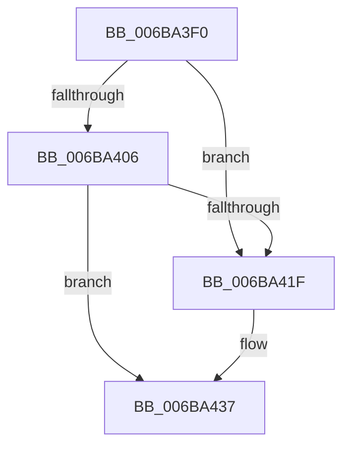

# PspSyscallProviderServiceDispatch

- RVA: `0x006BA3F0`–`0x006BA441` (길이 `81` bytes)
- VA: `0x00000001406BA3F0`
- 실행 섹션: `.text`
- PDB 이름 있음: `예`; PDB Function 태그: `아니요`
- unwind 정보 RVA: `0x000C23E0`
- 디코드: `23`개 명령, `81/81` bytes 표시
- 미해석 바이트: `0` (있으면 어셈블리에 `.byte`로 보존)

> 이 문서는 커널 이미지의 기계어와 PDB 기호를 분석해 생성했습니다. 4번과 5번은 함수 원형과 자료형을 바이너리 사용 방식에서 추정한 C 해석이며 원본 소스 복구 결과는 아닙니다.

## 1. Dependencies

- 직접 호출 지점: **2**; 고유 호출 대상: **2**
- 직접 호출자로 확인된 함수: **1**
- RIP 상대 이미지 참조: **0**

### Outgoing calls
- `0x006BA416` → [PspCaptureSystemServiceInMemoryArgs](../../page/77/PspCaptureSystemServiceInMemoryArgs_function_0077E400.md) (function, `0x0077E400`)
- `0x006BA432` → [guard_dispatch_icall](guard_dispatch_icall_function_006BAAD0.md) (function, `0x006BAAD0`)

### Direct callers
- [PsSyscallProviderDispatch](../../page/AB/PsSyscallProviderDispatch_function_00AB3D80.md) at `0x00AB3EE2`

### Static image references
- 디코드된 RIP-relative 메모리 참조가 없습니다.

## 2. Other-region calls and transfers

- 다른 실행 섹션으로 향하는 call: **1**
  - `0x006BA416` → [PspCaptureSystemServiceInMemoryArgs](../../page/77/PspCaptureSystemServiceInMemoryArgs_function_0077E400.md) (`.text` → `PAGE`)
- 별도 외부 분기/꼬리 이동을 확인하지 못했습니다.

## 3. Assembly (complete function range)

```asm
006BA3F0  48 53                           push rbx
006BA3F2  57                              push rdi
006BA3F3  48 81 EC 98 00 00 00            sub rsp, 0x98
006BA3FA  48 8B D9                        mov rbx, rcx
006BA3FD  48 8B FA                        mov rdi, rdx
006BA400  49 83 E0 0F                     and r8, 0xf
006BA404  74 19                           je 0x1406ba41f
006BA406  48 8D 54 24 20                  lea rdx, [rsp + 0x20]
006BA40B  48 8B 8B 80 01 00 00            mov rcx, qword ptr [rbx + 0x180]
006BA412  48 8D 49 28                     lea rcx, [rcx + 0x28]
006BA416  E8 E5 3F 0C 00                  call 0x14077e400
006BA41B  85 C0                           test eax, eax
006BA41D  78 18                           js 0x1406ba437
006BA41F  48 8B C7                        mov rax, rdi
006BA422  4C 8B 4B 50                     mov r9, qword ptr [rbx + 0x50]
006BA426  4C 8B 43 48                     mov r8, qword ptr [rbx + 0x48]
006BA42A  48 8B 53 40                     mov rdx, qword ptr [rbx + 0x40]
006BA42E  48 8B 4B 38                     mov rcx, qword ptr [rbx + 0x38]
006BA432  E8 99 06 00 00                  call 0x1406baad0
006BA437  48 81 C4 98 00 00 00            add rsp, 0x98
006BA43E  5F                              pop rdi
006BA43F  5B                              pop rbx
006BA440  C3                              ret
```

## 4. C-style interpretation (structured pseudocode)

```c
__int64 __fastcall PspSyscallProviderServiceDispatch(__int64 a1, __int64 a2, __int64 a3)
{
    __int64 result;
    __int64 v_rsp;
    unsigned __int64 v_stack_m88;

    v_rsp = (v_rsp) - (152);
    a3 = (a3) & (15);
    if (condition_is_equal) goto loc_006BA41F;
    result = PspCaptureSystemServiceInMemoryArgs(*(unsigned __int64 *)(a1 + 384) + 40, v_stack_m88, a3, a4);
    if (!(sign_flag)) {
        result = a2;
        a4 = *(unsigned __int64 *)(a1 + 80);
        a3 = *(unsigned __int64 *)(a1 + 72);
        a2 = *(unsigned __int64 *)(a1 + 64);
        a1 = *(unsigned __int64 *)(a1 + 56);
        result = guard_dispatch_icall(a1, a2, a3, a4);
    }
    v_rsp = (v_rsp) + (152);
    return result;
}
```

## 5. (Beta) C Style

```c
int64_t PspSyscallProviderServiceDispatch(void *Arg1, int64_t Arg2, int64_t Arg3)
{
    uint8_t *arg1 = (uint8_t *)Arg1;

    int64_t result;
    int64_t local_rsp;
    uint64_t v_stack_m88;

    local_rsp = (local_rsp) - (152);
    Arg3 = (Arg3) & (15);
    if (condition_is_equal) goto loc_006BA41F;
    result = PspCaptureSystemServiceInMemoryArgs(*(uint64_t *)(arg1 + 0x180) + 40, v_stack_m88, Arg3, a4);
    if (!(sign_flag)) {
        result = Arg2;
        a4 = *(uint64_t *)(arg1 + 0x50);
        Arg3 = *(uint64_t *)(arg1 + 0x48);
        Arg2 = *(uint64_t *)(arg1 + 0x40);
        Arg1 = *(uint64_t *)(arg1 + 0x38);
        result = guard_dispatch_icall(Arg1, Arg2, Arg3, a4);
    }
    local_rsp = (local_rsp) + (152);
    return result;
}
```

### 관측된 메모리 오프셋

구조체 형식이 확인되지 않은 접근은 인자 기준의 오프셋으로만 기록했습니다.

| 기준 인자 | 오프셋 표현 | 폭 (bit) | 접근 |
|---|---:|---:|---|
| `Arg1` | `+ 0x38` | `64` | `R` |
| `Arg1` | `+ 0x40` | `64` | `R` |
| `Arg1` | `+ 0x48` | `64` | `R` |
| `Arg1` | `+ 0x50` | `64` | `R` |
| `Arg1` | `+ 0x180` | `64` | `R` |

## 6. Execution-region graph

[열기: 2D/3D 그래프와 함수 탐색 컨트롤 패널](../../../control-panel.html?section=text&rva=0x006BA3F0&view=graph)

- 2D 그래프는 위에서 아래로 흐르고, 3D 그래프는 빈 공간을 드래그해 회전합니다. Shift+드래그는 이동, 휠은 확대·축소, 함수 노드 선택은 대상 보고서 이동입니다.

### Static fallback


