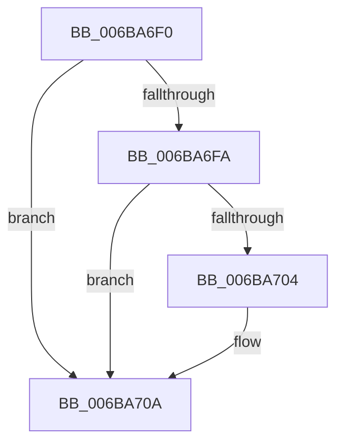

# RtlCompareMemoryUlong

- RVA: `0x006BA6F0`–`0x006BA714` (길이 `36` bytes)
- VA: `0x00000001406BA6F0`
- 실행 섹션: `.text`
- PDB 이름 있음: `예`; PDB Function 태그: `아니요`
- unwind 정보 RVA: `0x000C254C`
- 디코드: `13`개 명령, `36/36` bytes 표시
- 미해석 바이트: `0` (있으면 어셈블리에 `.byte`로 보존)

> 이 문서는 커널 이미지의 기계어와 PDB 기호를 분석해 생성했습니다. 4번과 5번은 함수 원형과 자료형을 바이너리 사용 방식에서 추정한 C 해석이며 원본 소스 복구 결과는 아닙니다.

## 1. Dependencies

- 직접 호출 지점: **0**; 고유 호출 대상: **0**
- 직접 호출자로 확인된 함수: **11**
- RIP 상대 이미지 참조: **0**

### Outgoing calls
- 직접 디코드된 call 명령이 없습니다.

### Direct callers
- [RtlScrubMemory](../3F/RtlScrubMemory_function_003F96DC.md) at `0x003F9770`
- [MiHashIsCommon](../46/MiHashIsCommon_function_00460848.md) at `0x0046087E`
- [MiDoGangAssignment](../4D/MiDoGangAssignment_function_004DE270.md) at `0x004DE37E`
- [RtlpAllocateHeap](../5E/RtlpAllocateHeap_function_005E8B1C.md) at `0x005E8F7F`
- [RtlpCoalesceFreeBlocks](../5E/RtlpCoalesceFreeBlocks_function_005E952C.md) at `0x005E9656`
- [RtlpCoalesceFreeBlocks](../5E/RtlpCoalesceFreeBlocks_function_005E952C.md) at `0x005E980B`
- [RtlpCreateSplitBlock](../5E/RtlpCreateSplitBlock_function_005E98F0.md) at `0x005E9AAF`
- [MiFreedUnusedPfnPagesDpc](../67/MiFreedUnusedPfnPagesDpc_function_00672378.md) at `0x00672538`
- [MiFreedUnusedPfnPagesDpc](../67/MiFreedUnusedPfnPagesDpc_function_00672378.md) at `0x0067258A`
- [MiFreedUnusedPfnPagesDpc](../67/MiFreedUnusedPfnPagesDpc_function_00672378.md) at `0x006725E4`
- [MiSoloZeroHugeRange](../68/MiSoloZeroHugeRange_function_0068C6E4.md) at `0x0068C7D2`
- [MiZeroHugeRangeWorker](../68/MiZeroHugeRangeWorker_function_0068C960.md) at `0x0068CA14`
- [MmQueryVirtualMemory](../../page/9D/MmQueryVirtualMemory_function_009D9280.md) at `0x009D9538`
- [IopTrackLink](../../page/A3/IopTrackLink_function_00A36764.md) at `0x00A36968`
- [IopTrackLink](../../page/A3/IopTrackLink_function_00A36764.md) at `0x00A36C6F`
- [IopTrackLink](../../page/A3/IopTrackLink_function_00A36764.md) at `0x00A36D64`
- [IopTrackLink](../../page/A3/IopTrackLink_function_00A36764.md) at `0x00A36F87`

### Static image references
- 디코드된 RIP-relative 메모리 참조가 없습니다.

## 2. Other-region calls and transfers

- 다른 실행 섹션으로 향하는 call: **0**
- 별도 외부 분기/꼬리 이동을 확인하지 못했습니다.

## 3. Assembly (complete function range)

```asm
006BA6F0  57                              push rdi
006BA6F1  48 8B F9                        mov rdi, rcx
006BA6F4  48 C1 EA 02                     shr rdx, 2
006BA6F8  74 10                           je 0x1406ba70a
006BA6FA  48 8B CA                        mov rcx, rdx
006BA6FD  41 8B C0                        mov eax, r8d
006BA700  F3 AF                           repe scasd eax, dword ptr [rdi]
006BA702  74 06                           je 0x1406ba70a
006BA704  48 FF C1                        inc rcx
006BA707  48 2B D1                        sub rdx, rcx
006BA70A  48 8D 04 95 00 00 00 00         lea rax, [rdx*4]
006BA712  5F                              pop rdi
006BA713  C3                              ret
```

## 4. C-style interpretation (structured pseudocode)

```c
__int64 __fastcall RtlCompareMemoryUlong(__int64 a1, __int64 a2, int a3)
{
    a2 = (a2) >> (2);
    if (condition_is_equal) goto loc_006BA70A;
    if (!(condition_is_equal)) {
        a1 = (a2) + 1;
        a2 = (a2) - (a1);
    }
    return a2 * 4;
}
```

## 5. (Beta) C Style

```c
int64_t RtlCompareMemoryUlong(void *Arg1, int64_t Arg2, int32_t Arg3)
{
    uint8_t *arg1 = (uint8_t *)Arg1;

    Arg2 = (Arg2) >> (2);
    if (condition_is_equal) goto loc_006BA70A;
    if (!(condition_is_equal)) {
        Arg1 = (Arg2) + 1;
        Arg2 = (Arg2) - (Arg1);
    }
    return Arg2 * 4;
}
```

### 관측된 메모리 오프셋

구조체 형식이 확인되지 않은 접근은 인자 기준의 오프셋으로만 기록했습니다.

| 기준 인자 | 오프셋 표현 | 폭 (bit) | 접근 |
|---|---:|---:|---|
| `Arg1` | `+ 0x0` | `32` | `R` |

## 6. Execution-region graph

[열기: 2D/3D 그래프와 함수 탐색 컨트롤 패널](../../../control-panel.html?section=text&rva=0x006BA6F0&view=graph)

- 2D 그래프는 위에서 아래로 흐르고, 3D 그래프는 빈 공간을 드래그해 회전합니다. Shift+드래그는 이동, 휠은 확대·축소, 함수 노드 선택은 대상 보고서 이동입니다.

### Static fallback


