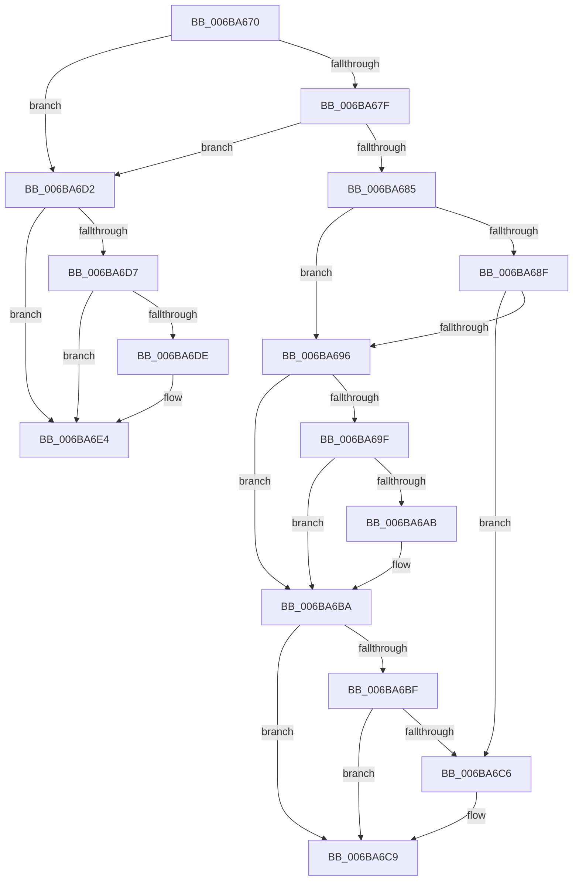

# RtlCompareMemory

- RVA: `0x006BA670`–`0x006BA6EA` (길이 `122` bytes)
- VA: `0x00000001406BA670`
- 실행 섹션: `.text`
- PDB 이름 있음: `예`; PDB Function 태그: `아니요`
- unwind 정보 RVA: `0x000C2540`
- 디코드: `49`개 명령, `122/122` bytes 표시
- 미해석 바이트: `0` (있으면 어셈블리에 `.byte`로 보존)

> 이 문서는 커널 이미지의 기계어와 PDB 기호를 분석해 생성했습니다. 4번과 5번은 함수 원형과 자료형을 바이너리 사용 방식에서 추정한 C 해석이며 원본 소스 복구 결과는 아닙니다.

## 1. Dependencies

- 직접 호출 지점: **0**; 고유 호출 대상: **0**
- 직접 호출자로 확인된 함수: **89**
- RIP 상대 이미지 참조: **0**

### Outgoing calls
- 직접 디코드된 call 명령이 없습니다.

### Direct callers
- [SepIsPackageSid](../30/SepIsPackageSid_function_00301120.md) at `0x0030114F`
- [MmReportParkedProcessors](../30/MmReportParkedProcessors_function_00305600.md) at `0x00305629`
- [PpmHeteroUpdateHgsConfiguration](../3B/PpmHeteroUpdateHgsConfiguration_function_003BF344.md) at `0x003BFA8B`
- [SepIsCapabilitySid](../3D/SepIsCapabilitySid_function_003D0DF0.md) at `0x003D0E1F`
- [EtwpTraceStackKey](../3F/EtwpTraceStackKey_function_003FC290.md) at `0x003FC3F0`
- [PpmPerfCalculateQosClassPolicies](../42/PpmPerfCalculateQosClassPolicies_function_0042BFC8.md) at `0x0042C399`
- [PpmPerfCalculateQosClassPolicies](../42/PpmPerfCalculateQosClassPolicies_function_0042BFC8.md) at `0x0042C464`
- [PpmPerfCalculateQosClassPolicies](../42/PpmPerfCalculateQosClassPolicies_function_0042BFC8.md) at `0x0042C4E6`
- [PpmPerfCalculateQosClassPolicies](../42/PpmPerfCalculateQosClassPolicies_function_0042BFC8.md) at `0x0042C665`
- [PopWriteBsdPoInfo](../43/PopWriteBsdPoInfo_function_00430768.md) at `0x004307E2`
- [IoReportTargetDeviceChangeAsynchronous](../47/IoReportTargetDeviceChangeAsynchronous_function_00475DA0.md) at `0x00475E1C`
- [IoReportTargetDeviceChangeAsynchronous](../47/IoReportTargetDeviceChangeAsynchronous_function_00475DA0.md) at `0x00475E38`
- [IoReportTargetDeviceChangeAsynchronous](../47/IoReportTargetDeviceChangeAsynchronous_function_00475DA0.md) at `0x00475E54`
- [EtwpGetCrimsonStackKey](../4D/EtwpGetCrimsonStackKey_function_004D68CC.md) at `0x004D6A2A`
- [WheaGetErrPacketFromErrRecord](../55/WheaGetErrPacketFromErrRecord_function_00556490.md) at `0x005564E6`
- [HalpGenericErrorSourceRecovery](../55/HalpGenericErrorSourceRecovery_function_0055669C.md) at `0x005566F9`
- [HalpGenericErrorSourceRecovery](../55/HalpGenericErrorSourceRecovery_function_0055669C.md) at `0x00556790`
- [HalpHpetDiscover](../56/HalpHpetDiscover_function_00561E98.md) at `0x00561FAD`
- [SecureDump_ValidateAmeCertChain](../5A/SecureDump_ValidateAmeCertChain_function_005A38B0.md) at `0x005A39D0`
- [SecureDump_ValidateAmeCertChain](../5A/SecureDump_ValidateAmeCertChain_function_005A38B0.md) at `0x005A39FB`
- [RtlpStdLogCapturedStackTrace](../5E/RtlpStdLogCapturedStackTrace_function_005E68F4.md) at `0x005E6977`
- [RtlIsValidAntiTamperAppSid](../5E/RtlIsValidAntiTamperAppSid_function_005E7194.md) at `0x005E71D1`
- [RtlIsValidAntiTamperSid](../5E/RtlIsValidAntiTamperSid_function_005E720C.md) at `0x005E7249`
- [SepIsAppSuiteSid](../60/SepIsAppSuiteSid_function_006083A0.md) at `0x006083D8`
- [SepIsTrustLabelSid](../60/SepIsTrustLabelSid_function_00608408.md) at `0x00608440`
- [MinCrypK_ParseRevocationList](../6A/MinCrypK_ParseRevocationList_function_006A602C.md) at `0x006A609D`
- [MinCryptIsKeyPresent](../6A/MinCryptIsKeyPresent_function_006A638C.md) at `0x006A641F`
- [CmpTransUowIsEqual](../../page/70/CmpTransUowIsEqual_function_007049CC.md) at `0x007049D6`
- [PipMatchPersistentMemory](../../page/72/PipMatchPersistentMemory_function_0072594C.md) at `0x007259BD`
- [PnpNotifyHwProfileChange](../../page/72/PnpNotifyHwProfileChange_function_00729B04.md) at `0x00729C07`
- [PnpRequestHwProfileChangeNotification](../../page/72/PnpRequestHwProfileChangeNotification_function_00729E78.md) at `0x00729EC8`
- [PnpRequestHwProfileChangeNotification](../../page/72/PnpRequestHwProfileChangeNotification_function_00729E78.md) at `0x00729EE4`
- [PnpRequestHwProfileChangeNotification](../../page/72/PnpRequestHwProfileChangeNotification_function_00729E78.md) at `0x00729F00`
- [PnpRequestHwProfileChangeNotification](../../page/72/PnpRequestHwProfileChangeNotification_function_00729E78.md) at `0x00729F1D`
- [PiDrvDbQuerySyncNodesUpdated](../../page/74/PiDrvDbQuerySyncNodesUpdated_function_00741F70.md) at `0x0074214E`
- [ObpGetTraceIndex](../../page/74/ObpGetTraceIndex_function_0074FB28.md) at `0x0074FBD5`
- [CompareNamesCaseSensitive](../../page/78/CompareNamesCaseSensitive_function_0078CA1C.md) at `0x0078CAB2`
- [WmipParseSysIdTable](../../page/7B/WmipParseSysIdTable_function_007B3068.md) at `0x007B3104`
- [WmipParseSysIdTable](../../page/7B/WmipParseSysIdTable_function_007B3068.md) at `0x007B312A`
- [SLUpdateLicenseDataInternal](../../page/7C/SLUpdateLicenseDataInternal_function_007C9C04.md) at `0x007C9E4F`
- [SLUpdateLicenseDataInternal](../../page/7C/SLUpdateLicenseDataInternal_function_007C9C04.md) at `0x007C9E77`
- [CmpFilterAcpiDockingState](../../page/7E/CmpFilterAcpiDockingState_function_007E3B1C.md) at `0x007E3BC2`
- [MiCompareUserSidHotPatchNodes](../../page/80/MiCompareUserSidHotPatchNodes_function_00803144.md) at `0x0080318F`
- [SdbpMergeAreTagValuesEqual](../../page/81/SdbpMergeAreTagValuesEqual_function_00819524.md) at `0x0081963B`
- [BiUpdateBcdObject](../../page/82/BiUpdateBcdObject_function_008270D0.md) at `0x00827183`
- [BiUpdateBcdObject](../../page/82/BiUpdateBcdObject_function_008270D0.md) at `0x0082725C`
- [MinCryptDecodeOid](../../page/83/MinCryptDecodeOid_function_008361F4.md) at `0x0083623B`
- [I_MinCryptFindIssuerCertificateByName](../../page/83/I_MinCryptFindIssuerCertificateByName_function_00836530.md) at `0x00836591`
- [I_MinCryptFindRootByKey](../../page/83/I_MinCryptFindRootByKey_function_00836620.md) at `0x0083665F`
- [I_MinCryptFindRootByName](../../page/83/I_MinCryptFindRootByName_function_00836694.md) at `0x008366E9`
- [I_MinCryptFindRootByName](../../page/83/I_MinCryptFindRootByName_function_00836694.md) at `0x00836738`
- [I_MinCryptFindSignerCertificateByIssuerAndSerialNumber](../../page/83/I_MinCryptFindSignerCertificateByIssuerAndSerialNumber_function_00837DE8.md) at `0x00837E4A`
- [I_MinCryptFindSignerCertificateByIssuerAndSerialNumber](../../page/83/I_MinCryptFindSignerCertificateByIssuerAndSerialNumber_function_00837DE8.md) at `0x00837E5E`
- [I_MinCryptVerifyRFC3161TimeStamp](../../page/83/I_MinCryptVerifyRFC3161TimeStamp_function_008382A4.md) at `0x0083833D`
- [I_MinCryptVerifyRFC3161TimeStamp](../../page/83/I_MinCryptVerifyRFC3161TimeStamp_function_008382A4.md) at `0x008383D5`
- [I_MinCryptVerifySignerAuthenticatedAttributes](../../page/83/I_MinCryptVerifySignerAuthenticatedAttributes_function_00838430.md) at `0x008384B1`
- [MinCrypK_VerifySignedDataKModeEx](../../page/83/MinCrypK_VerifySignedDataKModeEx_function_00838568.md) at `0x0083866A`
- [CmpCompareNewValueDataAgainstKCBCache](../../page/84/CmpCompareNewValueDataAgainstKCBCache_function_00846920.md) at `0x00846A06`
- [ObpLookupDirectoryEntry](../../page/85/ObpLookupDirectoryEntry_function_0085D5B0.md) at `0x0085D73A`
- [SepAdtAuditObjectAccessWithContext](../../page/86/SepAdtAuditObjectAccessWithContext_function_0086EEF0.md) at `0x0086F192`
- [SepAdtAuditObjectAccessWithContext](../../page/86/SepAdtAuditObjectAccessWithContext_function_0086EEF0.md) at `0x0086F1DD`
- [ObpLookupObjectName](../../page/89/ObpLookupObjectName_function_0089BE90.md) at `0x0089CFA1`
- [ObpLookupObjectName](../../page/89/ObpLookupObjectName_function_0089BE90.md) at `0x0089D9C3`
- [sub_008C0C36](../../page/8C/Unknown_function_008C0C36.md) at `0x008C0D21`
- [EtwpClearSessionAndUnreferenceEntry](../../page/8C/EtwpClearSessionAndUnreferenceEntry_function_008C1438.md) at `0x008C17CE`
- [sub_008D1C2C](../../page/8D/Unknown_function_008D1C2C.md) at `0x008D1C7D`
- [PnpIsNullGuid](../../page/8D/PnpIsNullGuid_function_008DD9E0.md) at `0x008DD9F4`
- [PnpDeviceRaisePropertyChangeEventWorker](../../page/8F/PnpDeviceRaisePropertyChangeEventWorker_function_008F80E0.md) at `0x008F843F`
- [PnpCompareInterruptInformation](../../page/90/PnpCompareInterruptInformation_function_009013F0.md) at `0x0090143A`
- [RtlCompareString](../../page/90/RtlCompareString_function_0090E880.md) at `0x0090E921`
- [PopSetPowerSettingValue](../../page/91/PopSetPowerSettingValue_function_00914E54.md) at `0x00914F3C`
- [PopArePowerSettingsEqual](../../page/91/PopArePowerSettingsEqual_function_0091606C.md) at `0x0091608C`
- [sub_0091FAE5](../../page/91/Unknown_function_0091FAE5.md) at `0x0091FB0C`
- [sub_0091FB36](../../page/91/Unknown_function_0091FB36.md) at `0x0091FB62`
- [SeSecurityDescriptorChangedAuditAlarm](../../page/91/SeSecurityDescriptorChangedAuditAlarm_function_0091FC5C.md) at `0x009202EA`
- [SepIsAclEqual](../../page/92/SepIsAclEqual_function_009207C8.md) at `0x009207E8`
- [RtlEqualUnicodeString](../../page/93/RtlEqualUnicodeString_function_00932A20.md) at `0x00932A90`
- [RtlCompareUnicodeString](../../page/93/RtlCompareUnicodeString_function_00937F90.md) at `0x00937FE9`
- [IopRegisterDeviceInterface](../../page/95/IopRegisterDeviceInterface_function_009501B0.md) at `0x009503E6`
- [PnpNotifyDeviceClassChange](../../page/95/PnpNotifyDeviceClassChange_function_0095441C.md) at `0x0095455A`
- [PnpNotifyTargetDeviceChange](../../page/95/PnpNotifyTargetDeviceChange_function_00954790.md) at `0x0095482F`
- [PnpNotifyTargetDeviceChange](../../page/95/PnpNotifyTargetDeviceChange_function_00954790.md) at `0x009549EA`
- [RtlCompareUnicodeStrings](../../page/97/RtlCompareUnicodeStrings_function_009727E0.md) at `0x0097282F`
- [sub_0099FE78](../../page/99/Unknown_function_0099FE78.md) at `0x0099FFAB`
- [ObpCompareEntryLevel2](../../page/9C/ObpCompareEntryLevel2_function_009CA430.md) at `0x009CA469`
- [AlpcpExposeWorkOnBehalfAttribute](../../page/9D/AlpcpExposeWorkOnBehalfAttribute_function_009D82F0.md) at `0x009D8343`
- [sub_00A0C12C](../../page/A0/Unknown_function_00A0C12C.md) at `0x00A0C3B5`
- [EtwpTrackDebugIdForSession](../../page/A0/EtwpTrackDebugIdForSession_function_00A0EDD4.md) at `0x00A0EE63`
- [EtwpTrackBinaryForSession](../../page/A1/EtwpTrackBinaryForSession_function_00A11708.md) at `0x00A117EA`
- [PnpBusTypeGuidGetIndex](../../page/A2/PnpBusTypeGuidGetIndex_function_00A2B088.md) at `0x00A2B0D4`
- [PpmCompareAndApplyPolicySettings](../../page/A5/PpmCompareAndApplyPolicySettings_function_00A52CEC.md) at `0x00A52E32`
- [PopInitializeHeteroProcessors](../../page/A5/PopInitializeHeteroProcessors_function_00A53570.md) at `0x00A5372E`
- [PopInitializeHeteroProcessors](../../page/A5/PopInitializeHeteroProcessors_function_00A53570.md) at `0x00A5374A`
- [RtlIsPackageSid](../../page/A5/RtlIsPackageSid_function_00A5E73C.md) at `0x00A5E761`
- [RtlIsCapabilitySid](../../page/A5/RtlIsCapabilitySid_function_00A5ED84.md) at `0x00A5EDA9`
- [IoReportTargetDeviceChange](../../page/A6/IoReportTargetDeviceChange_function_00A66F20.md) at `0x00A66F9C`
- [IoReportTargetDeviceChange](../../page/A6/IoReportTargetDeviceChange_function_00A66F20.md) at `0x00A66FC0`
- [IoReportTargetDeviceChange](../../page/A6/IoReportTargetDeviceChange_function_00A66F20.md) at `0x00A66FE4`
- [RtlGetAppContainerSidType](../../page/A7/RtlGetAppContainerSidType_function_00A72160.md) at `0x00A7218C`
- [PipGenerateContainerID](../../page/A8/PipGenerateContainerID_function_00A87694.md) at `0x00A8788D`
- [SepCheckCapabilities](../../page/AA/SepCheckCapabilities_function_00AA4A10.md) at `0x00AA4BDE`
- [sub_00B222A0](../../page/B2/Unknown_function_00B222A0.md) at `0x00B2234E`
- [sub_00B222A0](../../page/B2/Unknown_function_00B222A0.md) at `0x00B2241E`
- [sub_00B222A0](../../page/B2/Unknown_function_00B222A0.md) at `0x00B2245F`
- [sub_00B40828](../../page/B4/Unknown_function_00B40828.md) at `0x00B40B8B`
- [sub_00B40828](../../page/B4/Unknown_function_00B40828.md) at `0x00B40BA8`
- [VfUtilEqualUnicodeString](../../pagevrfy/B9/VfUtilEqualUnicodeString_function_00B93218.md) at `0x00B93234`
- [ViDdiDispatchWmiQueryAllData](../../pagevrfy/B9/ViDdiDispatchWmiQueryAllData_function_00B944D4.md) at `0x00B94524`
- [ViCheckTag](../../pagevrfy/B9/ViCheckTag_function_00B98614.md) at `0x00B9865F`
- [ViCheckTag](../../pagevrfy/B9/ViCheckTag_function_00B98614.md) at `0x00B986D3`
- [ViCopyBackModifiedBuffer](../../pagevrfy/B9/ViCopyBackModifiedBuffer_function_00B98764.md) at `0x00B9879F`
- [HalpAuditSlicTables](../../init/C2/HalpAuditSlicTables_function_00C24A94.md) at `0x00C24B14`
- [PipMigratePnpState](../../init/C3/PipMigratePnpState_function_00C317D4.md) at `0x00C31A50`
- [VhdiInitializeBootDisk](../../init/C6/VhdiInitializeBootDisk_function_00C6E190.md) at `0x00C6E3CC`
- [VhdiInitializeBootDisk](../../init/C6/VhdiInitializeBootDisk_function_00C6E190.md) at `0x00C6E3E4`
- [CimfsInitializeBootDisk](../../init/C6/CimfsInitializeBootDisk_function_00C6E9D0.md) at `0x00C6EBE9`
- [CimfsInitializeBootDisk](../../init/C6/CimfsInitializeBootDisk_function_00C6E9D0.md) at `0x00C6EC03`

### Static image references
- 디코드된 RIP-relative 메모리 참조가 없습니다.

## 2. Other-region calls and transfers

- 다른 실행 섹션으로 향하는 call: **0**
- 별도 외부 분기/꼬리 이동을 확인하지 못했습니다.

## 3. Assembly (complete function range)

```asm
006BA670  57                              push rdi
006BA671  56                              push rsi
006BA672  48 8B F1                        mov rsi, rcx
006BA675  48 8B FA                        mov rdi, rdx
006BA678  33 D1                           xor edx, ecx
006BA67A  83 E2 07                        and edx, 7
006BA67D  75 53                           jne 0x1406ba6d2
006BA67F  49 83 F8 08                     cmp r8, 8
006BA683  72 4D                           jb 0x1406ba6d2
006BA685  4C 8B CF                        mov r9, rdi
006BA688  F7 D9                           neg ecx
006BA68A  83 E1 07                        and ecx, 7
006BA68D  74 07                           je 0x1406ba696
006BA68F  4C 2B C1                        sub r8, rcx
006BA692  F3 A6                           repe cmpsb byte ptr [rsi], byte ptr [rdi]
006BA694  75 30                           jne 0x1406ba6c6
006BA696  49 8B C8                        mov rcx, r8
006BA699  48 83 E1 F8                     and rcx, 0xfffffffffffffff8
006BA69D  74 1B                           je 0x1406ba6ba
006BA69F  4C 2B C1                        sub r8, rcx
006BA6A2  48 C1 E9 03                     shr rcx, 3
006BA6A6  F3 48 A7                        repe cmpsq qword ptr [rsi], qword ptr [rdi]
006BA6A9  74 0F                           je 0x1406ba6ba
006BA6AB  48 FF C1                        inc rcx
006BA6AE  48 83 EE 08                     sub rsi, 8
006BA6B2  48 83 EF 08                     sub rdi, 8
006BA6B6  48 C1 E1 03                     shl rcx, 3
006BA6BA  4C 03 C1                        add r8, rcx
006BA6BD  74 0A                           je 0x1406ba6c9
006BA6BF  49 8B C8                        mov rcx, r8
006BA6C2  F3 A6                           repe cmpsb byte ptr [rsi], byte ptr [rdi]
006BA6C4  74 03                           je 0x1406ba6c9
006BA6C6  48 FF CF                        dec rdi
006BA6C9  49 2B F9                        sub rdi, r9
006BA6CC  48 8B C7                        mov rax, rdi
006BA6CF  5E                              pop rsi
006BA6D0  5F                              pop rdi
006BA6D1  C3                              ret
006BA6D2  4D 85 C0                        test r8, r8
006BA6D5  74 0D                           je 0x1406ba6e4
006BA6D7  49 8B C8                        mov rcx, r8
006BA6DA  F3 A6                           repe cmpsb byte ptr [rsi], byte ptr [rdi]
006BA6DC  74 06                           je 0x1406ba6e4
006BA6DE  48 FF C1                        inc rcx
006BA6E1  4C 2B C1                        sub r8, rcx
006BA6E4  49 8B C0                        mov rax, r8
006BA6E7  5E                              pop rsi
006BA6E8  5F                              pop rdi
006BA6E9  C3                              ret
```

## 4. C-style interpretation (structured pseudocode)

```c
__int64 __fastcall RtlCompareMemory(__int64 a1, __int64 a2, __int64 a3)
{
    __int64 v_rdi;
    __int64 v_rsi;

    a2 = (unsigned int)((a2) ^ ((unsigned int)(a1)));
    a2 = (unsigned int)((a2) & (7));
    if (condition_is_not_equal) goto loc_006BA6D2;
    if (a3 < 8) goto loc_006BA6D2;
    a1 = (unsigned int)(-(a1));
    a1 = (unsigned int)((a1) & (7));
    if (condition_is_equal) goto loc_006BA696;
    a3 = (a3) - (a1);
    if (condition_is_not_equal) goto loc_006BA6C6;
loc_006BA696:
    a1 = (a3) & (-8);
    if (condition_is_equal) goto loc_006BA6BA;
    a3 = (a3) - (a1);
    a1 = (a1) >> (3);
    v_rsi = a1;
    v_rdi = a2;
    if (!(condition_is_equal)) {
        a1 = (a1) + 1;
        v_rsi = (a1) - (8);
        v_rdi = (a2) - (8);
        a1 = (a1) << (3);
    }
    a3 = (a3) + (a1);
    if (condition_is_equal) goto loc_006BA6C9;
    if (!(condition_is_equal)) {
        v_rdi = (v_rdi) - 1;
    }
    v_rdi = (v_rdi) - (a2);
    return v_rdi;
loc_006BA6D2:
    if (a3 == 0) goto loc_006BA6E4;
    if (a3 != 0) {
        a1 = (a3) + 1;
        a3 = (a3) - (a1);
    }
    return a3;
}
```

## 5. (Beta) C Style

```c
int64_t RtlCompareMemory(void *Arg1, void *Arg2, int64_t Arg3)
{
    uint8_t *arg1 = (uint8_t *)Arg1;
    uint8_t *arg2 = (uint8_t *)Arg2;

    int64_t local_rdi;
    int64_t local_rsi;

    Arg2 = (uint32_t)((Arg2) ^ ((uint32_t)(Arg1)));
    Arg2 = (uint32_t)((Arg2) & (7));
    if (condition_is_not_equal) goto loc_006BA6D2;
    if (Arg3 < 8) goto loc_006BA6D2;
    Arg1 = (uint32_t)(-(Arg1));
    Arg1 = (uint32_t)((Arg1) & (7));
    if (condition_is_equal) goto loc_006BA696;
    Arg3 = (Arg3) - (Arg1);
    if (condition_is_not_equal) goto loc_006BA6C6;
loc_006BA696:
    Arg1 = (Arg3) & (-8);
    if (condition_is_equal) goto loc_006BA6BA;
    Arg3 = (Arg3) - (Arg1);
    Arg1 = (Arg1) >> (3);
    local_rsi = Arg1;
    local_rdi = Arg2;
    if (!(condition_is_equal)) {
        Arg1 = (Arg1) + 1;
        local_rsi = (Arg1) - (8);
        local_rdi = (Arg2) - (8);
        Arg1 = (Arg1) << (3);
    }
    Arg3 = (Arg3) + (Arg1);
    if (condition_is_equal) goto loc_006BA6C9;
    if (!(condition_is_equal)) {
        local_rdi = (local_rdi) - 1;
    }
    local_rdi = (local_rdi) - (Arg2);
    return local_rdi;
loc_006BA6D2:
    if (Arg3 == 0) goto loc_006BA6E4;
    if (Arg3 != 0) {
        Arg1 = (Arg3) + 1;
        Arg3 = (Arg3) - (Arg1);
    }
    return Arg3;
}
```

### 관측된 메모리 오프셋

구조체 형식이 확인되지 않은 접근은 인자 기준의 오프셋으로만 기록했습니다.

| 기준 인자 | 오프셋 표현 | 폭 (bit) | 접근 |
|---|---:|---:|---|
| `Arg1` | `+ 0x0` | `8` | `R` |
| `Arg1` | `+ 0x0` | `64` | `R` |
| `Arg2` | `+ 0x0` | `8` | `R` |
| `Arg2` | `+ 0x0` | `64` | `R` |

## 6. Execution-region graph

[열기: 2D/3D 그래프와 함수 탐색 컨트롤 패널](../../../control-panel.html?section=text&rva=0x006BA670&view=graph)

- 2D 그래프는 위에서 아래로 흐르고, 3D 그래프는 빈 공간을 드래그해 회전합니다. Shift+드래그는 이동, 휠은 확대·축소, 함수 노드 선택은 대상 보고서 이동입니다.

### Static fallback


