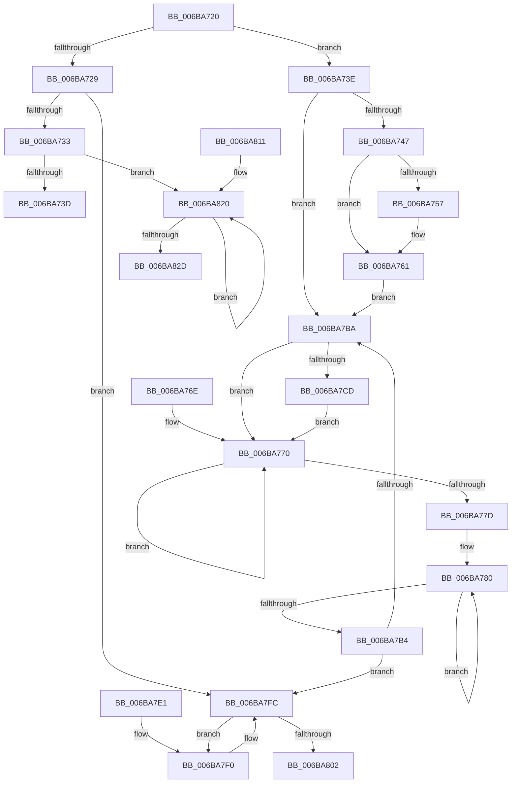

# RtlCopyMemoryNonTemporal

- RVA: `0x006BA720`–`0x006BA82E` (길이 `270` bytes)
- VA: `0x00000001406BA720`
- 실행 섹션: `.text`
- PDB 이름 있음: `예`; PDB Function 태그: `아니요`
- unwind 정보 RVA: `0x000C2558`
- 디코드: `67`개 명령, `270/270` bytes 표시
- 미해석 바이트: `0` (있으면 어셈블리에 `.byte`로 보존)

> 이 문서는 커널 이미지의 기계어와 PDB 기호를 분석해 생성했습니다. 4번과 5번은 함수 원형과 자료형을 바이너리 사용 방식에서 추정한 C 해석이며 원본 소스 복구 결과는 아닙니다.

## 1. Dependencies

- 직접 호출 지점: **0**; 고유 호출 대상: **0**
- 직접 호출자로 확인된 함수: **3**
- RIP 상대 이미지 참조: **0**

### Outgoing calls
- 직접 디코드된 call 명령이 없습니다.

### Direct callers
- [MmCopyToCachedPage](../34/MmCopyToCachedPage_function_00347B44.md) at `0x00347D78`
- [CcCopyToCacheHelper](../3C/CcCopyToCacheHelper_function_003CC290.md) at `0x003CC316`
- [RtlWriteNonVolatileMemory](../4A/RtlWriteNonVolatileMemory_function_004AF0D0.md) at `0x004AF11A`

### Static image references
- 디코드된 RIP-relative 메모리 참조가 없습니다.

## 2. Other-region calls and transfers

- 다른 실행 섹션으로 향하는 call: **0**
- 별도 외부 분기/꼬리 이동을 확인하지 못했습니다.

## 3. Assembly (complete function range)

```asm
006BA720  48 2B D1                        sub rdx, rcx
006BA723  49 83 F8 4F                     cmp r8, 0x4f
006BA727  73 15                           jae 0x1406ba73e
006BA729  49 83 F8 08                     cmp r8, 8
006BA72D  0F 83 C9 00 00 00               jae 0x1406ba7fc
006BA733  49 83 F8 00                     cmp r8, 0
006BA737  0F 85 E3 00 00 00               jne 0x1406ba820
006BA73D  C3                              ret
006BA73E  F6 C1 0F                        test cl, 0xf
006BA741  0F 84 73 00 00 00               je 0x1406ba7ba
006BA747  48 8B 04 0A                     mov rax, qword ptr [rdx + rcx]
006BA74B  4C 03 C1                        add r8, rcx
006BA74E  48 0F C3 01                     movnti qword ptr [rcx], rax
006BA752  F6 C1 08                        test cl, 8
006BA755  75 0A                           jne 0x1406ba761
006BA757  48 8B 44 0A 08                  mov rax, qword ptr [rdx + rcx + 8]
006BA75C  48 0F C3 41 08                  movnti qword ptr [rcx + 8], rax
006BA761  48 83 C1 10                     add rcx, 0x10
006BA765  48 83 E1 F0                     and rcx, 0xfffffffffffffff0
006BA769  4C 2B C1                        sub r8, rcx
006BA76C  EB 4C                           jmp 0x1406ba7ba
006BA76E  66 90                           nop
006BA770  0F 18 04 02                     prefetchnta byte ptr [rdx + rax]
006BA774  48 83 C0 40                     add rax, 0x40
006BA778  49 FF C9                        dec r9
006BA77B  75 F3                           jne 0x1406ba770
006BA77D  48 2B C1                        sub rax, rcx
006BA780  F3 0F 6F 04 0A                  movdqu xmm0, xmmword ptr [rdx + rcx]
006BA785  F3 0F 6F 4C 0A 10               movdqu xmm1, xmmword ptr [rdx + rcx + 0x10]
006BA78B  66 0F E7 01                     movntdq xmmword ptr [rcx], xmm0
006BA78F  66 0F E7 49 10                  movntdq xmmword ptr [rcx + 0x10], xmm1
006BA794  48 83 C1 40                     add rcx, 0x40
006BA798  F3 0F 6F 44 0A E0               movdqu xmm0, xmmword ptr [rdx + rcx - 0x20]
006BA79E  F3 0F 6F 4C 0A F0               movdqu xmm1, xmmword ptr [rdx + rcx - 0x10]
006BA7A4  66 0F E7 41 E0                  movntdq xmmword ptr [rcx - 0x20], xmm0
006BA7A9  66 0F E7 49 F0                  movntdq xmmword ptr [rcx - 0x10], xmm1
006BA7AE  48 83 E8 40                     sub rax, 0x40
006BA7B2  75 CC                           jne 0x1406ba780
006BA7B4  49 83 F8 40                     cmp r8, 0x40
006BA7B8  72 42                           jb 0x1406ba7fc
006BA7BA  48 8B C1                        mov rax, rcx
006BA7BD  49 C7 C1 10 00 00 00            mov r9, 0x10
006BA7C4  49 81 E8 00 04 00 00            sub r8, 0x400
006BA7CB  73 A3                           jae 0x1406ba770
006BA7CD  49 81 C0 00 04 00 00            add r8, 0x400
006BA7D4  4D 8B C8                        mov r9, r8
006BA7D7  49 C1 E9 06                     shr r9, 6
006BA7DB  49 83 E0 3F                     and r8, 0x3f
006BA7DF  EB 8F                           jmp 0x1406ba770
006BA7E1  66 66 66 66 66 66 66 0F 1F 84 00 00 00 00 00  nop word ptr [rax + rax]
006BA7F0  48 8B 04 0A                     mov rax, qword ptr [rdx + rcx]
006BA7F4  48 0F C3 01                     movnti qword ptr [rcx], rax
006BA7F8  48 83 C1 08                     add rcx, 8
006BA7FC  49 83 E8 08                     sub r8, 8
006BA800  77 EE                           ja 0x1406ba7f0
006BA802  49 03 C8                        add rcx, r8
006BA805  48 8B 04 0A                     mov rax, qword ptr [rdx + rcx]
006BA809  48 0F C3 01                     movnti qword ptr [rcx], rax
006BA80D  0F AE F8                        sfence
006BA810  C3                              ret
006BA811  66 66 66 66 66 66 66 0F 1F 84 00 00 00 00 00  nop word ptr [rax + rax]
006BA820  8A 04 0A                        mov al, byte ptr [rdx + rcx]
006BA823  88 01                           mov byte ptr [rcx], al
006BA825  48 FF C1                        inc rcx
006BA828  49 FF C8                        dec r8
006BA82B  75 F3                           jne 0x1406ba820
006BA82D  C3                              ret
```

## 4. C-style interpretation (structured pseudocode)

```c
__int64 __fastcall RtlCopyMemoryNonTemporal(__int64 a1, __int64 a2, __int64 a3, __int64 a4)
{
    __int64 result;

    a2 = (a2) - (a1);
    if (a3 >= 79) goto loc_006BA73E;
    if (a3 >= 8) goto loc_006BA7FC;
    if (a3 != 0) goto loc_006BA820;
    return result;
loc_006BA73E:
    if ((((unsigned __int8)(a1)) & (15)) == 0) goto loc_006BA7BA;
    a3 = (a3) + (a1);
    result = *(unsigned __int64 *)(a2 + a1 * 1);
    if ((((unsigned __int8)(a1)) & (8)) == 0) {
        result = *(unsigned __int64 *)(a2 + a1 * 1 + 8);
    }
    a1 = (a1) + (16);
    a1 = (a1) & (-16);
    a3 = (a3) - (a1);
    goto loc_006BA7BA;
loc_006BA770:
    result = (result) + (64);
    a4 = (a4) - 1;
    if (condition_is_not_equal) goto loc_006BA770;
    result = (result) - (a1);
loc_006BA780:
    *(unsigned __int64 *)(a1) = v_xmm0;
    *(unsigned __int64 *)(a1 + 16) = v_xmm1;
    a1 = (a1) + (64);
    *(unsigned __int64 *)(a1 - 32) = v_xmm0;
    *(unsigned __int64 *)(a1 - 16) = v_xmm1;
    result = (result) - (64);
    if (condition_is_not_equal) goto loc_006BA780;
    if (a3 < 64) goto loc_006BA7FC;
loc_006BA7BA:
    a3 = (a3) - (0x400ULL);
    if (condition_is_above_or_equal) goto loc_006BA770;
    a3 = (a3) + (0x400ULL);
    a4 = (a3) >> (6);
    a3 = (a3) & (63);
    goto loc_006BA770;
loc_006BA7F0:
    a1 = (a1) + (8);
loc_006BA7FC:
    a3 = (a3) - (8);
    if (condition_is_above) goto loc_006BA7F0;
    a1 = (a1) + (a3);
    return *(unsigned __int64 *)(a2 + a1 * 1);
loc_006BA820:
    *(unsigned __int8 *)(a1) = (unsigned __int8)(*(unsigned __int8 *)(a2 + a1 * 1));
    a1 = (a1) + 1;
    a3 = (a3) - 1;
    if (condition_is_not_equal) goto loc_006BA820;
    return *(unsigned __int8 *)(a2 + a1 * 1);
}
```

## 5. (Beta) C Style

```c
int64_t RtlCopyMemoryNonTemporal(int64_t Arg1, void *Arg2, int64_t Arg3, int64_t Arg4)
{
    uint8_t *arg2 = (uint8_t *)Arg2;

    int64_t result;

    Arg2 = (Arg2) - (Arg1);
    if (Arg3 >= 79) goto loc_006BA73E;
    if (Arg3 >= 8) goto loc_006BA7FC;
    if (Arg3 != 0) goto loc_006BA820;
    return result;
loc_006BA73E:
    if ((((uint8_t)(Arg1)) & (15)) == 0) goto loc_006BA7BA;
    Arg3 = (Arg3) + (Arg1);
    result = *(uint64_t *)(arg2 + Arg1 * 1);
    if ((((uint8_t)(Arg1)) & (8)) == 0) {
        result = *(uint64_t *)(arg2 + Arg1 * 1 + 0x8);
    }
    Arg1 = (Arg1) + (16);
    Arg1 = (Arg1) & (-16);
    Arg3 = (Arg3) - (Arg1);
    goto loc_006BA7BA;
loc_006BA770:
    result = (result) + (64);
    Arg4 = (Arg4) - 1;
    if (condition_is_not_equal) goto loc_006BA770;
    result = (result) - (Arg1);
loc_006BA780:
    *(uint64_t *)(Arg1) = v_xmm0;
    *(uint64_t *)(Arg1 + 0x10) = v_xmm1;
    Arg1 = (Arg1) + (64);
    *(uint64_t *)(Arg1 - 0x20) = v_xmm0;
    *(uint64_t *)(Arg1 - 0x10) = v_xmm1;
    result = (result) - (64);
    if (condition_is_not_equal) goto loc_006BA780;
    if (Arg3 < 64) goto loc_006BA7FC;
loc_006BA7BA:
    Arg3 = (Arg3) - (0x400ULL);
    if (condition_is_above_or_equal) goto loc_006BA770;
    Arg3 = (Arg3) + (0x400ULL);
    Arg4 = (Arg3) >> (6);
    Arg3 = (Arg3) & (63);
    goto loc_006BA770;
loc_006BA7F0:
    Arg1 = (Arg1) + (8);
loc_006BA7FC:
    Arg3 = (Arg3) - (8);
    if (condition_is_above) goto loc_006BA7F0;
    Arg1 = (Arg1) + (Arg3);
    return *(uint64_t *)(arg2 + Arg1 * 1);
loc_006BA820:
    *(uint8_t *)(Arg1) = (uint8_t)(*(uint8_t *)(arg2 + Arg1 * 1));
    Arg1 = (Arg1) + 1;
    Arg3 = (Arg3) - 1;
    if (condition_is_not_equal) goto loc_006BA820;
    return *(uint8_t *)(arg2 + Arg1 * 1);
}
```

### 관측된 메모리 오프셋

구조체 형식이 확인되지 않은 접근은 인자 기준의 오프셋으로만 기록했습니다.

| 기준 인자 | 오프셋 표현 | 폭 (bit) | 접근 |
|---|---:|---:|---|
| `Arg2` | `- 0x20 + rcx*1` | `128` | `R` |
| `Arg2` | `- 0x10 + rcx*1` | `128` | `R` |
| `Arg2` | `+ 0x0 + rax*1` | `8` | `R` |
| `Arg2` | `+ 0x0 + rcx*1` | `8` | `R` |
| `Arg2` | `+ 0x0 + rcx*1` | `64` | `R` |
| `Arg2` | `+ 0x0 + rcx*1` | `128` | `R` |
| `Arg2` | `+ 0x8 + rcx*1` | `64` | `R` |
| `Arg2` | `+ 0x10 + rcx*1` | `128` | `R` |

## 6. Execution-region graph

[열기: 2D/3D 그래프와 함수 탐색 컨트롤 패널](../../../control-panel.html?section=text&rva=0x006BA720&view=graph)

- 2D 그래프는 위에서 아래로 흐르고, 3D 그래프는 빈 공간을 드래그해 회전합니다. Shift+드래그는 이동, 휠은 확대·축소, 함수 노드 선택은 대상 보고서 이동입니다.

### Static fallback


