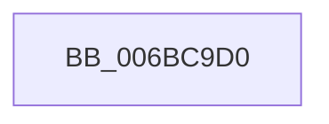

# RtlCopyVolatileMemory

- RVA: `0x006BC9D0`–`0x006BC9D5` (길이 `5` bytes)
- VA: `0x00000001406BC9D0`
- 실행 섹션: `.text`
- PDB 이름 있음: `예`; PDB Function 태그: `아니요`
- unwind 정보 RVA: `0x000C31E0`
- 디코드: `1`개 명령, `5/5` bytes 표시
- 미해석 바이트: `0` (있으면 어셈블리에 `.byte`로 보존)

> 이 문서는 커널 이미지의 기계어와 PDB 기호를 분석해 생성했습니다. 4번과 5번은 함수 원형과 자료형을 바이너리 사용 방식에서 추정한 C 해석이며 원본 소스 복구 결과는 아닙니다.

## 1. Dependencies

- 직접 호출 지점: **0**; 고유 호출 대상: **0**
- 직접 호출자로 확인된 함수: **59**
- RIP 상대 이미지 참조: **0**

### Outgoing calls
- 직접 디코드된 call 명령이 없습니다.

### Direct callers
- [sub_0025308F](../25/Unknown_function_0025308F.md) at `0x00253A6A`
- [KiChooseTargetProcessor](../25/KiChooseTargetProcessor_function_002556D8.md) at `0x00255975`
- [KiChooseTargetProcessor](../25/KiChooseTargetProcessor_function_002556D8.md) at `0x00255B42`
- [KiChooseTargetProcessor](../25/KiChooseTargetProcessor_function_002556D8.md) at `0x00255E56`
- [KiChooseTargetProcessor](../25/KiChooseTargetProcessor_function_002556D8.md) at `0x00255EBE`
- [sub_002567A2](../25/Unknown_function_002567A2.md) at `0x002567E5`
- [KiEnumerateNextSchedulerSubNodeInSystem](../25/KiEnumerateNextSchedulerSubNodeInSystem_function_002569C0.md) at `0x00256B41`
- [KeUpdateSoftParkRankList](../2D/KeUpdateSoftParkRankList_function_002D5998.md) at `0x002D5B2C`
- [KiCheckPreferredHeteroProcessor](../39/KiCheckPreferredHeteroProcessor_function_0039D72C.md) at `0x0039D892`
- [KiCheckPreferredHeteroProcessor](../39/KiCheckPreferredHeteroProcessor_function_0039D72C.md) at `0x0039D9F9`
- [ExpSetTimer2](../3A/ExpSetTimer2_function_003A0470.md) at `0x003A050A`
- [PoCopyDeepIdleMask](../3C/PoCopyDeepIdleMask_function_003C04C8.md) at `0x003C0540`
- [KiHeteroAttemptPreemptionSwapOnSubNode](../3C/KiHeteroAttemptPreemptionSwapOnSubNode_function_003C1144.md) at `0x003C1292`
- [KiSelectIdleProcessor](../3F/KiSelectIdleProcessor_function_003FE160.md) at `0x003FE210`
- [KiHeteroIdleSetReduction](../41/KiHeteroIdleSetReduction_function_00414A90.md) at `0x00414B22`
- [KiHeteroIdleSetReduction](../41/KiHeteroIdleSetReduction_function_00414A90.md) at `0x00414B5E`
- [KiHeteroIdleSetReduction](../41/KiHeteroIdleSetReduction_function_00414A90.md) at `0x00414BE1`
- [KeQueryNodeActiveAffinity2](../41/KeQueryNodeActiveAffinity2_function_004189C0.md) at `0x00418A24`
- [KeInitializeSchedulerSubNodeEnumerationContext](../41/KeInitializeSchedulerSubNodeEnumerationContext_function_0041E4B0.md) at `0x0041E4CD`
- [PpmEventTraceHeteroSets](../42/PpmEventTraceHeteroSets_function_00426DB4.md) at `0x00426F55`
- [KiInitializeSystemSubNodeEnumerationContext](../42/KiInitializeSystemSubNodeEnumerationContext_function_0042798C.md) at `0x004279EB`
- [KiUpdateProcessorClasses](../42/KiUpdateProcessorClasses_function_00427A30.md) at `0x00427C96`
- [KiUpdateProcessorClasses](../42/KiUpdateProcessorClasses_function_00427A30.md) at `0x00427CAF`
- [KeGetNodePrimarySubNode](../43/KeGetNodePrimarySubNode_function_0043EFF4.md) at `0x0043F023`
- [PsQueryProcessCommandLine](../46/PsQueryProcessCommandLine_function_00469810.md) at `0x0046997C`
- [PpmGetIdleConstrainedMask](../4B/PpmGetIdleConstrainedMask_function_004BCC5C.md) at `0x004BCCDF`
- [RtlCopyFromUser](../4F/RtlCopyFromUser_function_004FDAE8.md) at `0x004FDB32`
- [RtlCopyDeviceMemory](../52/RtlCopyDeviceMemory_function_00522BFC.md) at `0x00522C33`
- [PspProcessSuspendThreadParameters](../5E/PspProcessSuspendThreadParameters_function_005E3510.md) at `0x005E3592`
- [PspProcessUserCopyAttribute](../5E/PspProcessUserCopyAttribute_function_005E3610.md) at `0x005E3699`
- [sub_006D831E](../6D/Unknown_function_006D831E.md) at `0x006D84FE`
- [sub_006D831E](../6D/Unknown_function_006D831E.md) at `0x006D8913`
- [RtlCopyToUser](../../page/70/RtlCopyToUser_function_00705D68.md) at `0x00705DAF`
- [VslQueryRuntimeAttestationReport](../../page/71/VslQueryRuntimeAttestationReport_function_00719100.md) at `0x007192BA`
- [PspQueryWobTicketPriority](../../page/78/PspQueryWobTicketPriority_function_007898C8.md) at `0x00789923`
- [PspQueryWobTicketPriority](../../page/78/PspQueryWobTicketPriority_function_007898C8.md) at `0x00789966`
- [PspQueryWobTicketQos](../../page/78/PspQueryWobTicketQos_function_007899B0.md) at `0x00789A0E`
- [PspQueryWobTicketQos](../../page/78/PspQueryWobTicketQos_function_007899B0.md) at `0x00789A6B`
- [ExpQueryRuntimeAttestationReport](../../page/7C/ExpQueryRuntimeAttestationReport_function_007C4EE0.md) at `0x007C4F64`
- [AhcCacheQueryHwId](../../page/83/AhcCacheQueryHwId_function_0083ACB8.md) at `0x0083AD1E`
- [SeQueryHSTIResults](../../page/84/SeQueryHSTIResults_function_00841388.md) at `0x008413E6`
- [AlpcpSendMessage](../../page/88/AlpcpSendMessage_function_0088BD40.md) at `0x0088BE3F`
- [AlpcpSendMessage](../../page/88/AlpcpSendMessage_function_0088BD40.md) at `0x0088BEE5`
- [AlpcpCaptureSecurityAttribute](../../page/89/AlpcpCaptureSecurityAttribute_function_00890540.md) at `0x008905D2`
- [NtAlpcCreateSecurityContext](../../page/89/NtAlpcCreateSecurityContext_function_00890B50.md) at `0x00890C1A`
- [NtAlpcOpenSenderProcess](../../page/89/NtAlpcOpenSenderProcess_function_008953B0.md) at `0x008954CF`
- [NtAlpcOpenSenderProcess](../../page/89/NtAlpcOpenSenderProcess_function_008953B0.md) at `0x008954EB`
- [NtAlpcOpenSenderProcess](../../page/89/NtAlpcOpenSenderProcess_function_008953B0.md) at `0x00895559`
- [NtCreateWnfStateName](../../page/8B/NtCreateWnfStateName_function_008BE2B0.md) at `0x008BE58B`
- [ExpCaptureWnfStateName](../../page/90/ExpCaptureWnfStateName_function_00909370.md) at `0x009093F3`
- [NtGetCompleteWnfStateSubscription](../../page/90/NtGetCompleteWnfStateSubscription_function_00909450.md) at `0x009095BD`
- [NtGetCompleteWnfStateSubscription](../../page/90/NtGetCompleteWnfStateSubscription_function_00909450.md) at `0x009095D7`
- [NtQueryWnfStateData](../../page/90/NtQueryWnfStateData_function_00909DF0.md) at `0x00909F69`
- [NtQueryWnfStateData](../../page/90/NtQueryWnfStateData_function_00909DF0.md) at `0x0090A18F`
- [ExpNtUpdateWnfStateData](../../page/90/ExpNtUpdateWnfStateData_function_0090A7A0.md) at `0x0090A9AE`
- [ExpNtUpdateWnfStateData](../../page/90/ExpNtUpdateWnfStateData_function_0090A7A0.md) at `0x0090AA27`
- [NtSecureConnectPort](../../page/92/NtSecureConnectPort_function_00922F20.md) at `0x009230C5`
- [NtSecureConnectPort](../../page/92/NtSecureConnectPort_function_00922F20.md) at `0x00923165`
- [AlpcpSendLegacySynchronousRequest](../../page/92/AlpcpSendLegacySynchronousRequest_function_0092376C.md) at `0x009237F8`
- [AlpcpConnectPort](../../page/92/AlpcpConnectPort_function_00926C8C.md) at `0x00926DEB`
- [RtlpFindFunctionOverrideDvrtRecord](../../page/94/RtlpFindFunctionOverrideDvrtRecord_function_009431C0.md) at `0x0094323C`
- [RtlpFindFunctionOverrideDvrtRecord](../../page/94/RtlpFindFunctionOverrideDvrtRecord_function_009431C0.md) at `0x009432C1`
- [NtQueryInformationProcess](../../page/9A/NtQueryInformationProcess_function_009AA250.md) at `0x009AB9BF`
- [NtQueryInformationProcess](../../page/9A/NtQueryInformationProcess_function_009AA250.md) at `0x009ACC9A`
- [NtAlpcOpenSenderThread](../../page/9C/NtAlpcOpenSenderThread_function_009C5920.md) at `0x009C5A1C`
- [AlpcpProbeAndCaptureMessageHeader](../../page/9C/AlpcpProbeAndCaptureMessageHeader_function_009C5BB0.md) at `0x009C5BFF`
- [AlpcpProbeAndCaptureMessageHeader](../../page/9C/AlpcpProbeAndCaptureMessageHeader_function_009C5BB0.md) at `0x009C5C2A`
- [ObpCaptureBoundaryDescriptor](../../page/9C/ObpCaptureBoundaryDescriptor_function_009C9738.md) at `0x009C97BF`
- [WmipProbeAndCaptureGuidObjectAttributes](../../page/9D/WmipProbeAndCaptureGuidObjectAttributes_function_009DEA00.md) at `0x009DEA51`
- [AlpcpCreateConnectionPort](../../page/9E/AlpcpCreateConnectionPort_function_009E70B0.md) at `0x009E72D5`
- [PspBuildCreateProcessContext](../../page/9E/PspBuildCreateProcessContext_function_009ED6E0.md) at `0x009EE1FD`
- [PspBuildCreateProcessContext](../../page/9E/PspBuildCreateProcessContext_function_009ED6E0.md) at `0x009EE4F1`
- [PspBuildCreateProcessContext](../../page/9E/PspBuildCreateProcessContext_function_009ED6E0.md) at `0x009EE54B`
- [PspBuildCreateProcessContext](../../page/9E/PspBuildCreateProcessContext_function_009ED6E0.md) at `0x009EE645`
- [PspBuildCreateProcessContext](../../page/9E/PspBuildCreateProcessContext_function_009ED6E0.md) at `0x009EE6A3`
- [PspBuildCreateProcessContext](../../page/9E/PspBuildCreateProcessContext_function_009ED6E0.md) at `0x009EE8E8`
- [AlpcpReplyLegacySynchronousRequest](../../page/9F/AlpcpReplyLegacySynchronousRequest_function_009F5CF0.md) at `0x009F5D85`
- [AlpcpCaptureSecurityAttribute32](../../page/A2/AlpcpCaptureSecurityAttribute32_function_00A20924.md) at `0x00A20972`
- [NtCreateTimer2](../../page/A2/NtCreateTimer2_function_00A2C660.md) at `0x00A2C701`
- [AlpcpAcceptConnectPort](../../page/A3/AlpcpAcceptConnectPort_function_00A34290.md) at `0x00A34477`
- [AlpcpAcceptConnectPort](../../page/A3/AlpcpAcceptConnectPort_function_00A34290.md) at `0x00A34499`
- [NtQueryInformationThread](../../page/AE/NtQueryInformationThread_function_00AE3760.md) at `0x00AE42B9`
- [NtSetInformationProcess](../../page/AE/NtSetInformationProcess_function_00AE5370.md) at `0x00AE7220`
- [EtwpWriteUserEvent](../../page/AF/EtwpWriteUserEvent_function_00AF2FEC.md) at `0x00AF3D45`
- [sub_00B316B4](../../page/B3/Unknown_function_00B316B4.md) at `0x00B32072`
- [sub_00B316B4](../../page/B3/Unknown_function_00B316B4.md) at `0x00B32098`

### Static image references
- 디코드된 RIP-relative 메모리 참조가 없습니다.

## 2. Other-region calls and transfers

- 다른 실행 섹션으로 향하는 call: **0**
- call이 아닌 외부 분기/꼬리 이동: **1**
  - `0x006BC9D0` → [memcpy](../6C/memcpy_function_006C6840.md) (`tail-transfer`)

## 3. Assembly (complete function range)

```asm
006BC9D0  E9 6B 9E 00 00                  jmp 0x1406c6840
```

## 4. C-style interpretation (structured pseudocode)

```c
void __fastcall RtlCopyVolatileMemory(void)
{
}
```

## 5. (Beta) C Style

```c
void RtlCopyVolatileMemory(void)
{
}
```

## 6. Execution-region graph

[열기: 2D/3D 그래프와 함수 탐색 컨트롤 패널](../../../control-panel.html?section=text&rva=0x006BC9D0&view=graph)

- 2D 그래프는 위에서 아래로 흐르고, 3D 그래프는 빈 공간을 드래그해 회전합니다. Shift+드래그는 이동, 휠은 확대·축소, 함수 노드 선택은 대상 보고서 이동입니다.

### Static fallback


