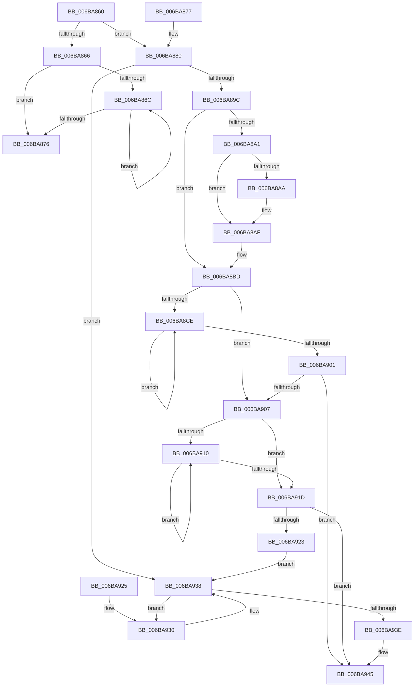

# RtlFillMemoryNonTemporal

- RVA: `0x006BA860`–`0x006BA949` (길이 `233` bytes)
- VA: `0x00000001406BA860`
- 실행 섹션: `.text`
- PDB 이름 있음: `예`; PDB Function 태그: `아니요`
- unwind 정보 RVA: `0x000C2560`
- 디코드: `61`개 명령, `233/233` bytes 표시
- 미해석 바이트: `0` (있으면 어셈블리에 `.byte`로 보존)

> 이 문서는 커널 이미지의 기계어와 PDB 기호를 분석해 생성했습니다. 4번과 5번은 함수 원형과 자료형을 바이너리 사용 방식에서 추정한 C 해석이며 원본 소스 복구 결과는 아닙니다.

## 1. Dependencies

- 직접 호출 지점: **0**; 고유 호출 대상: **0**
- 직접 호출자로 확인된 함수: **1**
- RIP 상대 이미지 참조: **0**

### Outgoing calls
- 직접 디코드된 call 명령이 없습니다.

### Direct callers
- [RtlFillNonVolatileMemory](../5E/RtlFillNonVolatileMemory_function_005EC5E0.md) at `0x005EC62E`

### Static image references
- 디코드된 RIP-relative 메모리 참조가 없습니다.

## 2. Other-region calls and transfers

- 다른 실행 섹션으로 향하는 call: **0**
- 별도 외부 분기/꼬리 이동을 확인하지 못했습니다.

## 3. Assembly (complete function range)

```asm
006BA860  48 83 FA 08                     cmp rdx, 8
006BA864  73 1A                           jae 0x1406ba880
006BA866  48 83 E2 07                     and rdx, 7
006BA86A  74 0A                           je 0x1406ba876
006BA86C  44 88 44 11 FF                  mov byte ptr [rcx + rdx - 1], r8b
006BA871  48 FF CA                        dec rdx
006BA874  75 F6                           jne 0x1406ba86c
006BA876  C3                              ret
006BA877  66 0F 1F 84 00 00 00 00 00      nop word ptr [rax + rax]
006BA880  4D 0F B6 C0                     movzx r8, r8b
006BA884  49 B9 01 01 01 01 01 01 01 01   movabs r9, 0x101010101010101
006BA88E  4D 0F AF C1                     imul r8, r9
006BA892  48 83 FA 4F                     cmp rdx, 0x4f
006BA896  0F 82 9C 00 00 00               jb 0x1406ba938
006BA89C  F6 C1 0F                        test cl, 0xf
006BA89F  74 1C                           je 0x1406ba8bd
006BA8A1  4C 0F C3 01                     movnti qword ptr [rcx], r8
006BA8A5  F6 C1 08                        test cl, 8
006BA8A8  75 05                           jne 0x1406ba8af
006BA8AA  4C 0F C3 41 08                  movnti qword ptr [rcx + 8], r8
006BA8AF  48 03 D1                        add rdx, rcx
006BA8B2  48 83 C1 0F                     add rcx, 0xf
006BA8B6  48 83 E1 F0                     and rcx, 0xfffffffffffffff0
006BA8BA  48 2B D1                        sub rdx, rcx
006BA8BD  66 49 0F 6E C0                  movq xmm0, r8
006BA8C2  0F 16 C0                        movlhps xmm0, xmm0
006BA8C5  4C 8B CA                        mov r9, rdx
006BA8C8  49 C1 E9 07                     shr r9, 7
006BA8CC  74 39                           je 0x1406ba907
006BA8CE  66 0F E7 01                     movntdq xmmword ptr [rcx], xmm0
006BA8D2  66 0F E7 41 10                  movntdq xmmword ptr [rcx + 0x10], xmm0
006BA8D7  48 81 C1 80 00 00 00            add rcx, 0x80
006BA8DE  66 0F E7 41 A0                  movntdq xmmword ptr [rcx - 0x60], xmm0
006BA8E3  66 0F E7 41 B0                  movntdq xmmword ptr [rcx - 0x50], xmm0
006BA8E8  49 FF C9                        dec r9
006BA8EB  66 0F E7 41 C0                  movntdq xmmword ptr [rcx - 0x40], xmm0
006BA8F0  66 0F E7 41 D0                  movntdq xmmword ptr [rcx - 0x30], xmm0
006BA8F5  66 0F E7 41 E0                  movntdq xmmword ptr [rcx - 0x20], xmm0
006BA8FA  66 0F E7 41 F0                  movntdq xmmword ptr [rcx - 0x10], xmm0
006BA8FF  75 CD                           jne 0x1406ba8ce
006BA901  48 83 E2 7F                     and rdx, 0x7f
006BA905  74 3E                           je 0x1406ba945
006BA907  4C 8B CA                        mov r9, rdx
006BA90A  49 C1 E9 04                     shr r9, 4
006BA90E  74 0D                           je 0x1406ba91d
006BA910  66 0F E7 01                     movntdq xmmword ptr [rcx], xmm0
006BA914  48 83 C1 10                     add rcx, 0x10
006BA918  49 FF C9                        dec r9
006BA91B  75 F3                           jne 0x1406ba910
006BA91D  48 83 E2 0F                     and rdx, 0xf
006BA921  74 22                           je 0x1406ba945
006BA923  EB 13                           jmp 0x1406ba938
006BA925  66 66 66 0F 1F 84 00 00 00 00 00  nop word ptr [rax + rax]
006BA930  4C 0F C3 01                     movnti qword ptr [rcx], r8
006BA934  48 83 C1 08                     add rcx, 8
006BA938  48 83 EA 08                     sub rdx, 8
006BA93C  77 F2                           ja 0x1406ba930
006BA93E  48 03 CA                        add rcx, rdx
006BA941  4C 0F C3 01                     movnti qword ptr [rcx], r8
006BA945  0F AE F8                        sfence
006BA948  C3                              ret
```

## 4. C-style interpretation (structured pseudocode)

```c
void __fastcall RtlFillMemoryNonTemporal(__int64 a1, __int64 a2, unsigned __int8 a3)
{
    if (a2 >= 8) goto loc_006BA880;
    a2 = (a2) & (7);
    if (condition_is_equal) goto loc_006BA876;
loc_006BA86C:
    *(unsigned __int8 *)(a1 + a2 * 1 - 1) = a3;
    a2 = (a2) - 1;
    if (condition_is_not_equal) goto loc_006BA86C;
loc_006BA876:
    return;
loc_006BA880:
    a3 = (a3) * (a4);
    if (a2 < 79) goto loc_006BA938;
    if ((((unsigned __int8)(a1)) & (15)) == 0) goto loc_006BA8BD;
    if ((((unsigned __int8)(a1)) & (8)) == 0) {
    }
    a2 = (a2) + (a1);
    a1 = (a1) + (15);
    a1 = (a1) & (-16);
    a2 = (a2) - (a1);
loc_006BA8BD:
    a4 = (a2) >> (7);
    if (condition_is_equal) goto loc_006BA907;
loc_006BA8CE:
    *(unsigned __int64 *)(a1) = v_xmm0;
    *(unsigned __int64 *)(a1 + 16) = v_xmm0;
    a1 = (a1) + (128);
    *(unsigned __int64 *)(a1 - 96) = v_xmm0;
    *(unsigned __int64 *)(a1 - 80) = v_xmm0;
    a4 = (a4) - 1;
    *(unsigned __int64 *)(a1 - 64) = v_xmm0;
    *(unsigned __int64 *)(a1 - 48) = v_xmm0;
    *(unsigned __int64 *)(a1 - 32) = v_xmm0;
    *(unsigned __int64 *)(a1 - 16) = v_xmm0;
    if (condition_is_not_equal) goto loc_006BA8CE;
    a2 = (a2) & (127);
    if (condition_is_equal) goto loc_006BA945;
loc_006BA907:
    a4 = (a2) >> (4);
    if (condition_is_equal) goto loc_006BA91D;
loc_006BA910:
    *(unsigned __int64 *)(a1) = v_xmm0;
    a1 = (a1) + (16);
    a4 = (a4) - 1;
    if (condition_is_not_equal) goto loc_006BA910;
loc_006BA91D:
    a2 = (a2) & (15);
    if (condition_is_equal) goto loc_006BA945;
    goto loc_006BA938;
loc_006BA930:
    a1 = (a1) + (8);
loc_006BA938:
    a2 = (a2) - (8);
    if (condition_is_above) goto loc_006BA930;
    a1 = (a1) + (a2);
loc_006BA945:
    return;
}
```

## 5. (Beta) C Style

```c
void RtlFillMemoryNonTemporal(void *Arg1, int64_t Arg2, uint8_t Arg3)
{
    uint8_t *arg1 = (uint8_t *)Arg1;

    if (Arg2 >= 8) goto loc_006BA880;
    Arg2 = (Arg2) & (7);
    if (condition_is_equal) goto loc_006BA876;
loc_006BA86C:
    *(uint8_t *)(arg1 + Arg2 * 1 - 0x1) = Arg3;
    Arg2 = (Arg2) - 1;
    if (condition_is_not_equal) goto loc_006BA86C;
loc_006BA876:
    return;
loc_006BA880:
    Arg3 = (Arg3) * (a4);
    if (Arg2 < 79) goto loc_006BA938;
    if ((((uint8_t)(Arg1)) & (15)) == 0) goto loc_006BA8BD;
    if ((((uint8_t)(Arg1)) & (8)) == 0) {
    }
    Arg2 = (Arg2) + (Arg1);
    Arg1 = (Arg1) + (15);
    Arg1 = (Arg1) & (-16);
    Arg2 = (Arg2) - (Arg1);
loc_006BA8BD:
    a4 = (Arg2) >> (7);
    if (condition_is_equal) goto loc_006BA907;
loc_006BA8CE:
    *(uint64_t *)(arg1) = v_xmm0;
    *(uint64_t *)(arg1 + 0x10) = v_xmm0;
    Arg1 = (Arg1) + (128);
    *(uint64_t *)(arg1 - 0x60) = v_xmm0;
    *(uint64_t *)(arg1 - 0x50) = v_xmm0;
    a4 = (a4) - 1;
    *(uint64_t *)(arg1 - 0x40) = v_xmm0;
    *(uint64_t *)(arg1 - 0x30) = v_xmm0;
    *(uint64_t *)(arg1 - 0x20) = v_xmm0;
    *(uint64_t *)(arg1 - 0x10) = v_xmm0;
    if (condition_is_not_equal) goto loc_006BA8CE;
    Arg2 = (Arg2) & (127);
    if (condition_is_equal) goto loc_006BA945;
loc_006BA907:
    a4 = (Arg2) >> (4);
    if (condition_is_equal) goto loc_006BA91D;
loc_006BA910:
    *(uint64_t *)(arg1) = v_xmm0;
    Arg1 = (Arg1) + (16);
    a4 = (a4) - 1;
    if (condition_is_not_equal) goto loc_006BA910;
loc_006BA91D:
    Arg2 = (Arg2) & (15);
    if (condition_is_equal) goto loc_006BA945;
    goto loc_006BA938;
loc_006BA930:
    Arg1 = (Arg1) + (8);
loc_006BA938:
    Arg2 = (Arg2) - (8);
    if (condition_is_above) goto loc_006BA930;
    Arg1 = (Arg1) + (Arg2);
loc_006BA945:
    return;
}
```

### 관측된 메모리 오프셋

구조체 형식이 확인되지 않은 접근은 인자 기준의 오프셋으로만 기록했습니다.

| 기준 인자 | 오프셋 표현 | 폭 (bit) | 접근 |
|---|---:|---:|---|
| `Arg1` | `- 0x1 + rdx*1` | `8` | `W` |

## 6. Execution-region graph

[열기: 2D/3D 그래프와 함수 탐색 컨트롤 패널](../../../control-panel.html?section=text&rva=0x006BA860&view=graph)

- 2D 그래프는 위에서 아래로 흐르고, 3D 그래프는 빈 공간을 드래그해 회전합니다. Shift+드래그는 이동, 휠은 확대·축소, 함수 노드 선택은 대상 보고서 이동입니다.

### Static fallback


