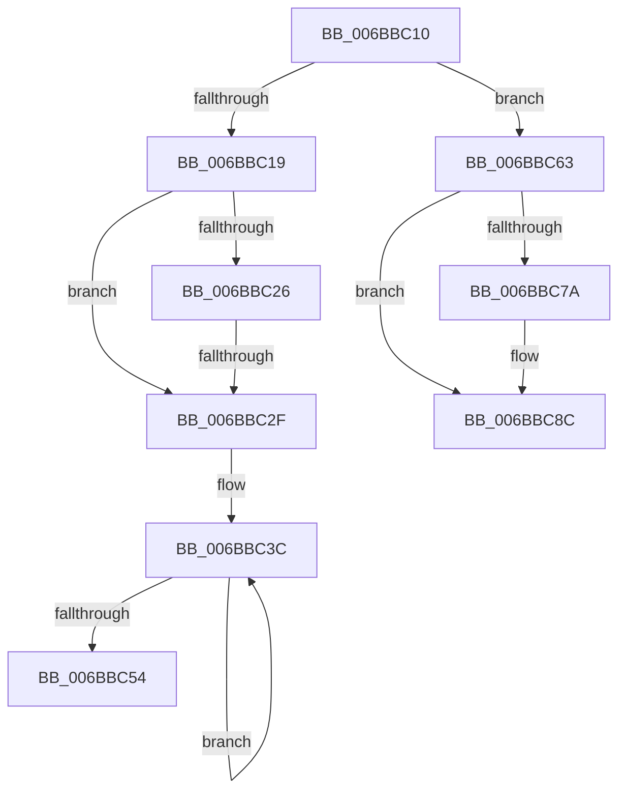

# RtlHeapZero

- RVA: `0x006BBC10`–`0x006BBC8D` (길이 `125` bytes)
- VA: `0x00000001406BBC10`
- 실행 섹션: `.text`
- PDB 이름 있음: `예`; PDB Function 태그: `아니요`
- unwind 정보 RVA: `0x000C2608`
- 디코드: `31`개 명령, `125/125` bytes 표시
- 미해석 바이트: `0` (있으면 어셈블리에 `.byte`로 보존)

> 이 문서는 커널 이미지의 기계어와 PDB 기호를 분석해 생성했습니다. 4번과 5번은 함수 원형과 자료형을 바이너리 사용 방식에서 추정한 C 해석이며 원본 소스 복구 결과는 아닙니다.

## 1. Dependencies

- 직접 호출 지점: **0**; 고유 호출 대상: **0**
- 직접 호출자로 확인된 함수: **12**
- RIP 상대 이미지 참조: **1**

### Outgoing calls
- 직접 디코드된 call 명령이 없습니다.

### Direct callers
- [RtlpHpLfhSlotAllocateSlow](../2E/RtlpHpLfhSlotAllocateSlow_function_002E8FBC.md) at `0x002E93BA`
- [sub_002E98D9](../2E/Unknown_function_002E98D9.md) at `0x002E9B8F`
- [RtlpHpAllocateHeapSlow](../2E/RtlpHpAllocateHeapSlow_function_002E9DEC.md) at `0x002EA063`
- [RtlpHpAllocateHeapSlow](../2E/RtlpHpAllocateHeapSlow_function_002E9DEC.md) at `0x002EA2B4`
- [RtlpHpVsContextAllocate](../2E/RtlpHpVsContextAllocate_function_002EA944.md) at `0x002EAA80`
- [RtlpHpVsContextAllocateFinalize](../2E/RtlpHpVsContextAllocateFinalize_function_002EB7EC.md) at `0x002EB84E`
- [RtlpHpLargeAlloc](../2E/RtlpHpLargeAlloc_function_002EBD5C.md) at `0x002EC068`
- [RtlpHpSegAlloc](../32/RtlpHpSegAlloc_function_003265BC.md) at `0x00326721`
- [RtlpHpAllocVA](../32/RtlpHpAllocVA_function_003276A0.md) at `0x00327820`
- [ExAllocateHeapPool](../35/ExAllocateHeapPool_function_0035BA30.md) at `0x0035C46A`
- [ExAllocateHeapPool](../35/ExAllocateHeapPool_function_0035BA30.md) at `0x0035C782`
- [ExAllocateHeapPool](../35/ExAllocateHeapPool_function_0035BA30.md) at `0x0035E5D1`
- [sub_006DE040](../6D/Unknown_function_006DE040.md) at `0x006DE324`
- [sub_006DE430](../6D/Unknown_function_006DE430.md) at `0x006DE54E`
- [sub_006E2C7C](../6E/Unknown_function_006E2C7C.md) at `0x006E2D91`
- [sub_006E2C7C](../6E/Unknown_function_006E2C7C.md) at `0x006E2FD5`

### Static image references
- `0x006BBC19` → RVA `0x00E28328` (`.data`; read)

## 2. Other-region calls and transfers

- 다른 실행 섹션으로 향하는 call: **0**
- call이 아닌 외부 분기/꼬리 이동: **1**
  - `0x006BBC2D` → [RtlpHeapZeroFastString](RtlpHeapZeroFastString_function_006BBCA0.md) (`tail-transfer`)

## 3. Assembly (complete function range)

```asm
006BBC10  0F 57 C0                        xorps xmm0, xmm0
006BBC13  48 83 FA 40                     cmp rdx, 0x40
006BBC17  72 4A                           jb 0x1406bbc63
006BBC19  48 F7 05 04 C7 76 00 02 00 00 00  test qword ptr [rip + 0x76c704], 2
006BBC24  74 09                           je 0x1406bbc2f
006BBC26  48 81 FA 20 03 00 00            cmp rdx, 0x320
006BBC2D  73 71                           jae 0x1406bbca0
006BBC2F  4C 8D 44 11 D0                  lea r8, [rcx + rdx - 0x30]
006BBC34  48 83 E2 C0                     and rdx, 0xffffffffffffffc0
006BBC38  48 C1 EA 06                     shr rdx, 6
006BBC3C  0F 29 01                        movaps xmmword ptr [rcx], xmm0
006BBC3F  0F 29 41 10                     movaps xmmword ptr [rcx + 0x10], xmm0
006BBC43  48 83 C1 40                     add rcx, 0x40
006BBC47  48 FF CA                        dec rdx
006BBC4A  0F 29 41 E0                     movaps xmmword ptr [rcx - 0x20], xmm0
006BBC4E  0F 29 41 F0                     movaps xmmword ptr [rcx - 0x10], xmm0
006BBC52  75 E8                           jne 0x1406bbc3c
006BBC54  41 0F 29 00                     movaps xmmword ptr [r8], xmm0
006BBC58  41 0F 29 40 10                  movaps xmmword ptr [r8 + 0x10], xmm0
006BBC5D  41 0F 29 40 20                  movaps xmmword ptr [r8 + 0x20], xmm0
006BBC62  C3                              ret
006BBC63  66 66 66 66 66 0F 1F 84 00 00 00 00 00  nop word ptr [rax + rax]
006BBC70  4C 8D 4C 0A F0                  lea r9, [rdx + rcx - 0x10]
006BBC75  48 85 D2                        test rdx, rdx
006BBC78  74 12                           je 0x1406bbc8c
006BBC7A  0F 29 01                        movaps xmmword ptr [rcx], xmm0
006BBC7D  48 83 E2 20                     and rdx, 0x20
006BBC81  41 0F 29 01                     movaps xmmword ptr [r9], xmm0
006BBC85  48 D1 EA                        shr rdx, 1
006BBC88  0F 29 04 11                     movaps xmmword ptr [rcx + rdx], xmm0
006BBC8C  C3                              ret
```

## 4. C-style interpretation (structured pseudocode)

```c
void __fastcall RtlHeapZero(__int64 a1, __int64 a2)
{
    if (a2 < 64) goto loc_006BBC63;
    if (((*(unsigned __int64 *)(v_rip + 7784196)) & (2)) == 0) goto loc_006BBC2F;
loc_006BBC2F:
    a2 = (a2) & (-64);
    a2 = (a2) >> (6);
loc_006BBC3C:
    *(unsigned __int64 *)(a1) = v_xmm0;
    *(unsigned __int64 *)(a1 + 16) = v_xmm0;
    a1 = (a1) + (64);
    a2 = (a2) - 1;
    *(unsigned __int64 *)(a1 - 32) = v_xmm0;
    *(unsigned __int64 *)(a1 - 16) = v_xmm0;
    if (condition_is_not_equal) goto loc_006BBC3C;
    *(unsigned __int64 *)(a1 + a2 * 1 - 48) = v_xmm0;
    *(unsigned __int64 *)(a1 + a2 * 1 - 48 + 16) = v_xmm0;
    *(unsigned __int64 *)(a1 + a2 * 1 - 48 + 32) = v_xmm0;
    return;
loc_006BBC63:
    if (a2 != 0) {
        *(unsigned __int64 *)(a1) = v_xmm0;
        a2 = (a2) & (32);
        *(unsigned __int64 *)(a2 + a1 * 1 - 16) = v_xmm0;
        a2 = (a2) >> (1);
        *(unsigned __int64 *)(a1 + a2 * 1) = v_xmm0;
    }
    return;
}
```

## 5. (Beta) C Style

```c
void RtlHeapZero(void *Arg1, int64_t Arg2)
{
    uint8_t *arg1 = (uint8_t *)Arg1;

    if (Arg2 < 64) goto loc_006BBC63;
    if (((*(uint64_t *)(v_rip + 0x76C704)) & (2)) == 0) goto loc_006BBC2F;
loc_006BBC2F:
    Arg2 = (Arg2) & (-64);
    Arg2 = (Arg2) >> (6);
loc_006BBC3C:
    *(uint64_t *)(arg1) = v_xmm0;
    *(uint64_t *)(arg1 + 0x10) = v_xmm0;
    Arg1 = (Arg1) + (64);
    Arg2 = (Arg2) - 1;
    *(uint64_t *)(arg1 - 0x20) = v_xmm0;
    *(uint64_t *)(arg1 - 0x10) = v_xmm0;
    if (condition_is_not_equal) goto loc_006BBC3C;
    *(uint64_t *)(arg1 + Arg2 * 1 - 0x30) = v_xmm0;
    *(uint64_t *)(arg1 + Arg2 * 1 - 0x30 + 0x10) = v_xmm0;
    *(uint64_t *)(arg1 + Arg2 * 1 - 0x30 + 0x20) = v_xmm0;
    return;
loc_006BBC63:
    if (Arg2 != 0) {
        *(uint64_t *)(arg1) = v_xmm0;
        Arg2 = (Arg2) & (32);
        *(uint64_t *)(Arg2 + arg1 * 1 - 0x10) = v_xmm0;
        Arg2 = (Arg2) >> (1);
        *(uint64_t *)(arg1 + Arg2 * 1) = v_xmm0;
    }
    return;
}
```

### 관측된 메모리 오프셋

구조체 형식이 확인되지 않은 접근은 인자 기준의 오프셋으로만 기록했습니다.

| 기준 인자 | 오프셋 표현 | 폭 (bit) | 접근 |
|---|---:|---:|---|
| `Arg1` | `- 0x30 + rdx*1` | `64` | `R` |
| `Arg1` | `- 0x20` | `128` | `W` |
| `Arg1` | `- 0x10` | `128` | `W` |
| `Arg1` | `+ 0x0` | `128` | `W` |
| `Arg1` | `+ 0x0 + rdx*1` | `128` | `W` |
| `Arg1` | `+ 0x10` | `128` | `W` |
| `Arg1` | `+ 0x20` | `128` | `W` |

## 6. Execution-region graph

[열기: 2D/3D 그래프와 함수 탐색 컨트롤 패널](../../../control-panel.html?section=text&rva=0x006BBC10&view=graph)

- 2D 그래프는 위에서 아래로 흐르고, 3D 그래프는 빈 공간을 드래그해 회전합니다. Shift+드래그는 이동, 휠은 확대·축소, 함수 노드 선택은 대상 보고서 이동입니다.

### Static fallback


