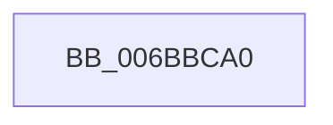

# RtlpHeapZeroFastString

- RVA: `0x006BBCA0`–`0x006BBCC8` (길이 `40` bytes)
- VA: `0x00000001406BBCA0`
- 실행 섹션: `.text`
- PDB 이름 있음: `예`; PDB Function 태그: `아니요`
- unwind 정보 RVA: `0x000C260C`
- 디코드: `14`개 명령, `40/40` bytes 표시
- 미해석 바이트: `0` (있으면 어셈블리에 `.byte`로 보존)

> 이 문서는 커널 이미지의 기계어와 PDB 기호를 분석해 생성했습니다. 4번과 5번은 함수 원형과 자료형을 바이너리 사용 방식에서 추정한 C 해석이며 원본 소스 복구 결과는 아닙니다.

## 1. Dependencies

- 직접 호출 지점: **0**; 고유 호출 대상: **0**
- 직접 호출자로 확인된 함수: **0**
- RIP 상대 이미지 참조: **0**

### Outgoing calls
- 직접 디코드된 call 명령이 없습니다.

### Direct callers
- 이 함수 시작 RVA로 연결되는 직접 call은 확인되지 않았습니다. 간접 호출은 완전히 역산할 수 없습니다.

### Static image references
- 디코드된 RIP-relative 메모리 참조가 없습니다.

## 2. Other-region calls and transfers

- 다른 실행 섹션으로 향하는 call: **0**
- 별도 외부 분기/꼬리 이동을 확인하지 못했습니다.

## 3. Assembly (complete function range)

```asm
006BBCA0  57                              push rdi
006BBCA1  48 8B F9                        mov rdi, rcx
006BBCA4  4C 8B C9                        mov r9, rcx
006BBCA7  0F 29 01                        movaps xmmword ptr [rcx], xmm0
006BBCAA  48 03 CA                        add rcx, rdx
006BBCAD  48 83 C7 3F                     add rdi, 0x3f
006BBCB1  41 0F 29 41 10                  movaps xmmword ptr [r9 + 0x10], xmm0
006BBCB6  48 83 E7 C0                     and rdi, 0xffffffffffffffc0
006BBCBA  33 C0                           xor eax, eax
006BBCBC  41 0F 29 41 20                  movaps xmmword ptr [r9 + 0x20], xmm0
006BBCC1  48 2B CF                        sub rcx, rdi
006BBCC4  F3 AA                           rep stosb byte ptr [rdi], al
006BBCC6  5F                              pop rdi
006BBCC7  C3                              ret
```

## 4. C-style interpretation (structured pseudocode)

```c
__int64 __fastcall RtlpHeapZeroFastString(__int64 a1, __int64 a2)
{
    __int64 result;
    __int64 v_rdi;

    *(unsigned __int64 *)(a1) = v_xmm0;
    a1 = (a1) + (a2);
    v_rdi = (a1) + (63);
    *(unsigned __int64 *)(a1 + 16) = v_xmm0;
    v_rdi = (v_rdi) & (-64);
    result = 0;
    *(unsigned __int64 *)(a1 + 32) = v_xmm0;
    a1 = (a1) - (v_rdi);
    return result;
}
```

## 5. (Beta) C Style

```c
int64_t RtlpHeapZeroFastString(void *Arg1, int64_t Arg2)
{
    uint8_t *arg1 = (uint8_t *)Arg1;

    int64_t result;
    int64_t local_rdi;

    *(uint64_t *)(arg1) = v_xmm0;
    Arg1 = (Arg1) + (Arg2);
    local_rdi = (Arg1) + (63);
    *(uint64_t *)(arg1 + 0x10) = v_xmm0;
    local_rdi = (local_rdi) & (-64);
    result = 0;
    *(uint64_t *)(arg1 + 0x20) = v_xmm0;
    Arg1 = (Arg1) - (local_rdi);
    return result;
}
```

### 관측된 메모리 오프셋

구조체 형식이 확인되지 않은 접근은 인자 기준의 오프셋으로만 기록했습니다.

| 기준 인자 | 오프셋 표현 | 폭 (bit) | 접근 |
|---|---:|---:|---|
| `Arg1` | `+ 0x0` | `8` | `W` |
| `Arg1` | `+ 0x0` | `128` | `W` |
| `Arg1` | `+ 0x10` | `128` | `W` |
| `Arg1` | `+ 0x20` | `128` | `W` |

## 6. Execution-region graph

[열기: 2D/3D 그래프와 함수 탐색 컨트롤 패널](../../../control-panel.html?section=text&rva=0x006BBCA0&view=graph)

- 2D 그래프는 위에서 아래로 흐르고, 3D 그래프는 빈 공간을 드래그해 회전합니다. Shift+드래그는 이동, 휠은 확대·축소, 함수 노드 선택은 대상 보고서 이동입니다.

### Static fallback


