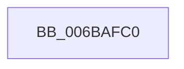

# RtlpUnwindHandler

- RVA: `0x006BAFC0`–`0x006BB010` (길이 `80` bytes)
- VA: `0x00000001406BAFC0`
- 실행 섹션: `.text`
- PDB 이름 있음: `예`; PDB Function 태그: `아니요`
- unwind 정보 RVA: `0x000C25C0`
- 디코드: `21`개 명령, `80/80` bytes 표시
- 미해석 바이트: `0` (있으면 어셈블리에 `.byte`로 보존)

> 이 문서는 커널 이미지의 기계어와 PDB 기호를 분석해 생성했습니다. 4번과 5번은 함수 원형과 자료형을 바이너리 사용 방식에서 추정한 C 해석이며 원본 소스 복구 결과는 아닙니다.

## 1. Dependencies

- 직접 호출 지점: **0**; 고유 호출 대상: **0**
- 직접 호출자로 확인된 함수: **0**
- RIP 상대 이미지 참조: **0**

### Outgoing calls
- 직접 디코드된 call 명령이 없습니다.

### Direct callers
- 이 함수 시작 RVA로 연결되는 직접 call은 확인되지 않았습니다. 간접 호출은 완전히 역산할 수 없습니다.

### Static image references
- 디코드된 RIP-relative 메모리 참조가 없습니다.

## 2. Other-region calls and transfers

- 다른 실행 섹션으로 향하는 call: **0**
- 별도 외부 분기/꼬리 이동을 확인하지 못했습니다.

## 3. Assembly (complete function range)

```asm
006BAFC0  48 8B 42 20                     mov rax, qword ptr [rdx + 0x20]
006BAFC4  4C 8B 10                        mov r10, qword ptr [rax]
006BAFC7  4D 89 11                        mov qword ptr [r9], r10
006BAFCA  4C 8B 50 08                     mov r10, qword ptr [rax + 8]
006BAFCE  4D 89 51 08                     mov qword ptr [r9 + 8], r10
006BAFD2  4C 8B 50 10                     mov r10, qword ptr [rax + 0x10]
006BAFD6  4D 89 51 10                     mov qword ptr [r9 + 0x10], r10
006BAFDA  4C 8B 50 18                     mov r10, qword ptr [rax + 0x18]
006BAFDE  4D 89 51 18                     mov qword ptr [r9 + 0x18], r10
006BAFE2  4C 8B 50 28                     mov r10, qword ptr [rax + 0x28]
006BAFE6  4D 89 51 28                     mov qword ptr [r9 + 0x28], r10
006BAFEA  4C 8B 50 30                     mov r10, qword ptr [rax + 0x30]
006BAFEE  4D 89 51 30                     mov qword ptr [r9 + 0x30], r10
006BAFF2  4C 8B 50 38                     mov r10, qword ptr [rax + 0x38]
006BAFF6  4D 89 51 38                     mov qword ptr [r9 + 0x38], r10
006BAFFA  4C 8B 50 40                     mov r10, qword ptr [rax + 0x40]
006BAFFE  4D 89 51 40                     mov qword ptr [r9 + 0x40], r10
006BB002  44 8B 50 48                     mov r10d, dword ptr [rax + 0x48]
006BB006  45 89 51 48                     mov dword ptr [r9 + 0x48], r10d
006BB00A  B8 03 00 00 00                  mov eax, 3
006BB00F  C3                              ret
```

## 4. C-style interpretation (structured pseudocode)

```c
__int64 __fastcall RtlpUnwindHandler(__int64 a1, __int64 a2, __int64 a3, __int64 a4)
{
    *(unsigned __int64 *)(a4) = *(unsigned __int64 *)(*(unsigned __int64 *)(a2 + 32));
    *(unsigned __int64 *)(a4 + 8) = *(unsigned __int64 *)(*(unsigned __int64 *)(a2 + 32) + 8);
    *(unsigned __int64 *)(a4 + 16) = *(unsigned __int64 *)(*(unsigned __int64 *)(a2 + 32) + 16);
    *(unsigned __int64 *)(a4 + 24) = *(unsigned __int64 *)(*(unsigned __int64 *)(a2 + 32) + 24);
    *(unsigned __int64 *)(a4 + 40) = *(unsigned __int64 *)(*(unsigned __int64 *)(a2 + 32) + 40);
    *(unsigned __int64 *)(a4 + 48) = *(unsigned __int64 *)(*(unsigned __int64 *)(a2 + 32) + 48);
    *(unsigned __int64 *)(a4 + 56) = *(unsigned __int64 *)(*(unsigned __int64 *)(a2 + 32) + 56);
    *(unsigned __int64 *)(a4 + 64) = *(unsigned __int64 *)(*(unsigned __int64 *)(a2 + 32) + 64);
    *(unsigned int *)(a4 + 72) = (unsigned int)((unsigned int)(*(unsigned int *)(*(unsigned __int64 *)(a2 + 32) + 72)));
    return 3;
}
```

## 5. (Beta) C Style

```c
int64_t RtlpUnwindHandler(int64_t Arg1, void *Arg2, int64_t Arg3, void *Arg4)
{
    uint8_t *arg2 = (uint8_t *)Arg2;
    uint8_t *arg4 = (uint8_t *)Arg4;

    *(uint64_t *)(arg4) = *(uint64_t *)(*(uint64_t *)(arg2 + 0x20));
    *(uint64_t *)(arg4 + 0x8) = *(uint64_t *)(*(uint64_t *)(arg2 + 0x20) + 0x8);
    *(uint64_t *)(arg4 + 0x10) = *(uint64_t *)(*(uint64_t *)(arg2 + 0x20) + 0x10);
    *(uint64_t *)(arg4 + 0x18) = *(uint64_t *)(*(uint64_t *)(arg2 + 0x20) + 0x18);
    *(uint64_t *)(arg4 + 0x28) = *(uint64_t *)(*(uint64_t *)(arg2 + 0x20) + 0x28);
    *(uint64_t *)(arg4 + 0x30) = *(uint64_t *)(*(uint64_t *)(arg2 + 0x20) + 0x30);
    *(uint64_t *)(arg4 + 0x38) = *(uint64_t *)(*(uint64_t *)(arg2 + 0x20) + 0x38);
    *(uint64_t *)(arg4 + 0x40) = *(uint64_t *)(*(uint64_t *)(arg2 + 0x20) + 0x40);
    *(uint32_t *)(arg4 + 0x48) = (uint32_t)((uint32_t)(*(uint32_t *)(*(uint64_t *)(arg2 + 0x20) + 0x48)));
    return 3;
}
```

### 관측된 메모리 오프셋

구조체 형식이 확인되지 않은 접근은 인자 기준의 오프셋으로만 기록했습니다.

| 기준 인자 | 오프셋 표현 | 폭 (bit) | 접근 |
|---|---:|---:|---|
| `Arg2` | `+ 0x20` | `64` | `R` |
| `Arg4` | `+ 0x0` | `64` | `W` |
| `Arg4` | `+ 0x8` | `64` | `W` |
| `Arg4` | `+ 0x10` | `64` | `W` |
| `Arg4` | `+ 0x18` | `64` | `W` |
| `Arg4` | `+ 0x28` | `64` | `W` |
| `Arg4` | `+ 0x30` | `64` | `W` |
| `Arg4` | `+ 0x38` | `64` | `W` |
| `Arg4` | `+ 0x40` | `64` | `W` |
| `Arg4` | `+ 0x48` | `32` | `W` |

## 6. Execution-region graph

[열기: 2D/3D 그래프와 함수 탐색 컨트롤 패널](../../../control-panel.html?section=text&rva=0x006BAFC0&view=graph)

- 2D 그래프는 위에서 아래로 흐르고, 3D 그래프는 빈 공간을 드래그해 회전합니다. Shift+드래그는 이동, 휠은 확대·축소, 함수 노드 선택은 대상 보고서 이동입니다.

### Static fallback


