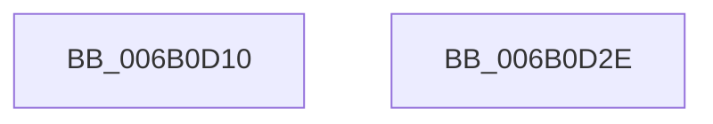

# ZwUpdateWnfStateData

- RVA: `0x006B0D10`–`0x006B0D2F` (길이 `31` bytes)
- VA: `0x00000001406B0D10`
- 실행 섹션: `.text`
- PDB 이름 있음: `예`; PDB Function 태그: `아니요`
- unwind 정보 RVA: `0x000C1528`
- 디코드: `11`개 명령, `31/31` bytes 표시
- 미해석 바이트: `0` (있으면 어셈블리에 `.byte`로 보존)

> 이 문서는 커널 이미지의 기계어와 PDB 기호를 분석해 생성했습니다. 4번과 5번은 함수 원형과 자료형을 바이너리 사용 방식에서 추정한 C 해석이며 원본 소스 복구 결과는 아닙니다.

## 1. Dependencies

- 직접 호출 지점: **0**; 고유 호출 대상: **0**
- 직접 호출자로 확인된 함수: **96**
- RIP 상대 이미지 참조: **1**

### Outgoing calls
- 직접 디코드된 call 명령이 없습니다.

### Direct callers
- [FsRtlSendModernAppTermination](../49/FsRtlSendModernAppTermination_function_0049F340.md) at `0x0049F398`
- [PopDevicePowerTransitionInProgressWorker](../4A/PopDevicePowerTransitionInProgressWorker_function_004A3EB0.md) at `0x004A3F00`
- [BapdWriteEtwEvents](../4A/BapdWriteEtwEvents_function_004AE884.md) at `0x004AEC9E`
- [PopFxClearDeviceConstraints](../4B/PopFxClearDeviceConstraints_function_004B05F8.md) at `0x004B076D`
- [PpmPerfUpdateMultimediaPowerModel](../4B/PpmPerfUpdateMultimediaPowerModel_function_004BA06C.md) at `0x004BA0C1`
- [PopThermalStandbyNotify](../5D/PopThermalStandbyNotify_function_005D55A0.md) at `0x005D55E6`
- [PopThermalSxExit](../5D/PopThermalSxExit_function_005D55F8.md) at `0x005D5687`
- [PopPepPlatformStateRegistered](../5D/PopPepPlatformStateRegistered_function_005DCDB8.md) at `0x005DCFD8`
- [RtlRaiseCustomSystemEventTrigger](../5E/RtlRaiseCustomSystemEventTrigger_function_005EE300.md) at `0x005EE4D8`
- [ExpSetSoftRebootFlags](../65/ExpSetSoftRebootFlags_function_006550DC.md) at `0x0065549B`
- [ExpPlProcessNotifications](../65/ExpPlProcessNotifications_function_00657170.md) at `0x006571C8`
- [MiBadPageSignaler](../67/MiBadPageSignaler_function_006794C0.md) at `0x00679504`
- [MmMarkPhysicalMemoryAsBad](../67/MmMarkPhysicalMemoryAsBad_function_0067AA50.md) at `0x0067AFA2`
- [RtlpFcNotifyFeatureUsageTarget](../../page/70/RtlpFcNotifyFeatureUsageTarget_function_00702268.md) at `0x0070236A`
- [PpDevCfgRequestDeviceInstall](../../page/70/PpDevCfgRequestDeviceInstall_function_00704520.md) at `0x0070454C`
- [FsRtlpDedupChangeRegisterVolume](../../page/71/FsRtlpDedupChangeRegisterVolume_function_00715F70.md) at `0x00716110`
- [FsRtlpHeatRegisterVolume](../../page/71/FsRtlpHeatRegisterVolume_function_0071696C.md) at `0x00716AED`
- [PiUEventBroadcastHardwareProfilesChangedEvent](../../page/72/PiUEventBroadcastHardwareProfilesChangedEvent_function_0072DD18.md) at `0x0072DD4B`
- [PiUEventBroadcastHardwareProfilesChangedEvent](../../page/72/PiUEventBroadcastHardwareProfilesChangedEvent_function_0072DD18.md) at `0x0072DD84`
- [PiUEventBroadcastPortsChangedEvent](../../page/72/PiUEventBroadcastPortsChangedEvent_function_0072DDA8.md) at `0x0072DE85`
- [PiUEventBroadcastPortsChangedEvent](../../page/72/PiUEventBroadcastPortsChangedEvent_function_0072DDA8.md) at `0x0072DEBE`
- [PiUEventBroadcastVolumesChangedEvent](../../page/72/PiUEventBroadcastVolumesChangedEvent_function_0072DF04.md) at `0x0072DF30`
- [PiUEventBroadcastVolumesChangedEvent](../../page/72/PiUEventBroadcastVolumesChangedEvent_function_0072DF04.md) at `0x0072DF67`
- [PiNotifyCiDriverBlocked](../../page/72/PiNotifyCiDriverBlocked_function_0072E100.md) at `0x0072E196`
- [PiDrvDbDriverStoreNodesUpdated](../../page/74/PiDrvDbDriverStoreNodesUpdated_function_00740E9C.md) at `0x00740EE7`
- [PopSetupMixedRealitytNotification](../../page/75/PopSetupMixedRealitytNotification_function_00753B1C.md) at `0x00753B5C`
- [PopThermalHandlePreviousShutdown](../../page/75/PopThermalHandlePreviousShutdown_function_0075F400.md) at `0x0075F6F1`
- [PopUpdateOverThrottledCount](../../page/75/PopUpdateOverThrottledCount_function_0075FC24.md) at `0x0075FC8B`
- [PopPowerAggregatorEngageModernStandby](../../page/76/PopPowerAggregatorEngageModernStandby_function_00764784.md) at `0x00764829`
- [PopEvaluateInputSuppressionAction](../../page/76/PopEvaluateInputSuppressionAction_function_00765454.md) at `0x007655CD`
- [PopEvaluateInputSuppressionAction](../../page/76/PopEvaluateInputSuppressionAction_function_00765454.md) at `0x0076561D`
- [PopBatteryInitialize](../../page/76/PopBatteryInitialize_function_00766834.md) at `0x00766A24`
- [PopBatteryPublishChargeLimitStatus](../../page/76/PopBatteryPublishChargeLimitStatus_function_00766BBC.md) at `0x00766C54`
- [PopCheckCachedPowerSourceStateUpdates](../../page/76/PopCheckCachedPowerSourceStateUpdates_function_0076728C.md) at `0x007673B6`
- [PopPowerAdapterAdd](../../page/76/PopPowerAdapterAdd_function_00767430.md) at `0x00767574`
- [PopPowerAdapterAdd](../../page/76/PopPowerAdapterAdd_function_00767430.md) at `0x00767783`
- [PopPowerAdapterPublishRecState](../../page/76/PopPowerAdapterPublishRecState_function_007679CC.md) at `0x00767B09`
- [PopPowerAdapterReinitialize](../../page/76/PopPowerAdapterReinitialize_function_00767E48.md) at `0x00767F46`
- [PopPowerAdapterRemove](../../page/76/PopPowerAdapterRemove_function_00768180.md) at `0x00768210`
- [PopNetDisengageNetworkRefresh](../../page/76/PopNetDisengageNetworkRefresh_function_00768B88.md) at `0x00768BB2`
- [PopNetRefreshTimerWorkerCallback](../../page/76/PopNetRefreshTimerWorkerCallback_function_00768D10.md) at `0x00768D7D`
- [PopSendFanNoiseChangeWnf](../../page/76/PopSendFanNoiseChangeWnf_function_00769240.md) at `0x0076926A`
- [PdcPoNetworkResiliency](../../page/76/PdcPoNetworkResiliency_function_007693A0.md) at `0x00769414`
- [PopEsPublishStateV2](../../page/76/PopEsPublishStateV2_function_00769908.md) at `0x00769952`
- [PopEsPublishStateV2](../../page/76/PopEsPublishStateV2_function_00769908.md) at `0x00769982`
- [PopEsPublishStateV2](../../page/76/PopEsPublishStateV2_function_00769908.md) at `0x007699D0`
- [PopEsUpdateSetting](../../page/76/PopEsUpdateSetting_function_00769A48.md) at `0x00769AAA`
- [PopModernStandbyNotificationCallback](../../page/76/PopModernStandbyNotificationCallback_function_0076AE00.md) at `0x0076AF6B`
- [PopDripsWatchdogCheckHwDivergence](../../page/76/PopDripsWatchdogCheckHwDivergence_function_0076C534.md) at `0x0076C5A1`
- [TtmpUpdatePrimaryDisplayWnf](../../page/77/TtmpUpdatePrimaryDisplayWnf_function_00776CEC.md) at `0x00776D60`
- [TtmpTerminalInactivityWorkerRoutine](../../page/77/TtmpTerminalInactivityWorkerRoutine_function_0077D690.md) at `0x0077D6B3`
- [PspSendNoWakeChargeLimitNotification](../../page/78/PspSendNoWakeChargeLimitNotification_function_007853B0.md) at `0x00785440`
- [EtwpNotifyProcessTracingChange](../../page/7B/EtwpNotifyProcessTracingChange_function_007B8D90.md) at `0x007B8E12`
- [ExpCrossVmIntHostCallback](../../page/7D/ExpCrossVmIntHostCallback_function_007D54A0.md) at `0x007D558D`
- [MiNotifyMemoryChange](../../page/7F/MiNotifyMemoryChange_function_007FAC8C.md) at `0x007FACC9`
- [PspChargeProcessWakeCounter](../../page/88/PspChargeProcessWakeCounter_function_0088D2A0.md) at `0x0088D67D`
- [PopSetPowerSettingValue](../../page/91/PopSetPowerSettingValue_function_00914E54.md) at `0x00915289`
- [PspClearNoWakeChargeLimitNotification](../../page/91/PspClearNoWakeChargeLimitNotification_function_00918378.md) at `0x009183B4`
- [DbgkpStartSystemErrorHandler](../../page/92/DbgkpStartSystemErrorHandler_function_00920F78.md) at `0x00920FE9`
- [PiUEventNotifyUserMode](../../page/95/PiUEventNotifyUserMode_function_00954CB4.md) at `0x0095508F`
- [NtPowerInformation](../../page/95/NtPowerInformation_function_00955D80.md) at `0x00956E1A`
- [SPCallServerHandleQueryPolicy](../../page/96/SPCallServerHandleQueryPolicy_function_0096AF24.md) at `0x0096B9BA`
- [PopPowerAggregatorDisengageModernStandby](../../page/98/PopPowerAggregatorDisengageModernStandby_function_00989DD8.md) at `0x00989E85`
- [TtmNotifySessionDisplayRequiredChange](../../page/98/TtmNotifySessionDisplayRequiredChange_function_0098C6B4.md) at `0x0098C7A3`
- [PspAllocateAndQueryProcessNotificationChannel](../../page/9D/PspAllocateAndQueryProcessNotificationChannel_function_009D0140.md) at `0x009D044E`
- [PiUEventNotifyClientPendingEvent](../../page/A1/PiUEventNotifyClientPendingEvent_function_00A1E784.md) at `0x00A1E7CA`
- [PopPolicyTimeChange](../../page/A2/PopPolicyTimeChange_function_00A20180.md) at `0x00A201AD`
- [PopUpdateConsoleDisplayState](../../page/A3/PopUpdateConsoleDisplayState_function_00A31298.md) at `0x00A31397`
- [PopDispatchNotificationsToList](../../page/A3/PopDispatchNotificationsToList_function_00A3ADA8.md) at `0x00A3AEDB`
- [CmFcpManagerPublishChangeNotifications](../../page/A4/CmFcpManagerPublishChangeNotifications_function_00A44E94.md) at `0x00A44FC8`
- [PspJobNotificationWorker](../../page/A5/PspJobNotificationWorker_function_00A55CB0.md) at `0x00A55D1B`
- [ExpRefreshTimeZoneInformation](../../page/A6/ExpRefreshTimeZoneInformation_function_00A6B46C.md) at `0x00A6B89D`
- [PiUEventBroadcastDevnodesChangedEvent](../../page/A7/PiUEventBroadcastDevnodesChangedEvent_function_00A76600.md) at `0x00A7662C`
- [PiUEventBroadcastDevnodesChangedEvent](../../page/A7/PiUEventBroadcastDevnodesChangedEvent_function_00A76600.md) at `0x00A76668`
- [PopSetBatteryDischargingState](../../page/A8/PopSetBatteryDischargingState_function_00A8450C.md) at `0x00A8457B`
- [PopPowerInformationInternal](../../page/A8/PopPowerInformationInternal_function_00A8B7C0.md) at `0x00A8BB9B`
- [PopPowerInformationInternal](../../page/A8/PopPowerInformationInternal_function_00A8B7C0.md) at `0x00A8BEFA`
- [PopSleepstudySendSessionChangeWnf](../../page/A9/PopSleepstudySendSessionChangeWnf_function_00A928E8.md) at `0x00A9292A`
- [CmFcpManagerPublishFeatureUsageDataBuffers](../../page/A9/CmFcpManagerPublishFeatureUsageDataBuffers_function_00A9677C.md) at `0x00A967FB`
- [PopPowerRequestCallbackPerfBoostRequired](../../page/A9/PopPowerRequestCallbackPerfBoostRequired_function_00A96F70.md) at `0x00A96FE3`
- [PopNetPublishWnfStateUpdate](../../page/AA/PopNetPublishWnfStateUpdate_function_00AAF544.md) at `0x00AAF586`
- [PopFxUpdateVetoMaskWork](../../page/AB/PopFxUpdateVetoMaskWork_function_00AB2800.md) at `0x00AB2921`
- [PiDcContainerRequiresConfiguration](../../page/AB/PiDcContainerRequiresConfiguration_function_00AB6004.md) at `0x00AB610F`
- [PopSleepstudySendWnfNotification](../../page/AC/PopSleepstudySendWnfNotification_function_00AC6038.md) at `0x00AC6074`
- [PopUpdateBackgroundCoolingStatus](../../page/AD/PopUpdateBackgroundCoolingStatus_function_00AD5890.md) at `0x00AD58D9`
- [PopPublishPowerButtonState](../../page/AD/PopPublishPowerButtonState_function_00ADB8C8.md) at `0x00ADB99C`
- [PopPowerAggregatorHandleActiveIntent](../../page/AD/PopPowerAggregatorHandleActiveIntent_function_00ADFCB0.md) at `0x00ADFD67`
- [PopBatteryApplyCompositeState](../../page/AE/PopBatteryApplyCompositeState_function_00AE0CD0.md) at `0x00AE12B0`
- [PopBatteryWorker](../../page/AE/PopBatteryWorker_function_00AE1650.md) at `0x00AE2100`
- [PopBatteryWorker](../../page/AE/PopBatteryWorker_function_00AE1650.md) at `0x00AE241C`
- [PopBatteryWorker](../../page/AE/PopBatteryWorker_function_00AE1650.md) at `0x00AE2460`
- [PopBatteryWorker](../../page/AE/PopBatteryWorker_function_00AE1650.md) at `0x00AE25D8`
- [PopBatteryWorker](../../page/AE/PopBatteryWorker_function_00AE1650.md) at `0x00AE2C53`
- [PopBatteryWorker](../../page/AE/PopBatteryWorker_function_00AE1650.md) at `0x00AE2C85`
- [PopEvaluateWeakChargerState](../../page/AE/PopEvaluateWeakChargerState_function_00AE2DA0.md) at `0x00AE2EA2`
- [sub_00B1D464](../../page/B1/Unknown_function_00B1D464.md) at `0x00B1D499`
- [sub_00B218E0](../../page/B2/Unknown_function_00B218E0.md) at `0x00B21978`
- [sub_00B3807C](../../page/B3/Unknown_function_00B3807C.md) at `0x00B384E0`
- [sub_00B3AFF6](../../page/B3/Unknown_function_00B3AFF6.md) at `0x00B3B064`
- [sub_00B3C62C](../../page/B3/Unknown_function_00B3C62C.md) at `0x00B3C702`
- [PopTransitionSystemPowerStateEx](../../pagelk/B7/PopTransitionSystemPowerStateEx_function_00B7E8C0.md) at `0x00B7EFA8`
- [Phase1InitializationDiscard](../../init/C1/Phase1InitializationDiscard_function_00C1C728.md) at `0x00C1D661`
- [Phase1InitializationDiscard](../../init/C1/Phase1InitializationDiscard_function_00C1C728.md) at `0x00C1D690`
- [PopInitVideoWnfState](../../init/C3/PopInitVideoWnfState_function_00C3D684.md) at `0x00C3D6AD`
- [PopInitVideoWnfState](../../init/C3/PopInitVideoWnfState_function_00C3D684.md) at `0x00C3D6D7`
- [PopInitVideoWnfState](../../init/C3/PopInitVideoWnfState_function_00C3D684.md) at `0x00C3D707`
- [PopCheckShutdownMarker](../../init/C3/PopCheckShutdownMarker_function_00C3DAD4.md) at `0x00C3DEC4`
- [PopNetInitialize](../../init/C4/PopNetInitialize_function_00C423AC.md) at `0x00C42544`
- [PopAdaptiveInitializeBootContext](../../init/C4/PopAdaptiveInitializeBootContext_function_00C43A84.md) at `0x00C43B0B`
- [EtwpInitialize](../../init/C4/EtwpInitialize_function_00C4DBCC.md) at `0x00C4E120`
- [CmFcManagerStartRuntimePhase](../../init/C5/CmFcManagerStartRuntimePhase_function_00C5DC70.md) at `0x00C5DEEF`
- [PoInitSystem](../../init/C7/PoInitSystem_function_00C72358.md) at `0x00C72EA9`
- [PoInitSystem](../../init/C7/PoInitSystem_function_00C72358.md) at `0x00C73139`
- [PopPowerAggregatorInitialize](../../init/C7/PopPowerAggregatorInitialize_function_00C77B94.md) at `0x00C77DE1`
- [PopPowerAggregatorInitialize](../../init/C7/PopPowerAggregatorInitialize_function_00C77B94.md) at `0x00C77E0D`

### Static image references
- `0x006B0D1C` → RVA `0x006B3460` (`KiServiceLinkage`; read)

## 2. Other-region calls and transfers

- 다른 실행 섹션으로 향하는 call: **0**
- call이 아닌 외부 분기/꼬리 이동: **1**
  - `0x006B0D29` → [KiServiceInternal](../6C/KiServiceInternal_function_006C49C0.md) (`tail-transfer`)

## 3. Assembly (complete function range)

```asm
006B0D10  48 8B C4                        mov rax, rsp
006B0D13  FA                              cli
006B0D14  48 83 EC 10                     sub rsp, 0x10
006B0D18  50                              push rax
006B0D19  9C                              pushfq
006B0D1A  6A 10                           push 0x10
006B0D1C  48 8D 05 3D 27 00 00            lea rax, [rip + 0x273d]
006B0D23  50                              push rax
006B0D24  B8 E2 01 00 00                  mov eax, 0x1e2
006B0D29  E9 92 3C 01 00                  jmp 0x1406c49c0
006B0D2E  C3                              ret
```

## 4. C-style interpretation (structured pseudocode)

```c
__int64 __fastcall ZwUpdateWnfStateData(void)
{
    __int64 v_rsp;

    v_rsp = (v_rsp) - (16);
}
```

## 5. (Beta) C Style

```c
void ZwUpdateWnfStateData(void)
{
    int64_t local_rsp;

    local_rsp = (local_rsp) - (16);
}
```

## 6. Execution-region graph

[열기: 2D/3D 그래프와 함수 탐색 컨트롤 패널](../../../control-panel.html?section=text&rva=0x006B0D10&view=graph)

- 2D 그래프는 위에서 아래로 흐르고, 3D 그래프는 빈 공간을 드래그해 회전합니다. Shift+드래그는 이동, 휠은 확대·축소, 함수 노드 선택은 대상 보고서 이동입니다.

### Static fallback


