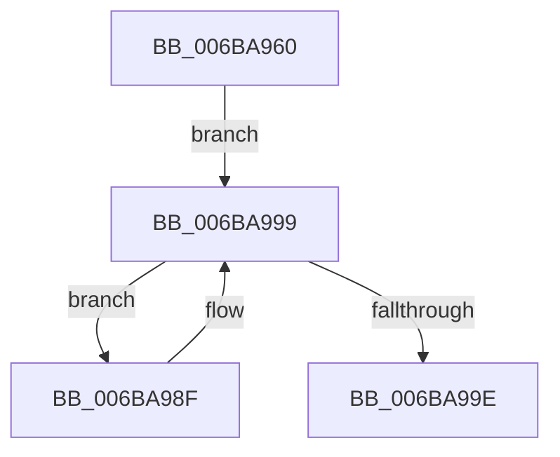

# _chkstk

- RVA: `0x006BA960`–`0x006BA9AC` (길이 `76` bytes)
- VA: `0x00000001406BA960`
- 실행 섹션: `.text`
- PDB 이름 있음: `예`; PDB Function 태그: `아니요`
- unwind 정보 RVA: `0x000C2568`
- 디코드: `19`개 명령, `76/76` bytes 표시
- 미해석 바이트: `0` (있으면 어셈블리에 `.byte`로 보존)

> 이 문서는 커널 이미지의 기계어와 PDB 기호를 분석해 생성했습니다. 4번과 5번은 함수 원형과 자료형을 바이너리 사용 방식에서 추정한 C 해석이며 원본 소스 복구 결과는 아닙니다.

## 1. Dependencies

- 직접 호출 지점: **0**; 고유 호출 대상: **0**
- 직접 호출자로 확인된 함수: **45**
- RIP 상대 이미지 참조: **0**

### Outgoing calls
- 직접 디코드된 call 명령이 없습니다.

### Direct callers
- [ST_STORE&lt;SM_TRAITS&gt;::StDmPageRemove](../20/ST_STORE_SM_TRAITS_StDmPageRemove_function_002049A0.md) at `0x00204F20`
- [KeIntSteerSnapPerf](../2D/KeIntSteerSnapPerf_function_002D76C0.md) at `0x002D79DD`
- [RtlUnwind](../2F/RtlUnwind_function_002F1CB0.md) at `0x002F1D59`
- [RtlDispatchException](../2F/RtlDispatchException_function_002F22A0.md) at `0x002F2407`
- [RtlUnwindEx](../2F/RtlUnwindEx_function_002F2830.md) at `0x002F2D46`
- [RtlUnwindEx](../2F/RtlUnwindEx_function_002F2830.md) at `0x002F2DC4`
- [RtlpWalkFrameChain](../2F/RtlpWalkFrameChain_function_002F3ED0.md) at `0x002F4039`
- [KiContinuePreviousModeUser](../2F/KiContinuePreviousModeUser_function_002F9B10.md) at `0x002F9C6B`
- [vDbgPrintExWithPrefixInternalHelper](../35/vDbgPrintExWithPrefixInternalHelper_function_003593C0.md) at `0x0035947E`
- [B_TREE&lt;unsigned long,ST_STORE&lt;SM_TRAITS&gt;::_ST_REGION_ENTRY,4096,NP_CONTEXT,ST_STORE&lt;SM_TRAITS&gt;::ST_REGION_ENTRY_COMPARATOR&gt;::BTreeSearchResultDeref](../3A/B_TREE_unsigned_long_ST_STORE_SM_TRAITS__ST_REGION_ENTRY_4096_NP_CONTEXT_ST_STORE_SM_TRAITS_ST_REGIO_function_003AD260.md) at `0x003AD33C`
- [KyRaiseException](../3D/KyRaiseException_function_003D5E20.md) at `0x003D5EE9`
- [KiUnwindUserSspForApcContextCopyBypass](../3D/KiUnwindUserSspForApcContextCopyBypass_function_003D6F0C.md) at `0x003D6F9A`
- [KiDispatchException](../3D/KiDispatchException_function_003D7650.md) at `0x003D7753`
- [EtwpTraceLostEvent](../3F/EtwpTraceLostEvent_function_003F0D58.md) at `0x003F0EA4`
- [EtwpApplyEventNameFilter](../3F/EtwpApplyEventNameFilter_function_003F10B8.md) at `0x003F11D6`
- [EtwpApplyPayloadFilterInternal](../3F/EtwpApplyPayloadFilterInternal_function_003F43D0.md) at `0x003F4542`
- [EtwpApplyPayloadFilterInternal](../3F/EtwpApplyPayloadFilterInternal_function_003F43D0.md) at `0x003F4571`
- [B_TREE&lt;_SM_PAGE_KEY,ST_STORE&lt;SM_TRAITS&gt;::_ST_PAGE_ENTRY,4096,NP_CONTEXT,B_TREE_KEY_COMPARATOR&lt;_SM_PAGE_KEY&gt; &gt;::BTreeFindLeafSibling](../41/B_TREE__SM_PAGE_KEY_ST_STORE_SM_TRAITS__ST_PAGE_ENTRY_4096_NP_CONTEXT_B_TREE_KEY_COMPARATOR__SM_PAGE_function_00410EF0.md) at `0x00410F53`
- [B_TREE&lt;unsigned long,ST_STORE&lt;SM_TRAITS&gt;::_ST_HASH_ENTRY,4096,NP_CONTEXT,ST_STORE&lt;SM_TRAITS&gt;::ST_HASH_ENTRY_COMPARATOR&gt;::BTreeFindLeafSibling](../43/B_TREE_unsigned_long_ST_STORE_SM_TRAITS__ST_HASH_ENTRY_4096_NP_CONTEXT_ST_STORE_SM_TRAITS_ST_HASH_EN_function_0043F728.md) at `0x0043F78B`
- [HalSetEnvironmentVariableEx](../44/HalSetEnvironmentVariableEx_function_00448EB0.md) at `0x00448F49`
- [HalGetEnvironmentVariableEx](../44/HalGetEnvironmentVariableEx_function_00449100.md) at `0x0044918E`
- [B_TREE&lt;unsigned long,ST_STORE&lt;SM_TRAITS&gt;::_ST_REGION_ENTRY,4096,NP_CONTEXT,ST_STORE&lt;SM_TRAITS&gt;::ST_REGION_ENTRY_COMPARATOR&gt;::BTreeFindLeafSibling](../45/B_TREE_unsigned_long_ST_STORE_SM_TRAITS__ST_REGION_ENTRY_4096_NP_CONTEXT_ST_STORE_SM_TRAITS_ST_REGIO_function_00450FB8.md) at `0x0045101B`
- [ST_STORE&lt;SM_TRAITS&gt;::StCompactRegions](../4A/ST_STORE_SM_TRAITS_StCompactRegions_function_004A48E0.md) at `0x004A4ECC`
- [ST_STORE&lt;SM_TRAITS&gt;::StDmCombineBufferAddEntry](../4E/ST_STORE_SM_TRAITS_StDmCombineBufferAddEntry_function_004EB420.md) at `0x004EB8F8`
- [ReadStringDelimited](../50/ReadStringDelimited_function_00508BF8.md) at `0x00508C0D`
- [HalpHvStartVirtualProcessor](../54/HalpHvStartVirtualProcessor_function_0054CF98.md) at `0x0054CFA3`
- [RtlRaiseException](../5E/RtlRaiseException_function_005E6B00.md) at `0x005E6B82`
- [sub_006D8D90](../6D/Unknown_function_006D8D90.md) at `0x006D8D94`
- [sub_006DF314](../6D/Unknown_function_006DF314.md) at `0x006DF318`
- [sub_006DF902](../6D/Unknown_function_006DF902.md) at `0x006DFA31`
- [sub_006E6D3C](../6E/Unknown_function_006E6D3C.md) at `0x006E6D5C`
- [sub_006E6E64](../6E/Unknown_function_006E6E64.md) at `0x006E6E84`
- [sub_006ED0C0](../6E/Unknown_function_006ED0C0.md) at `0x006ED0E0`
- [sub_006EEC06](../6E/Unknown_function_006EEC06.md) at `0x006EEC35`
- [sub_006EF588](../6E/Unknown_function_006EF588.md) at `0x006EF5B7`
- [sub_006EFF4C](../6E/Unknown_function_006EFF4C.md) at `0x006EFF6C`
- [sub_006F026C](../6F/Unknown_function_006F026C.md) at `0x006F029C`
- [ExpWatchProductTypeWork](../../page/6F/ExpWatchProductTypeWork_function_006FFCA0.md) at `0x006FFFF6`
- [SmStorePhysicalRequestIssue](../../page/7A/SmStorePhysicalRequestIssue_function_007A732C.md) at `0x007A73B6`
- [ObWaitForMultipleObjects](../../page/86/ObWaitForMultipleObjects_function_00868DF0.md) at `0x00869545`
- [PspWow64SetContextThread](../../page/8C/PspWow64SetContextThread_function_008CCC88.md) at `0x008CCDF1`
- [PspWow64SetContextThread](../../page/8C/PspWow64SetContextThread_function_008CCC88.md) at `0x008CCEA6`
- [PspWow64SetContextThread](../../page/8C/PspWow64SetContextThread_function_008CCC88.md) at `0x008CD0D8`
- [PspSetContextThreadInternal](../../page/8D/PspSetContextThreadInternal_function_008D4420.md) at `0x008D4618`
- [PspGetContextThreadInternal](../../page/8D/PspGetContextThreadInternal_function_008D4770.md) at `0x008D49B5`
- [PspInitializeThunkContext](../../page/8D/PspInitializeThunkContext_function_008D5418.md) at `0x008D54E4`
- [NtCreateThreadEx](../../page/9E/NtCreateThreadEx_function_009ED3D0.md) at `0x009ED5C3`
- [PspWow64GetContextThread](../../page/A1/PspWow64GetContextThread_function_00A11E90.md) at `0x00A11FDA`
- [PspWow64GetContextThread](../../page/A1/PspWow64GetContextThread_function_00A11E90.md) at `0x00A1208D`
- [PspWow64GetContextThread](../../page/A1/PspWow64GetContextThread_function_00A11E90.md) at `0x00A12225`
- [NtCreateUserProcess](../../page/AE/NtCreateUserProcess_function_00AEA680.md) at `0x00AEB2CE`

### Static image references
- 디코드된 RIP-relative 메모리 참조가 없습니다.

## 2. Other-region calls and transfers

- 다른 실행 섹션으로 향하는 call: **0**
- 별도 외부 분기/꼬리 이동을 확인하지 못했습니다.

## 3. Assembly (complete function range)

```asm
006BA960  48 83 EC 10                     sub rsp, 0x10
006BA964  4C 89 14 24                     mov qword ptr [rsp], r10
006BA968  4C 89 5C 24 08                  mov qword ptr [rsp + 8], r11
006BA96D  4D 33 DB                        xor r11, r11
006BA970  4C 8D 54 24 18                  lea r10, [rsp + 0x18]
006BA975  4C 2B D0                        sub r10, rax
006BA978  4D 0F 42 D3                     cmovb r10, r11
006BA97C  66 41 81 E2 00 F0               and r10w, 0xf000
006BA982  4C 8D 5C 24 18                  lea r11, [rsp + 0x18]
006BA987  66 41 81 E3 00 F0               and r11w, 0xf000
006BA98D  EB 0A                           jmp 0x1406ba999
006BA98F  4D 8D 9B 00 F0 FF FF            lea r11, [r11 - 0x1000]
006BA996  45 84 1B                        test byte ptr [r11], r11b
006BA999  4D 3B D3                        cmp r10, r11
006BA99C  72 F1                           jb 0x1406ba98f
006BA99E  4C 8B 14 24                     mov r10, qword ptr [rsp]
006BA9A2  4C 8B 5C 24 08                  mov r11, qword ptr [rsp + 8]
006BA9A7  48 83 C4 10                     add rsp, 0x10
006BA9AB  C3                              ret
```

## 4. C-style interpretation (structured pseudocode)

```c
void __fastcall _chkstk(void)
{
    __int64 v_r10;
    __int64 v_r11;
    __int64 v_rsp;
    unsigned __int64 v_stack_m10;
    unsigned __int64 v_stack_m8;
    unsigned __int64 v_stack_p8;

    v_rsp = (v_rsp) - (16);
    v_stack_m10 = v_r10;
    v_stack_m8 = v_r11;
    v_r11 = 0;
    v_r10 = (v_stack_p8) - (result);
    if (condition_is_below) { v_r10 = 0; }
    v_r10 = (unsigned __int16)((v_r10) & (0xF000ULL));
    v_r11 = (unsigned __int16)((v_stack_p8) & (0xF000ULL));
    goto loc_006BA999;
loc_006BA98F:
loc_006BA999:
    if (v_r10 < (v_r11 - 4096)) goto loc_006BA98F;
    v_rsp = (v_rsp) + (16);
    return;
}
```

## 5. (Beta) C Style

```c
void _chkstk(void)
{
    int64_t local_r10;
    int64_t local_r11;
    int64_t local_rsp;
    uint64_t v_stack_m10;
    uint64_t v_stack_m8;
    uint64_t v_stack_p8;

    local_rsp = (local_rsp) - (16);
    v_stack_m10 = local_r10;
    v_stack_m8 = local_r11;
    local_r11 = 0;
    local_r10 = (v_stack_p8) - (result);
    if (condition_is_below) { local_r10 = 0; }
    local_r10 = (uint16_t)((local_r10) & (0xF000ULL));
    local_r11 = (uint16_t)((v_stack_p8) & (0xF000ULL));
    goto loc_006BA999;
loc_006BA98F:
loc_006BA999:
    if (local_r10 < (local_r11 - 4096)) goto loc_006BA98F;
    local_rsp = (local_rsp) + (16);
    return;
}
```

## 6. Execution-region graph

[열기: 2D/3D 그래프와 함수 탐색 컨트롤 패널](../../../control-panel.html?section=text&rva=0x006BA960&view=graph)

- 2D 그래프는 위에서 아래로 흐르고, 3D 그래프는 빈 공간을 드래그해 회전합니다. Shift+드래그는 이동, 휠은 확대·축소, 함수 노드 선택은 대상 보고서 이동입니다.

### Static fallback


