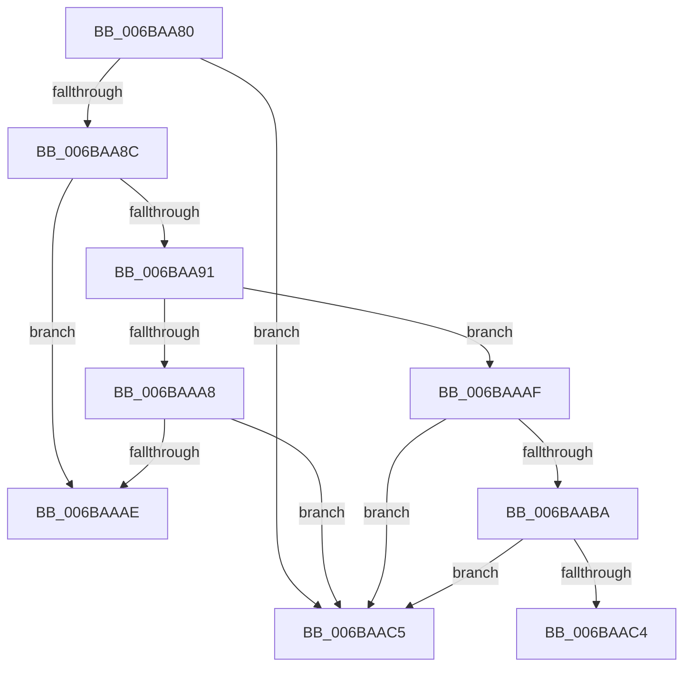

# guard_check_icall

- RVA: `0x006BAA80`–`0x006BAACA` (길이 `74` bytes)
- VA: `0x00000001406BAA80`
- 실행 섹션: `.text`
- PDB 이름 있음: `예`; PDB Function 태그: `아니요`
- unwind 정보 RVA: `0x000C2588`
- 디코드: `23`개 명령, `74/74` bytes 표시
- 미해석 바이트: `0` (있으면 어셈블리에 `.byte`로 보존)

> 이 문서는 커널 이미지의 기계어와 PDB 기호를 분석해 생성했습니다. 4번과 5번은 함수 원형과 자료형을 바이너리 사용 방식에서 추정한 C 해석이며 원본 소스 복구 결과는 아닙니다.

## 1. Dependencies

- 직접 호출 지점: **0**; 고유 호출 대상: **0**
- 직접 호출자로 확인된 함수: **9**
- RIP 상대 이미지 참조: **1**

### Outgoing calls
- 직접 디코드된 call 명령이 없습니다.

### Direct callers
- [bsearch](../50/bsearch_function_00500430.md) at `0x0050048A`
- [bsearch_s](../50/bsearch_s_function_00500540.md) at `0x0050059E`
- [sub_00500A6E](../50/Unknown_function_00500A6E.md) at `0x00500A91`
- [sub_00500E5D](../50/Unknown_function_00500E5D.md) at `0x00500E78`
- [sub_0050A560](../50/Unknown_function_0050A560.md) at `0x0050A592`
- [sub_0050BDE0](../50/Unknown_function_0050BDE0.md) at `0x0050BE84`
- [sub_0050BEC0](../50/Unknown_function_0050BEC0.md) at `0x0050C01A`
- [sub_0051AC80](../51/Unknown_function_0051AC80.md) at `0x0051ACD2`
- [sub_0051AC80](../51/Unknown_function_0051AC80.md) at `0x0051ACF8`
- [HaliSaveProcessorContextAndSleep](../6A/HaliSaveProcessorContextAndSleep_function_006ACE10.md) at `0x006ACE60`

### Static image references
- `0x006BAA80` → RVA `0x012018B8` (`CFGRO`; read)

## 2. Other-region calls and transfers

- 다른 실행 섹션으로 향하는 call: **0**
- call이 아닌 외부 분기/꼬리 이동: **1**
  - `0x006BAAC5` → [guard_icall_bugcheck](guard_icall_bugcheck_function_006BAA20.md) (`tail-transfer`)

## 3. Assembly (complete function range)

```asm
006BAA80  48 8B 15 31 6E B4 00            mov rdx, qword ptr [rip + 0xb46e31]
006BAA87  48 85 C9                        test rcx, rcx
006BAA8A  7D 39                           jge 0x1406baac5
006BAA8C  48 85 D2                        test rdx, rdx
006BAA8F  74 1D                           je 0x1406baaae
006BAA91  4C 8B D1                        mov r10, rcx
006BAA94  49 C1 EA 09                     shr r10, 9
006BAA98  4A 8B 14 D2                     mov rdx, qword ptr [rdx + r10*8]
006BAA9C  4C 8B D1                        mov r10, rcx
006BAA9F  49 C1 EA 03                     shr r10, 3
006BAAA3  F6 C1 0F                        test cl, 0xf
006BAAA6  75 07                           jne 0x1406baaaf
006BAAA8  4C 0F A3 D2                     bt rdx, r10
006BAAAC  73 17                           jae 0x1406baac5
006BAAAE  C3                              ret
006BAAAF  49 0F BA F2 00                  btr r10, 0
006BAAB4  4C 0F A3 D2                     bt rdx, r10
006BAAB8  73 0B                           jae 0x1406baac5
006BAABA  49 83 CA 01                     or r10, 1
006BAABE  4C 0F A3 D2                     bt rdx, r10
006BAAC2  73 01                           jae 0x1406baac5
006BAAC4  C3                              ret
006BAAC5  E9 56 FF FF FF                  jmp 0x1406baa20
```

## 4. C-style interpretation (structured pseudocode)

```c
void __fastcall guard_check_icall(__int64 a1)
{
    __int64 v_r10;

    if (condition_is_greater_or_equal) goto loc_006BAAC5;
    if (*(unsigned __int64 *)(v_rip + 11824689) == 0) goto loc_006BAAAE;
    v_r10 = (a1) >> (9);
    v_r10 = (a1) >> (3);
    if ((((unsigned __int8)(a1)) & (15)) != 0) goto loc_006BAAAF;
    if (condition_is_above_or_equal) goto loc_006BAAC5;
loc_006BAAAE:
    return;
loc_006BAAAF:
    if (condition_is_above_or_equal) goto loc_006BAAC5;
    v_r10 = (v_r10) | (1);
    if (condition_is_above_or_equal) goto loc_006BAAC5;
    return;
loc_006BAAC5:
}
```

## 5. (Beta) C Style

```c
void guard_check_icall(int64_t Arg1)
{
    int64_t local_r10;

    if (condition_is_greater_or_equal) goto loc_006BAAC5;
    if (*(uint64_t *)(v_rip + 0xB46E31) == 0) goto loc_006BAAAE;
    local_r10 = (Arg1) >> (9);
    local_r10 = (Arg1) >> (3);
    if ((((uint8_t)(Arg1)) & (15)) != 0) goto loc_006BAAAF;
    if (condition_is_above_or_equal) goto loc_006BAAC5;
loc_006BAAAE:
    return;
loc_006BAAAF:
    if (condition_is_above_or_equal) goto loc_006BAAC5;
    local_r10 = (local_r10) | (1);
    if (condition_is_above_or_equal) goto loc_006BAAC5;
    return;
loc_006BAAC5:
}
```

## 6. Execution-region graph

[열기: 2D/3D 그래프와 함수 탐색 컨트롤 패널](../../../control-panel.html?section=text&rva=0x006BAA80&view=graph)

- 2D 그래프는 위에서 아래로 흐르고, 3D 그래프는 빈 공간을 드래그해 회전합니다. Shift+드래그는 이동, 휠은 확대·축소, 함수 노드 선택은 대상 보고서 이동입니다.

### Static fallback


