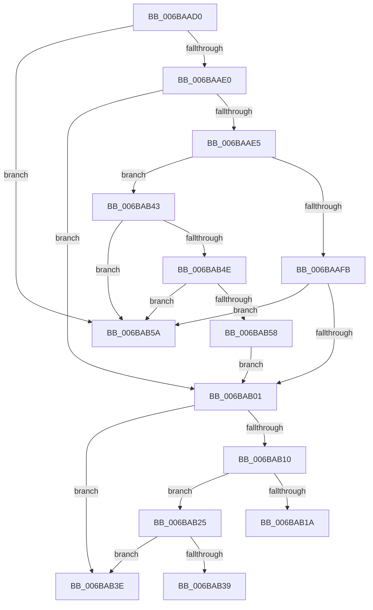

# guard_dispatch_icall

- RVA: `0x006BAAD0`–`0x006BAB62` (길이 `146` bytes)
- VA: `0x00000001406BAAD0`
- 실행 섹션: `.text`
- PDB 이름 있음: `예`; PDB Function 태그: `아니요`
- unwind 정보 RVA: `0x000C2588`
- 디코드: `40`개 명령, `146/146` bytes 표시
- 미해석 바이트: `0` (있으면 어셈블리에 `.byte`로 보존)

> 이 문서는 커널 이미지의 기계어와 PDB 기호를 분석해 생성했습니다. 4번과 5번은 함수 원형과 자료형을 바이너리 사용 방식에서 추정한 C 해석이며 원본 소스 복구 결과는 아닙니다.

## 1. Dependencies

- 직접 호출 지점: **1**; 고유 호출 대상: **1**
- 직접 호출자로 확인된 함수: **3153**
- RIP 상대 이미지 참조: **2**

### Outgoing calls
- `0x006BAB1A` → [guard_dispatch_icall + 0x50](guard_dispatch_icall_function_006BAAD0.md) (inside-function, `0x006BAB20`)

### Direct callers
- [sub_002073F4](../20/Unknown_function_002073F4.md) at `0x00207430`
- [HalpTimerClockInterrupt](../20/HalpTimerClockInterrupt_function_002086A0.md) at `0x00208868`
- [HalpTimerClockInterrupt](../20/HalpTimerClockInterrupt_function_002086A0.md) at `0x002088F2`
- [HalpTimerClockInterrupt](../20/HalpTimerClockInterrupt_function_002086A0.md) at `0x00208911`
- [sub_00208A2D](../20/Unknown_function_00208A2D.md) at `0x00208A74`
- [sub_00208C94](../20/Unknown_function_00208C94.md) at `0x00208D6F`
- [sub_00208E4A](../20/Unknown_function_00208E4A.md) at `0x00208E66`
- [sub_00208F20](../20/Unknown_function_00208F20.md) at `0x00208F3C`
- [sub_00208F20](../20/Unknown_function_00208F20.md) at `0x00208F46`
- [sub_002092A9](../20/Unknown_function_002092A9.md) at `0x002092E2`
- [sub_002092A9](../20/Unknown_function_002092A9.md) at `0x002094D7`
- [sub_002092A9](../20/Unknown_function_002092A9.md) at `0x002094E1`
- [sub_0020A8E8](../20/Unknown_function_0020A8E8.md) at `0x0020AB3E`
- [sub_0020A8E8](../20/Unknown_function_0020A8E8.md) at `0x0020AB4A`
- [sub_0020A8E8](../20/Unknown_function_0020A8E8.md) at `0x0020AB57`
- [sub_0020A8E8](../20/Unknown_function_0020A8E8.md) at `0x0020AB6D`
- [sub_0020A8E8](../20/Unknown_function_0020A8E8.md) at `0x0020AB79`
- [KiRcuFlushCompleted](../20/KiRcuFlushCompleted_function_0020AD38.md) at `0x0020AEBC`
- [sub_002142F9](../21/Unknown_function_002142F9.md) at `0x00214D86`
- [PsBoostThreadOutstandingIoQoS](../21/PsBoostThreadOutstandingIoQoS_function_00215C54.md) at `0x00215C9F`
- [sub_002160C7](../21/Unknown_function_002160C7.md) at `0x002160CE`
- [IoBoostThreadIoPriority](../21/IoBoostThreadIoPriority_function_00216110.md) at `0x002162B4`
- [IoBoostThreadIoPriority](../21/IoBoostThreadIoPriority_function_00216110.md) at `0x00216405`
- [SepRmCallLsa](../22/SepRmCallLsa_function_00223630.md) at `0x0022380F`
- [SepQueueWorkItem](../22/SepQueueWorkItem_function_00225844.md) at `0x002258D0`
- [EtwpEventWriteFull](../22/EtwpEventWriteFull_function_00225C10.md) at `0x002263AB`
- [EtwpEventWriteFull](../22/EtwpEventWriteFull_function_00225C10.md) at `0x002277F0`
- [KiProcessExpiredTimerList](../23/KiProcessExpiredTimerList_function_00234200.md) at `0x00234544`
- [sub_00235B5D](../23/Unknown_function_00235B5D.md) at `0x00235CA3`
- [sub_00235D85](../23/Unknown_function_00235D85.md) at `0x00235DA7`
- [HalpPciAccessMmConfigSpace](../23/HalpPciAccessMmConfigSpace_function_0023683C.md) at `0x0023695C`
- [MiReacquireHigherPageTableLock](../23/MiReacquireHigherPageTableLock_function_00239650.md) at `0x00239D02`
- [MiYieldPageTableWalk](../23/MiYieldPageTableWalk_function_00239D20.md) at `0x00239E7E`
- [MiAgeTrimListsTail](../23/MiAgeTrimListsTail_function_00239E90.md) at `0x00239FBE`
- [PopPluginComponentActive](../24/PopPluginComponentActive_function_0024B800.md) at `0x0024B885`
- [PopPepProcessEvent](../24/PopPepProcessEvent_function_0024B930.md) at `0x0024C944`
- [PopPepProcessEvent](../24/PopPepProcessEvent_function_0024B930.md) at `0x0024CBA6`
- [PopPepProcessEvent](../24/PopPepProcessEvent_function_0024B930.md) at `0x0024CC06`
- [PopPepProcessEvent](../24/PopPepProcessEvent_function_0024B930.md) at `0x0024CC61`
- [PopPepTriggerActivity](../24/PopPepTriggerActivity_function_0024CDB0.md) at `0x0024D0A6`
- [PopPepStartActivity](../24/PopPepStartActivity_function_0024D6E0.md) at `0x0024D777`
- [sub_002514A5](../25/Unknown_function_002514A5.md) at `0x00251663`
- [sub_002514A5](../25/Unknown_function_002514A5.md) at `0x00251670`
- [sub_002514A5](../25/Unknown_function_002514A5.md) at `0x00251682`
- [sub_002514A5](../25/Unknown_function_002514A5.md) at `0x0025168F`
- [HalpInterruptSendIpi](../25/HalpInterruptSendIpi_function_00252310.md) at `0x0025243C`
- [sub_002525D7](../25/Unknown_function_002525D7.md) at `0x00252711`
- [sub_002525D7](../25/Unknown_function_002525D7.md) at `0x002527F5`
- [sub_00252888](../25/Unknown_function_00252888.md) at `0x002528E6`
- [sub_00252912](../25/Unknown_function_00252912.md) at `0x002529A2`
- [sub_00252A85](../25/Unknown_function_00252A85.md) at `0x00252C8C`
- [KiExecuteAllDpcs](../25/KiExecuteAllDpcs_function_0025B740.md) at `0x0025BDCD`
- [EtwpLogKernelEvent](../25/EtwpLogKernelEvent_function_0025CC00.md) at `0x0025D487`
- [EtwpLogKernelEvent](../25/EtwpLogKernelEvent_function_0025CC00.md) at `0x0025D731`
- [EtwpLogKernelEvent](../25/EtwpLogKernelEvent_function_0025CC00.md) at `0x0025D816`
- [IopBoostThreadCallback](../26/IopBoostThreadCallback_function_00265C30.md) at `0x00265C4C`
- [SMKM_STORE_MGR&lt;SM_TRAITS&gt;::SmFeEvictComplete](../26/SMKM_STORE_MGR_SM_TRAITS_SmFeEvictComplete_function_00266854.md) at `0x00266A9B`
- [SmStoreCompressBuffer](../26/SmStoreCompressBuffer_function_002683E0.md) at `0x00268545`
- [RtlCompressBuffer](../26/RtlCompressBuffer_function_0026A220.md) at `0x0026A376`
- [PopIrpWorker](../26/PopIrpWorker_function_0026D410.md) at `0x0026D638`
- [PopRequestCompletion](../26/PopRequestCompletion_function_0026EEF0.md) at `0x0026EF4F`
- [IopCompleteUnloadOrDelete](../27/IopCompleteUnloadOrDelete_function_00270BC8.md) at `0x00270CFC`
- [IoCancelIrp](../27/IoCancelIrp_function_002720E0.md) at `0x0027214C`
- [MiDeleteVaDirect](../27/MiDeleteVaDirect_function_00277560.md) at `0x002789B6`
- [MiDeleteVaDirect](../27/MiDeleteVaDirect_function_00277560.md) at `0x002789C3`
- [MiWalkPageTablesRecursively](../27/MiWalkPageTablesRecursively_function_002796C0.md) at `0x0027B29A`
- [MiWalkPageTablesRecursively](../27/MiWalkPageTablesRecursively_function_002796C0.md) at `0x0027B764`
- [MiWalkPageTablesRecursively](../27/MiWalkPageTablesRecursively_function_002796C0.md) at `0x0027B76E`
- [MiWalkPageTablesRecursively](../27/MiWalkPageTablesRecursively_function_002796C0.md) at `0x0027B77A`
- [MiWalkPageTablesRecursively](../27/MiWalkPageTablesRecursively_function_002796C0.md) at `0x0027B7A1`
- [sub_0027BB85](../27/Unknown_function_0027BB85.md) at `0x0027BBE0`
- [IopCompletePageWrite](../29/IopCompletePageWrite_function_00298010.md) at `0x00298074`
- [sub_00299018](../29/Unknown_function_00299018.md) at `0x00299052`
- [FsRtlReleaseFileForModWrite](../29/FsRtlReleaseFileForModWrite_function_00299100.md) at `0x002992CD`
- [FsFilterPerformCallbacks](../29/FsFilterPerformCallbacks_function_00299590.md) at `0x002997B8`
- [FsRtlAcquireFileForModWriteEx](../29/FsRtlAcquireFileForModWriteEx_function_00299E5C.md) at `0x0029A000`
- [IofCallDriver](../29/IofCallDriver_function_0029B4B0.md) at `0x0029B52F`
- [IopfCompleteRequest](../29/IopfCompleteRequest_function_0029B5F8.md) at `0x0029B798`
- [IopfCompleteRequest](../29/IopfCompleteRequest_function_0029B5F8.md) at `0x0029B92A`
- [IopfCallDriver](../29/IopfCallDriver_function_0029C474.md) at `0x0029C4DC`
- [sub_0029EB68](../29/Unknown_function_0029EB68.md) at `0x0029EBAE`
- [sub_0029EBE0](../29/Unknown_function_0029EBE0.md) at `0x0029EBE0`
- [IoAllocateMdl](../29/IoAllocateMdl_function_0029EBF0.md) at `0x0029ECB2`
- [IoAllocateMdl](../29/IoAllocateMdl_function_0029EBF0.md) at `0x0029EDFD`
- [KeEnumerateKernelStackSegments](../2A/KeEnumerateKernelStackSegments_function_002A13B8.md) at `0x002A1528`
- [KeEnumerateKernelStackSegments](../2A/KeEnumerateKernelStackSegments_function_002A13B8.md) at `0x002A1535`
- [MiEnumerateSystemImages](../2A/MiEnumerateSystemImages_function_002A3D40.md) at `0x002A3DAB`
- [MiEnumerateSystemImages](../2A/MiEnumerateSystemImages_function_002A3D40.md) at `0x002A3E0F`
- [PopFxDispatchPluginWorkOnce](../2B/PopFxDispatchPluginWorkOnce_function_002BC69C.md) at `0x002BC839`
- [PopPepWork](../2B/PopPepWork_function_002BCBC0.md) at `0x002BD0DE`
- [PopPepWork](../2B/PopPepWork_function_002BCBC0.md) at `0x002BD104`
- [sub_002BD41B](../2B/Unknown_function_002BD41B.md) at `0x002BD66F`
- [sub_002BD6E6](../2B/Unknown_function_002BD6E6.md) at `0x002BD88B`
- [sub_002BD6E6](../2B/Unknown_function_002BD6E6.md) at `0x002BD8E0`
- [sub_002BD95A](../2B/Unknown_function_002BD95A.md) at `0x002BDA33`
- [sub_002BD95A](../2B/Unknown_function_002BD95A.md) at `0x002BDAD2`
- [sub_002BD95A](../2B/Unknown_function_002BD95A.md) at `0x002BDC6B`
- [PopPluginComponentIdleState](../2B/PopPluginComponentIdleState_function_002BE310.md) at `0x002BE3A8`
- [PopFxActivateComponentDependents](../2B/PopFxActivateComponentDependents_function_002BE9F0.md) at `0x002BEC3A`
- [PopPluginNotifyIdleState](../2B/PopPluginNotifyIdleState_function_002BFCA0.md) at `0x002BFCE8`
- [PopPepDeviceDState](../2B/PopPepDeviceDState_function_002BFE70.md) at `0x002BFF98`
- [PopFxIdleWorker](../2C/PopFxIdleWorker_function_002C04A0.md) at `0x002C051D`
- [PfSnNameQueryWorker](../2C/PfSnNameQueryWorker_function_002C0E20.md) at `0x002C0E8C`
- [MiWalkPageTablesRecursivelyNoSynch](../2C/MiWalkPageTablesRecursivelyNoSynch_function_002C2A28.md) at `0x002C2B55`
- [KiInitiateGenericCallDpc](../2C/KiInitiateGenericCallDpc_function_002C9C40.md) at `0x002C9CCA`
- [MiLaunchZeroParent](../2C/MiLaunchZeroParent_function_002CA5F8.md) at `0x002CA66E`
- [PpmPerfApplyDomainState](../2C/PpmPerfApplyDomainState_function_002CD470.md) at `0x002CD953`
- [PpmIdleSelectStates](../2C/PpmIdleSelectStates_function_002CFFE8.md) at `0x002D01C1`
- [PpmIdleSelectStates](../2C/PpmIdleSelectStates_function_002CFFE8.md) at `0x002D03C2`
- [PpmIdleSelectStates](../2C/PpmIdleSelectStates_function_002CFFE8.md) at `0x002D06F3`
- [PpmIdleExecuteTransition](../2D/PpmIdleExecuteTransition_function_002D0A1C.md) at `0x002D0C43`
- [PpmIdleExecuteTransition](../2D/PpmIdleExecuteTransition_function_002D0A1C.md) at `0x002D0DF3`
- [PpmIdleExecuteTransition](../2D/PpmIdleExecuteTransition_function_002D0A1C.md) at `0x002D0F2F`
- [PpmIdleExecuteTransition](../2D/PpmIdleExecuteTransition_function_002D0A1C.md) at `0x002D10C0`
- [HalpHandleMaskUnmaskSecondaryInterrupt](../2D/HalpHandleMaskUnmaskSecondaryInterrupt_function_002D1C8C.md) at `0x002D1D2A`
- [HalpHandleMaskUnmaskSecondaryInterrupt](../2D/HalpHandleMaskUnmaskSecondaryInterrupt_function_002D1C8C.md) at `0x002D1D71`
- [HalpMaskInterrupt](../2D/HalpMaskInterrupt_function_002D1DB0.md) at `0x002D1E95`
- [HalpUnmaskInterrupt](../2D/HalpUnmaskInterrupt_function_002D1EE0.md) at `0x002D201E`
- [HalpInterruptSetLineStateInternal](../2D/HalpInterruptSetLineStateInternal_function_002D2104.md) at `0x002D2134`
- [HalpInterruptSetLineStateInternal](../2D/HalpInterruptSetLineStateInternal_function_002D2104.md) at `0x002D215F`
- [HalpVpptAcknowledgeInterrupt](../2D/HalpVpptAcknowledgeInterrupt_function_002D2230.md) at `0x002D2265`
- [HalpVpptAcknowledgeInterrupt](../2D/HalpVpptAcknowledgeInterrupt_function_002D2230.md) at `0x002D237F`
- [HalpVpptUpdatePhysicalTimer](../2D/HalpVpptUpdatePhysicalTimer_function_002D23D8.md) at `0x002D249E`
- [HalpVpptUpdatePhysicalTimer](../2D/HalpVpptUpdatePhysicalTimer_function_002D23D8.md) at `0x002D24C5`
- [HalpHvRetargetDeviceMsiInterrupt](../2D/HalpHvRetargetDeviceMsiInterrupt_function_002D33A4.md) at `0x002D33FF`
- [HalDisableInterrupt](../2D/HalDisableInterrupt_function_002D39F0.md) at `0x002D3B0D`
- [HalpHvRetargetIoApicDeviceInterrupt](../2D/HalpHvRetargetIoApicDeviceInterrupt_function_002D3C48.md) at `0x002D3CC9`
- [KeConnectInterrupt](../2D/KeConnectInterrupt_function_002D3D5C.md) at `0x002D3EE0`
- [KiIsInterruptTypeSecondary](../2D/KiIsInterruptTypeSecondary_function_002D44BC.md) at `0x002D44E3`
- [HalEnableInterrupt](../2D/HalEnableInterrupt_function_002D4990.md) at `0x002D4ACC`
- [KiIntSteerGetLineInformation](../2D/KiIntSteerGetLineInformation_function_002D4B04.md) at `0x002D4B5E`
- [KiIntSteerGetLineInformation](../2D/KiIntSteerGetLineInformation_function_002D4B04.md) at `0x002D4B86`
- [KiIntSteerSetDestination](../2D/KiIntSteerSetDestination_function_002D581C.md) at `0x002D5856`
- [sub_002D6C05](../2D/Unknown_function_002D6C05.md) at `0x002D6CD5`
- [PpmCheckRun](../2D/PpmCheckRun_function_002DA0C0.md) at `0x002DA148`
- [PpmPerfControlExecuteAction](../2D/PpmPerfControlExecuteAction_function_002DA31C.md) at `0x002DA33E`
- [PpmPerfApplyProcessorState](../2D/PpmPerfApplyProcessorState_function_002DA4BC.md) at `0x002DA61F`
- [MiManageUltraSpacePageTable](../2D/MiManageUltraSpacePageTable_function_002DCAF0.md) at `0x002DCED3`
- [PopExecuteProcessorCallback](../2D/PopExecuteProcessorCallback_function_002DD7D0.md) at `0x002DD820`
- [PpmSnapPerformanceAccumulation](../2D/PpmSnapPerformanceAccumulation_function_002DE090.md) at `0x002DE268`
- [PpmUpdatePerformanceFeedback](../2D/PpmUpdatePerformanceFeedback_function_002DE580.md) at `0x002DE949`
- [PpmUpdatePerformanceFeedback](../2D/PpmUpdatePerformanceFeedback_function_002DE580.md) at `0x002DEA58`
- [PpmUpdatePerformanceFeedback](../2D/PpmUpdatePerformanceFeedback_function_002DE580.md) at `0x002DEF8A`
- [PpmUpdatePerformanceFeedback](../2D/PpmUpdatePerformanceFeedback_function_002DE580.md) at `0x002DEF9E`
- [RtlpHpVsChunkSplit](../2E/RtlpHpVsChunkSplit_function_002E5C80.md) at `0x002E6B44`
- [RtlpHpVsSubsegmentCommitPages](../2E/RtlpHpVsSubsegmentCommitPages_function_002E6C74.md) at `0x002E6D94`
- [RtlpHpVsSubsegmentCommitPages](../2E/RtlpHpVsSubsegmentCommitPages_function_002E6C74.md) at `0x002E6D9B`
- [RtlpHpLfhSubsegmentFree](../2E/RtlpHpLfhSubsegmentFree_function_002E7CA0.md) at `0x002E7D39`
- [RtlpHpVsSubsegmentFree](../2E/RtlpHpVsSubsegmentFree_function_002E7D9C.md) at `0x002E7DDC`
- [RtlpHpLfhSubsegmentCommitBlock](../2E/RtlpHpLfhSubsegmentCommitBlock_function_002EA630.md) at `0x002EA90A`
- [RtlpHpVsSubsegmentCreate](../2E/RtlpHpVsSubsegmentCreate_function_002EAE30.md) at `0x002EAF38`
- [RtlpHpVsSubsegmentCreate](../2E/RtlpHpVsSubsegmentCreate_function_002EAE30.md) at `0x002EAF3F`
- [RtlpHpLfhSubsegmentCreate](../2E/RtlpHpLfhSubsegmentCreate_function_002EC5A0.md) at `0x002EC68A`
- [RtlpHpLfhSubsegmentCreate](../2E/RtlpHpLfhSubsegmentCreate_function_002EC5A0.md) at `0x002EC6F5`
- [RtlpHpLfhSubsegmentCreate](../2E/RtlpHpLfhSubsegmentCreate_function_002EC5A0.md) at `0x002EC728`
- [CcForEachPartition](../2F/CcForEachPartition_function_002F0828.md) at `0x002F08D3`
- [EtwpTraceLastBranchRecord](../2F/EtwpTraceLastBranchRecord_function_002F7B00.md) at `0x002F7BF0`
- [KeExpandKernelStackAndCalloutInternal](../2F/KeExpandKernelStackAndCalloutInternal_function_002F8450.md) at `0x002F851F`
- [EtwpApcPoolThunk](../2F/EtwpApcPoolThunk_function_002FA090.md) at `0x002FA391`
- [EtwpTraceMessageVa](../2F/EtwpTraceMessageVa_function_002FB2B0.md) at `0x002FBA48`
- [EtwpLogSystemEventUnsafe](../2F/EtwpLogSystemEventUnsafe_function_002FBF10.md) at `0x002FC2F7`
- [EtwpLogSystemEventUnsafe](../2F/EtwpLogSystemEventUnsafe_function_002FBF10.md) at `0x002FC727`
- [EtwpLogSystemEventUnsafe](../2F/EtwpLogSystemEventUnsafe_function_002FBF10.md) at `0x002FC812`
- [EtwpReserveWithPmcCounters](../2F/EtwpReserveWithPmcCounters_function_002FCED0.md) at `0x002FD044`
- [PpmParkReportMask](../30/PpmParkReportMask_function_00305190.md) at `0x00305207`
- [IommupHvMapDeviceLogicalRange](../30/IommupHvMapDeviceLogicalRange_function_00306C94.md) at `0x00306CF0`
- [IommupHvMapDeviceLogicalRange](../30/IommupHvMapDeviceLogicalRange_function_00306C94.md) at `0x00306D0F`
- [HalpPutScatterGatherListDmarThin](../30/HalpPutScatterGatherListDmarThin_function_00306DB4.md) at `0x00306E59`
- [HalpPutScatterGatherListDmarThin](../30/HalpPutScatterGatherListDmarThin_function_00306DB4.md) at `0x00306EB3`
- [IommuUnmapIdentityRangeEx](../30/IommuUnmapIdentityRangeEx_function_00306F80.md) at `0x003070DB`
- [HalpIommuDomainFreeLogicalAddressRange](../30/HalpIommuDomainFreeLogicalAddressRange_function_003070EC.md) at `0x00307129`
- [IommupHvUnmapDeviceLogicalRange](../30/IommupHvUnmapDeviceLogicalRange_function_0030730C.md) at `0x0030735B`
- [IommuMapLogicalRangeEx](../30/IommuMapLogicalRangeEx_function_003074B0.md) at `0x00307671`
- [IommupHvMapDeviceLogical](../30/IommupHvMapDeviceLogical_function_003076F4.md) at `0x0030777A`
- [IommupHvMapDeviceLogical](../30/IommupHvMapDeviceLogical_function_003076F4.md) at `0x00307793`
- [IommuMapIdentityRangeEx](../30/IommuMapIdentityRangeEx_function_00307C10.md) at `0x00307DC2`
- [HalpIommuDomainGetLogicalAddressRange](../30/HalpIommuDomainGetLogicalAddressRange_function_00307E48.md) at `0x00307EC4`
- [HalpIommuMapLogical](../30/HalpIommuMapLogical_function_00308290.md) at `0x00308406`
- [HalpIommuMapLogical](../30/HalpIommuMapLogical_function_00308290.md) at `0x00308535`
- [MiFlushEntireTbDueToAttributeChange](../30/MiFlushEntireTbDueToAttributeChange_function_00308AE0.md) at `0x00308BE6`
- [HalpIommuFlushDmaDomain](../30/HalpIommuFlushDmaDomain_function_003093B4.md) at `0x0030946C`
- [KiStartThreadCycleAccumulationContextSwap](../30/KiStartThreadCycleAccumulationContextSwap_function_00309C10.md) at `0x0030A542`
- [KiStartThreadCycleAccumulationContextSwap](../30/KiStartThreadCycleAccumulationContextSwap_function_00309C10.md) at `0x0030A5AB`
- [KiStartThreadCycleAccumulationContextSwap](../30/KiStartThreadCycleAccumulationContextSwap_function_00309C10.md) at `0x0030A5BB`
- [KiStartThreadCycleAccumulationContextSwap](../30/KiStartThreadCycleAccumulationContextSwap_function_00309C10.md) at `0x0030A5C9`
- [KiStartThreadCycleAccumulationContextSwap](../30/KiStartThreadCycleAccumulationContextSwap_function_00309C10.md) at `0x0030A5DF`
- [KiIpiSendRequestEx](../31/KiIpiSendRequestEx_function_003112D0.md) at `0x00311313`
- [KiIpiSendRequestEx](../31/KiIpiSendRequestEx_function_003112D0.md) at `0x003113A7`
- [sub_003127BF](../31/Unknown_function_003127BF.md) at `0x003128DA`
- [sub_003127BF](../31/Unknown_function_003127BF.md) at `0x003129FE`
- [sub_00312A48](../31/Unknown_function_00312A48.md) at `0x00312B0B`
- [ExFlushTb](../31/ExFlushTb_function_00312B34.md) at `0x00312B89`
- [ExFlushTb](../31/ExFlushTb_function_00312B34.md) at `0x00312BC3`
- [sub_00317914](../31/Unknown_function_00317914.md) at `0x0031798B`
- [RtlpHpLfhOwnerListCompact](../32/RtlpHpLfhOwnerListCompact_function_00323BA8.md) at `0x00323CD3`
- [RtlpHpLfhSubsegmentDelayFreeListProcess](../32/RtlpHpLfhSubsegmentDelayFreeListProcess_function_00323CE0.md) at `0x0032420B`
- [sub_00341DB3](../34/Unknown_function_00341DB3.md) at `0x00342017`
- [sub_00342B2F](../34/Unknown_function_00342B2F.md) at `0x00342B97`
- [PfFbLogEntryComplete](../34/PfFbLogEntryComplete_function_00349B40.md) at `0x00349B99`
- [PfLogEvent](../34/PfLogEvent_function_00349BA8.md) at `0x00349D00`
- [PfLogEvent](../34/PfLogEvent_function_00349BA8.md) at `0x00349D40`
- [PfLogEvent](../34/PfLogEvent_function_00349BA8.md) at `0x00349D5A`
- [SMKM_STORE_MGR&lt;SM_TRAITS&gt;::SmHighMemPriorityWatchdogWorker](../34/SMKM_STORE_MGR_SM_TRAITS_SmHighMemPriorityWatchdogWorker_function_0034C080.md) at `0x0034C0EA`
- [CcWriteBehind](../35/CcWriteBehind_function_00356EAC.md) at `0x00356F72`
- [CcAllocateWorkQueueEntry](../35/CcAllocateWorkQueueEntry_function_0035710C.md) at `0x00357181`
- [CcFreeWorkQueueEntry](../35/CcFreeWorkQueueEntry_function_0035723C.md) at `0x003572E0`
- [CcWriteBehindPreProcess](../35/CcWriteBehindPreProcess_function_00357784.md) at `0x0035788C`
- [CcWriteBehindPreProcess](../35/CcWriteBehindPreProcess_function_00357784.md) at `0x00357906`
- [CcWriteBehindPreProcess](../35/CcWriteBehindPreProcess_function_00357784.md) at `0x00357B1E`
- [CcGetDirtyPagesHelper](../35/CcGetDirtyPagesHelper_function_00358D40.md) at `0x00358F55`
- [CcPostDeferredWrites](../35/CcPostDeferredWrites_function_003590FC.md) at `0x003591EB`
- [wil_details_FeatureReporting_ReportVariantUsageToService](../37/wil_details_FeatureReporting_ReportVariantUsageToService_function_003782F8.md) at `0x00378387`
- [wil_details_FeatureReporting_ReportUsageToServiceDirect](../37/wil_details_FeatureReporting_ReportUsageToServiceDirect_function_003783A0.md) at `0x0037842F`
- [HalpHvCounterQueryCounter](../37/HalpHvCounterQueryCounter_function_00378F50.md) at `0x0037903E`
- [sub_0037AE18](../37/Unknown_function_0037AE18.md) at `0x0037B306`
- [sub_0037AE18](../37/Unknown_function_0037AE18.md) at `0x0037B312`
- [sub_0037AE18](../37/Unknown_function_0037AE18.md) at `0x0037B31F`
- [sub_0037AE18](../37/Unknown_function_0037AE18.md) at `0x0037B335`
- [sub_0037AE18](../37/Unknown_function_0037AE18.md) at `0x0037B341`
- [sub_0037BC17](../37/Unknown_function_0037BC17.md) at `0x0037BE9F`
- [sub_0037BC17](../37/Unknown_function_0037BC17.md) at `0x0037BF08`
- [sub_0037BFA1](../37/Unknown_function_0037BFA1.md) at `0x0037BFA4`
- [sub_0037BFA1](../37/Unknown_function_0037BFA1.md) at `0x0037BFB5`
- [sub_0037BFA1](../37/Unknown_function_0037BFA1.md) at `0x0037BFCB`
- [KiEndThreadCycleAccumulation](../37/KiEndThreadCycleAccumulation_function_0037BFF0.md) at `0x0037CA3E`
- [KiEndThreadCycleAccumulation](../37/KiEndThreadCycleAccumulation_function_0037BFF0.md) at `0x0037CAA7`
- [KiEndThreadCycleAccumulation](../37/KiEndThreadCycleAccumulation_function_0037BFF0.md) at `0x0037CB43`
- [KiEndThreadCycleAccumulation](../37/KiEndThreadCycleAccumulation_function_0037BFF0.md) at `0x0037CB54`
- [KiEndThreadCycleAccumulation](../37/KiEndThreadCycleAccumulation_function_0037BFF0.md) at `0x0037CB6A`
- [sub_0037D3AC](../37/Unknown_function_0037D3AC.md) at `0x0037D63B`
- [sub_0037D3AC](../37/Unknown_function_0037D3AC.md) at `0x0037D6A4`
- [sub_0037D73D](../37/Unknown_function_0037D73D.md) at `0x0037D740`
- [sub_0037D73D](../37/Unknown_function_0037D73D.md) at `0x0037D751`
- [sub_0037D73D](../37/Unknown_function_0037D73D.md) at `0x0037D767`
- [sub_0037EAAA](../37/Unknown_function_0037EAAA.md) at `0x0037ED14`
- [sub_0037EAAA](../37/Unknown_function_0037EAAA.md) at `0x0037ED7E`
- [sub_0037EAAA](../37/Unknown_function_0037EAAA.md) at `0x0037ED8E`
- [sub_0037EAAA](../37/Unknown_function_0037EAAA.md) at `0x0037ED9C`
- [sub_0037EAAA](../37/Unknown_function_0037EAAA.md) at `0x0037EDAC`
- [WheapWorkQueueWorkerRoutine](../38/WheapWorkQueueWorkerRoutine_function_003865E0.md) at `0x00386606`
- [ExFreeToPagedLookasideList](../38/ExFreeToPagedLookasideList_function_00387D30.md) at `0x00387E88`
- [CcForEachPrivateVolumeCacheMap](../38/CcForEachPrivateVolumeCacheMap_function_0038967C.md) at `0x003896F5`
- [CcScanLogHandleList](../38/CcScanLogHandleList_function_0038A26C.md) at `0x0038A30A`
- [ExFreeToLookasideListEx](../38/ExFreeToLookasideListEx_function_0038ACC0.md) at `0x0038AD21`
- [RtlDeleteElementGenericTable](../38/RtlDeleteElementGenericTable_function_0038C340.md) at `0x0038C375`
- [RtlDeleteElementGenericTable](../38/RtlDeleteElementGenericTable_function_0038C340.md) at `0x0038C3F9`
- [FsRtlFastUnlockSingleExclusive](../38/FsRtlFastUnlockSingleExclusive_function_0038C8E0.md) at `0x0038CB60`
- [sub_0038D07B](../38/Unknown_function_0038D07B.md) at `0x0038D152`
- [sub_0038D07B](../38/Unknown_function_0038D07B.md) at `0x0038D1B6`
- [sub_0038D785](../38/Unknown_function_0038D785.md) at `0x0038D83E`
- [sub_0038D785](../38/Unknown_function_0038D785.md) at `0x0038D880`
- [ExFreeToNPagedLookasideList](../38/ExFreeToNPagedLookasideList_function_0038D9D0.md) at `0x0038DB0B`
- [ExAllocateFromNPagedLookasideList](../38/ExAllocateFromNPagedLookasideList_function_0038E6C0.md) at `0x0038E71E`
- [RtlInsertElementGenericTable](../38/RtlInsertElementGenericTable_function_0038EDE0.md) at `0x0038EE29`
- [RtlInsertElementGenericTable](../38/RtlInsertElementGenericTable_function_0038EDE0.md) at `0x0038EF41`
- [RtlInsertElementGenericTableFull](../38/RtlInsertElementGenericTableFull_function_0038EF60.md) at `0x0038F070`
- [RtlLookupElementGenericTableFull](../38/RtlLookupElementGenericTableFull_function_0038F090.md) at `0x0038F0D0`
- [RtlLookupElementGenericTable](../38/RtlLookupElementGenericTable_function_0038F160.md) at `0x0038F18E`
- [PspReturnResourceQuota](../38/PspReturnResourceQuota_function_0038FFC4.md) at `0x00390045`
- [PspExpandQuota](../39/PspExpandQuota_function_00390660.md) at `0x0039072E`
- [PspExpandQuota](../39/PspExpandQuota_function_00390660.md) at `0x0039075B`
- [PspReturnQuota](../39/PspReturnQuota_function_00390C40.md) at `0x00390E57`
- [PpmPerfArbitratorApplyProcessorState](../39/PpmPerfArbitratorApplyProcessorState_function_00391E00.md) at `0x00391FD0`
- [ExNotifyCallback](../39/ExNotifyCallback_function_003926B0.md) at `0x00392714`
- [ExNotifyCallback](../39/ExNotifyCallback_function_003926B0.md) at `0x003927AE`
- [IoCsqRemoveNextIrp](../39/IoCsqRemoveNextIrp_function_00392AB0.md) at `0x00392ADE`
- [IoCsqRemoveNextIrp](../39/IoCsqRemoveNextIrp_function_00392AB0.md) at `0x00392AEF`
- [IoCsqRemoveNextIrp](../39/IoCsqRemoveNextIrp_function_00392AB0.md) at `0x00392B12`
- [IoCsqRemoveNextIrp](../39/IoCsqRemoveNextIrp_function_00392AB0.md) at `0x00392B85`
- [IoCsqRemoveNextIrp](../39/IoCsqRemoveNextIrp_function_00392AB0.md) at `0x00392B8F`
- [sub_00393FDE](../39/Unknown_function_00393FDE.md) at `0x00393FE3`
- [sub_00393FDE](../39/Unknown_function_00393FDE.md) at `0x00394006`
- [KeGenericProcessorCallback](../39/KeGenericProcessorCallback_function_00398C2C.md) at `0x00398EA5`
- [HalpTimerClockIpiRoutine](../39/HalpTimerClockIpiRoutine_function_00399CC0.md) at `0x00399DB2`
- [HalpTimerClockIpiRoutine](../39/HalpTimerClockIpiRoutine_function_00399CC0.md) at `0x00399DD1`
- [HalpTimerClockInterruptWork](../39/HalpTimerClockInterruptWork_function_0039B310.md) at `0x0039B370`
- [IoProcessPassiveInterrupts](../39/IoProcessPassiveInterrupts_function_0039F85C.md) at `0x0039F891`
- [IopUnloadSafeCompletion](../3A/IopUnloadSafeCompletion_function_003A16A0.md) at `0x003A170A`
- [KiFinalizeTimer2Disablement](../3A/KiFinalizeTimer2Disablement_function_003A2198.md) at `0x003A2382`
- [KiExpireTimer2](../3A/KiExpireTimer2_function_003A24E0.md) at `0x003A2A2B`
- [ExpFinalizeTimerDeletion](../3A/ExpFinalizeTimerDeletion_function_003A33B0.md) at `0x003A341D`
- [IopTimerDispatch](../3A/IopTimerDispatch_function_003A3900.md) at `0x003A3A00`
- [IopTimerDispatch](../3A/IopTimerDispatch_function_003A3900.md) at `0x003A3A4D`
- [sub_003A3E54](../3A/Unknown_function_003A3E54.md) at `0x003A3F07`
- [KiIpiGenericCallTarget](../3A/KiIpiGenericCallTarget_function_003A4000.md) at `0x003A4084`
- [EtwpGetHostPerfCounter](../3A/EtwpGetHostPerfCounter_function_003A4134.md) at `0x003A414A`
- [SmDecompressBuffer](../3A/SmDecompressBuffer_function_003A4978.md) at `0x003A49F3`
- [SmDecompressBuffer](../3A/SmDecompressBuffer_function_003A4978.md) at `0x003A4A6C`
- [SmDecompressBuffer](../3A/SmDecompressBuffer_function_003A4978.md) at `0x003A4AB2`
- [SmDecompressBuffer](../3A/SmDecompressBuffer_function_003A4978.md) at `0x003A4AC3`
- [SmDecompressBuffer](../3A/SmDecompressBuffer_function_003A4978.md) at `0x003A4B1E`
- [RtlDecompressBufferEx](../3A/RtlDecompressBufferEx_function_003A4C60.md) at `0x003A4D03`
- [NP_CONTEXT::NpLeafDerefInternal](../3A/NP_CONTEXT_NpLeafDerefInternal_function_003A9A70.md) at `0x003A9B1D`
- [NP_CONTEXT::NpLeafRefInternal](../3A/NP_CONTEXT_NpLeafRefInternal_function_003AA340.md) at `0x003AA3C2`
- [NP_CONTEXT::NpLeafRefInternal](../3A/NP_CONTEXT_NpLeafRefInternal_function_003AA340.md) at `0x003AA3DD`
- [SMKM_STORE_MGR&lt;SM_TRAITS&gt;::SmStoreMgrCallback](../3B/SMKM_STORE_MGR_SM_TRAITS_SmStoreMgrCallback_function_003B0040.md) at `0x003B008A`
- [RtlGetCompressionWorkSpaceSize](../3B/RtlGetCompressionWorkSpaceSize_function_003B2560.md) at `0x003B25B3`
- [PpmHeteroUpdateHgsConfiguration](../3B/PpmHeteroUpdateHgsConfiguration_function_003BF344.md) at `0x003BF44D`
- [PpmHeteroUpdateHgsConfiguration](../3B/PpmHeteroUpdateHgsConfiguration_function_003BF344.md) at `0x003BFCDE`
- [SmKmStoreHelperCommandProcess](../3C/SmKmStoreHelperCommandProcess_function_003C3AA4.md) at `0x003C3CA2`
- [CcNotifyEnhancedExternalCaches](../3C/CcNotifyEnhancedExternalCaches_function_003C9294.md) at `0x003C934B`
- [CcNotifyExternalCachesInternal](../3C/CcNotifyExternalCachesInternal_function_003C9E00.md) at `0x003C9F22`
- [ExAllocateFromLookasideListEx](../3C/ExAllocateFromLookasideListEx_function_003CD390.md) at `0x003CD41A`
- [CcForEachNumaNode](../3C/CcForEachNumaNode_function_003CF070.md) at `0x003CF0D5`
- [sub_003D1E0B](../3D/Unknown_function_003D1E0B.md) at `0x003D1E1D`
- [KeFreeXStateContext](../3D/KeFreeXStateContext_function_003D6324.md) at `0x003D63B7`
- [KiPreprocessFault](../3D/KiPreprocessFault_function_003D7E70.md) at `0x003D8080`
- [KeAllocateXStateContext](../3D/KeAllocateXStateContext_function_003D9D60.md) at `0x003D9DEA`
- [HalpDmaControllerQueryMaxFragments](../3D/HalpDmaControllerQueryMaxFragments_function_003DA0C0.md) at `0x003DA12D`
- [HalpAllocateDmaResourcesInternal](../3D/HalpAllocateDmaResourcesInternal_function_003DA7C4.md) at `0x003DA8CA`
- [HalpDmaControllerFlushChannel](../3D/HalpDmaControllerFlushChannel_function_003DB25C.md) at `0x003DB2B4`
- [HalpAllocateAdapterCallbackV3](../3D/HalpAllocateAdapterCallbackV3_function_003DB380.md) at `0x003DB424`
- [HalMapTransferEx](../3D/HalMapTransferEx_function_003DB450.md) at `0x003DB86E`
- [HalpDmaControllerProgramChannel](../3D/HalpDmaControllerProgramChannel_function_003DB990.md) at `0x003DBA6A`
- [HalAllocateAdapterChannelV2](../3D/HalAllocateAdapterChannelV2_function_003DC714.md) at `0x003DC7F4`
- [HalAllocateAdapterChannelV2](../3D/HalAllocateAdapterChannelV2_function_003DC714.md) at `0x003DC8DE`
- [sub_003DD194](../3D/Unknown_function_003DD194.md) at `0x003DD33B`
- [sub_003DD598](../3D/Unknown_function_003DD598.md) at `0x003DD6B9`
- [sub_003DE131](../3D/Unknown_function_003DE131.md) at `0x003DE166`
- [IoFreeAdapterChannelV2](../3D/IoFreeAdapterChannelV2_function_003DE3B0.md) at `0x003DE46C`
- [sub_003DEC6A](../3D/Unknown_function_003DEC6A.md) at `0x003DEC7C`
- [sub_003DF08F](../3D/Unknown_function_003DF08F.md) at `0x003DF11B`
- [HalpDmaProcessMapRegisterQueueV2](../3D/HalpDmaProcessMapRegisterQueueV2_function_003DF50C.md) at `0x003DF583`
- [IoFlushAdapterBuffersV2](../3E/IoFlushAdapterBuffersV2_function_003E0050.md) at `0x003E0236`
- [HvpGrowDirtyVectors](../3E/HvpGrowDirtyVectors_function_003E2028.md) at `0x003E2086`
- [HvpGrowDirtyVectors](../3E/HvpGrowDirtyVectors_function_003E2028.md) at `0x003E20A2`
- [HvpGrowDirtyVectors](../3E/HvpGrowDirtyVectors_function_003E2028.md) at `0x003E2132`
- [HvpGrowDirtyVectors](../3E/HvpGrowDirtyVectors_function_003E2028.md) at `0x003E2147`
- [HvpGrowDirtyVectors](../3E/HvpGrowDirtyVectors_function_003E2028.md) at `0x003E21F5`
- [sub_003E59B6](../3E/Unknown_function_003E59B6.md) at `0x003E5A0E`
- [RtlLookupFirstMatchingElementGenericTableAvl](../3E/RtlLookupFirstMatchingElementGenericTableAvl_function_003E5B70.md) at `0x003E5BED`
- [sub_003E5CDB](../3E/Unknown_function_003E5CDB.md) at `0x003E5CF5`
- [sub_003E6192](../3E/Unknown_function_003E6192.md) at `0x003E61D1`
- [sub_003E623E](../3E/Unknown_function_003E623E.md) at `0x003E6263`
- [sub_003E623E](../3E/Unknown_function_003E623E.md) at `0x003E62B9`
- [HalpAllocateCommonBufferVectorInternal](../3E/HalpAllocateCommonBufferVectorInternal_function_003E848C.md) at `0x003E885F`
- [HalpAllocateDomainCommonBufferInternal](../3E/HalpAllocateDomainCommonBufferInternal_function_003E8B64.md) at `0x003E8EAA`
- [HalpAllocateDomainCommonBufferInternal](../3E/HalpAllocateDomainCommonBufferInternal_function_003E8B64.md) at `0x003E8EDE`
- [HalpAllocateDomainCommonBufferInternal](../3E/HalpAllocateDomainCommonBufferInternal_function_003E8B64.md) at `0x003E8F4E`
- [HalpAllocateDomainCommonBufferInternal](../3E/HalpAllocateDomainCommonBufferInternal_function_003E8B64.md) at `0x003E8F76`
- [HalpAllocateCommonBufferDmarThin](../3E/HalpAllocateCommonBufferDmarThin_function_003E8FF0.md) at `0x003E914B`
- [HalpAllocateCommonBufferDmarThin](../3E/HalpAllocateCommonBufferDmarThin_function_003E8FF0.md) at `0x003E91B2`
- [HalpAllocateCommonBufferDmaThin](../3E/HalpAllocateCommonBufferDmaThin_function_003E9788.md) at `0x003E99BC`
- [sub_003EC3E4](../3E/Unknown_function_003EC3E4.md) at `0x003EC69A`
- [RtlInsertElementGenericTableAvl](../3E/RtlInsertElementGenericTableAvl_function_003EE510.md) at `0x003EE736`
- [RtlInsertElementGenericTableAvl](../3E/RtlInsertElementGenericTableAvl_function_003EE510.md) at `0x003EE740`
- [RtlDeleteElementGenericTableAvl](../3E/RtlDeleteElementGenericTableAvl_function_003EE750.md) at `0x003EEA50`
- [RtlDeleteElementGenericTableAvl](../3E/RtlDeleteElementGenericTableAvl_function_003EE750.md) at `0x003EEA5A`
- [RtlDeleteElementGenericTableAvlEx](../3E/RtlDeleteElementGenericTableAvlEx_function_003EEA70.md) at `0x003EECEC`
- [RtlInsertElementGenericTableFullAvl](../3E/RtlInsertElementGenericTableFullAvl_function_003EED00.md) at `0x003EEE7A`
- [RtlLookupElementGenericTableFullAvl](../3E/RtlLookupElementGenericTableFullAvl_function_003EF460.md) at `0x003EF55A`
- [HalFreeCommonBufferDmarThin](../3F/HalFreeCommonBufferDmarThin_function_003F6290.md) at `0x003F62F6`
- [HalFreeCommonBufferDmaThin](../3F/HalFreeCommonBufferDmaThin_function_003F6800.md) at `0x003F68C4`
- [HalFreeCommonBufferVector](../3F/HalFreeCommonBufferVector_function_003F87C0.md) at `0x003F885B`
- [ExAllocateFromPagedLookasideList](../3F/ExAllocateFromPagedLookasideList_function_003FB730.md) at `0x003FB79A`
- [FsRtlProcessFileLock](../3F/FsRtlProcessFileLock_function_003FD0E0.md) at `0x003FD244`
- [FsRtlPrivateFastUnlockAll](../3F/FsRtlPrivateFastUnlockAll_function_003FD554.md) at `0x003FD879`
- [wil_details_FeatureStateCache_ReevaluateCachedFeatureEnabledState](../3F/wil_details_FeatureStateCache_ReevaluateCachedFeatureEnabledState_function_003FE988.md) at `0x003FE9B8`
- [wil_details_FeatureStateCache_ReevaluateCachedFeatureEnabledState](../3F/wil_details_FeatureStateCache_ReevaluateCachedFeatureEnabledState_function_003FE988.md) at `0x003FEA5B`
- [sub_003FF07D](../3F/Unknown_function_003FF07D.md) at `0x003FF097`
- [IopAllocateMdl](../3F/IopAllocateMdl_function_003FF0B0.md) at `0x003FF17B`
- [IopAllocateMdl](../3F/IopAllocateMdl_function_003FF0B0.md) at `0x003FF2C1`
- [sub_003FF683](../3F/Unknown_function_003FF683.md) at `0x003FF695`
- [SepDeleteAccessState](../3F/SepDeleteAccessState_function_003FFF20.md) at `0x003FFF9E`
- [SepDeleteAccessState](../3F/SepDeleteAccessState_function_003FFF20.md) at `0x003FFFB4`
- [CcAcquireByteRangeForWrite](../40/CcAcquireByteRangeForWrite_function_00401E74.md) at `0x00402468`
- [CcAcquireByteRangeForWrite](../40/CcAcquireByteRangeForWrite_function_00401E74.md) at `0x004024F3`
- [IopAttachDeviceToDeviceStackSafe](../41/IopAttachDeviceToDeviceStackSafe_function_00410574.md) at `0x0041074C`
- [EtwpTraceProcessorTrace](../41/EtwpTraceProcessorTrace_function_00418130.md) at `0x004181D7`
- [HalPerformEndOfInterrupt](../41/HalPerformEndOfInterrupt_function_00418E20.md) at `0x00418E35`
- [RtlpMakeXpressCallback](../41/RtlpMakeXpressCallback_function_0041A7F0.md) at `0x0041A80F`
- [HalpAcpiPmRegisterWrite](../41/HalpAcpiPmRegisterWrite_function_0041C760.md) at `0x0041C7F6`
- [KiClearLastBranchRecordStack](../41/KiClearLastBranchRecordStack_function_0041CAB0.md) at `0x0041CABB`
- [HalpAcpiPmRegisterRead](../41/HalpAcpiPmRegisterRead_function_0041DB30.md) at `0x0041DB9A`
- [FsRtlpRemoveAndCompleteWaitingIrp](../42/FsRtlpRemoveAndCompleteWaitingIrp_function_00425FC0.md) at `0x00426062`
- [IoStopIoRateControl](../42/IoStopIoRateControl_function_0042867C.md) at `0x0042869D`
- [IopIoRateStartRateControl](../42/IopIoRateStartRateControl_function_004286C0.md) at `0x004287B1`
- [VmpPrefetchVirtualAddresses](../42/VmpPrefetchVirtualAddresses_function_00428844.md) at `0x0042898E`
- [VmpPrefetchVirtualAddresses](../42/VmpPrefetchVirtualAddresses_function_00428844.md) at `0x00428A06`
- [MiProcessVpabAccessedInfo](../42/MiProcessVpabAccessedInfo_function_00428FD4.md) at `0x00429031`
- [sub_0042BC55](../42/Unknown_function_0042BC55.md) at `0x0042BC80`
- [sub_0042BCAE](../42/Unknown_function_0042BCAE.md) at `0x0042BCDA`
- [HalpSetTimer](../42/HalpSetTimer_function_0042BD30.md) at `0x0042BF7B`
- [PpmPerfApplyLatencyHint](../42/PpmPerfApplyLatencyHint_function_0042C8EC.md) at `0x0042C9B0`
- [PpmPerfSelectProcessorState](../42/PpmPerfSelectProcessorState_function_0042CA78.md) at `0x0042CC0E`
- [HalpSetCmosData](../42/HalpSetCmosData_function_0042D294.md) at `0x0042D2D4`
- [HalpGetSetCmosData](../42/HalpGetSetCmosData_function_0042D794.md) at `0x0042D7FC`
- [RtlCaptureRetpolineImportRvas](../43/RtlCaptureRetpolineImportRvas_function_004317B4.md) at `0x0043188E`
- [MiMirrorPerformBlackWrites](../43/MiMirrorPerformBlackWrites_function_00432EF0.md) at `0x00433171`
- [SmKmStoreDeleteWhenEmptyWorker](../43/SmKmStoreDeleteWhenEmptyWorker_function_00434130.md) at `0x0043417D`
- [HaliPciInterfaceReadConfig](../43/HaliPciInterfaceReadConfig_function_004391A0.md) at `0x00439364`
- [PopCaptureSleepStudyStatistics](../43/PopCaptureSleepStudyStatistics_function_004399F4.md) at `0x00439AD3`
- [PopQueryBootSessionStandbyActivationInfo](../43/PopQueryBootSessionStandbyActivationInfo_function_0043AD74.md) at `0x0043AD9A`
- [PpmQueryPlatformStateResidency](../43/PpmQueryPlatformStateResidency_function_0043AEF4.md) at `0x0043AF8A`
- [PopFxIdleWorkerTail](../43/PopFxIdleWorkerTail_function_0043CDA0.md) at `0x0043CF61`
- [KiSetClockTickRate](../43/KiSetClockTickRate_function_0043FEA0.md) at `0x0043FF07`
- [KiSetClockTickRate](../43/KiSetClockTickRate_function_0043FEA0.md) at `0x0044003A`
- [EmpEvaluateNodeLink](../44/EmpEvaluateNodeLink_function_0044313C.md) at `0x00443690`
- [EmpEvaluateNodeLink](../44/EmpEvaluateNodeLink_function_0044313C.md) at `0x0044369B`
- [PpmPerfFeedbackCounterRead](../44/PpmPerfFeedbackCounterRead_function_004437B0.md) at `0x004437F0`
- [PpmPerfFeedbackCounterRead](../44/PpmPerfFeedbackCounterRead_function_004437B0.md) at `0x00443866`
- [KiInterruptMessageDispatch](../44/KiInterruptMessageDispatch_function_00444DC0.md) at `0x00444DCC`
- [HalpScanForProfilingCorruptionInternal](../44/HalpScanForProfilingCorruptionInternal_function_00445A64.md) at `0x00445B17`
- [HalpPerfInterrupt](../44/HalpPerfInterrupt_function_00445B70.md) at `0x00445BC7`
- [HalpPerfInterrupt](../44/HalpPerfInterrupt_function_00445B70.md) at `0x00445BE2`
- [HalpPerfInterrupt](../44/HalpPerfInterrupt_function_00445B70.md) at `0x00445BF4`
- [HalpPerfInterrupt](../44/HalpPerfInterrupt_function_00445B70.md) at `0x00445C02`
- [FsRtlUninitializeBaseMcb](../44/FsRtlUninitializeBaseMcb_function_00446CB0.md) at `0x00446E4E`
- [PpmInstallNewIdleStates](../44/PpmInstallNewIdleStates_function_00446E80.md) at `0x004472B4`
- [LZNT1DecompressChunkWorkItem](../44/LZNT1DecompressChunkWorkItem_function_00448A20.md) at `0x00448BB3`
- [HalpEnumerateEnvironmentVariablesWithFilter](../44/HalpEnumerateEnvironmentVariablesWithFilter_function_004492D0.md) at `0x0044967F`
- [RtlpConstructImportRelocationFixup](../44/RtlpConstructImportRelocationFixup_function_0044A49C.md) at `0x0044A775`
- [RtlpConstructImportRelocationFixup](../44/RtlpConstructImportRelocationFixup_function_0044A49C.md) at `0x0044A7AE`
- [sub_0044B72C](../44/Unknown_function_0044B72C.md) at `0x0044B757`
- [IoCsqInsertIrpEx](../44/IoCsqInsertIrpEx_function_0044B800.md) at `0x0044B842`
- [IoCsqInsertIrpEx](../44/IoCsqInsertIrpEx_function_0044B800.md) at `0x0044B856`
- [IoCsqInsertIrpEx](../44/IoCsqInsertIrpEx_function_0044B800.md) at `0x0044B883`
- [IoCsqInsertIrpEx](../44/IoCsqInsertIrpEx_function_0044B800.md) at `0x0044B8A1`
- [IoCsqInsertIrpEx](../44/IoCsqInsertIrpEx_function_0044B800.md) at `0x0044B8DE`
- [EtwpTraceImageUnloadApc](../44/EtwpTraceImageUnloadApc_function_0044BF50.md) at `0x0044BF99`
- [PoIssueCoalescingNotification](../44/PoIssueCoalescingNotification_function_0044D670.md) at `0x0044D6EB`
- [HsaIommuSendCommand](../44/HsaIommuSendCommand_function_0044E1DC.md) at `0x0044E3DF`
- [HalpPCIPerformConfigAccess](../44/HalpPCIPerformConfigAccess_function_0044F6E4.md) at `0x0044F739`
- [PpmResetPerfEngineForProcessor](../44/PpmResetPerfEngineForProcessor_function_0044F7D0.md) at `0x0044F8A6`
- [PpmResetPerfEngineForProcessor](../44/PpmResetPerfEngineForProcessor_function_0044F7D0.md) at `0x0044F8C4`
- [PpmHvSnapPerformanceAccumulation](../44/PpmHvSnapPerformanceAccumulation_function_0044FA34.md) at `0x0044FB68`
- [PpmHvSnapPerformanceAccumulation](../44/PpmHvSnapPerformanceAccumulation_function_0044FA34.md) at `0x0044FB79`
- [SmKmStoreDeleteWhenEmpty](../45/SmKmStoreDeleteWhenEmpty_function_00450D50.md) at `0x00450E0D`
- [IopSessionChangeWorker](../45/IopSessionChangeWorker_function_004522B0.md) at `0x00452315`
- [IopSessionChangeWorker](../45/IopSessionChangeWorker_function_004522B0.md) at `0x004523E4`
- [ExNotifyWithProcessing](../45/ExNotifyWithProcessing_function_004523F4.md) at `0x00452471`
- [ExNotifyWithProcessing](../45/ExNotifyWithProcessing_function_004523F4.md) at `0x0045254A`
- [ExNotifyWithProcessing](../45/ExNotifyWithProcessing_function_004523F4.md) at `0x0045256C`
- [ExNotifyWithProcessing](../45/ExNotifyWithProcessing_function_004523F4.md) at `0x00452592`
- [ExNotifyWithProcessing](../45/ExNotifyWithProcessing_function_004523F4.md) at `0x004525BB`
- [ExNotifyWithProcessing](../45/ExNotifyWithProcessing_function_004523F4.md) at `0x004525E5`
- [PpmCheckComputeEnergy](../45/PpmCheckComputeEnergy_function_00452CD0.md) at `0x00452E75`
- [PpmPerfUpdateHwDebugData](../45/PpmPerfUpdateHwDebugData_function_0045A5E0.md) at `0x0045A616`
- [MiMirrorPerformBrownWrites](../45/MiMirrorPerformBrownWrites_function_0045C560.md) at `0x0045CEA1`
- [CcCompleteAsyncRead](../45/CcCompleteAsyncRead_function_0045E7DC.md) at `0x0045EAF8`
- [PfFbLogEntryReserve](../45/PfFbLogEntryReserve_function_0045F164.md) at `0x0045F206`
- [PfFbLogEntryReserve](../45/PfFbLogEntryReserve_function_0045F164.md) at `0x0045F235`
- [PpmGetPmcCounters](../45/PpmGetPmcCounters_function_0045F2DC.md) at `0x0045F2EF`
- [IopPassiveInterruptWorker](../45/IopPassiveInterruptWorker_function_0045F3A0.md) at `0x0045F46F`
- [IopPassiveInterruptWorker](../45/IopPassiveInterruptWorker_function_0045F3A0.md) at `0x0045F4A9`
- [IopStartNextPacket](../45/IopStartNextPacket_function_0045F9A4.md) at `0x0045FA25`
- [IopStartNextPacketByKey](../45/IopStartNextPacketByKey_function_0045FA64.md) at `0x0045FAEF`
- [IoStartPacket](../45/IoStartPacket_function_0045FC30.md) at `0x0045FCE6`
- [HalTranslateBusAddress](../46/HalTranslateBusAddress_function_004610B0.md) at `0x004610DF`
- [IoPropagateIrpExtensionEx](../46/IoPropagateIrpExtensionEx_function_00461250.md) at `0x00461345`
- [IoPropagateIrpExtensionEx](../46/IoPropagateIrpExtensionEx_function_00461250.md) at `0x004613BC`
- [HalSetBusDataByOffset](../46/HalSetBusDataByOffset_function_004614A0.md) at `0x00461569`
- [HalGetBusDataByOffset](../46/HalGetBusDataByOffset_function_00461730.md) at `0x004617D6`
- [RtlpHpLfhSubsegmentReformatAsSingle](../46/RtlpHpLfhSubsegmentReformatAsSingle_function_00461D88.md) at `0x00461E71`
- [HalpApicTimerArm](../46/HalpApicTimerArm_function_00462560.md) at `0x0046258F`
- [HalpApicTimerArm](../46/HalpApicTimerArm_function_00462560.md) at `0x004625A3`
- [HalpApicTimerArm](../46/HalpApicTimerArm_function_00462560.md) at `0x004625B6`
- [RtlDecompressBuffer](../46/RtlDecompressBuffer_function_004638C0.md) at `0x0046394C`
- [HalpConstructScatterGatherListDmarThin](../46/HalpConstructScatterGatherListDmarThin_function_00467D30.md) at `0x00467E88`
- [HalpConstructScatterGatherListDmarThin](../46/HalpConstructScatterGatherListDmarThin_function_00467D30.md) at `0x00467F25`
- [KiDispatchCallout](../46/KiDispatchCallout_function_00468CE0.md) at `0x00468E35`
- [PoFxSystemLatencyNotify](../46/PoFxSystemLatencyNotify_function_0046A15C.md) at `0x0046A1F8`
- [IvtIommuWaitCommand](../46/IvtIommuWaitCommand_function_0046A594.md) at `0x0046A641`
- [IvtIommuSendCommand](../46/IvtIommuSendCommand_function_0046A6E4.md) at `0x0046A901`
- [PpmCheckReportComplete](../46/PpmCheckReportComplete_function_0046B720.md) at `0x0046B73E`
- [IopPoHandleIrp](../47/IopPoHandleIrp_function_0047096C.md) at `0x004709C0`
- [KeIpiGenericCall](../47/KeIpiGenericCall_function_00471720.md) at `0x0047181C`
- [SysCtxInternalEnumSubkeyCallback](../47/SysCtxInternalEnumSubkeyCallback_function_00471998.md) at `0x004719CA`
- [PnpCtxInternalEnumKeyCallback](../47/PnpCtxInternalEnumKeyCallback_function_004719E0.md) at `0x00471A0C`
- [XmEmulateStream](../47/XmEmulateStream_function_00473514.md) at `0x00473647`
- [XmEmulateStream](../47/XmEmulateStream_function_00473514.md) at `0x0047365E`
- [x86BiosReadPciDataPort](../47/x86BiosReadPciDataPort_function_00473AAC.md) at `0x00473B0E`
- [FsRtlGetSupportedFeatures](../47/FsRtlGetSupportedFeatures_function_00473F20.md) at `0x00473F38`
- [MiEnumerateSlabAllocatorsEx](../47/MiEnumerateSlabAllocatorsEx_function_004746F8.md) at `0x00474789`
- [KiUnmaskInterruptInternal](../47/KiUnmaskInterruptInternal_function_00479CA8.md) at `0x00479CB7`
- [KiUnmaskSecondaryInterruptInternal](../47/KiUnmaskSecondaryInterruptInternal_function_00479CC8.md) at `0x00479D70`
- [KiMaskSecondaryInterruptInternal](../47/KiMaskSecondaryInterruptInternal_function_00479D94.md) at `0x00479E38`
- [MiIterateOverPartitions](../47/MiIterateOverPartitions_function_0047FC14.md) at `0x0047FD2F`
- [ExpFlushGeneralLookaside](../48/ExpFlushGeneralLookaside_function_00481D80.md) at `0x00481DA1`
- [ExFlushLookasideListEx](../48/ExFlushLookasideListEx_function_00481E80.md) at `0x00481ED6`
- [PfFbBufferListFlushStandby](../48/PfFbBufferListFlushStandby_function_00484174.md) at `0x004841C7`
- [HvlPerformEndOfInterrupt](../48/HvlPerformEndOfInterrupt_function_004855F0.md) at `0x004855FC`
- [KiEntropyDpcRoutine](../48/KiEntropyDpcRoutine_function_00485FC0.md) at `0x00485FF9`
- [HalpWheaReadMsrMisc](../48/HalpWheaReadMsrMisc_function_004872EC.md) at `0x00487310`
- [HalpHvEpReadMsr](../48/HalpHvEpReadMsr_function_00487340.md) at `0x004873B6`
- [HalpWheaWriteMsrStatus](../48/HalpWheaWriteMsrStatus_function_004874C0.md) at `0x004874E4`
- [HalpWheaWriteMsrControl](../48/HalpWheaWriteMsrControl_function_0048750C.md) at `0x0048752D`
- [HalpMcaReadErrorPresence](../48/HalpMcaReadErrorPresence_function_004878D4.md) at `0x00487960`
- [HalpWheaReadMsrStatus](../48/HalpWheaReadMsrStatus_function_0048799C.md) at `0x004879C8`
- [HalpGetMcaPcrContext](../48/HalpGetMcaPcrContext_function_00487A38.md) at `0x00487A69`
- [HalpCmciSetProcessorConfigIntel](../48/HalpCmciSetProcessorConfigIntel_function_00487AE0.md) at `0x00487B44`
- [HalpCmciSetProcessorConfigIntel](../48/HalpCmciSetProcessorConfigIntel_function_00487AE0.md) at `0x00487B5D`
- [HalpCmciSetProcessorConfigIntel](../48/HalpCmciSetProcessorConfigIntel_function_00487AE0.md) at `0x00487BD1`
- [HalpCmciSetProcessorConfigAMD](../48/HalpCmciSetProcessorConfigAMD_function_00487BE0.md) at `0x00487C1F`
- [HalpCmciSetProcessorConfigAMD](../48/HalpCmciSetProcessorConfigAMD_function_00487BE0.md) at `0x00487C5D`
- [HalpCmciSetProcessorConfigAMD](../48/HalpCmciSetProcessorConfigAMD_function_00487BE0.md) at `0x00487D03`
- [HalpCmciSetProcessorConfigAMD](../48/HalpCmciSetProcessorConfigAMD_function_00487BE0.md) at `0x00487D87`
- [HalpCmciSetProcessorConfigAMD](../48/HalpCmciSetProcessorConfigAMD_function_00487BE0.md) at `0x00487DBF`
- [HalpCmciSetProcessorConfigAMD](../48/HalpCmciSetProcessorConfigAMD_function_00487BE0.md) at `0x00487DD3`
- [HalpCmciSetProcessorConfigAMD](../48/HalpCmciSetProcessorConfigAMD_function_00487BE0.md) at `0x00487DFD`
- [HalpHvLpReadMultipleMsr](../48/HalpHvLpReadMultipleMsr_function_00487E4C.md) at `0x00487E5C`
- [HalpDisableSecondaryInterrupt](../48/HalpDisableSecondaryInterrupt_function_00488F34.md) at `0x00488F74`
- [HalpIommuUpdateRemappingTableEntry](../48/HalpIommuUpdateRemappingTableEntry_function_0048ABC8.md) at `0x0048AC16`
- [HalpIommuUpdateRemappingTableEntry](../48/HalpIommuUpdateRemappingTableEntry_function_0048ABC8.md) at `0x0048AC31`
- [PpmIdleGuestComplete](../48/PpmIdleGuestComplete_function_0048B720.md) at `0x0048B747`
- [IoCsqRemoveIrp](../48/IoCsqRemoveIrp_function_0048B790.md) at `0x0048B7B8`
- [IoCsqRemoveIrp](../48/IoCsqRemoveIrp_function_0048B790.md) at `0x0048B7DB`
- [IoCsqRemoveIrp](../48/IoCsqRemoveIrp_function_0048B790.md) at `0x0048B7F8`
- [IoCsqRemoveIrp](../48/IoCsqRemoveIrp_function_0048B790.md) at `0x0048B819`
- [RtlDecompressBufferEx2](../48/RtlDecompressBufferEx2_function_0048C870.md) at `0x0048C8D1`
- [HalpTimerCaptureCurrentAuxiliaryQpcPair](../48/HalpTimerCaptureCurrentAuxiliaryQpcPair_function_0048E0D4.md) at `0x0048E12E`
- [CcPerformReadAhead](../48/CcPerformReadAhead_function_0048F738.md) at `0x0048F829`
- [CcPerformReadAhead](../48/CcPerformReadAhead_function_0048F738.md) at `0x0048FD0A`
- [ExpHpEnumerateHeaps](../49/ExpHpEnumerateHeaps_function_00491194.md) at `0x00491200`
- [ExpHpEnumerateHeaps](../49/ExpHpEnumerateHeaps_function_00491194.md) at `0x0049125E`
- [RtlDecompressFragmentEx](../49/RtlDecompressFragmentEx_function_00491540.md) at `0x004915B2`
- [PopPolicyWorkerThread](../49/PopPolicyWorkerThread_function_00491FD0.md) at `0x00492049`
- [PopFxIdleTimeoutDpcRoutine](../49/PopFxIdleTimeoutDpcRoutine_function_00492B80.md) at `0x00492C07`
- [PopFxDeliverDevicePowerRequired](../49/PopFxDeliverDevicePowerRequired_function_00492C4C.md) at `0x00492C85`
- [PspSystemThreadStartup](../49/PspSystemThreadStartup_function_004932C0.md) at `0x00493315`
- [HalpIommuFlushDomainTB](../49/HalpIommuFlushDomainTB_function_00494C64.md) at `0x00494C87`
- [WheapCallErrorSourceCreateRecord](../49/WheapCallErrorSourceCreateRecord_function_00495354.md) at `0x004953D3`
- [IommupHvMapDeviceIdentityRange](../49/IommupHvMapDeviceIdentityRange_function_00498728.md) at `0x00498767`
- [IommupHvMapDeviceIdentityRange](../49/IommupHvMapDeviceIdentityRange_function_00498728.md) at `0x004987A3`
- [PopProcessorQueryPlatformStateNotification](../49/PopProcessorQueryPlatformStateNotification_function_00499420.md) at `0x0049946C`
- [PopPluginPrepareDevice](../49/PopPluginPrepareDevice_function_0049A0C8.md) at `0x0049A13C`
- [PdcPortSendMessageSynchronously](../49/PdcPortSendMessageSynchronously_function_0049A6B4.md) at `0x0049A6F1`
- [PopFxProcessWorkPool](../49/PopFxProcessWorkPool_function_0049E8A0.md) at `0x0049EA5D`
- [CmpWorkItemWrapper](../49/CmpWorkItemWrapper_function_0049F4E0.md) at `0x0049F51D`
- [HalpIommuDomainUnmapIdentityRange](../4A/HalpIommuDomainUnmapIdentityRange_function_004A0070.md) at `0x004A00C3`
- [HvlGetSharedPageVa](../4A/HvlGetSharedPageVa_function_004A1C00.md) at `0x004A1C1D`
- [EtwpApcPoolDpc](../4A/EtwpApcPoolDpc_function_004A2700.md) at `0x004A2771`
- [KiProcessProfileList](../4A/KiProcessProfileList_function_004A351C.md) at `0x004A358F`
- [KeConvertAuxiliaryCounterToPerformanceCounter](../4A/KeConvertAuxiliaryCounterToPerformanceCounter_function_004A3B40.md) at `0x004A3B4B`
- [CcWriteBehindReleaseFile](../4A/CcWriteBehindReleaseFile_function_004A4080.md) at `0x004A41AB`
- [KiMaskInterruptInternal](../4A/KiMaskInterruptInternal_function_004A74B4.md) at `0x004A74C3`
- [KiMaskInterruptInternal](../4A/KiMaskInterruptInternal_function_004A74B4.md) at `0x004A7500`
- [IopCsqCancelRoutine](../4A/IopCsqCancelRoutine_function_004A7D00.md) at `0x004A7D4E`
- [IopCsqCancelRoutine](../4A/IopCsqCancelRoutine_function_004A7D00.md) at `0x004A7D5D`
- [IopCsqCancelRoutine](../4A/IopCsqCancelRoutine_function_004A7D00.md) at `0x004A7D7F`
- [IopCsqCancelRoutine](../4A/IopCsqCancelRoutine_function_004A7D00.md) at `0x004A7D8E`
- [HalpIumGetNextVariableName](../4A/HalpIumGetNextVariableName_function_004A7DB0.md) at `0x004A7E54`
- [HalpCmosRangeHandler](../4A/HalpCmosRangeHandler_function_004A8814.md) at `0x004A8888`
- [RtlpHpFixedVsCommit](../4A/RtlpHpFixedVsCommit_function_004A9C30.md) at `0x004A9C55`
- [KsepCompletionSafeWrapper](../4A/KsepCompletionSafeWrapper_function_004AA950.md) at `0x004AA984`
- [KsepCompletionSafeWrapper](../4A/KsepCompletionSafeWrapper_function_004AA950.md) at `0x004AA9A8`
- [HalpIumGetVariable](../4A/HalpIumGetVariable_function_004AAA30.md) at `0x004AAB41`
- [PopFxPlatformIdleVeto](../4A/PopFxPlatformIdleVeto_function_004AABC0.md) at `0x004AAC55`
- [HalConfigureAdapterChannel](../4A/HalConfigureAdapterChannel_function_004AB140.md) at `0x004AB1C7`
- [HalpTimerRestorePerformanceCounter](../4A/HalpTimerRestorePerformanceCounter_function_004AB768.md) at `0x004AB7C3`
- [HalpTimerCalibratePerformanceCounter](../4A/HalpTimerCalibratePerformanceCounter_function_004AB874.md) at `0x004AB9D5`
- [HalpTimerCalibratePerformanceCounter](../4A/HalpTimerCalibratePerformanceCounter_function_004AB874.md) at `0x004AB9E2`
- [HalpTimerPropagateQpcBiasUpdate](../4A/HalpTimerPropagateQpcBiasUpdate_function_004AB9F4.md) at `0x004ABA5B`
- [IommuHvFlushAllPasid](../4A/IommuHvFlushAllPasid_function_004AE850.md) at `0x004AE870`
- [HalpArtAvailable](../4A/HalpArtAvailable_function_004AF870.md) at `0x004AF8C3`
- [HalpArtAvailable](../4A/HalpArtAvailable_function_004AF870.md) at `0x004AF8EB`
- [HalpArtAvailable](../4A/HalpArtAvailable_function_004AF870.md) at `0x004AF90E`
- [HalpArtAvailable](../4A/HalpArtAvailable_function_004AF870.md) at `0x004AF974`
- [HalpArtAvailable](../4A/HalpArtAvailable_function_004AF870.md) at `0x004AF9A7`
- [HalpArtAvailable](../4A/HalpArtAvailable_function_004AF870.md) at `0x004AF9D3`
- [IopPerfCompletionRoutine](../4B/IopPerfCompletionRoutine_function_004B11E0.md) at `0x004B12D1`
- [PoFxProcessorNotification](../4B/PoFxProcessorNotification_function_004B1530.md) at `0x004B1555`
- [PpmUpdateTargetProcessorPolicy](../4B/PpmUpdateTargetProcessorPolicy_function_004B1BAC.md) at `0x004B1BF1`
- [PpmUpdateTargetProcessorPolicy](../4B/PpmUpdateTargetProcessorPolicy_function_004B1BAC.md) at `0x004B1C4F`
- [PpmUpdateTargetProcessorPolicy](../4B/PpmUpdateTargetProcessorPolicy_function_004B1BAC.md) at `0x004B1C68`
- [PpmUpdateTargetProcessorPolicy](../4B/PpmUpdateTargetProcessorPolicy_function_004B1BAC.md) at `0x004B1C85`
- [PpmUpdateTargetProcessorPolicy](../4B/PpmUpdateTargetProcessorPolicy_function_004B1BAC.md) at `0x004B1CB8`
- [HalpInterruptThermalService](../4B/HalpInterruptThermalService_function_004B1EC0.md) at `0x004B1ECB`
- [HalpTimerDpcRoutine](../4B/HalpTimerDpcRoutine_function_004B2870.md) at `0x004B2A2C`
- [HalpTimerDpcRoutine](../4B/HalpTimerDpcRoutine_function_004B2870.md) at `0x004B2A39`
- [HalpHvEpWriteMsr](../4B/HalpHvEpWriteMsr_function_004B2D40.md) at `0x004B2D7A`
- [PopPluginRequestPowerControl](../4B/PopPluginRequestPowerControl_function_004B2F28.md) at `0x004B2F7C`
- [HalpTimerSavePerformanceCounter](../4B/HalpTimerSavePerformanceCounter_function_004B37F0.md) at `0x004B3A25`
- [HalpTimerSavePerformanceCounter](../4B/HalpTimerSavePerformanceCounter_function_004B37F0.md) at `0x004B3A7A`
- [HalpTimerSavePerformanceCounter](../4B/HalpTimerSavePerformanceCounter_function_004B37F0.md) at `0x004B3A87`
- [HalpTimerSavePerformanceCounter](../4B/HalpTimerSavePerformanceCounter_function_004B37F0.md) at `0x004B3A94`
- [PpvUtilCallAddDevice](../4B/PpvUtilCallAddDevice_function_004B3B40.md) at `0x004B3B72`
- [PpvUtilCallAddDevice](../4B/PpvUtilCallAddDevice_function_004B3B40.md) at `0x004B3B9B`
- [PoFxStartDevicePowerManagement](../4B/PoFxStartDevicePowerManagement_function_004B5740.md) at `0x004B5876`
- [EtwpInvokeEventCallback](../4B/EtwpInvokeEventCallback_function_004B6F0C.md) at `0x004B6F6E`
- [PsPicoDispatchException](../4B/PsPicoDispatchException_function_004B7610.md) at `0x004B7628`
- [HalpPowerStateCallback](../4B/HalpPowerStateCallback_function_004B8150.md) at `0x004B81B4`
- [HalpDmaControllerDpcRoutine](../4B/HalpDmaControllerDpcRoutine_function_004B8EE0.md) at `0x004B8F28`
- [HalpInterruptLocalErrorService](../4B/HalpInterruptLocalErrorService_function_004B9450.md) at `0x004B94AE`
- [HalpInterruptLocalErrorService](../4B/HalpInterruptLocalErrorService_function_004B9450.md) at `0x004B94C0`
- [MiWalkAllFreeZeroLists](../4B/MiWalkAllFreeZeroLists_function_004BB6C8.md) at `0x004BB7B8`
- [HalpIommuQueryAcpiDeviceMapping](../4B/HalpIommuQueryAcpiDeviceMapping_function_004BC784.md) at `0x004BC7EC`
- [HalpRestartProfiling](../4B/HalpRestartProfiling_function_004BD0A4.md) at `0x004BD0B3`
- [HalpRestartProfiling](../4B/HalpRestartProfiling_function_004BD0A4.md) at `0x004BD0C6`
- [HalpDmaControllerInterruptRoutine](../4B/HalpDmaControllerInterruptRoutine_function_004BE3D0.md) at `0x004BE3FE`
- [HalpIommuLeaveDmaDomain](../4B/HalpIommuLeaveDmaDomain_function_004BF220.md) at `0x004BF252`
- [HalpIommuLeaveDmaDomain](../4B/HalpIommuLeaveDmaDomain_function_004BF220.md) at `0x004BF33F`
- [HalpDmaControllerReadDmaCounter](../4B/HalpDmaControllerReadDmaCounter_function_004BF470.md) at `0x004BF4E4`
- [HalpTimerClockStop](../4C/HalpTimerClockStop_function_004C0690.md) at `0x004C06BE`
- [HalpTimerClockStop](../4C/HalpTimerClockStop_function_004C0690.md) at `0x004C06E3`
- [PopFxCompleteComponentPerfState](../4C/PopFxCompleteComponentPerfState_function_004C1750.md) at `0x004C180E`
- [PopPluginRequestComponentPerfState](../4C/PopPluginRequestComponentPerfState_function_004C1C58.md) at `0x004C1C94`
- [KiOpGetPciConfigSpaceAccessInfoFromPhysicalAddress](../4C/KiOpGetPciConfigSpaceAccessInfoFromPhysicalAddress_function_004C23C0.md) at `0x004C23EB`
- [PopFxHandleDirectedPowerTransition](../4C/PopFxHandleDirectedPowerTransition_function_004C405C.md) at `0x004C40CE`
- [RtlpHpLfhContextMetadataAllocate](../4C/RtlpHpLfhContextMetadataAllocate_function_004C472C.md) at `0x004C47BE`
- [sub_004C4874](../4C/Unknown_function_004C4874.md) at `0x004C49B2`
- [HalpAllocatePmcCounterSetEx](../4C/HalpAllocatePmcCounterSetEx_function_004C5E70.md) at `0x004C5FFF`
- [HalpAllocatePmcCounterSetEx](../4C/HalpAllocatePmcCounterSetEx_function_004C5E70.md) at `0x004C6068`
- [HalpAllocatePmcCounterSetEx](../4C/HalpAllocatePmcCounterSetEx_function_004C5E70.md) at `0x004C613C`
- [SMKM_STORE_MGR&lt;SM_TRAITS&gt;::SmHighMemPriorityWatchdogTimerCallback](../4C/SMKM_STORE_MGR_SM_TRAITS_SmHighMemPriorityWatchdogTimerCallback_function_004C6560.md) at `0x004C658F`
- [PopFxAcpiForwardPepAcpiNotifyRequest](../4C/PopFxAcpiForwardPepAcpiNotifyRequest_function_004C7650.md) at `0x004C76B2`
- [HalpApicClearLocalUnitError](../4C/HalpApicClearLocalUnitError_function_004C8030.md) at `0x004C8042`
- [InbvNotifyDisplayOwnershipChange](../4C/InbvNotifyDisplayOwnershipChange_function_004C8C10.md) at `0x004C8C29`
- [HalpApicGetLocalUnitError](../4C/HalpApicGetLocalUnitError_function_004C8E10.md) at `0x004C8E20`
- [IoAllocateController](../4C/IoAllocateController_function_004C9C50.md) at `0x004C9C99`
- [KiSuspendClockTimer](../4C/KiSuspendClockTimer_function_004CAA78.md) at `0x004CAAA4`
- [PopFxLowPowerEpochCallback](../4C/PopFxLowPowerEpochCallback_function_004CBC10.md) at `0x004CBCF3`
- [PopPluginRegisterDevice](../4C/PopPluginRegisterDevice_function_004CF8FC.md) at `0x004CF94F`
- [IommuHvFlushTb](../4C/IommuHvFlushTb_function_004CF9A0.md) at `0x004CF9C7`
- [SmKmStoreHelperCommandCleanup](../4D/SmKmStoreHelperCommandCleanup_function_004D03FC.md) at `0x004D044B`
- [KiSynchronizePassiveInterruptExecution](../4D/KiSynchronizePassiveInterruptExecution_function_004D2444.md) at `0x004D248D`
- [PopPluginRequestDeviceIdleConstraints](../4D/PopPluginRequestDeviceIdleConstraints_function_004D2660.md) at `0x004D26B4`
- [KiRestoreClockTickRate](../4D/KiRestoreClockTickRate_function_004D2780.md) at `0x004D2864`
- [KiRestoreClockTickRate](../4D/KiRestoreClockTickRate_function_004D2780.md) at `0x004D28A1`
- [HalpTimerEnableHypervisorTimer](../4D/HalpTimerEnableHypervisorTimer_function_004D6ECC.md) at `0x004D6F1E`
- [HalpTimerEnableHypervisorTimer](../4D/HalpTimerEnableHypervisorTimer_function_004D6ECC.md) at `0x004D6F50`
- [HalpTimerEnableHypervisorTimer](../4D/HalpTimerEnableHypervisorTimer_function_004D6ECC.md) at `0x004D7014`
- [PopPluginRegisterCrashdumpDevice](../4D/PopPluginRegisterCrashdumpDevice_function_004D8944.md) at `0x004D8968`
- [KdPowerTransitionEx](../4D/KdPowerTransitionEx_function_004D9150.md) at `0x004D9259`
- [KdPowerTransitionEx](../4D/KdPowerTransitionEx_function_004D9150.md) at `0x004D9288`
- [PopPluginAcpiNotification](../4D/PopPluginAcpiNotification_function_004D9820.md) at `0x004D9831`
- [HalpIommuCreateDeviceInternal](../4D/HalpIommuCreateDeviceInternal_function_004D9A4C.md) at `0x004D9AB4`
- [HalpIommuCreateDeviceInternal](../4D/HalpIommuCreateDeviceInternal_function_004D9A4C.md) at `0x004D9AF5`
- [IommupHvFlushDomainTbs](../4D/IommupHvFlushDomainTbs_function_004DADB0.md) at `0x004DAEA4`
- [IommupHvFlushDomainTbs](../4D/IommupHvFlushDomainTbs_function_004DADB0.md) at `0x004DAEC4`
- [HalpTimerSaveProcessorCounter](../4D/HalpTimerSaveProcessorCounter_function_004DCF88.md) at `0x004DCFD6`
- [sub_004DD3C8](../4D/Unknown_function_004DD3C8.md) at `0x004DD558`
- [PpmPerfGetVmPerfConfig](../4D/PpmPerfGetVmPerfConfig_function_004DE504.md) at `0x004DE6DF`
- [HalpDmaSyncMapBuffersWithEmergencyResources](../4D/HalpDmaSyncMapBuffersWithEmergencyResources_function_004DE714.md) at `0x004DE8AF`
- [KeFreezeExecution](../4D/KeFreezeExecution_function_004DFA40.md) at `0x004DFB87`
- [HalpCmciLoadThresholdConfiguration](../4E/HalpCmciLoadThresholdConfiguration_function_004E06A0.md) at `0x004E07E3`
- [IoCaptureLiveDump](../4E/IoCaptureLiveDump_function_004E085C.md) at `0x004E09C1`
- [IoCaptureLiveDump](../4E/IoCaptureLiveDump_function_004E085C.md) at `0x004E09D1`
- [IoCaptureLiveDump](../4E/IoCaptureLiveDump_function_004E085C.md) at `0x004E09E6`
- [IoCaptureLiveDump](../4E/IoCaptureLiveDump_function_004E085C.md) at `0x004E0CAC`
- [KeStartProfile](../4E/KeStartProfile_function_004E1120.md) at `0x004E11D4`
- [KeStartProfile](../4E/KeStartProfile_function_004E1120.md) at `0x004E1251`
- [IopLoadCrashdumpDriver](../4E/IopLoadCrashdumpDriver_function_004E2F70.md) at `0x004E30DF`
- [HalJoinDmaDomain](../4E/HalJoinDmaDomain_function_004E3320.md) at `0x004E33DD`
- [HalJoinDmaDomain](../4E/HalJoinDmaDomain_function_004E3320.md) at `0x004E341E`
- [HalJoinDmaDomain](../4E/HalJoinDmaDomain_function_004E3320.md) at `0x004E343B`
- [PopPluginAbandonDevice](../4E/PopPluginAbandonDevice_function_004E3EAC.md) at `0x004E3ECE`
- [FsRtlUninitializeOplock](../4E/FsRtlUninitializeOplock_function_004E42C0.md) at `0x004E4675`
- [FsRtlpWaitOnIrp](../4E/FsRtlpWaitOnIrp_function_004E7998.md) at `0x004E7B76`
- [FsRtlpWaitOnIrp](../4E/FsRtlpWaitOnIrp_function_004E7998.md) at `0x004E7D0E`
- [FsRtlpWaitOnIrp](../4E/FsRtlpWaitOnIrp_function_004E7998.md) at `0x004E7D3F`
- [PopPropogateCoolingChange](../4E/PopPropogateCoolingChange_function_004E8FA0.md) at `0x004E9048`
- [PopPropogateCoolingChange](../4E/PopPropogateCoolingChange_function_004E8FA0.md) at `0x004E9094`
- [ExpWorkerThread](../4E/ExpWorkerThread_function_004ECAF0.md) at `0x004ECD70`
- [ExpWorkerThread](../4E/ExpWorkerThread_function_004ECAF0.md) at `0x004ECD8A`
- [KeThawExecution](../4F/KeThawExecution_function_004F5240.md) at `0x004F5274`
- [KiResumeClockTimer](../4F/KiResumeClockTimer_function_004F6420.md) at `0x004F6469`
- [KiResumeClockTimer](../4F/KiResumeClockTimer_function_004F6420.md) at `0x004F6483`
- [PopFxAcpiForwardPepWorkRequest](../4F/PopFxAcpiForwardPepWorkRequest_function_004F65A4.md) at `0x004F661D`
- [HalpTimerRestoreProcessorCounter](../4F/HalpTimerRestoreProcessorCounter_function_004F6EC8.md) at `0x004F6F0E`
- [KiTpHandleTrap](../4F/KiTpHandleTrap_function_004F86B0.md) at `0x004F886E`
- [KiTpHandleTrap](../4F/KiTpHandleTrap_function_004F86B0.md) at `0x004F88BC`
- [gsl::details::terminate](../4F/gsl_details_terminate_function_004F9AA0.md) at `0x004F9AAB`
- [BCryptEncrypt](../4F/BCryptEncrypt_function_004F9D54.md) at `0x004F9DEA`
- [HalpTimerSwitchStallSource](../4F/HalpTimerSwitchStallSource_function_004F9FF0.md) at `0x004FA02E`
- [InbvIsBootDriverInstalled](../4F/InbvIsBootDriverInstalled_function_004FC1E0.md) at `0x004FC1F9`
- [InbvSetProgressBarSubset](../4F/InbvSetProgressBarSubset_function_004FC340.md) at `0x004FC359`
- [HalpSetProfileSourceInterval](../4F/HalpSetProfileSourceInterval_function_004FC36C.md) at `0x004FC37B`
- [KeConvertPerformanceCounterToAuxiliaryCounter](../4F/KeConvertPerformanceCounterToAuxiliaryCounter_function_004FC770.md) at `0x004FC77B`
- [HalpCmciSetProcessorMiscConfigAMD](../4F/HalpCmciSetProcessorMiscConfigAMD_function_004FD07C.md) at `0x004FD13A`
- [RcConsolidateFrames](../4F/RcConsolidateFrames_function_004FEBC0.md) at `0x004FEBC4`
- [sub_00500A6E](../50/Unknown_function_00500A6E.md) at `0x00500AE9`
- [sub_00500E5D](../50/Unknown_function_00500E5D.md) at `0x00500ECC`
- [SymCryptParallelHashProcess](../52/SymCryptParallelHashProcess_function_00521BF4.md) at `0x00521E0E`
- [SymCryptParallelHashProcess_serial](../52/SymCryptParallelHashProcess_serial_function_00521EB8.md) at `0x00521FDD`
- [SymCryptParallelHashProcess_serial](../52/SymCryptParallelHashProcess_serial_function_00521EB8.md) at `0x00521FF9`
- [SymCryptParallelHashSetNextWork](../52/SymCryptParallelHashSetNextWork_function_00522038.md) at `0x00522099`
- [SymCryptParallelHashSetNextWork](../52/SymCryptParallelHashSetNextWork_function_00522038.md) at `0x005220BE`
- [SymCryptHashAppendInternal](../52/SymCryptHashAppendInternal_function_0052D1FC.md) at `0x0052D279`
- [SymCryptHashAppendInternal](../52/SymCryptHashAppendInternal_function_0052D1FC.md) at `0x0052D29D`
- [SymCryptHashCommonPaddingMd4Style](../52/SymCryptHashCommonPaddingMd4Style_function_0052D2F0.md) at `0x0052D353`
- [SymCryptHashCommonPaddingMd4Style](../52/SymCryptHashCommonPaddingMd4Style_function_0052D2F0.md) at `0x0052D38E`
- [SymCryptFdefIntToModElement](../53/SymCryptFdefIntToModElement_function_005340BC.md) at `0x00534121`
- [SymCryptFdefIntToModulus](../53/SymCryptFdefIntToModulus_function_00534144.md) at `0x005341D6`
- [SymCryptFdefModElementGetValue](../53/SymCryptFdefModElementGetValue_function_005344FC.md) at `0x00534564`
- [SymCryptFdefModElementSetValueNegUint32](../53/SymCryptFdefModElementSetValueNegUint32_function_005346F4.md) at `0x00534796`
- [HalpInitializePnTimers](../53/HalpInitializePnTimers_function_0053C120.md) at `0x0053C16B`
- [HalpInitializeTimers](../53/HalpInitializeTimers_function_0053C1E0.md) at `0x0053C22B`
- [HalpTimerCaptureCloestAuxiliaryQpcPair](../53/HalpTimerCaptureCloestAuxiliaryQpcPair_function_0053C428.md) at `0x0053C47F`
- [HalpTimerInitialize](../53/HalpTimerInitialize_function_0053CF38.md) at `0x0053CF5F`
- [HalpTimerInitialize](../53/HalpTimerInitialize_function_0053CF38.md) at `0x0053CFA4`
- [HalpTimerQueryCycleCounter](../53/HalpTimerQueryCycleCounter_function_0053D1D0.md) at `0x0053D217`
- [HalpTimerQueryHostPerformanceCounter](../53/HalpTimerQueryHostPerformanceCounter_function_0053D230.md) at `0x0053D26A`
- [HalpTimerQueryHostPerformanceCounter](../53/HalpTimerQueryHostPerformanceCounter_function_0053D230.md) at `0x0053D279`
- [HalpTimerReinitializeThisProcessor](../53/HalpTimerReinitializeThisProcessor_function_0053D2F0.md) at `0x0053D32E`
- [HalpDmaFreeLa](../53/HalpDmaFreeLa_function_0053E1B8.md) at `0x0053E1E5`
- [HalpDmaFreeLa](../53/HalpDmaFreeLa_function_0053E1B8.md) at `0x0053E229`
- [HalpDmaGetIommuInterface](../53/HalpDmaGetIommuInterface_function_0053E2A0.md) at `0x0053E2E1`
- [wil_details_FeatureReporting_ReportUsageToService](../53/wil_details_FeatureReporting_ReportUsageToService_function_0053E6E4.md) at `0x0053E755`
- [HalAllocateCommonBuffer](../53/HalAllocateCommonBuffer_function_0053F370.md) at `0x0053F37C`
- [HalFreeCommonBuffer](../53/HalFreeCommonBuffer_function_0053F390.md) at `0x0053F3A6`
- [HalReadDmaCounter](../53/HalReadDmaCounter_function_0053F3C0.md) at `0x0053F3CC`
- [IoFlushAdapterBuffers](../53/IoFlushAdapterBuffers_function_0053F4D0.md) at `0x0053F4F0`
- [IoFreeAdapterChannel](../53/IoFreeAdapterChannel_function_0053F510.md) at `0x0053F51C`
- [IoFreeMapRegisters](../53/IoFreeMapRegisters_function_0053F530.md) at `0x0053F53C`
- [IoMapTransfer](../53/IoMapTransfer_function_0053F590.md) at `0x0053F5B0`
- [HalDmaAllocateCrashDumpRegistersEx](../53/HalDmaAllocateCrashDumpRegistersEx_function_0053F6D0.md) at `0x0053F83C`
- [HalDmaAllocateCrashDumpRegistersEx](../53/HalDmaAllocateCrashDumpRegistersEx_function_0053F6D0.md) at `0x0053F8CA`
- [HalReadDmaCounterV2](../53/HalReadDmaCounterV2_function_0053FB70.md) at `0x0053FBAF`
- [HalpAddMcaToProcessorSpecificSection](../54/HalpAddMcaToProcessorSpecificSection_function_005403D8.md) at `0x00540444`
- [HalpCreateMcaMemoryErrorRecord](../54/HalpCreateMcaMemoryErrorRecord_function_00540C78.md) at `0x00540DD3`
- [HalpCreateMcaProcessorErrorRecord](../54/HalpCreateMcaProcessorErrorRecord_function_00541038.md) at `0x005410FB`
- [HalpGetMcaExtendedLogStatusBlock](../54/HalpGetMcaExtendedLogStatusBlock_function_005412EC.md) at `0x0054132B`
- [HalpHandleMachineCheck](../54/HalpHandleMachineCheck_function_005413C8.md) at `0x00541410`
- [HalpMcaClearError](../54/HalpMcaClearError_function_00541478.md) at `0x005414D7`
- [HalpMcaClearError](../54/HalpMcaClearError_function_00541478.md) at `0x005414F5`
- [HalpMcaPopulateErrorData](../54/HalpMcaPopulateErrorData_function_005417AC.md) at `0x00541861`
- [HalpMcaPopulateErrorData](../54/HalpMcaPopulateErrorData_function_005417AC.md) at `0x005418BD`
- [HalpMcaPopulateErrorData](../54/HalpMcaPopulateErrorData_function_005417AC.md) at `0x00541958`
- [HalpMceHandlerCore](../54/HalpMceHandlerCore_function_00542038.md) at `0x00542078`
- [HalpWheaGetApicId](../54/HalpWheaGetApicId_function_005424D0.md) at `0x005424FB`
- [HalpWheaGetApicId](../54/HalpWheaGetApicId_function_005424D0.md) at `0x00542516`
- [HalGetInterruptVector](../54/HalGetInterruptVector_function_00542530.md) at `0x0054254F`
- [HalGetVectorInput](../54/HalGetVectorInput_function_00542560.md) at `0x00542575`
- [HalpInterruptEnumerateUnmaskedInterrupts](../54/HalpInterruptEnumerateUnmaskedInterrupts_function_00542590.md) at `0x0054267E`
- [HalpInterruptGenerateMessage](../54/HalpInterruptGenerateMessage_function_005428F0.md) at `0x00542A30`
- [HalpInterruptResetThisProcessor](../54/HalpInterruptResetThisProcessor_function_00543930.md) at `0x005439E5`
- [HalpInterruptResetThisProcessor](../54/HalpInterruptResetThisProcessor_function_00543930.md) at `0x00543A2C`
- [HalpInterruptResetThisProcessor](../54/HalpInterruptResetThisProcessor_function_00543930.md) at `0x00543A48`
- [HalpInterruptGetHighestPriorityInterrupt](../54/HalpInterruptGetHighestPriorityInterrupt_function_00543F90.md) at `0x00543FDE`
- [HalpInterruptRequestInterrupt](../54/HalpInterruptRequestInterrupt_function_00544460.md) at `0x00544496`
- [HalpInterruptRequestInterrupt](../54/HalpInterruptRequestInterrupt_function_00544460.md) at `0x00544542`
- [HalpInterruptRestoreClock](../54/HalpInterruptRestoreClock_function_00544580.md) at `0x00544673`
- [HalpMcaProcessorBankConfigAmd](../54/HalpMcaProcessorBankConfigAmd_function_005454CC.md) at `0x005454EE`
- [HalpMcaProcessorBankConfigAmd](../54/HalpMcaProcessorBankConfigAmd_function_005454CC.md) at `0x00545506`
- [HalpReadExtendedMcaRegistersAMD](../54/HalpReadExtendedMcaRegistersAMD_function_005455B8.md) at `0x00545600`
- [HalpReadExtendedMcaRegistersAMD](../54/HalpReadExtendedMcaRegistersAMD_function_005455B8.md) at `0x0054561C`
- [HalpReadExtendedMcaRegistersAMD](../54/HalpReadExtendedMcaRegistersAMD_function_005455B8.md) at `0x00545638`
- [HalpReadExtendedMcaRegistersAMD](../54/HalpReadExtendedMcaRegistersAMD_function_005455B8.md) at `0x00545654`
- [HalpReadExtendedMcaRegistersAMD](../54/HalpReadExtendedMcaRegistersAMD_function_005455B8.md) at `0x00545670`
- [HalpReadExtendedMcaRegistersAMD](../54/HalpReadExtendedMcaRegistersAMD_function_005455B8.md) at `0x0054568C`
- [HalpReadExtendedMcaRegistersAMD](../54/HalpReadExtendedMcaRegistersAMD_function_005455B8.md) at `0x005456A8`
- [HalpReadExtendedMcaRegistersAMD](../54/HalpReadExtendedMcaRegistersAMD_function_005455B8.md) at `0x005456C4`
- [HalpReadExtendedMcaRegistersAMD](../54/HalpReadExtendedMcaRegistersAMD_function_005455B8.md) at `0x005456E3`
- [HalpReadExtendedMcaRegistersIntel](../54/HalpReadExtendedMcaRegistersIntel_function_0054573C.md) at `0x0054576C`
- [HalpReadExtendedMcaRegistersIntel](../54/HalpReadExtendedMcaRegistersIntel_function_0054573C.md) at `0x005457A0`
- [HalpReadExtendedMcaRegistersIntel](../54/HalpReadExtendedMcaRegistersIntel_function_0054573C.md) at `0x005457C3`
- [HalpCreateNMIErrorRecord](../54/HalpCreateNMIErrorRecord_function_005459A8.md) at `0x00545A43`
- [HalpInterruptPerformDirectedEndOfInterrupt](../54/HalpInterruptPerformDirectedEndOfInterrupt_function_00545C88.md) at `0x00545CEA`
- [HalpInterruptStandardEndOfInterrupt](../54/HalpInterruptStandardEndOfInterrupt_function_00545DE0.md) at `0x00545DF3`
- [HalSendNMI](../54/HalSendNMI_function_00545E80.md) at `0x00545FAF`
- [HalSendNMI](../54/HalSendNMI_function_00545E80.md) at `0x005460C7`
- [HalSendNMI](../54/HalSendNMI_function_00545E80.md) at `0x00546197`
- [HalSendNMI](../54/HalSendNMI_function_00545E80.md) at `0x0054624D`
- [HalpInterruptSendIpiToPhysicalTarget](../54/HalpInterruptSendIpiToPhysicalTarget_function_005464B0.md) at `0x00546531`
- [HalReturnToFirmware](../54/HalReturnToFirmware_function_00546550.md) at `0x005465A4`
- [HalpPowerWriteResetCommand](../54/HalpPowerWriteResetCommand_function_00546744.md) at `0x0054675F`
- [HalpReboot](../54/HalpReboot_function_00546870.md) at `0x005468C1`
- [HalpShutdown](../54/HalpShutdown_function_005469AC.md) at `0x00546A05`
- [HalpShutdownReset](../54/HalpShutdownReset_function_00546BA0.md) at `0x00546BDE`
- [HalSetProfileInterval](../54/HalSetProfileInterval_function_00546C20.md) at `0x00546C3A`
- [HalStopProfileInterrupt](../54/HalStopProfileInterrupt_function_00546C90.md) at `0x00546CC7`
- [HalpFreePmcCounterSet](../54/HalpFreePmcCounterSet_function_00547310.md) at `0x005473F1`
- [HalpPmuProcessorCallbackDpcRoutine](../54/HalpPmuProcessorCallbackDpcRoutine_function_005475D0.md) at `0x005475E7`
- [HalpPmuReservedResourcesProcessorCallback](../54/HalpPmuReservedResourcesProcessorCallback_function_00547608.md) at `0x005476AD`
- [HalpStartProfileInterruptEx](../54/HalpStartProfileInterruptEx_function_00547840.md) at `0x005478CD`
- [HalpProcessorPrepareForIdle](../54/HalpProcessorPrepareForIdle_function_00547A30.md) at `0x00547A62`
- [HalpProcessorResumeFromIdle](../54/HalpProcessorResumeFromIdle_function_00547A80.md) at `0x00547AB2`
- [x86BiosGetPciBusData](../54/x86BiosGetPciBusData_function_00547C60.md) at `0x00547C75`
- [x86BiosSetPciBusData](../54/x86BiosSetPciBusData_function_00547EC0.md) at `0x00547ED5`
- [x86BiosWritePciDataPort](../54/x86BiosWritePciDataPort_function_00548040.md) at `0x0054809C`
- [HalpTimerClockActivate](../54/HalpTimerClockActivate_function_005480B0.md) at `0x00548118`
- [HalpTimerClockInitialize](../54/HalpTimerClockInitialize_function_00548130.md) at `0x0054814C`
- [HalpTimerClockPowerChange](../54/HalpTimerClockPowerChange_function_005481A0.md) at `0x0054827C`
- [HalpTimerInitializeClockPn](../54/HalpTimerInitializeClockPn_function_00548614.md) at `0x0054868B`
- [HalpTimerInitializeClockPn](../54/HalpTimerInitializeClockPn_function_00548614.md) at `0x005486E1`
- [HalpTimerSwitchToNormalClock](../54/HalpTimerSwitchToNormalClock_function_00548814.md) at `0x00548869`
- [HalpTimerConfigureInterrupt](../54/HalpTimerConfigureInterrupt_function_00548AB0.md) at `0x00548B8B`
- [HalpTimerConfigureInterrupt](../54/HalpTimerConfigureInterrupt_function_00548AB0.md) at `0x00548C94`
- [HalpTimerConfigureInterrupt](../54/HalpTimerConfigureInterrupt_function_00548AB0.md) at `0x00548D99`
- [HalpTimerDelayedQueryCounter](../54/HalpTimerDelayedQueryCounter_function_00548F20.md) at `0x00548FC4`
- [HalpTimerDelayedQueryCounter](../54/HalpTimerDelayedQueryCounter_function_00548F20.md) at `0x0054909C`
- [HalpTimerDelayedQueryCounter](../54/HalpTimerDelayedQueryCounter_function_00548F20.md) at `0x005490D4`
- [HalpTimerDetermineValidTimerPairReadLatency](../54/HalpTimerDetermineValidTimerPairReadLatency_function_00549100.md) at `0x00549169`
- [HalpTimerDetermineValidTimerPairReadLatency](../54/HalpTimerDetermineValidTimerPairReadLatency_function_00549100.md) at `0x0054919E`
- [HalpTimerMeasureFrequencies](../54/HalpTimerMeasureFrequencies_function_005493C0.md) at `0x0054949D`
- [HalpTimerMeasureFrequencies](../54/HalpTimerMeasureFrequencies_function_005493C0.md) at `0x005494CF`
- [HalpTimerMeasureFrequencies](../54/HalpTimerMeasureFrequencies_function_005493C0.md) at `0x00549541`
- [HalpTimerMeasureFrequencies](../54/HalpTimerMeasureFrequencies_function_005493C0.md) at `0x00549589`
- [HalpTimerMeasureFrequencies](../54/HalpTimerMeasureFrequencies_function_005493C0.md) at `0x00549603`
- [HalpTimerMeasureFrequencies](../54/HalpTimerMeasureFrequencies_function_005493C0.md) at `0x00549701`
- [HalpTimerPerformanceCounterPowerChange](../54/HalpTimerPerformanceCounterPowerChange_function_00549738.md) at `0x00549786`
- [HalpTimerPerformanceCounterPowerChange](../54/HalpTimerPerformanceCounterPowerChange_function_00549738.md) at `0x00549818`
- [HalpTimerPerformanceCounterPowerChange](../54/HalpTimerPerformanceCounterPowerChange_function_00549738.md) at `0x005498E5`
- [HalpTimerPerformanceCounterPowerChange](../54/HalpTimerPerformanceCounterPowerChange_function_00549738.md) at `0x005499FB`
- [HalpTimerPerformanceCounterPowerChange](../54/HalpTimerPerformanceCounterPowerChange_function_00549738.md) at `0x00549ABA`
- [HalpTimerPerformanceCounterPowerChange](../54/HalpTimerPerformanceCounterPowerChange_function_00549738.md) at `0x00549B24`
- [HalpTimerPerformanceCounterPowerChange](../54/HalpTimerPerformanceCounterPowerChange_function_00549738.md) at `0x00549BE1`
- [HalpTimerPerformanceCounterPowerChange](../54/HalpTimerPerformanceCounterPowerChange_function_00549738.md) at `0x00549C7B`
- [HalpTimerPerformanceCounterPowerChange](../54/HalpTimerPerformanceCounterPowerChange_function_00549738.md) at `0x00549D35`
- [HalpTimerPowerChange](../54/HalpTimerPowerChange_function_00549DF0.md) at `0x00549E9D`
- [HalpTimerReadTimerPairWithLatencyLimit](../54/HalpTimerReadTimerPairWithLatencyLimit_function_00549F28.md) at `0x00549F93`
- [HalpTimerReadTimerPairWithLatencyLimit](../54/HalpTimerReadTimerPairWithLatencyLimit_function_00549F28.md) at `0x00549FCB`
- [HalpTimerStallCounterPowerChange](../54/HalpTimerStallCounterPowerChange_function_0054A078.md) at `0x0054A0B5`
- [HalpVpptInitializePhysicalTimer](../54/HalpVpptInitializePhysicalTimer_function_0054A2F4.md) at `0x0054A351`
- [HalpVpptStop](../54/HalpVpptStop_function_0054A380.md) at `0x0054A3EB`
- [HalpTimerInitializeProfiling](../54/HalpTimerInitializeProfiling_function_0054B4FC.md) at `0x0054B61C`
- [HalpTimerInitializeProfiling](../54/HalpTimerInitializeProfiling_function_0054B4FC.md) at `0x0054B639`
- [HalpTimerRestartProfileInterrupt](../54/HalpTimerRestartProfileInterrupt_function_0054B6A4.md) at `0x0054B6E7`
- [HalpTimerRestartProfileInterrupt](../54/HalpTimerRestartProfileInterrupt_function_0054B6A4.md) at `0x0054B72C`
- [HalpTimerStopProfileInterrupt](../54/HalpTimerStopProfileInterrupt_function_0054B8A4.md) at `0x0054B8DC`
- [HalpTimerInitializeHypervisorTimer](../54/HalpTimerInitializeHypervisorTimer_function_0054B8F4.md) at `0x0054BAB9`
- [HalpTimerTestHypervisorTimer](../54/HalpTimerTestHypervisorTimer_function_0054BBC0.md) at `0x0054BCBF`
- [HalpTimerTestHypervisorTimer](../54/HalpTimerTestHypervisorTimer_function_0054BBC0.md) at `0x0054BD05`
- [HalpHvEpCpuid](../54/HalpHvEpCpuid_function_0054C060.md) at `0x0054C0B8`
- [HalpTimerWatchdogStart](../54/HalpTimerWatchdogStart_function_0054C710.md) at `0x0054C746`
- [HalpTimerWatchdogStop](../54/HalpTimerWatchdogStop_function_0054C7A0.md) at `0x0054C7D1`
- [HalpEnlightenmentInitialize](../54/HalpEnlightenmentInitialize_function_0054C9C0.md) at `0x0054C9F8`
- [HalpHvEnterSleepState](../54/HalpHvEnterSleepState_function_0054CDEC.md) at `0x0054CE01`
- [HalpHvGetMachineCheckContext](../54/HalpHvGetMachineCheckContext_function_0054CE14.md) at `0x0054CE45`
- [HalpHvInvokeWheaErrorNotificationCallback](../54/HalpHvInvokeWheaErrorNotificationCallback_function_0054CE74.md) at `0x0054CE86`
- [HalpHvNotifyDebugDeviceAvailable](../54/HalpHvNotifyDebugDeviceAvailable_function_0054CEA0.md) at `0x0054CEB5`
- [HalpHvQueryAssociatedProcessors](../54/HalpHvQueryAssociatedProcessors_function_0054CEC8.md) at `0x0054CEDD`
- [HalpHvSetMachineCheckHandlerState](../54/HalpHvSetMachineCheckHandlerState_function_0054CEF8.md) at `0x0054CF24`
- [HalpHvSetMachineCheckRecoveryState](../54/HalpHvSetMachineCheckRecoveryState_function_0054CF38.md) at `0x0054CF5E`
- [HalpHvSetSleepStateProperty](../54/HalpHvSetSleepStateProperty_function_0054CF70.md) at `0x0054CF85`
- [HalpHvStartVirtualProcessor](../54/HalpHvStartVirtualProcessor_function_0054CF98.md) at `0x0054D0C6`
- [HalpHvVpStartEnabled](../54/HalpHvVpStartEnabled_function_0054D0F4.md) at `0x0054D104`
- [DefaultOverflowHandler](../54/DefaultOverflowHandler_function_0054DBE0.md) at `0x0054DBF0`
- [HalpIommuEnableInterrupts](../54/HalpIommuEnableInterrupts_function_0054E9FC.md) at `0x0054EA39`
- [HalpIommuAllocateRemappingTableEntry](../54/HalpIommuAllocateRemappingTableEntry_function_0054EB8C.md) at `0x0054EC74`
- [HalpIommuCreateDevice](../54/HalpIommuCreateDevice_function_0054ED60.md) at `0x0054F143`
- [HalpIommuCreateDevice](../54/HalpIommuCreateDevice_function_0054ED60.md) at `0x0054F19B`
- [HalpIommuCreateDevice](../54/HalpIommuCreateDevice_function_0054ED60.md) at `0x0054F2D6`
- [HalpIommuDeleteDevice](../54/HalpIommuDeleteDevice_function_0054F368.md) at `0x0054F4DF`
- [HalpIommuDeviceGetDomainTypes](../54/HalpIommuDeviceGetDomainTypes_function_0054F538.md) at `0x0054F61A`
- [HalpIommuFreeRemappingTableEntry](../54/HalpIommuFreeRemappingTableEntry_function_0054F690.md) at `0x0054F6DE`
- [HalpIommuInvokeInterfaceStateChangeCallbacks](../54/HalpIommuInvokeInterfaceStateChangeCallbacks_function_0054F708.md) at `0x0054F7E4`
- [IommupDomainAttachPasidDevice](../54/IommupDomainAttachPasidDevice_function_0054F984.md) at `0x0054FC16`
- [IommupDomainAttachPasidDevice](../54/IommupDomainAttachPasidDevice_function_0054F984.md) at `0x0054FC34`
- [IommupDomainAttachPasidDevice](../54/IommupDomainAttachPasidDevice_function_0054F984.md) at `0x0054FC4E`
- [IommupDomainDetachPasidDevice](../54/IommupDomainDetachPasidDevice_function_0054FD50.md) at `0x0054FDF6`
- [IommupDomainDetachPasidDevice](../54/IommupDomainDetachPasidDevice_function_0054FD50.md) at `0x0054FE09`
- [HalpDmaFreeChildAdapter](../55/HalpDmaFreeChildAdapter_function_00550E30.md) at `0x00550F00`
- [HalCreateCommonBufferFromMdl](../55/HalCreateCommonBufferFromMdl_function_00551680.md) at `0x005518F7`
- [HalCreateCommonBufferFromMdl](../55/HalCreateCommonBufferFromMdl_function_00551680.md) at `0x00551965`
- [HalCreateCommonBufferFromMdl](../55/HalCreateCommonBufferFromMdl_function_00551680.md) at `0x00551A08`
- [HalCreateCommonBufferFromMdl](../55/HalCreateCommonBufferFromMdl_function_00551680.md) at `0x00551A2C`
- [HalFreeCommonBufferV3](../55/HalFreeCommonBufferV3_function_00551A70.md) at `0x00551AF6`
- [HalpDmaAllocateDomain](../55/HalpDmaAllocateDomain_function_00551C10.md) at `0x00551D91`
- [HalpDmaAllocateDomain](../55/HalpDmaAllocateDomain_function_00551C10.md) at `0x00551E92`
- [HalpDmaDeleteDomain](../55/HalpDmaDeleteDomain_function_00551FC8.md) at `0x00551FE0`
- [HalpDmaGetReservedRegionsForDeviceResources](../55/HalpDmaGetReservedRegionsForDeviceResources_function_00552018.md) at `0x00552080`
- [HalpDmaGetReservedRegionsForDeviceResources](../55/HalpDmaGetReservedRegionsForDeviceResources_function_00552018.md) at `0x00552279`
- [HalpLeaveDmaDomain](../55/HalpLeaveDmaDomain_function_00552600.md) at `0x00552679`
- [HalpLeaveDmaDomain](../55/HalpLeaveDmaDomain_function_00552600.md) at `0x005526E3`
- [HalCreateCommonBufferFromMdlDmaThin](../55/HalCreateCommonBufferFromMdlDmaThin_function_00552800.md) at `0x00552A10`
- [HalCreateCommonBufferFromMdlDmaThin](../55/HalCreateCommonBufferFromMdlDmaThin_function_00552800.md) at `0x00552A51`
- [HalCreateCommonBufferFromMdlDmarThin](../55/HalCreateCommonBufferFromMdlDmarThin_function_00552DA0.md) at `0x00552EE1`
- [HalCreateCommonBufferFromMdlDmarThin](../55/HalCreateCommonBufferFromMdlDmarThin_function_00552DA0.md) at `0x00552F63`
- [HalpDmaInitializeControllers](../55/HalpDmaInitializeControllers_function_005531E8.md) at `0x00553266`
- [HalpIommuAcquireNewDomain](../55/HalpIommuAcquireNewDomain_function_0055339C.md) at `0x005533FD`
- [HalpIommuAttachDeviceDomain](../55/HalpIommuAttachDeviceDomain_function_00553418.md) at `0x00553443`
- [HalpIommuGetDeviceId](../55/HalpIommuGetDeviceId_function_005536C0.md) at `0x00553763`
- [HalpIommuGetDeviceId](../55/HalpIommuGetDeviceId_function_005536C0.md) at `0x005537AB`
- [HalpIommuGetDeviceId](../55/HalpIommuGetDeviceId_function_005536C0.md) at `0x005537BA`
- [HalpIommuInterruptRoutine](../55/HalpIommuInterruptRoutine_function_00553890.md) at `0x005538D6`
- [HalpIommuInterruptRoutine](../55/HalpIommuInterruptRoutine_function_00553890.md) at `0x005538EF`
- [HalpDmaControllerCancelTransfer](../55/HalpDmaControllerCancelTransfer_function_00554090.md) at `0x0055411E`
- [HalpDmaControllerInitializeController](../55/HalpDmaControllerInitializeController_function_00554198.md) at `0x005541BC`
- [HalpDmaControllerInitializeController](../55/HalpDmaControllerInitializeController_function_00554198.md) at `0x00554245`
- [HalpDmaControllerValidateRequestLineBinding](../55/HalpDmaControllerValidateRequestLineBinding_function_00554274.md) at `0x005542EE`
- [HalpDmaPowerCriticalTransitionCallback](../55/HalpDmaPowerCriticalTransitionCallback_function_00554340.md) at `0x00554358`
- [HalpIommuAllocateDmaDomain](../55/HalpIommuAllocateDmaDomain_function_00554904.md) at `0x00554AF1`
- [HalpIommuAllocateDmaDomain](../55/HalpIommuAllocateDmaDomain_function_00554904.md) at `0x00554BF2`
- [HalpIommuDereferenceHardwareDomain](../55/HalpIommuDereferenceHardwareDomain_function_00554E58.md) at `0x00554EF0`
- [HalpIommuDetermineReservedPciRid](../55/HalpIommuDetermineReservedPciRid_function_00554F4C.md) at `0x00554FC4`
- [HalpIommuFreeDmaDomain](../55/HalpIommuFreeDmaDomain_function_005550F8.md) at `0x0055517E`
- [HalpIommuFreeDmaDomain](../55/HalpIommuFreeDmaDomain_function_005550F8.md) at `0x00555195`
- [HalpIommuGetAcpiDeviceMapCount](../55/HalpIommuGetAcpiDeviceMapCount_function_005551BC.md) at `0x005551F6`
- [HalpIommuInitializeDmaGuardPolicy](../55/HalpIommuInitializeDmaGuardPolicy_function_00555348.md) at `0x00555374`
- [HalpIommuProcessReservationsInternal](../55/HalpIommuProcessReservationsInternal_function_00555900.md) at `0x00555928`
- [HalpIommuProcessReservationsInternal](../55/HalpIommuProcessReservationsInternal_function_00555900.md) at `0x00555980`
- [HalpWheaReadMsrAddress](../55/HalpWheaReadMsrAddress_function_005559C0.md) at `0x005559F8`
- [HalpMemoryErrorDeferredHandler](../55/HalpMemoryErrorDeferredHandler_function_0055686C.md) at `0x005568F7`
- [HalpMemoryErrorDeferredRecovery](../55/HalpMemoryErrorDeferredRecovery_function_00556918.md) at `0x00556974`
- [HalpInterruptEnumerateUnmaskedSecondaryInterrupts](../55/HalpInterruptEnumerateUnmaskedSecondaryInterrupts_function_00556F8C.md) at `0x0055703B`
- [HalpInterruptEnumerateUnmaskedSecondaryInterrupts](../55/HalpInterruptEnumerateUnmaskedSecondaryInterrupts_function_00556F8C.md) at `0x0055704D`
- [HalpInterruptRequestSecondaryInterrupt](../55/HalpInterruptRequestSecondaryInterrupt_function_005570A8.md) at `0x005570CC`
- [HalpInterruptRequestSecondaryInterrupt](../55/HalpInterruptRequestSecondaryInterrupt_function_005570A8.md) at `0x00557111`
- [HalpInterruptRequestSecondaryInterrupt](../55/HalpInterruptRequestSecondaryInterrupt_function_005570A8.md) at `0x0055713D`
- [HalpInterruptInitializeController](../55/HalpInterruptInitializeController_function_00557914.md) at `0x005579A7`
- [HalpInterruptInitializeLocalUnit](../55/HalpInterruptInitializeLocalUnit_function_00557A2C.md) at `0x00557A91`
- [HalpInterruptInitializeLocalUnit](../55/HalpInterruptInitializeLocalUnit_function_00557A2C.md) at `0x00557BB8`
- [HalpInterruptInitializeLocalUnit](../55/HalpInterruptInitializeLocalUnit_function_00557A2C.md) at `0x00557C7D`
- [HalpInterruptInitializeLocalUnit](../55/HalpInterruptInitializeLocalUnit_function_00557A2C.md) at `0x00557CF3`
- [HalpInterruptInitializeLocalUnit](../55/HalpInterruptInitializeLocalUnit_function_00557A2C.md) at `0x00557D72`
- [HalpHvStartProcessor](../55/HalpHvStartProcessor_function_0055A23C.md) at `0x0055A296`
- [HalpMcEnumerateAndSetPatchConfig](../55/HalpMcEnumerateAndSetPatchConfig_function_0055AB38.md) at `0x0055AE8A`
- [HalpMcGetLoadConfiguration](../55/HalpMcGetLoadConfiguration_function_0055AF34.md) at `0x0055AFC3`
- [HalpMcGetRollbackRequest](../55/HalpMcGetRollbackRequest_function_0055AFEC.md) at `0x0055B074`
- [HalpSetResumeTime](../55/HalpSetResumeTime_function_0055BC08.md) at `0x0055BCBD`
- [HalpInitializeUncoreProfiling](../55/HalpInitializeUncoreProfiling_function_0055BE70.md) at `0x0055BE87`
- [EmonOverflowHandlerInternalV1Enhanced](../55/EmonOverflowHandlerInternalV1Enhanced_function_0055D88C.md) at `0x0055DA34`
- [EmonOverflowHandlerInternalV1Original](../55/EmonOverflowHandlerInternalV1Original_function_0055DCD8.md) at `0x0055DE6A`
- [EmonOverflowHandlerInternalV2Enhanced](../55/EmonOverflowHandlerInternalV2Enhanced_function_0055E110.md) at `0x0055E1A7`
- [EmonOverflowHandlerInternalV2Enhanced](../55/EmonOverflowHandlerInternalV2Enhanced_function_0055E110.md) at `0x0055E31E`
- [EmonOverflowHandlerInternalV2Original](../55/EmonOverflowHandlerInternalV2Original_function_0055E5BC.md) at `0x0055E653`
- [EmonOverflowHandlerInternalV2Original](../55/EmonOverflowHandlerInternalV2Original_function_0055E5BC.md) at `0x0055E7B5`
- [EmonPebsOverflowHandler](../55/EmonPebsOverflowHandler_function_0055ED7C.md) at `0x0055EDFB`
- [HalpTimerAlwaysOnClockInterrupt](../56/HalpTimerAlwaysOnClockInterrupt_function_00560240.md) at `0x00560276`
- [HalpTimerAlwaysOnClockInterrupt](../56/HalpTimerAlwaysOnClockInterrupt_function_00560240.md) at `0x005603CF`
- [HalpTimerAlwaysOnClockInterrupt](../56/HalpTimerAlwaysOnClockInterrupt_function_00560240.md) at `0x00560441`
- [HalpTimerClockInterruptStub](../56/HalpTimerClockInterruptStub_function_005604C0.md) at `0x005604DA`
- [HalpTimerHypervisorInterruptStub](../56/HalpTimerHypervisorInterruptStub_function_00560510.md) at `0x0056052A`
- [HalpTimerProfileInterrupt](../56/HalpTimerProfileInterrupt_function_00560560.md) at `0x00560583`
- [HalpTimerProfileInterrupt](../56/HalpTimerProfileInterrupt_function_00560560.md) at `0x00560597`
- [HalpTimerWatchdogPreResetInterrupt](../56/HalpTimerWatchdogPreResetInterrupt_function_005605C0.md) at `0x005605DC`
- [HalpHvTimerInitialize](../56/HalpHvTimerInitialize_function_00560810.md) at `0x00560868`
- [HalpHvTimerInitialize](../56/HalpHvTimerInitialize_function_00560810.md) at `0x005608B8`
- [HalpWdatProcessWdrtInternalData](../56/HalpWdatProcessWdrtInternalData_function_00560FC0.md) at `0x0056105C`
- [HalpApicTimerDiscover](../56/HalpApicTimerDiscover_function_005623D0.md) at `0x0056242C`
- [HalpApicTimerInitialize](../56/HalpApicTimerInitialize_function_00562580.md) at `0x00562598`
- [HalpApicTimerInitialize](../56/HalpApicTimerInitialize_function_00562580.md) at `0x005625B5`
- [HalpApicTimerInitialize](../56/HalpApicTimerInitialize_function_00562580.md) at `0x005625C8`
- [HalpApicTimerIsInvariant](../56/HalpApicTimerIsInvariant_function_005625DC.md) at `0x00562622`
- [HalpApicTimerIsInvariant](../56/HalpApicTimerIsInvariant_function_005625DC.md) at `0x00562675`
- [HalpApicTimerIsInvariant](../56/HalpApicTimerIsInvariant_function_005625DC.md) at `0x005626A0`
- [HalpApicTimerQueryCounter](../56/HalpApicTimerQueryCounter_function_005626C0.md) at `0x005626D0`
- [HalpApicTimerStop](../56/HalpApicTimerStop_function_00562700.md) at `0x00562717`
- [HalpTscDiscover](../56/HalpTscDiscover_function_00562728.md) at `0x005627B4`
- [HalpTscGetAttributes](../56/HalpTscGetAttributes_function_00562870.md) at `0x005628E8`
- [HalpTscGetAttributes](../56/HalpTscGetAttributes_function_00562870.md) at `0x00562908`
- [HalpTscGetAttributes](../56/HalpTscGetAttributes_function_00562870.md) at `0x00562933`
- [HalpTscGetAttributes](../56/HalpTscGetAttributes_function_00562870.md) at `0x00562999`
- [HalpTimerUpdateApiConsumers](../56/HalpTimerUpdateApiConsumers_function_00562D28.md) at `0x00562D4C`
- [HalpIumGetTime](../56/HalpIumGetTime_function_00562DB0.md) at `0x00562DF3`
- [HalpIumQueryVariableInfo](../56/HalpIumQueryVariableInfo_function_00562E60.md) at `0x00562EAC`
- [HalpIumResetSystem](../56/HalpIumResetSystem_function_00562EF0.md) at `0x00562F30`
- [HalpIumSetTime](../56/HalpIumSetTime_function_00562F60.md) at `0x00562FA1`
- [HalpIumSetVariable](../56/HalpIumSetVariable_function_00562FC0.md) at `0x005630C0`
- [HalpInterruptDpReplaceBegin](../56/HalpInterruptDpReplaceBegin_function_005631CC.md) at `0x0056333A`
- [HalpInterruptDpReplaceBegin](../56/HalpInterruptDpReplaceBegin_function_005631CC.md) at `0x00563359`
- [HalpInterruptDpReplaceBegin](../56/HalpInterruptDpReplaceBegin_function_005631CC.md) at `0x0056339C`
- [HalpInterruptDpReplaceBegin](../56/HalpInterruptDpReplaceBegin_function_005631CC.md) at `0x005633E2`
- [HalpInterruptDpReplaceBegin](../56/HalpInterruptDpReplaceBegin_function_005631CC.md) at `0x0056340B`
- [HalpInterruptDpReplaceBegin](../56/HalpInterruptDpReplaceBegin_function_005631CC.md) at `0x0056346E`
- [HalpInterruptOfflineProcessor](../56/HalpInterruptOfflineProcessor_function_005636C0.md) at `0x00563720`
- [HalpUsbLegacyReadPCIConfig](../56/HalpUsbLegacyReadPCIConfig_function_00563888.md) at `0x005638B2`
- [HalpUsbLegacyWritePCIConfig](../56/HalpUsbLegacyWritePCIConfig_function_005638C4.md) at `0x005638ED`
- [IommuCreateAtsDevice](../56/IommuCreateAtsDevice_function_00564BB0.md) at `0x00564CA9`
- [IommuCreateAtsDevice](../56/IommuCreateAtsDevice_function_00564BB0.md) at `0x00564CCA`
- [IommuDeleteAtsDevice](../56/IommuDeleteAtsDevice_function_00564D30.md) at `0x00564D5C`
- [IommuDeleteAtsDevice](../56/IommuDeleteAtsDevice_function_00564D30.md) at `0x00564D88`
- [IommuDevicePowerChange](../56/IommuDevicePowerChange_function_00564DB0.md) at `0x00564E45`
- [IommuDisableDevicePasid](../56/IommuDisableDevicePasid_function_00564E80.md) at `0x00564F70`
- [IommuDisableDevicePasid](../56/IommuDisableDevicePasid_function_00564E80.md) at `0x00564FD0`
- [IommuDisableDevicePasid](../56/IommuDisableDevicePasid_function_00564E80.md) at `0x00565078`
- [IommuEnableDevicePasid](../56/IommuEnableDevicePasid_function_00565150.md) at `0x00565295`
- [IommuEnableDevicePasid](../56/IommuEnableDevicePasid_function_00565150.md) at `0x005652B9`
- [IommuEnableDevicePasid](../56/IommuEnableDevicePasid_function_00565150.md) at `0x005652D9`
- [IommuFinalizeDeviceReset](../56/IommuFinalizeDeviceReset_function_005653F0.md) at `0x0056548D`
- [IommuFinalizeDeviceReset](../56/IommuFinalizeDeviceReset_function_005653F0.md) at `0x00565529`
- [IommuFlushAllPasid](../56/IommuFlushAllPasid_function_005655C0.md) at `0x0056564F`
- [IommuFlushTb](../56/IommuFlushTb_function_005656B0.md) at `0x00565759`
- [IommuGetAtsSettings](../56/IommuGetAtsSettings_function_00565860.md) at `0x005658BB`
- [IommuProcessPageRequestQueue](../56/IommuProcessPageRequestQueue_function_00565BA0.md) at `0x00565C8A`
- [IommuProcessPageRequestQueue](../56/IommuProcessPageRequestQueue_function_00565BA0.md) at `0x00565CCC`
- [IommuProcessPageRequestQueue](../56/IommuProcessPageRequestQueue_function_00565BA0.md) at `0x00565DD3`
- [IommuProcessPageRequestQueue](../56/IommuProcessPageRequestQueue_function_00565BA0.md) at `0x00565EB4`
- [IommuProcessPageRequestQueue](../56/IommuProcessPageRequestQueue_function_00565BA0.md) at `0x00565F53`
- [IommuSetAddressSpace](../56/IommuSetAddressSpace_function_00566060.md) at `0x00566142`
- [IommuSetAddressSpace](../56/IommuSetAddressSpace_function_00566060.md) at `0x00566182`
- [IommupMapDeviceInternal](../56/IommupMapDeviceInternal_function_00566478.md) at `0x005664F0`
- [IommupMapDeviceInternal](../56/IommupMapDeviceInternal_function_00566478.md) at `0x00566669`
- [IommupUnmapDeviceInternal](../56/IommupUnmapDeviceInternal_function_005667D8.md) at `0x0056682C`
- [IommuHvDevicePowerChange](../56/IommuHvDevicePowerChange_function_005669C0.md) at `0x005669E2`
- [IommuHvSetAddressSpace](../56/IommuHvSetAddressSpace_function_00566A50.md) at `0x00566A7E`
- [IommupHvAttachDeviceDomain](../56/IommupHvAttachDeviceDomain_function_00566ABC.md) at `0x00566ADB`
- [IommupHvAttachPasidDevice](../56/IommupHvAttachPasidDevice_function_00566AEC.md) at `0x00566BBE`
- [IommupHvAttachPasidDevice](../56/IommupHvAttachPasidDevice_function_00566AEC.md) at `0x00566C3B`
- [IommupHvAttachPasidDevice](../56/IommupHvAttachPasidDevice_function_00566AEC.md) at `0x00566CCC`
- [IommupHvAttachPasidDevice](../56/IommupHvAttachPasidDevice_function_00566AEC.md) at `0x00566D04`
- [IommupHvAttachPasidDevice](../56/IommupHvAttachPasidDevice_function_00566AEC.md) at `0x00566D1A`
- [IommupHvAttachPasidDevice](../56/IommupHvAttachPasidDevice_function_00566AEC.md) at `0x00566D60`
- [IommupHvAttachPasidDevice](../56/IommupHvAttachPasidDevice_function_00566AEC.md) at `0x00566D7E`
- [IommupHvAttachPasidDevice](../56/IommupHvAttachPasidDevice_function_00566AEC.md) at `0x00566DB1`
- [IommupHvAttachPasidDevice](../56/IommupHvAttachPasidDevice_function_00566AEC.md) at `0x00566DC9`
- [IommupHvAttachPasidDevice](../56/IommupHvAttachPasidDevice_function_00566AEC.md) at `0x00566DE6`
- [IommupHvAttachPasidDevice](../56/IommupHvAttachPasidDevice_function_00566AEC.md) at `0x00566DF6`
- [IommupHvAttachPasidDevice](../56/IommupHvAttachPasidDevice_function_00566AEC.md) at `0x00566E06`
- [IommupHvAttachPasidDeviceDomain](../56/IommupHvAttachPasidDeviceDomain_function_00566E3C.md) at `0x00566F0C`
- [IommupHvAttachPasidDeviceDomain](../56/IommupHvAttachPasidDeviceDomain_function_00566E3C.md) at `0x00566F46`
- [IommupHvAttachPasidDeviceDomain](../56/IommupHvAttachPasidDeviceDomain_function_00566E3C.md) at `0x00566F5C`
- [IommupHvAttachPasidDeviceDomain](../56/IommupHvAttachPasidDeviceDomain_function_00566E3C.md) at `0x00566FA2`
- [IommupHvConfigureDeviceDomain](../56/IommupHvConfigureDeviceDomain_function_00566FD4.md) at `0x00567027`
- [IommupHvCreateSvmPasidSpace](../56/IommupHvCreateSvmPasidSpace_function_0056703C.md) at `0x005670E5`
- [IommupHvDetachPasidDevice](../56/IommupHvDetachPasidDevice_function_00567150.md) at `0x0056716D`
- [IommupHvDetachPasidDevice](../56/IommupHvDetachPasidDevice_function_00567150.md) at `0x00567183`
- [IommupHvDetachPasidDevice](../56/IommupHvDetachPasidDevice_function_00567150.md) at `0x00567192`
- [IommupHvDetachPasidDevice](../56/IommupHvDetachPasidDevice_function_00567150.md) at `0x005671A1`
- [IommupHvDetachPasidDeviceDomain](../56/IommupHvDetachPasidDeviceDomain_function_005671B4.md) at `0x005671EF`
- [IommupHvDetachPasidDeviceDomain](../56/IommupHvDetachPasidDeviceDomain_function_005671B4.md) at `0x0056724D`
- [IommupHvDismissPageFault](../56/IommupHvDismissPageFault_function_00567288.md) at `0x0056736B`
- [IommupHvFlushDeviceDomainVaList](../56/IommupHvFlushDeviceDomainVaList_function_005673B0.md) at `0x005673DE`
- [IommupHvGetDeviceSvmCapabilities](../56/IommupHvGetDeviceSvmCapabilities_function_005673F0.md) at `0x00567423`
- [IommupHvGetPageFault](../56/IommupHvGetPageFault_function_005674A0.md) at `0x005675DF`
- [IommupHvInterruptRoutine](../56/IommupHvInterruptRoutine_function_00567600.md) at `0x0056764C`
- [IommupHvIsStage1DmarCompatible](../56/IommupHvIsStage1DmarCompatible_function_00567670.md) at `0x005676B6`
- [IommupHvMapDevice](../56/IommupHvMapDevice_function_00567704.md) at `0x0056775D`
- [IommupHvMapDevice](../56/IommupHvMapDevice_function_00567704.md) at `0x00567774`
- [IommupHvMapDevice](../56/IommupHvMapDevice_function_00567704.md) at `0x0056778B`
- [IommupHvMapDevice](../56/IommupHvMapDevice_function_00567704.md) at `0x005677A0`
- [IommupHvMapDevice](../56/IommupHvMapDevice_function_00567704.md) at `0x005677B6`
- [IommupHvSetRootFaultReportingReady](../56/IommupHvSetRootFaultReportingReady_function_005677D4.md) at `0x005677DF`
- [IommupHvUnblockDefaultDma](../56/IommupHvUnblockDefaultDma_function_005677F0.md) at `0x005677FB`
- [IommupHvUnmapDevice](../56/IommupHvUnmapDevice_function_0056780C.md) at `0x0056781C`
- [IommupHvUnmapDevice](../56/IommupHvUnmapDevice_function_0056780C.md) at `0x0056784E`
- [IommupHvUnmapDevice](../56/IommupHvUnmapDevice_function_0056780C.md) at `0x00567864`
- [IommupHvUnregisterDeviceId](../56/IommupHvUnregisterDeviceId_function_00567878.md) at `0x00567883`
- [IommupHvValidatePageRequestGpa](../56/IommupHvValidatePageRequestGpa_function_00567894.md) at `0x00567919`
- [IommuFlushDomain](../56/IommuFlushDomain_function_00567F20.md) at `0x00567F65`
- [IommuRegisterInterfaceStateChangeCallback](../56/IommuRegisterInterfaceStateChangeCallback_function_00568200.md) at `0x005683D5`
- [HalpIommuInitializeDmarPageTable](../56/HalpIommuInitializeDmarPageTable_function_00568F24.md) at `0x00569088`
- [HalpIommuMapLogicalRange](../56/HalpIommuMapLogicalRange_function_005690DC.md) at `0x0056924F`
- [HalpIommuMapLogicalRange](../56/HalpIommuMapLogicalRange_function_005690DC.md) at `0x00569318`
- [HalpApicConvertFromRte](../56/HalpApicConvertFromRte_function_005695E8.md) at `0x005696EE`
- [HalpApicEndOfInterruptReadIoApicIndex](../56/HalpApicEndOfInterruptReadIoApicIndex_function_00569AA0.md) at `0x00569AC0`
- [HalpApicGetCpuInfo](../56/HalpApicGetCpuInfo_function_00569C54.md) at `0x00569CBA`
- [HalpApicInitializeLocalUnit](../56/HalpApicInitializeLocalUnit_function_00569EC0.md) at `0x00569F84`
- [HalpApicInitializeLocalUnit](../56/HalpApicInitializeLocalUnit_function_00569EC0.md) at `0x00569F99`
- [HalpApicInitializeLocalUnit](../56/HalpApicInitializeLocalUnit_function_00569EC0.md) at `0x00569FC3`
- [HalpApicInitializeLocalUnit](../56/HalpApicInitializeLocalUnit_function_00569EC0.md) at `0x00569FE0`
- [HalpApicInitializeLocalUnit](../56/HalpApicInitializeLocalUnit_function_00569EC0.md) at `0x00569FF9`
- [HalpApicInitializeLocalUnit](../56/HalpApicInitializeLocalUnit_function_00569EC0.md) at `0x0056A00F`
- [HalpApicInitializeLocalUnit](../56/HalpApicInitializeLocalUnit_function_00569EC0.md) at `0x0056A024`
- [HalpApicInitializeLocalUnit](../56/HalpApicInitializeLocalUnit_function_00569EC0.md) at `0x0056A037`
- [HalpApicInitializeLocalUnit](../56/HalpApicInitializeLocalUnit_function_00569EC0.md) at `0x0056A04A`
- [HalpApicInitializeLocalUnit](../56/HalpApicInitializeLocalUnit_function_00569EC0.md) at `0x0056A05E`
- [HalpApicInitializeLocalUnit](../56/HalpApicInitializeLocalUnit_function_00569EC0.md) at `0x0056A06E`
- [HalpApicInitializeLocalUnit](../56/HalpApicInitializeLocalUnit_function_00569EC0.md) at `0x0056A085`
- [HalpApicInitializeLocalUnit](../56/HalpApicInitializeLocalUnit_function_00569EC0.md) at `0x0056A096`
- [HalpApicIsCmciImplemented](../56/HalpApicIsCmciImplemented_function_0056A0E4.md) at `0x0056A15F`
- [HalpApicIsCmciImplemented](../56/HalpApicIsCmciImplemented_function_0056A0E4.md) at `0x0056A174`
- [HalpApicQueryAndGetSource](../56/HalpApicQueryAndGetSource_function_0056A1E0.md) at `0x0056A22A`
- [HalpApicSetLogicalId](../56/HalpApicSetLogicalId_function_0056A510.md) at `0x0056A567`
- [HalpApicSetLogicalId](../56/HalpApicSetLogicalId_function_0056A510.md) at `0x0056A578`
- [HalpApicSetLogicalId](../56/HalpApicSetLogicalId_function_0056A510.md) at `0x0056A5B0`
- [HalpApicSetLogicalId](../56/HalpApicSetLogicalId_function_0056A510.md) at `0x0056A5C1`
- [HalpApicSetLogicalId](../56/HalpApicSetLogicalId_function_0056A510.md) at `0x0056A5D8`
- [HalpApicSetLogicalId](../56/HalpApicSetLogicalId_function_0056A510.md) at `0x0056A5F5`
- [HalpApicSetLogicalId](../56/HalpApicSetLogicalId_function_0056A510.md) at `0x0056A615`
- [HalpApicSetLogicalId](../56/HalpApicSetLogicalId_function_0056A510.md) at `0x0056A634`
- [HalpApicSetPriority](../56/HalpApicSetPriority_function_0056A660.md) at `0x0056A677`
- [HalpApicSetPriority](../56/HalpApicSetPriority_function_0056A660.md) at `0x0056A688`
- [HalpApicStartProcessor](../56/HalpApicStartProcessor_function_0056A6B0.md) at `0x0056A6E3`
- [HalpApicStartProcessor](../56/HalpApicStartProcessor_function_0056A6B0.md) at `0x0056A702`
- [HalpApicStartProcessor](../56/HalpApicStartProcessor_function_0056A6B0.md) at `0x0056A71F`
- [HalpApicStartProcessor](../56/HalpApicStartProcessor_function_0056A6B0.md) at `0x0056A748`
- [HalpApicStartProcessor](../56/HalpApicStartProcessor_function_0056A6B0.md) at `0x0056A75E`
- [HalpApicStartProcessor](../56/HalpApicStartProcessor_function_0056A6B0.md) at `0x0056A778`
- [HalpApicWriteEndOfInterrupt](../56/HalpApicWriteEndOfInterrupt_function_0056A7A0.md) at `0x0056A7B2`
- [HaliRunPlatformDebugTriggers](../56/HaliRunPlatformDebugTriggers_function_0056ACB0.md) at `0x0056AD15`
- [HaliRunPlatformDebugTriggers](../56/HaliRunPlatformDebugTriggers_function_0056ACB0.md) at `0x0056AD27`
- [HaliAcpiSleep](../56/HaliAcpiSleep_function_0056AD60.md) at `0x0056ADE3`
- [HaliAcpiSleep](../56/HaliAcpiSleep_function_0056AD60.md) at `0x0056AE04`
- [HaliAcpiSleep](../56/HaliAcpiSleep_function_0056AD60.md) at `0x0056AEEF`
- [HaliAcpiSleep](../56/HaliAcpiSleep_function_0056AD60.md) at `0x0056AF0D`
- [HaliAcpiSleep](../56/HaliAcpiSleep_function_0056AD60.md) at `0x0056AF7F`
- [HaliAcpiSleep](../56/HaliAcpiSleep_function_0056AD60.md) at `0x0056B1A7`
- [HaliCompleteAcpiAPSleep](../56/HaliCompleteAcpiAPSleep_function_0056B320.md) at `0x0056B34F`
- [HaliCompleteAcpiAPSleep](../56/HaliCompleteAcpiAPSleep_function_0056B320.md) at `0x0056B3B3`
- [Amd64OverflowHandlerInternal](../56/Amd64OverflowHandlerInternal_function_0056D330.md) at `0x0056D4F6`
- [WdInstrExecuteInstruction](../56/WdInstrExecuteInstruction_function_0056DF44.md) at `0x0056DFA3`
- [WdInstrExecuteInstruction](../56/WdInstrExecuteInstruction_function_0056DF44.md) at `0x0056DFD2`
- [WdInstrExecuteInstruction](../56/WdInstrExecuteInstruction_function_0056DF44.md) at `0x0056DFEF`
- [WdInstrExecuteInstruction](../56/WdInstrExecuteInstruction_function_0056DF44.md) at `0x0056E003`
- [WdInstrExecuteInstruction](../56/WdInstrExecuteInstruction_function_0056DF44.md) at `0x0056E021`
- [IvtInitializeIdentityMappings](../57/IvtInitializeIdentityMappings_function_005702A8.md) at `0x005702F7`
- [IvtInitializeIdentityMappings](../57/IvtInitializeIdentityMappings_function_005702A8.md) at `0x00570381`
- [HalpApicReplaySendSelfIpi](../57/HalpApicReplaySendSelfIpi_function_00575FD0.md) at `0x00575FE4`
- [HalpApicReplaySendSelfIpi](../57/HalpApicReplaySendSelfIpi_function_00575FD0.md) at `0x00576001`
- [HalpApicSaveLocalInterrupts](../57/HalpApicSaveLocalInterrupts_function_00576020.md) at `0x00576047`
- [HalpApicSaveLocalInterrupts](../57/HalpApicSaveLocalInterrupts_function_00576020.md) at `0x0057605C`
- [HalpApicSaveLocalInterrupts](../57/HalpApicSaveLocalInterrupts_function_00576020.md) at `0x00576071`
- [HalpIvtLegacyProcessDrhdEntry](../57/HalpIvtLegacyProcessDrhdEntry_function_00578C58.md) at `0x00578D41`
- [HalpIvtProcessDrhdEntry](../57/HalpIvtProcessDrhdEntry_function_005794B4.md) at `0x005795B5`
- [XmInt1aFindPciClassCode](../57/XmInt1aFindPciClassCode_function_0057A2C8.md) at `0x0057A34B`
- [XmInt1aFindPciDevice](../57/XmInt1aFindPciDevice_function_0057A3D4.md) at `0x0057A465`
- [XmInt1aReadConfigRegister](../57/XmInt1aReadConfigRegister_function_0057A4EC.md) at `0x0057A57C`
- [XmInt1aWriteConfigRegister](../57/XmInt1aWriteConfigRegister_function_0057A5D8.md) at `0x0057A670`
- [CcDeferWrite](../57/CcDeferWrite_function_0057C860.md) at `0x0057C8BB`
- [CcRegistryChangeCallback](../57/CcRegistryChangeCallback_function_0057CC20.md) at `0x0057CC95`
- [DbgkpLkmdSnapDataEx](../57/DbgkpLkmdSnapDataEx_function_0057FDD4.md) at `0x0057FDFA`
- [EmpRuleStateChangeNotify](../58/EmpRuleStateChangeNotify_function_00580AC4.md) at `0x00580AED`
- [EmpEvaluateUpdateRuleEvalState](../58/EmpEvaluateUpdateRuleEvalState_function_00580DC8.md) at `0x00580E36`
- [FsRtlMdlReadComplete](../58/FsRtlMdlReadComplete_function_005810B0.md) at `0x005810F3`
- [FsRtlStackOverflowRead](../58/FsRtlStackOverflowRead_function_00583400.md) at `0x00583429`
- [FsRtlWorkerThread](../58/FsRtlWorkerThread_function_00583480.md) at `0x005834E0`
- [HvlDebuggerSupportInitialize](../58/HvlDebuggerSupportInitialize_function_00583790.md) at `0x005838F0`
- [HvlDebuggerSupportInitialize](../58/HvlDebuggerSupportInitialize_function_00583790.md) at `0x00583AC8`
- [HvlWheaInUsePageOfflineNotificationCallback](../58/HvlWheaInUsePageOfflineNotificationCallback_function_005844A0.md) at `0x005844EA`
- [HvlStartBootLogicalProcessors](../58/HvlStartBootLogicalProcessors_function_00584E18.md) at `0x00584E86`
- [HvlpComputeLpComparisonMetrics](../58/HvlpComputeLpComparisonMetrics_function_005852E4.md) at `0x00585414`
- [HvlpQueryApicIdAndNumaNode](../58/HvlpQueryApicIdAndNumaNode_function_00585C60.md) at `0x00585C96`
- [HvlpSelectLpSet](../58/HvlpSelectLpSet_function_00585D30.md) at `0x00585EB4`
- [HvlpSelectLpSet](../58/HvlpSelectLpSet_function_00585D30.md) at `0x00585ED0`
- [HvlInvokeWheaErrorNotificationCallback](../58/HvlInvokeWheaErrorNotificationCallback_function_00588810.md) at `0x00588828`
- [HvlPrepareForRootCrashdump](../58/HvlPrepareForRootCrashdump_function_00588F84.md) at `0x00589026`
- [HvlPrepareForRootCrashdump](../58/HvlPrepareForRootCrashdump_function_00588F84.md) at `0x00589037`
- [HvlResumeFromRootCrashdump](../58/HvlResumeFromRootCrashdump_function_005893E0.md) at `0x00589475`
- [HvlCrashdumpCallbackRoutine](../58/HvlCrashdumpCallbackRoutine_function_0058B650.md) at `0x0058B67A`
- [HvlSkCrashdumpCallbackRoutine](../58/HvlSkCrashdumpCallbackRoutine_function_0058B870.md) at `0x0058B8B9`
- [HvlSkCrashdumpCallbackRoutine](../58/HvlSkCrashdumpCallbackRoutine_function_0058B870.md) at `0x0058B8CA`
- [HvlpHandleIommuFaultMessage](../58/HvlpHandleIommuFaultMessage_function_0058C0F0.md) at `0x0058C173`
- [HvlpAllocateEarlyPages](../58/HvlpAllocateEarlyPages_function_0058D3DC.md) at `0x0058D3E7`
- [HvlpMapEarlyPages](../58/HvlpMapEarlyPages_function_0058D504.md) at `0x0058D514`
- [VslHandleKsrCall](../58/VslHandleKsrCall_function_0058E7F0.md) at `0x0058E84E`
- [InbvAcquireDisplayOwnership](../59/InbvAcquireDisplayOwnership_function_00590100.md) at `0x00590119`
- [InbvAcquireLock](../59/InbvAcquireLock_function_0059012C.md) at `0x00590148`
- [InbvBitBlt](../59/InbvBitBlt_function_0059015C.md) at `0x00590177`
- [InbvCheckDisplayOwnership](../59/InbvCheckDisplayOwnership_function_00590190.md) at `0x005901A9`
- [InbvDisplayString](../59/InbvDisplayString_function_00590280.md) at `0x005902A3`
- [InbvDisplayString](../59/InbvDisplayString_function_00590280.md) at `0x005902C2`
- [InbvEnableBootDriver](../59/InbvEnableBootDriver_function_005902E0.md) at `0x005902F9`
- [InbvGetDisplayState](../59/InbvGetDisplayState_function_0059030C.md) at `0x00590328`
- [InbvGetResourceAddress](../59/InbvGetResourceAddress_function_00590340.md) at `0x0059035C`
- [InbvNotifyDisplayOwnershipLost](../59/InbvNotifyDisplayOwnershipLost_function_00590390.md) at `0x005903A8`
- [InbvReleaseLock](../59/InbvReleaseLock_function_005903BC.md) at `0x005903D8`
- [InbvReleaseResources](../59/InbvReleaseResources_function_005903EC.md) at `0x00590408`
- [InbvResetDisplay](../59/InbvResetDisplay_function_00590420.md) at `0x00590439`
- [InbvSetFunction](../59/InbvSetFunction_function_00590450.md) at `0x00590480`
- [InbvSetScrollRegion](../59/InbvSetScrollRegion_function_005904C0.md) at `0x005904D9`
- [InbvSetTextColor](../59/InbvSetTextColor_function_005904F0.md) at `0x00590509`
- [InbvSetVirtualFrameBuffer](../59/InbvSetVirtualFrameBuffer_function_00590520.md) at `0x0059053C`
- [InbvSolidColorFill](../59/InbvSolidColorFill_function_00590560.md) at `0x00590589`
- [BgkAcquireDisplayOwnership](../59/BgkAcquireDisplayOwnership_function_00590AA0.md) at `0x00590B00`
- [BgkDisplayStringEx](../59/BgkDisplayStringEx_function_00590C04.md) at `0x00590C8E`
- [BgkNotifyDisplayOwnershipChange](../59/BgkNotifyDisplayOwnershipChange_function_00590CC0.md) at `0x00590D4C`
- [BgkNotifyDisplayOwnershipChange](../59/BgkNotifyDisplayOwnershipChange_function_00590CC0.md) at `0x00590DA8`
- [BgkNotifyDisplayOwnershipChange](../59/BgkNotifyDisplayOwnershipChange_function_00590CC0.md) at `0x00590E50`
- [BgkSetTextColor](../59/BgkSetTextColor_function_00590F00.md) at `0x00590F2E`
- [BgkSolidColorFill](../59/BgkSolidColorFill_function_00591150.md) at `0x0059119A`
- [BgkSolidColorFill](../59/BgkSolidColorFill_function_00591150.md) at `0x005911AA`
- [BgkpResetDisplay](../59/BgkpResetDisplay_function_00591230.md) at `0x0059126A`
- [BvgaAcquireDisplayOwnership](../59/BvgaAcquireDisplayOwnership_function_00591360.md) at `0x00591381`
- [IoDumpStackResumeCapable](../59/IoDumpStackResumeCapable_function_00591E9C.md) at `0x00591EBA`
- [IoGetDumpStackTransferSizes](../59/IoGetDumpStackTransferSizes_function_00592A0C.md) at `0x00592A26`
- [IoInitializeDumpStack](../59/IoInitializeDumpStack_function_00592A50.md) at `0x00592A73`
- [IoNotifyDumpEx](../59/IoNotifyDumpEx_function_00592B78.md) at `0x00592BDF`
- [IoProvisionCrashDumpKey](../59/IoProvisionCrashDumpKey_function_00592BF0.md) at `0x00592C7A`
- [IoRetryAsMiniDump](../59/IoRetryAsMiniDump_function_00592CA0.md) at `0x00592D50`
- [IoRevertFromDemotedDumpType](../59/IoRevertFromDemotedDumpType_function_00592DE4.md) at `0x00592DFC`
- [IoSaveInitialBugCheckProgress](../59/IoSaveInitialBugCheckProgress_function_00593020.md) at `0x005930CB`
- [IoSaveInitialBugCheckProgress](../59/IoSaveInitialBugCheckProgress_function_00593020.md) at `0x00593148`
- [IoSaveInitialBugCheckProgress](../59/IoSaveInitialBugCheckProgress_function_00593020.md) at `0x0059316E`
- [IoSaveInitialBugCheckProgress](../59/IoSaveInitialBugCheckProgress_function_00593020.md) at `0x00593197`
- [IoUpdateBugCheckProgressEnvVariable](../59/IoUpdateBugCheckProgressEnvVariable_function_005933E0.md) at `0x00593423`
- [IoUpdateDumpPhysicalRanges](../59/IoUpdateDumpPhysicalRanges_function_0059343C.md) at `0x0059348B`
- [IoWriteCrashDump](../59/IoWriteCrashDump_function_005936D8.md) at `0x00593838`
- [IoWriteCrashDump](../59/IoWriteCrashDump_function_005936D8.md) at `0x00593891`
- [IoWriteCrashDump](../59/IoWriteCrashDump_function_005936D8.md) at `0x00593C43`
- [IoWriteCrashDump](../59/IoWriteCrashDump_function_005936D8.md) at `0x00593CC9`
- [IoWriteCrashDump](../59/IoWriteCrashDump_function_005936D8.md) at `0x00593D57`
- [IoWriteCrashDump](../59/IoWriteCrashDump_function_005936D8.md) at `0x00593D92`
- [IopBugCheckProgressEfiVariableServicesAvailable](../59/IopBugCheckProgressEfiVariableServicesAvailable_function_00594708.md) at `0x00594737`
- [IopDisableCrashDump](../59/IopDisableCrashDump_function_005949A0.md) at `0x005949C5`
- [IopDumpCallAddPagesCallbacks](../59/IopDumpCallAddPagesCallbacks_function_005949FC.md) at `0x00594AA5`
- [IopDumpCallRemovePagesCallbacks](../59/IopDumpCallRemovePagesCallbacks_function_00594B44.md) at `0x00594BED`
- [IopWriteTriageDumpToFirmware](../59/IopWriteTriageDumpToFirmware_function_00596984.md) at `0x00596A44`
- [IoAllocateAdapterChannel](../59/IoAllocateAdapterChannel_function_005978E0.md) at `0x005978F6`
- [IoFreeController](../59/IoFreeController_function_005979F0.md) at `0x00597A1A`
- [IopProcessIoTracking](../59/IopProcessIoTracking_function_005986C0.md) at `0x0059878D`
- [IopLiveDumpAddIptTraceBuffers](../59/IopLiveDumpAddIptTraceBuffers_function_00598EF0.md) at `0x00598F65`
- [IopLiveDumpAddTriageDumpData](../59/IopLiveDumpAddTriageDumpData_function_00599190.md) at `0x0059924E`
- [IopLiveDumpAllocateIptBuffers](../59/IopLiveDumpAllocateIptBuffers_function_0059A694.md) at `0x0059A6E4`
- [IopLiveDumpAllocateIptBuffers](../59/IopLiveDumpAllocateIptBuffers_function_0059A694.md) at `0x0059A79B`
- [IopLiveDumpCallRemovePagesCallbacks](../59/IopLiveDumpCallRemovePagesCallbacks_function_0059AC28.md) at `0x0059ADD7`
- [IopLiveDumpGenerateIptSecondaryData](../59/IopLiveDumpGenerateIptSecondaryData_function_0059C074.md) at `0x0059C0F4`
- [IopLiveDumpGenerateIptSecondaryData](../59/IopLiveDumpGenerateIptSecondaryData_function_0059C074.md) at `0x0059C196`
- [IopLiveDumpMarkImportantDumpData](../59/IopLiveDumpMarkImportantDumpData_function_0059CCA4.md) at `0x0059CD4D`
- [IopLiveDumpMarkImportantDumpData](../59/IopLiveDumpMarkImportantDumpData_function_0059CCA4.md) at `0x0059CD6C`
- [IoAddProcessesToDump](../5A/IoAddProcessesToDump_function_005A1150.md) at `0x005A11CC`
- [PnpBootDeviceWait](../5A/PnpBootDeviceWait_function_005A4D68.md) at `0x005A4E52`
- [PipEnumeratePersistedMemoryCallback](../5A/PipEnumeratePersistedMemoryCallback_function_005A5300.md) at `0x005A546F`
- [IoTranslateBusAddress](../5A/IoTranslateBusAddress_function_005A5F60.md) at `0x005A6081`
- [IoTranslateBusAddress](../5A/IoTranslateBusAddress_function_005A5F60.md) at `0x005A6096`
- [IopPassiveInterruptRealtimeWorker](../5A/IopPassiveInterruptRealtimeWorker_function_005A6850.md) at `0x005A6897`
- [PnprGetPageDestination](../5A/PnprGetPageDestination_function_005A8BD0.md) at `0x005A8C30`
- [PnprQueryReplaceFeatures](../5A/PnprQueryReplaceFeatures_function_005A8D08.md) at `0x005A8D9A`
- [PnprQueryReplaceFeatures](../5A/PnprQueryReplaceFeatures_function_005A8D08.md) at `0x005A8DC5`
- [PnprSwap](../5A/PnprSwap_function_005A910C.md) at `0x005A9200`
- [PnprSwapFinalize](../5A/PnprSwapFinalize_function_005A9334.md) at `0x005A93A7`
- [KdCallPowerHandlers](../5B/KdCallPowerHandlers_function_005B083C.md) at `0x005B08AB`
- [KeQueryAuxiliaryCounterFrequency](../5B/KeQueryAuxiliaryCounterFrequency_function_005B1990.md) at `0x005B199B`
- [KeQueryWakeSource](../5B/KeQueryWakeSource_function_005B19AC.md) at `0x005B19E7`
- [KiHandleBound](../5B/KiHandleBound_function_005B1FB0.md) at `0x005B1FE5`
- [KeBugCheck2](../5B/KeBugCheck2_function_005B27D0.md) at `0x005B2C65`
- [KeBugCheck2](../5B/KeBugCheck2_function_005B27D0.md) at `0x005B3182`
- [KeBugCheck2](../5B/KeBugCheck2_function_005B27D0.md) at `0x005B31B7`
- [KeBugCheck2](../5B/KeBugCheck2_function_005B27D0.md) at `0x005B34AB`
- [KeBugCheck2](../5B/KeBugCheck2_function_005B27D0.md) at `0x005B3596`
- [KeBugCheck2](../5B/KeBugCheck2_function_005B27D0.md) at `0x005B3738`
- [KeBugCheck2](../5B/KeBugCheck2_function_005B27D0.md) at `0x005B376A`
- [KiBugCheckDebugBreak](../5B/KiBugCheckDebugBreak_function_005B3DC0.md) at `0x005B3E6D`
- [KiInvokeBugCheckAddTriageDumpDataCallbacks](../5B/KiInvokeBugCheckAddTriageDumpDataCallbacks_function_005B4F88.md) at `0x005B5089`
- [KiInvokeBugCheckEntryCallbacks](../5B/KiInvokeBugCheckEntryCallbacks_function_005B51A0.md) at `0x005B5216`
- [KiScanBugCheckCallbackList](../5B/KiScanBugCheckCallbackList_function_005B5464.md) at `0x005B5500`
- [wil_details_FeatureStateCache_ReevaluateCachedVariantState](../5B/wil_details_FeatureStateCache_ReevaluateCachedVariantState_function_005B867C.md) at `0x005B86A9`
- [wil_details_FeatureStateCache_ReevaluateCachedVariantState](../5B/wil_details_FeatureStateCache_ReevaluateCachedVariantState_function_005B867C.md) at `0x005B876D`
- [KiProcessNMI](../5B/KiProcessNMI_function_005B8950.md) at `0x005B897C`
- [KiProcessNMI](../5B/KiProcessNMI_function_005B8950.md) at `0x005B89DD`
- [KiProcessNMI](../5B/KiProcessNMI_function_005B8950.md) at `0x005B89FC`
- [KiAvailableCpusWorkItemCallbackWrapper](../5B/KiAvailableCpusWorkItemCallbackWrapper_function_005B9A90.md) at `0x005B9AAE`
- [KePrepareClockTimerForIdle](../5B/KePrepareClockTimerForIdle_function_005BA49C.md) at `0x005BA6DB`
- [KePrepareClockTimerForPlatformIdle](../5B/KePrepareClockTimerForPlatformIdle_function_005BA820.md) at `0x005BAB39`
- [KeResumeClockTimerFromIdle](../5B/KeResumeClockTimerFromIdle_function_005BACC4.md) at `0x005BB047`
- [KeResumeClockTimerFromIdle](../5B/KeResumeClockTimerFromIdle_function_005BACC4.md) at `0x005BB16B`
- [KeResumeClockTimerFromIdle](../5B/KeResumeClockTimerFromIdle_function_005BACC4.md) at `0x005BB2EA`
- [KeSuspendClockTimerSafe](../5B/KeSuspendClockTimerSafe_function_005BB394.md) at `0x005BB3EC`
- [KeSuspendClockTimerSafe](../5B/KeSuspendClockTimerSafe_function_005BB394.md) at `0x005BB452`
- [KiOnlyClockInterruptPending](../5B/KiOnlyClockInterruptPending_function_005BB880.md) at `0x005BB89C`
- [KiQueryProcessorNode](../5B/KiQueryProcessorNode_function_005BCC70.md) at `0x005BCCE3`
- [KiQueryProximityNode](../5B/KiQueryProximityNode_function_005BCDE0.md) at `0x005BCDEB`
- [KiGetNextTimerExpirationDueTime](../5B/KiGetNextTimerExpirationDueTime_function_005BCF60.md) at `0x005BD1D7`
- [KeEnumerateQueueApc](../5B/KeEnumerateQueueApc_function_005BE290.md) at `0x005BE2F5`
- [KiSetIntervalWorker](../5C/KiSetIntervalWorker_function_005C07F0.md) at `0x005C0805`
- [KiFreezeTargetExecution](../5C/KiFreezeTargetExecution_function_005C30A0.md) at `0x005C3175`
- [KiFreezeTargetExecution](../5C/KiFreezeTargetExecution_function_005C30A0.md) at `0x005C3260`
- [KiBugCheckRecoveryCleanupFromCrashDump](../5C/KiBugCheckRecoveryCleanupFromCrashDump_function_005C706C.md) at `0x005C70B4`
- [KiBugCheckRecoveryPrepareForCrashDump](../5C/KiBugCheckRecoveryPrepareForCrashDump_function_005C7410.md) at `0x005C746D`
- [KiCaptureDumpPreRecovery](../5C/KiCaptureDumpPreRecovery_function_005C74D0.md) at `0x005C7520`
- [KiDeferredBugcheckRecoveryWorker](../5C/KiDeferredBugcheckRecoveryWorker_function_005C75A0.md) at `0x005C775B`
- [KiIpiTargetCall](../5C/KiIpiTargetCall_function_005C94B0.md) at `0x005C9510`
- [KiIpiTargetCallIpi](../5C/KiIpiTargetCallIpi_function_005C95D0.md) at `0x005C95DF`
- [KiAltReturnWorkerRoutine](../5C/KiAltReturnWorkerRoutine_function_005CB130.md) at `0x005CB14D`
- [KseHookExAllocatePoolWithTag](../5C/KseHookExAllocatePoolWithTag_function_005CBE60.md) at `0x005CBE74`
- [KseDsCallbackHookAddDevice](../5C/KseDsCallbackHookAddDevice_function_005CBEB0.md) at `0x005CBEF1`
- [KseDsCallbackHookAddDevice](../5C/KseDsCallbackHookAddDevice_function_005CBEB0.md) at `0x005CBF00`
- [KseDsCallbackHookDriverStartIo](../5C/KseDsCallbackHookDriverStartIo_function_005CBFA0.md) at `0x005CBFBE`
- [KseDsCallbackHookDriverStartIo](../5C/KseDsCallbackHookDriverStartIo_function_005CBFA0.md) at `0x005CBFCD`
- [KseDsCallbackHookDriverUnload](../5C/KseDsCallbackHookDriverUnload_function_005CC000.md) at `0x005CC013`
- [KseDsCallbackHookDriverUnload](../5C/KseDsCallbackHookDriverUnload_function_005CC000.md) at `0x005CC01F`
- [KseDsCallbackHookIrpDeviceControlFunction](../5C/KseDsCallbackHookIrpDeviceControlFunction_function_005CC040.md) at `0x005CC072`
- [KseDsCallbackHookIrpDeviceControlFunction](../5C/KseDsCallbackHookIrpDeviceControlFunction_function_005CC040.md) at `0x005CC082`
- [KseDsCallbackHookIrpFunction](../5C/KseDsCallbackHookIrpFunction_function_005CC0C0.md) at `0x005CC0F2`
- [KseDsCallbackHookIrpFunction](../5C/KseDsCallbackHookIrpFunction_function_005CC0C0.md) at `0x005CC102`
- [KseDsCallbackHookIrpPnpFunction](../5C/KseDsCallbackHookIrpPnpFunction_function_005CC150.md) at `0x005CC19F`
- [KseDsCallbackHookIrpPnpFunction](../5C/KseDsCallbackHookIrpPnpFunction_function_005CC150.md) at `0x005CC1B2`
- [KseDsCallbackHookIrpPnpFunction](../5C/KseDsCallbackHookIrpPnpFunction_function_005CC150.md) at `0x005CC1C2`
- [KseDsCallbackHookIrpPowerFunction](../5C/KseDsCallbackHookIrpPowerFunction_function_005CC200.md) at `0x005CC25E`
- [KseDsCallbackHookIrpPowerFunction](../5C/KseDsCallbackHookIrpPowerFunction_function_005CC200.md) at `0x005CC271`
- [KseDsCallbackHookIrpPowerFunction](../5C/KseDsCallbackHookIrpPowerFunction_function_005CC200.md) at `0x005CC281`
- [KseDsHookExAllocatePool](../5C/KseDsHookExAllocatePool_function_005CC3D0.md) at `0x005CC3EB`
- [KseDsHookExAllocatePoolWithTag](../5C/KseDsHookExAllocatePoolWithTag_function_005CC430.md) at `0x005CC453`
- [KseDsHookExFreePool](../5C/KseDsHookExFreePool_function_005CC4A0.md) at `0x005CC4B0`
- [KseDsHookExFreePoolWithTag](../5C/KseDsHookExFreePoolWithTag_function_005CC4E0.md) at `0x005CC4F6`
- [KseDsHookIoCreateDevice](../5C/KseDsHookIoCreateDevice_function_005CC520.md) at `0x005CC569`
- [KseDsHookPoRequestPowerIrp](../5C/KseDsHookPoRequestPowerIrp_function_005CC5C0.md) at `0x005CC603`
- [KseHookMmGetVirtualForPhysical](../5C/KseHookMmGetVirtualForPhysical_function_005CD4C0.md) at `0x005CD4E2`
- [KseHookMmMapIoSpace](../5C/KseHookMmMapIoSpace_function_005CD500.md) at `0x005CD522`
- [PoInitiateProcessorWake](../5C/PoInitiateProcessorWake_function_005CF2D0.md) at `0x005CF417`
- [PoInitiateProcessorWake](../5C/PoInitiateProcessorWake_function_005CF2D0.md) at `0x005CF43F`
- [PpmIdleCheckProcessorStateEligibility](../5C/PpmIdleCheckProcessorStateEligibility_function_005CFD54.md) at `0x005CFE49`
- [PpmIdleWaitForDependentTransitions](../5D/PpmIdleWaitForDependentTransitions_function_005D0594.md) at `0x005D0616`
- [PpmRemoveIdleStates](../5D/PpmRemoveIdleStates_function_005D0730.md) at `0x005D07B5`
- [PopCleanPowerLimitExtension](../5D/PopCleanPowerLimitExtension_function_005D0DD4.md) at `0x005D0DFC`
- [PopPropogateCoolingChangeV2](../5D/PopPropogateCoolingChangeV2_function_005D1058.md) at `0x005D1170`
- [PopPropogateCoolingChangeV2](../5D/PopPropogateCoolingChangeV2_function_005D1058.md) at `0x005D1195`
- [PoFxPowerOnCrashdumpDevice](../5D/PoFxPowerOnCrashdumpDevice_function_005D1B10.md) at `0x005D1B50`
- [PopFxProcessorIdleVeto](../5D/PopFxProcessorIdleVeto_function_005D2FF0.md) at `0x005D3085`
- [PopFxQueryCurrentComponentPerfState](../5D/PopFxQueryCurrentComponentPerfState_function_005D30BC.md) at `0x005D3120`
- [PopFxRequestCommon](../5D/PopFxRequestCommon_function_005D3600.md) at `0x005D3650`
- [PopFxTransitionCriticalResource](../5D/PopFxTransitionCriticalResource_function_005D36F0.md) at `0x005D377E`
- [PopFxUpdatePlatformIdleState](../5D/PopFxUpdatePlatformIdleState_function_005D3880.md) at `0x005D3920`
- [PopFxUpdateProcessorIdleState](../5D/PopFxUpdateProcessorIdleState_function_005D3960.md) at `0x005D3A00`
- [PopPluginQueryComponentPerfCapabilities](../5D/PopPluginQueryComponentPerfCapabilities_function_005D3A68.md) at `0x005D3A9C`
- [PopPluginQueryComponentPerfSet](../5D/PopPluginQueryComponentPerfSet_function_005D3AB8.md) at `0x005D3B01`
- [PopPluginQueryComponentPerfSetName](../5D/PopPluginQueryComponentPerfSetName_function_005D3B64.md) at `0x005D3BB3`
- [PopPluginQueryComponentPerfStates](../5D/PopPluginQueryComponentPerfStates_function_005D3BF0.md) at `0x005D3C1D`
- [PopPluginRegisterComponentPerfStates](../5D/PopPluginRegisterComponentPerfStates_function_005D3C48.md) at `0x005D3C7F`
- [PopPluginRequestComponentIdleConstraints](../5D/PopPluginRequestComponentIdleConstraints_function_005D3C98.md) at `0x005D3CFD`
- [PopPluginUnregisterDevice](../5D/PopPluginUnregisterDevice_function_005D3D40.md) at `0x005D3D5C`
- [PopProcessorNotifyLpiCoordinatedStatesNotification](../5D/PopProcessorNotifyLpiCoordinatedStatesNotification_function_005D3D90.md) at `0x005D3E03`
- [PopProcessorParkMaskNotification](../5D/PopProcessorParkMaskNotification_function_005D3E30.md) at `0x005D3E7E`
- [PopProcessorParkNotification](../5D/PopProcessorParkNotification_function_005D3EB0.md) at `0x005D3F1A`
- [PopProcessorParkNotification](../5D/PopProcessorParkNotification_function_005D3EB0.md) at `0x005D3F42`
- [PopProcessorQueryCoordinatedDependencyNotification](../5D/PopProcessorQueryCoordinatedDependencyNotification_function_005D3F70.md) at `0x005D3F9B`
- [PpmPerfApplyHiddenProcessorState](../5D/PpmPerfApplyHiddenProcessorState_function_005D4048.md) at `0x005D40E5`
- [PpmPerfFeedbackCounterUpdate](../5D/PpmPerfFeedbackCounterUpdate_function_005D411C.md) at `0x005D4155`
- [PpmPerfFeedbackCounterUpdate](../5D/PpmPerfFeedbackCounterUpdate_function_005D411C.md) at `0x005D4168`
- [PpmPerfGetVmCppcConfig](../5D/PpmPerfGetVmCppcConfig_function_005D41A8.md) at `0x005D4419`
- [PpmPerfGetVmPerfPriorityConfig](../5D/PpmPerfGetVmPerfPriorityConfig_function_005D4454.md) at `0x005D44B5`
- [PopStateTransitionTimeoutDispatch](../5D/PopStateTransitionTimeoutDispatch_function_005D51F0.md) at `0x005D5299`
- [PopStateTransitionTimeoutDispatch](../5D/PopStateTransitionTimeoutDispatch_function_005D51F0.md) at `0x005D52B0`
- [PopWatchdogWorker](../5D/PopWatchdogWorker_function_005DA200.md) at `0x005DA370`
- [PopPepInitializeDebuggerMasks](../5D/PopPepInitializeDebuggerMasks_function_005DCB94.md) at `0x005DCC02`
- [PopPepIterateDeviceList](../5D/PopPepIterateDeviceList_function_005DCC84.md) at `0x005DCD1D`
- [PopPepIterateDeviceList](../5D/PopPepIterateDeviceList_function_005DCC84.md) at `0x005DCD3B`
- [PopPepIterateDeviceList](../5D/PopPepIterateDeviceList_function_005DCC84.md) at `0x005DCD5E`
- [PpmIdleGuestPreExecute](../5D/PpmIdleGuestPreExecute_function_005DD0E0.md) at `0x005DD10B`
- [PpmIdleGuestTest](../5D/PpmIdleGuestTest_function_005DD280.md) at `0x005DD29C`
- [PopPlPublishSystemPowerChange](../5D/PopPlPublishSystemPowerChange_function_005DDD0C.md) at `0x005DDDE9`
- [PpmParkComputeUnparkMaskEx](../5E/PpmParkComputeUnparkMaskEx_function_005E05E0.md) at `0x005E0A70`
- [PspExpandLimit](../5E/PspExpandLimit_function_005E2B20.md) at `0x005E2B6A`
- [PspReleaseReturnedQuota](../5E/PspReleaseReturnedQuota_function_005E2C84.md) at `0x005E2CD4`
- [PsQueryActivityModerationUserSettings](../5E/PsQueryActivityModerationUserSettings_function_005E2D84.md) at `0x005E2DB8`
- [PsSetExeModerationState](../5E/PsSetExeModerationState_function_005E2DF0.md) at `0x005E2E2B`
- [PspChangeProcessExecutionStateLegacy](../5E/PspChangeProcessExecutionStateLegacy_function_005E4098.md) at `0x005E428E`
- [RtlpFindAndCommitPages](../5E/RtlpFindAndCommitPages_function_005EA95C.md) at `0x005EAA05`
- [RtlpTraceDatabaseInternalAdd](../5E/RtlpTraceDatabaseInternalAdd_function_005EE9A0.md) at `0x005EEB13`
- [RtlpTraceDatabaseInternalFind](../5E/RtlpTraceDatabaseInternalFind_function_005EEB64.md) at `0x005EEB8F`
- [inflateReset2](../5F/inflateReset2_function_005F334C.md) at `0x005F33AB`
- [updatewindow](../5F/updatewindow_function_005F34B8.md) at `0x005F34FF`
- [deflate](../5F/deflate_function_005F35C8.md) at `0x005F37F8`
- [RtlpHpHeapCreate](../60/RtlpHpHeapCreate_function_00602FDC.md) at `0x006032F0`
- [RtlpHpFixedHeapCreate](../60/RtlpHpFixedHeapCreate_function_006038A0.md) at `0x006039E2`
- [RtlpHpLfhBucketActivate](../60/RtlpHpLfhBucketActivate_function_0060453C.md) at `0x006045FB`
- [RtlpHpVsContextStart](../60/RtlpHpVsContextStart_function_006056F0.md) at `0x00605740`
- [RtlpHpVsSlotCreate](../60/RtlpHpVsSlotCreate_function_006057C0.md) at `0x006057E4`
- [BCryptCloseAlgorithmProvider](../60/BCryptCloseAlgorithmProvider_function_006064D8.md) at `0x00606504`
- [BCryptDestroyKey](../60/BCryptDestroyKey_function_00606530.md) at `0x0060655A`
- [BCryptGenRandom](../60/BCryptGenRandom_function_00606588.md) at `0x006065C8`
- [B_TREE&lt;_SM_PAGE_KEY,ST_STORE&lt;SM_TRAITS&gt;::_ST_PAGE_ENTRY,4096,NP_CONTEXT,B_TREE_KEY_COMPARATOR&lt;_SM_PAGE_KEY&gt; &gt;::BTreeWalkPostOrderInternal](../60/B_TREE__SM_PAGE_KEY_ST_STORE_SM_TRAITS__ST_PAGE_ENTRY_4096_NP_CONTEXT_B_TREE_KEY_COMPARATOR__SM_PAGE_function_0060BD34.md) at `0x0060BDA2`
- [B_TREE&lt;_SM_PAGE_KEY,ST_STORE&lt;SM_TRAITS&gt;::_ST_PAGE_ENTRY,4096,NP_CONTEXT,B_TREE_KEY_COMPARATOR&lt;_SM_PAGE_KEY&gt; &gt;::BTreeWalkPostOrderInternal](../60/B_TREE__SM_PAGE_KEY_ST_STORE_SM_TRAITS__ST_PAGE_ENTRY_4096_NP_CONTEXT_B_TREE_KEY_COMPARATOR__SM_PAGE_function_0060BD34.md) at `0x0060BE0A`
- [B_TREE&lt;_SM_PAGE_KEY,ST_STORE&lt;SM_TRAITS&gt;::_ST_PAGE_ENTRY,4096,NP_CONTEXT,B_TREE_KEY_COMPARATOR&lt;_SM_PAGE_KEY&gt; &gt;::BTreeWalkPostOrderInternal](../60/B_TREE__SM_PAGE_KEY_ST_STORE_SM_TRAITS__ST_PAGE_ENTRY_4096_NP_CONTEXT_B_TREE_KEY_COMPARATOR__SM_PAGE_function_0060BD34.md) at `0x0060BE8D`
- [NP_CONTEXT::NpLeafRemoveInternal](../60/NP_CONTEXT_NpLeafRemoveInternal_function_0060BF04.md) at `0x0060BF40`
- [NP_CONTEXT::NpLeafRemoveInternal](../60/NP_CONTEXT_NpLeafRemoveInternal_function_0060BF04.md) at `0x0060BF57`
- [NP_CONTEXT::NpiLeafPageIn](../60/NP_CONTEXT_NpiLeafPageIn_function_0060C01C.md) at `0x0060C061`
- [NP_CONTEXT::NpiPerformPageOut](../60/NP_CONTEXT_NpiPerformPageOut_function_0060C0BC.md) at `0x0060C0F2`
- [NP_CONTEXT::NpiPerformPageOut](../60/NP_CONTEXT_NpiPerformPageOut_function_0060C0BC.md) at `0x0060C128`
- [SmKmIssueFileIo](../60/SmKmIssueFileIo_function_0060F2F4.md) at `0x0060F368`
- [DifEnumeratePluginData](../61/DifEnumeratePluginData_function_00612590.md) at `0x0061265B`
- [VfRemoveContext](../61/VfRemoveContext_function_00612990.md) at `0x00612A3D`
- [VfRemoveContext](../61/VfRemoveContext_function_00612990.md) at `0x00612A6D`
- [VfQueryDispatchTable](../61/VfQueryDispatchTable_function_00612A90.md) at `0x00612AD1`
- [VfAllocateDomainCommonBuffer](../61/VfAllocateDomainCommonBuffer_function_00612B20.md) at `0x00612BD4`
- [VfFlushDmaBuffer](../61/VfFlushDmaBuffer_function_00612C40.md) at `0x00612C6C`
- [VfGetDmaDomain](../61/VfGetDmaDomain_function_00612C90.md) at `0x00612CAA`
- [VfJoinDmaDomain](../61/VfJoinDmaDomain_function_00612CC0.md) at `0x00612CE2`
- [VfLeaveDmaDomain](../61/VfLeaveDmaDomain_function_00612D00.md) at `0x00612D1A`
- [ViXdvSetXdvKernelUtilities](../61/ViXdvSetXdvKernelUtilities_function_006131B4.md) at `0x006131DC`
- [VerifierExpInterlockedPushEntrySList](../61/VerifierExpInterlockedPushEntrySList_function_00613FD0.md) at `0x00613FDB`
- [VerifierFsRtlRegisterUncProviderEx](../61/VerifierFsRtlRegisterUncProviderEx_function_00613FF0.md) at `0x00613FFB`
- [VerifierIoGetDeviceToVerify](../61/VerifierIoGetDeviceToVerify_function_00614010.md) at `0x0061401B`
- [VerifierIoInvalidateDeviceRelations](../61/VerifierIoInvalidateDeviceRelations_function_00614030.md) at `0x0061403B`
- [VerifierIoSetDeviceToVerify](../61/VerifierIoSetDeviceToVerify_function_00614050.md) at `0x0061405B`
- [VerifierZwFlushKey](../61/VerifierZwFlushKey_function_00614070.md) at `0x0061407B`
- [XdvExInitializeLookasideListExInternal](../61/XdvExInitializeLookasideListExInternal_function_00614090.md) at `0x006140E3`
- [XdvIoAllocateIrp](../61/XdvIoAllocateIrp_function_00614100.md) at `0x00614109`
- [XdvIoAllocateMdl](../61/XdvIoAllocateMdl_function_00614120.md) at `0x00614140`
- [XdvIoAllocateWorkItem](../61/XdvIoAllocateWorkItem_function_00614160.md) at `0x00614167`
- [XdvIoBuildDeviceIoControlRequest](../61/XdvIoBuildDeviceIoControlRequest_function_00614180.md) at `0x006141E8`
- [XdvIoBuildSynchronousFsdRequest](../61/XdvIoBuildSynchronousFsdRequest_function_00614200.md) at `0x0061423F`
- [XdvIopBuildAsynchronousFsdRequest](../61/XdvIopBuildAsynchronousFsdRequest_function_00614250.md) at `0x0061427D`
- [VerifierExAcquireFastResourceExclusive](../61/VerifierExAcquireFastResourceExclusive_function_006162F0.md) at `0x006162FB`
- [VerifierExAcquireFastResourceShared](../61/VerifierExAcquireFastResourceShared_function_00616310.md) at `0x0061631B`
- [VerifierExAcquireFastResourceSharedStarveExclusive](../61/VerifierExAcquireFastResourceSharedStarveExclusive_function_00616330.md) at `0x0061633B`
- [VerifierExConvertFastResourceExclusiveToShared](../61/VerifierExConvertFastResourceExclusiveToShared_function_00616350.md) at `0x0061635B`
- [VerifierExDeleteFastResource](../61/VerifierExDeleteFastResource_function_00616370.md) at `0x0061637B`
- [VerifierExDisownFastResource](../61/VerifierExDisownFastResource_function_00616390.md) at `0x0061639B`
- [VerifierExInitializeFastOwnerEntry](../61/VerifierExInitializeFastOwnerEntry_function_006163B0.md) at `0x006163BB`
- [VerifierExInitializeFastResource](../61/VerifierExInitializeFastResource_function_006163D0.md) at `0x006163DB`
- [VerifierExInitializeFastResourceAcquired](../61/VerifierExInitializeFastResourceAcquired_function_006163F0.md) at `0x006163FB`
- [VerifierExIsFastResourceContended](../61/VerifierExIsFastResourceContended_function_00616410.md) at `0x0061641B`
- [VerifierExIsFastResourceHeld](../61/VerifierExIsFastResourceHeld_function_00616430.md) at `0x0061643B`
- [VerifierExIsFastResourceHeldExclusive](../61/VerifierExIsFastResourceHeldExclusive_function_00616450.md) at `0x0061645B`
- [VerifierExReinitializeFastResource](../61/VerifierExReinitializeFastResource_function_00616470.md) at `0x0061647B`
- [VerifierExReleaseDisownedFastResource](../61/VerifierExReleaseDisownedFastResource_function_00616490.md) at `0x0061649B`
- [VerifierExReleaseDisownedFastResourceExclusive](../61/VerifierExReleaseDisownedFastResourceExclusive_function_006164B0.md) at `0x006164BB`
- [VerifierExReleaseDisownedFastResourceShared](../61/VerifierExReleaseDisownedFastResourceShared_function_006164D0.md) at `0x006164DB`
- [VerifierExReleaseFastResource](../61/VerifierExReleaseFastResource_function_006164F0.md) at `0x006164FB`
- [VerifierExReleaseFastResourceExclusive](../61/VerifierExReleaseFastResourceExclusive_function_00616510.md) at `0x0061651B`
- [VerifierExReleaseFastResourceShared](../61/VerifierExReleaseFastResourceShared_function_00616530.md) at `0x0061653B`
- [VerifierExTryToAcquireResourceExclusiveLite](../61/VerifierExTryToAcquireResourceExclusiveLite_function_00616550.md) at `0x0061655B`
- [VerifierExTryToConvertFastResourceSharedToExclusive](../61/VerifierExTryToConvertFastResourceSharedToExclusive_function_00616570.md) at `0x0061657B`
- [VerifierZwCreateResourceManager](../61/VerifierZwCreateResourceManager_function_00617600.md) at `0x0061762C`
- [VerifierZwGetNotificationResourceManager](../61/VerifierZwGetNotificationResourceManager_function_00617640.md) at `0x0061766C`
- [VerifierZwOpenResourceManager](../61/VerifierZwOpenResourceManager_function_00617680.md) at `0x00617695`
- [VerifierZwQueryInformationResourceManager](../61/VerifierZwQueryInformationResourceManager_function_006176B0.md) at `0x006176C5`
- [DifObjTrkQeuryInvokeDeleteRange](../61/DifObjTrkQeuryInvokeDeleteRange_function_00619EA0.md) at `0x0061A0CD`
- [DifCallPluginEntry](../61/DifCallPluginEntry_function_0061A5A0.md) at `0x0061A626`
- [DifDeregisterPlugin](../61/DifDeregisterPlugin_function_0061A6C8.md) at `0x0061A881`
- [DifNotifyPluginSystemEvent](../61/DifNotifyPluginSystemEvent_function_0061A9B8.md) at `0x0061AA1E`
- [CarLiveDumpCallBack](../61/CarLiveDumpCallBack_function_0061BC20.md) at `0x0061BCED`
- [DifAddDeviceWrapper](../61/DifAddDeviceWrapper_function_0061BF70.md) at `0x0061C00C`
- [DifAddDeviceWrapper](../61/DifAddDeviceWrapper_function_0061BF70.md) at `0x0061C03C`
- [DifAddDeviceWrapper](../61/DifAddDeviceWrapper_function_0061BF70.md) at `0x0061C090`
- [DifCcCopyWriteExWrapper](../61/DifCcCopyWriteExWrapper_function_0061C0E0.md) at `0x0061C1C0`
- [DifCcCopyWriteExWrapper](../61/DifCcCopyWriteExWrapper_function_0061C0E0.md) at `0x0061C24F`
- [DifCcCopyWriteWrapper](../61/DifCcCopyWriteWrapper_function_0061C2A0.md) at `0x0061C370`
- [DifCcCopyWriteWrapper](../61/DifCcCopyWriteWrapper_function_0061C2A0.md) at `0x0061C3FC`
- [DifCcDeferWriteWrapper](../61/DifCcDeferWriteWrapper_function_0061C450.md) at `0x0061C524`
- [DifCcDeferWriteWrapper](../61/DifCcDeferWriteWrapper_function_0061C450.md) at `0x0061C5AC`
- [DifCcFastCopyWriteWrapper](../61/DifCcFastCopyWriteWrapper_function_0061C5F0.md) at `0x0061C6B4`
- [DifCcFastCopyWriteWrapper](../61/DifCcFastCopyWriteWrapper_function_0061C5F0.md) at `0x0061C72E`
- [DifCmRegisterCallbackExWrapper](../61/DifCmRegisterCallbackExWrapper_function_0061C780.md) at `0x0061C85A`
- [DifCmRegisterCallbackExWrapper](../61/DifCmRegisterCallbackExWrapper_function_0061C780.md) at `0x0061C8E9`
- [DifCmRegisterCallbackWrapper](../61/DifCmRegisterCallbackWrapper_function_0061C930.md) at `0x0061C9EE`
- [DifCmRegisterCallbackWrapper](../61/DifCmRegisterCallbackWrapper_function_0061C930.md) at `0x0061CA67`
- [DifCmUnRegisterCallbackWrapper](../61/DifCmUnRegisterCallbackWrapper_function_0061CAB0.md) at `0x0061CB5C`
- [DifCmUnRegisterCallbackWrapper](../61/DifCmUnRegisterCallbackWrapper_function_0061CAB0.md) at `0x0061CBD1`
- [DifDriverCancelWrapper](../61/DifDriverCancelWrapper_function_0061CC20.md) at `0x0061CCBB`
- [DifDriverCancelWrapper](../61/DifDriverCancelWrapper_function_0061CC20.md) at `0x0061CCE2`
- [DifDriverCancelWrapper](../61/DifDriverCancelWrapper_function_0061CC20.md) at `0x0061CD32`
- [DifDriverEntryWrapper](../61/DifDriverEntryWrapper_function_0061CD80.md) at `0x0061CE1B`
- [DifDriverEntryWrapper](../61/DifDriverEntryWrapper_function_0061CD80.md) at `0x0061CE4A`
- [DifDriverEntryWrapper](../61/DifDriverEntryWrapper_function_0061CD80.md) at `0x0061CE9E`
- [DifDriverStartIoWrapper](../61/DifDriverStartIoWrapper_function_0061CEE0.md) at `0x0061CF87`
- [DifDriverStartIoWrapper](../61/DifDriverStartIoWrapper_function_0061CEE0.md) at `0x0061CFBB`
- [DifDriverStartIoWrapper](../61/DifDriverStartIoWrapper_function_0061CEE0.md) at `0x0061D00B`
- [DifDriverUnloadWrapper](../61/DifDriverUnloadWrapper_function_0061D050.md) at `0x0061D0E0`
- [DifDriverUnloadWrapper](../61/DifDriverUnloadWrapper_function_0061D050.md) at `0x0061D10D`
- [DifDriverUnloadWrapper](../61/DifDriverUnloadWrapper_function_0061D050.md) at `0x0061D15D`
- [DifEtwRegisterWrapper](../61/DifEtwRegisterWrapper_function_0061D1A0.md) at `0x0061D268`
- [DifEtwRegisterWrapper](../61/DifEtwRegisterWrapper_function_0061D1A0.md) at `0x0061D2E5`
- [DifEtwUnregisterWrapper](../61/DifEtwUnregisterWrapper_function_0061D330.md) at `0x0061D3DC`
- [DifEtwUnregisterWrapper](../61/DifEtwUnregisterWrapper_function_0061D330.md) at `0x0061D451`
- [DifExAcquireFastMutexUnsafeWrapper](../61/DifExAcquireFastMutexUnsafeWrapper_function_0061D4A0.md) at `0x0061D545`
- [DifExAcquireFastMutexUnsafeWrapper](../61/DifExAcquireFastMutexUnsafeWrapper_function_0061D4A0.md) at `0x0061D5B6`
- [DifExAcquireFastMutexWrapper](../61/DifExAcquireFastMutexWrapper_function_0061D600.md) at `0x0061D6A5`
- [DifExAcquireFastMutexWrapper](../61/DifExAcquireFastMutexWrapper_function_0061D600.md) at `0x0061D716`
- [DifExAcquireFastResourceExclusiveWrapper](../61/DifExAcquireFastResourceExclusiveWrapper_function_0061D760.md) at `0x0061D81E`
- [DifExAcquireFastResourceExclusiveWrapper](../61/DifExAcquireFastResourceExclusiveWrapper_function_0061D760.md) at `0x0061D897`
- [DifExAcquireFastResourceSharedStarveExclusiveWrapper](../61/DifExAcquireFastResourceSharedStarveExclusiveWrapper_function_0061D8E0.md) at `0x0061D99E`
- [DifExAcquireFastResourceSharedStarveExclusiveWrapper](../61/DifExAcquireFastResourceSharedStarveExclusiveWrapper_function_0061D8E0.md) at `0x0061DA17`
- [DifExAcquireFastResourceSharedWrapper](../61/DifExAcquireFastResourceSharedWrapper_function_0061DA60.md) at `0x0061DB1E`
- [DifExAcquireFastResourceSharedWrapper](../61/DifExAcquireFastResourceSharedWrapper_function_0061DA60.md) at `0x0061DB97`
- [DifExAcquireResourceExclusiveLiteWrapper](../61/DifExAcquireResourceExclusiveLiteWrapper_function_0061DBE0.md) at `0x0061DC90`
- [DifExAcquireResourceExclusiveLiteWrapper](../61/DifExAcquireResourceExclusiveLiteWrapper_function_0061DBE0.md) at `0x0061DD08`
- [DifExAcquireResourceSharedLiteWrapper](../61/DifExAcquireResourceSharedLiteWrapper_function_0061DD50.md) at `0x0061DE00`
- [DifExAcquireResourceSharedLiteWrapper](../61/DifExAcquireResourceSharedLiteWrapper_function_0061DD50.md) at `0x0061DE78`
- [DifExAcquireSharedStarveExclusiveWrapper](../61/DifExAcquireSharedStarveExclusiveWrapper_function_0061DEC0.md) at `0x0061DF70`
- [DifExAcquireSharedStarveExclusiveWrapper](../61/DifExAcquireSharedStarveExclusiveWrapper_function_0061DEC0.md) at `0x0061DFE8`
- [DifExAcquireSharedWaitForExclusiveWrapper](../61/DifExAcquireSharedWaitForExclusiveWrapper_function_0061E030.md) at `0x0061E0E0`
- [DifExAcquireSharedWaitForExclusiveWrapper](../61/DifExAcquireSharedWaitForExclusiveWrapper_function_0061E030.md) at `0x0061E158`
- [DifExAllocateCacheAwareRundownProtectionWrapper](../61/DifExAllocateCacheAwareRundownProtectionWrapper_function_0061E1A0.md) at `0x0061E253`
- [DifExAllocateCacheAwareRundownProtectionWrapper](../61/DifExAllocateCacheAwareRundownProtectionWrapper_function_0061E1A0.md) at `0x0061E2CC`
- [DifExAllocatePool2Wrapper](../61/DifExAllocatePool2Wrapper_function_0061E310.md) at `0x0061E3F3`
- [DifExAllocatePool2Wrapper](../61/DifExAllocatePool2Wrapper_function_0061E310.md) at `0x0061E441`
- [DifExAllocatePool2Wrapper](../61/DifExAllocatePool2Wrapper_function_0061E310.md) at `0x0061E494`
- [DifExAllocatePool3Wrapper](../61/DifExAllocatePool3Wrapper_function_0061E4E0.md) at `0x0061E5C3`
- [DifExAllocatePool3Wrapper](../61/DifExAllocatePool3Wrapper_function_0061E4E0.md) at `0x0061E611`
- [DifExAllocatePool3Wrapper](../61/DifExAllocatePool3Wrapper_function_0061E4E0.md) at `0x0061E664`
- [DifExAllocatePoolWithQuotaTagWrapper](../61/DifExAllocatePoolWithQuotaTagWrapper_function_0061E6B0.md) at `0x0061E793`
- [DifExAllocatePoolWithQuotaTagWrapper](../61/DifExAllocatePoolWithQuotaTagWrapper_function_0061E6B0.md) at `0x0061E7E1`
- [DifExAllocatePoolWithQuotaTagWrapper](../61/DifExAllocatePoolWithQuotaTagWrapper_function_0061E6B0.md) at `0x0061E834`
- [DifExAllocatePoolWithQuotaWrapper](../61/DifExAllocatePoolWithQuotaWrapper_function_0061E880.md) at `0x0061E963`
- [DifExAllocatePoolWithQuotaWrapper](../61/DifExAllocatePoolWithQuotaWrapper_function_0061E880.md) at `0x0061E9B1`
- [DifExAllocatePoolWithQuotaWrapper](../61/DifExAllocatePoolWithQuotaWrapper_function_0061E880.md) at `0x0061EA04`
- [DifExAllocatePoolWithTagPriorityWrapper](../61/DifExAllocatePoolWithTagPriorityWrapper_function_0061EA50.md) at `0x0061EB33`
- [DifExAllocatePoolWithTagPriorityWrapper](../61/DifExAllocatePoolWithTagPriorityWrapper_function_0061EA50.md) at `0x0061EB81`
- [DifExAllocatePoolWithTagPriorityWrapper](../61/DifExAllocatePoolWithTagPriorityWrapper_function_0061EA50.md) at `0x0061EBD4`
- [DifExAllocatePoolWithTagWrapper](../61/DifExAllocatePoolWithTagWrapper_function_0061EC20.md) at `0x0061ED03`
- [DifExAllocatePoolWithTagWrapper](../61/DifExAllocatePoolWithTagWrapper_function_0061EC20.md) at `0x0061ED51`
- [DifExAllocatePoolWithTagWrapper](../61/DifExAllocatePoolWithTagWrapper_function_0061EC20.md) at `0x0061EDA4`
- [DifExAllocatePoolWrapper](../61/DifExAllocatePoolWrapper_function_0061EDF0.md) at `0x0061EED3`
- [DifExAllocatePoolWrapper](../61/DifExAllocatePoolWrapper_function_0061EDF0.md) at `0x0061EF21`
- [DifExAllocatePoolWrapper](../61/DifExAllocatePoolWrapper_function_0061EDF0.md) at `0x0061EF74`
- [DifExConvertExclusiveToSharedLiteWrapper](../61/DifExConvertExclusiveToSharedLiteWrapper_function_0061EFC0.md) at `0x0061F065`
- [DifExConvertExclusiveToSharedLiteWrapper](../61/DifExConvertExclusiveToSharedLiteWrapper_function_0061EFC0.md) at `0x0061F0D6`
- [DifExConvertFastResourceExclusiveToSharedWrapper](../61/DifExConvertFastResourceExclusiveToSharedWrapper_function_0061F120.md) at `0x0061F1D3`
- [DifExConvertFastResourceExclusiveToSharedWrapper](../61/DifExConvertFastResourceExclusiveToSharedWrapper_function_0061F120.md) at `0x0061F247`
- [DifExCreateCallbackWrapper](../61/DifExCreateCallbackWrapper_function_0061F290.md) at `0x0061F35C`
- [DifExCreateCallbackWrapper](../61/DifExCreateCallbackWrapper_function_0061F290.md) at `0x0061F3D9`
- [DifExDeleteFastResourceWrapper](../61/DifExDeleteFastResourceWrapper_function_0061F420.md) at `0x0061F4C5`
- [DifExDeleteFastResourceWrapper](../61/DifExDeleteFastResourceWrapper_function_0061F420.md) at `0x0061F5A5`
- [DifExDeleteLookasideListExWrapper](../61/DifExDeleteLookasideListExWrapper_function_0061F5F0.md) at `0x0061F695`
- [DifExDeleteLookasideListExWrapper](../61/DifExDeleteLookasideListExWrapper_function_0061F5F0.md) at `0x0061F706`
- [DifExDeleteNPagedLookasideListWrapper](../61/DifExDeleteNPagedLookasideListWrapper_function_0061F750.md) at `0x0061F7F5`
- [DifExDeleteNPagedLookasideListWrapper](../61/DifExDeleteNPagedLookasideListWrapper_function_0061F750.md) at `0x0061F866`
- [DifExDeletePagedLookasideListWrapper](../61/DifExDeletePagedLookasideListWrapper_function_0061F8B0.md) at `0x0061F955`
- [DifExDeletePagedLookasideListWrapper](../61/DifExDeletePagedLookasideListWrapper_function_0061F8B0.md) at `0x0061F9C6`
- [DifExDeleteResourceLiteWrapper](../61/DifExDeleteResourceLiteWrapper_function_0061FA10.md) at `0x0061FABC`
- [DifExDeleteResourceLiteWrapper](../61/DifExDeleteResourceLiteWrapper_function_0061FA10.md) at `0x0061FB31`
- [DifExDisownFastResourceWrapper](../61/DifExDisownFastResourceWrapper_function_0061FB80.md) at `0x0061FC33`
- [DifExDisownFastResourceWrapper](../61/DifExDisownFastResourceWrapper_function_0061FB80.md) at `0x0061FCA7`
- [DifExEnterCriticalRegionAndAcquireResourceExclusiveWrapper](../61/DifExEnterCriticalRegionAndAcquireResourceExclusiveWrapper_function_0061FCF0.md) at `0x0061FD9C`
- [DifExEnterCriticalRegionAndAcquireResourceExclusiveWrapper](../61/DifExEnterCriticalRegionAndAcquireResourceExclusiveWrapper_function_0061FCF0.md) at `0x0061FE12`
- [DifExEnterCriticalRegionAndAcquireResourceSharedWrapper](../61/DifExEnterCriticalRegionAndAcquireResourceSharedWrapper_function_0061FE60.md) at `0x0061FF0C`
- [DifExEnterCriticalRegionAndAcquireResourceSharedWrapper](../61/DifExEnterCriticalRegionAndAcquireResourceSharedWrapper_function_0061FE60.md) at `0x0061FF82`
- [DifExEnterCriticalRegionAndAcquireSharedWaitForExclusiveWrapper](../61/DifExEnterCriticalRegionAndAcquireSharedWaitForExclusiveWrapper_function_0061FFD0.md) at `0x0062007C`
- [DifExEnterCriticalRegionAndAcquireSharedWaitForExclusiveWrapper](../61/DifExEnterCriticalRegionAndAcquireSharedWaitForExclusiveWrapper_function_0061FFD0.md) at `0x006200F2`
- [DifExEnterPriorityRegionAndAcquireResourceExclusiveWrapper](../62/DifExEnterPriorityRegionAndAcquireResourceExclusiveWrapper_function_00620140.md) at `0x006201EC`
- [DifExEnterPriorityRegionAndAcquireResourceExclusiveWrapper](../62/DifExEnterPriorityRegionAndAcquireResourceExclusiveWrapper_function_00620140.md) at `0x00620262`
- [DifExEnterPriorityRegionAndAcquireResourceSharedWrapper](../62/DifExEnterPriorityRegionAndAcquireResourceSharedWrapper_function_006202B0.md) at `0x0062035C`
- [DifExEnterPriorityRegionAndAcquireResourceSharedWrapper](../62/DifExEnterPriorityRegionAndAcquireResourceSharedWrapper_function_006202B0.md) at `0x006203D2`
- [DifExFreePoolWithTagWrapper](../62/DifExFreePoolWithTagWrapper_function_00620420.md) at `0x006204D3`
- [DifExFreePoolWithTagWrapper](../62/DifExFreePoolWithTagWrapper_function_00620420.md) at `0x00620547`
- [DifExFreePoolWrapper](../62/DifExFreePoolWrapper_function_00620590.md) at `0x00620635`
- [DifExFreePoolWrapper](../62/DifExFreePoolWrapper_function_00620590.md) at `0x006206A8`
- [DifExInitializeFastOwnerEntryWrapper](../62/DifExInitializeFastOwnerEntryWrapper_function_006206F0.md) at `0x00620795`
- [DifExInitializeFastOwnerEntryWrapper](../62/DifExInitializeFastOwnerEntryWrapper_function_006206F0.md) at `0x00620806`
- [DifExInitializeFastResourceAcquiredWrapper](../62/DifExInitializeFastResourceAcquiredWrapper_function_00620850.md) at `0x0062090D`
- [DifExInitializeFastResourceAcquiredWrapper](../62/DifExInitializeFastResourceAcquiredWrapper_function_00620850.md) at `0x00620984`
- [DifExInitializeFastResourceWrapper](../62/DifExInitializeFastResourceWrapper_function_006209D0.md) at `0x00620A83`
- [DifExInitializeFastResourceWrapper](../62/DifExInitializeFastResourceWrapper_function_006209D0.md) at `0x00620AFB`
- [DifExInitializeLookasideListExWrapper](../62/DifExInitializeLookasideListExWrapper_function_00620B40.md) at `0x00620C2C`
- [DifExInitializeLookasideListExWrapper](../62/DifExInitializeLookasideListExWrapper_function_00620B40.md) at `0x00620C82`
- [DifExInitializeLookasideListExWrapper](../62/DifExInitializeLookasideListExWrapper_function_00620B40.md) at `0x00620CD4`
- [DifExInitializeNPagedLookasideListWrapper](../62/DifExInitializeNPagedLookasideListWrapper_function_00620D20.md) at `0x00620E06`
- [DifExInitializeNPagedLookasideListWrapper](../62/DifExInitializeNPagedLookasideListWrapper_function_00620D20.md) at `0x00620E55`
- [DifExInitializeNPagedLookasideListWrapper](../62/DifExInitializeNPagedLookasideListWrapper_function_00620D20.md) at `0x00620EA4`
- [DifExInitializePagedLookasideListWrapper](../62/DifExInitializePagedLookasideListWrapper_function_00620EF0.md) at `0x00620FD6`
- [DifExInitializePagedLookasideListWrapper](../62/DifExInitializePagedLookasideListWrapper_function_00620EF0.md) at `0x00621025`
- [DifExInitializePagedLookasideListWrapper](../62/DifExInitializePagedLookasideListWrapper_function_00620EF0.md) at `0x00621074`
- [DifExInitializeResourceLiteWrapper](../62/DifExInitializeResourceLiteWrapper_function_006210C0.md) at `0x0062116C`
- [DifExInitializeResourceLiteWrapper](../62/DifExInitializeResourceLiteWrapper_function_006210C0.md) at `0x006211E4`
- [DifExIsFastResourceContendedWrapper](../62/DifExIsFastResourceContendedWrapper_function_00621230.md) at `0x006212DC`
- [DifExIsFastResourceContendedWrapper](../62/DifExIsFastResourceContendedWrapper_function_00621230.md) at `0x00621351`
- [DifExIsFastResourceHeldExclusiveWrapper](../62/DifExIsFastResourceHeldExclusiveWrapper_function_006213A0.md) at `0x0062144C`
- [DifExIsFastResourceHeldExclusiveWrapper](../62/DifExIsFastResourceHeldExclusiveWrapper_function_006213A0.md) at `0x006214C1`
- [DifExIsFastResourceHeldWrapper](../62/DifExIsFastResourceHeldWrapper_function_00621510.md) at `0x006215BC`
- [DifExIsFastResourceHeldWrapper](../62/DifExIsFastResourceHeldWrapper_function_00621510.md) at `0x00621631`
- [DifExIsProcessorFeaturePresentWrapper](../62/DifExIsProcessorFeaturePresentWrapper_function_00621680.md) at `0x00621723`
- [DifExIsProcessorFeaturePresentWrapper](../62/DifExIsProcessorFeaturePresentWrapper_function_00621680.md) at `0x00621797`
- [DifExIsResourceAcquiredExclusiveLiteWrapper](../62/DifExIsResourceAcquiredExclusiveLiteWrapper_function_006217E0.md) at `0x0062188C`
- [DifExIsResourceAcquiredExclusiveLiteWrapper](../62/DifExIsResourceAcquiredExclusiveLiteWrapper_function_006217E0.md) at `0x00621901`
- [DifExIsResourceAcquiredSharedLiteWrapper](../62/DifExIsResourceAcquiredSharedLiteWrapper_function_00621950.md) at `0x006219FC`
- [DifExIsResourceAcquiredSharedLiteWrapper](../62/DifExIsResourceAcquiredSharedLiteWrapper_function_00621950.md) at `0x00621A71`
- [DifExRaiseAccessViolationWrapper](../62/DifExRaiseAccessViolationWrapper_function_00621AC0.md) at `0x00621B52`
- [DifExRaiseDatatypeMisalignmentWrapper](../62/DifExRaiseDatatypeMisalignmentWrapper_function_00621B80.md) at `0x00621C12`
- [DifExRaiseStatusWrapper](../62/DifExRaiseStatusWrapper_function_00621C40.md) at `0x00621CDE`
- [DifExRegisterCallbackWrapper](../62/DifExRegisterCallbackWrapper_function_00621D10.md) at `0x00621DCE`
- [DifExRegisterCallbackWrapper](../62/DifExRegisterCallbackWrapper_function_00621D10.md) at `0x00621E48`
- [DifExReinitializeFastResourceWrapper](../62/DifExReinitializeFastResourceWrapper_function_00621E90.md) at `0x00621F35`
- [DifExReinitializeFastResourceWrapper](../62/DifExReinitializeFastResourceWrapper_function_00621E90.md) at `0x00621FA6`
- [DifExReleaseDisownedFastResourceExclusiveWrapper](../62/DifExReleaseDisownedFastResourceExclusiveWrapper_function_00621FF0.md) at `0x006220A3`
- [DifExReleaseDisownedFastResourceExclusiveWrapper](../62/DifExReleaseDisownedFastResourceExclusiveWrapper_function_00621FF0.md) at `0x00622117`
- [DifExReleaseDisownedFastResourceSharedWrapper](../62/DifExReleaseDisownedFastResourceSharedWrapper_function_00622160.md) at `0x00622213`
- [DifExReleaseDisownedFastResourceSharedWrapper](../62/DifExReleaseDisownedFastResourceSharedWrapper_function_00622160.md) at `0x00622287`
- [DifExReleaseDisownedFastResourceWrapper](../62/DifExReleaseDisownedFastResourceWrapper_function_006222D0.md) at `0x00622383`
- [DifExReleaseDisownedFastResourceWrapper](../62/DifExReleaseDisownedFastResourceWrapper_function_006222D0.md) at `0x006223F7`
- [DifExReleaseFastMutexUnsafeWrapper](../62/DifExReleaseFastMutexUnsafeWrapper_function_00622440.md) at `0x006224E5`
- [DifExReleaseFastMutexUnsafeWrapper](../62/DifExReleaseFastMutexUnsafeWrapper_function_00622440.md) at `0x00622556`
- [DifExReleaseFastMutexWrapper](../62/DifExReleaseFastMutexWrapper_function_006225A0.md) at `0x00622645`
- [DifExReleaseFastMutexWrapper](../62/DifExReleaseFastMutexWrapper_function_006225A0.md) at `0x006226B6`
- [DifExReleaseFastResourceExclusiveWrapper](../62/DifExReleaseFastResourceExclusiveWrapper_function_00622700.md) at `0x006227B3`
- [DifExReleaseFastResourceExclusiveWrapper](../62/DifExReleaseFastResourceExclusiveWrapper_function_00622700.md) at `0x00622827`
- [DifExReleaseFastResourceSharedWrapper](../62/DifExReleaseFastResourceSharedWrapper_function_00622870.md) at `0x00622923`
- [DifExReleaseFastResourceSharedWrapper](../62/DifExReleaseFastResourceSharedWrapper_function_00622870.md) at `0x00622997`
- [DifExReleaseFastResourceWrapper](../62/DifExReleaseFastResourceWrapper_function_006229E0.md) at `0x00622A93`
- [DifExReleaseFastResourceWrapper](../62/DifExReleaseFastResourceWrapper_function_006229E0.md) at `0x00622B07`
- [DifExReleaseResourceAndLeaveCriticalRegionWrapper](../62/DifExReleaseResourceAndLeaveCriticalRegionWrapper_function_00622B50.md) at `0x00622BF5`
- [DifExReleaseResourceAndLeaveCriticalRegionWrapper](../62/DifExReleaseResourceAndLeaveCriticalRegionWrapper_function_00622B50.md) at `0x00622C66`
- [DifExReleaseResourceAndLeavePriorityRegionWrapper](../62/DifExReleaseResourceAndLeavePriorityRegionWrapper_function_00622CB0.md) at `0x00622D55`
- [DifExReleaseResourceAndLeavePriorityRegionWrapper](../62/DifExReleaseResourceAndLeavePriorityRegionWrapper_function_00622CB0.md) at `0x00622DC6`
- [DifExReleaseResourceForThreadLiteWrapper](../62/DifExReleaseResourceForThreadLiteWrapper_function_00622E10.md) at `0x00622EC3`
- [DifExReleaseResourceForThreadLiteWrapper](../62/DifExReleaseResourceForThreadLiteWrapper_function_00622E10.md) at `0x00622F37`
- [DifExReleaseResourceLiteWrapper](../62/DifExReleaseResourceLiteWrapper_function_00622F80.md) at `0x00623025`
- [DifExReleaseResourceLiteWrapper](../62/DifExReleaseResourceLiteWrapper_function_00622F80.md) at `0x00623096`
- [DifExSetTimerResolutionWrapper](../62/DifExSetTimerResolutionWrapper_function_006230E0.md) at `0x00623193`
- [DifExSetTimerResolutionWrapper](../62/DifExSetTimerResolutionWrapper_function_006230E0.md) at `0x0062320B`
- [DifExTryToAcquireFastMutexWrapper](../62/DifExTryToAcquireFastMutexWrapper_function_00623250.md) at `0x006232FC`
- [DifExTryToAcquireFastMutexWrapper](../62/DifExTryToAcquireFastMutexWrapper_function_00623250.md) at `0x00623371`
- [DifExTryToAcquireResourceExclusiveLiteWrapper](../62/DifExTryToAcquireResourceExclusiveLiteWrapper_function_006233C0.md) at `0x0062346C`
- [DifExTryToAcquireResourceExclusiveLiteWrapper](../62/DifExTryToAcquireResourceExclusiveLiteWrapper_function_006233C0.md) at `0x006234E1`
- [DifExTryToConvertFastResourceSharedToExclusiveWrapper](../62/DifExTryToConvertFastResourceSharedToExclusiveWrapper_function_00623530.md) at `0x006235E0`
- [DifExTryToConvertFastResourceSharedToExclusiveWrapper](../62/DifExTryToConvertFastResourceSharedToExclusiveWrapper_function_00623530.md) at `0x00623658`
- [DifExUnregisterCallbackWrapper](../62/DifExUnregisterCallbackWrapper_function_006236A0.md) at `0x00623745`
- [DifExUnregisterCallbackWrapper](../62/DifExUnregisterCallbackWrapper_function_006236A0.md) at `0x006237B6`
- [DifExUuidCreateWrapper](../62/DifExUuidCreateWrapper_function_00623800.md) at `0x006238AC`
- [DifExUuidCreateWrapper](../62/DifExUuidCreateWrapper_function_00623800.md) at `0x00623921`
- [DifExfAcquirePushLockExclusiveWrapper](../62/DifExfAcquirePushLockExclusiveWrapper_function_00623970.md) at `0x00623A15`
- [DifExfAcquirePushLockExclusiveWrapper](../62/DifExfAcquirePushLockExclusiveWrapper_function_00623970.md) at `0x00623A8B`
- [DifExfAcquirePushLockSharedWrapper](../62/DifExfAcquirePushLockSharedWrapper_function_00623AD0.md) at `0x00623B75`
- [DifExfAcquirePushLockSharedWrapper](../62/DifExfAcquirePushLockSharedWrapper_function_00623AD0.md) at `0x00623BEE`
- [DifExfReleasePushLockSharedWrapper](../62/DifExfReleasePushLockSharedWrapper_function_00623C30.md) at `0x00623CD5`
- [DifExfReleasePushLockSharedWrapper](../62/DifExfReleasePushLockSharedWrapper_function_00623C30.md) at `0x00623D46`
- [DifExfReleasePushLockWrapper](../62/DifExfReleasePushLockWrapper_function_00623D90.md) at `0x00623E35`
- [DifExfReleasePushLockWrapper](../62/DifExfReleasePushLockWrapper_function_00623D90.md) at `0x00623EA6`
- [DifExfTryAcquirePushLockSharedWrapper](../62/DifExfTryAcquirePushLockSharedWrapper_function_00623EF0.md) at `0x00623F9C`
- [DifExfTryAcquirePushLockSharedWrapper](../62/DifExfTryAcquirePushLockSharedWrapper_function_00623EF0.md) at `0x00624013`
- [DifExfTryToWakePushLockWrapper](../62/DifExfTryToWakePushLockWrapper_function_00624060.md) at `0x00624105`
- [DifExfTryToWakePushLockWrapper](../62/DifExfTryToWakePushLockWrapper_function_00624060.md) at `0x00624176`
- [DifHalAllocateCrashDumpRegistersWrapper](../62/DifHalAllocateCrashDumpRegistersWrapper_function_006241C0.md) at `0x00624270`
- [DifHalAllocateCrashDumpRegistersWrapper](../62/DifHalAllocateCrashDumpRegistersWrapper_function_006241C0.md) at `0x006242E9`
- [DifHalDmaAllocateCrashDumpRegistersExWrapper](../62/DifHalDmaAllocateCrashDumpRegistersExWrapper_function_00624330.md) at `0x00624400`
- [DifHalDmaAllocateCrashDumpRegistersExWrapper](../62/DifHalDmaAllocateCrashDumpRegistersExWrapper_function_00624330.md) at `0x00624486`
- [DifHalDmaFreeCrashDumpRegistersExWrapper](../62/DifHalDmaFreeCrashDumpRegistersExWrapper_function_006244D0.md) at `0x00624580`
- [DifHalDmaFreeCrashDumpRegistersExWrapper](../62/DifHalDmaFreeCrashDumpRegistersExWrapper_function_006244D0.md) at `0x006245F8`
- [DifIRP_MJ_CLEANUPWrapper](../62/DifIRP_MJ_CLEANUPWrapper_function_00624640.md) at `0x006246F0`
- [DifIRP_MJ_CLEANUPWrapper](../62/DifIRP_MJ_CLEANUPWrapper_function_00624640.md) at `0x0062472F`
- [DifIRP_MJ_CLEANUPWrapper](../62/DifIRP_MJ_CLEANUPWrapper_function_00624640.md) at `0x00624783`
- [DifIRP_MJ_CLOSEWrapper](../62/DifIRP_MJ_CLOSEWrapper_function_006247D0.md) at `0x00624880`
- [DifIRP_MJ_CLOSEWrapper](../62/DifIRP_MJ_CLOSEWrapper_function_006247D0.md) at `0x006248BF`
- [DifIRP_MJ_CLOSEWrapper](../62/DifIRP_MJ_CLOSEWrapper_function_006247D0.md) at `0x00624913`
- [DifIRP_MJ_CREATEWrapper](../62/DifIRP_MJ_CREATEWrapper_function_00624960.md) at `0x00624A10`
- [DifIRP_MJ_CREATEWrapper](../62/DifIRP_MJ_CREATEWrapper_function_00624960.md) at `0x00624A4F`
- [DifIRP_MJ_CREATEWrapper](../62/DifIRP_MJ_CREATEWrapper_function_00624960.md) at `0x00624AA3`
- [DifIRP_MJ_CREATE_MAILSLOTWrapper](../62/DifIRP_MJ_CREATE_MAILSLOTWrapper_function_00624AF0.md) at `0x00624BA0`
- [DifIRP_MJ_CREATE_MAILSLOTWrapper](../62/DifIRP_MJ_CREATE_MAILSLOTWrapper_function_00624AF0.md) at `0x00624BDF`
- [DifIRP_MJ_CREATE_MAILSLOTWrapper](../62/DifIRP_MJ_CREATE_MAILSLOTWrapper_function_00624AF0.md) at `0x00624C33`
- [DifIRP_MJ_CREATE_NAMED_PIPEWrapper](../62/DifIRP_MJ_CREATE_NAMED_PIPEWrapper_function_00624C80.md) at `0x00624D30`
- [DifIRP_MJ_CREATE_NAMED_PIPEWrapper](../62/DifIRP_MJ_CREATE_NAMED_PIPEWrapper_function_00624C80.md) at `0x00624D6F`
- [DifIRP_MJ_CREATE_NAMED_PIPEWrapper](../62/DifIRP_MJ_CREATE_NAMED_PIPEWrapper_function_00624C80.md) at `0x00624DC3`
- [DifIRP_MJ_DEVICE_CHANGEWrapper](../62/DifIRP_MJ_DEVICE_CHANGEWrapper_function_00624E10.md) at `0x00624EC0`
- [DifIRP_MJ_DEVICE_CHANGEWrapper](../62/DifIRP_MJ_DEVICE_CHANGEWrapper_function_00624E10.md) at `0x00624EFF`
- [DifIRP_MJ_DEVICE_CHANGEWrapper](../62/DifIRP_MJ_DEVICE_CHANGEWrapper_function_00624E10.md) at `0x00624F53`
- [DifIRP_MJ_DEVICE_CONTROLWrapper](../62/DifIRP_MJ_DEVICE_CONTROLWrapper_function_00624FA0.md) at `0x00625050`
- [DifIRP_MJ_DEVICE_CONTROLWrapper](../62/DifIRP_MJ_DEVICE_CONTROLWrapper_function_00624FA0.md) at `0x0062508F`
- [DifIRP_MJ_DEVICE_CONTROLWrapper](../62/DifIRP_MJ_DEVICE_CONTROLWrapper_function_00624FA0.md) at `0x006250E3`
- [DifIRP_MJ_DIRECTORY_CONTROLWrapper](../62/DifIRP_MJ_DIRECTORY_CONTROLWrapper_function_00625130.md) at `0x006251E0`
- [DifIRP_MJ_DIRECTORY_CONTROLWrapper](../62/DifIRP_MJ_DIRECTORY_CONTROLWrapper_function_00625130.md) at `0x0062521F`
- [DifIRP_MJ_DIRECTORY_CONTROLWrapper](../62/DifIRP_MJ_DIRECTORY_CONTROLWrapper_function_00625130.md) at `0x00625273`
- [DifIRP_MJ_FILE_SYSTEM_CONTROLWrapper](../62/DifIRP_MJ_FILE_SYSTEM_CONTROLWrapper_function_006252C0.md) at `0x00625370`
- [DifIRP_MJ_FILE_SYSTEM_CONTROLWrapper](../62/DifIRP_MJ_FILE_SYSTEM_CONTROLWrapper_function_006252C0.md) at `0x006253AF`
- [DifIRP_MJ_FILE_SYSTEM_CONTROLWrapper](../62/DifIRP_MJ_FILE_SYSTEM_CONTROLWrapper_function_006252C0.md) at `0x00625403`
- [DifIRP_MJ_FLUSH_BUFFERSWrapper](../62/DifIRP_MJ_FLUSH_BUFFERSWrapper_function_00625450.md) at `0x00625500`
- [DifIRP_MJ_FLUSH_BUFFERSWrapper](../62/DifIRP_MJ_FLUSH_BUFFERSWrapper_function_00625450.md) at `0x0062553F`
- [DifIRP_MJ_FLUSH_BUFFERSWrapper](../62/DifIRP_MJ_FLUSH_BUFFERSWrapper_function_00625450.md) at `0x00625593`
- [DifIRP_MJ_INTERNAL_DEVICE_CONTROLWrapper](../62/DifIRP_MJ_INTERNAL_DEVICE_CONTROLWrapper_function_006255E0.md) at `0x00625690`
- [DifIRP_MJ_INTERNAL_DEVICE_CONTROLWrapper](../62/DifIRP_MJ_INTERNAL_DEVICE_CONTROLWrapper_function_006255E0.md) at `0x006256CF`
- [DifIRP_MJ_INTERNAL_DEVICE_CONTROLWrapper](../62/DifIRP_MJ_INTERNAL_DEVICE_CONTROLWrapper_function_006255E0.md) at `0x00625723`
- [DifIRP_MJ_LOCK_CONTROLWrapper](../62/DifIRP_MJ_LOCK_CONTROLWrapper_function_00625770.md) at `0x00625820`
- [DifIRP_MJ_LOCK_CONTROLWrapper](../62/DifIRP_MJ_LOCK_CONTROLWrapper_function_00625770.md) at `0x0062585F`
- [DifIRP_MJ_LOCK_CONTROLWrapper](../62/DifIRP_MJ_LOCK_CONTROLWrapper_function_00625770.md) at `0x006258B3`
- [DifIRP_MJ_PNPWrapper](../62/DifIRP_MJ_PNPWrapper_function_00625900.md) at `0x006259B0`
- [DifIRP_MJ_PNPWrapper](../62/DifIRP_MJ_PNPWrapper_function_00625900.md) at `0x006259EF`
- [DifIRP_MJ_PNPWrapper](../62/DifIRP_MJ_PNPWrapper_function_00625900.md) at `0x00625A43`
- [DifIRP_MJ_POWERWrapper](../62/DifIRP_MJ_POWERWrapper_function_00625A90.md) at `0x00625B40`
- [DifIRP_MJ_POWERWrapper](../62/DifIRP_MJ_POWERWrapper_function_00625A90.md) at `0x00625B7F`
- [DifIRP_MJ_POWERWrapper](../62/DifIRP_MJ_POWERWrapper_function_00625A90.md) at `0x00625BD3`
- [DifIRP_MJ_QUERY_EAWrapper](../62/DifIRP_MJ_QUERY_EAWrapper_function_00625C20.md) at `0x00625CD0`
- [DifIRP_MJ_QUERY_EAWrapper](../62/DifIRP_MJ_QUERY_EAWrapper_function_00625C20.md) at `0x00625D0F`
- [DifIRP_MJ_QUERY_EAWrapper](../62/DifIRP_MJ_QUERY_EAWrapper_function_00625C20.md) at `0x00625D63`
- [DifIRP_MJ_QUERY_INFORMATIONWrapper](../62/DifIRP_MJ_QUERY_INFORMATIONWrapper_function_00625DB0.md) at `0x00625E60`
- [DifIRP_MJ_QUERY_INFORMATIONWrapper](../62/DifIRP_MJ_QUERY_INFORMATIONWrapper_function_00625DB0.md) at `0x00625E9F`
- [DifIRP_MJ_QUERY_INFORMATIONWrapper](../62/DifIRP_MJ_QUERY_INFORMATIONWrapper_function_00625DB0.md) at `0x00625EF3`
- [DifIRP_MJ_QUERY_QUOTAWrapper](../62/DifIRP_MJ_QUERY_QUOTAWrapper_function_00625F40.md) at `0x00625FF0`
- [DifIRP_MJ_QUERY_QUOTAWrapper](../62/DifIRP_MJ_QUERY_QUOTAWrapper_function_00625F40.md) at `0x0062602F`
- [DifIRP_MJ_QUERY_QUOTAWrapper](../62/DifIRP_MJ_QUERY_QUOTAWrapper_function_00625F40.md) at `0x00626083`
- [DifIRP_MJ_QUERY_SECURITYWrapper](../62/DifIRP_MJ_QUERY_SECURITYWrapper_function_006260D0.md) at `0x00626180`
- [DifIRP_MJ_QUERY_SECURITYWrapper](../62/DifIRP_MJ_QUERY_SECURITYWrapper_function_006260D0.md) at `0x006261BF`
- [DifIRP_MJ_QUERY_SECURITYWrapper](../62/DifIRP_MJ_QUERY_SECURITYWrapper_function_006260D0.md) at `0x00626213`
- [DifIRP_MJ_QUERY_VOLUME_INFORMATIONWrapper](../62/DifIRP_MJ_QUERY_VOLUME_INFORMATIONWrapper_function_00626260.md) at `0x00626310`
- [DifIRP_MJ_QUERY_VOLUME_INFORMATIONWrapper](../62/DifIRP_MJ_QUERY_VOLUME_INFORMATIONWrapper_function_00626260.md) at `0x0062634F`
- [DifIRP_MJ_QUERY_VOLUME_INFORMATIONWrapper](../62/DifIRP_MJ_QUERY_VOLUME_INFORMATIONWrapper_function_00626260.md) at `0x006263A3`
- [DifIRP_MJ_READWrapper](../62/DifIRP_MJ_READWrapper_function_006263F0.md) at `0x006264A0`
- [DifIRP_MJ_READWrapper](../62/DifIRP_MJ_READWrapper_function_006263F0.md) at `0x006264DF`
- [DifIRP_MJ_READWrapper](../62/DifIRP_MJ_READWrapper_function_006263F0.md) at `0x00626533`
- [DifIRP_MJ_SET_EAWrapper](../62/DifIRP_MJ_SET_EAWrapper_function_00626580.md) at `0x00626630`
- [DifIRP_MJ_SET_EAWrapper](../62/DifIRP_MJ_SET_EAWrapper_function_00626580.md) at `0x0062666F`
- [DifIRP_MJ_SET_EAWrapper](../62/DifIRP_MJ_SET_EAWrapper_function_00626580.md) at `0x006266C3`
- [DifIRP_MJ_SET_INFORMATIONWrapper](../62/DifIRP_MJ_SET_INFORMATIONWrapper_function_00626710.md) at `0x006267C0`
- [DifIRP_MJ_SET_INFORMATIONWrapper](../62/DifIRP_MJ_SET_INFORMATIONWrapper_function_00626710.md) at `0x006267FF`
- [DifIRP_MJ_SET_INFORMATIONWrapper](../62/DifIRP_MJ_SET_INFORMATIONWrapper_function_00626710.md) at `0x00626853`
- [DifIRP_MJ_SET_QUOTAWrapper](../62/DifIRP_MJ_SET_QUOTAWrapper_function_006268A0.md) at `0x00626950`
- [DifIRP_MJ_SET_QUOTAWrapper](../62/DifIRP_MJ_SET_QUOTAWrapper_function_006268A0.md) at `0x0062698F`
- [DifIRP_MJ_SET_QUOTAWrapper](../62/DifIRP_MJ_SET_QUOTAWrapper_function_006268A0.md) at `0x006269E3`
- [DifIRP_MJ_SET_SECURITYWrapper](../62/DifIRP_MJ_SET_SECURITYWrapper_function_00626A30.md) at `0x00626AE0`
- [DifIRP_MJ_SET_SECURITYWrapper](../62/DifIRP_MJ_SET_SECURITYWrapper_function_00626A30.md) at `0x00626B1F`
- [DifIRP_MJ_SET_SECURITYWrapper](../62/DifIRP_MJ_SET_SECURITYWrapper_function_00626A30.md) at `0x00626B73`
- [DifIRP_MJ_SET_VOLUME_INFORMATIONWrapper](../62/DifIRP_MJ_SET_VOLUME_INFORMATIONWrapper_function_00626BC0.md) at `0x00626C70`
- [DifIRP_MJ_SET_VOLUME_INFORMATIONWrapper](../62/DifIRP_MJ_SET_VOLUME_INFORMATIONWrapper_function_00626BC0.md) at `0x00626CAF`
- [DifIRP_MJ_SET_VOLUME_INFORMATIONWrapper](../62/DifIRP_MJ_SET_VOLUME_INFORMATIONWrapper_function_00626BC0.md) at `0x00626D03`
- [DifIRP_MJ_SHUTDOWNWrapper](../62/DifIRP_MJ_SHUTDOWNWrapper_function_00626D50.md) at `0x00626E00`
- [DifIRP_MJ_SHUTDOWNWrapper](../62/DifIRP_MJ_SHUTDOWNWrapper_function_00626D50.md) at `0x00626E3F`
- [DifIRP_MJ_SHUTDOWNWrapper](../62/DifIRP_MJ_SHUTDOWNWrapper_function_00626D50.md) at `0x00626E93`
- [DifIRP_MJ_SYSTEM_CONTROLWrapper](../62/DifIRP_MJ_SYSTEM_CONTROLWrapper_function_00626EE0.md) at `0x00626F90`
- [DifIRP_MJ_SYSTEM_CONTROLWrapper](../62/DifIRP_MJ_SYSTEM_CONTROLWrapper_function_00626EE0.md) at `0x00626FCF`
- [DifIRP_MJ_SYSTEM_CONTROLWrapper](../62/DifIRP_MJ_SYSTEM_CONTROLWrapper_function_00626EE0.md) at `0x00627023`
- [DifIRP_MJ_WRITEWrapper](../62/DifIRP_MJ_WRITEWrapper_function_00627070.md) at `0x00627120`
- [DifIRP_MJ_WRITEWrapper](../62/DifIRP_MJ_WRITEWrapper_function_00627070.md) at `0x0062715F`
- [DifIRP_MJ_WRITEWrapper](../62/DifIRP_MJ_WRITEWrapper_function_00627070.md) at `0x006271B3`
- [DifIoAcquireRemoveLockExWrapper](../62/DifIoAcquireRemoveLockExWrapper_function_00627200.md) at `0x006272CE`
- [DifIoAcquireRemoveLockExWrapper](../62/DifIoAcquireRemoveLockExWrapper_function_00627200.md) at `0x00627352`
- [DifIoAllocateControllerWrapper](../62/DifIoAllocateControllerWrapper_function_006273A0.md) at `0x0062746C`
- [DifIoAllocateControllerWrapper](../62/DifIoAllocateControllerWrapper_function_006273A0.md) at `0x006274E6`
- [DifIoAllocateDriverObjectExtensionWrapper](../62/DifIoAllocateDriverObjectExtensionWrapper_function_00627530.md) at `0x006275F8`
- [DifIoAllocateDriverObjectExtensionWrapper](../62/DifIoAllocateDriverObjectExtensionWrapper_function_00627530.md) at `0x00627675`
- [DifIoAllocateErrorLogEntryWrapper](../62/DifIoAllocateErrorLogEntryWrapper_function_006276C0.md) at `0x00627770`
- [DifIoAllocateErrorLogEntryWrapper](../62/DifIoAllocateErrorLogEntryWrapper_function_006276C0.md) at `0x006277E9`
- [DifIoAllocateIrpExWrapper](../62/DifIoAllocateIrpExWrapper_function_00627830.md) at `0x006278FC`
- [DifIoAllocateIrpExWrapper](../62/DifIoAllocateIrpExWrapper_function_00627830.md) at `0x0062792B`
- [DifIoAllocateIrpExWrapper](../62/DifIoAllocateIrpExWrapper_function_00627830.md) at `0x0062797E`
- [DifIoAllocateIrpWrapper](../62/DifIoAllocateIrpWrapper_function_006279D0.md) at `0x00627A9C`
- [DifIoAllocateIrpWrapper](../62/DifIoAllocateIrpWrapper_function_006279D0.md) at `0x00627ACB`
- [DifIoAllocateIrpWrapper](../62/DifIoAllocateIrpWrapper_function_006279D0.md) at `0x00627B1E`
- [DifIoAllocateMdlWrapper](../62/DifIoAllocateMdlWrapper_function_00627B70.md) at `0x00627C4A`
- [DifIoAllocateMdlWrapper](../62/DifIoAllocateMdlWrapper_function_00627B70.md) at `0x00627C8B`
- [DifIoAllocateMdlWrapper](../62/DifIoAllocateMdlWrapper_function_00627B70.md) at `0x00627CDE`
- [DifIoAllocateWorkItemWrapper](../62/DifIoAllocateWorkItemWrapper_function_00627D30.md) at `0x00627DE8`
- [DifIoAllocateWorkItemWrapper](../62/DifIoAllocateWorkItemWrapper_function_00627D30.md) at `0x00627E0F`
- [DifIoAllocateWorkItemWrapper](../62/DifIoAllocateWorkItemWrapper_function_00627D30.md) at `0x00627E64`
- [DifIoAttachDeviceWrapper](../62/DifIoAttachDeviceWrapper_function_00627EB0.md) at `0x00627F6E`
- [DifIoAttachDeviceWrapper](../62/DifIoAttachDeviceWrapper_function_00627EB0.md) at `0x00627FE7`
- [DifIoBuildAsynchronousFsdRequestWrapper](../62/DifIoBuildAsynchronousFsdRequestWrapper_function_00628030.md) at `0x0062810F`
- [DifIoBuildAsynchronousFsdRequestWrapper](../62/DifIoBuildAsynchronousFsdRequestWrapper_function_00628030.md) at `0x00628158`
- [DifIoBuildAsynchronousFsdRequestWrapper](../62/DifIoBuildAsynchronousFsdRequestWrapper_function_00628030.md) at `0x006281AB`
- [DifIoBuildDeviceIoControlRequestWrapper](../62/DifIoBuildDeviceIoControlRequestWrapper_function_00628200.md) at `0x006282F3`
- [DifIoBuildDeviceIoControlRequestWrapper](../62/DifIoBuildDeviceIoControlRequestWrapper_function_00628200.md) at `0x00628356`
- [DifIoBuildDeviceIoControlRequestWrapper](../62/DifIoBuildDeviceIoControlRequestWrapper_function_00628200.md) at `0x006283A9`
- [DifIoBuildSynchronousFsdRequestWrapper](../62/DifIoBuildSynchronousFsdRequestWrapper_function_00628400.md) at `0x006284E7`
- [DifIoBuildSynchronousFsdRequestWrapper](../62/DifIoBuildSynchronousFsdRequestWrapper_function_00628400.md) at `0x00628539`
- [DifIoBuildSynchronousFsdRequestWrapper](../62/DifIoBuildSynchronousFsdRequestWrapper_function_00628400.md) at `0x0062858C`
- [DifIoCheckShareAccessWrapper](../62/DifIoCheckShareAccessWrapper_function_006285E0.md) at `0x006286AB`
- [DifIoCheckShareAccessWrapper](../62/DifIoCheckShareAccessWrapper_function_006285E0.md) at `0x0062872E`
- [DifIoConnectInterruptExWrapper](../62/DifIoConnectInterruptExWrapper_function_00628780.md) at `0x0062882C`
- [DifIoConnectInterruptExWrapper](../62/DifIoConnectInterruptExWrapper_function_00628780.md) at `0x006288A1`
- [DifIoConnectInterruptWrapper](../62/DifIoConnectInterruptWrapper_function_006288F0.md) at `0x006289E9`
- [DifIoConnectInterruptWrapper](../62/DifIoConnectInterruptWrapper_function_006288F0.md) at `0x00628A9C`
- [DifIoCreateControllerWrapper](../62/DifIoCreateControllerWrapper_function_00628AF0.md) at `0x00628B9A`
- [DifIoCreateControllerWrapper](../62/DifIoCreateControllerWrapper_function_00628AF0.md) at `0x00628C0F`
- [DifIoCreateDeviceWrapper](../62/DifIoCreateDeviceWrapper_function_00628C60.md) at `0x00628D3D`
- [DifIoCreateDeviceWrapper](../62/DifIoCreateDeviceWrapper_function_00628C60.md) at `0x00628DD1`
- [DifIoCreateFileExWrapper](../62/DifIoCreateFileExWrapper_function_00628E20.md) at `0x00628F41`
- [DifIoCreateFileExWrapper](../62/DifIoCreateFileExWrapper_function_00628E20.md) at `0x00629022`
- [DifIoCreateFileSpecifyDeviceObjectHintWrapper](../62/DifIoCreateFileSpecifyDeviceObjectHintWrapper_function_00629070.md) at `0x00629191`
- [DifIoCreateFileSpecifyDeviceObjectHintWrapper](../62/DifIoCreateFileSpecifyDeviceObjectHintWrapper_function_00629070.md) at `0x00629272`
- [DifIoCreateFileWrapper](../62/DifIoCreateFileWrapper_function_006292C0.md) at `0x006293D6`
- [DifIoCreateFileWrapper](../62/DifIoCreateFileWrapper_function_006292C0.md) at `0x006294AB`
- [DifIoCreateNotificationEventWrapper](../62/DifIoCreateNotificationEventWrapper_function_00629500.md) at `0x006295B0`
- [DifIoCreateNotificationEventWrapper](../62/DifIoCreateNotificationEventWrapper_function_00629500.md) at `0x00629629`
- [DifIoCreateSymbolicLinkWrapper](../62/DifIoCreateSymbolicLinkWrapper_function_00629670.md) at `0x00629720`
- [DifIoCreateSymbolicLinkWrapper](../62/DifIoCreateSymbolicLinkWrapper_function_00629670.md) at `0x00629798`
- [DifIoCreateSynchronizationEventWrapper](../62/DifIoCreateSynchronizationEventWrapper_function_006297E0.md) at `0x00629890`
- [DifIoCreateSynchronizationEventWrapper](../62/DifIoCreateSynchronizationEventWrapper_function_006297E0.md) at `0x00629909`
- [DifIoCreateUnprotectedSymbolicLinkWrapper](../62/DifIoCreateUnprotectedSymbolicLinkWrapper_function_00629950.md) at `0x00629A00`
- [DifIoCreateUnprotectedSymbolicLinkWrapper](../62/DifIoCreateUnprotectedSymbolicLinkWrapper_function_00629950.md) at `0x00629A78`
- [DifIoDeleteControllerWrapper](../62/DifIoDeleteControllerWrapper_function_00629AC0.md) at `0x00629B65`
- [DifIoDeleteControllerWrapper](../62/DifIoDeleteControllerWrapper_function_00629AC0.md) at `0x00629BD6`
- [DifIoDeleteDeviceWrapper](../62/DifIoDeleteDeviceWrapper_function_00629C20.md) at `0x00629CC5`
- [DifIoDeleteDeviceWrapper](../62/DifIoDeleteDeviceWrapper_function_00629C20.md) at `0x00629D36`
- [DifIoDeleteSymbolicLinkWrapper](../62/DifIoDeleteSymbolicLinkWrapper_function_00629D80.md) at `0x00629E2C`
- [DifIoDeleteSymbolicLinkWrapper](../62/DifIoDeleteSymbolicLinkWrapper_function_00629D80.md) at `0x00629EA1`
- [DifIoDetachDeviceWrapper](../62/DifIoDetachDeviceWrapper_function_00629EF0.md) at `0x00629F95`
- [DifIoDetachDeviceWrapper](../62/DifIoDetachDeviceWrapper_function_00629EF0.md) at `0x0062A006`
- [DifIoDisconnectInterruptExWrapper](../62/DifIoDisconnectInterruptExWrapper_function_0062A050.md) at `0x0062A0F5`
- [DifIoDisconnectInterruptExWrapper](../62/DifIoDisconnectInterruptExWrapper_function_0062A050.md) at `0x0062A166`
- [DifIoDisconnectInterruptWrapper](../62/DifIoDisconnectInterruptWrapper_function_0062A1B0.md) at `0x0062A255`
- [DifIoDisconnectInterruptWrapper](../62/DifIoDisconnectInterruptWrapper_function_0062A1B0.md) at `0x0062A2C6`
- [DifIoFreeControllerWrapper](../62/DifIoFreeControllerWrapper_function_0062A310.md) at `0x0062A3B5`
- [DifIoFreeControllerWrapper](../62/DifIoFreeControllerWrapper_function_0062A310.md) at `0x0062A426`
- [DifIoFreeIrpWrapper](../62/DifIoFreeIrpWrapper_function_0062A470.md) at `0x0062A515`
- [DifIoFreeIrpWrapper](../62/DifIoFreeIrpWrapper_function_0062A470.md) at `0x0062A586`
- [DifIoFreeMdlWrapper](../62/DifIoFreeMdlWrapper_function_0062A5D0.md) at `0x0062A675`
- [DifIoFreeMdlWrapper](../62/DifIoFreeMdlWrapper_function_0062A5D0.md) at `0x0062A6E6`
- [DifIoGetConfigurationInformationWrapper](../62/DifIoGetConfigurationInformationWrapper_function_0062A730.md) at `0x0062A7C9`
- [DifIoGetConfigurationInformationWrapper](../62/DifIoGetConfigurationInformationWrapper_function_0062A730.md) at `0x0062A83C`
- [DifIoGetDeviceDirectoryWrapper](../62/DifIoGetDeviceDirectoryWrapper_function_0062A880.md) at `0x0062A950`
- [DifIoGetDeviceDirectoryWrapper](../62/DifIoGetDeviceDirectoryWrapper_function_0062A880.md) at `0x0062A9D6`
- [DifIoGetDeviceObjectPointerWrapper](../62/DifIoGetDeviceObjectPointerWrapper_function_0062AA20.md) at `0x0062AAE8`
- [DifIoGetDeviceObjectPointerWrapper](../62/DifIoGetDeviceObjectPointerWrapper_function_0062AA20.md) at `0x0062AB65`
- [DifIoGetDeviceToVerifyWrapper](../62/DifIoGetDeviceToVerifyWrapper_function_0062ABB0.md) at `0x0062AC5C`
- [DifIoGetDeviceToVerifyWrapper](../62/DifIoGetDeviceToVerifyWrapper_function_0062ABB0.md) at `0x0062ACD1`
- [DifIoGetDmaAdapterWrapper](../62/DifIoGetDmaAdapterWrapper_function_0062AD20.md) at `0x0062ADDE`
- [DifIoGetDmaAdapterWrapper](../62/DifIoGetDmaAdapterWrapper_function_0062AD20.md) at `0x0062AE58`
- [DifIoGetDriverDirectoryWrapper](../62/DifIoGetDriverDirectoryWrapper_function_0062AEA0.md) at `0x0062AF6C`
- [DifIoGetDriverDirectoryWrapper](../62/DifIoGetDriverDirectoryWrapper_function_0062AEA0.md) at `0x0062AFE9`
- [DifIoGetFileObjectGenericMappingWrapper](../62/DifIoGetFileObjectGenericMappingWrapper_function_0062B030.md) at `0x0062B0C9`
- [DifIoGetFileObjectGenericMappingWrapper](../62/DifIoGetFileObjectGenericMappingWrapper_function_0062B030.md) at `0x0062B13C`
- [DifIoGetInitialStackWrapper](../62/DifIoGetInitialStackWrapper_function_0062B180.md) at `0x0062B219`
- [DifIoGetInitialStackWrapper](../62/DifIoGetInitialStackWrapper_function_0062B180.md) at `0x0062B28C`
- [DifIoInitializeRemoveLockExWrapper](../62/DifIoInitializeRemoveLockExWrapper_function_0062B2D0.md) at `0x0062B39F`
- [DifIoInitializeRemoveLockExWrapper](../62/DifIoInitializeRemoveLockExWrapper_function_0062B2D0.md) at `0x0062B424`
- [DifIoInitializeTimerWrapper](../62/DifIoInitializeTimerWrapper_function_0062B470.md) at `0x0062B52E`
- [DifIoInitializeTimerWrapper](../62/DifIoInitializeTimerWrapper_function_0062B470.md) at `0x0062B5A7`
- [DifIoInitializeWorkItemWrapper](../62/DifIoInitializeWorkItemWrapper_function_0062B5F0.md) at `0x0062B6A3`
- [DifIoInitializeWorkItemWrapper](../62/DifIoInitializeWorkItemWrapper_function_0062B5F0.md) at `0x0062B717`
- [DifIoIsWdmVersionAvailableWrapper](../62/DifIoIsWdmVersionAvailableWrapper_function_0062B760.md) at `0x0062B80C`
- [DifIoIsWdmVersionAvailableWrapper](../62/DifIoIsWdmVersionAvailableWrapper_function_0062B760.md) at `0x0062B884`
- [DifIoOpenDeviceInterfaceRegistryKeyWrapper](../62/DifIoOpenDeviceInterfaceRegistryKeyWrapper_function_0062B8D0.md) at `0x0062B98E`
- [DifIoOpenDeviceInterfaceRegistryKeyWrapper](../62/DifIoOpenDeviceInterfaceRegistryKeyWrapper_function_0062B8D0.md) at `0x0062BA07`
- [DifIoOpenDeviceRegistryKeyWrapper](../62/DifIoOpenDeviceRegistryKeyWrapper_function_0062BA50.md) at `0x0062BB1C`
- [DifIoOpenDeviceRegistryKeyWrapper](../62/DifIoOpenDeviceRegistryKeyWrapper_function_0062BA50.md) at `0x0062BB99`
- [DifIoOpenDriverRegistryKeyWrapper](../62/DifIoOpenDriverRegistryKeyWrapper_function_0062BBE0.md) at `0x0062BCB0`
- [DifIoOpenDriverRegistryKeyWrapper](../62/DifIoOpenDriverRegistryKeyWrapper_function_0062BBE0.md) at `0x0062BD36`
- [DifIoRaiseHardErrorWrapper](../62/DifIoRaiseHardErrorWrapper_function_0062BD80.md) at `0x0062BE3D`
- [DifIoRaiseHardErrorWrapper](../62/DifIoRaiseHardErrorWrapper_function_0062BD80.md) at `0x0062BEB4`
- [DifIoRaiseInformationalHardErrorWrapper](../62/DifIoRaiseInformationalHardErrorWrapper_function_0062BF00.md) at `0x0062BFBD`
- [DifIoRaiseInformationalHardErrorWrapper](../62/DifIoRaiseInformationalHardErrorWrapper_function_0062BF00.md) at `0x0062C038`
- [DifIoReadPartitionTableWrapper](../62/DifIoReadPartitionTableWrapper_function_0062C080.md) at `0x0062C14C`
- [DifIoReadPartitionTableWrapper](../62/DifIoReadPartitionTableWrapper_function_0062C080.md) at `0x0062C1C9`
- [DifIoRegisterDeviceInterfaceWrapper](../62/DifIoRegisterDeviceInterfaceWrapper_function_0062C210.md) at `0x0062C2D8`
- [DifIoRegisterDeviceInterfaceWrapper](../62/DifIoRegisterDeviceInterfaceWrapper_function_0062C210.md) at `0x0062C355`
- [DifIoRegisterDriverReinitializationWrapper](../62/DifIoRegisterDriverReinitializationWrapper_function_0062C3A0.md) at `0x0062C45D`
- [DifIoRegisterDriverReinitializationWrapper](../62/DifIoRegisterDriverReinitializationWrapper_function_0062C3A0.md) at `0x0062C4D4`
- [DifIoRegisterShutdownNotificationWrapper](../62/DifIoRegisterShutdownNotificationWrapper_function_0062C520.md) at `0x0062C5CC`
- [DifIoRegisterShutdownNotificationWrapper](../62/DifIoRegisterShutdownNotificationWrapper_function_0062C520.md) at `0x0062C641`
- [DifIoReleaseRemoveLockAndWaitExWrapper](../62/DifIoReleaseRemoveLockAndWaitExWrapper_function_0062C690.md) at `0x0062C74D`
- [DifIoReleaseRemoveLockAndWaitExWrapper](../62/DifIoReleaseRemoveLockAndWaitExWrapper_function_0062C690.md) at `0x0062C7C4`
- [DifIoReleaseRemoveLockExWrapper](../62/DifIoReleaseRemoveLockExWrapper_function_0062C810.md) at `0x0062C8CD`
- [DifIoReleaseRemoveLockExWrapper](../62/DifIoReleaseRemoveLockExWrapper_function_0062C810.md) at `0x0062C944`
- [DifIoRemoveShareAccessWrapper](../62/DifIoRemoveShareAccessWrapper_function_0062C990.md) at `0x0062CA43`
- [DifIoRemoveShareAccessWrapper](../62/DifIoRemoveShareAccessWrapper_function_0062C990.md) at `0x0062CAB7`
- [DifIoSetCompletionRoutineExWrapper](../62/DifIoSetCompletionRoutineExWrapper_function_0062CB00.md) at `0x0062CBE1`
- [DifIoSetCompletionRoutineExWrapper](../62/DifIoSetCompletionRoutineExWrapper_function_0062CB00.md) at `0x0062CC73`
- [DifIoSetDeviceInterfaceStateWrapper](../62/DifIoSetDeviceInterfaceStateWrapper_function_0062CCC0.md) at `0x0062CD70`
- [DifIoSetDeviceInterfaceStateWrapper](../62/DifIoSetDeviceInterfaceStateWrapper_function_0062CCC0.md) at `0x0062CDE8`
- [DifIoSetDeviceToVerifyWrapper](../62/DifIoSetDeviceToVerifyWrapper_function_0062CE30.md) at `0x0062CEE3`
- [DifIoSetDeviceToVerifyWrapper](../62/DifIoSetDeviceToVerifyWrapper_function_0062CE30.md) at `0x0062CF53`
- [DifIoSetPartitionInformationWrapper](../62/DifIoSetPartitionInformationWrapper_function_0062CFA0.md) at `0x0062D06C`
- [DifIoSetPartitionInformationWrapper](../62/DifIoSetPartitionInformationWrapper_function_0062CFA0.md) at `0x0062D0E9`
- [DifIoSetShareAccessWrapper](../62/DifIoSetShareAccessWrapper_function_0062D130.md) at `0x0062D1F4`
- [DifIoSetShareAccessWrapper](../62/DifIoSetShareAccessWrapper_function_0062D130.md) at `0x0062D26E`
- [DifIoStartNextPacketWrapper](../62/DifIoStartNextPacketWrapper_function_0062D2C0.md) at `0x0062D373`
- [DifIoStartNextPacketWrapper](../62/DifIoStartNextPacketWrapper_function_0062D2C0.md) at `0x0062D3E7`
- [DifIoUnregisterShutdownNotificationWrapper](../62/DifIoUnregisterShutdownNotificationWrapper_function_0062D430.md) at `0x0062D4D5`
- [DifIoUnregisterShutdownNotificationWrapper](../62/DifIoUnregisterShutdownNotificationWrapper_function_0062D430.md) at `0x0062D546`
- [DifIoUpdateShareAccessWrapper](../62/DifIoUpdateShareAccessWrapper_function_0062D590.md) at `0x0062D643`
- [DifIoUpdateShareAccessWrapper](../62/DifIoUpdateShareAccessWrapper_function_0062D590.md) at `0x0062D6B7`
- [DifIoWMIAllocateInstanceIdsWrapper](../62/DifIoWMIAllocateInstanceIdsWrapper_function_0062D700.md) at `0x0062D7BE`
- [DifIoWMIAllocateInstanceIdsWrapper](../62/DifIoWMIAllocateInstanceIdsWrapper_function_0062D700.md) at `0x0062D837`
- [DifIoWMIRegistrationControlWrapper](../62/DifIoWMIRegistrationControlWrapper_function_0062D880.md) at `0x0062D930`
- [DifIoWMIRegistrationControlWrapper](../62/DifIoWMIRegistrationControlWrapper_function_0062D880.md) at `0x0062D9A8`
- [DifIoWriteErrorLogEntryWrapper](../62/DifIoWriteErrorLogEntryWrapper_function_0062D9F0.md) at `0x0062DA95`
- [DifIoWriteErrorLogEntryWrapper](../62/DifIoWriteErrorLogEntryWrapper_function_0062D9F0.md) at `0x0062DB06`
- [DifIoWritePartitionTableWrapper](../62/DifIoWritePartitionTableWrapper_function_0062DB50.md) at `0x0062DC20`
- [DifIoWritePartitionTableWrapper](../62/DifIoWritePartitionTableWrapper_function_0062DB50.md) at `0x0062DCA6`
- [DifIofCallDriverWrapper](../62/DifIofCallDriverWrapper_function_0062DCF0.md) at `0x0062DDB4`
- [DifIofCallDriverWrapper](../62/DifIofCallDriverWrapper_function_0062DCF0.md) at `0x0062DDDF`
- [DifIofCallDriverWrapper](../62/DifIofCallDriverWrapper_function_0062DCF0.md) at `0x0062DE31`
- [DifIofCompleteRequestWrapper](../62/DifIofCompleteRequestWrapper_function_0062DE80.md) at `0x0062DF33`
- [DifIofCompleteRequestWrapper](../62/DifIofCompleteRequestWrapper_function_0062DE80.md) at `0x0062DFA7`
- [DifKeAcquireGuardedMutexUnsafeWrapper](../62/DifKeAcquireGuardedMutexUnsafeWrapper_function_0062DFF0.md) at `0x0062E095`
- [DifKeAcquireGuardedMutexUnsafeWrapper](../62/DifKeAcquireGuardedMutexUnsafeWrapper_function_0062DFF0.md) at `0x0062E106`
- [DifKeAcquireGuardedMutexWrapper](../62/DifKeAcquireGuardedMutexWrapper_function_0062E150.md) at `0x0062E1F5`
- [DifKeAcquireGuardedMutexWrapper](../62/DifKeAcquireGuardedMutexWrapper_function_0062E150.md) at `0x0062E266`
- [DifKeAcquireInStackQueuedSpinLockAtDpcLevelWrapper](../62/DifKeAcquireInStackQueuedSpinLockAtDpcLevelWrapper_function_0062E2B0.md) at `0x0062E363`
- [DifKeAcquireInStackQueuedSpinLockAtDpcLevelWrapper](../62/DifKeAcquireInStackQueuedSpinLockAtDpcLevelWrapper_function_0062E2B0.md) at `0x0062E3D7`
- [DifKeAcquireInStackQueuedSpinLockForDpcWrapper](../62/DifKeAcquireInStackQueuedSpinLockForDpcWrapper_function_0062E420.md) at `0x0062E4D3`
- [DifKeAcquireInStackQueuedSpinLockForDpcWrapper](../62/DifKeAcquireInStackQueuedSpinLockForDpcWrapper_function_0062E420.md) at `0x0062E547`
- [DifKeAcquireInStackQueuedSpinLockRaiseToSynchWrapper](../62/DifKeAcquireInStackQueuedSpinLockRaiseToSynchWrapper_function_0062E590.md) at `0x0062E643`
- [DifKeAcquireInStackQueuedSpinLockRaiseToSynchWrapper](../62/DifKeAcquireInStackQueuedSpinLockRaiseToSynchWrapper_function_0062E590.md) at `0x0062E6B7`
- [DifKeAcquireInStackQueuedSpinLockWrapper](../62/DifKeAcquireInStackQueuedSpinLockWrapper_function_0062E700.md) at `0x0062E7B3`
- [DifKeAcquireInStackQueuedSpinLockWrapper](../62/DifKeAcquireInStackQueuedSpinLockWrapper_function_0062E700.md) at `0x0062E827`
- [DifKeAcquireQueuedSpinLockRaiseToSynchWrapper](../62/DifKeAcquireQueuedSpinLockRaiseToSynchWrapper_function_0062E870.md) at `0x0062E91C`
- [DifKeAcquireQueuedSpinLockRaiseToSynchWrapper](../62/DifKeAcquireQueuedSpinLockRaiseToSynchWrapper_function_0062E870.md) at `0x0062E991`
- [DifKeAcquireQueuedSpinLockWrapper](../62/DifKeAcquireQueuedSpinLockWrapper_function_0062E9E0.md) at `0x0062EA8C`
- [DifKeAcquireQueuedSpinLockWrapper](../62/DifKeAcquireQueuedSpinLockWrapper_function_0062E9E0.md) at `0x0062EB01`
- [DifKeAcquireSpinLockAtDpcLevelWrapper](../62/DifKeAcquireSpinLockAtDpcLevelWrapper_function_0062EB50.md) at `0x0062EBF5`
- [DifKeAcquireSpinLockAtDpcLevelWrapper](../62/DifKeAcquireSpinLockAtDpcLevelWrapper_function_0062EB50.md) at `0x0062EC66`
- [DifKeAcquireSpinLockRaiseToDpcWrapper](../62/DifKeAcquireSpinLockRaiseToDpcWrapper_function_0062ECB0.md) at `0x0062ED5C`
- [DifKeAcquireSpinLockRaiseToDpcWrapper](../62/DifKeAcquireSpinLockRaiseToDpcWrapper_function_0062ECB0.md) at `0x0062EDD1`
- [DifKeCancelTimerWrapper](../62/DifKeCancelTimerWrapper_function_0062EE20.md) at `0x0062EECC`
- [DifKeCancelTimerWrapper](../62/DifKeCancelTimerWrapper_function_0062EE20.md) at `0x0062EF41`
- [DifKeClearEventWrapper](../62/DifKeClearEventWrapper_function_0062EF90.md) at `0x0062F035`
- [DifKeClearEventWrapper](../62/DifKeClearEventWrapper_function_0062EF90.md) at `0x0062F0A6`
- [DifKeDelayExecutionThreadWrapper](../62/DifKeDelayExecutionThreadWrapper_function_0062F0F0.md) at `0x0062F1B0`
- [DifKeDelayExecutionThreadWrapper](../62/DifKeDelayExecutionThreadWrapper_function_0062F0F0.md) at `0x0062F22B`
- [DifKeDeregisterNmiCallbackWrapper](../62/DifKeDeregisterNmiCallbackWrapper_function_0062F280.md) at `0x0062F32C`
- [DifKeDeregisterNmiCallbackWrapper](../62/DifKeDeregisterNmiCallbackWrapper_function_0062F280.md) at `0x0062F3A1`
- [DifKeEnterCriticalRegionWrapper](../62/DifKeEnterCriticalRegionWrapper_function_0062F3F0.md) at `0x0062F487`
- [DifKeEnterCriticalRegionWrapper](../62/DifKeEnterCriticalRegionWrapper_function_0062F3F0.md) at `0x0062F501`
- [DifKeEnterGuardedRegionWrapper](../62/DifKeEnterGuardedRegionWrapper_function_0062F540.md) at `0x0062F5D7`
- [DifKeEnterGuardedRegionWrapper](../62/DifKeEnterGuardedRegionWrapper_function_0062F540.md) at `0x0062F651`
- [DifKeInitializeDeviceQueueWrapper](../62/DifKeInitializeDeviceQueueWrapper_function_0062F690.md) at `0x0062F735`
- [DifKeInitializeDeviceQueueWrapper](../62/DifKeInitializeDeviceQueueWrapper_function_0062F690.md) at `0x0062F7C0`
- [DifKeInitializeEventWrapper](../62/DifKeInitializeEventWrapper_function_0062F800.md) at `0x0062F8C1`
- [DifKeInitializeEventWrapper](../62/DifKeInitializeEventWrapper_function_0062F800.md) at `0x0062F942`
- [DifKeInitializeMutantWrapper](../62/DifKeInitializeMutantWrapper_function_0062F990.md) at `0x0062FA43`
- [DifKeInitializeMutantWrapper](../62/DifKeInitializeMutantWrapper_function_0062F990.md) at `0x0062FABD`
- [DifKeInitializeMutexWrapper](../62/DifKeInitializeMutexWrapper_function_0062FB00.md) at `0x0062FBB2`
- [DifKeInitializeMutexWrapper](../62/DifKeInitializeMutexWrapper_function_0062FB00.md) at `0x0062FC2B`
- [DifKeInitializeSemaphoreWrapper](../62/DifKeInitializeSemaphoreWrapper_function_0062FC70.md) at `0x0062FD30`
- [DifKeInitializeSemaphoreWrapper](../62/DifKeInitializeSemaphoreWrapper_function_0062FC70.md) at `0x0062FDB3`
- [DifKeInitializeTimerExWrapper](../62/DifKeInitializeTimerExWrapper_function_0062FE00.md) at `0x0062FEBB`
- [DifKeInitializeTimerExWrapper](../62/DifKeInitializeTimerExWrapper_function_0062FE00.md) at `0x0062FF46`
- [DifKeInitializeTimerWrapper](../62/DifKeInitializeTimerWrapper_function_0062FF90.md) at `0x00630037`
- [DifKeInitializeTimerWrapper](../62/DifKeInitializeTimerWrapper_function_0062FF90.md) at `0x006300BE`
- [DifKeInsertByKeyDeviceQueueWrapper](../63/DifKeInsertByKeyDeviceQueueWrapper_function_00630100.md) at `0x006301BE`
- [DifKeInsertByKeyDeviceQueueWrapper](../63/DifKeInsertByKeyDeviceQueueWrapper_function_00630100.md) at `0x00630237`
- [DifKeInsertDeviceQueueWrapper](../63/DifKeInsertDeviceQueueWrapper_function_00630280.md) at `0x00630330`
- [DifKeInsertDeviceQueueWrapper](../63/DifKeInsertDeviceQueueWrapper_function_00630280.md) at `0x006303A8`
- [DifKeInsertQueueDpcWrapper](../63/DifKeInsertQueueDpcWrapper_function_006303F0.md) at `0x006304AE`
- [DifKeInsertQueueDpcWrapper](../63/DifKeInsertQueueDpcWrapper_function_006303F0.md) at `0x00630527`
- [DifKeLeaveCriticalRegionWrapper](../63/DifKeLeaveCriticalRegionWrapper_function_00630570.md) at `0x00630607`
- [DifKeLeaveCriticalRegionWrapper](../63/DifKeLeaveCriticalRegionWrapper_function_00630570.md) at `0x0063067C`
- [DifKeLeaveGuardedRegionWrapper](../63/DifKeLeaveGuardedRegionWrapper_function_006306C0.md) at `0x00630757`
- [DifKeLeaveGuardedRegionWrapper](../63/DifKeLeaveGuardedRegionWrapper_function_006306C0.md) at `0x006307CC`
- [DifKeLowerIrqlWrapper](../63/DifKeLowerIrqlWrapper_function_00630810.md) at `0x006308B5`
- [DifKeLowerIrqlWrapper](../63/DifKeLowerIrqlWrapper_function_00630810.md) at `0x00630937`
- [DifKePulseEventWrapper](../63/DifKePulseEventWrapper_function_00630980.md) at `0x00630A3D`
- [DifKePulseEventWrapper](../63/DifKePulseEventWrapper_function_00630980.md) at `0x00630AB8`
- [DifKeRaiseIrqlToDpcLevelWrapper](../63/DifKeRaiseIrqlToDpcLevelWrapper_function_00630B00.md) at `0x00630B99`
- [DifKeRaiseIrqlToDpcLevelWrapper](../63/DifKeRaiseIrqlToDpcLevelWrapper_function_00630B00.md) at `0x00630C23`
- [DifKeReadStateEventWrapper](../63/DifKeReadStateEventWrapper_function_00630C70.md) at `0x00630D1C`
- [DifKeReadStateEventWrapper](../63/DifKeReadStateEventWrapper_function_00630C70.md) at `0x00630D8C`
- [DifKeReadStateTimerWrapper](../63/DifKeReadStateTimerWrapper_function_00630DD0.md) at `0x00630E7C`
- [DifKeReadStateTimerWrapper](../63/DifKeReadStateTimerWrapper_function_00630DD0.md) at `0x00630EEC`
- [DifKeRegisterNmiCallbackWrapper](../63/DifKeRegisterNmiCallbackWrapper_function_00630F30.md) at `0x00630FE0`
- [DifKeRegisterNmiCallbackWrapper](../63/DifKeRegisterNmiCallbackWrapper_function_00630F30.md) at `0x006310A4`
- [DifKeReleaseGuardedMutexUnsafeWrapper](../63/DifKeReleaseGuardedMutexUnsafeWrapper_function_006310F0.md) at `0x00631195`
- [DifKeReleaseGuardedMutexUnsafeWrapper](../63/DifKeReleaseGuardedMutexUnsafeWrapper_function_006310F0.md) at `0x00631206`
- [DifKeReleaseGuardedMutexWrapper](../63/DifKeReleaseGuardedMutexWrapper_function_00631250.md) at `0x006312F5`
- [DifKeReleaseGuardedMutexWrapper](../63/DifKeReleaseGuardedMutexWrapper_function_00631250.md) at `0x00631366`
- [DifKeReleaseInStackQueuedSpinLockForDpcWrapper](../63/DifKeReleaseInStackQueuedSpinLockForDpcWrapper_function_006313B0.md) at `0x00631455`
- [DifKeReleaseInStackQueuedSpinLockForDpcWrapper](../63/DifKeReleaseInStackQueuedSpinLockForDpcWrapper_function_006313B0.md) at `0x006314C6`
- [DifKeReleaseInStackQueuedSpinLockFromDpcLevelWrapper](../63/DifKeReleaseInStackQueuedSpinLockFromDpcLevelWrapper_function_00631510.md) at `0x006315B5`
- [DifKeReleaseInStackQueuedSpinLockFromDpcLevelWrapper](../63/DifKeReleaseInStackQueuedSpinLockFromDpcLevelWrapper_function_00631510.md) at `0x00631626`
- [DifKeReleaseInStackQueuedSpinLockWrapper](../63/DifKeReleaseInStackQueuedSpinLockWrapper_function_00631670.md) at `0x00631715`
- [DifKeReleaseInStackQueuedSpinLockWrapper](../63/DifKeReleaseInStackQueuedSpinLockWrapper_function_00631670.md) at `0x00631786`
- [DifKeReleaseMutantWrapper](../63/DifKeReleaseMutantWrapper_function_006317D0.md) at `0x00631894`
- [DifKeReleaseMutantWrapper](../63/DifKeReleaseMutantWrapper_function_006317D0.md) at `0x00631911`
- [DifKeReleaseMutexWrapper](../63/DifKeReleaseMutexWrapper_function_00631960.md) at `0x00631A10`
- [DifKeReleaseMutexWrapper](../63/DifKeReleaseMutexWrapper_function_00631960.md) at `0x00631A8F`
- [DifKeReleaseQueuedSpinLockWrapper](../63/DifKeReleaseQueuedSpinLockWrapper_function_00631AE0.md) at `0x00631B93`
- [DifKeReleaseQueuedSpinLockWrapper](../63/DifKeReleaseQueuedSpinLockWrapper_function_00631AE0.md) at `0x00631C07`
- [DifKeReleaseSpinLockFromDpcLevelWrapper](../63/DifKeReleaseSpinLockFromDpcLevelWrapper_function_00631C50.md) at `0x00631CF5`
- [DifKeReleaseSpinLockFromDpcLevelWrapper](../63/DifKeReleaseSpinLockFromDpcLevelWrapper_function_00631C50.md) at `0x00631D66`
- [DifKeReleaseSpinLockWrapper](../63/DifKeReleaseSpinLockWrapper_function_00631DB0.md) at `0x00631E63`
- [DifKeReleaseSpinLockWrapper](../63/DifKeReleaseSpinLockWrapper_function_00631DB0.md) at `0x00631ED7`
- [DifKeRemoveByKeyDeviceQueueWrapper](../63/DifKeRemoveByKeyDeviceQueueWrapper_function_00631F20.md) at `0x00631FD0`
- [DifKeRemoveByKeyDeviceQueueWrapper](../63/DifKeRemoveByKeyDeviceQueueWrapper_function_00631F20.md) at `0x00632049`
- [DifKeRemoveDeviceQueueWrapper](../63/DifKeRemoveDeviceQueueWrapper_function_00632090.md) at `0x0063213C`
- [DifKeRemoveDeviceQueueWrapper](../63/DifKeRemoveDeviceQueueWrapper_function_00632090.md) at `0x006321B2`
- [DifKeRemoveEntryDeviceQueueWrapper](../63/DifKeRemoveEntryDeviceQueueWrapper_function_00632200.md) at `0x006322B0`
- [DifKeRemoveEntryDeviceQueueWrapper](../63/DifKeRemoveEntryDeviceQueueWrapper_function_00632200.md) at `0x00632328`
- [DifKeRemoveQueueDpcWrapper](../63/DifKeRemoveQueueDpcWrapper_function_00632370.md) at `0x0063241C`
- [DifKeRemoveQueueDpcWrapper](../63/DifKeRemoveQueueDpcWrapper_function_00632370.md) at `0x00632493`
- [DifKeResetEventWrapper](../63/DifKeResetEventWrapper_function_006324E0.md) at `0x0063258C`
- [DifKeResetEventWrapper](../63/DifKeResetEventWrapper_function_006324E0.md) at `0x00632601`
- [DifKeRestoreExtendedProcessorStateWrapper](../63/DifKeRestoreExtendedProcessorStateWrapper_function_00632650.md) at `0x006326F5`
- [DifKeRestoreExtendedProcessorStateWrapper](../63/DifKeRestoreExtendedProcessorStateWrapper_function_00632650.md) at `0x00632766`
- [DifKeSaveExtendedProcessorStateWrapper](../63/DifKeSaveExtendedProcessorStateWrapper_function_006327B0.md) at `0x00632860`
- [DifKeSaveExtendedProcessorStateWrapper](../63/DifKeSaveExtendedProcessorStateWrapper_function_006327B0.md) at `0x006328D8`
- [DifKeSetEventWrapper](../63/DifKeSetEventWrapper_function_00632920.md) at `0x006329DD`
- [DifKeSetEventWrapper](../63/DifKeSetEventWrapper_function_00632920.md) at `0x00632A58`
- [DifKeSetTimerExWrapper](../63/DifKeSetTimerExWrapper_function_00632AA0.md) at `0x00632B68`
- [DifKeSetTimerExWrapper](../63/DifKeSetTimerExWrapper_function_00632AA0.md) at `0x00632BEA`
- [DifKeSetTimerWrapper](../63/DifKeSetTimerWrapper_function_00632C30.md) at `0x00632CEE`
- [DifKeSetTimerWrapper](../63/DifKeSetTimerWrapper_function_00632C30.md) at `0x00632D6F`
- [DifKeSynchronizeExecutionWrapper](../63/DifKeSynchronizeExecutionWrapper_function_00632DC0.md) at `0x00632E7E`
- [DifKeSynchronizeExecutionWrapper](../63/DifKeSynchronizeExecutionWrapper_function_00632DC0.md) at `0x00632EF7`
- [DifKeTryToAcquireGuardedMutexWrapper](../63/DifKeTryToAcquireGuardedMutexWrapper_function_00632F40.md) at `0x00632FEC`
- [DifKeTryToAcquireGuardedMutexWrapper](../63/DifKeTryToAcquireGuardedMutexWrapper_function_00632F40.md) at `0x00633061`
- [DifKeTryToAcquireQueuedSpinLockRaiseToSynchWrapper](../63/DifKeTryToAcquireQueuedSpinLockRaiseToSynchWrapper_function_006330B0.md) at `0x00633160`
- [DifKeTryToAcquireQueuedSpinLockRaiseToSynchWrapper](../63/DifKeTryToAcquireQueuedSpinLockRaiseToSynchWrapper_function_006330B0.md) at `0x006331D8`
- [DifKeTryToAcquireQueuedSpinLockWrapper](../63/DifKeTryToAcquireQueuedSpinLockWrapper_function_00633220.md) at `0x006332D0`
- [DifKeTryToAcquireQueuedSpinLockWrapper](../63/DifKeTryToAcquireQueuedSpinLockWrapper_function_00633220.md) at `0x00633348`
- [DifKeTryToAcquireSpinLockAtDpcLevelWrapper](../63/DifKeTryToAcquireSpinLockAtDpcLevelWrapper_function_00633390.md) at `0x0063343C`
- [DifKeTryToAcquireSpinLockAtDpcLevelWrapper](../63/DifKeTryToAcquireSpinLockAtDpcLevelWrapper_function_00633390.md) at `0x006334B1`
- [DifKeWaitForMultipleObjectsWrapper](../63/DifKeWaitForMultipleObjectsWrapper_function_00633500.md) at `0x006335E8`
- [DifKeWaitForMultipleObjectsWrapper](../63/DifKeWaitForMultipleObjectsWrapper_function_00633500.md) at `0x00633684`
- [DifKeWaitForSingleObjectWrapper](../63/DifKeWaitForSingleObjectWrapper_function_006336D0.md) at `0x006337A4`
- [DifKeWaitForSingleObjectWrapper](../63/DifKeWaitForSingleObjectWrapper_function_006336D0.md) at `0x0063382A`
- [DifKfRaiseIrqlWrapper](../63/DifKfRaiseIrqlWrapper_function_00633870.md) at `0x00633915`
- [DifKfRaiseIrqlWrapper](../63/DifKfRaiseIrqlWrapper_function_00633870.md) at `0x0063399D`
- [DifMmAllocateContiguousMemoryExWrapper](../63/DifMmAllocateContiguousMemoryExWrapper_function_006339F0.md) at `0x00633AE2`
- [DifMmAllocateContiguousMemoryExWrapper](../63/DifMmAllocateContiguousMemoryExWrapper_function_006339F0.md) at `0x00633B8D`
- [DifMmAllocateContiguousMemorySpecifyCacheNodeWrapper](../63/DifMmAllocateContiguousMemorySpecifyCacheNodeWrapper_function_00633BE0.md) at `0x00633CBC`
- [DifMmAllocateContiguousMemorySpecifyCacheNodeWrapper](../63/DifMmAllocateContiguousMemorySpecifyCacheNodeWrapper_function_00633BE0.md) at `0x00633D48`
- [DifMmAllocateContiguousMemorySpecifyCacheWrapper](../63/DifMmAllocateContiguousMemorySpecifyCacheWrapper_function_00633D90.md) at `0x00633E66`
- [DifMmAllocateContiguousMemorySpecifyCacheWrapper](../63/DifMmAllocateContiguousMemorySpecifyCacheWrapper_function_00633D90.md) at `0x00633EF3`
- [DifMmAllocateContiguousMemoryWrapper](../63/DifMmAllocateContiguousMemoryWrapper_function_00633F40.md) at `0x00633FF0`
- [DifMmAllocateContiguousMemoryWrapper](../63/DifMmAllocateContiguousMemoryWrapper_function_00633F40.md) at `0x00634069`
- [DifMmAllocateContiguousNodeMemoryWrapper](../63/DifMmAllocateContiguousNodeMemoryWrapper_function_006340B0.md) at `0x0063418C`
- [DifMmAllocateContiguousNodeMemoryWrapper](../63/DifMmAllocateContiguousNodeMemoryWrapper_function_006340B0.md) at `0x00634218`
- [DifMmAllocateMappingAddressExWrapper](../63/DifMmAllocateMappingAddressExWrapper_function_00634260.md) at `0x0063431D`
- [DifMmAllocateMappingAddressExWrapper](../63/DifMmAllocateMappingAddressExWrapper_function_00634260.md) at `0x00634399`
- [DifMmAllocateMappingAddressWrapper](../63/DifMmAllocateMappingAddressWrapper_function_006343F0.md) at `0x006344A0`
- [DifMmAllocateMappingAddressWrapper](../63/DifMmAllocateMappingAddressWrapper_function_006343F0.md) at `0x00634519`
- [DifMmAllocateNodePagesForMdlExWrapper](../63/DifMmAllocateNodePagesForMdlExWrapper_function_00634560.md) at `0x0063463B`
- [DifMmAllocateNodePagesForMdlExWrapper](../63/DifMmAllocateNodePagesForMdlExWrapper_function_00634560.md) at `0x006346CE`
- [DifMmAllocateNonCachedMemoryWrapper](../63/DifMmAllocateNonCachedMemoryWrapper_function_00634720.md) at `0x006347CC`
- [DifMmAllocateNonCachedMemoryWrapper](../63/DifMmAllocateNonCachedMemoryWrapper_function_00634720.md) at `0x00634842`
- [DifMmAllocatePagesForMdlExWrapper](../63/DifMmAllocatePagesForMdlExWrapper_function_00634890.md) at `0x0063496C`
- [DifMmAllocatePagesForMdlExWrapper](../63/DifMmAllocatePagesForMdlExWrapper_function_00634890.md) at `0x006349F8`
- [DifMmAllocatePagesForMdlWrapper](../63/DifMmAllocatePagesForMdlWrapper_function_00634A40.md) at `0x00634B08`
- [DifMmAllocatePagesForMdlWrapper](../63/DifMmAllocatePagesForMdlWrapper_function_00634A40.md) at `0x00634B86`
- [DifMmBuildMdlForNonPagedPoolWrapper](../63/DifMmBuildMdlForNonPagedPoolWrapper_function_00634BD0.md) at `0x00634C75`
- [DifMmBuildMdlForNonPagedPoolWrapper](../63/DifMmBuildMdlForNonPagedPoolWrapper_function_00634BD0.md) at `0x00634CE6`
- [DifMmCreateMdlWrapper](../63/DifMmCreateMdlWrapper_function_00634D30.md) at `0x00634DEE`
- [DifMmCreateMdlWrapper](../63/DifMmCreateMdlWrapper_function_00634D30.md) at `0x00634E68`
- [DifMmCreateSectionWrapper](../63/DifMmCreateSectionWrapper_function_00634EB0.md) at `0x00634F96`
- [DifMmCreateSectionWrapper](../63/DifMmCreateSectionWrapper_function_00634EB0.md) at `0x00635033`
- [DifMmFreeContiguousMemorySpecifyCacheWrapper](../63/DifMmFreeContiguousMemorySpecifyCacheWrapper_function_00635080.md) at `0x00635138`
- [DifMmFreeContiguousMemorySpecifyCacheWrapper](../63/DifMmFreeContiguousMemorySpecifyCacheWrapper_function_00635080.md) at `0x006351A9`
- [DifMmFreeContiguousMemoryWrapper](../63/DifMmFreeContiguousMemoryWrapper_function_006351F0.md) at `0x00635295`
- [DifMmFreeContiguousMemoryWrapper](../63/DifMmFreeContiguousMemoryWrapper_function_006351F0.md) at `0x00635306`
- [DifMmFreeMappingAddressWrapper](../63/DifMmFreeMappingAddressWrapper_function_00635350.md) at `0x00635403`
- [DifMmFreeMappingAddressWrapper](../63/DifMmFreeMappingAddressWrapper_function_00635350.md) at `0x00635477`
- [DifMmFreeNonCachedMemoryWrapper](../63/DifMmFreeNonCachedMemoryWrapper_function_006354C0.md) at `0x00635573`
- [DifMmFreeNonCachedMemoryWrapper](../63/DifMmFreeNonCachedMemoryWrapper_function_006354C0.md) at `0x006355E7`
- [DifMmFreePagesFromMdlWrapper](../63/DifMmFreePagesFromMdlWrapper_function_00635630.md) at `0x006356D5`
- [DifMmFreePagesFromMdlWrapper](../63/DifMmFreePagesFromMdlWrapper_function_00635630.md) at `0x0063574E`
- [DifMmLockPagableDataSectionWrapper](../63/DifMmLockPagableDataSectionWrapper_function_00635790.md) at `0x0063583C`
- [DifMmLockPagableDataSectionWrapper](../63/DifMmLockPagableDataSectionWrapper_function_00635790.md) at `0x006358B2`
- [DifMmLockPagableSectionByHandleWrapper](../63/DifMmLockPagableSectionByHandleWrapper_function_00635900.md) at `0x006359A5`
- [DifMmLockPagableSectionByHandleWrapper](../63/DifMmLockPagableSectionByHandleWrapper_function_00635900.md) at `0x00635A16`
- [DifMmMapIoSpaceExWrapper](../63/DifMmMapIoSpaceExWrapper_function_00635A60.md) at `0x00635B1E`
- [DifMmMapIoSpaceExWrapper](../63/DifMmMapIoSpaceExWrapper_function_00635A60.md) at `0x00635B98`
- [DifMmMapIoSpaceWrapper](../63/DifMmMapIoSpaceWrapper_function_00635BE0.md) at `0x00635C9E`
- [DifMmMapIoSpaceWrapper](../63/DifMmMapIoSpaceWrapper_function_00635BE0.md) at `0x00635D18`
- [DifMmMapLockedPagesSpecifyCacheWrapper](../63/DifMmMapLockedPagesSpecifyCacheWrapper_function_00635D60.md) at `0x00635E36`
- [DifMmMapLockedPagesSpecifyCacheWrapper](../63/DifMmMapLockedPagesSpecifyCacheWrapper_function_00635D60.md) at `0x00635EC2`
- [DifMmMapLockedPagesWrapper](../63/DifMmMapLockedPagesWrapper_function_00635F10.md) at `0x00635FC0`
- [DifMmMapLockedPagesWrapper](../63/DifMmMapLockedPagesWrapper_function_00635F10.md) at `0x0063604F`
- [DifMmMapViewOfSectionWrapper](../63/DifMmMapViewOfSectionWrapper_function_006360A0.md) at `0x00636194`
- [DifMmMapViewOfSectionWrapper](../63/DifMmMapViewOfSectionWrapper_function_006360A0.md) at `0x00636241`
- [DifMmPageEntireDriverWrapper](../63/DifMmPageEntireDriverWrapper_function_00636290.md) at `0x0063633C`
- [DifMmPageEntireDriverWrapper](../63/DifMmPageEntireDriverWrapper_function_00636290.md) at `0x006363B2`
- [DifMmProbeAndLockPagesWrapper](../63/DifMmProbeAndLockPagesWrapper_function_00636400.md) at `0x006364C0`
- [DifMmProbeAndLockPagesWrapper](../63/DifMmProbeAndLockPagesWrapper_function_00636400.md) at `0x00636537`
- [DifMmProbeAndLockProcessPagesWrapper](../63/DifMmProbeAndLockProcessPagesWrapper_function_00636580.md) at `0x00636644`
- [DifMmProbeAndLockProcessPagesWrapper](../63/DifMmProbeAndLockProcessPagesWrapper_function_00636580.md) at `0x006366BE`
- [DifMmProtectMdlSystemAddressWrapper](../63/DifMmProtectMdlSystemAddressWrapper_function_00636710.md) at `0x006367C0`
- [DifMmProtectMdlSystemAddressWrapper](../63/DifMmProtectMdlSystemAddressWrapper_function_00636710.md) at `0x00636838`
- [DifMmResetDriverPagingWrapper](../63/DifMmResetDriverPagingWrapper_function_00636880.md) at `0x00636925`
- [DifMmResetDriverPagingWrapper](../63/DifMmResetDriverPagingWrapper_function_00636880.md) at `0x00636996`
- [DifMmSecureVirtualMemoryWrapper](../63/DifMmSecureVirtualMemoryWrapper_function_006369E0.md) at `0x00636A9E`
- [DifMmSecureVirtualMemoryWrapper](../63/DifMmSecureVirtualMemoryWrapper_function_006369E0.md) at `0x00636B18`
- [DifMmUnlockPagableImageSectionWrapper](../63/DifMmUnlockPagableImageSectionWrapper_function_00636B60.md) at `0x00636C05`
- [DifMmUnlockPagableImageSectionWrapper](../63/DifMmUnlockPagableImageSectionWrapper_function_00636B60.md) at `0x00636C76`
- [DifMmUnlockPagesWrapper](../63/DifMmUnlockPagesWrapper_function_00636CC0.md) at `0x00636D65`
- [DifMmUnlockPagesWrapper](../63/DifMmUnlockPagesWrapper_function_00636CC0.md) at `0x00636DD6`
- [DifMmUnmapIoSpaceWrapper](../63/DifMmUnmapIoSpaceWrapper_function_00636E20.md) at `0x00636ED3`
- [DifMmUnmapIoSpaceWrapper](../63/DifMmUnmapIoSpaceWrapper_function_00636E20.md) at `0x00636F4A`
- [DifMmUnmapLockedPagesWrapper](../63/DifMmUnmapLockedPagesWrapper_function_00636F90.md) at `0x00637043`
- [DifMmUnmapLockedPagesWrapper](../63/DifMmUnmapLockedPagesWrapper_function_00636F90.md) at `0x006370B7`
- [DifMmUnsecureVirtualMemoryWrapper](../63/DifMmUnsecureVirtualMemoryWrapper_function_00637100.md) at `0x006371A5`
- [DifMmUnsecureVirtualMemoryWrapper](../63/DifMmUnsecureVirtualMemoryWrapper_function_00637100.md) at `0x00637216`
- [DifNtCreateFileWrapper](../63/DifNtCreateFileWrapper_function_00637260.md) at `0x0063735B`
- [DifNtCreateFileWrapper](../63/DifNtCreateFileWrapper_function_00637260.md) at `0x00637410`
- [DifNtCreateSectionWrapper](../63/DifNtCreateSectionWrapper_function_00637460.md) at `0x0063753D`
- [DifNtCreateSectionWrapper](../63/DifNtCreateSectionWrapper_function_00637460.md) at `0x006375D1`
- [DifNtDeleteFileWrapper](../63/DifNtDeleteFileWrapper_function_00637620.md) at `0x006376CC`
- [DifNtDeleteFileWrapper](../63/DifNtDeleteFileWrapper_function_00637620.md) at `0x00637741`
- [DifNtMapViewOfSectionWrapper](../63/DifNtMapViewOfSectionWrapper_function_00637790.md) at `0x00637884`
- [DifNtMapViewOfSectionWrapper](../63/DifNtMapViewOfSectionWrapper_function_00637790.md) at `0x00637931`
- [DifNtOpenFileWrapper](../63/DifNtOpenFileWrapper_function_00637980.md) at `0x00637A5C`
- [DifNtOpenFileWrapper](../63/DifNtOpenFileWrapper_function_00637980.md) at `0x00637AE7`
- [DifNtSetInformationFileWrapper](../63/DifNtSetInformationFileWrapper_function_00637B30.md) at `0x00637BFE`
- [DifNtSetInformationFileWrapper](../63/DifNtSetInformationFileWrapper_function_00637B30.md) at `0x00637C82`
- [DifNtWriteFileWrapper](../63/DifNtWriteFileWrapper_function_00637CD0.md) at `0x00637DC0`
- [DifNtWriteFileWrapper](../63/DifNtWriteFileWrapper_function_00637CD0.md) at `0x00637E68`
- [DifObGetObjectSecurityWrapper](../63/DifObGetObjectSecurityWrapper_function_00637EC0.md) at `0x00637F7E`
- [DifObGetObjectSecurityWrapper](../63/DifObGetObjectSecurityWrapper_function_00637EC0.md) at `0x00637FF7`
- [DifObReferenceObjectByHandleWrapper](../63/DifObReferenceObjectByHandleWrapper_function_00638040.md) at `0x0063811D`
- [DifObReferenceObjectByHandleWrapper](../63/DifObReferenceObjectByHandleWrapper_function_00638040.md) at `0x006381BC`
- [DifObReferenceObjectByPointerWithTagWrapper](../63/DifObReferenceObjectByPointerWithTagWrapper_function_00638210.md) at `0x006382DE`
- [DifObReferenceObjectByPointerWithTagWrapper](../63/DifObReferenceObjectByPointerWithTagWrapper_function_00638210.md) at `0x00638362`
- [DifObReferenceObjectByPointerWrapper](../63/DifObReferenceObjectByPointerWrapper_function_006383B0.md) at `0x00638478`
- [DifObReferenceObjectByPointerWrapper](../63/DifObReferenceObjectByPointerWrapper_function_006383B0.md) at `0x006384FD`
- [DifObReleaseObjectSecurityWrapper](../63/DifObReleaseObjectSecurityWrapper_function_00638550.md) at `0x00638603`
- [DifObReleaseObjectSecurityWrapper](../63/DifObReleaseObjectSecurityWrapper_function_00638550.md) at `0x00638677`
- [DifObfDereferenceObjectWithTagWrapper](../63/DifObfDereferenceObjectWithTagWrapper_function_006386C0.md) at `0x00638770`
- [DifObfDereferenceObjectWithTagWrapper](../63/DifObfDereferenceObjectWithTagWrapper_function_006386C0.md) at `0x006387E9`
- [DifObfDereferenceObjectWrapper](../63/DifObfDereferenceObjectWrapper_function_00638830.md) at `0x006388DC`
- [DifObfDereferenceObjectWrapper](../63/DifObfDereferenceObjectWrapper_function_00638830.md) at `0x00638957`
- [DifObfReferenceObjectWithTagWrapper](../63/DifObfReferenceObjectWithTagWrapper_function_006389A0.md) at `0x00638A50`
- [DifObfReferenceObjectWithTagWrapper](../63/DifObfReferenceObjectWithTagWrapper_function_006389A0.md) at `0x00638AC9`
- [DifObfReferenceObjectWrapper](../63/DifObfReferenceObjectWrapper_function_00638B10.md) at `0x00638BBC`
- [DifObfReferenceObjectWrapper](../63/DifObfReferenceObjectWrapper_function_00638B10.md) at `0x00638C37`
- [DifPoCallDriverWrapper](../63/DifPoCallDriverWrapper_function_00638C80.md) at `0x00638D44`
- [DifPoCallDriverWrapper](../63/DifPoCallDriverWrapper_function_00638C80.md) at `0x00638D6F`
- [DifPoCallDriverWrapper](../63/DifPoCallDriverWrapper_function_00638C80.md) at `0x00638DC1`
- [DifPoFxActivateComponentWrapper](../63/DifPoFxActivateComponentWrapper_function_00638E10.md) at `0x00638ED0`
- [DifPoFxActivateComponentWrapper](../63/DifPoFxActivateComponentWrapper_function_00638E10.md) at `0x00638F47`
- [DifPoFxCompleteDevicePowerNotRequiredWrapper](../63/DifPoFxCompleteDevicePowerNotRequiredWrapper_function_00638F90.md) at `0x00639035`
- [DifPoFxCompleteDevicePowerNotRequiredWrapper](../63/DifPoFxCompleteDevicePowerNotRequiredWrapper_function_00638F90.md) at `0x006390A6`
- [DifPoFxCompleteIdleConditionWrapper](../63/DifPoFxCompleteIdleConditionWrapper_function_006390F0.md) at `0x006391A3`
- [DifPoFxCompleteIdleConditionWrapper](../63/DifPoFxCompleteIdleConditionWrapper_function_006390F0.md) at `0x00639217`
- [DifPoFxCompleteIdleStateWrapper](../63/DifPoFxCompleteIdleStateWrapper_function_00639260.md) at `0x00639313`
- [DifPoFxCompleteIdleStateWrapper](../63/DifPoFxCompleteIdleStateWrapper_function_00639260.md) at `0x00639387`
- [DifPoFxIdleComponentWrapper](../63/DifPoFxIdleComponentWrapper_function_006393D0.md) at `0x00639490`
- [DifPoFxIdleComponentWrapper](../63/DifPoFxIdleComponentWrapper_function_006393D0.md) at `0x00639507`
- [DifPoFxNotifySurprisePowerOnWrapper](../63/DifPoFxNotifySurprisePowerOnWrapper_function_00639550.md) at `0x006395F5`
- [DifPoFxNotifySurprisePowerOnWrapper](../63/DifPoFxNotifySurprisePowerOnWrapper_function_00639550.md) at `0x00639666`
- [DifPoFxPowerControlWrapper](../63/DifPoFxPowerControlWrapper_function_006396B0.md) at `0x00639792`
- [DifPoFxPowerControlWrapper](../63/DifPoFxPowerControlWrapper_function_006396B0.md) at `0x0063982A`
- [DifPoFxRegisterDeviceWrapper](../63/DifPoFxRegisterDeviceWrapper_function_00639880.md) at `0x0063993E`
- [DifPoFxRegisterDeviceWrapper](../63/DifPoFxRegisterDeviceWrapper_function_00639880.md) at `0x006399B7`
- [DifPoFxReportDevicePoweredOnWrapper](../63/DifPoFxReportDevicePoweredOnWrapper_function_00639A00.md) at `0x00639AA5`
- [DifPoFxReportDevicePoweredOnWrapper](../63/DifPoFxReportDevicePoweredOnWrapper_function_00639A00.md) at `0x00639B16`
- [DifPoFxSetComponentLatencyWrapper](../63/DifPoFxSetComponentLatencyWrapper_function_00639B60.md) at `0x00639C1D`
- [DifPoFxSetComponentLatencyWrapper](../63/DifPoFxSetComponentLatencyWrapper_function_00639B60.md) at `0x00639C94`
- [DifPoFxSetComponentResidencyWrapper](../63/DifPoFxSetComponentResidencyWrapper_function_00639CE0.md) at `0x00639D9D`
- [DifPoFxSetComponentResidencyWrapper](../63/DifPoFxSetComponentResidencyWrapper_function_00639CE0.md) at `0x00639E14`
- [DifPoFxSetComponentWakeWrapper](../63/DifPoFxSetComponentWakeWrapper_function_00639E60.md) at `0x00639F20`
- [DifPoFxSetComponentWakeWrapper](../63/DifPoFxSetComponentWakeWrapper_function_00639E60.md) at `0x00639F97`
- [DifPoFxSetDeviceIdleTimeoutWrapper](../63/DifPoFxSetDeviceIdleTimeoutWrapper_function_00639FE0.md) at `0x0063A093`
- [DifPoFxSetDeviceIdleTimeoutWrapper](../63/DifPoFxSetDeviceIdleTimeoutWrapper_function_00639FE0.md) at `0x0063A107`
- [DifPoFxStartDevicePowerManagementWrapper](../63/DifPoFxStartDevicePowerManagementWrapper_function_0063A150.md) at `0x0063A1F5`
- [DifPoFxStartDevicePowerManagementWrapper](../63/DifPoFxStartDevicePowerManagementWrapper_function_0063A150.md) at `0x0063A266`
- [DifPoFxUnregisterDeviceWrapper](../63/DifPoFxUnregisterDeviceWrapper_function_0063A2B0.md) at `0x0063A355`
- [DifPoFxUnregisterDeviceWrapper](../63/DifPoFxUnregisterDeviceWrapper_function_0063A2B0.md) at `0x0063A3C6`
- [DifPoRequestPowerIrpWrapper](../63/DifPoRequestPowerIrpWrapper_function_0063A410.md) at `0x0063A4F2`
- [DifPoRequestPowerIrpWrapper](../63/DifPoRequestPowerIrpWrapper_function_0063A410.md) at `0x0063A586`
- [DifProbeForReadWrapper](../63/DifProbeForReadWrapper_function_0063A5D0.md) at `0x0063A68D`
- [DifProbeForReadWrapper](../63/DifProbeForReadWrapper_function_0063A5D0.md) at `0x0063A724`
- [DifProbeForWriteWrapper](../63/DifProbeForWriteWrapper_function_0063A770.md) at `0x0063A82D`
- [DifProbeForWriteWrapper](../63/DifProbeForWriteWrapper_function_0063A770.md) at `0x0063A8A4`
- [DifPsCreateSystemThreadWrapper](../63/DifPsCreateSystemThreadWrapper_function_0063A8F0.md) at `0x0063A9D2`
- [DifPsCreateSystemThreadWrapper](../63/DifPsCreateSystemThreadWrapper_function_0063A8F0.md) at `0x0063AA6A`
- [DifPsGetVersionWrapper](../63/DifPsGetVersionWrapper_function_0063AAC0.md) at `0x0063AB88`
- [DifPsGetVersionWrapper](../63/DifPsGetVersionWrapper_function_0063AAC0.md) at `0x0063AC05`
- [DifPsSetCreateProcessNotifyRoutineWrapper](../63/DifPsSetCreateProcessNotifyRoutineWrapper_function_0063AC50.md) at `0x0063AD00`
- [DifPsSetCreateProcessNotifyRoutineWrapper](../63/DifPsSetCreateProcessNotifyRoutineWrapper_function_0063AC50.md) at `0x0063AD78`
- [DifPsSetCreateThreadNotifyRoutineWrapper](../63/DifPsSetCreateThreadNotifyRoutineWrapper_function_0063ADC0.md) at `0x0063AE6C`
- [DifPsSetCreateThreadNotifyRoutineWrapper](../63/DifPsSetCreateThreadNotifyRoutineWrapper_function_0063ADC0.md) at `0x0063AEE1`
- [DifPsSetLoadImageNotifyRoutineWrapper](../63/DifPsSetLoadImageNotifyRoutineWrapper_function_0063AF30.md) at `0x0063AFDC`
- [DifPsSetLoadImageNotifyRoutineWrapper](../63/DifPsSetLoadImageNotifyRoutineWrapper_function_0063AF30.md) at `0x0063B051`
- [DifPsTerminateSystemThreadWrapper](../63/DifPsTerminateSystemThreadWrapper_function_0063B0A0.md) at `0x0063B143`
- [DifPsTerminateSystemThreadWrapper](../63/DifPsTerminateSystemThreadWrapper_function_0063B0A0.md) at `0x0063B1B7`
- [DifRtlAnsiStringToUnicodeStringWrapper](../63/DifRtlAnsiStringToUnicodeStringWrapper_function_0063B200.md) at `0x0063B2BE`
- [DifRtlAnsiStringToUnicodeStringWrapper](../63/DifRtlAnsiStringToUnicodeStringWrapper_function_0063B200.md) at `0x0063B337`
- [DifRtlCheckRegistryKeyWrapper](../63/DifRtlCheckRegistryKeyWrapper_function_0063B380.md) at `0x0063B433`
- [DifRtlCheckRegistryKeyWrapper](../63/DifRtlCheckRegistryKeyWrapper_function_0063B380.md) at `0x0063B4AB`
- [DifRtlCreateRegistryKeyWrapper](../63/DifRtlCreateRegistryKeyWrapper_function_0063B4F0.md) at `0x0063B5A3`
- [DifRtlCreateRegistryKeyWrapper](../63/DifRtlCreateRegistryKeyWrapper_function_0063B4F0.md) at `0x0063B61B`
- [DifRtlCreateSystemVolumeInformationFolderWrapper](../63/DifRtlCreateSystemVolumeInformationFolderWrapper_function_0063B660.md) at `0x0063B70C`
- [DifRtlCreateSystemVolumeInformationFolderWrapper](../63/DifRtlCreateSystemVolumeInformationFolderWrapper_function_0063B660.md) at `0x0063B781`
- [DifRtlCreateUnicodeStringWrapper](../63/DifRtlCreateUnicodeStringWrapper_function_0063B7D0.md) at `0x0063B880`
- [DifRtlCreateUnicodeStringWrapper](../63/DifRtlCreateUnicodeStringWrapper_function_0063B7D0.md) at `0x0063B8F8`
- [DifRtlDeleteRegistryValueWrapper](../63/DifRtlDeleteRegistryValueWrapper_function_0063B940.md) at `0x0063B9FD`
- [DifRtlDeleteRegistryValueWrapper](../63/DifRtlDeleteRegistryValueWrapper_function_0063B940.md) at `0x0063BA78`
- [DifRtlDowncaseUnicodeStringWrapper](../63/DifRtlDowncaseUnicodeStringWrapper_function_0063BAC0.md) at `0x0063BB7E`
- [DifRtlDowncaseUnicodeStringWrapper](../63/DifRtlDowncaseUnicodeStringWrapper_function_0063BAC0.md) at `0x0063BBF7`
- [DifRtlDuplicateUnicodeStringWrapper](../63/DifRtlDuplicateUnicodeStringWrapper_function_0063BC40.md) at `0x0063BCFD`
- [DifRtlDuplicateUnicodeStringWrapper](../63/DifRtlDuplicateUnicodeStringWrapper_function_0063BC40.md) at `0x0063BD78`
- [DifRtlOemStringToCountedUnicodeStringWrapper](../63/DifRtlOemStringToCountedUnicodeStringWrapper_function_0063BDC0.md) at `0x0063BE7E`
- [DifRtlOemStringToCountedUnicodeStringWrapper](../63/DifRtlOemStringToCountedUnicodeStringWrapper_function_0063BDC0.md) at `0x0063BEF7`
- [DifRtlOemStringToUnicodeStringWrapper](../63/DifRtlOemStringToUnicodeStringWrapper_function_0063BF40.md) at `0x0063BFFE`
- [DifRtlOemStringToUnicodeStringWrapper](../63/DifRtlOemStringToUnicodeStringWrapper_function_0063BF40.md) at `0x0063C077`
- [DifRtlQueryRegistryValueWithFallbackWrapper](../63/DifRtlQueryRegistryValueWithFallbackWrapper_function_0063C0C0.md) at `0x0063C1A2`
- [DifRtlQueryRegistryValueWithFallbackWrapper](../63/DifRtlQueryRegistryValueWithFallbackWrapper_function_0063C0C0.md) at `0x0063C23A`
- [DifRtlQueryRegistryValuesExWrapper](../63/DifRtlQueryRegistryValuesExWrapper_function_0063C290.md) at `0x0063C35D`
- [DifRtlQueryRegistryValuesExWrapper](../63/DifRtlQueryRegistryValuesExWrapper_function_0063C290.md) at `0x0063C3E2`
- [DifRtlQueryRegistryValuesWrapper](../63/DifRtlQueryRegistryValuesWrapper_function_0063C430.md) at `0x0063C4FD`
- [DifRtlQueryRegistryValuesWrapper](../63/DifRtlQueryRegistryValuesWrapper_function_0063C430.md) at `0x0063C582`
- [DifRtlUnicodeStringToAnsiStringWrapper](../63/DifRtlUnicodeStringToAnsiStringWrapper_function_0063C5D0.md) at `0x0063C68E`
- [DifRtlUnicodeStringToAnsiStringWrapper](../63/DifRtlUnicodeStringToAnsiStringWrapper_function_0063C5D0.md) at `0x0063C707`
- [DifRtlUnicodeStringToCountedOemStringWrapper](../63/DifRtlUnicodeStringToCountedOemStringWrapper_function_0063C750.md) at `0x0063C80E`
- [DifRtlUnicodeStringToCountedOemStringWrapper](../63/DifRtlUnicodeStringToCountedOemStringWrapper_function_0063C750.md) at `0x0063C887`
- [DifRtlUnicodeStringToOemStringWrapper](../63/DifRtlUnicodeStringToOemStringWrapper_function_0063C8D0.md) at `0x0063C98E`
- [DifRtlUnicodeStringToOemStringWrapper](../63/DifRtlUnicodeStringToOemStringWrapper_function_0063C8D0.md) at `0x0063CA07`
- [DifRtlUpcaseUnicodeStringToAnsiStringWrapper](../63/DifRtlUpcaseUnicodeStringToAnsiStringWrapper_function_0063CA50.md) at `0x0063CB0E`
- [DifRtlUpcaseUnicodeStringToAnsiStringWrapper](../63/DifRtlUpcaseUnicodeStringToAnsiStringWrapper_function_0063CA50.md) at `0x0063CB87`
- [DifRtlUpcaseUnicodeStringToCountedOemStringWrapper](../63/DifRtlUpcaseUnicodeStringToCountedOemStringWrapper_function_0063CBD0.md) at `0x0063CC8E`
- [DifRtlUpcaseUnicodeStringToCountedOemStringWrapper](../63/DifRtlUpcaseUnicodeStringToCountedOemStringWrapper_function_0063CBD0.md) at `0x0063CD07`
- [DifRtlUpcaseUnicodeStringToOemStringWrapper](../63/DifRtlUpcaseUnicodeStringToOemStringWrapper_function_0063CD50.md) at `0x0063CE0E`
- [DifRtlUpcaseUnicodeStringToOemStringWrapper](../63/DifRtlUpcaseUnicodeStringToOemStringWrapper_function_0063CD50.md) at `0x0063CE87`
- [DifRtlUpcaseUnicodeStringWrapper](../63/DifRtlUpcaseUnicodeStringWrapper_function_0063CED0.md) at `0x0063CF8E`
- [DifRtlUpcaseUnicodeStringWrapper](../63/DifRtlUpcaseUnicodeStringWrapper_function_0063CED0.md) at `0x0063D007`
- [DifRtlWriteRegistryValueWrapper](../63/DifRtlWriteRegistryValueWrapper_function_0063D050.md) at `0x0063D12B`
- [DifRtlWriteRegistryValueWrapper](../63/DifRtlWriteRegistryValueWrapper_function_0063D050.md) at `0x0063D1B7`
- [DifZwAccessCheckAndAuditAlarmWrapper](../63/DifZwAccessCheckAndAuditAlarmWrapper_function_0063D200.md) at `0x0063D301`
- [DifZwAccessCheckAndAuditAlarmWrapper](../63/DifZwAccessCheckAndAuditAlarmWrapper_function_0063D200.md) at `0x0063D3BC`
- [DifZwAddBootEntryWrapper](../63/DifZwAddBootEntryWrapper_function_0063D410.md) at `0x0063D4C0`
- [DifZwAddBootEntryWrapper](../63/DifZwAddBootEntryWrapper_function_0063D410.md) at `0x0063D538`
- [DifZwAddDriverEntryWrapper](../63/DifZwAddDriverEntryWrapper_function_0063D580.md) at `0x0063D630`
- [DifZwAddDriverEntryWrapper](../63/DifZwAddDriverEntryWrapper_function_0063D580.md) at `0x0063D6A8`
- [DifZwAdjustPrivilegesTokenWrapper](../63/DifZwAdjustPrivilegesTokenWrapper_function_0063D6F0.md) at `0x0063D7CA`
- [DifZwAdjustPrivilegesTokenWrapper](../63/DifZwAdjustPrivilegesTokenWrapper_function_0063D6F0.md) at `0x0063D859`
- [DifZwAllocateVirtualMemoryWrapper](../63/DifZwAllocateVirtualMemoryWrapper_function_0063D8A0.md) at `0x0063D97C`
- [DifZwAllocateVirtualMemoryWrapper](../63/DifZwAllocateVirtualMemoryWrapper_function_0063D8A0.md) at `0x0063DA07`
- [DifZwAlpcAcceptConnectPortWrapper](../63/DifZwAlpcAcceptConnectPortWrapper_function_0063DA50.md) at `0x0063DB40`
- [DifZwAlpcAcceptConnectPortWrapper](../63/DifZwAlpcAcceptConnectPortWrapper_function_0063DA50.md) at `0x0063DBE8`
- [DifZwAlpcConnectPortWrapper](../63/DifZwAlpcConnectPortWrapper_function_0063DC40.md) at `0x0063DD43`
- [DifZwAlpcConnectPortWrapper](../63/DifZwAlpcConnectPortWrapper_function_0063DC40.md) at `0x0063DE00`
- [DifZwAlpcCreatePortSectionWrapper](../63/DifZwAlpcCreatePortSectionWrapper_function_0063DE50.md) at `0x0063DF2A`
- [DifZwAlpcCreatePortSectionWrapper](../63/DifZwAlpcCreatePortSectionWrapper_function_0063DE50.md) at `0x0063DFB9`
- [DifZwAlpcCreatePortWrapper](../63/DifZwAlpcCreatePortWrapper_function_0063E000.md) at `0x0063E0BE`
- [DifZwAlpcCreatePortWrapper](../63/DifZwAlpcCreatePortWrapper_function_0063E000.md) at `0x0063E137`
- [DifZwAlpcCreateResourceReserveWrapper](../63/DifZwAlpcCreateResourceReserveWrapper_function_0063E180.md) at `0x0063E248`
- [DifZwAlpcCreateResourceReserveWrapper](../63/DifZwAlpcCreateResourceReserveWrapper_function_0063E180.md) at `0x0063E2C5`
- [DifZwAlpcCreateSectionViewWrapper](../63/DifZwAlpcCreateSectionViewWrapper_function_0063E310.md) at `0x0063E3CE`
- [DifZwAlpcCreateSectionViewWrapper](../63/DifZwAlpcCreateSectionViewWrapper_function_0063E310.md) at `0x0063E447`
- [DifZwAlpcCreateSecurityContextWrapper](../63/DifZwAlpcCreateSecurityContextWrapper_function_0063E490.md) at `0x0063E54E`
- [DifZwAlpcCreateSecurityContextWrapper](../63/DifZwAlpcCreateSecurityContextWrapper_function_0063E490.md) at `0x0063E5C7`
- [DifZwAlpcQueryInformationWrapper](../63/DifZwAlpcQueryInformationWrapper_function_0063E610.md) at `0x0063E6E8`
- [DifZwAlpcQueryInformationWrapper](../63/DifZwAlpcQueryInformationWrapper_function_0063E610.md) at `0x0063E76E`
- [DifZwAlpcSendWaitReceivePortWrapper](../63/DifZwAlpcSendWaitReceivePortWrapper_function_0063E7C0.md) at `0x0063E8AA`
- [DifZwAlpcSendWaitReceivePortWrapper](../63/DifZwAlpcSendWaitReceivePortWrapper_function_0063E7C0.md) at `0x0063E94B`
- [DifZwAlpcSetInformationWrapper](../63/DifZwAlpcSetInformationWrapper_function_0063E9A0.md) at `0x0063EA68`
- [DifZwAlpcSetInformationWrapper](../63/DifZwAlpcSetInformationWrapper_function_0063E9A0.md) at `0x0063EAE5`
- [DifZwCancelIoFileWrapper](../63/DifZwCancelIoFileWrapper_function_0063EB30.md) at `0x0063EBE0`
- [DifZwCancelIoFileWrapper](../63/DifZwCancelIoFileWrapper_function_0063EB30.md) at `0x0063EC58`
- [DifZwCancelTimerWrapper](../63/DifZwCancelTimerWrapper_function_0063ECA0.md) at `0x0063ED50`
- [DifZwCancelTimerWrapper](../63/DifZwCancelTimerWrapper_function_0063ECA0.md) at `0x0063EDC8`
- [DifZwCloseObjectAuditAlarmWrapper](../63/DifZwCloseObjectAuditAlarmWrapper_function_0063EE10.md) at `0x0063EECE`
- [DifZwCloseObjectAuditAlarmWrapper](../63/DifZwCloseObjectAuditAlarmWrapper_function_0063EE10.md) at `0x0063EF47`
- [DifZwCloseWrapper](../63/DifZwCloseWrapper_function_0063EF90.md) at `0x0063F03C`
- [DifZwCloseWrapper](../63/DifZwCloseWrapper_function_0063EF90.md) at `0x0063F0B1`
- [DifZwCommitEnlistmentWrapper](../63/DifZwCommitEnlistmentWrapper_function_0063F100.md) at `0x0063F1B0`
- [DifZwCommitEnlistmentWrapper](../63/DifZwCommitEnlistmentWrapper_function_0063F100.md) at `0x0063F228`
- [DifZwConnectPortWrapper](../63/DifZwConnectPortWrapper_function_0063F270.md) at `0x0063F35A`
- [DifZwConnectPortWrapper](../63/DifZwConnectPortWrapper_function_0063F270.md) at `0x0063F3FB`
- [DifZwCreateDirectoryObjectWrapper](../63/DifZwCreateDirectoryObjectWrapper_function_0063F450.md) at `0x0063F50C`
- [DifZwCreateDirectoryObjectWrapper](../63/DifZwCreateDirectoryObjectWrapper_function_0063F450.md) at `0x0063F585`
- [DifZwCreateEnlistmentWrapper](../63/DifZwCreateEnlistmentWrapper_function_0063F5D0.md) at `0x0063F6B6`
- [DifZwCreateEnlistmentWrapper](../63/DifZwCreateEnlistmentWrapper_function_0063F5D0.md) at `0x0063F753`
- [DifZwCreateEventWrapper](../63/DifZwCreateEventWrapper_function_0063F7A0.md) at `0x0063F86E`
- [DifZwCreateEventWrapper](../63/DifZwCreateEventWrapper_function_0063F7A0.md) at `0x0063F8F2`
- [DifZwCreateFileWrapper](../63/DifZwCreateFileWrapper_function_0063F940.md) at `0x0063FA3B`
- [DifZwCreateFileWrapper](../63/DifZwCreateFileWrapper_function_0063F940.md) at `0x0063FAF0`
- [DifZwCreateJobObjectWrapper](../63/DifZwCreateJobObjectWrapper_function_0063FB40.md) at `0x0063FBFC`
- [DifZwCreateJobObjectWrapper](../63/DifZwCreateJobObjectWrapper_function_0063FB40.md) at `0x0063FC75`
- [DifZwCreateKeyTransactedWrapper](../63/DifZwCreateKeyTransactedWrapper_function_0063FCC0.md) at `0x0063FDA8`
- [DifZwCreateKeyTransactedWrapper](../63/DifZwCreateKeyTransactedWrapper_function_0063FCC0.md) at `0x0063FE47`
- [DifZwCreateKeyWrapper](../63/DifZwCreateKeyWrapper_function_0063FE90.md) at `0x0063FF70`
- [DifZwCreateKeyWrapper](../63/DifZwCreateKeyWrapper_function_0063FE90.md) at `0x00640006`
- [DifZwCreateResourceManagerWrapper](../64/DifZwCreateResourceManagerWrapper_function_00640050.md) at `0x00640130`
- [DifZwCreateResourceManagerWrapper](../64/DifZwCreateResourceManagerWrapper_function_00640050.md) at `0x006401C6`
- [DifZwCreateSectionWrapper](../64/DifZwCreateSectionWrapper_function_00640210.md) at `0x006402ED`
- [DifZwCreateSectionWrapper](../64/DifZwCreateSectionWrapper_function_00640210.md) at `0x00640381`
- [DifZwCreateSymbolicLinkObjectWrapper](../64/DifZwCreateSymbolicLinkObjectWrapper_function_006403D0.md) at `0x00640498`
- [DifZwCreateSymbolicLinkObjectWrapper](../64/DifZwCreateSymbolicLinkObjectWrapper_function_006403D0.md) at `0x00640515`
- [DifZwCreateTimerWrapper](../64/DifZwCreateTimerWrapper_function_00640560.md) at `0x00640628`
- [DifZwCreateTimerWrapper](../64/DifZwCreateTimerWrapper_function_00640560.md) at `0x006406A5`
- [DifZwCreateTransactionManagerWrapper](../64/DifZwCreateTransactionManagerWrapper_function_006406F0.md) at `0x006407CA`
- [DifZwCreateTransactionManagerWrapper](../64/DifZwCreateTransactionManagerWrapper_function_006406F0.md) at `0x00640855`
- [DifZwCreateTransactionWrapper](../64/DifZwCreateTransactionWrapper_function_006408A0.md) at `0x00640994`
- [DifZwCreateTransactionWrapper](../64/DifZwCreateTransactionWrapper_function_006408A0.md) at `0x00640A41`
- [DifZwDeleteBootEntryWrapper](../64/DifZwDeleteBootEntryWrapper_function_00640A90.md) at `0x00640B33`
- [DifZwDeleteBootEntryWrapper](../64/DifZwDeleteBootEntryWrapper_function_00640A90.md) at `0x00640BA7`
- [DifZwDeleteFileWrapper](../64/DifZwDeleteFileWrapper_function_00640BF0.md) at `0x00640C9A`
- [DifZwDeleteFileWrapper](../64/DifZwDeleteFileWrapper_function_00640BF0.md) at `0x00640D0F`
- [DifZwDeleteKeyWrapper](../64/DifZwDeleteKeyWrapper_function_00640D60.md) at `0x00640E0A`
- [DifZwDeleteKeyWrapper](../64/DifZwDeleteKeyWrapper_function_00640D60.md) at `0x00640E7F`
- [DifZwDeleteValueKeyWrapper](../64/DifZwDeleteValueKeyWrapper_function_00640ED0.md) at `0x00640F80`
- [DifZwDeleteValueKeyWrapper](../64/DifZwDeleteValueKeyWrapper_function_00640ED0.md) at `0x00640FF8`
- [DifZwDeviceIoControlFileWrapper](../64/DifZwDeviceIoControlFileWrapper_function_00641040.md) at `0x00641134`
- [DifZwDeviceIoControlFileWrapper](../64/DifZwDeviceIoControlFileWrapper_function_00641040.md) at `0x006411E1`
- [DifZwDisplayStringWrapper](../64/DifZwDisplayStringWrapper_function_00641230.md) at `0x006412DA`
- [DifZwDisplayStringWrapper](../64/DifZwDisplayStringWrapper_function_00641230.md) at `0x0064134F`
- [DifZwDuplicateObjectWrapper](../64/DifZwDuplicateObjectWrapper_function_006413A0.md) at `0x0064147B`
- [DifZwDuplicateObjectWrapper](../64/DifZwDuplicateObjectWrapper_function_006413A0.md) at `0x0064150D`
- [DifZwDuplicateTokenWrapper](../64/DifZwDuplicateTokenWrapper_function_00641560.md) at `0x0064163C`
- [DifZwDuplicateTokenWrapper](../64/DifZwDuplicateTokenWrapper_function_00641560.md) at `0x006416C9`
- [DifZwEnumerateBootEntriesWrapper](../64/DifZwEnumerateBootEntriesWrapper_function_00641710.md) at `0x006417C0`
- [DifZwEnumerateBootEntriesWrapper](../64/DifZwEnumerateBootEntriesWrapper_function_00641710.md) at `0x00641838`
- [DifZwEnumerateDriverEntriesWrapper](../64/DifZwEnumerateDriverEntriesWrapper_function_00641880.md) at `0x00641930`
- [DifZwEnumerateDriverEntriesWrapper](../64/DifZwEnumerateDriverEntriesWrapper_function_00641880.md) at `0x006419A8`
- [DifZwEnumerateKeyWrapper](../64/DifZwEnumerateKeyWrapper_function_006419F0.md) at `0x00641ACC`
- [DifZwEnumerateKeyWrapper](../64/DifZwEnumerateKeyWrapper_function_006419F0.md) at `0x00641B59`
- [DifZwEnumerateValueKeyWrapper](../64/DifZwEnumerateValueKeyWrapper_function_00641BA0.md) at `0x00641C7C`
- [DifZwEnumerateValueKeyWrapper](../64/DifZwEnumerateValueKeyWrapper_function_00641BA0.md) at `0x00641D09`
- [DifZwFlushBuffersFileExWrapper](../64/DifZwFlushBuffersFileExWrapper_function_00641D50.md) at `0x00641E26`
- [DifZwFlushBuffersFileExWrapper](../64/DifZwFlushBuffersFileExWrapper_function_00641D50.md) at `0x00641EAC`
- [DifZwFlushBuffersFileWrapper](../64/DifZwFlushBuffersFileWrapper_function_00641F00.md) at `0x00641FB0`
- [DifZwFlushBuffersFileWrapper](../64/DifZwFlushBuffersFileWrapper_function_00641F00.md) at `0x00642028`
- [DifZwFlushInstructionCacheWrapper](../64/DifZwFlushInstructionCacheWrapper_function_00642070.md) at `0x0064212C`
- [DifZwFlushInstructionCacheWrapper](../64/DifZwFlushInstructionCacheWrapper_function_00642070.md) at `0x006421A5`
- [DifZwFlushKeyWrapper](../64/DifZwFlushKeyWrapper_function_006421F0.md) at `0x0064229A`
- [DifZwFlushKeyWrapper](../64/DifZwFlushKeyWrapper_function_006421F0.md) at `0x0064230F`
- [DifZwFlushVirtualMemoryWrapper](../64/DifZwFlushVirtualMemoryWrapper_function_00642360.md) at `0x00642428`
- [DifZwFlushVirtualMemoryWrapper](../64/DifZwFlushVirtualMemoryWrapper_function_00642360.md) at `0x006424A5`
- [DifZwFreeVirtualMemoryWrapper](../64/DifZwFreeVirtualMemoryWrapper_function_006424F0.md) at `0x006425B8`
- [DifZwFreeVirtualMemoryWrapper](../64/DifZwFreeVirtualMemoryWrapper_function_006424F0.md) at `0x00642635`
- [DifZwFsControlFileWrapper](../64/DifZwFsControlFileWrapper_function_00642680.md) at `0x00642775`
- [DifZwFsControlFileWrapper](../64/DifZwFsControlFileWrapper_function_00642680.md) at `0x00642822`
- [DifZwGetNotificationResourceManagerWrapper](../64/DifZwGetNotificationResourceManagerWrapper_function_00642870.md) at `0x00642950`
- [DifZwGetNotificationResourceManagerWrapper](../64/DifZwGetNotificationResourceManagerWrapper_function_00642870.md) at `0x006429E6`
- [DifZwLoadDriverWrapper](../64/DifZwLoadDriverWrapper_function_00642A30.md) at `0x00642ADA`
- [DifZwLoadDriverWrapper](../64/DifZwLoadDriverWrapper_function_00642A30.md) at `0x00642B4F`
- [DifZwLoadKeyWrapper](../64/DifZwLoadKeyWrapper_function_00642BA0.md) at `0x00642C50`
- [DifZwLoadKeyWrapper](../64/DifZwLoadKeyWrapper_function_00642BA0.md) at `0x00642CC8`
- [DifZwMapViewOfSectionWrapper](../64/DifZwMapViewOfSectionWrapper_function_00642D10.md) at `0x00642E04`
- [DifZwMapViewOfSectionWrapper](../64/DifZwMapViewOfSectionWrapper_function_00642D10.md) at `0x00642EB1`
- [DifZwModifyBootEntryWrapper](../64/DifZwModifyBootEntryWrapper_function_00642F00.md) at `0x00642FAA`
- [DifZwModifyBootEntryWrapper](../64/DifZwModifyBootEntryWrapper_function_00642F00.md) at `0x0064301F`
- [DifZwModifyDriverEntryWrapper](../64/DifZwModifyDriverEntryWrapper_function_00643070.md) at `0x0064311A`
- [DifZwModifyDriverEntryWrapper](../64/DifZwModifyDriverEntryWrapper_function_00643070.md) at `0x0064318F`
- [DifZwNotifyChangeKeyWrapper](../64/DifZwNotifyChangeKeyWrapper_function_006431E0.md) at `0x006432D2`
- [DifZwNotifyChangeKeyWrapper](../64/DifZwNotifyChangeKeyWrapper_function_006431E0.md) at `0x0064337D`
- [DifZwOpenDirectoryObjectWrapper](../64/DifZwOpenDirectoryObjectWrapper_function_006433D0.md) at `0x0064348C`
- [DifZwOpenDirectoryObjectWrapper](../64/DifZwOpenDirectoryObjectWrapper_function_006433D0.md) at `0x00643505`
- [DifZwOpenEnlistmentWrapper](../64/DifZwOpenEnlistmentWrapper_function_00643550.md) at `0x00643626`
- [DifZwOpenEnlistmentWrapper](../64/DifZwOpenEnlistmentWrapper_function_00643550.md) at `0x006436AC`
- [DifZwOpenEventWrapper](../64/DifZwOpenEventWrapper_function_00643700.md) at `0x006437BC`
- [DifZwOpenEventWrapper](../64/DifZwOpenEventWrapper_function_00643700.md) at `0x00643835`
- [DifZwOpenFileWrapper](../64/DifZwOpenFileWrapper_function_00643880.md) at `0x0064395A`
- [DifZwOpenFileWrapper](../64/DifZwOpenFileWrapper_function_00643880.md) at `0x006439E5`
- [DifZwOpenJobObjectWrapper](../64/DifZwOpenJobObjectWrapper_function_00643A30.md) at `0x00643AEC`
- [DifZwOpenJobObjectWrapper](../64/DifZwOpenJobObjectWrapper_function_00643A30.md) at `0x00643B65`
- [DifZwOpenKeyExWrapper](../64/DifZwOpenKeyExWrapper_function_00643BB0.md) at `0x00643C78`
- [DifZwOpenKeyExWrapper](../64/DifZwOpenKeyExWrapper_function_00643BB0.md) at `0x00643CF5`
- [DifZwOpenKeyTransactedExWrapper](../64/DifZwOpenKeyTransactedExWrapper_function_00643D40.md) at `0x00643E16`
- [DifZwOpenKeyTransactedExWrapper](../64/DifZwOpenKeyTransactedExWrapper_function_00643D40.md) at `0x00643E9C`
- [DifZwOpenKeyTransactedWrapper](../64/DifZwOpenKeyTransactedWrapper_function_00643EF0.md) at `0x00643FB8`
- [DifZwOpenKeyTransactedWrapper](../64/DifZwOpenKeyTransactedWrapper_function_00643EF0.md) at `0x00644035`
- [DifZwOpenKeyWrapper](../64/DifZwOpenKeyWrapper_function_00644080.md) at `0x0064413C`
- [DifZwOpenKeyWrapper](../64/DifZwOpenKeyWrapper_function_00644080.md) at `0x006441B5`
- [DifZwOpenProcessTokenExWrapper](../64/DifZwOpenProcessTokenExWrapper_function_00644200.md) at `0x006442CA`
- [DifZwOpenProcessTokenExWrapper](../64/DifZwOpenProcessTokenExWrapper_function_00644200.md) at `0x00644347`
- [DifZwOpenProcessTokenWrapper](../64/DifZwOpenProcessTokenWrapper_function_00644390.md) at `0x0064444C`
- [DifZwOpenProcessTokenWrapper](../64/DifZwOpenProcessTokenWrapper_function_00644390.md) at `0x006444C5`
- [DifZwOpenProcessWrapper](../64/DifZwOpenProcessWrapper_function_00644510.md) at `0x006445D8`
- [DifZwOpenProcessWrapper](../64/DifZwOpenProcessWrapper_function_00644510.md) at `0x00644655`
- [DifZwOpenResourceManagerWrapper](../64/DifZwOpenResourceManagerWrapper_function_006446A0.md) at `0x00644776`
- [DifZwOpenResourceManagerWrapper](../64/DifZwOpenResourceManagerWrapper_function_006446A0.md) at `0x006447FC`
- [DifZwOpenSectionWrapper](../64/DifZwOpenSectionWrapper_function_00644850.md) at `0x0064490C`
- [DifZwOpenSectionWrapper](../64/DifZwOpenSectionWrapper_function_00644850.md) at `0x00644985`
- [DifZwOpenSymbolicLinkObjectWrapper](../64/DifZwOpenSymbolicLinkObjectWrapper_function_006449D0.md) at `0x00644A8C`
- [DifZwOpenSymbolicLinkObjectWrapper](../64/DifZwOpenSymbolicLinkObjectWrapper_function_006449D0.md) at `0x00644B05`
- [DifZwOpenThreadTokenExWrapper](../64/DifZwOpenThreadTokenExWrapper_function_00644B50.md) at `0x00644C20`
- [DifZwOpenThreadTokenExWrapper](../64/DifZwOpenThreadTokenExWrapper_function_00644B50.md) at `0x00644CA6`
- [DifZwOpenThreadTokenWrapper](../64/DifZwOpenThreadTokenWrapper_function_00644CF0.md) at `0x00644DBA`
- [DifZwOpenThreadTokenWrapper](../64/DifZwOpenThreadTokenWrapper_function_00644CF0.md) at `0x00644E37`
- [DifZwOpenThreadWrapper](../64/DifZwOpenThreadWrapper_function_00644E80.md) at `0x00644F48`
- [DifZwOpenThreadWrapper](../64/DifZwOpenThreadWrapper_function_00644E80.md) at `0x00644FC5`
- [DifZwOpenTimerWrapper](../64/DifZwOpenTimerWrapper_function_00645010.md) at `0x006450CC`
- [DifZwOpenTimerWrapper](../64/DifZwOpenTimerWrapper_function_00645010.md) at `0x00645145`
- [DifZwOpenTransactionManagerWrapper](../64/DifZwOpenTransactionManagerWrapper_function_00645190.md) at `0x00645268`
- [DifZwOpenTransactionManagerWrapper](../64/DifZwOpenTransactionManagerWrapper_function_00645190.md) at `0x006452F5`
- [DifZwOpenTransactionWrapper](../64/DifZwOpenTransactionWrapper_function_00645340.md) at `0x00645416`
- [DifZwOpenTransactionWrapper](../64/DifZwOpenTransactionWrapper_function_00645340.md) at `0x0064549C`
- [DifZwPowerInformationWrapper](../64/DifZwPowerInformationWrapper_function_006454F0.md) at `0x006455BB`
- [DifZwPowerInformationWrapper](../64/DifZwPowerInformationWrapper_function_006454F0.md) at `0x0064563E`
- [DifZwPrePrepareEnlistmentWrapper](../64/DifZwPrePrepareEnlistmentWrapper_function_00645690.md) at `0x00645740`
- [DifZwPrePrepareEnlistmentWrapper](../64/DifZwPrePrepareEnlistmentWrapper_function_00645690.md) at `0x006457B8`
- [DifZwPrepareCompleteWrapper](../64/DifZwPrepareCompleteWrapper_function_00645800.md) at `0x006458B0`
- [DifZwPrepareCompleteWrapper](../64/DifZwPrepareCompleteWrapper_function_00645800.md) at `0x00645928`
- [DifZwPrepareEnlistmentWrapper](../64/DifZwPrepareEnlistmentWrapper_function_00645970.md) at `0x00645A20`
- [DifZwPrepareEnlistmentWrapper](../64/DifZwPrepareEnlistmentWrapper_function_00645970.md) at `0x00645A98`
- [DifZwProtectVirtualMemoryWrapper](../64/DifZwProtectVirtualMemoryWrapper_function_00645AE0.md) at `0x00645BB6`
- [DifZwProtectVirtualMemoryWrapper](../64/DifZwProtectVirtualMemoryWrapper_function_00645AE0.md) at `0x00645C3C`
- [DifZwPulseEventWrapper](../64/DifZwPulseEventWrapper_function_00645C90.md) at `0x00645D40`
- [DifZwPulseEventWrapper](../64/DifZwPulseEventWrapper_function_00645C90.md) at `0x00645DB8`
- [DifZwQueryBootEntryOrderWrapper](../64/DifZwQueryBootEntryOrderWrapper_function_00645E00.md) at `0x00645EB0`
- [DifZwQueryBootEntryOrderWrapper](../64/DifZwQueryBootEntryOrderWrapper_function_00645E00.md) at `0x00645F28`
- [DifZwQueryBootOptionsWrapper](../64/DifZwQueryBootOptionsWrapper_function_00645F70.md) at `0x00646020`
- [DifZwQueryBootOptionsWrapper](../64/DifZwQueryBootOptionsWrapper_function_00645F70.md) at `0x00646098`
- [DifZwQueryDefaultLocaleWrapper](../64/DifZwQueryDefaultLocaleWrapper_function_006460E0.md) at `0x00646191`
- [DifZwQueryDefaultLocaleWrapper](../64/DifZwQueryDefaultLocaleWrapper_function_006460E0.md) at `0x00646209`
- [DifZwQueryDefaultUILanguageWrapper](../64/DifZwQueryDefaultUILanguageWrapper_function_00646250.md) at `0x006462FA`
- [DifZwQueryDefaultUILanguageWrapper](../64/DifZwQueryDefaultUILanguageWrapper_function_00646250.md) at `0x0064636F`
- [DifZwQueryDirectoryFileExWrapper](../64/DifZwQueryDirectoryFileExWrapper_function_006463C0.md) at `0x006464B4`
- [DifZwQueryDirectoryFileExWrapper](../64/DifZwQueryDirectoryFileExWrapper_function_006463C0.md) at `0x00646561`
- [DifZwQueryDirectoryFileWrapper](../64/DifZwQueryDirectoryFileWrapper_function_006465B0.md) at `0x006466AD`
- [DifZwQueryDirectoryFileWrapper](../64/DifZwQueryDirectoryFileWrapper_function_006465B0.md) at `0x00646764`
- [DifZwQueryDirectoryObjectWrapper](../64/DifZwQueryDirectoryObjectWrapper_function_006467B0.md) at `0x00646893`
- [DifZwQueryDirectoryObjectWrapper](../64/DifZwQueryDirectoryObjectWrapper_function_006467B0.md) at `0x00646929`
- [DifZwQueryDriverEntryOrderWrapper](../64/DifZwQueryDriverEntryOrderWrapper_function_00646980.md) at `0x00646A30`
- [DifZwQueryDriverEntryOrderWrapper](../64/DifZwQueryDriverEntryOrderWrapper_function_00646980.md) at `0x00646AA8`
- [DifZwQueryEaFileWrapper](../64/DifZwQueryEaFileWrapper_function_00646AF0.md) at `0x00646BDC`
- [DifZwQueryEaFileWrapper](../64/DifZwQueryEaFileWrapper_function_00646AF0.md) at `0x00646C80`
- [DifZwQueryFullAttributesFileWrapper](../64/DifZwQueryFullAttributesFileWrapper_function_00646CD0.md) at `0x00646D80`
- [DifZwQueryFullAttributesFileWrapper](../64/DifZwQueryFullAttributesFileWrapper_function_00646CD0.md) at `0x00646DF8`
- [DifZwQueryInformationEnlistmentWrapper](../64/DifZwQueryInformationEnlistmentWrapper_function_00646E40.md) at `0x00646F16`
- [DifZwQueryInformationEnlistmentWrapper](../64/DifZwQueryInformationEnlistmentWrapper_function_00646E40.md) at `0x00646F9C`
- [DifZwQueryInformationFileWrapper](../64/DifZwQueryInformationFileWrapper_function_00646FF0.md) at `0x006470BE`
- [DifZwQueryInformationFileWrapper](../64/DifZwQueryInformationFileWrapper_function_00646FF0.md) at `0x00647142`
- [DifZwQueryInformationJobObjectWrapper](../64/DifZwQueryInformationJobObjectWrapper_function_00647190.md) at `0x00647266`
- [DifZwQueryInformationJobObjectWrapper](../64/DifZwQueryInformationJobObjectWrapper_function_00647190.md) at `0x006472EC`
- [DifZwQueryInformationProcessWrapper](../64/DifZwQueryInformationProcessWrapper_function_00647340.md) at `0x00647416`
- [DifZwQueryInformationProcessWrapper](../64/DifZwQueryInformationProcessWrapper_function_00647340.md) at `0x0064749C`
- [DifZwQueryInformationResourceManagerWrapper](../64/DifZwQueryInformationResourceManagerWrapper_function_006474F0.md) at `0x006475C6`
- [DifZwQueryInformationResourceManagerWrapper](../64/DifZwQueryInformationResourceManagerWrapper_function_006474F0.md) at `0x0064764C`
- [DifZwQueryInformationThreadWrapper](../64/DifZwQueryInformationThreadWrapper_function_006476A0.md) at `0x00647776`
- [DifZwQueryInformationThreadWrapper](../64/DifZwQueryInformationThreadWrapper_function_006476A0.md) at `0x006477FC`
- [DifZwQueryInformationTokenWrapper](../64/DifZwQueryInformationTokenWrapper_function_00647850.md) at `0x00647926`
- [DifZwQueryInformationTokenWrapper](../64/DifZwQueryInformationTokenWrapper_function_00647850.md) at `0x006479AC`
- [DifZwQueryInformationTransactionManagerWrapper](../64/DifZwQueryInformationTransactionManagerWrapper_function_00647A00.md) at `0x00647AD6`
- [DifZwQueryInformationTransactionManagerWrapper](../64/DifZwQueryInformationTransactionManagerWrapper_function_00647A00.md) at `0x00647B5C`
- [DifZwQueryInformationTransactionWrapper](../64/DifZwQueryInformationTransactionWrapper_function_00647BB0.md) at `0x00647C86`
- [DifZwQueryInformationTransactionWrapper](../64/DifZwQueryInformationTransactionWrapper_function_00647BB0.md) at `0x00647D0C`
- [DifZwQueryInstallUILanguageWrapper](../64/DifZwQueryInstallUILanguageWrapper_function_00647D60.md) at `0x00647E0A`
- [DifZwQueryInstallUILanguageWrapper](../64/DifZwQueryInstallUILanguageWrapper_function_00647D60.md) at `0x00647E7F`
- [DifZwQueryKeyWrapper](../64/DifZwQueryKeyWrapper_function_00647ED0.md) at `0x00647FA6`
- [DifZwQueryKeyWrapper](../64/DifZwQueryKeyWrapper_function_00647ED0.md) at `0x0064802C`
- [DifZwQueryLicenseValueWrapper](../64/DifZwQueryLicenseValueWrapper_function_00648080.md) at `0x00648156`
- [DifZwQueryLicenseValueWrapper](../64/DifZwQueryLicenseValueWrapper_function_00648080.md) at `0x006481DC`
- [DifZwQueryObjectWrapper](../64/DifZwQueryObjectWrapper_function_00648230.md) at `0x00648306`
- [DifZwQueryObjectWrapper](../64/DifZwQueryObjectWrapper_function_00648230.md) at `0x0064838C`
- [DifZwQuerySectionWrapper](../64/DifZwQuerySectionWrapper_function_006483E0.md) at `0x006484B6`
- [DifZwQuerySectionWrapper](../64/DifZwQuerySectionWrapper_function_006483E0.md) at `0x0064853C`
- [DifZwQuerySecurityObjectWrapper](../64/DifZwQuerySecurityObjectWrapper_function_00648590.md) at `0x00648666`
- [DifZwQuerySecurityObjectWrapper](../64/DifZwQuerySecurityObjectWrapper_function_00648590.md) at `0x006486EC`
- [DifZwQuerySymbolicLinkObjectWrapper](../64/DifZwQuerySymbolicLinkObjectWrapper_function_00648740.md) at `0x006487FC`
- [DifZwQuerySymbolicLinkObjectWrapper](../64/DifZwQuerySymbolicLinkObjectWrapper_function_00648740.md) at `0x00648875`
- [DifZwQuerySystemInformationWrapper](../64/DifZwQuerySystemInformationWrapper_function_006488C0.md) at `0x00648987`
- [DifZwQuerySystemInformationWrapper](../64/DifZwQuerySystemInformationWrapper_function_006488C0.md) at `0x00648A03`
- [DifZwQueryValueKeyWrapper](../64/DifZwQueryValueKeyWrapper_function_00648A50.md) at `0x00648B28`
- [DifZwQueryValueKeyWrapper](../64/DifZwQueryValueKeyWrapper_function_00648A50.md) at `0x00648BB5`
- [DifZwQueryVolumeInformationFileWrapper](../64/DifZwQueryVolumeInformationFileWrapper_function_00648C00.md) at `0x00648CCE`
- [DifZwQueryVolumeInformationFileWrapper](../64/DifZwQueryVolumeInformationFileWrapper_function_00648C00.md) at `0x00648D52`
- [DifZwReadFileWrapper](../64/DifZwReadFileWrapper_function_00648DA0.md) at `0x00648E90`
- [DifZwReadFileWrapper](../64/DifZwReadFileWrapper_function_00648DA0.md) at `0x00648F38`
- [DifZwRemoveIoCompletionExWrapper](../64/DifZwRemoveIoCompletionExWrapper_function_00648F90.md) at `0x00649068`
- [DifZwRemoveIoCompletionExWrapper](../64/DifZwRemoveIoCompletionExWrapper_function_00648F90.md) at `0x006490F5`
- [DifZwRenameKeyWrapper](../64/DifZwRenameKeyWrapper_function_00649140.md) at `0x006491F0`
- [DifZwRenameKeyWrapper](../64/DifZwRenameKeyWrapper_function_00649140.md) at `0x00649268`
- [DifZwReplaceKeyWrapper](../64/DifZwReplaceKeyWrapper_function_006492B0.md) at `0x0064936C`
- [DifZwReplaceKeyWrapper](../64/DifZwReplaceKeyWrapper_function_006492B0.md) at `0x006493E5`
- [DifZwRequestWaitReplyPortWrapper](../64/DifZwRequestWaitReplyPortWrapper_function_00649430.md) at `0x006494EC`
- [DifZwRequestWaitReplyPortWrapper](../64/DifZwRequestWaitReplyPortWrapper_function_00649430.md) at `0x00649565`
- [DifZwResetEventWrapper](../64/DifZwResetEventWrapper_function_006495B0.md) at `0x00649660`
- [DifZwResetEventWrapper](../64/DifZwResetEventWrapper_function_006495B0.md) at `0x006496D8`
- [DifZwRestoreKeyWrapper](../64/DifZwRestoreKeyWrapper_function_00649720.md) at `0x006497DC`
- [DifZwRestoreKeyWrapper](../64/DifZwRestoreKeyWrapper_function_00649720.md) at `0x00649855`
- [DifZwRollbackEnlistmentWrapper](../64/DifZwRollbackEnlistmentWrapper_function_006498A0.md) at `0x00649950`
- [DifZwRollbackEnlistmentWrapper](../64/DifZwRollbackEnlistmentWrapper_function_006498A0.md) at `0x006499C8`
- [DifZwSetBootEntryOrderWrapper](../64/DifZwSetBootEntryOrderWrapper_function_00649A10.md) at `0x00649AC0`
- [DifZwSetBootEntryOrderWrapper](../64/DifZwSetBootEntryOrderWrapper_function_00649A10.md) at `0x00649B38`
- [DifZwSetBootOptionsWrapper](../64/DifZwSetBootOptionsWrapper_function_00649B80.md) at `0x00649C30`
- [DifZwSetBootOptionsWrapper](../64/DifZwSetBootOptionsWrapper_function_00649B80.md) at `0x00649CA8`
- [DifZwSetDriverEntryOrderWrapper](../64/DifZwSetDriverEntryOrderWrapper_function_00649CF0.md) at `0x00649DA0`
- [DifZwSetDriverEntryOrderWrapper](../64/DifZwSetDriverEntryOrderWrapper_function_00649CF0.md) at `0x00649E18`
- [DifZwSetEaFileWrapper](../64/DifZwSetEaFileWrapper_function_00649E60.md) at `0x00649F28`
- [DifZwSetEaFileWrapper](../64/DifZwSetEaFileWrapper_function_00649E60.md) at `0x00649FA5`
- [DifZwSetEventWrapper](../64/DifZwSetEventWrapper_function_00649FF0.md) at `0x0064A0A0`
- [DifZwSetEventWrapper](../64/DifZwSetEventWrapper_function_00649FF0.md) at `0x0064A118`
- [DifZwSetInformationEnlistmentWrapper](../64/DifZwSetInformationEnlistmentWrapper_function_0064A160.md) at `0x0064A228`
- [DifZwSetInformationEnlistmentWrapper](../64/DifZwSetInformationEnlistmentWrapper_function_0064A160.md) at `0x0064A2A5`
- [DifZwSetInformationFileWrapper](../64/DifZwSetInformationFileWrapper_function_0064A2F0.md) at `0x0064A3BE`
- [DifZwSetInformationFileWrapper](../64/DifZwSetInformationFileWrapper_function_0064A2F0.md) at `0x0064A442`
- [DifZwSetInformationJobObjectWrapper](../64/DifZwSetInformationJobObjectWrapper_function_0064A490.md) at `0x0064A558`
- [DifZwSetInformationJobObjectWrapper](../64/DifZwSetInformationJobObjectWrapper_function_0064A490.md) at `0x0064A5D5`
- [DifZwSetInformationKeyWrapper](../64/DifZwSetInformationKeyWrapper_function_0064A620.md) at `0x0064A6E8`
- [DifZwSetInformationKeyWrapper](../64/DifZwSetInformationKeyWrapper_function_0064A620.md) at `0x0064A765`
- [DifZwSetInformationObjectWrapper](../64/DifZwSetInformationObjectWrapper_function_0064A7B0.md) at `0x0064A878`
- [DifZwSetInformationObjectWrapper](../64/DifZwSetInformationObjectWrapper_function_0064A7B0.md) at `0x0064A8F5`
- [DifZwSetInformationProcessWrapper](../64/DifZwSetInformationProcessWrapper_function_0064A940.md) at `0x0064AA08`
- [DifZwSetInformationProcessWrapper](../64/DifZwSetInformationProcessWrapper_function_0064A940.md) at `0x0064AA85`
- [DifZwSetInformationThreadWrapper](../64/DifZwSetInformationThreadWrapper_function_0064AAD0.md) at `0x0064AB98`
- [DifZwSetInformationThreadWrapper](../64/DifZwSetInformationThreadWrapper_function_0064AAD0.md) at `0x0064AC15`
- [DifZwSetInformationTransactionWrapper](../64/DifZwSetInformationTransactionWrapper_function_0064AC60.md) at `0x0064AD28`
- [DifZwSetInformationTransactionWrapper](../64/DifZwSetInformationTransactionWrapper_function_0064AC60.md) at `0x0064ADA5`
- [DifZwSetSecurityObjectWrapper](../64/DifZwSetSecurityObjectWrapper_function_0064ADF0.md) at `0x0064AEAC`
- [DifZwSetSecurityObjectWrapper](../64/DifZwSetSecurityObjectWrapper_function_0064ADF0.md) at `0x0064AF25`
- [DifZwSetSystemInformationWrapper](../64/DifZwSetSystemInformationWrapper_function_0064AF70.md) at `0x0064B02D`
- [DifZwSetSystemInformationWrapper](../64/DifZwSetSystemInformationWrapper_function_0064AF70.md) at `0x0064B0A8`
- [DifZwSetSystemTimeWrapper](../64/DifZwSetSystemTimeWrapper_function_0064B0F0.md) at `0x0064B1A0`
- [DifZwSetSystemTimeWrapper](../64/DifZwSetSystemTimeWrapper_function_0064B0F0.md) at `0x0064B218`
- [DifZwSetTimerWrapper](../64/DifZwSetTimerWrapper_function_0064B260.md) at `0x0064B33D`
- [DifZwSetTimerWrapper](../64/DifZwSetTimerWrapper_function_0064B260.md) at `0x0064B3D1`
- [DifZwSetValueKeyWrapper](../64/DifZwSetValueKeyWrapper_function_0064B420.md) at `0x0064B4FC`
- [DifZwSetValueKeyWrapper](../64/DifZwSetValueKeyWrapper_function_0064B420.md) at `0x0064B589`
- [DifZwSetVolumeInformationFileWrapper](../64/DifZwSetVolumeInformationFileWrapper_function_0064B5D0.md) at `0x0064B69E`
- [DifZwSetVolumeInformationFileWrapper](../64/DifZwSetVolumeInformationFileWrapper_function_0064B5D0.md) at `0x0064B722`
- [DifZwTranslateFilePathWrapper](../64/DifZwTranslateFilePathWrapper_function_0064B770.md) at `0x0064B838`
- [DifZwTranslateFilePathWrapper](../64/DifZwTranslateFilePathWrapper_function_0064B770.md) at `0x0064B8B5`
- [DifZwUnloadDriverWrapper](../64/DifZwUnloadDriverWrapper_function_0064B900.md) at `0x0064B9AA`
- [DifZwUnloadDriverWrapper](../64/DifZwUnloadDriverWrapper_function_0064B900.md) at `0x0064BA1F`
- [DifZwUnloadKeyWrapper](../64/DifZwUnloadKeyWrapper_function_0064BA70.md) at `0x0064BB1A`
- [DifZwUnloadKeyWrapper](../64/DifZwUnloadKeyWrapper_function_0064BA70.md) at `0x0064BB8F`
- [DifZwWaitForMultipleObjectsWrapper](../64/DifZwWaitForMultipleObjectsWrapper_function_0064BBE0.md) at `0x0064BCAF`
- [DifZwWaitForMultipleObjectsWrapper](../64/DifZwWaitForMultipleObjectsWrapper_function_0064BBE0.md) at `0x0064BD34`
- [DifZwWaitForSingleObjectWrapper](../64/DifZwWaitForSingleObjectWrapper_function_0064BD80.md) at `0x0064BE3C`
- [DifZwWaitForSingleObjectWrapper](../64/DifZwWaitForSingleObjectWrapper_function_0064BD80.md) at `0x0064BEB5`
- [DifZwWriteFileWrapper](../64/DifZwWriteFileWrapper_function_0064BF00.md) at `0x0064BFED`
- [DifZwWriteFileWrapper](../64/DifZwWriteFileWrapper_function_0064BF00.md) at `0x0064C095`
- [EtwpGetPmcOwnership](../64/EtwpGetPmcOwnership_function_0064E960.md) at `0x0064EA1C`
- [EtwpCancelApcThunk](../65/EtwpCancelApcThunk_function_00652CD0.md) at `0x00652CFF`
- [EtwpUpdateLastBranchTracingHalState](../65/EtwpUpdateLastBranchTracingHalState_function_006539F8.md) at `0x00653A3C`
- [EtwpUpdateLastBranchTracingHalState](../65/EtwpUpdateLastBranchTracingHalState_function_006539F8.md) at `0x00653A6D`
- [EtwpCovSampLookasideGrow](../65/EtwpCovSampLookasideGrow_function_0065410C.md) at `0x00654149`
- [BapdpKsrCancelScenario](../65/BapdpKsrCancelScenario_function_006546F0.md) at `0x00654715`
- [BapdpKsrCompleteScenario](../65/BapdpKsrCompleteScenario_function_00654790.md) at `0x006547AD`
- [BapdpKsrCompleteScenarioPhase0](../65/BapdpKsrCompleteScenarioPhase0_function_006547D0.md) at `0x006547EF`
- [BapdpKsrInitiateScenarioPhase0](../65/BapdpKsrInitiateScenarioPhase0_function_00654810.md) at `0x0065483F`
- [BapdpKsrpInitiateScenario](../65/BapdpKsrpInitiateScenario_function_00654860.md) at `0x0065488F`
- [ExpSetSoftRebootFlags](../65/ExpSetSoftRebootFlags_function_006550DC.md) at `0x0065540D`
- [ExpWaitForBootDevices](../65/ExpWaitForBootDevices_function_00657D90.md) at `0x00657DFF`
- [PrmInvokeHandler](../65/PrmInvokeHandler_function_00659890.md) at `0x0065990A`
- [PrmLockModule](../65/PrmLockModule_function_00659960.md) at `0x006599BD`
- [PrmQueryHandler](../65/PrmQueryHandler_function_00659A10.md) at `0x00659A78`
- [PrmUnlockModule](../65/PrmUnlockModule_function_00659AD0.md) at `0x00659B2D`
- [ExInitializeDeviceAts](../65/ExInitializeDeviceAts_function_00659B80.md) at `0x00659CFF`
- [ExInitializeDeviceAts](../65/ExInitializeDeviceAts_function_00659B80.md) at `0x00659D11`
- [ExpAtsDereferenceDevice](../65/ExpAtsDereferenceDevice_function_00659EDC.md) at `0x00659F18`
- [ExpAtsDereferenceDevice](../65/ExpAtsDereferenceDevice_function_00659EDC.md) at `0x00659F64`
- [ExpAtsDereferenceDevice](../65/ExpAtsDereferenceDevice_function_00659EDC.md) at `0x00659F71`
- [ExpAtsDereferenceDevice](../65/ExpAtsDereferenceDevice_function_00659EDC.md) at `0x00659F84`
- [ExpPrepareNewAtsDevice](../65/ExpPrepareNewAtsDevice_function_00659FB0.md) at `0x00659FFD`
- [ExpPrepareNewAtsDevice](../65/ExpPrepareNewAtsDevice_function_00659FB0.md) at `0x0065A0CA`
- [ExpPrepareNewAtsDevice](../65/ExpPrepareNewAtsDevice_function_00659FB0.md) at `0x0065A0E1`
- [ExpPrepareNewAtsDevice](../65/ExpPrepareNewAtsDevice_function_00659FB0.md) at `0x0065A114`
- [ExpPrepareNewAtsDevice](../65/ExpPrepareNewAtsDevice_function_00659FB0.md) at `0x0065A219`
- [ExpPrepareNewAtsDevice](../65/ExpPrepareNewAtsDevice_function_00659FB0.md) at `0x0065A23E`
- [ExpPrepareNewAtsDevice](../65/ExpPrepareNewAtsDevice_function_00659FB0.md) at `0x0065A255`
- [ExpPrepareNewAtsDevice](../65/ExpPrepareNewAtsDevice_function_00659FB0.md) at `0x0065A262`
- [ExAtsSvmDevicePowerCallback](../65/ExAtsSvmDevicePowerCallback_function_0065AC10.md) at `0x0065AC36`
- [ExSvmBeginDeviceReset](../65/ExSvmBeginDeviceReset_function_0065ACE0.md) at `0x0065AD88`
- [ExSvmFinalizeDeviceReset](../65/ExSvmFinalizeDeviceReset_function_0065AE00.md) at `0x0065AE9E`
- [ExpConvertSvmDevice](../65/ExpConvertSvmDevice_function_0065B124.md) at `0x0065B15F`
- [ExpConvertSvmDevice](../65/ExpConvertSvmDevice_function_0065B124.md) at `0x0065B1BF`
- [ExpPrepareNewSvmDevice](../65/ExpPrepareNewSvmDevice_function_0065B288.md) at `0x0065B2D3`
- [ExpPrepareNewSvmDevice](../65/ExpPrepareNewSvmDevice_function_0065B288.md) at `0x0065B383`
- [ExpPrepareNewSvmDevice](../65/ExpPrepareNewSvmDevice_function_0065B288.md) at `0x0065B3AE`
- [ExpPrepareNewSvmDevice](../65/ExpPrepareNewSvmDevice_function_0065B288.md) at `0x0065B424`
- [ExpPrepareNewSvmDevice](../65/ExpPrepareNewSvmDevice_function_0065B288.md) at `0x0065B44F`
- [ExpPrepareNewSvmDevice](../65/ExpPrepareNewSvmDevice_function_0065B288.md) at `0x0065B462`
- [ExpPrepareNewSvmDevice](../65/ExpPrepareNewSvmDevice_function_0065B288.md) at `0x0065B4B8`
- [ExpShareAddressSpaceWithDevice](../65/ExpShareAddressSpaceWithDevice_function_0065B528.md) at `0x0065B6C7`
- [ExpShareAddressSpaceWithDevice](../65/ExpShareAddressSpaceWithDevice_function_0065B528.md) at `0x0065B75D`
- [ExpShareAddressSpaceWithDevice](../65/ExpShareAddressSpaceWithDevice_function_0065B528.md) at `0x0065B9D4`
- [ExpShareAddressSpaceWithDevice](../65/ExpShareAddressSpaceWithDevice_function_0065B528.md) at `0x0065B9F9`
- [ExpShareAddressSpaceWithDevice](../65/ExpShareAddressSpaceWithDevice_function_0065B528.md) at `0x0065BABD`
- [ExpSvmDereferenceDevice](../65/ExpSvmDereferenceDevice_function_0065BBCC.md) at `0x0065BC93`
- [ExpSvmDereferenceDevice](../65/ExpSvmDereferenceDevice_function_0065BBCC.md) at `0x0065BCB5`
- [ExpSvmDereferenceDevice](../65/ExpSvmDereferenceDevice_function_0065BBCC.md) at `0x0065BCEE`
- [ExpSvmWorkerThread](../65/ExpSvmWorkerThread_function_0065BFD0.md) at `0x0065BFEC`
- [WheapAttemptArchitecturalErrorRecovery](../65/WheapAttemptArchitecturalErrorRecovery_function_0065E240.md) at `0x0065E2B2`
- [WheapCallErrorSourceCorrect](../65/WheapCallErrorSourceCorrect_function_0065FBD4.md) at `0x0065FBFB`
- [WheapCallErrorSourceInitialize](../65/WheapCallErrorSourceInitialize_function_0065FC14.md) at `0x0065FC49`
- [WheapCallErrorSourceInitialize](../65/WheapCallErrorSourceInitialize_function_0065FC14.md) at `0x0065FC71`
- [WheapCallErrorSourceUninitialize](../65/WheapCallErrorSourceUninitialize_function_0065FC8C.md) at `0x0065FCB7`
- [WheapGenericErrSrcRecover](../66/WheapGenericErrSrcRecover_function_00660080.md) at `0x0066008B`
- [WheapDeferredRecoveryServiceDpcRoutine](../66/WheapDeferredRecoveryServiceDpcRoutine_function_006601C0.md) at `0x00660223`
- [WheapDeferredRecoveryServiceWorker](../66/WheapDeferredRecoveryServiceWorker_function_006602B0.md) at `0x006602F7`
- [WheaFlushETWEventsWorkerRoutine](../66/WheaFlushETWEventsWorkerRoutine_function_006604B0.md) at `0x006604C2`
- [WheapLogIpmiSELEvent](../66/WheapLogIpmiSELEvent_function_00660910.md) at `0x006609C2`
- [WheapPrmInvokeHandler](../66/WheapPrmInvokeHandler_function_00660B0C.md) at `0x00660B38`
- [WheaSignalHandlerOverride](../66/WheaSignalHandlerOverride_function_00661100.md) at `0x00661122`
- [PrExtControlOperations](../66/PrExtControlOperations_function_00666A6C.md) at `0x00666B08`
- [CmpLazyWriteWorker](../66/CmpLazyWriteWorker_function_0066ADF0.md) at `0x0066AE73`
- [CmFcpUsageProviderWorkItemWrapper](../66/CmFcpUsageProviderWorkItemWrapper_function_0066B500.md) at `0x0066B525`
- [CmFcDebugUpdateSystemInfo](../66/CmFcDebugUpdateSystemInfo_function_0066B76C.md) at `0x0066B7AD`
- [MmUpdateMdlTrackerForMdlSwitch](../67/MmUpdateMdlTrackerForMdlSwitch_function_00674298.md) at `0x00674431`
- [MiMirrorVerify](../67/MiMirrorVerify_function_00678C84.md) at `0x00678E7F`
- [MiRemovePendingBadPagesFromDump](../67/MiRemovePendingBadPagesFromDump_function_0067A1DC.md) at `0x0067A274`
- [MiRemovePendingBadPagesFromDump](../67/MiRemovePendingBadPagesFromDump_function_0067A1DC.md) at `0x0067A327`
- [MmMapMdl](../67/MmMapMdl_function_0067CBA0.md) at `0x0067CC18`
- [MmMapMdl](../67/MmMapMdl_function_0067CBA0.md) at `0x0067CD50`
- [MiAddNonSecuredPagesToDump](../67/MiAddNonSecuredPagesToDump_function_0067CDDC.md) at `0x0067CE43`
- [MiAddNonSecuredPagesToDump](../67/MiAddNonSecuredPagesToDump_function_0067CDDC.md) at `0x0067CE7C`
- [MiAddPhysicalPagesToCrashDump](../67/MiAddPhysicalPagesToCrashDump_function_0067D1B4.md) at `0x0067D2C9`
- [MiCrashdumpRemovePte](../67/MiCrashdumpRemovePte_function_0067D430.md) at `0x0067D4B4`
- [MiFilterCrashDumpPte](../67/MiFilterCrashDumpPte_function_0067D4D0.md) at `0x0067D75F`
- [MmAddPrivateDataToCrashDump](../67/MmAddPrivateDataToCrashDump_function_0067D794.md) at `0x0067D81B`
- [MmGetDumpRange](../67/MmGetDumpRange_function_0067DA68.md) at `0x0067DACB`
- [MmGetDumpRange](../67/MmGetDumpRange_function_0067DA68.md) at `0x0067DB34`
- [MmGetDumpRange](../67/MmGetDumpRange_function_0067DA68.md) at `0x0067DB89`
- [MmGetDumpRange](../67/MmGetDumpRange_function_0067DA68.md) at `0x0067DCBF`
- [MiRemoveEnclavePagesFromDump](../68/MiRemoveEnclavePagesFromDump_function_00687098.md) at `0x006870D2`
- [sub_0069B640](../69/Unknown_function_0069B640.md) at `0x0069B7D4`
- [sub_0069B640](../69/Unknown_function_0069B640.md) at `0x0069B95E`
- [sub_0069B640](../69/Unknown_function_0069B640.md) at `0x0069B99D`
- [KiLockServiceTable](../69/KiLockServiceTable_function_0069BC98.md) at `0x0069BE6C`
- [WdtpTimerCallback](../6A/WdtpTimerCallback_function_006A31B0.md) at `0x006A31DC`
- [WdtpTimerCallback](../6A/WdtpTimerCallback_function_006A31B0.md) at `0x006A3224`
- [SC_DISK::GenerateId](../6A/SC_DISK_GenerateId_function_006A446C.md) at `0x006A44BF`
- [SC_DISK::Initialize](../6A/SC_DISK_Initialize_function_006A46C0.md) at `0x006A474B`
- [SC_DISK::Initialize](../6A/SC_DISK_Initialize_function_006A46C0.md) at `0x006A4781`
- [SC_DISK::Initialize](../6A/SC_DISK_Initialize_function_006A46C0.md) at `0x006A47BF`
- [SC_DISK::ReadSectors](../6A/SC_DISK_ReadSectors_function_006A4A2C.md) at `0x006A4A5D`
- [SC_DISK::WriteSectors](../6A/SC_DISK_WriteSectors_function_006A4E2C.md) at `0x006A4E5D`
- [SC_DEVICE::GetStorageProperty](../6A/SC_DEVICE_GetStorageProperty_function_006A57F8.md) at `0x006A583D`
- [SC_DEVICE::GetStorageProperty](../6A/SC_DEVICE_GetStorageProperty_function_006A57F8.md) at `0x006A5898`
- [SC_DEVICE::GetStorageProperty](../6A/SC_DEVICE_GetStorageProperty_function_006A57F8.md) at `0x006A58D7`
- [SC_DEVICE::Initialize](../6A/SC_DEVICE_Initialize_function_006A5990.md) at `0x006A59D8`
- [SC_DEVICE::UpdateStorageProperty](../6A/SC_DEVICE_UpdateStorageProperty_function_006A5B34.md) at `0x006A5B6B`
- [IpmiLibpKcsBmcTransact](../6A/IpmiLibpKcsBmcTransact_function_006A6EA0.md) at `0x006A6F22`
- [IpmiLibpHandleErrorInterrupt](../6A/IpmiLibpHandleErrorInterrupt_function_006A7674.md) at `0x006A76B3`
- [IpmiLibpHandleReadInterrupt](../6A/IpmiLibpHandleReadInterrupt_function_006A76D8.md) at `0x006A7732`
- [IpmiLibpHandleSendInterrupt](../6A/IpmiLibpHandleSendInterrupt_function_006A77BC.md) at `0x006A77FE`
- [InbvPortGetByte](../6A/InbvPortGetByte_function_006A8134.md) at `0x006A817B`
- [InbvPortInitialize](../6A/InbvPortInitialize_function_006A8194.md) at `0x006A82B8`
- [InbvPortPollOnly](../6A/InbvPortPollOnly_function_006A82E8.md) at `0x006A8329`
- [InbvPortPutByte](../6A/InbvPortPutByte_function_006A8350.md) at `0x006A8394`
- [DifDllInitializeWrapper](../6A/DifDllInitializeWrapper_function_006AAEBC.md) at `0x006AAF6A`
- [DifDllInitializeWrapper](../6A/DifDllInitializeWrapper_function_006AAEBC.md) at `0x006AAF8E`
- [DifDllInitializeWrapper](../6A/DifDllInitializeWrapper_function_006AAEBC.md) at `0x006AAFE9`
- [DifDllUnloadWrapper](../6A/DifDllUnloadWrapper_function_006AB030.md) at `0x006AB0C2`
- [DifDllUnloadWrapper](../6A/DifDllUnloadWrapper_function_006AB030.md) at `0x006AB0E3`
- [DifDllUnloadWrapper](../6A/DifDllUnloadWrapper_function_006AB030.md) at `0x006AB0F3`
- [DifDllUnloadWrapper](../6A/DifDllUnloadWrapper_function_006AB030.md) at `0x006AB14E`
- [IaLpssReadClockParams](../6A/IaLpssReadClockParams_function_006AB4CC.md) at `0x006AB4DE`
- [IaLpssReadCmdStatus](../6A/IaLpssReadCmdStatus_function_006AB4F0.md) at `0x006AB511`
- [IaLpssReadPmcsr](../6A/IaLpssReadPmcsr_function_006AB530.md) at `0x006AB551`
- [IaLpssReadResetRegister](../6A/IaLpssReadResetRegister_function_006AB570.md) at `0x006AB585`
- [IaLpssSetPowerD3](../6A/IaLpssSetPowerD3_function_006AB650.md) at `0x006AB68E`
- [IaLpssSetPowerD3](../6A/IaLpssSetPowerD3_function_006AB650.md) at `0x006AB6A3`
- [IaLpssSetPowerD3](../6A/IaLpssSetPowerD3_function_006AB650.md) at `0x006AB6B6`
- [IaLpssWriteClockParams](../6A/IaLpssWriteClockParams_function_006AB6E8.md) at `0x006AB6FA`
- [IaLpssWriteCmdStatus](../6A/IaLpssWriteCmdStatus_function_006AB70C.md) at `0x006AB72D`
- [IaLpssWritePmcsr](../6A/IaLpssWritePmcsr_function_006AB748.md) at `0x006AB769`
- [IaLpssWriteResetRegister](../6A/IaLpssWriteResetRegister_function_006AB784.md) at `0x006AB799`
- [Uart16550GetByte](../6A/Uart16550GetByte_function_006AB7B0.md) at `0x006AB7E3`
- [Uart16550GetByte](../6A/Uart16550GetByte_function_006AB7B0.md) at `0x006AB807`
- [Uart16550GetByte](../6A/Uart16550GetByte_function_006AB7B0.md) at `0x006AB81E`
- [Uart16550GetByte](../6A/Uart16550GetByte_function_006AB7B0.md) at `0x006AB83E`
- [Uart16550InitializePortCommon](../6A/Uart16550InitializePortCommon_function_006AB8C4.md) at `0x006AB8EF`
- [Uart16550InitializePortCommon](../6A/Uart16550InitializePortCommon_function_006AB8C4.md) at `0x006AB904`
- [Uart16550InitializePortCommon](../6A/Uart16550InitializePortCommon_function_006AB8C4.md) at `0x006AB915`
- [Uart16550InitializePortCommon](../6A/Uart16550InitializePortCommon_function_006AB8C4.md) at `0x006AB926`
- [Uart16550InitializePortCommon](../6A/Uart16550InitializePortCommon_function_006AB8C4.md) at `0x006AB942`
- [Uart16550InitializePortCommon](../6A/Uart16550InitializePortCommon_function_006AB8C4.md) at `0x006AB953`
- [Uart16550InitializePortCommon](../6A/Uart16550InitializePortCommon_function_006AB8C4.md) at `0x006AB961`
- [Uart16550PutByte](../6A/Uart16550PutByte_function_006ABA20.md) at `0x006ABA63`
- [Uart16550PutByte](../6A/Uart16550PutByte_function_006ABA20.md) at `0x006ABA81`
- [Uart16550PutByte](../6A/Uart16550PutByte_function_006ABA20.md) at `0x006ABA95`
- [Uart16550PutByte](../6A/Uart16550PutByte_function_006ABA20.md) at `0x006ABAA3`
- [Uart16550PutByte](../6A/Uart16550PutByte_function_006ABA20.md) at `0x006ABAB9`
- [Uart16550PutByte](../6A/Uart16550PutByte_function_006ABA20.md) at `0x006ABACF`
- [Uart16550PutByte](../6A/Uart16550PutByte_function_006ABA20.md) at `0x006ABB13`
- [Uart16550PutByte](../6A/Uart16550PutByte_function_006ABA20.md) at `0x006ABB23`
- [Uart16550RxReady](../6A/Uart16550RxReady_function_006ABB50.md) at `0x006ABB65`
- [Uart16550SetBaudCommon](../6A/Uart16550SetBaudCommon_function_006ABBB0.md) at `0x006ABBE4`
- [Uart16550SetBaudCommon](../6A/Uart16550SetBaudCommon_function_006ABBB0.md) at `0x006ABBF9`
- [Uart16550SetBaudCommon](../6A/Uart16550SetBaudCommon_function_006ABBB0.md) at `0x006ABC0E`
- [Uart16550SetBaudCommon](../6A/Uart16550SetBaudCommon_function_006ABBB0.md) at `0x006ABC1F`
- [Uart16550SetBaudCommon](../6A/Uart16550SetBaudCommon_function_006ABBB0.md) at `0x006ABC31`
- [SpiInit](../6A/SpiInit_function_006ABC58.md) at `0x006ABC81`
- [SpiInit](../6A/SpiInit_function_006ABC58.md) at `0x006ABC99`
- [SpiInit](../6A/SpiInit_function_006ABC58.md) at `0x006ABCA8`
- [SpiInit](../6A/SpiInit_function_006ABC58.md) at `0x006ABCBE`
- [SpiInit](../6A/SpiInit_function_006ABC58.md) at `0x006ABCD3`
- [SpiInit](../6A/SpiInit_function_006ABC58.md) at `0x006ABCE7`
- [SpiInit](../6A/SpiInit_function_006ABC58.md) at `0x006ABCF9`
- [SpiInit](../6A/SpiInit_function_006ABC58.md) at `0x006ABD0B`
- [SpiInit](../6A/SpiInit_function_006ABC58.md) at `0x006ABD22`
- [SpiInit](../6A/SpiInit_function_006ABC58.md) at `0x006ABD33`
- [SpiInit](../6A/SpiInit_function_006ABC58.md) at `0x006ABD51`
- [SpiSend16](../6A/SpiSend16_function_006AC0F8.md) at `0x006AC12D`
- [SpiSend16](../6A/SpiSend16_function_006AC0F8.md) at `0x006AC13F`
- [SpiSend16](../6A/SpiSend16_function_006AC0F8.md) at `0x006AC14F`
- [SpiSend16](../6A/SpiSend16_function_006AC0F8.md) at `0x006AC166`
- [ReadPortWithIndex16](../6A/ReadPortWithIndex16_function_006AC190.md) at `0x006AC1AB`
- [ReadPortWithIndex32](../6A/ReadPortWithIndex32_function_006AC1C0.md) at `0x006AC1DB`
- [ReadPortWithIndex8](../6A/ReadPortWithIndex8_function_006AC1F0.md) at `0x006AC20B`
- [ReadRegisterWithIndex16](../6A/ReadRegisterWithIndex16_function_006AC220.md) at `0x006AC23B`
- [ReadRegisterWithIndex32](../6A/ReadRegisterWithIndex32_function_006AC250.md) at `0x006AC26B`
- [ReadRegisterWithIndex64](../6A/ReadRegisterWithIndex64_function_006AC280.md) at `0x006AC29B`
- [ReadRegisterWithIndex8](../6A/ReadRegisterWithIndex8_function_006AC2B0.md) at `0x006AC2CB`
- [WritePortWithIndex16](../6A/WritePortWithIndex16_function_006AC3E0.md) at `0x006AC3FF`
- [WritePortWithIndex32](../6A/WritePortWithIndex32_function_006AC410.md) at `0x006AC42F`
- [WritePortWithIndex8](../6A/WritePortWithIndex8_function_006AC440.md) at `0x006AC45E`
- [WriteRegisterWithIndex16](../6A/WriteRegisterWithIndex16_function_006AC470.md) at `0x006AC48F`
- [WriteRegisterWithIndex32](../6A/WriteRegisterWithIndex32_function_006AC4A0.md) at `0x006AC4BF`
- [WriteRegisterWithIndex64](../6A/WriteRegisterWithIndex64_function_006AC4D0.md) at `0x006AC4EF`
- [WriteRegisterWithIndex8](../6A/WriteRegisterWithIndex8_function_006AC500.md) at `0x006AC51E`
- [KxSwitchKernelStackCallout](KxSwitchKernelStackCallout_function_006B26A0.md) at `0x006B26C9`
- [KiStartSystemThread](KiStartSystemThread_function_006B2AA0.md) at `0x006B2ACF`
- [KxStartUserThread](KxStartUserThread_function_006B2E50.md) at `0x006B2ED3`
- [KiHvInterruptSubDispatch](KiHvInterruptSubDispatch_function_006B7F10.md) at `0x006B7F82`
- [KiVmbusInterruptSubDispatch](KiVmbusInterruptSubDispatch_function_006B7FC0.md) at `0x006B8030`
- [KxPlatformSwapStacksAndCall](KxPlatformSwapStacksAndCall_function_006B96E0.md) at `0x006B96E3`
- [PspSyscallProviderServiceDispatch](PspSyscallProviderServiceDispatch_function_006BA3F0.md) at `0x006BA432`
- [guard_dispatch_icall](guard_dispatch_icall_function_006BAAD0.md) at `0x006BAB1A`
- [ExpCenturyDpcRoutine$fin$0](../6D/ExpCenturyDpcRoutine_fin_0_function_006D1A27.md) at `0x006D1C5B`
- [IopTimerDispatch$filt$2](../6D/IopTimerDispatch_filt_2_function_006D2547.md) at `0x006D2976`
- [CcCompleteAsyncRead$fin$1](../6D/CcCompleteAsyncRead_fin_1_function_006D3387.md) at `0x006D33D1`
- [IopIrpStackProfilerDpcRoutine$fin$1](../6D/IopIrpStackProfilerDpcRoutine_fin_1_function_006D35C1.md) at `0x006D37F8`
- [CcPerformReadAhead$fin$1](../6D/CcPerformReadAhead_fin_1_function_006D3929.md) at `0x006D3981`
- [KiBalanceSetManagerDeferredRoutine$fin$0](../6D/KiBalanceSetManagerDeferredRoutine_fin_0_function_006D3AAF.md) at `0x006D3CFB`
- [ExpTimerDpcRoutine$filt$1](../6D/ExpTimerDpcRoutine_filt_1_function_006D3F95.md) at `0x006D4380`
- [CmpLazyFlushDpcRoutine$filt$1](../6D/CmpLazyFlushDpcRoutine_filt_1_function_006D4566.md) at `0x006D49A6`
- [ExpTimeRefreshDpcRoutine$filt$3](../6D/ExpTimeRefreshDpcRoutine_filt_3_function_006D4AD8.md) at `0x006D4F3B`
- [PopThermalZoneDpc$filt$2](../6D/PopThermalZoneDpc_filt_2_function_006D560E.md) at `0x006D5A6F`
- [ExpTimeZoneDpcRoutine$fin$2](../6D/ExpTimeZoneDpcRoutine_fin_2_function_006D5CC1.md) at `0x006D5F14`
- [CmpEnableLazyFlushDpcRoutine$fin$1](../6D/CmpEnableLazyFlushDpcRoutine_fin_1_function_006D5FED.md) at `0x006D623C`
- [sub_006DA07A](../6D/Unknown_function_006DA07A.md) at `0x006DA097`
- [sub_006DA88A](../6D/Unknown_function_006DA88A.md) at `0x006DA896`
- [sub_006DBF28](../6D/Unknown_function_006DBF28.md) at `0x006DBF3B`
- [sub_006DCEEE](../6D/Unknown_function_006DCEEE.md) at `0x006DCF9B`
- [sub_006DCEEE](../6D/Unknown_function_006DCEEE.md) at `0x006DD05D`
- [sub_006DCEEE](../6D/Unknown_function_006DCEEE.md) at `0x006DD329`
- [sub_006DE674](../6D/Unknown_function_006DE674.md) at `0x006DE674`
- [sub_006E2BF8](../6E/Unknown_function_006E2BF8.md) at `0x006E2C09`
- [sub_006E5574](../6E/Unknown_function_006E5574.md) at `0x006E565B`
- [sub_006E5690](../6E/Unknown_function_006E5690.md) at `0x006E569F`
- [sub_006E5A5E](../6E/Unknown_function_006E5A5E.md) at `0x006E5A82`
- [sub_006E6BDC](../6E/Unknown_function_006E6BDC.md) at `0x006E6C26`
- [sub_006E6BDC](../6E/Unknown_function_006E6BDC.md) at `0x006E6C49`
- [sub_006E6C8A](../6E/Unknown_function_006E6C8A.md) at `0x006E6CDD`
- [sub_006E6C8A](../6E/Unknown_function_006E6C8A.md) at `0x006E6CFE`
- [sub_006E6DE4](../6E/Unknown_function_006E6DE4.md) at `0x006E6E38`
- [sub_006E6DE4](../6E/Unknown_function_006E6DE4.md) at `0x006E6E59`
- [sub_006E6F04](../6E/Unknown_function_006E6F04.md) at `0x006E6F58`
- [sub_006E6F04](../6E/Unknown_function_006E6F04.md) at `0x006E6F79`
- [sub_006E9B50](../6E/Unknown_function_006E9B50.md) at `0x006E9BAC`
- [sub_006E9D14](../6E/Unknown_function_006E9D14.md) at `0x006E9ED0`
- [sub_006EA0C0](../6E/Unknown_function_006EA0C0.md) at `0x006EA0FA`
- [sub_006EA110](../6E/Unknown_function_006EA110.md) at `0x006EA14B`
- [sub_006EA110](../6E/Unknown_function_006EA110.md) at `0x006EA1C1`
- [sub_006EA3B0](../6E/Unknown_function_006EA3B0.md) at `0x006EA3F6`
- [sub_006EA3B0](../6E/Unknown_function_006EA3B0.md) at `0x006EA486`
- [sub_006EAAF4](../6E/Unknown_function_006EAAF4.md) at `0x006EAB2D`
- [sub_006EABA2](../6E/Unknown_function_006EABA2.md) at `0x006EAC52`
- [sub_006EBD42](../6E/Unknown_function_006EBD42.md) at `0x006EBD62`
- [sub_006EE4A2](../6E/Unknown_function_006EE4A2.md) at `0x006EE4AB`
- [sub_006EE630](../6E/Unknown_function_006EE630.md) at `0x006EE63C`
- [sub_006EE630](../6E/Unknown_function_006EE630.md) at `0x006EE659`
- [sub_006EFFEC](../6E/Unknown_function_006EFFEC.md) at `0x006F0051`
- [sub_006F0080](../6F/Unknown_function_006F0080.md) at `0x006F0182`
- [sub_006F0080](../6F/Unknown_function_006F0080.md) at `0x006F019D`
- [sub_006F0D96](../6F/Unknown_function_006F0D96.md) at `0x006F0DAD`
- [sub_006F0D96](../6F/Unknown_function_006F0D96.md) at `0x006F0DBC`
- [sub_006F10CA](../6F/Unknown_function_006F10CA.md) at `0x006F1109`
- [sub_006F11D4](../6F/Unknown_function_006F11D4.md) at `0x006F1207`
- [sub_006F11D4](../6F/Unknown_function_006F11D4.md) at `0x006F1287`
- [sub_006F12A0](../6F/Unknown_function_006F12A0.md) at `0x006F12E8`
- [sub_006F12A0](../6F/Unknown_function_006F12A0.md) at `0x006F1318`
- [sub_006F25C4](../6F/Unknown_function_006F25C4.md) at `0x006F25D0`
- [sub_006F2DEA](../6F/Unknown_function_006F2DEA.md) at `0x006F2E0E`
- [sub_006F35D8](../6F/Unknown_function_006F35D8.md) at `0x006F360E`
- [sub_006F3648](../6F/Unknown_function_006F3648.md) at `0x006F377E`
- [sub_006F77C0](../6F/Unknown_function_006F77C0.md) at `0x006F77CD`
- [sub_006F7EE2](../6F/Unknown_function_006F7EE2.md) at `0x006F7F36`
- [sub_006F7EE2](../6F/Unknown_function_006F7EE2.md) at `0x006F7F5F`
- [sub_006F7EE2](../6F/Unknown_function_006F7EE2.md) at `0x006F7F92`
- [sub_006F7EE2](../6F/Unknown_function_006F7EE2.md) at `0x006F7FBF`
- [sub_006F962E](../6F/Unknown_function_006F962E.md) at `0x006F97A0`
- [sub_006F985C](../6F/Unknown_function_006F985C.md) at `0x006F988D`
- [sub_006FB35E](../6F/Unknown_function_006FB35E.md) at `0x006FB371`
- [sub_006FC1F6](../6F/Unknown_function_006FC1F6.md) at `0x006FC21C`
- [sub_006FC1F6](../6F/Unknown_function_006FC1F6.md) at `0x006FC233`
- [sub_006FCC46](../6F/Unknown_function_006FCC46.md) at `0x006FCC56`
- [sub_006FEBA4](../../page/6F/Unknown_function_006FEBA4.md) at `0x006FEC31`
- [sub_006FEE40](../../page/6F/Unknown_function_006FEE40.md) at `0x006FEF5B`
- [sub_006FF210](../../page/6F/Unknown_function_006FF210.md) at `0x006FF32B`
- [ExpWatchProductTypeWork](../../page/6F/ExpWatchProductTypeWork_function_006FFCA0.md) at `0x006FFFC8`
- [NtOpenKeyTransactedEx_Stub](../../page/70/NtOpenKeyTransactedEx_Stub_function_00702FB0.md) at `0x00702FF7`
- [sub_00703688](../../page/70/Unknown_function_00703688.md) at `0x00703767`
- [PopPdcRegister](../../page/70/PopPdcRegister_function_00704AD0.md) at `0x00704CA0`
- [SepLogonSystemManagedAdmin](../../page/70/SepLogonSystemManagedAdmin_function_00704DA4.md) at `0x00704DE2`
- [PopFreeHiberContext](../../page/70/PopFreeHiberContext_function_00704F1C.md) at `0x00705031`
- [PopPdcSnapDiagnosticContext](../../page/70/PopPdcSnapDiagnosticContext_function_00705194.md) at `0x007051A4`
- [HalpDmaAllocateChildAdapterV3](../../page/70/HalpDmaAllocateChildAdapterV3_function_007066A0.md) at `0x007067C5`
- [HalpDmaAllocateChildAdapterV3](../../page/70/HalpDmaAllocateChildAdapterV3_function_007066A0.md) at `0x0070695A`
- [HalpDmaAllocateChildAdapterV3](../../page/70/HalpDmaAllocateChildAdapterV3_function_007066A0.md) at `0x00706AE3`
- [HalpDmaAllocateChildAdapterV3](../../page/70/HalpDmaAllocateChildAdapterV3_function_007066A0.md) at `0x00706C39`
- [HalpDmaAllocateChildAdapterV3](../../page/70/HalpDmaAllocateChildAdapterV3_function_007066A0.md) at `0x00706CC3`
- [HalpDmaAllocateChildAdapterV3](../../page/70/HalpDmaAllocateChildAdapterV3_function_007066A0.md) at `0x00706D0C`
- [HalAssignSlotResources](../../page/70/HalAssignSlotResources_function_00706E30.md) at `0x00706E7A`
- [HalpGetCacheCoherency](../../page/70/HalpGetCacheCoherency_function_00706FA0.md) at `0x0070701B`
- [HalAllocateHardwareCounters](../../page/70/HalAllocateHardwareCounters_function_00707050.md) at `0x00707192`
- [HalFreeHardwareCounters](../../page/70/HalFreeHardwareCounters_function_007071E0.md) at `0x0070726F`
- [HalpPmuArbiterNotifyActor](../../page/70/HalpPmuArbiterNotifyActor_function_00707B54.md) at `0x00707B71`
- [HalpPmuArbiterQueryRegistryQuantum](../../page/70/HalpPmuArbiterQueryRegistryQuantum_function_00707D04.md) at `0x00707D8C`
- [HalpIommuLocateFromDevice](../../page/70/HalpIommuLocateFromDevice_function_00708830.md) at `0x00708883`
- [HalpIommuLocateFromDevice](../../page/70/HalpIommuLocateFromDevice_function_00708830.md) at `0x007088C0`
- [HalpQueryIommuReservedRegionInformation](../../page/70/HalpQueryIommuReservedRegionInformation_function_00708904.md) at `0x0070897A`
- [IommupDeviceDisablePasidTaggedDma](../../page/70/IommupDeviceDisablePasidTaggedDma_function_007089A8.md) at `0x007089F8`
- [IommupDeviceDisableSvm](../../page/70/IommupDeviceDisableSvm_function_00708A28.md) at `0x00708A82`
- [IommupDeviceEnablePasidTaggedDma](../../page/70/IommupDeviceEnablePasidTaggedDma_function_00708B74.md) at `0x00708C96`
- [IommupDeviceEnableSvm](../../page/70/IommupDeviceEnableSvm_function_00708CC4.md) at `0x00708D40`
- [IommupDeviceEnableSvm](../../page/70/IommupDeviceEnableSvm_function_00708CC4.md) at `0x00708E5C`
- [HalpDmaCvmSetPageShareability](../../page/70/HalpDmaCvmSetPageShareability_function_0070973C.md) at `0x007097AD`
- [HalGetAdapterV2](../../page/70/HalGetAdapterV2_function_00709DD8.md) at `0x00709E40`
- [HalGetAdapterV2](../../page/70/HalGetAdapterV2_function_00709DD8.md) at `0x0070A0F6`
- [HalpLoadMicrocode](../../page/70/HalpLoadMicrocode_function_0070B200.md) at `0x0070B336`
- [HalpLoadMicrocode](../../page/70/HalpLoadMicrocode_function_0070B200.md) at `0x0070B37D`
- [HalpChannelPowerRequest](../../page/70/HalpChannelPowerRequest_function_0070D62C.md) at `0x0070D72C`
- [HalpStartPccCommand](../../page/70/HalpStartPccCommand_function_0070D8D4.md) at `0x0070D950`
- [ArbBootAllocation](../../page/70/ArbBootAllocation_function_0070E290.md) at `0x0070E38A`
- [ArbBootAllocation](../../page/70/ArbBootAllocation_function_0070E290.md) at `0x0070E3A3`
- [ArbBootAllocation](../../page/70/ArbBootAllocation_function_0070E290.md) at `0x0070E3BF`
- [ArbBuildAssignmentOrdering](../../page/70/ArbBuildAssignmentOrdering_function_0070E43C.md) at `0x0070E666`
- [ArbBuildAssignmentOrdering](../../page/70/ArbBuildAssignmentOrdering_function_0070E43C.md) at `0x0070E6C2`
- [ArbBuildAssignmentOrdering](../../page/70/ArbBuildAssignmentOrdering_function_0070E43C.md) at `0x0070E815`
- [ArbBuildAssignmentOrdering](../../page/70/ArbBuildAssignmentOrdering_function_0070E43C.md) at `0x0070E871`
- [ArbFindSuitableRange](../../page/70/ArbFindSuitableRange_function_0070E9D0.md) at `0x0070EAE7`
- [ArbInitializeRangeList](../../page/70/ArbInitializeRangeList_function_0070F070.md) at `0x0070F0EA`
- [ArbQueryConflict](../../page/70/ArbQueryConflict_function_0070F410.md) at `0x0070F5C5`
- [ArbQueryConflict](../../page/70/ArbQueryConflict_function_0070F410.md) at `0x0070F610`
- [ArbRetestAllocation](../../page/70/ArbRetestAllocation_function_0070F940.md) at `0x0070FA06`
- [ArbRetestAllocation](../../page/70/ArbRetestAllocation_function_0070F940.md) at `0x0070FA58`
- [ArbRetestAllocation](../../page/70/ArbRetestAllocation_function_0070F940.md) at `0x0070FA7D`
- [ArbRetestAllocation](../../page/70/ArbRetestAllocation_function_0070F940.md) at `0x0070FA9D`
- [ArbStartArbiter](../../page/70/ArbStartArbiter_function_0070FD40.md) at `0x0070FD6E`
- [ArbTestAllocation](../../page/70/ArbTestAllocation_function_0070FD90.md) at `0x0070FDD4`
- [ArbTestAllocation](../../page/70/ArbTestAllocation_function_0070FD90.md) at `0x0070FE15`
- [ArbTestAllocation](../../page/70/ArbTestAllocation_function_0070FD90.md) at `0x0070FE51`
- [ArbTestAllocation](../../page/70/ArbTestAllocation_function_0070FD90.md) at `0x0070FEDA`
- [ArbpBuildAlternative](../../page/71/ArbpBuildAlternative_function_00710068.md) at `0x007100A1`
- [DbgkCaptureLiveDump](../../page/71/DbgkCaptureLiveDump_function_0071113C.md) at `0x00711275`
- [DbgkCaptureLiveDump](../../page/71/DbgkCaptureLiveDump_function_0071113C.md) at `0x007114BC`
- [DbgkpLkmdFireCallbacks](../../page/71/DbgkpLkmdFireCallbacks_function_00711708.md) at `0x007117A0`
- [DbgkpLkmdFireCallbacks](../../page/71/DbgkpLkmdFireCallbacks_function_00711708.md) at `0x007117C2`
- [DbgkpLkmdFireCallbacks](../../page/71/DbgkpLkmdFireCallbacks_function_00711708.md) at `0x007117D9`
- [DbgkpLkmdIsMemoryBlockPresentFromCallback](../../page/71/DbgkpLkmdIsMemoryBlockPresentFromCallback_function_00711820.md) at `0x00711832`
- [FsRtlMdlReadDev](../../page/71/FsRtlMdlReadDev_function_00713980.md) at `0x00713A6C`
- [FsRtlMdlWriteComplete](../../page/71/FsRtlMdlWriteComplete_function_00713B40.md) at `0x00713B8E`
- [FsRtlPrepareMdlWriteDev](../../page/71/FsRtlPrepareMdlWriteDev_function_00713BB0.md) at `0x00713DC0`
- [FsRtlMupGetProviderIdFromName](../../page/71/FsRtlMupGetProviderIdFromName_function_00714220.md) at `0x00714234`
- [IopInitializeCrashDump](../../page/71/IopInitializeCrashDump_function_0071A270.md) at `0x0071A366`
- [IopInitializeCrashDump](../../page/71/IopInitializeCrashDump_function_0071A270.md) at `0x0071A38C`
- [IoRegisterFileSystem](../../page/71/IoRegisterFileSystem_function_0071D6C0.md) at `0x0071D824`
- [IoUnregisterFileSystem](../../page/71/IoUnregisterFileSystem_function_0071E110.md) at `0x0071E186`
- [IopNotifyAlreadyRegisteredFileSystems](../../page/71/IopNotifyAlreadyRegisteredFileSystems_function_0071E3B0.md) at `0x0071E3EE`
- [IopDispatchSessionNotifications](../../page/71/IopDispatchSessionNotifications_function_0071EAE0.md) at `0x0071EB34`
- [pIoQueryDeviceDescription](../../page/71/pIoQueryDeviceDescription_function_0071F10C.md) at `0x0071F349`
- [pIoQueryDeviceDescription](../../page/71/pIoQueryDeviceDescription_function_0071F10C.md) at `0x0071F506`
- [IoQueryEnvironmentVariableInfoEx](../../page/72/IoQueryEnvironmentVariableInfoEx_function_00721CA8.md) at `0x00721D23`
- [IopEnumerateEnvironmentVariablesTrEE](../../page/72/IopEnumerateEnvironmentVariablesTrEE_function_007220A0.md) at `0x00722283`
- [IopRegistryInitializeCallbacks](../../page/72/IopRegistryInitializeCallbacks_function_00722E58.md) at `0x00722E9E`
- [IopConnectInterruptFullySpecified](../../page/72/IopConnectInterruptFullySpecified_function_007273E8.md) at `0x007274CA`
- [IoGetDmaAdapter](../../page/72/IoGetDmaAdapter_function_00729450.md) at `0x007294D9`
- [IoGetDmaAdapter](../../page/72/IoGetDmaAdapter_function_00729450.md) at `0x00729564`
- [IoGetIommuInterface](../../page/72/IoGetIommuInterface_function_007296B0.md) at `0x007296E3`
- [IoGetIommuInterfaceEx](../../page/72/IoGetIommuInterfaceEx_function_00729700.md) at `0x00729733`
- [PiGetDmaAdapterFromBusInterface](../../page/72/PiGetDmaAdapterFromBusInterface_function_00729744.md) at `0x007297E3`
- [PiGetDmaAdapterFromBusInterface](../../page/72/PiGetDmaAdapterFromBusInterface_function_00729744.md) at `0x007297F5`
- [PnpRequestDeviceEjectExWorker](../../page/72/PnpRequestDeviceEjectExWorker_function_0072A6D0.md) at `0x0072A738`
- [IopParentToRawTranslation](../../page/72/IopParentToRawTranslation_function_0072AE04.md) at `0x0072AE66`
- [IopRetestConfiguration](../../page/72/IopRetestConfiguration_function_0072AE8C.md) at `0x0072AF1F`
- [IopTestConfiguration](../../page/72/IopTestConfiguration_function_0072B1AC.md) at `0x0072B24F`
- [IopTranslateAndAdjustReqDesc](../../page/72/IopTranslateAndAdjustReqDesc_function_0072B2AC.md) at `0x0072B3A1`
- [PnpProcessCompletedEject](../../page/72/PnpProcessCompletedEject_function_0072D090.md) at `0x0072D0D1`
- [PnpProcessCompletedEject](../../page/72/PnpProcessCompletedEject_function_0072D090.md) at `0x0072D0E2`
- [IopDuplicateDetection](../../page/72/IopDuplicateDetection_function_0072E4AC.md) at `0x0072E527`
- [IopDuplicateDetection](../../page/72/IopDuplicateDetection_function_0072E4AC.md) at `0x0072E557`
- [IopBootAllocation](../../page/72/IopBootAllocation_function_0072E898.md) at `0x0072E921`
- [IopPortFindSuitableRange](../../page/72/IopPortFindSuitableRange_function_0072F3F0.md) at `0x0072F495`
- [PiPnpRtlEnumDevicesCallback](../../page/72/PiPnpRtlEnumDevicesCallback_function_0072FA20.md) at `0x0072FA49`
- [PiDmPnpObjectMatchCallback](../../page/73/PiDmPnpObjectMatchCallback_function_00730720.md) at `0x00730744`
- [PnpReplacePartitionUnit](../../page/73/PnpReplacePartitionUnit_function_00738550.md) at `0x00738EF7`
- [PnprIdentifyUnits](../../page/73/PnprIdentifyUnits_function_00739B0C.md) at `0x00739C56`
- [PnprIdentifyUnits](../../page/73/PnprIdentifyUnits_function_00739B0C.md) at `0x00739C73`
- [PnprIdentifyUnits](../../page/73/PnprIdentifyUnits_function_00739B0C.md) at `0x00739C93`
- [PnprIdentifyUnits](../../page/73/PnprIdentifyUnits_function_00739B0C.md) at `0x00739CE1`
- [PnprIdentifyUnits](../../page/73/PnprIdentifyUnits_function_00739B0C.md) at `0x00739CF3`
- [PnprLoadPluginDriver](../../page/73/PnprLoadPluginDriver_function_00739FC4.md) at `0x0073A095`
- [PnprReplaceStart](../../page/73/PnprReplaceStart_function_0073A8BC.md) at `0x0073A91E`
- [PnprReplaceStart](../../page/73/PnprReplaceStart_function_0073A8BC.md) at `0x0073A9DE`
- [PipDmgSaveDeviceDmarPolicy](../../page/73/PipDmgSaveDeviceDmarPolicy_function_0073C630.md) at `0x0073C6E7`
- [PipDmgSetIommuDomainPolicyAndNotifyHal](../../page/73/PipDmgSetIommuDomainPolicyAndNotifyHal_function_0073C718.md) at `0x0073C7DC`
- [IopEjectDevice](../../page/73/IopEjectDevice_function_0073DC84.md) at `0x0073DCBB`
- [IopEjectDevice](../../page/73/IopEjectDevice_function_0073DC84.md) at `0x0073DD0E`
- [IopEjectDevice](../../page/73/IopEjectDevice_function_0073DC84.md) at `0x0073DD1F`
- [IopFileUtilWalkDirectoryTreeHelper](../../page/73/IopFileUtilWalkDirectoryTreeHelper_function_0073FD40.md) at `0x0073FF43`
- [IopFileUtilWalkDirectoryTreeHelper](../../page/73/IopFileUtilWalkDirectoryTreeHelper_function_0073FD40.md) at `0x0073FF83`
- [PiIommuAllocateExtension](../../page/74/PiIommuAllocateExtension_function_00740004.md) at `0x00740079`
- [PiIommuAllocateExtension](../../page/74/PiIommuAllocateExtension_function_00740004.md) at `0x00740112`
- [PiIommuBlockDevice](../../page/74/PiIommuBlockDevice_function_00740178.md) at `0x007401A2`
- [PiIommuPutInterface](../../page/74/PiIommuPutInterface_function_0074026C.md) at `0x0074027D`
- [PipIommuRetrieveDeviceId](../../page/74/PipIommuRetrieveDeviceId_function_00740308.md) at `0x0074034B`
- [PipIommuRetrieveDeviceId](../../page/74/PipIommuRetrieveDeviceId_function_00740308.md) at `0x00740397`
- [PiUpdateDeviceResourceLists](../../page/74/PiUpdateDeviceResourceLists_function_007406BC.md) at `0x0074070B`
- [PiUpdateDeviceResourceLists](../../page/74/PiUpdateDeviceResourceLists_function_007406BC.md) at `0x007407A7`
- [PipUnprotectDevice](../../page/74/PipUnprotectDevice_function_007409BC.md) at `0x00740A21`
- [PipUnprotectDevice](../../page/74/PipUnprotectDevice_function_007409BC.md) at `0x00740A33`
- [KeRegisterProcessorChangeCallback](../../page/74/KeRegisterProcessorChangeCallback_function_00746520.md) at `0x00746658`
- [KeRegisterProcessorChangeCallback](../../page/74/KeRegisterProcessorChangeCallback_function_00746520.md) at `0x007466D9`
- [KeQueryIntervalProfile](../../page/74/KeQueryIntervalProfile_function_00746F90.md) at `0x00746FD1`
- [KiTrackSystemCallEntry](../../page/74/KiTrackSystemCallEntry_function_00747D40.md) at `0x00747E16`
- [KiTrackSystemCallExit](../../page/74/KiTrackSystemCallExit_function_00747E60.md) at `0x00747EA8`
- [KeInitializeEntropySystem](../../page/74/KeInitializeEntropySystem_function_00747EDC.md) at `0x00747F37`
- [KsepApplyShimsToDriver](../../page/74/KsepApplyShimsToDriver_function_00749C84.md) at `0x00749D25`
- [KsepCacheReset](../../page/74/KsepCacheReset_function_0074AF3C.md) at `0x0074AF62`
- [KsepCacheUninitialize](../../page/74/KsepCacheUninitialize_function_0074AFB0.md) at `0x0074AFD6`
- [KseHookQueryValueKey](../../page/74/KseHookQueryValueKey_function_0074BD00.md) at `0x0074BD36`
- [ObShutdownSystem](../../page/74/ObShutdownSystem_function_0074DBB0.md) at `0x0074DF6D`
- [PoInitHiberServices](../../page/75/PoInitHiberServices_function_007537C4.md) at `0x007538AA`
- [PoQueryPowerLimitValue](../../page/75/PoQueryPowerLimitValue_function_00755B10.md) at `0x00755BD5`
- [PopDisablePowerLimitExtension](../../page/75/PopDisablePowerLimitExtension_function_00756148.md) at `0x00756205`
- [PopEvaluatePowerLimitChange](../../page/75/PopEvaluatePowerLimitChange_function_00756224.md) at `0x00756432`
- [PopQueryPowerLimitAttributes](../../page/75/PopQueryPowerLimitAttributes_function_00756928.md) at `0x0075695A`
- [PopQueryPowerLimitAttributes](../../page/75/PopQueryPowerLimitAttributes_function_00756928.md) at `0x007569F1`
- [PopDisableCoolingExtension](../../page/75/PopDisableCoolingExtension_function_00757208.md) at `0x007572EE`
- [PopFxInitializeSocSubsystemStaticInfo](../../page/75/PopFxInitializeSocSubsystemStaticInfo_function_00758EC8.md) at `0x00758F53`
- [PopFxInvokeDripsWatchdogCallback](../../page/75/PopFxInvokeDripsWatchdogCallback_function_00759348.md) at `0x0075939C`
- [PopFxResetSocSubsystemAccounting](../../page/75/PopFxResetSocSubsystemAccounting_function_0075A6A0.md) at `0x0075A6DD`
- [PopPluginInitializeSocSubsystemStaticInfo](../../page/75/PopPluginInitializeSocSubsystemStaticInfo_function_0075A98C.md) at `0x0075A9C9`
- [PopPluginQuerySocSubsystemMetadata](../../page/75/PopPluginQuerySocSubsystemMetadata_function_0075AABC.md) at `0x0075AB8E`
- [PopWnfEffectivePowerModeCallback](../../page/75/PopWnfEffectivePowerModeCallback_function_0075C3B0.md) at `0x0075C44A`
- [PopSwitchUpdateUserShutdownScenarioState](../../page/75/PopSwitchUpdateUserShutdownScenarioState_function_0075F260.md) at `0x0075F2FA`
- [PopSwitchUpdateUserShutdownScenarioState](../../page/75/PopSwitchUpdateUserShutdownScenarioState_function_0075F260.md) at `0x0075F350`
- [PpmHeteroDispatchRegisterWpsUpdates](../../page/76/PpmHeteroDispatchRegisterWpsUpdates_function_00764000.md) at `0x00764057`
- [PopPowerAggregatorEngageModernStandby](../../page/76/PopPowerAggregatorEngageModernStandby_function_00764784.md) at `0x007648A5`
- [PopEvaluatePowerButtonSuppressionState](../../page/76/PopEvaluatePowerButtonSuppressionState_function_00765954.md) at `0x007659BD`
- [PopDispatchShutdownEvent](../../page/76/PopDispatchShutdownEvent_function_00765C60.md) at `0x00765CF4`
- [PopConnectToPolicyDevice](../../page/76/PopConnectToPolicyDevice_function_00765D20.md) at `0x00765E3B`
- [PopPolicyDeviceRemove](../../page/76/PopPolicyDeviceRemove_function_00766414.md) at `0x00766455`
- [PopPdcEngagePhases](../../page/76/PopPdcEngagePhases_function_007697B4.md) at `0x007697CC`
- [PopEtEnergyTrackerCleanup](../../page/76/PopEtEnergyTrackerCleanup_function_00769CB4.md) at `0x00769D63`
- [PopEtEnergyTrackerFindDxgAdapters](../../page/76/PopEtEnergyTrackerFindDxgAdapters_function_0076A1E8.md) at `0x0076A25B`
- [PopEtEnergyTrackerFindDxgAdapters](../../page/76/PopEtEnergyTrackerFindDxgAdapters_function_0076A1E8.md) at `0x0076A2BB`
- [PopEtEnergyTrackerFindDxgAdapters](../../page/76/PopEtEnergyTrackerFindDxgAdapters_function_0076A1E8.md) at `0x0076A345`
- [TtmiSessionDeviceListWorker](../../page/77/TtmiSessionDeviceListWorker_function_00775CA0.md) at `0x00775DDF`
- [TtmpCallAssignedToTerminal](../../page/77/TtmpCallAssignedToTerminal_function_00775F70.md) at `0x00775FCA`
- [TtmpCallSetDisplayState](../../page/77/TtmpCallSetDisplayState_function_0077608C.md) at `0x007760EE`
- [TtmpCallSetInputMode](../../page/77/TtmpCallSetInputMode_function_0077613C.md) at `0x00776193`
- [PspSyscallProviderOptIn](../../page/77/PspSyscallProviderOptIn_function_0077E79C.md) at `0x0077E879`
- [PspSyscallProviderServiceDispatchGeneric](../../page/77/PspSyscallProviderServiceDispatchGeneric_function_0077E914.md) at `0x0077E9F1`
- [PspDeferredWorkerRoutine](../../page/77/PspDeferredWorkerRoutine_function_0077FB50.md) at `0x0077FB61`
- [PspProcessQosChangeNotificationWorker](../../page/78/PspProcessQosChangeNotificationWorker_function_00781740.md) at `0x0078182B`
- [PspNetRateControlDispatch](../../page/78/PspNetRateControlDispatch_function_007850C4.md) at `0x007850EB`
- [PspSetRateControlJobPreCallback](../../page/78/PspSetRateControlJobPreCallback_function_00785C80.md) at `0x00785CA1`
- [PspSetRateControlProcessCallback](../../page/78/PspSetRateControlProcessCallback_function_00785CC0.md) at `0x00785CD6`
- [PsUnregisterSiloMonitor](../../page/78/PsUnregisterSiloMonitor_function_00786A00.md) at `0x00786A7A`
- [PsUnregisterSiloMonitor](../../page/78/PsUnregisterSiloMonitor_function_00786A00.md) at `0x00786AA3`
- [PspInvokeCreateCallback](../../page/78/PspInvokeCreateCallback_function_00786B94.md) at `0x00786BC4`
- [PspInvokeTerminateCallback](../../page/78/PspInvokeTerminateCallback_function_00786BF8.md) at `0x00786C27`
- [PspDereferenceSessionFinal](../../page/78/PspDereferenceSessionFinal_function_00788F5C.md) at `0x00788FFD`
- [RtlDecompressFragment](../../page/78/RtlDecompressFragment_function_0078B7B0.md) at `0x0078B823`
- [RtlDescribeChunk](../../page/78/RtlDescribeChunk_function_0078B850.md) at `0x0078B896`
- [RtlReserveChunk](../../page/78/RtlReserveChunk_function_0078B8B0.md) at `0x0078B8F6`
- [RtlpInternHashBucketsAllocate](../../page/79/RtlpInternHashBucketsAllocate_function_00795024.md) at `0x00795038`
- [RtlpInternHashBucketsFree](../../page/79/RtlpInternHashBucketsFree_function_0079504C.md) at `0x00795061`
- [RtlpFlsFree](../../page/79/RtlpFlsFree_function_0079521C.md) at `0x00795384`
- [RtlpFlsFree](../../page/79/RtlpFlsFree_function_0079521C.md) at `0x0079538B`
- [Pdcv2pActivationClientCallback](../../page/79/Pdcv2pActivationClientCallback_function_0079B2C0.md) at `0x0079B431`
- [PdcpPortReleaseResources](../../page/79/PdcpPortReleaseResources_function_0079B6D0.md) at `0x0079B727`
- [SeCodeIntegrityGetBuildExpiryTime](../../page/79/SeCodeIntegrityGetBuildExpiryTime_function_0079B7E0.md) at `0x0079B7F5`
- [SeCodeIntegritySetInformationProcess](../../page/79/SeCodeIntegritySetInformationProcess_function_0079B808.md) at `0x0079B887`
- [SeValidateFileAsImageType](../../page/79/SeValidateFileAsImageType_function_0079BA0C.md) at `0x0079BA23`
- [SepSetTrustedLaunchSigningLevel](../../page/79/SepSetTrustedLaunchSigningLevel_function_0079C22C.md) at `0x0079C267`
- [BCryptGenerateSymmetricKey](../../page/79/BCryptGenerateSymmetricKey_function_0079C828.md) at `0x0079C890`
- [BCryptImportKeyPair](../../page/79/BCryptImportKeyPair_function_0079C8C8.md) at `0x0079C923`
- [BCryptSetProperty](../../page/79/BCryptSetProperty_function_0079C950.md) at `0x0079C9A3`
- [LsaCallAuthenticationPackage](../../page/79/LsaCallAuthenticationPackage_function_0079C9E0.md) at `0x0079CA4C`
- [LsaDeregisterLogonProcess](../../page/79/LsaDeregisterLogonProcess_function_0079CA90.md) at `0x0079CABA`
- [LsaLogonUser](../../page/79/LsaLogonUser_function_0079CAF0.md) at `0x0079CBC5`
- [LsaLookupAuthenticationPackage](../../page/79/LsaLookupAuthenticationPackage_function_0079CC00.md) at `0x0079CC40`
- [LsaRegisterLogonProcess](../../page/79/LsaRegisterLogonProcess_function_0079CC80.md) at `0x0079CCC0`
- [SepNotifyFileSystems](../../page/7A/SepNotifyFileSystems_function_007A1910.md) at `0x007A1950`
- [SepNotifyFileSystems](../../page/7A/SepNotifyFileSystems_function_007A1910.md) at `0x007A1976`
- [VmCleanProcessAddressSpace](../../page/7A/VmCleanProcessAddressSpace_function_007ACD38.md) at `0x007ACD88`
- [EtwpFreePmcData](../../page/7B/EtwpFreePmcData_function_007B6758.md) at `0x007B678D`
- [EtwpLoadMicroarchitecturalProfileSource](../../page/7B/EtwpLoadMicroarchitecturalProfileSource_function_007B7288.md) at `0x007B763F`
- [EtwpClockSourceRunDown](../../page/7B/EtwpClockSourceRunDown_function_007BFEE0.md) at `0x007BFF27`
- [EtwpFreeLbrData](../../page/7C/EtwpFreeLbrData_function_007C0DA4.md) at `0x007C0DD9`
- [EtwpInitializeLastBranchTracing](../../page/7C/EtwpInitializeLastBranchTracing_function_007C0E04.md) at `0x007C0E51`
- [EtwpUpdateLastBranchTracingConfiguration](../../page/7C/EtwpUpdateLastBranchTracingConfiguration_function_007C0EFC.md) at `0x007C0F52`
- [EtwpUpdateLastBranchTracingConfiguration](../../page/7C/EtwpUpdateLastBranchTracingConfiguration_function_007C0EFC.md) at `0x007C0F7D`
- [EtwpDestructIptData](../../page/7C/EtwpDestructIptData_function_007C10DC.md) at `0x007C1116`
- [EtwpUpdateProcessorTraceConfiguration](../../page/7C/EtwpUpdateProcessorTraceConfiguration_function_007C11BC.md) at `0x007C1213`
- [EtwpCoverageSamplerStart](../../page/7C/EtwpCoverageSamplerStart_function_007C2248.md) at `0x007C230C`
- [ExpQueryNumaProximityNode](../../page/7C/ExpQueryNumaProximityNode_function_007C4C20.md) at `0x007C4C6B`
- [ExSetLicenseTamperState](../../page/7C/ExSetLicenseTamperState_function_007C7B60.md) at `0x007C7C7A`
- [ExUpdateOsPfnInRegistry](../../page/7C/ExUpdateOsPfnInRegistry_function_007C7CA0.md) at `0x007C7CD3`
- [ExpGenuinePolicyPostProcess](../../page/7C/ExpGenuinePolicyPostProcess_function_007C8380.md) at `0x007C8473`
- [ExpGenuinePolicyPostProcess](../../page/7C/ExpGenuinePolicyPostProcess_function_007C8380.md) at `0x007C853C`
- [SLQueryLicenseValueInternal](../../page/7C/SLQueryLicenseValueInternal_function_007C93EC.md) at `0x007C969A`
- [SLQueryLicenseValueInternal](../../page/7C/SLQueryLicenseValueInternal_function_007C93EC.md) at `0x007C99A6`
- [SLQueryLicenseValueInternal](../../page/7C/SLQueryLicenseValueInternal_function_007C93EC.md) at `0x007C9B9F`
- [ExpPrmNotifyInterfaceChange](../../page/7C/ExpPrmNotifyInterfaceChange_function_007CEDE0.md) at `0x007CEE9A`
- [ExpPrmTargetDeviceChangeCallback](../../page/7C/ExpPrmTargetDeviceChangeCallback_function_007CEED0.md) at `0x007CEF19`
- [ExpPrmTargetDeviceChangeCallback](../../page/7C/ExpPrmTargetDeviceChangeCallback_function_007CEED0.md) at `0x007CEF74`
- [ExRegisterExtension](../../page/7D/ExRegisterExtension_function_007D0420.md) at `0x007D05CE`
- [ExRegisterExtension](../../page/7D/ExRegisterExtension_function_007D0420.md) at `0x007D0622`
- [ExUnregisterExtension](../../page/7D/ExUnregisterExtension_function_007D0870.md) at `0x007D08FC`
- [ExUnregisterExtension](../../page/7D/ExUnregisterExtension_function_007D0870.md) at `0x007D0939`
- [ExpProfileCreate](../../page/7D/ExpProfileCreate_function_007D1AB8.md) at `0x007D1C1F`
- [NtAcquireCrossVmMutant](../../page/7D/NtAcquireCrossVmMutant_function_007D26C0.md) at `0x007D279C`
- [ExpCreateCrossVmEvent](../../page/7D/ExpCreateCrossVmEvent_function_007D530C.md) at `0x007D5392`
- [ExpCreateCrossVmMutant](../../page/7D/ExpCreateCrossVmMutant_function_007D53D0.md) at `0x007D5456`
- [ExpCrossVmIntHostCallback](../../page/7D/ExpCrossVmIntHostCallback_function_007D54A0.md) at `0x007D54E2`
- [ExpCrossVmIntHostCallback](../../page/7D/ExpCrossVmIntHostCallback_function_007D54A0.md) at `0x007D5508`
- [ExpCrossVmIntHostCallback](../../page/7D/ExpCrossVmIntHostCallback_function_007D54A0.md) at `0x007D5533`
- [ExpCrossVmIntHostCallback](../../page/7D/ExpCrossVmIntHostCallback_function_007D54A0.md) at `0x007D5559`
- [ExpCrossVmWnfPull](../../page/7D/ExpCrossVmWnfPull_function_007D55BC.md) at `0x007D55FD`
- [ExpObCloseCrossVmEvent](../../page/7D/ExpObCloseCrossVmEvent_function_007D5630.md) at `0x007D5673`
- [ExpObCloseCrossVmMutant](../../page/7D/ExpObCloseCrossVmMutant_function_007D56A0.md) at `0x007D56E3`
- [ExpObDeleteCrossVmEvent](../../page/7D/ExpObDeleteCrossVmEvent_function_007D5710.md) at `0x007D5735`
- [ExpObDeleteCrossVmMutant](../../page/7D/ExpObDeleteCrossVmMutant_function_007D5760.md) at `0x007D5785`
- [ExpPulseCrossVmEvent](../../page/7D/ExpPulseCrossVmEvent_function_007D57A4.md) at `0x007D57DA`
- [ExpReleaseCrossVmMutant](../../page/7D/ExpReleaseCrossVmMutant_function_007D5800.md) at `0x007D5836`
- [ExpResetCrossVmEvent](../../page/7D/ExpResetCrossVmEvent_function_007D585C.md) at `0x007D5892`
- [ExpQuerySystemMemoryNumaInformation](../../page/7D/ExpQuerySystemMemoryNumaInformation_function_007D5A88.md) at `0x007D5B59`
- [ExpQuerySystemMemoryNumaInformation](../../page/7D/ExpQuerySystemMemoryNumaInformation_function_007D5A88.md) at `0x007D5B7D`
- [ExpQuerySystemMemoryNumaPerformanceInformation](../../page/7D/ExpQuerySystemMemoryNumaPerformanceInformation_function_007D5BD4.md) at `0x007D5CF4`
- [ExpQuerySystemMemoryNumaPerformanceInformation](../../page/7D/ExpQuerySystemMemoryNumaPerformanceInformation_function_007D5BD4.md) at `0x007D5D37`
- [ExpQuerySystemMemoryNumaPerformanceInformation](../../page/7D/ExpQuerySystemMemoryNumaPerformanceInformation_function_007D5BD4.md) at `0x007D5E0E`
- [WheapCallInUsePageNotificationCallbacks](../../page/7D/WheapCallInUsePageNotificationCallbacks_function_007D7C28.md) at `0x007D7D0D`
- [CmpAcceptBoot](../../page/7D/CmpAcceptBoot_function_007DF574.md) at `0x007DF5DB`
- [CmUnRegisterCallback](../../page/7E/CmUnRegisterCallback_function_007E1510.md) at `0x007E1851`
- [CmpMachineHiveLoadedWorkItem](../../page/7E/CmpMachineHiveLoadedWorkItem_function_007E1F40.md) at `0x007E1F67`
- [CmpSystemHiveHysteresisWorker](../../page/7E/CmpSystemHiveHysteresisWorker_function_007E23C0.md) at `0x007E23E4`
- [CmSetAcpiHwProfile](../../page/7E/CmSetAcpiHwProfile_function_007E2584.md) at `0x007E28C3`
- [CmpReplicateKeyToVirtual](../../page/7E/CmpReplicateKeyToVirtual_function_007EBAEC.md) at `0x007EBBE9`
- [CmpReplicateKeyToVirtual](../../page/7E/CmpReplicateKeyToVirtual_function_007EBAEC.md) at `0x007EBD06`
- [HvHiveStartEmptyClone](../../page/7E/HvHiveStartEmptyClone_function_007EF050.md) at `0x007EF0A7`
- [HvRecoverFlushProtocolStateFromFiles](../../page/7E/HvRecoverFlushProtocolStateFromFiles_function_007EF224.md) at `0x007EF3B7`
- [HvRecoverFlushProtocolStateFromFiles](../../page/7E/HvRecoverFlushProtocolStateFromFiles_function_007EF224.md) at `0x007EF4BD`
- [HvRecoverFlushProtocolStateFromFiles](../../page/7E/HvRecoverFlushProtocolStateFromFiles_function_007EF224.md) at `0x007EF4D4`
- [HvpReadHiveDataFromFile](../../page/7E/HvpReadHiveDataFromFile_function_007EFA44.md) at `0x007EFAA1`
- [HvpShrinkMap](../../page/7F/HvpShrinkMap_function_007F3D78.md) at `0x007F3DBA`
- [CmFcManagerUnregisterFeatureUsageProvider](../../page/7F/CmFcManagerUnregisterFeatureUsageProvider_function_007F4ABC.md) at `0x007F4BE2`
- [CmFcpChangeSubscriptionWrapper](../../page/7F/CmFcpChangeSubscriptionWrapper_function_007F52F0.md) at `0x007F52FB`
- [HvpApplyLegacyLogFile](../../page/7F/HvpApplyLegacyLogFile_function_007F66D0.md) at `0x007F6751`
- [HvpApplyLegacyLogFile](../../page/7F/HvpApplyLegacyLogFile_function_007F66D0.md) at `0x007F67E7`
- [HvpApplyLegacyLogFile](../../page/7F/HvpApplyLegacyLogFile_function_007F66D0.md) at `0x007F6866`
- [HvpApplyLegacyLogFile](../../page/7F/HvpApplyLegacyLogFile_function_007F66D0.md) at `0x007F68CD`
- [MiActOnLargeKernelHalPages](../../page/7F/MiActOnLargeKernelHalPages_function_007F852C.md) at `0x007F85E8`
- [MiActOnLargeKernelHalPages](../../page/7F/MiActOnLargeKernelHalPages_function_007F852C.md) at `0x007F8630`
- [MiInvokePatchCallback](../../page/80/MiInvokePatchCallback_function_00804538.md) at `0x0080457C`
- [sub_00811BD0](../../page/81/Unknown_function_00811BD0.md) at `0x00811CA1`
- [sub_00811BD0](../../page/81/Unknown_function_00811BD0.md) at `0x00811CDF`
- [SdbpCheckMatchingDevice](../../page/81/SdbpCheckMatchingDevice_function_00813E20.md) at `0x00813EB3`
- [SdbpMatchList](../../page/81/SdbpMatchList_function_00816734.md) at `0x0081680D`
- [SdbpGetSystemSdbFilePath](../../page/81/SdbpGetSystemSdbFilePath_function_008183F4.md) at `0x0081849F`
- [SdbpOpenCompressedDatabase](../../page/81/SdbpOpenCompressedDatabase_function_00818524.md) at `0x00818624`
- [SdbpCheckAllAttributes](../../page/81/SdbpCheckAllAttributes_function_008187EC.md) at `0x008189D8`
- [CmCreateInstallerClass](../../page/82/CmCreateInstallerClass_function_00829594.md) at `0x0082961F`
- [CmCreateInstallerClass](../../page/82/CmCreateInstallerClass_function_00829594.md) at `0x0082967A`
- [CmDeleteCommonClassRegKey](../../page/82/CmDeleteCommonClassRegKey_function_008297AC.md) at `0x00829841`
- [CmDeleteCommonClassRegKey](../../page/82/CmDeleteCommonClassRegKey_function_008297AC.md) at `0x00829896`
- [CmDeleteDevice](../../page/82/CmDeleteDevice_function_00829BB8.md) at `0x00829C27`
- [CmDeleteDevice](../../page/82/CmDeleteDevice_function_00829BB8.md) at `0x00829C79`
- [CmDeleteDeviceInterfaceRegKey](../../page/82/CmDeleteDeviceInterfaceRegKey_function_00829CE4.md) at `0x00829D5E`
- [CmDeleteDeviceInterfaceRegKey](../../page/82/CmDeleteDeviceInterfaceRegKey_function_00829CE4.md) at `0x00829DB8`
- [CmDeleteInstallerClass](../../page/82/CmDeleteInstallerClass_function_0082A338.md) at `0x0082A3A7`
- [CmDeleteInstallerClass](../../page/82/CmDeleteInstallerClass_function_0082A338.md) at `0x0082A3F9`
- [CmDeleteInterfaceClass](../../page/82/CmDeleteInterfaceClass_function_0082A6E0.md) at `0x0082A74F`
- [CmDeleteInterfaceClass](../../page/82/CmDeleteInterfaceClass_function_0082A6E0.md) at `0x0082A7A1`
- [CmSetInstallerClassRegProp](../../page/82/CmSetInstallerClassRegProp_function_0082AA90.md) at `0x0082AB26`
- [CmSetInstallerClassRegProp](../../page/82/CmSetInstallerClassRegProp_function_0082AA90.md) at `0x0082AB93`
- [CmContainerListGenericObjectCallback](../../page/82/CmContainerListGenericObjectCallback_function_0082AE90.md) at `0x0082AED6`
- [CmDeleteDeviceContainer](../../page/82/CmDeleteDeviceContainer_function_0082AEF4.md) at `0x0082AF5C`
- [CmDeleteDeviceContainer](../../page/82/CmDeleteDeviceContainer_function_0082AEF4.md) at `0x0082AFAE`
- [CmDeleteDeviceContainerRegKey](../../page/82/CmDeleteDeviceContainerRegKey_function_0082B01C.md) at `0x0082B095`
- [CmDeleteDeviceContainerRegKey](../../page/82/CmDeleteDeviceContainerRegKey_function_0082B01C.md) at `0x0082B0EF`
- [CmEnumDevicesInContainerWithCallback](../../page/82/CmEnumDevicesInContainerWithCallback_function_0082B538.md) at `0x0082B5C3`
- [CmEnumDevicesInContainerWithCallback](../../page/82/CmEnumDevicesInContainerWithCallback_function_0082B538.md) at `0x0082B626`
- [CmEnumDevicesInContainerWithCallbackWorker](../../page/82/CmEnumDevicesInContainerWithCallbackWorker_function_0082B688.md) at `0x0082B822`
- [CmGetMatchingDeviceContainerList](../../page/82/CmGetMatchingDeviceContainerList_function_0082BCC4.md) at `0x0082BD53`
- [CmGetMatchingDeviceContainerList](../../page/82/CmGetMatchingDeviceContainerList_function_0082BCC4.md) at `0x0082BDF5`
- [CmRemoveDeviceFromContainer](../../page/82/CmRemoveDeviceFromContainer_function_0082BF40.md) at `0x0082BFBB`
- [CmRemoveDeviceFromContainer](../../page/82/CmRemoveDeviceFromContainer_function_0082BF40.md) at `0x0082C017`
- [PnpCreateObject](../../page/82/PnpCreateObject_function_0082C27C.md) at `0x0082C305`
- [PnpCreateObject](../../page/82/PnpCreateObject_function_0082C27C.md) at `0x0082C36F`
- [PnpCreateObjectDispatch](../../page/82/PnpCreateObjectDispatch_function_0082C3EC.md) at `0x0082C489`
- [PnpDeleteObject](../../page/82/PnpDeleteObject_function_0082C4F4.md) at `0x0082C55C`
- [PnpDeleteObject](../../page/82/PnpDeleteObject_function_0082C4F4.md) at `0x0082C5B0`
- [PnpDeleteObjectDispatch](../../page/82/PnpDeleteObjectDispatch_function_0082C618.md) at `0x0082C6A5`
- [CmClassFilterCallback](../../page/82/CmClassFilterCallback_function_0082C6F0.md) at `0x0082C7F9`
- [CmClassSubkeyCallback](../../page/82/CmClassSubkeyCallback_function_0082C830.md) at `0x0082C8DD`
- [CmDeviceClassesSubkeyCallback](../../page/82/CmDeviceClassesSubkeyCallback_function_0082C940.md) at `0x0082CDA9`
- [CmEnumSubkeyCallback](../../page/82/CmEnumSubkeyCallback_function_0082CE50.md) at `0x0082D099`
- [CmGetMatchingCommonClassList](../../page/82/CmGetMatchingCommonClassList_function_0082D120.md) at `0x0082D1C4`
- [CmGetMatchingCommonClassList](../../page/82/CmGetMatchingCommonClassList_function_0082D120.md) at `0x0082D22A`
- [CmGetMatchingDeviceInterfaceList](../../page/82/CmGetMatchingDeviceInterfaceList_function_0082D41C.md) at `0x0082D4B5`
- [CmGetMatchingDeviceInterfaceList](../../page/82/CmGetMatchingDeviceInterfaceList_function_0082D41C.md) at `0x0082D555`
- [CmServiceFilterCallback](../../page/82/CmServiceFilterCallback_function_0082D7A0.md) at `0x0082DBAC`
- [CmRaiseDeleteEvent](../../page/82/CmRaiseDeleteEvent_function_0082DBE0.md) at `0x0082DC3C`
- [PnpInterfaceClassRaisePropertyChangeEventWorker](../../page/82/PnpInterfaceClassRaisePropertyChangeEventWorker_function_0082DC58.md) at `0x0082DCA2`
- [PnpObjectRaiseDeleteEvent](../../page/82/PnpObjectRaiseDeleteEvent_function_0082DCFC.md) at `0x0082DD2B`
- [PnpUpdateInterfacesCallback](../../page/82/PnpUpdateInterfacesCallback_function_0082DD40.md) at `0x0082DD86`
- [CmAddPanelDevice](../../page/82/CmAddPanelDevice_function_0082DDEC.md) at `0x0082DE61`
- [CmAddPanelDevice](../../page/82/CmAddPanelDevice_function_0082DDEC.md) at `0x0082DEB8`
- [CmCreateDevicePanel](../../page/82/CmCreateDevicePanel_function_0082E0E0.md) at `0x0082E15C`
- [CmCreateDevicePanel](../../page/82/CmCreateDevicePanel_function_0082E0E0.md) at `0x0082E1B8`
- [CmDeleteDevicePanel](../../page/82/CmDeleteDevicePanel_function_0082E2EC.md) at `0x0082E354`
- [CmDeleteDevicePanel](../../page/82/CmDeleteDevicePanel_function_0082E2EC.md) at `0x0082E3A6`
- [CmDeleteDevicePanelRegKey](../../page/82/CmDeleteDevicePanelRegKey_function_0082E414.md) at `0x0082E48D`
- [CmDeleteDevicePanelRegKey](../../page/82/CmDeleteDevicePanelRegKey_function_0082E414.md) at `0x0082E4E7`
- [CmDevicePanelEnumSubkeyCallback](../../page/82/CmDevicePanelEnumSubkeyCallback_function_0082E9B0.md) at `0x0082EC45`
- [CmGetMatchingDevicePanelList](../../page/82/CmGetMatchingDevicePanelList_function_0082EF30.md) at `0x0082EFC9`
- [CmGetMatchingDevicePanelList](../../page/82/CmGetMatchingDevicePanelList_function_0082EF30.md) at `0x0082F030`
- [CmOpenDevicePanelRegKey](../../page/82/CmOpenDevicePanelRegKey_function_0082F1C0.md) at `0x0082F24E`
- [CmOpenDevicePanelRegKey](../../page/82/CmOpenDevicePanelRegKey_function_0082F1C0.md) at `0x0082F2BD`
- [CmRemovePanelDevice](../../page/82/CmRemovePanelDevice_function_0082F32C.md) at `0x0082F3A1`
- [CmRemovePanelDevice](../../page/82/CmRemovePanelDevice_function_0082F32C.md) at `0x0082F3F8`
- [PnpCmMatchCallbackRoutine](../../page/83/PnpCmMatchCallbackRoutine_function_008317F0.md) at `0x00831810`
- [PnpObjectListCallback](../../page/83/PnpObjectListCallback_function_008323A0.md) at `0x008323DE`
- [NtCreateKeyTransacted_Stub](../../page/83/NtCreateKeyTransacted_Stub_function_00832CF4.md) at `0x00832D5F`
- [WdtpBarkWorkerThread](../../page/83/WdtpBarkWorkerThread_function_00835EA0.md) at `0x00835EB4`
- [RtlEnumerateHotPatchPatches](../../page/84/RtlEnumerateHotPatchPatches_function_00840DE8.md) at `0x00840E44`
- [NtSetInformationKey](../../page/84/NtSetInformationKey_function_00843720.md) at `0x00843FD2`
- [NtSetValueKey](../../page/84/NtSetValueKey_function_00844EA0.md) at `0x00845687`
- [NtDeleteValueKey](../../page/84/NtDeleteValueKey_function_00848770.md) at `0x00848DD6`
- [NtDeleteKey](../../page/84/NtDeleteKey_function_00849920.md) at `0x00849C9F`
- [HvpFreeHiveFreeDisplay](../../page/84/HvpFreeHiveFreeDisplay_function_0084C4C0.md) at `0x0084C551`
- [CmpAddSubKeyToList](../../page/84/CmpAddSubKeyToList_function_0084D644.md) at `0x0084D8C4`
- [CmpAddSubKeyToList](../../page/84/CmpAddSubKeyToList_function_0084D644.md) at `0x0084D8D7`
- [HvHiveCleanup](../../page/84/HvHiveCleanup_function_0084D918.md) at `0x0084DA86`
- [HvHiveCleanup](../../page/84/HvHiveCleanup_function_0084D918.md) at `0x0084DB10`
- [HvpAdjustBitmap](../../page/84/HvpAdjustBitmap_function_0084DBFC.md) at `0x0084DCC4`
- [HvpAdjustBitmap](../../page/84/HvpAdjustBitmap_function_0084DBFC.md) at `0x0084DD2A`
- [sub_00851B91](../../page/85/Unknown_function_00851B91.md) at `0x00851D48`
- [CmpCreateKeyControlBlock](../../page/85/CmpCreateKeyControlBlock_function_00851DB0.md) at `0x0085275C`
- [sub_00858022](../../page/85/Unknown_function_00858022.md) at `0x00858065`
- [HvpEnlistFreeCell](../../page/85/HvpEnlistFreeCell_function_0085A430.md) at `0x0085A55E`
- [sub_0085AE2B](../../page/85/Unknown_function_0085AE2B.md) at `0x0085AECB`
- [CmpExpandPathInfo](../../page/85/CmpExpandPathInfo_function_0085D4DC.md) at `0x0085D54B`
- [sub_0085F45E](../../page/85/Unknown_function_0085F45E.md) at `0x0085F63D`
- [CmpCleanupPathInfo](../../page/85/CmpCleanupPathInfo_function_0085F6D0.md) at `0x0085F73E`
- [sub_00862322](../../page/86/Unknown_function_00862322.md) at `0x00862325`
- [sub_00863251](../../page/86/Unknown_function_00863251.md) at `0x00863254`
- [ObpDecrementHandleCount](../../page/86/ObpDecrementHandleCount_function_008632E0.md) at `0x0086376B`
- [CmpCloseKeyObject](../../page/86/CmpCloseKeyObject_function_00863AD0.md) at `0x00863D05`
- [CmpFireCleanupNotifications](../../page/86/CmpFireCleanupNotifications_function_008649B0.md) at `0x00864A28`
- [ObpRemoveObjectRoutine](../../page/86/ObpRemoveObjectRoutine_function_00864A60.md) at `0x00864B71`
- [ObpRemoveObjectRoutine](../../page/86/ObpRemoveObjectRoutine_function_00864A60.md) at `0x00864BD1`
- [sub_00864EE6](../../page/86/Unknown_function_00864EE6.md) at `0x008653D1`
- [CmpCallCallBacksEx](../../page/86/CmpCallCallBacksEx_function_00865F40.md) at `0x0086613C`
- [CmpCallCallBacksEx](../../page/86/CmpCallCallBacksEx_function_00865F40.md) at `0x00866388`
- [CmpCallCallBacksEx](../../page/86/CmpCallCallBacksEx_function_00865F40.md) at `0x0086658E`
- [CmpCallCallBacksEx](../../page/86/CmpCallCallBacksEx_function_00865F40.md) at `0x008668C2`
- [CmpCallCallBacksEx](../../page/86/CmpCallCallBacksEx_function_00865F40.md) at `0x008668CC`
- [NtQueryKey](../../page/86/NtQueryKey_function_008676E0.md) at `0x00868021`
- [ObCloseHandleTableEntry](../../page/86/ObCloseHandleTableEntry_function_00869E20.md) at `0x0086A5C9`
- [ObCloseHandleTableEntry](../../page/86/ObCloseHandleTableEntry_function_00869E20.md) at `0x0086AA2A`
- [ObpCreateHandle](../../page/86/ObpCreateHandle_function_0086B950.md) at `0x0086C41F`
- [ObpCreateHandle](../../page/86/ObpCreateHandle_function_0086B950.md) at `0x0086C979`
- [ObpCreateHandle](../../page/86/ObpCreateHandle_function_0086B950.md) at `0x0086D81B`
- [ObpCreateHandle](../../page/86/ObpCreateHandle_function_0086B950.md) at `0x0086D898`
- [ObpCreateHandle](../../page/86/ObpCreateHandle_function_0086B950.md) at `0x0086D986`
- [ObpIncrementHandleCountEx](../../page/86/ObpIncrementHandleCountEx_function_0086DA10.md) at `0x0086E3B0`
- [ObpGrantAccess](../../page/86/ObpGrantAccess_function_0086F250.md) at `0x0086F909`
- [ObpGrantAccess](../../page/86/ObpGrantAccess_function_0086F250.md) at `0x0086F9D8`
- [CmpSecurityMethod](../../page/87/CmpSecurityMethod_function_00870CC0.md) at `0x008714DC`
- [ObpGetObjectSecurity](../../page/87/ObpGetObjectSecurity_function_008717E0.md) at `0x00871A70`
- [ObpGetObjectSecurity](../../page/87/ObpGetObjectSecurity_function_008717E0.md) at `0x00871A8D`
- [ObCheckObjectAccess](../../page/87/ObCheckObjectAccess_function_00872260.md) at `0x0087272D`
- [ObCheckObjectAccess](../../page/87/ObCheckObjectAccess_function_00872260.md) at `0x00872809`
- [ObCreateObject](../../page/87/ObCreateObject_function_00872CB0.md) at `0x00872D53`
- [ObCreateObject](../../page/87/ObCreateObject_function_00872CB0.md) at `0x0087317D`
- [ObCreateObject](../../page/87/ObCreateObject_function_00872CB0.md) at `0x00873191`
- [NtQuerySecurityObject](../../page/87/NtQuerySecurityObject_function_008737B0.md) at `0x008739D9`
- [ObpAllocateAndQuerySecurityDescriptorInfo](../../page/87/ObpAllocateAndQuerySecurityDescriptorInfo_function_0087421C.md) at `0x008743A5`
- [ObpAllocateAndQuerySecurityDescriptorInfo](../../page/87/ObpAllocateAndQuerySecurityDescriptorInfo_function_0087421C.md) at `0x008743E9`
- [CmCreateKey](../../page/87/CmCreateKey_function_00875020.md) at `0x00875588`
- [CmOpenKey](../../page/87/CmOpenKey_function_00876350.md) at `0x00876737`
- [CmOpenKey](../../page/87/CmOpenKey_function_00876350.md) at `0x00876786`
- [CmpFreeExtraParameter](../../page/87/CmpFreeExtraParameter_function_00876894.md) at `0x008768D3`
- [sub_008769E3](../../page/87/Unknown_function_008769E3.md) at `0x008769E3`
- [ObDeleteCapturedInsertInfo](../../page/87/ObDeleteCapturedInsertInfo_function_00876E90.md) at `0x00876F2B`
- [sub_008783F2](../../page/87/Unknown_function_008783F2.md) at `0x008783F5`
- [HvHiveStartMemoryBacked](../../page/87/HvHiveStartMemoryBacked_function_0087BF38.md) at `0x0087C0AA`
- [HvHiveStartMemoryBacked](../../page/87/HvHiveStartMemoryBacked_function_0087BF38.md) at `0x0087C117`
- [HvHiveStartMemoryBacked](../../page/87/HvHiveStartMemoryBacked_function_0087BF38.md) at `0x0087C131`
- [HvHiveStartMemoryBacked](../../page/87/HvHiveStartMemoryBacked_function_0087BF38.md) at `0x0087C40B`
- [HvHiveStartMemoryBacked](../../page/87/HvHiveStartMemoryBacked_function_0087BF38.md) at `0x0087C443`
- [HvHiveStartMemoryBacked](../../page/87/HvHiveStartMemoryBacked_function_0087BF38.md) at `0x0087C45B`
- [HvHiveStartMemoryBacked](../../page/87/HvHiveStartMemoryBacked_function_0087BF38.md) at `0x0087C576`
- [HvHiveStartMemoryBacked](../../page/87/HvHiveStartMemoryBacked_function_0087BF38.md) at `0x0087C5E6`
- [AlpcpDeleteBlob](../../page/88/AlpcpDeleteBlob_function_0088A11C.md) at `0x0088A1BE`
- [sub_0088B031](../../page/88/Unknown_function_0088B031.md) at `0x0088B031`
- [sub_0088B031](../../page/88/Unknown_function_0088B031.md) at `0x0088B03B`
- [sub_0088B031](../../page/88/Unknown_function_0088B031.md) at `0x0088B045`
- [sub_0088B6D3](../../page/88/Unknown_function_0088B6D3.md) at `0x0088B6D3`
- [sub_0088B6D3](../../page/88/Unknown_function_0088B6D3.md) at `0x0088B6DD`
- [sub_0088B6D3](../../page/88/Unknown_function_0088B6D3.md) at `0x0088B6E7`
- [sub_0088BB42](../../page/88/Unknown_function_0088BB42.md) at `0x0088BB42`
- [sub_0088BB4C](../../page/88/Unknown_function_0088BB4C.md) at `0x0088BB4C`
- [sub_0088BB64](../../page/88/Unknown_function_0088BB64.md) at `0x0088BB64`
- [AlpcpAllocateBlob](../../page/89/AlpcpAllocateBlob_function_008925B0.md) at `0x008926A3`
- [sub_0089297B](../../page/89/Unknown_function_0089297B.md) at `0x00892988`
- [sub_00897CA0](../../page/89/Unknown_function_00897CA0.md) at `0x00897CA0`
- [sub_00897CAA](../../page/89/Unknown_function_00897CAA.md) at `0x00897CAA`
- [sub_00897CC2](../../page/89/Unknown_function_00897CC2.md) at `0x00897CC2`
- [IopAllocRealFileObject](../../page/89/IopAllocRealFileObject_function_00899720.md) at `0x008997F5`
- [IopAllocRealFileObject](../../page/89/IopAllocRealFileObject_function_00899720.md) at `0x00899E7C`
- [IopAllocRealFileObject](../../page/89/IopAllocRealFileObject_function_00899720.md) at `0x00899E91`
- [IopAllocRealFileObject](../../page/89/IopAllocRealFileObject_function_00899720.md) at `0x00899E9B`
- [sub_0089A903](../../page/89/Unknown_function_0089A903.md) at `0x0089A960`
- [sub_0089AEE3](../../page/89/Unknown_function_0089AEE3.md) at `0x0089B198`
- [sub_0089AEE3](../../page/89/Unknown_function_0089AEE3.md) at `0x0089B1AD`
- [sub_0089AEE3](../../page/89/Unknown_function_0089AEE3.md) at `0x0089B1B7`
- [sub_0089AEE3](../../page/89/Unknown_function_0089AEE3.md) at `0x0089B1C1`
- [ObCreateObjectEx](../../page/89/ObCreateObjectEx_function_0089B1E0.md) at `0x0089B287`
- [ObCreateObjectEx](../../page/89/ObCreateObjectEx_function_0089B1E0.md) at `0x0089B8D4`
- [ObCreateObjectEx](../../page/89/ObCreateObjectEx_function_0089B1E0.md) at `0x0089B8F2`
- [ObpCaptureObjectName](../../page/89/ObpCaptureObjectName_function_0089BC40.md) at `0x0089BDB3`
- [ObpLookupObjectName](../../page/89/ObpLookupObjectName_function_0089BE90.md) at `0x0089DCCC`
- [ObpLookupObjectName](../../page/89/ObpLookupObjectName_function_0089BE90.md) at `0x0089DD8E`
- [IopParseDevice](../../page/89/IopParseDevice_function_0089E510.md) at `0x0089EE43`
- [IopParseDevice](../../page/89/IopParseDevice_function_0089E510.md) at `0x0089F061`
- [sub_008A1237](../../page/8A/Unknown_function_008A1237.md) at `0x008A1302`
- [sub_008A134D](../../page/8A/Unknown_function_008A134D.md) at `0x008A139B`
- [sub_008A13F1](../../page/8A/Unknown_function_008A13F1.md) at `0x008A1404`
- [FsRtlFreeExtraCreateParameterList](../../page/8A/FsRtlFreeExtraCreateParameterList_function_008A1420.md) at `0x008A14D9`
- [FsRtlFreeExtraCreateParameterList](../../page/8A/FsRtlFreeExtraCreateParameterList_function_008A1420.md) at `0x008A1531`
- [FsRtlFreeExtraCreateParameterList](../../page/8A/FsRtlFreeExtraCreateParameterList_function_008A1420.md) at `0x008A1569`
- [FsRtlFreeExtraCreateParameter](../../page/8A/FsRtlFreeExtraCreateParameter_function_008A1760.md) at `0x008A17C8`
- [FsRtlFreeExtraCreateParameter](../../page/8A/FsRtlFreeExtraCreateParameter_function_008A1760.md) at `0x008A17F7`
- [FsRtlFreeExtraCreateParameter](../../page/8A/FsRtlFreeExtraCreateParameter_function_008A1760.md) at `0x008A1816`
- [ExpSnapShotHandleTables](../../page/8A/ExpSnapShotHandleTables_function_008A25C0.md) at `0x008A2A82`
- [DbgkForwardException](../../page/8A/DbgkForwardException_function_008A2D60.md) at `0x008A3033`
- [NtQueryObject](../../page/8A/NtQueryObject_function_008A6DB0.md) at `0x008A74C5`
- [EtwpEnumerateAddressSpace](../../page/8A/EtwpEnumerateAddressSpace_function_008A7590.md) at `0x008A7812`
- [EtwpEnumerateAddressSpace](../../page/8A/EtwpEnumerateAddressSpace_function_008A7590.md) at `0x008A7AB2`
- [ObQueryNameStringMode](../../page/8A/ObQueryNameStringMode_function_008A7ED0.md) at `0x008A8949`
- [PfSnGetSectionObject](../../page/8A/PfSnGetSectionObject_function_008A9448.md) at `0x008A9840`
- [PfpOpenHandleClose](../../page/8A/PfpOpenHandleClose_function_008A9E74.md) at `0x008A9EB9`
- [PfpOpenHandleCreate](../../page/8A/PfpOpenHandleCreate_function_008A9EDC.md) at `0x008A9FAA`
- [IopCreateFile](../../page/8A/IopCreateFile_function_008AB298.md) at `0x008AB378`
- [IopCreateFile](../../page/8A/IopCreateFile_function_008AB298.md) at `0x008AB603`
- [IopCreateFile](../../page/8A/IopCreateFile_function_008AB298.md) at `0x008ABAF9`
- [IopCreateFile](../../page/8A/IopCreateFile_function_008AB298.md) at `0x008ABBA3`
- [IopCreateFile](../../page/8A/IopCreateFile_function_008AB298.md) at `0x008ABC8A`
- [IopCreateFile](../../page/8A/IopCreateFile_function_008AB298.md) at `0x008ABD40`
- [IopCreateFile](../../page/8A/IopCreateFile_function_008AB298.md) at `0x008ABE64`
- [IopCreateFile](../../page/8A/IopCreateFile_function_008AB298.md) at `0x008ABF61`
- [IopGetBasicInformationFile](../../page/8A/IopGetBasicInformationFile_function_008AC038.md) at `0x008AC09E`
- [NtQueryInformationFile](../../page/8A/NtQueryInformationFile_function_008AD630.md) at `0x008ADC81`
- [IopReadFile](../../page/8A/IopReadFile_function_008AEFF0.md) at `0x008AF4B9`
- [NtQueryMultipleValueKey](../../page/8B/NtQueryMultipleValueKey_function_008B13B0.md) at `0x008B1A2F`
- [NtEnumerateKey](../../page/8B/NtEnumerateKey_function_008B1F70.md) at `0x008B24EA`
- [NtQueryValueKey](../../page/8B/NtQueryValueKey_function_008B2A00.md) at `0x008B31C7`
- [ObpParseSymbolicLinkEx](../../page/8B/ObpParseSymbolicLinkEx_function_008B35C0.md) at `0x008B3929`
- [NtEnumerateValueKey](../../page/8B/NtEnumerateValueKey_function_008B3B50.md) at `0x008B46A6`
- [sub_008B4E48](../../page/8B/Unknown_function_008B4E48.md) at `0x008B4E54`
- [SepAppendAceToTokenObjectAcl](../../page/8B/SepAppendAceToTokenObjectAcl_function_008B6430.md) at `0x008B6B7C`
- [SepAppendAceToTokenObjectAcl](../../page/8B/SepAppendAceToTokenObjectAcl_function_008B6430.md) at `0x008B6CC8`
- [SepAppendAceToTokenObjectAcl](../../page/8B/SepAppendAceToTokenObjectAcl_function_008B6430.md) at `0x008B6CF8`
- [NtCreateEvent](../../page/8B/NtCreateEvent_function_008B9140.md) at `0x008B9228`
- [NtCreateEvent](../../page/8B/NtCreateEvent_function_008B9140.md) at `0x008B9749`
- [NtCreateEvent](../../page/8B/NtCreateEvent_function_008B9140.md) at `0x008B975D`
- [ObInsertObjectEx](../../page/8B/ObInsertObjectEx_function_008B97A0.md) at `0x008B9F85`
- [ObInsertObjectEx](../../page/8B/ObInsertObjectEx_function_008B97A0.md) at `0x008BA057`
- [ObInsertObjectEx](../../page/8B/ObInsertObjectEx_function_008B97A0.md) at `0x008BA090`
- [sub_008BA23A](../../page/8B/Unknown_function_008BA23A.md) at `0x008BA294`
- [ObSetSecurityObjectByPointer](../../page/8B/ObSetSecurityObjectByPointer_function_008BAD20.md) at `0x008BADB8`
- [ObReferenceObjectByNameEx](../../page/8B/ObReferenceObjectByNameEx_function_008BD524.md) at `0x008BD5D4`
- [ObReferenceObjectByNameEx](../../page/8B/ObReferenceObjectByNameEx_function_008BD524.md) at `0x008BD869`
- [RtlpCallQueryRegistryRoutine](../../page/8B/RtlpCallQueryRegistryRoutine_function_008BE844.md) at `0x008BEB14`
- [RtlpCallQueryRegistryRoutine](../../page/8B/RtlpCallQueryRegistryRoutine_function_008BE844.md) at `0x008BEBC4`
- [sub_008C2328](../../page/8C/Unknown_function_008C2328.md) at `0x008C25E7`
- [sub_008C2DC2](../../page/8C/Unknown_function_008C2DC2.md) at `0x008C2E26`
- [sub_008C2DC2](../../page/8C/Unknown_function_008C2DC2.md) at `0x008C2E3D`
- [NtCreateSemaphore](../../page/8C/NtCreateSemaphore_function_008C38D0.md) at `0x008C39BB`
- [NtCreateSemaphore](../../page/8C/NtCreateSemaphore_function_008C38D0.md) at `0x008C3BB9`
- [sub_008C3C89](../../page/8C/Unknown_function_008C3C89.md) at `0x008C3D11`
- [sub_008C405D](../../page/8C/Unknown_function_008C405D.md) at `0x008C41D1`
- [sub_008C405D](../../page/8C/Unknown_function_008C405D.md) at `0x008C41E8`
- [ObpFreeObjectNameBuffer](../../page/8C/ObpFreeObjectNameBuffer_function_008C4250.md) at `0x008C42D4`
- [NtCreateMutant](../../page/8C/NtCreateMutant_function_008C43D0.md) at `0x008C4493`
- [NtCreateMutant](../../page/8C/NtCreateMutant_function_008C43D0.md) at `0x008C46AC`
- [NtCreateWaitCompletionPacket](../../page/8C/NtCreateWaitCompletionPacket_function_008C4700.md) at `0x008C47C0`
- [NtCreateWaitCompletionPacket](../../page/8C/NtCreateWaitCompletionPacket_function_008C4700.md) at `0x008C49B1`
- [ObDuplicateObject](../../page/8C/ObDuplicateObject_function_008C4FA0.md) at `0x008C5706`
- [ObpCallPreOperationCallbacks](../../page/8C/ObpCallPreOperationCallbacks_function_008C6570.md) at `0x008C6709`
- [EtwpSendDataBlock](../../page/8C/EtwpSendDataBlock_function_008C8530.md) at `0x008C863A`
- [EtwpSendDataBlock](../../page/8C/EtwpSendDataBlock_function_008C8530.md) at `0x008C86AB`
- [RtlpQueryRegistryValues](../../page/8C/RtlpQueryRegistryValues_function_008C9050.md) at `0x008C94E7`
- [RtlpGetRegistryHandle](../../page/8C/RtlpGetRegistryHandle_function_008C955C.md) at `0x008C9616`
- [RtlpGetRegistryHandle](../../page/8C/RtlpGetRegistryHandle_function_008C955C.md) at `0x008C97BF`
- [PsEnumProcessThreads](../../page/8C/PsEnumProcessThreads_function_008C9B30.md) at `0x008C9BB9`
- [BCryptFinishHash](../../page/8D/BCryptFinishHash_function_008D1BB8.md) at `0x008D1BFB`
- [BCryptHashData](../../page/8D/BCryptHashData_function_008D1CB4.md) at `0x008D1CFA`
- [BCryptDestroyHash](../../page/8D/BCryptDestroyHash_function_008D1D2C.md) at `0x008D1D56`
- [BCryptCreateHash](../../page/8D/BCryptCreateHash_function_008D1D80.md) at `0x008D1DDA`
- [sub_008D1E14](../../page/8D/Unknown_function_008D1E14.md) at `0x008D1EB8`
- [sub_008D2F2C](../../page/8D/Unknown_function_008D2F2C.md) at `0x008D32A9`
- [sub_008D32D4](../../page/8D/Unknown_function_008D32D4.md) at `0x008D33FD`
- [sub_008D368C](../../page/8D/Unknown_function_008D368C.md) at `0x008D378F`
- [sub_008D379C](../../page/8D/Unknown_function_008D379C.md) at `0x008D39AB`
- [sub_008D3CBA](../../page/8D/Unknown_function_008D3CBA.md) at `0x008D3CBA`
- [sub_008D3DC0](../../page/8D/Unknown_function_008D3DC0.md) at `0x008D3EB9`
- [PspInitializeThunkContext](../../page/8D/PspInitializeThunkContext_function_008D5418.md) at `0x008D5773`
- [sub_008D6C29](../../page/8D/Unknown_function_008D6C29.md) at `0x008D6C9E`
- [sub_008D6D5D](../../page/8D/Unknown_function_008D6D5D.md) at `0x008D6D68`
- [sub_008D6D7D](../../page/8D/Unknown_function_008D6D7D.md) at `0x008D6D9D`
- [FilterEvalImpliedAnd](../../page/8D/FilterEvalImpliedAnd_function_008DE898.md) at `0x008DE9AD`
- [PiDqPnPGetObjectPropertyInBestLocale](../../page/8D/PiDqPnPGetObjectPropertyInBestLocale_function_008DEE10.md) at `0x008DF2D7`
- [PiDqPnPGetObjectPropertyInBestLocale](../../page/8D/PiDqPnPGetObjectPropertyInBestLocale_function_008DEE10.md) at `0x008DF2E4`
- [PiDqPnPGetObjectProperty](../../page/8D/PiDqPnPGetObjectProperty_function_008DFD90.md) at `0x008E01A4`
- [PiDqPnPGetObjectProperty](../../page/8D/PiDqPnPGetObjectProperty_function_008DFD90.md) at `0x008E01B1`
- [FilterEvalStrict](../../page/8E/FilterEvalStrict_function_008E0ADC.md) at `0x008E0BC8`
- [PnpGetObjectProperty](../../page/8E/PnpGetObjectProperty_function_008E1110.md) at `0x008E1550`
- [PnpGetObjectProperty](../../page/8E/PnpGetObjectProperty_function_008E1110.md) at `0x008E15B7`
- [PnpGetObjectProperty](../../page/8E/PnpGetObjectProperty_function_008E1110.md) at `0x008E15CE`
- [PnpOpenObjectRegKey](../../page/8E/PnpOpenObjectRegKey_function_008E15E8.md) at `0x008E1783`
- [PnpOpenObjectRegKey](../../page/8E/PnpOpenObjectRegKey_function_008E15E8.md) at `0x008E1794`
- [PnpOpenObjectRegKey](../../page/8E/PnpOpenObjectRegKey_function_008E15E8.md) at `0x008E17D7`
- [PnpGetObjectPropertyWorker](../../page/8E/PnpGetObjectPropertyWorker_function_008E1810.md) at `0x008E1C76`
- [PnpGetObjectPropertyWorker](../../page/8E/PnpGetObjectPropertyWorker_function_008E1810.md) at `0x008E1D08`
- [PnpGetObjectProperty](../../page/8E/PnpGetObjectProperty_function_008E2180.md) at `0x008E2737`
- [PnpGetObjectProperty](../../page/8E/PnpGetObjectProperty_function_008E2180.md) at `0x008E27D1`
- [PnpGetObjectProperty](../../page/8E/PnpGetObjectProperty_function_008E2180.md) at `0x008E27DE`
- [PnpGetObjectProperty](../../page/8E/PnpGetObjectProperty_function_008E2180.md) at `0x008E2832`
- [PiDmEnumObjectsWithCallback](../../page/8E/PiDmEnumObjectsWithCallback_function_008E3920.md) at `0x008E3B0F`
- [PiDmListEnumObjectsWithCallback](../../page/8E/PiDmListEnumObjectsWithCallback_function_008E3B60.md) at `0x008E3CFB`
- [PiDmGetObjectListCallback](../../page/8E/PiDmGetObjectListCallback_function_008E3D30.md) at `0x008E3E59`
- [PiDmCmObjectMatchCallback](../../page/8E/PiDmCmObjectMatchCallback_function_008E3E80.md) at `0x008E3EE2`
- [sub_008E40F7](../../page/8E/Unknown_function_008E40F7.md) at `0x008E40FF`
- [PiPnpRtlInterfaceFilterCallback](../../page/8E/PiPnpRtlInterfaceFilterCallback_function_008E4FC0.md) at `0x008E505D`
- [PiPnpRtlInterfaceFilterCallback](../../page/8E/PiPnpRtlInterfaceFilterCallback_function_008E4FC0.md) at `0x008E529E`
- [PiPnpRtlInterfaceFilterCallback](../../page/8E/PiPnpRtlInterfaceFilterCallback_function_008E4FC0.md) at `0x008E52BE`
- [PiPnpRtlInterfaceFilterCallback](../../page/8E/PiPnpRtlInterfaceFilterCallback_function_008E4FC0.md) at `0x008E52C5`
- [PiPnpRtlEnumeratorFilterCallback](../../page/8E/PiPnpRtlEnumeratorFilterCallback_function_008E52F0.md) at `0x008E536E`
- [PiPnpRtlEnumeratorFilterCallback](../../page/8E/PiPnpRtlEnumeratorFilterCallback_function_008E52F0.md) at `0x008E5402`
- [PiPnpRtlApplyMandatoryDeviceInterfaceFilters](../../page/8E/PiPnpRtlApplyMandatoryDeviceInterfaceFilters_function_008E59D0.md) at `0x008E5C5C`
- [PiPnpRtlApplyMandatoryDeviceInterfaceFilters](../../page/8E/PiPnpRtlApplyMandatoryDeviceInterfaceFilters_function_008E59D0.md) at `0x008E5C69`
- [PiPnpRtlApplyMandatoryDeviceFilters](../../page/8E/PiPnpRtlApplyMandatoryDeviceFilters_function_008E5E90.md) at `0x008E63F9`
- [PiPnpRtlApplyMandatoryDeviceFilters](../../page/8E/PiPnpRtlApplyMandatoryDeviceFilters_function_008E5E90.md) at `0x008E6406`
- [PiPnpRtlApplyMandatoryDeviceFilters](../../page/8E/PiPnpRtlApplyMandatoryDeviceFilters_function_008E5E90.md) at `0x008E6413`
- [PiPnpRtlApplyMandatoryDeviceFilters](../../page/8E/PiPnpRtlApplyMandatoryDeviceFilters_function_008E5E90.md) at `0x008E6420`
- [DrvDbGetDriverDatabaseList](../../page/8E/DrvDbGetDriverDatabaseList_function_008E7054.md) at `0x008E71D9`
- [PnpGetObjectList](../../page/8E/PnpGetObjectList_function_008E7520.md) at `0x008E76CB`
- [PnpGetObjectList](../../page/8E/PnpGetObjectList_function_008E7520.md) at `0x008E76DC`
- [PnpGetObjectList](../../page/8E/PnpGetObjectList_function_008E7520.md) at `0x008E76FA`
- [PiCMValidateDeviceInstance](../../page/8E/PiCMValidateDeviceInstance_function_008E799C.md) at `0x008E7CAA`
- [KeUserModeCallback](../../page/8E/KeUserModeCallback_function_008E8A00.md) at `0x008E8D5B`
- [IopWriteFile](../../page/8E/IopWriteFile_function_008E9790.md) at `0x008E994F`
- [IopSynchronousServiceTail](../../page/8E/IopSynchronousServiceTail_function_008EB440.md) at `0x008EB722`
- [PiCMHandleIoctl](../../page/8E/PiCMHandleIoctl_function_008EB880.md) at `0x008EC3E1`
- [PiCMHandleIoctl](../../page/8E/PiCMHandleIoctl_function_008EB880.md) at `0x008EC3F6`
- [PiDaFastIoDispatch](../../page/8E/PiDaFastIoDispatch_function_008EC5B0.md) at `0x008EC670`
- [CmGetDeviceRegProp](../../page/8E/CmGetDeviceRegProp_function_008ED870.md) at `0x008EDA0F`
- [CmGetDeviceRegProp](../../page/8E/CmGetDeviceRegProp_function_008ED870.md) at `0x008EDA1C`
- [sub_008EDC5D](../../page/8E/Unknown_function_008EDC5D.md) at `0x008EDE08`
- [sub_008EDF25](../../page/8E/Unknown_function_008EDF25.md) at `0x008EE057`
- [PnpCtxRegQueryValueIndirect](../../page/8E/PnpCtxRegQueryValueIndirect_function_008EE188.md) at `0x008EE200`
- [_CmOpenDeviceRegKey](../../page/8E/_CmOpenDeviceRegKey_function_008EE540.md) at `0x008EE678`
- [_CmOpenDeviceRegKey](../../page/8E/_CmOpenDeviceRegKey_function_008EE540.md) at `0x008EE6B7`
- [sub_008EF91D](../../page/8E/Unknown_function_008EF91D.md) at `0x008EF970`
- [sub_008EFE2C](../../page/8E/Unknown_function_008EFE2C.md) at `0x008EFF0F`
- [CmOpenCommonClassRegKey](../../page/8E/CmOpenCommonClassRegKey_function_008EFF5C.md) at `0x008F00C0`
- [CmOpenCommonClassRegKey](../../page/8E/CmOpenCommonClassRegKey_function_008EFF5C.md) at `0x008F00F0`
- [IopGetDeviceInterfaces](../../page/8F/IopGetDeviceInterfaces_function_008F0120.md) at `0x008F0851`
- [IopGetDeviceInterfaces](../../page/8F/IopGetDeviceInterfaces_function_008F0120.md) at `0x008F08B6`
- [IopGetDeviceInterfaces](../../page/8F/IopGetDeviceInterfaces_function_008F0120.md) at `0x008F08EB`
- [IopGetDeviceInterfaces](../../page/8F/IopGetDeviceInterfaces_function_008F0120.md) at `0x008F0987`
- [_CmOpenDeviceInterfaceRegKey](../../page/8F/_CmOpenDeviceInterfaceRegKey_function_008F31F4.md) at `0x008F3318`
- [_CmOpenDeviceInterfaceRegKey](../../page/8F/_CmOpenDeviceInterfaceRegKey_function_008F31F4.md) at `0x008F3356`
- [CmGetDeviceInterfaceMappedPropertyFromRegValue](../../page/8F/CmGetDeviceInterfaceMappedPropertyFromRegValue_function_008F40BC.md) at `0x008F41F9`
- [CmGetDeviceInterfaceMappedPropertyFromRegValue](../../page/8F/CmGetDeviceInterfaceMappedPropertyFromRegValue_function_008F40BC.md) at `0x008F452D`
- [_CmOpenDeviceContainerRegKey](../../page/8F/_CmOpenDeviceContainerRegKey_function_008F5C80.md) at `0x008F5D0E`
- [_CmOpenDeviceContainerRegKey](../../page/8F/_CmOpenDeviceContainerRegKey_function_008F5C80.md) at `0x008F5DC2`
- [PnpSetObjectProperty](../../page/8F/PnpSetObjectProperty_function_008F66E8.md) at `0x008F677F`
- [PnpSetObjectProperty](../../page/8F/PnpSetObjectProperty_function_008F66E8.md) at `0x008F6830`
- [PnpObjectRaisePropertyChangeEvent](../../page/8F/PnpObjectRaisePropertyChangeEvent_function_008F7E94.md) at `0x008F7F52`
- [PnpDeviceRaisePropertyChangeEventWorker](../../page/8F/PnpDeviceRaisePropertyChangeEventWorker_function_008F80E0.md) at `0x008F81F5`
- [PnpDeviceRaisePropertyChangeEventWorker](../../page/8F/PnpDeviceRaisePropertyChangeEventWorker_function_008F80E0.md) at `0x008F83D2`
- [PnpDeviceRaisePropertyChangeEventWorker](../../page/8F/PnpDeviceRaisePropertyChangeEventWorker_function_008F80E0.md) at `0x008F8420`
- [PnpDeviceRaisePropertyChangeEventWorker](../../page/8F/PnpDeviceRaisePropertyChangeEventWorker_function_008F80E0.md) at `0x008F84E3`
- [PnpDeviceRaisePropertyChangeEventWorker](../../page/8F/PnpDeviceRaisePropertyChangeEventWorker_function_008F80E0.md) at `0x008F856D`
- [PnpDeviceRaisePropertyChangeEventWorker](../../page/8F/PnpDeviceRaisePropertyChangeEventWorker_function_008F80E0.md) at `0x008F859F`
- [PnpDeviceRaisePropertyChangeEventWorker](../../page/8F/PnpDeviceRaisePropertyChangeEventWorker_function_008F80E0.md) at `0x008F85CE`
- [IopUncacheInterfaceInformation](../../page/8F/IopUncacheInterfaceInformation_function_008FCC28.md) at `0x008FCD38`
- [IopUncacheInterfaceInformation](../../page/8F/IopUncacheInterfaceInformation_function_008FCC28.md) at `0x008FCD55`
- [CmSetDeviceRegProp](../../page/8F/CmSetDeviceRegProp_function_008FD68C.md) at `0x008FD720`
- [CmSetDeviceRegProp](../../page/8F/CmSetDeviceRegProp_function_008FD68C.md) at `0x008FD7BE`
- [CmRaisePropertyChangeEvent](../../page/8F/CmRaisePropertyChangeEvent_function_008FE93C.md) at `0x008FE9EB`
- [CmAddDeviceToContainer](../../page/8F/CmAddDeviceToContainer_function_008FF190.md) at `0x008FF211`
- [CmAddDeviceToContainer](../../page/8F/CmAddDeviceToContainer_function_008FF190.md) at `0x008FF26D`
- [CmCreateDeviceContainer](../../page/8F/CmCreateDeviceContainer_function_008FF718.md) at `0x008FF794`
- [CmCreateDeviceContainer](../../page/8F/CmCreateDeviceContainer_function_008FF718.md) at `0x008FF854`
- [CmRaiseCreateEvent](../../page/8F/CmRaiseCreateEvent_function_008FF944.md) at `0x008FF9BC`
- [PnpObjectRaiseCreateEvent](../../page/8F/PnpObjectRaiseCreateEvent_function_008FF9CC.md) at `0x008FF9FA`
- [CmCreateDevice](../../page/8F/CmCreateDevice_function_008FFABC.md) at `0x008FFB41`
- [CmCreateDevice](../../page/8F/CmCreateDevice_function_008FFABC.md) at `0x008FFBAA`
- [IopConnectInterrupt](../../page/90/IopConnectInterrupt_function_00900B40.md) at `0x00900F58`
- [CmCreateDeviceInterface](../../page/90/CmCreateDeviceInterface_function_00901578.md) at `0x00901602`
- [CmCreateDeviceInterface](../../page/90/CmCreateDeviceInterface_function_00901578.md) at `0x0090165E`
- [CmCreateInterfaceClass](../../page/90/CmCreateInterfaceClass_function_00901838.md) at `0x009018F4`
- [CmCreateInterfaceClass](../../page/90/CmCreateInterfaceClass_function_00901838.md) at `0x00901962`
- [PspTerminateProcess](../../page/90/PspTerminateProcess_function_00903FFC.md) at `0x00904174`
- [PspCallProcessNotifyRoutines](../../page/90/PspCallProcessNotifyRoutines_function_00904928.md) at `0x009049E6`
- [PspCallProcessNotifyRoutines](../../page/90/PspCallProcessNotifyRoutines_function_00904928.md) at `0x00904A75`
- [PspCallProcessNotifyRoutines](../../page/90/PspCallProcessNotifyRoutines_function_00904928.md) at `0x00904AF7`
- [PspCallProcessNotifyRoutines](../../page/90/PspCallProcessNotifyRoutines_function_00904928.md) at `0x00904C44`
- [ExCallCallBack](../../page/90/ExCallCallBack_function_009054B4.md) at `0x009054EC`
- [PspCallThreadNotifyRoutines](../../page/90/PspCallThreadNotifyRoutines_function_00905530.md) at `0x009055ED`
- [PspCallThreadNotifyRoutines](../../page/90/PspCallThreadNotifyRoutines_function_00905530.md) at `0x0090564C`
- [PspCallThreadNotifyRoutines](../../page/90/PspCallThreadNotifyRoutines_function_00905530.md) at `0x009056B6`
- [KeRundownApcQueues](../../page/90/KeRundownApcQueues_function_00905C44.md) at `0x00905CC5`
- [PspExitThread](../../page/90/PspExitThread_function_00905F60.md) at `0x009067A4`
- [PspProcessDelete](../../page/90/PspProcessDelete_function_00907B90.md) at `0x0090811A`
- [ExpNtUpdateWnfStateData](../../page/90/ExpNtUpdateWnfStateData_function_0090A7A0.md) at `0x0090B09D`
- [ExpNtUpdateWnfStateData](../../page/90/ExpNtUpdateWnfStateData_function_0090A7A0.md) at `0x0090B25A`
- [ExpWnfDispatchKernelSubscription](../../page/90/ExpWnfDispatchKernelSubscription_function_0090C520.md) at `0x0090C91B`
- [PopPowerAggregatorInvokeStateMachine](../../page/91/PopPowerAggregatorInvokeStateMachine_function_00912038.md) at `0x009120C3`
- [sub_009133FC](../../page/91/Unknown_function_009133FC.md) at `0x0091342C`
- [PopTriggerMonitorPowerEvent](../../page/91/PopTriggerMonitorPowerEvent_function_0091446C.md) at `0x009144FF`
- [PopPowerAggregatorHandleIntentUnsafe](../../page/91/PopPowerAggregatorHandleIntentUnsafe_function_009146D8.md) at `0x009147A9`
- [PopCallPowerSettingCallback](../../page/91/PopCallPowerSettingCallback_function_009162CC.md) at `0x00916375`
- [PspCallJobHierarchyCallbacks](../../page/91/PspCallJobHierarchyCallbacks_function_00918A34.md) at `0x00918BDD`
- [PspCallJobHierarchyCallbacks](../../page/91/PspCallJobHierarchyCallbacks_function_00918A34.md) at `0x00918BEA`
- [PspCallJobHierarchyCallbacks](../../page/91/PspCallJobHierarchyCallbacks_function_00918A34.md) at `0x00918BF7`
- [PsEnumProcesses](../../page/91/PsEnumProcesses_function_0091BE84.md) at `0x0091BEF2`
- [ExProcessCounterSetCallback](../../page/91/ExProcessCounterSetCallback_function_0091CDF0.md) at `0x0091D1DB`
- [sub_0091D78C](../../page/91/Unknown_function_0091D78C.md) at `0x0091D78C`
- [ExEnumHandleTable](../../page/91/ExEnumHandleTable_function_0091DB20.md) at `0x0091DC61`
- [PnpHandleProcessWalkWorker](../../page/91/PnpHandleProcessWalkWorker_function_0091DE30.md) at `0x0091DEF4`
- [EtwpRegisterKMProvider](../../page/92/EtwpRegisterKMProvider_function_009209A4.md) at `0x00920D5A`
- [DrvDbLoadDatabaseNode](../../page/93/DrvDbLoadDatabaseNode_function_00931668.md) at `0x009317DE`
- [DrvDbLoadDatabaseNode](../../page/93/DrvDbLoadDatabaseNode_function_00931668.md) at `0x0093181D`
- [DrvDbUnloadDatabaseNode](../../page/93/DrvDbUnloadDatabaseNode_function_0093183C.md) at `0x00931938`
- [DrvDbUnloadDatabaseNode](../../page/93/DrvDbUnloadDatabaseNode_function_0093183C.md) at `0x0093196A`
- [CmGetDeviceParent](../../page/93/CmGetDeviceParent_function_00932368.md) at `0x00932419`
- [MiGetSectionStrongImageReference](../../page/93/MiGetSectionStrongImageReference_function_0093E9C0.md) at `0x0093E9E8`
- [SeValidateImageData](../../page/93/SeValidateImageData_function_0093ED98.md) at `0x0093EDC0`
- [MiPageHasRelocations](../../page/93/MiPageHasRelocations_function_0093EEC0.md) at `0x0093EF7B`
- [MiValidateSectionCreate](../../page/94/MiValidateSectionCreate_function_00940190.md) at `0x009407CC`
- [MiImageRvaRawEnumFirst](../../page/94/MiImageRvaRawEnumFirst_function_009423E0.md) at `0x00942426`
- [RtlpCompressRvaList](../../page/94/RtlpCompressRvaList_function_00942650.md) at `0x009426AB`
- [RtlpCompressRvaList](../../page/94/RtlpCompressRvaList_function_00942650.md) at `0x00942A38`
- [RtlpCompressRvaList](../../page/94/RtlpCompressRvaList_function_00942650.md) at `0x00942A59`
- [sub_00942C7A](../../page/94/Unknown_function_00942C7A.md) at `0x00942CA1`
- [PnpInterfaceRaisePropertyChangeEventWorker](../../page/95/PnpInterfaceRaisePropertyChangeEventWorker_function_00951F88.md) at `0x00951FD5`
- [PnpInterfaceRaisePropertyChangeEventWorker](../../page/95/PnpInterfaceRaisePropertyChangeEventWorker_function_00951F88.md) at `0x00952043`
- [IoGetEnvironmentVariableEx](../../page/95/IoGetEnvironmentVariableEx_function_00952760.md) at `0x009527EF`
- [PnpNotifyDriverCallback](../../page/95/PnpNotifyDriverCallback_function_00954AA0.md) at `0x00954AEF`
- [PnpCompleteDeviceEvent](../../page/95/PnpCompleteDeviceEvent_function_00955548.md) at `0x0095569E`
- [NtPowerInformation](../../page/95/NtPowerInformation_function_00955D80.md) at `0x00957421`
- [KsepCacheLookup](../../page/95/KsepCacheLookup_function_00959DE8.md) at `0x00959E0E`
- [KsepCacheLookup](../../page/95/KsepCacheLookup_function_00959DE8.md) at `0x00959E50`
- [RtlRunOnceExecuteOnce](../../page/95/RtlRunOnceExecuteOnce_function_0095DC00.md) at `0x0095DCA7`
- [AslLogCallPrintf](../../page/95/AslLogCallPrintf_function_0095E4EC.md) at `0x0095E511`
- [PiDevCfgCopyObjectProperties](../../page/96/PiDevCfgCopyObjectProperties_function_009645D8.md) at `0x0096485D`
- [PiDevCfgEnumDeviceKeys](../../page/96/PiDevCfgEnumDeviceKeys_function_00964EE8.md) at `0x00965065`
- [sub_009669C4](../../page/96/Unknown_function_009669C4.md) at `0x00966C21`
- [sub_009675F8](../../page/96/Unknown_function_009675F8.md) at `0x00967863`
- [sub_009675F8](../../page/96/Unknown_function_009675F8.md) at `0x0096787E`
- [sub_00967F18](../../page/96/Unknown_function_00967F18.md) at `0x00968590`
- [sub_00967F18](../../page/96/Unknown_function_00967F18.md) at `0x009685AE`
- [sub_00967F18](../../page/96/Unknown_function_00967F18.md) at `0x00968986`
- [sub_00967F18](../../page/96/Unknown_function_00967F18.md) at `0x009689CC`
- [sub_00968AF6](../../page/96/Unknown_function_00968AF6.md) at `0x0096900A`
- [sub_00968AF6](../../page/96/Unknown_function_00968AF6.md) at `0x00969028`
- [sub_00968AF6](../../page/96/Unknown_function_00968AF6.md) at `0x00969297`
- [sub_00968AF6](../../page/96/Unknown_function_00968AF6.md) at `0x009692E3`
- [sub_00968AF6](../../page/96/Unknown_function_00968AF6.md) at `0x0096A96D`
- [SPCallServerHandleQueryPolicy](../../page/96/SPCallServerHandleQueryPolicy_function_0096AF24.md) at `0x0096BBDD`
- [SPCallServerHandleQueryPolicy](../../page/96/SPCallServerHandleQueryPolicy_function_0096AF24.md) at `0x0096BC11`
- [SPCallServerHandleQueryPolicy](../../page/96/SPCallServerHandleQueryPolicy_function_0096AF24.md) at `0x0096BC28`
- [SPCallServerHandleQueryPolicy](../../page/96/SPCallServerHandleQueryPolicy_function_0096AF24.md) at `0x0096BC77`
- [SPCallServerHandleQueryPolicy](../../page/96/SPCallServerHandleQueryPolicy_function_0096AF24.md) at `0x0096BC9B`
- [NtQueryLicenseValue](../../page/96/NtQueryLicenseValue_function_0096BCC0.md) at `0x0096BF0E`
- [sub_0096BFF0](../../page/96/Unknown_function_0096BFF0.md) at `0x0096C027`
- [sub_0096C058](../../page/96/Unknown_function_0096C058.md) at `0x0096C14C`
- [CmCheckRegistry](../../page/96/CmCheckRegistry_function_0096D2F4.md) at `0x0096D383`
- [CmCheckRegistry](../../page/96/CmCheckRegistry_function_0096D2F4.md) at `0x0096D525`
- [CmpAddSecurityCellToCache](../../page/96/CmpAddSecurityCellToCache_function_0096E228.md) at `0x0096E2C0`
- [CmpAddSecurityCellToCache](../../page/96/CmpAddSecurityCellToCache_function_0096E228.md) at `0x0096E418`
- [CmpAddSecurityCellToCache](../../page/96/CmpAddSecurityCellToCache_function_0096E228.md) at `0x0096E453`
- [CmpAdjustSecurityCacheSize](../../page/96/CmpAdjustSecurityCacheSize_function_0096E4AC.md) at `0x0096E4D6`
- [CmpAdjustSecurityCacheSize](../../page/96/CmpAdjustSecurityCacheSize_function_0096E4AC.md) at `0x0096E511`
- [CmpCheckRegistry2](../../page/96/CmpCheckRegistry2_function_0096E990.md) at `0x0096E9D3`
- [sub_0096E9E9](../../page/96/Unknown_function_0096E9E9.md) at `0x0096ED2A`
- [NtQuerySecurityPolicy](../../page/97/NtQuerySecurityPolicy_function_00973410.md) at `0x009735D2`
- [NtSetCachedSigningLevel2](../../page/97/NtSetCachedSigningLevel2_function_00973720.md) at `0x009739A8`
- [PopPluginQuerySocSubsystemBlockingTime](../../page/97/PopPluginQuerySocSubsystemBlockingTime_function_0097A6A4.md) at `0x0097A6E5`
- [EtwpCovSampEnumerateProcess](../../page/97/EtwpCovSampEnumerateProcess_function_0097D9B0.md) at `0x0097DABD`
- [FsRtlReleaseFileNameInformation](../../page/97/FsRtlReleaseFileNameInformation_function_0097DB90.md) at `0x0097DB9F`
- [FsRtlGetFileSize](../../page/98/FsRtlGetFileSize_function_00985150.md) at `0x009851BE`
- [FsRtlReleaseFile](../../page/98/FsRtlReleaseFile_function_00985B70.md) at `0x00985CA7`
- [MiValidateExistingImage](../../page/98/MiValidateExistingImage_function_009864B4.md) at `0x0098675A`
- [MiCreateImageFileMap](../../page/98/MiCreateImageFileMap_function_00986830.md) at `0x00986FAE`
- [PopPdcDisengagePhases](../../page/98/PopPdcDisengagePhases_function_00989D5C.md) at `0x00989D7A`
- [PopPowerAggregatorDisengageModernStandby](../../page/98/PopPowerAggregatorDisengageModernStandby_function_00989DD8.md) at `0x00989E37`
- [PopPowerAggregatorDisengageModernStandby](../../page/98/PopPowerAggregatorDisengageModernStandby_function_00989DD8.md) at `0x00989E55`
- [PopPowerAggregatorDisengageModernStandby](../../page/98/PopPowerAggregatorDisengageModernStandby_function_00989DD8.md) at `0x00989E93`
- [PopPdcAreAllPhasesDisengaged](../../page/98/PopPdcAreAllPhasesDisengaged_function_0098A238.md) at `0x0098A24D`
- [RtlInternEntryDereference](../../page/98/RtlInternEntryDereference_function_0098DCB4.md) at `0x0098DE32`
- [RtlInternEntryDereference](../../page/98/RtlInternEntryDereference_function_0098DCB4.md) at `0x0098DE3C`
- [RtlInternEntryDereference](../../page/98/RtlInternEntryDereference_function_0098DCB4.md) at `0x0098DE43`
- [RtlpInternEntryCreate](../../page/98/RtlpInternEntryCreate_function_0098E8CC.md) at `0x0098E91F`
- [RtlInternTableIntern](../../page/98/RtlInternTableIntern_function_0098EEB4.md) at `0x0098EF01`
- [RtlInternTableIntern](../../page/98/RtlInternTableIntern_function_0098EEB4.md) at `0x0098EF30`
- [RtlInternTableIntern](../../page/98/RtlInternTableIntern_function_0098EEB4.md) at `0x0098EF69`
- [RtlInternTableIntern](../../page/98/RtlInternTableIntern_function_0098EEB4.md) at `0x0098EF97`
- [RtlInternTableIntern](../../page/98/RtlInternTableIntern_function_0098EEB4.md) at `0x0098F06D`
- [RtlInternTableIntern](../../page/98/RtlInternTableIntern_function_0098EEB4.md) at `0x0098F085`
- [RtlInternTableIntern](../../page/98/RtlInternTableIntern_function_0098EEB4.md) at `0x0098F0A8`
- [RtlInternTableIntern](../../page/98/RtlInternTableIntern_function_0098EEB4.md) at `0x0098F23F`
- [PnpValidateObjectName](../../page/99/PnpValidateObjectName_function_00990798.md) at `0x00990800`
- [PnpValidateObjectName](../../page/99/PnpValidateObjectName_function_00990798.md) at `0x00990889`
- [PnpValidateObjectNameDispatch](../../page/99/PnpValidateObjectNameDispatch_function_009908B8.md) at `0x0099091E`
- [PnpGetObjectPropertyKeys](../../page/99/PnpGetObjectPropertyKeys_function_009919B4.md) at `0x00991A46`
- [PnpGetObjectPropertyKeys](../../page/99/PnpGetObjectPropertyKeys_function_009919B4.md) at `0x00991AFA`
- [PnpGetMappedPropertyKeysDispatch](../../page/99/PnpGetMappedPropertyKeysDispatch_function_0099229C.md) at `0x00992347`
- [CmGetInstallerClassRegProp](../../page/99/CmGetInstallerClassRegProp_function_00994940.md) at `0x00994AD0`
- [CmGetInstallerClassRegProp](../../page/99/CmGetInstallerClassRegProp_function_00994940.md) at `0x00994AE4`
- [CmGetInstallerClassRegPropWorker](../../page/99/CmGetInstallerClassRegPropWorker_function_00994AF4.md) at `0x00994D9F`
- [PnpGetObjectPropertyLocales](../../page/99/PnpGetObjectPropertyLocales_function_00995A1C.md) at `0x00995AAF`
- [PnpGetObjectPropertyLocales](../../page/99/PnpGetObjectPropertyLocales_function_00995A1C.md) at `0x00995B5C`
- [PnpGetMappedPropertyLocalesDispatch](../../page/99/PnpGetMappedPropertyLocalesDispatch_function_00995CCC.md) at `0x00995D57`
- [PnpCallDriverEntry](../../page/99/PnpCallDriverEntry_function_00996AF4.md) at `0x00996B43`
- [IopLoadUnloadDriver](../../page/99/IopLoadUnloadDriver_function_00996B80.md) at `0x00996C69`
- [IopLoadUnloadDriver](../../page/99/IopLoadUnloadDriver_function_00996B80.md) at `0x00996C9B`
- [ExpSetCrossVmEvent](../../page/99/ExpSetCrossVmEvent_function_0099C730.md) at `0x0099C781`
- [sub_0099FC70](../../page/99/Unknown_function_0099FC70.md) at `0x0099FD8B`
- [sub_009A13B8](../../page/9A/Unknown_function_009A13B8.md) at `0x009A143F`
- [ObQuerySecurityObject](../../page/9A/ObQuerySecurityObject_function_009A3564.md) at `0x009A35F7`
- [sub_009A5BCF](../../page/9A/Unknown_function_009A5BCF.md) at `0x009A5BCF`
- [FsRtlTeardownPerStreamContexts](../../page/9A/FsRtlTeardownPerStreamContexts_function_009A5CD0.md) at `0x009A5D04`
- [FsRtlTeardownPerStreamContexts](../../page/9A/FsRtlTeardownPerStreamContexts_function_009A5CD0.md) at `0x009A5DF6`
- [ObpCallPostOperationCallbacks](../../page/9A/ObpCallPostOperationCallbacks_function_009A7BC0.md) at `0x009A7C1B`
- [sub_009A83B5](../../page/9A/Unknown_function_009A83B5.md) at `0x009A83CD`
- [NtQueryInformationProcess](../../page/9A/NtQueryInformationProcess_function_009AA250.md) at `0x009AB484`
- [CmpEnumerateKcbCacheBucket](../../page/9B/CmpEnumerateKcbCacheBucket_function_009B03E4.md) at `0x009B0466`
- [CmKtmNotification](../../page/9B/CmKtmNotification_function_009B1950.md) at `0x009B1E57`
- [HvWriteHivePrimaryFile](../../page/9B/HvWriteHivePrimaryFile_function_009B2374.md) at `0x009B2452`
- [HvWriteHivePrimaryFile](../../page/9B/HvWriteHivePrimaryFile_function_009B2374.md) at `0x009B24BF`
- [HvValidateOrInvalidatePrimaryFileHeader](../../page/9B/HvValidateOrInvalidatePrimaryFileHeader_function_009B27A8.md) at `0x009B2844`
- [HvWriteLogFile](../../page/9B/HvWriteLogFile_function_009B28E4.md) at `0x009B2A09`
- [CmpDestroySecurityCache](../../page/9B/CmpDestroySecurityCache_function_009B3808.md) at `0x009B3860`
- [CmpDestroySecurityCache](../../page/9B/CmpDestroySecurityCache_function_009B3808.md) at `0x009B3889`
- [HvpDropPagedBins](../../page/9B/HvpDropPagedBins_function_009B7168.md) at `0x009B7216`
- [HvpAllocateBin](../../page/9B/HvpAllocateBin_function_009B78A4.md) at `0x009B78CB`
- [HvHiveStartFileBacked](../../page/9B/HvHiveStartFileBacked_function_009B7E20.md) at `0x009B7FE6`
- [HvLoadHive](../../page/9B/HvLoadHive_function_009B8138.md) at `0x009B83F5`
- [HvLoadHive](../../page/9B/HvLoadHive_function_009B8138.md) at `0x009B868E`
- [HvLoadHive](../../page/9B/HvLoadHive_function_009B8138.md) at `0x009B8747`
- [HvpGetHiveHeader](../../page/9B/HvpGetHiveHeader_function_009B8758.md) at `0x009B8790`
- [HvpGetHiveHeader](../../page/9B/HvpGetHiveHeader_function_009B8758.md) at `0x009B87CF`
- [HvpGetHiveHeader](../../page/9B/HvpGetHiveHeader_function_009B8758.md) at `0x009B889C`
- [HvpGetHiveHeader](../../page/9B/HvpGetHiveHeader_function_009B8758.md) at `0x009B88B7`
- [HvpInitMap](../../page/9B/HvpInitMap_function_009B8A68.md) at `0x009B8AE9`
- [HvpInitMap](../../page/9B/HvpInitMap_function_009B8A68.md) at `0x009B8B06`
- [HvpInitMap](../../page/9B/HvpInitMap_function_009B8A68.md) at `0x009B8B62`
- [HvpInitMap](../../page/9B/HvpInitMap_function_009B8A68.md) at `0x009B8BF2`
- [HvpInitMap](../../page/9B/HvpInitMap_function_009B8A68.md) at `0x009B8CFB`
- [HvpRemapAndEnlistHiveBins](../../page/9B/HvpRemapAndEnlistHiveBins_function_009B8E0C.md) at `0x009B92B0`
- [HvAnalyzeLogFiles](../../page/9B/HvAnalyzeLogFiles_function_009B9A9C.md) at `0x009B9B41`
- [HvpAllocateMap](../../page/9B/HvpAllocateMap_function_009BA14C.md) at `0x009BA18F`
- [sub_009BCBB2](../../page/9B/Unknown_function_009BCBB2.md) at `0x009BCBC4`
- [IopThreadStart](../../page/9B/IopThreadStart_function_009BCDF0.md) at `0x009BCE22`
- [EtwpFlushActiveBuffers](../../page/9B/EtwpFlushActiveBuffers_function_009BDEF4.md) at `0x009BE2EC`
- [EtwpAddLogHeader](../../page/9C/EtwpAddLogHeader_function_009C0BD0.md) at `0x009C0C98`
- [RtlEnumerateBoundaryDescriptorEntries](../../page/9C/RtlEnumerateBoundaryDescriptorEntries_function_009CA278.md) at `0x009CA3E5`
- [CmGetDeviceRelationsList](../../page/9D/CmGetDeviceRelationsList_function_009D0660.md) at `0x009D06ED`
- [CmGetDeviceChildren](../../page/9D/CmGetDeviceChildren_function_009D08DC.md) at `0x009D0984`
- [CmGetDeviceChildren](../../page/9D/CmGetDeviceChildren_function_009D08DC.md) at `0x009D0A7D`
- [CmGetDeviceStatus](../../page/9D/CmGetDeviceStatus_function_009D154C.md) at `0x009D15CB`
- [_CmGetDeviceMappedPropertyFromComposite](../../page/9D/_CmGetDeviceMappedPropertyFromComposite_function_009D1684.md) at `0x009D1CD9`
- [_CmGetDeviceMappedPropertyFromComposite](../../page/9D/_CmGetDeviceMappedPropertyFromComposite_function_009D1684.md) at `0x009D1E9F`
- [_CmGetDeviceMappedPropertyFromComposite](../../page/9D/_CmGetDeviceMappedPropertyFromComposite_function_009D1684.md) at `0x009D1F3F`
- [_CmGetDeviceMappedPropertyFromComposite](../../page/9D/_CmGetDeviceMappedPropertyFromComposite_function_009D1684.md) at `0x009D1FF8`
- [_CmGetDeviceMappedPropertyFromComposite](../../page/9D/_CmGetDeviceMappedPropertyFromComposite_function_009D1684.md) at `0x009D2361`
- [_CmGetDeviceMappedPropertyFromComposite](../../page/9D/_CmGetDeviceMappedPropertyFromComposite_function_009D1684.md) at `0x009D2485`
- [_CmGetInstallerClassMappedPropertyFromRegValue](../../page/9D/_CmGetInstallerClassMappedPropertyFromRegValue_function_009D4058.md) at `0x009D4360`
- [ObGetObjectSecurity](../../page/9D/ObGetObjectSecurity_function_009D45F0.md) at `0x009D486C`
- [ObGetObjectSecurity](../../page/9D/ObGetObjectSecurity_function_009D45F0.md) at `0x009D4889`
- [FsRtlAcquireFileForCcFlushEx](../../page/9D/FsRtlAcquireFileForCcFlushEx_function_009D72F0.md) at `0x009D746C`
- [FsRtlReleaseFileForCcFlush](../../page/9D/FsRtlReleaseFileForCcFlush_function_009D75A0.md) at `0x009D7701`
- [IopQueryInformation](../../page/9D/IopQueryInformation_function_009D8370.md) at `0x009D83FE`
- [NtLockFile](../../page/9D/NtLockFile_function_009D86D0.md) at `0x009D896D`
- [WmipProcessEvent](../../page/9D/WmipProcessEvent_function_009DFA40.md) at `0x009DFB16`
- [WmipUnreferenceEntry](../../page/9E/WmipUnreferenceEntry_function_009E0CC8.md) at `0x009E0D81`
- [WmipForwardWmiIrp](../../page/9E/WmipForwardWmiIrp_function_009E0DB4.md) at `0x009E1046`
- [ExProcessorCounterSetCallback](../../page/9E/ExProcessorCounterSetCallback_function_009E4880.md) at `0x009E4A3B`
- [ExProcessorCounterSetCallback](../../page/9E/ExProcessorCounterSetCallback_function_009E4880.md) at `0x009E4C0C`
- [ExProcessorCounterSetCallback](../../page/9E/ExProcessorCounterSetCallback_function_009E4880.md) at `0x009E50A5`
- [ExProcessorCounterSetCallback](../../page/9E/ExProcessorCounterSetCallback_function_009E4880.md) at `0x009E5232`
- [NtUnlockFile](../../page/9E/NtUnlockFile_function_009E5DA0.md) at `0x009E5F48`
- [SeLocateProcessImageName](../../page/9E/SeLocateProcessImageName_function_009E8B20.md) at `0x009E8BBD`
- [CmIsDeviceInterfaceEnabled](../../page/9F/CmIsDeviceInterfaceEnabled_function_009F21E0.md) at `0x009F2220`
- [EtwpAddRegEntryToGroup](../../page/9F/EtwpAddRegEntryToGroup_function_009F39D4.md) at `0x009F40E6`
- [NtQueueApcThreadEx2](../../page/9F/NtQueueApcThreadEx2_function_009FE980.md) at `0x009FEBE1`
- [PiDaDispatch](../../page/A0/PiDaDispatch_function_00A00230.md) at `0x00A00278`
- [PnpProcessQueryRemoveAndEject](../../page/A0/PnpProcessQueryRemoveAndEject_function_00A05170.md) at `0x00A056D9`
- [PiForEachDriverQueryRoutine](../../page/A0/PiForEachDriverQueryRoutine_function_00A08278.md) at `0x00A082DA`
- [IopReleaseDeviceResources](../../page/A0/IopReleaseDeviceResources_function_00A0867C.md) at `0x00A0883C`
- [_CmGetMatchingDeviceList](../../page/A0/_CmGetMatchingDeviceList_function_00A0951C.md) at `0x00A095B1`
- [_CmGetMatchingFilteredDeviceInterfaceList](../../page/A0/_CmGetMatchingFilteredDeviceInterfaceList_function_00A09610.md) at `0x00A09795`
- [_CmGetMatchingFilteredDeviceInterfaceList](../../page/A0/_CmGetMatchingFilteredDeviceInterfaceList_function_00A09610.md) at `0x00A097C3`
- [_CmDeleteDeviceRegKey](../../page/A0/_CmDeleteDeviceRegKey_function_00A09A2C.md) at `0x00A09AB1`
- [CmDeleteDeviceInterface](../../page/A0/CmDeleteDeviceInterface_function_00A09E98.md) at `0x00A09F06`
- [CmDeleteDeviceInterface](../../page/A0/CmDeleteDeviceInterface_function_00A09E98.md) at `0x00A09F57`
- [FsRtlTeardownPerFileContexts](../../page/A0/FsRtlTeardownPerFileContexts_function_00A0CDD0.md) at `0x00A0CE0C`
- [FsRtlTeardownPerFileContexts](../../page/A0/FsRtlTeardownPerFileContexts_function_00A0CDD0.md) at `0x00A0CE5E`
- [PiPnpRtlServiceFilterCallback](../../page/A0/PiPnpRtlServiceFilterCallback_function_00A0DB80.md) at `0x00A0DEC2`
- [CmIsDevicePresent](../../page/A0/CmIsDevicePresent_function_00A0DF7C.md) at `0x00A0DFE6`
- [EtwpEventTracingCounterSetCallback](../../page/A0/EtwpEventTracingCounterSetCallback_function_00A0E0C0.md) at `0x00A0E211`
- [PcwAddInstance](../../page/A0/PcwAddInstance_function_00A0E530.md) at `0x00A0E57B`
- [PspThreadOpen](../../page/A0/PspThreadOpen_function_00A0FED0.md) at `0x00A0FF7E`
- [PsTestProtectedProcessIncompatibility](../../page/A1/PsTestProtectedProcessIncompatibility_function_00A1003C.md) at `0x00A10078`
- [DrvDbGetObjectSubKeyCallback](../../page/A1/DrvDbGetObjectSubKeyCallback_function_00A11300.md) at `0x00A115B5`
- [PsQueryProcessSignatureMitigationPolicy](../../page/A1/PsQueryProcessSignatureMitigationPolicy_function_00A11660.md) at `0x00A116A0`
- [PsQueryProcessSignatureMitigationPolicy](../../page/A1/PsQueryProcessSignatureMitigationPolicy_function_00A11660.md) at `0x00A116EC`
- [FsRtlGetFileNameInformation](../../page/A1/FsRtlGetFileNameInformation_function_00A11E50.md) at `0x00A11E64`
- [SeGetImageRequiredSigningLevel](../../page/A1/SeGetImageRequiredSigningLevel_function_00A135BC.md) at `0x00A13647`
- [SeGetImageRequiredSigningLevel](../../page/A1/SeGetImageRequiredSigningLevel_function_00A135BC.md) at `0x00A136B7`
- [SeCompareSigningLevels](../../page/A1/SeCompareSigningLevels_function_00A13760.md) at `0x00A13775`
- [SeQuerySigningPolicyWorker](../../page/A1/SeQuerySigningPolicyWorker_function_00A13788.md) at `0x00A13818`
- [SeQuerySigningPolicyWorker](../../page/A1/SeQuerySigningPolicyWorker_function_00A13788.md) at `0x00A138EE`
- [PspAllocateProcess](../../page/A1/PspAllocateProcess_function_00A13B3C.md) at `0x00A14D5C`
- [PspAllocateProcess](../../page/A1/PspAllocateProcess_function_00A13B3C.md) at `0x00A15306`
- [PfSnVolumeKeyQuery](../../page/A1/PfSnVolumeKeyQuery_function_00A18928.md) at `0x00A189C7`
- [RtlpFlsDataCleanup](../../page/A1/RtlpFlsDataCleanup_function_00A1D998.md) at `0x00A1DAE5`
- [RtlpFlsDataCleanup](../../page/A1/RtlpFlsDataCleanup_function_00A1D998.md) at `0x00A1DB73`
- [FsRtlNotifyFilterReportChange](../../page/A1/FsRtlNotifyFilterReportChange_function_00A1E880.md) at `0x00A1EE02`
- [FsRtlNotifyFilterReportChange](../../page/A1/FsRtlNotifyFilterReportChange_function_00A1E880.md) at `0x00A1EE28`
- [FsRtlNotifyFilterReportChangeLiteEx](../../page/A1/FsRtlNotifyFilterReportChangeLiteEx_function_00A1F2B0.md) at `0x00A1F6E0`
- [FsRtlNotifyFilterReportChangeLiteEx](../../page/A1/FsRtlNotifyFilterReportChangeLiteEx_function_00A1F2B0.md) at `0x00A1F7A4`
- [PnpNotifyDerivedKeys](../../page/A2/PnpNotifyDerivedKeys_function_00A211A4.md) at `0x00A21241`
- [PerfLogImageUnload](../../page/A2/PerfLogImageUnload_function_00A2216C.md) at `0x00A2236C`
- [IoEnumerateEnvironmentVariablesEx](../../page/A2/IoEnumerateEnvironmentVariablesEx_function_00A2592C.md) at `0x00A259A3`
- [PipCallDriverAddDevice](../../page/A2/PipCallDriverAddDevice_function_00A272E0.md) at `0x00A279B1`
- [PiProcessDriversLoadedOnSecureDevice](../../page/A2/PiProcessDriversLoadedOnSecureDevice_function_00A27F9C.md) at `0x00A28003`
- [PnpQueryExtendedAddress](../../page/A2/PnpQueryExtendedAddress_function_00A284DC.md) at `0x00A2855B`
- [PnpQueryExtendedAddress](../../page/A2/PnpQueryExtendedAddress_function_00A284DC.md) at `0x00A2856F`
- [PnpGetDeviceLocationStrings](../../page/A2/PnpGetDeviceLocationStrings_function_00A286C0.md) at `0x00A28823`
- [PnpGetDeviceLocationStrings](../../page/A2/PnpGetDeviceLocationStrings_function_00A286C0.md) at `0x00A2896F`
- [CmGetMatchingFilteredDeviceList](../../page/A2/CmGetMatchingFilteredDeviceList_function_00A2C11C.md) at `0x00A2C1D6`
- [CmGetMatchingFilteredDeviceList](../../page/A2/CmGetMatchingFilteredDeviceList_function_00A2C11C.md) at `0x00A2C277`
- [SeGetCachedSigningLevel](../../page/A3/SeGetCachedSigningLevel_function_00A30060.md) at `0x00A300B0`
- [FsRtlCopyRead](../../page/A3/FsRtlCopyRead_function_00A305D0.md) at `0x00A30799`
- [PopUpdateConsoleDisplayState](../../page/A3/PopUpdateConsoleDisplayState_function_00A31298.md) at `0x00A313DC`
- [PopPowerRequestCallbackExecutionRequired](../../page/A3/PopPowerRequestCallbackExecutionRequired_function_00A31660.md) at `0x00A3169E`
- [PopUpdatePdcSystemIdleState](../../page/A3/PopUpdatePdcSystemIdleState_function_00A320B4.md) at `0x00A320F2`
- [RtlpIsRangeAvailable](../../page/A3/RtlpIsRangeAvailable_function_00A35950.md) at `0x00A35A20`
- [MiRotateToFrameBuffer](../../page/A3/MiRotateToFrameBuffer_function_00A38214.md) at `0x00A3848F`
- [ExpGetSystemFirmwareTableInformation](../../page/A3/ExpGetSystemFirmwareTableInformation_function_00A38A2C.md) at `0x00A38AD0`
- [NtGetCachedSigningLevel](../../page/A4/NtGetCachedSigningLevel_function_00A42820.md) at `0x00A429A9`
- [sub_00A42ACC](../../page/A4/Unknown_function_00A42ACC.md) at `0x00A42F04`
- [SeCodeIntegrityQueryInformation](../../page/A4/SeCodeIntegrityQueryInformation_function_00A454D4.md) at `0x00A45505`
- [NtCompareSigningLevels](../../page/A4/NtCompareSigningLevels_function_00A45530.md) at `0x00A45545`
- [FsRtlCopyWrite](../../page/A4/FsRtlCopyWrite_function_00A48210.md) at `0x00A48522`
- [CcMdlReadComplete](../../page/A4/CcMdlReadComplete_function_00A49230.md) at `0x00A49273`
- [sub_00A4991C](../../page/A4/Unknown_function_00A4991C.md) at `0x00A49B03`
- [SeCodeIntegrityQueryPolicyInformation](../../page/A4/SeCodeIntegrityQueryPolicyInformation_function_00A4AA7C.md) at `0x00A4AAA4`
- [EtwpCovSampModuleGetName](../../page/A5/EtwpCovSampModuleGetName_function_00A5095C.md) at `0x00A509B3`
- [PipForAllDeviceNodesCallback](../../page/A5/PipForAllDeviceNodesCallback_function_00A519E0.md) at `0x00A519F7`
- [PpmUpdateProcessorPolicy](../../page/A5/PpmUpdateProcessorPolicy_function_00A53324.md) at `0x00A53481`
- [PpmUpdateProcessorPolicy](../../page/A5/PpmUpdateProcessorPolicy_function_00A53324.md) at `0x00A53541`
- [CmpEnumerateAllHigherLayerKcbs](../../page/A5/CmpEnumerateAllHigherLayerKcbs_function_00A55234.md) at `0x00A552F7`
- [CmpEnumerateAllHigherLayerKcbs](../../page/A5/CmpEnumerateAllHigherLayerKcbs_function_00A55234.md) at `0x00A5538F`
- [SiGetSystemDeviceName](../../page/A5/SiGetSystemDeviceName_function_00A558B8.md) at `0x00A558F3`
- [BCryptGetProperty](../../page/A5/BCryptGetProperty_function_00A56158.md) at `0x00A561B3`
- [HvpExpandMap](../../page/A5/HvpExpandMap_function_00A56B90.md) at `0x00A56C12`
- [ExpQuerySystemInformation](../../page/A5/ExpQuerySystemInformation_function_00A57858.md) at `0x00A58DE2`
- [ExpQuerySystemInformation](../../page/A5/ExpQuerySystemInformation_function_00A57858.md) at `0x00A59245`
- [ExpQuerySystemInformation](../../page/A5/ExpQuerySystemInformation_function_00A57858.md) at `0x00A592BF`
- [ExpQuerySystemInformation](../../page/A5/ExpQuerySystemInformation_function_00A57858.md) at `0x00A59A96`
- [ExpQuerySystemInformation](../../page/A5/ExpQuerySystemInformation_function_00A57858.md) at `0x00A5AE59`
- [ExpQuerySystemInformation](../../page/A5/ExpQuerySystemInformation_function_00A57858.md) at `0x00A5AED9`
- [ExpQuerySystemInformation](../../page/A5/ExpQuerySystemInformation_function_00A57858.md) at `0x00A5AF94`
- [KiSynchCounterSetCallback](../../page/A5/KiSynchCounterSetCallback_function_00A5F5B0.md) at `0x00A5F68B`
- [SshNotifySystemSessionChange](../../page/A6/SshNotifySystemSessionChange_function_00A602BC.md) at `0x00A60688`
- [PcwCreateInstance](../../page/A6/PcwCreateInstance_function_00A610F0.md) at `0x00A6113B`
- [PcwRegister](../../page/A6/PcwRegister_function_00A61180.md) at `0x00A611AA`
- [FsRtlAddDiskIOCounterInstance](../../page/A6/FsRtlAddDiskIOCounterInstance_function_00A615C0.md) at `0x00A6167B`
- [IopRaiseHardError](../../page/A6/IopRaiseHardError_function_00A64260.md) at `0x00A64431`
- [PopPowerRequestHandleRequestUpdate](../../page/A6/PopPowerRequestHandleRequestUpdate_function_00A652D8.md) at `0x00A653B6`
- [PopPowerRequestHandleRequestUpdate](../../page/A6/PopPowerRequestHandleRequestUpdate_function_00A652D8.md) at `0x00A65430`
- [CmpSearchKeyControlBlockTreeEx](../../page/A6/CmpSearchKeyControlBlockTreeEx_function_00A65548.md) at `0x00A6564A`
- [HvpFreeMap](../../page/A6/HvpFreeMap_function_00A68674.md) at `0x00A686C3`
- [TlgAggregateInternalRegisteredProviderEtwCallback](../../page/A6/TlgAggregateInternalRegisteredProviderEtwCallback_function_00A69500.md) at `0x00A69546`
- [SepRmCommandServerThread](../../page/A6/SepRmCommandServerThread_function_00A6A8D0.md) at `0x00A6AA93`
- [PopPolicyWorkerNotify](../../page/A6/PopPolicyWorkerNotify_function_00A6C6C0.md) at `0x00A6C704`
- [IopRetrieveSystemDeviceName](../../page/A6/IopRetrieveSystemDeviceName_function_00A6CBA8.md) at `0x00A6CC1E`
- [SPCallServerHandleGetAppPolicyValue](../../page/A6/SPCallServerHandleGetAppPolicyValue_function_00A6CCD0.md) at `0x00A6D347`
- [SmKmStoreDelete](../../page/A6/SmKmStoreDelete_function_00A6D7D0.md) at `0x00A6D8A0`
- [SmKmStoreDelete](../../page/A6/SmKmStoreDelete_function_00A6D7D0.md) at `0x00A6D8D7`
- [SmKmStoreDelete](../../page/A6/SmKmStoreDelete_function_00A6D7D0.md) at `0x00A6D98F`
- [SmKmStoreDelete](../../page/A6/SmKmStoreDelete_function_00A6D7D0.md) at `0x00A6DA4A`
- [HvpRecoverDataReadRoutine](../../page/A6/HvpRecoverDataReadRoutine_function_00A6DA60.md) at `0x00A6DB16`
- [sub_00A6EDAC](../../page/A6/Unknown_function_00A6EDAC.md) at `0x00A6EE9E`
- [PpmPdcNotifyMediaBufferingUpdate](../../page/A6/PpmPdcNotifyMediaBufferingUpdate_function_00A6F0B8.md) at `0x00A6F0C8`
- [PcwCloseInstance](../../page/A7/PcwCloseInstance_function_00A705A0.md) at `0x00A705C1`
- [tlgEnableCallback](../../page/A7/tlgEnableCallback_function_00A70790.md) at `0x00A707ED`
- [PnpSetMappedPropertyDispatch](../../page/A7/PnpSetMappedPropertyDispatch_function_00A70E6C.md) at `0x00A70F01`
- [FsRtlPrepareMdlWrite](../../page/A7/FsRtlPrepareMdlWrite_function_00A742B0.md) at `0x00A74337`
- [PsSetProcessFaultInformation](../../page/A7/PsSetProcessFaultInformation_function_00A75400.md) at `0x00A754E3`
- [KiSynchNumaCounterSetCallback](../../page/A7/KiSynchNumaCounterSetCallback_function_00A77BE0.md) at `0x00A77D9F`
- [KiSynchNumaCounterSetCallback](../../page/A7/KiSynchNumaCounterSetCallback_function_00A77BE0.md) at `0x00A7812A`
- [PspThreadDelete](../../page/A7/PspThreadDelete_function_00A79C20.md) at `0x00A7A13F`
- [MiReplaceRotateWithDemandZero](../../page/A7/MiReplaceRotateWithDemandZero_function_00A7C010.md) at `0x00A7C1AA`
- [FsRtlMdlRead](../../page/A7/FsRtlMdlRead_function_00A7CC40.md) at `0x00A7CCAF`
- [EtwpSampledProfileRunDown](../../page/A7/EtwpSampledProfileRunDown_function_00A7F60C.md) at `0x00A7F6CC`
- [CmpRemoveFromSecurityCache](../../page/A8/CmpRemoveFromSecurityCache_function_00A80794.md) at `0x00A8080D`
- [HvpFreeBin](../../page/A8/HvpFreeBin_function_00A8158C.md) at `0x00A815C8`
- [SPCallServerHandleUpdatePolicies](../../page/A8/SPCallServerHandleUpdatePolicies_function_00A815EC.md) at `0x00A81715`
- [CcMdlWriteComplete](../../page/A8/CcMdlWriteComplete_function_00A83BA0.md) at `0x00A83BEE`
- [HvWriteExternal](../../page/A8/HvWriteExternal_function_00A83C20.md) at `0x00A83D70`
- [HvWriteExternal](../../page/A8/HvWriteExternal_function_00A83C20.md) at `0x00A83DDC`
- [ExpCrossVmWnfPush](../../page/A8/ExpCrossVmWnfPush_function_00A85A14.md) at `0x00A85A8B`
- [NtFlushKey](../../page/A8/NtFlushKey_function_00A8A030.md) at `0x00A8A3FC`
- [PopPowerInformationInternal](../../page/A8/PopPowerInformationInternal_function_00A8B7C0.md) at `0x00A8CD45`
- [PopPowerInformationInternal](../../page/A8/PopPowerInformationInternal_function_00A8B7C0.md) at `0x00A8D3B4`
- [EtwpInitializeTimeStamp](../../page/A8/EtwpInitializeTimeStamp_function_00A8F750.md) at `0x00A8F8D7`
- [PopSuspendResumePdc](../../page/A9/PopSuspendResumePdc_function_00A910AC.md) at `0x00A910BC`
- [IoSetEnvironmentVariableEx](../../page/A9/IoSetEnvironmentVariableEx_function_00A91A84.md) at `0x00A91B69`
- [KeInitializeTimerTable](../../page/A9/KeInitializeTimerTable_function_00A9471C.md) at `0x00A947FF`
- [PpmPerfQueryProcMeasurementValues](../../page/A9/PpmPerfQueryProcMeasurementValues_function_00A950C0.md) at `0x00A95102`
- [EtwpLogPmcCounterRundown](../../page/A9/EtwpLogPmcCounterRundown_function_00A95790.md) at `0x00A958A4`
- [EtwpLogPmcCounterRundown](../../page/A9/EtwpLogPmcCounterRundown_function_00A95790.md) at `0x00A959C9`
- [IopRegistryCallback](../../page/A9/IopRegistryCallback_function_00A95FD0.md) at `0x00A960F6`
- [PsSetProcessesWindowState](../../page/A9/PsSetProcessesWindowState_function_00A97C80.md) at `0x00A97CB0`
- [PnpContainerRaiseDevicesChangeEvent](../../page/A9/PnpContainerRaiseDevicesChangeEvent_function_00A98BF4.md) at `0x00A98C38`
- [PnpContainerRaiseDevicesChangeEvent](../../page/A9/PnpContainerRaiseDevicesChangeEvent_function_00A98BF4.md) at `0x00A98C77`
- [PopCoalescingCallback](../../page/A9/PopCoalescingCallback_function_00A99570.md) at `0x00A99589`
- [PopPolicyWorkerAction](../../page/A9/PopPolicyWorkerAction_function_00A9CC40.md) at `0x00A9CE3C`
- [PopEtEnergyTrackerQueryDxgProcessEnergyValues](../../page/A9/PopEtEnergyTrackerQueryDxgProcessEnergyValues_function_00A9FBD4.md) at `0x00A9FD4F`
- [PopEtEnergyTrackerQueryDxgProcessEnergyValues](../../page/A9/PopEtEnergyTrackerQueryDxgProcessEnergyValues_function_00A9FBD4.md) at `0x00A9FDC4`
- [PopEtEnergyTrackerQueryDxgProcessEnergyValues](../../page/A9/PopEtEnergyTrackerQueryDxgProcessEnergyValues_function_00A9FBD4.md) at `0x00A9FE25`
- [PopEtEnergyTrackerQueryDxgProcessEnergyValues](../../page/A9/PopEtEnergyTrackerQueryDxgProcessEnergyValues_function_00A9FBD4.md) at `0x00A9FE98`
- [HvpIncrementalLogFileEnumeratorAdvance](../../page/AA/HvpIncrementalLogFileEnumeratorAdvance_function_00AA07B0.md) at `0x00AA0865`
- [HvpReadLogEntryHeader](../../page/AA/HvpReadLogEntryHeader_function_00AA08D8.md) at `0x00AA0900`
- [SPCallServerHandleUpdateLicense](../../page/AA/SPCallServerHandleUpdateLicense_function_00AA4CE0.md) at `0x00AA4DD2`
- [PnpReleaseResourcesInternal](../../page/AA/PnpReleaseResourcesInternal_function_00AA5140.md) at `0x00AA52B5`
- [IopCallArbiter](../../page/AA/IopCallArbiter_function_00AA5394.md) at `0x00AA5443`
- [IopCallArbiter](../../page/AA/IopCallArbiter_function_00AA5394.md) at `0x00AA54A1`
- [IopCallArbiter](../../page/AA/IopCallArbiter_function_00AA5394.md) at `0x00AA54C3`
- [PopPdcCompleteResiliencyCallback](../../page/AA/PopPdcCompleteResiliencyCallback_function_00AA5940.md) at `0x00AA5950`
- [NtConvertBetweenAuxiliaryCounterAndPerformanceCounter](../../page/AA/NtConvertBetweenAuxiliaryCounterAndPerformanceCounter_function_00AA5B90.md) at `0x00AA5C42`
- [NtConvertBetweenAuxiliaryCounterAndPerformanceCounter](../../page/AA/NtConvertBetweenAuxiliaryCounterAndPerformanceCounter_function_00AA5B90.md) at `0x00AA5C82`
- [KeCleanupImageTracepoints](../../page/AA/KeCleanupImageTracepoints_function_00AA76E4.md) at `0x00AA773E`
- [SeSetImageBaseAddress](../../page/AA/SeSetImageBaseAddress_function_00AA8898.md) at `0x00AA88A8`
- [IopChildToRootTranslation](../../page/AA/IopChildToRootTranslation_function_00AAB4CC.md) at `0x00AAB629`
- [SepParseElamCertResources](../../page/AA/SepParseElamCertResources_function_00AAC43C.md) at `0x00AAC7F2`
- [IopEnumerateEnvironmentVariablesHal](../../page/AA/IopEnumerateEnvironmentVariablesHal_function_00AADE60.md) at `0x00AADE7B`
- [PiIommuUnblockDevice](../../page/AA/PiIommuUnblockDevice_function_00AADEFC.md) at `0x00AADF5C`
- [KeSpecialUserApcKernelRoutine](../../page/AA/KeSpecialUserApcKernelRoutine_function_00AADF90.md) at `0x00AAE02E`
- [PopSuspendResumeInvocation](../../page/AA/PopSuspendResumeInvocation_function_00AAE544.md) at `0x00AAE55F`
- [PspDeleteSiloContext](../../page/AA/PspDeleteSiloContext_function_00AAE7F0.md) at `0x00AAE827`
- [SeReleaseImageValidationContext](../../page/AB/SeReleaseImageValidationContext_function_00AB0028.md) at `0x00AB0045`
- [HalpSetSystemInformation](../../page/AB/HalpSetSystemInformation_function_00AB0850.md) at `0x00AB08F5`
- [HalpSetSystemInformation](../../page/AB/HalpSetSystemInformation_function_00AB0850.md) at `0x00AB0920`
- [PopExternalMonitorUpdatedWorker](../../page/AB/PopExternalMonitorUpdatedWorker_function_00AB0B20.md) at `0x00AB0B72`
- [DbgkpWerInvokeCallbacks](../../page/AB/DbgkpWerInvokeCallbacks_function_00AB0FC4.md) at `0x00AB104C`
- [ExUpdateLicenseData](../../page/AB/ExUpdateLicenseData_function_00AB3160.md) at `0x00AB3185`
- [PsPicoSystemCallDispatch](../../page/AB/PsPicoSystemCallDispatch_function_00AB3F18.md) at `0x00AB3F32`
- [IopAddRemoveReqDescs](../../page/AB/IopAddRemoveReqDescs_function_00AB3FD0.md) at `0x00AB403E`
- [PipCslStateChangeCallback](../../page/AB/PipCslStateChangeCallback_function_00AB5C70.md) at `0x00AB5CC9`
- [EtwpUpdatePmcCounters](../../page/AB/EtwpUpdatePmcCounters_function_00AB63AC.md) at `0x00AB648A`
- [EtwpUpdatePmcCounters](../../page/AB/EtwpUpdatePmcCounters_function_00AB63AC.md) at `0x00AB64CA`
- [KsepCacheInsert](../../page/AB/KsepCacheInsert_function_00AB722C.md) at `0x00AB7243`
- [KsepCacheInsert](../../page/AB/KsepCacheInsert_function_00AB722C.md) at `0x00AB730F`
- [HalpQueryPrimaryInterruptInformation](../../page/AB/HalpQueryPrimaryInterruptInformation_function_00AB888C.md) at `0x00AB88EF`
- [PopNetSetResiliencyPhaseBias](../../page/AB/PopNetSetResiliencyPhaseBias_function_00ABD9F0.md) at `0x00ABDA17`
- [BCryptOpenAlgorithmProvider](../../page/AB/BCryptOpenAlgorithmProvider_function_00ABF200.md) at `0x00ABF24E`
- [PsPicoWalkUserStack](../../page/AB/PsPicoWalkUserStack_function_00ABF288.md) at `0x00ABF366`
- [IopCommitConfiguration](../../page/AB/IopCommitConfiguration_function_00ABF3D4.md) at `0x00ABF416`
- [IopUnloadDriver](../../page/AB/IopUnloadDriver_function_00ABF868.md) at `0x00ABFBB4`
- [FsRtlMupGetProviderInfoFromFileObject](../../page/AC/FsRtlMupGetProviderInfoFromFileObject_function_00AC0D80.md) at `0x00AC0D93`
- [IopAllocatePassiveInterruptBlock](../../page/AC/IopAllocatePassiveInterruptBlock_function_00AC2BE0.md) at `0x00AC2C89`
- [LsaFreeReturnBuffer](../../page/AC/LsaFreeReturnBuffer_function_00AC3C60.md) at `0x00AC3C8A`
- [AlpcpInvokeLogCallbacks](../../page/AC/AlpcpInvokeLogCallbacks_function_00AC40D0.md) at `0x00AC4148`
- [PcwUnregister](../../page/AC/PcwUnregister_function_00AC41A0.md) at `0x00AC41C1`
- [PopSleepstudyStartNextSession](../../page/AC/PopSleepstudyStartNextSession_function_00AC4720.md) at `0x00AC4C7B`
- [HalpEnableSecondaryInterrupt](../../page/AC/HalpEnableSecondaryInterrupt_function_00AC4DC0.md) at `0x00AC4E65`
- [ArbAllocateEntry](../../page/AC/ArbAllocateEntry_function_00AC5730.md) at `0x00AC5794`
- [ArbAllocateEntry](../../page/AC/ArbAllocateEntry_function_00AC5730.md) at `0x00AC57CA`
- [ArbAllocateEntry](../../page/AC/ArbAllocateEntry_function_00AC5730.md) at `0x00AC583B`
- [ArbAllocateEntry](../../page/AC/ArbAllocateEntry_function_00AC5730.md) at `0x00AC5851`
- [ArbAllocateEntry](../../page/AC/ArbAllocateEntry_function_00AC5730.md) at `0x00AC5872`
- [ArbAllocateEntry](../../page/AC/ArbAllocateEntry_function_00AC5730.md) at `0x00AC58BD`
- [PnpObjectRaiseDevicesChangeEvent](../../page/AC/PnpObjectRaiseDevicesChangeEvent_function_00AC9888.md) at `0x00AC98E1`
- [IoCreateDriver](../../page/AC/IoCreateDriver_function_00AC9D70.md) at `0x00ACA05A`
- [PnpInstallerClassRaisePropertyChangeEventWorker](../../page/AC/PnpInstallerClassRaisePropertyChangeEventWorker_function_00ACAF9C.md) at `0x00ACAFE9`
- [PnpInstallerClassRaisePropertyChangeEventWorker](../../page/AC/PnpInstallerClassRaisePropertyChangeEventWorker_function_00ACAF9C.md) at `0x00ACB059`
- [ArbArbiterHandler](../../page/AC/ArbArbiterHandler_function_00ACCFD0.md) at `0x00ACD044`
- [ArbArbiterHandler](../../page/AC/ArbArbiterHandler_function_00ACCFD0.md) at `0x00ACD0A2`
- [RtlpFcLinearSearchInSortedArray](../../page/AD/RtlpFcLinearSearchInSortedArray_function_00AD16F8.md) at `0x00AD1727`
- [sub_00AD1D78](../../page/AD/Unknown_function_00AD1D78.md) at `0x00AD20CB`
- [sub_00AD3088](../../page/AD/Unknown_function_00AD3088.md) at `0x00AD3191`
- [sub_00AD34D0](../../page/AD/Unknown_function_00AD34D0.md) at `0x00AD36B6`
- [sub_00AD3B00](../../page/AD/Unknown_function_00AD3B00.md) at `0x00AD3D47`
- [HvExtendHivePrimaryFileValidDataLength](../../page/AD/HvExtendHivePrimaryFileValidDataLength_function_00AD49C0.md) at `0x00AD4A06`
- [ExpQueryCrossVmEvent](../../page/AD/ExpQueryCrossVmEvent_function_00AD4B08.md) at `0x00AD4B64`
- [HalpQueryProfileInformation](../../page/AD/HalpQueryProfileInformation_function_00AD621C.md) at `0x00AD6272`
- [PopSleepstudyCaptureResiliencyStatistics](../../page/AD/PopSleepstudyCaptureResiliencyStatistics_function_00AD6B74.md) at `0x00AD6C6B`
- [PopSleepstudyCaptureSessionStatistics](../../page/AD/PopSleepstudyCaptureSessionStatistics_function_00AD7554.md) at `0x00AD76FA`
- [PopSleepstudyCaptureSessionStatistics](../../page/AD/PopSleepstudyCaptureSessionStatistics_function_00AD7554.md) at `0x00AD7749`
- [sub_00AD777C](../../page/AD/Unknown_function_00AD777C.md) at `0x00AD7B8D`
- [sub_00AD7D60](../../page/AD/Unknown_function_00AD7D60.md) at `0x00AD7F51`
- [PopPdcInvocation](../../page/AD/PopPdcInvocation_function_00AD87F8.md) at `0x00AD8830`
- [sub_00AD9930](../../page/AD/Unknown_function_00AD9930.md) at `0x00AD9BA5`
- [sub_00AD9930](../../page/AD/Unknown_function_00AD9930.md) at `0x00AD9BC2`
- [IoGetDumpStack](../../page/AD/IoGetDumpStack_function_00AD9D6C.md) at `0x00AD9DB5`
- [sub_00ADAAF4](../../page/AD/Unknown_function_00ADAAF4.md) at `0x00ADAD21`
- [sub_00ADBBE8](../../page/AD/Unknown_function_00ADBBE8.md) at `0x00ADBD9D`
- [PopAllocateHiberContext](../../page/AD/PopAllocateHiberContext_function_00ADC05C.md) at `0x00ADC424`
- [PopCleanCoolingExtension](../../page/AD/PopCleanCoolingExtension_function_00ADF580.md) at `0x00ADF614`
- [NtSetInformationProcess](../../page/AE/NtSetInformationProcess_function_00AE5370.md) at `0x00AE80E4`
- [NtSetInformationProcess](../../page/AE/NtSetInformationProcess_function_00AE5370.md) at `0x00AE8115`
- [NtSetInformationProcess](../../page/AE/NtSetInformationProcess_function_00AE5370.md) at `0x00AE8151`
- [NtSetInformationProcess](../../page/AE/NtSetInformationProcess_function_00AE5370.md) at `0x00AE8175`
- [NtSetInformationProcess](../../page/AE/NtSetInformationProcess_function_00AE5370.md) at `0x00AE81DA`
- [NtSetInformationProcess](../../page/AE/NtSetInformationProcess_function_00AE5370.md) at `0x00AE820A`
- [NtSetInformationProcess](../../page/AE/NtSetInformationProcess_function_00AE5370.md) at `0x00AE823F`
- [NtSetInformationProcess](../../page/AE/NtSetInformationProcess_function_00AE5370.md) at `0x00AE8267`
- [NtSetInformationProcess](../../page/AE/NtSetInformationProcess_function_00AE5370.md) at `0x00AE9319`
- [NtCreateUserProcess](../../page/AE/NtCreateUserProcess_function_00AEA680.md) at `0x00AEABE6`
- [NtCreateUserProcess](../../page/AE/NtCreateUserProcess_function_00AEA680.md) at `0x00AEB7FD`
- [PspChangeProcessExecutionState](../../page/AE/PspChangeProcessExecutionState_function_00AEC594.md) at `0x00AEC7A4`
- [EtwQueryPerformanceTraceInformation](../../page/AF/EtwQueryPerformanceTraceInformation_function_00AF28A4.md) at `0x00AF2D38`
- [ExpInitializeSessionDriver](../../page/AF/ExpInitializeSessionDriver_function_00AF49D4.md) at `0x00AF4A24`
- [NtSetSystemInformation](../../page/AF/NtSetSystemInformation_function_00AF4A60.md) at `0x00AF5592`
- [NtSetSystemInformation](../../page/AF/NtSetSystemInformation_function_00AF4A60.md) at `0x00AF55B5`
- [NtSetSystemInformation](../../page/AF/NtSetSystemInformation_function_00AF4A60.md) at `0x00AF6774`
- [CmFcpFeatureUsageProviderSubscriptionWrapper](../../page/AF/CmFcpFeatureUsageProviderSubscriptionWrapper_function_00AF7AB0.md) at `0x00AF7B07`
- [HvpAddBin](../../page/AF/HvpAddBin_function_00AF7D48.md) at `0x00AF7FFF`
- [HvpAddBin](../../page/AF/HvpAddBin_function_00AF7D48.md) at `0x00AF81A1`
- [HvpAddBin](../../page/AF/HvpAddBin_function_00AF7D48.md) at `0x00AF82B2`
- [sub_00B174A6](../../page/B1/Unknown_function_00B174A6.md) at `0x00B1758A`
- [sub_00B19FF6](../../page/B1/Unknown_function_00B19FF6.md) at `0x00B1A048`
- [sub_00B19FF6](../../page/B1/Unknown_function_00B19FF6.md) at `0x00B1A1DF`
- [sub_00B19FF6](../../page/B1/Unknown_function_00B19FF6.md) at `0x00B1A3EA`
- [sub_00B1CF9C](../../page/B1/Unknown_function_00B1CF9C.md) at `0x00B1D026`
- [sub_00B1D806](../../page/B1/Unknown_function_00B1D806.md) at `0x00B1D817`
- [sub_00B1FD92](../../page/B1/Unknown_function_00B1FD92.md) at `0x00B1FE30`
- [sub_00B225A4](../../page/B2/Unknown_function_00B225A4.md) at `0x00B22666`
- [sub_00B2542C](../../page/B2/Unknown_function_00B2542C.md) at `0x00B254D1`
- [sub_00B26BF6](../../page/B2/Unknown_function_00B26BF6.md) at `0x00B26C39`
- [sub_00B29218](../../page/B2/Unknown_function_00B29218.md) at `0x00B2938B`
- [sub_00B2C588](../../page/B2/Unknown_function_00B2C588.md) at `0x00B2C5E3`
- [sub_00B2E0C6](../../page/B2/Unknown_function_00B2E0C6.md) at `0x00B2E0D0`
- [sub_00B2E0C6](../../page/B2/Unknown_function_00B2E0C6.md) at `0x00B2E0E5`
- [sub_00B2E69A](../../page/B2/Unknown_function_00B2E69A.md) at `0x00B2E7E3`
- [sub_00B2FB62](../../page/B2/Unknown_function_00B2FB62.md) at `0x00B2FBA0`
- [sub_00B33FE8](../../page/B3/Unknown_function_00B33FE8.md) at `0x00B34321`
- [sub_00B33FE8](../../page/B3/Unknown_function_00B33FE8.md) at `0x00B3432E`
- [sub_00B33FE8](../../page/B3/Unknown_function_00B33FE8.md) at `0x00B343EA`
- [sub_00B33FE8](../../page/B3/Unknown_function_00B33FE8.md) at `0x00B343F7`
- [sub_00B34728](../../page/B3/Unknown_function_00B34728.md) at `0x00B34777`
- [sub_00B34A28](../../page/B3/Unknown_function_00B34A28.md) at `0x00B34A88`
- [sub_00B34AC2](../../page/B3/Unknown_function_00B34AC2.md) at `0x00B34B1E`
- [sub_00B39700](../../page/B3/Unknown_function_00B39700.md) at `0x00B3975E`
- [sub_00B3C988](../../page/B3/Unknown_function_00B3C988.md) at `0x00B3CFC0`
- [sub_00B3C988](../../page/B3/Unknown_function_00B3C988.md) at `0x00B3D083`
- [sub_00B3C988](../../page/B3/Unknown_function_00B3C988.md) at `0x00B3D232`
- [sub_00B3D876](../../page/B3/Unknown_function_00B3D876.md) at `0x00B3D8A6`
- [sub_00B3E78C](../../page/B3/Unknown_function_00B3E78C.md) at `0x00B3E7E0`
- [sub_00B420B0](../../page/B4/Unknown_function_00B420B0.md) at `0x00B42400`
- [sub_00B4387E](../../page/B4/Unknown_function_00B4387E.md) at `0x00B438E8`
- [sub_00B4657A](../../page/B4/Unknown_function_00B4657A.md) at `0x00B465A1`
- [sub_00B478B4](../../page/B4/Unknown_function_00B478B4.md) at `0x00B478BB`
- [HalpInitSystemHelper](../../pagelk/B5/HalpInitSystemHelper_function_00B5B738.md) at `0x00B5B78A`
- [HalpInterruptStartProcessor](../../pagelk/B5/HalpInterruptStartProcessor_function_00B5BEF0.md) at `0x00B5C096`
- [HalpRestoreDmaControllerState](../../pagelk/B5/HalpRestoreDmaControllerState_function_00B5C0D0.md) at `0x00B5C0F9`
- [HalpHvMapDeviceMsiRange](../../pagelk/B5/HalpHvMapDeviceMsiRange_function_00B5C728.md) at `0x00B5C7DF`
- [HalpHvMapIoApicDeviceInterrupt](../../pagelk/B5/HalpHvMapIoApicDeviceInterrupt_function_00B5C858.md) at `0x00B5C8E5`
- [HalpHvUnmapDeviceMsiRange](../../pagelk/B5/HalpHvUnmapDeviceMsiRange_function_00B5C930.md) at `0x00B5C9AE`
- [HalpHvUnmapIoApicDeviceInterrupt](../../pagelk/B5/HalpHvUnmapIoApicDeviceInterrupt_function_00B5C9D4.md) at `0x00B5CA21`
- [HaliLocateHiberRanges](../../pagelk/B5/HaliLocateHiberRanges_function_00B5CE50.md) at `0x00B5D061`
- [HaliLocateHiberRanges](../../pagelk/B5/HaliLocateHiberRanges_function_00B5CE50.md) at `0x00B5D094`
- [HalpIommuInitSystem](../../pagelk/B5/HalpIommuInitSystem_function_00B5D7E0.md) at `0x00B5D80E`
- [HalpIommuInitSystem](../../pagelk/B5/HalpIommuInitSystem_function_00B5D7E0.md) at `0x00B5D826`
- [HalpIommuUpdateRemappingDestination](../../pagelk/B5/HalpIommuUpdateRemappingDestination_function_00B5DC30.md) at `0x00B5DC89`
- [HalpIommuSetupMessageInterruptRouting](../../pagelk/B5/HalpIommuSetupMessageInterruptRouting_function_00B5DCF0.md) at `0x00B5DD0F`
- [HalpIommuProcessReservedDomains](../../pagelk/B5/HalpIommuProcessReservedDomains_function_00B5DE2C.md) at `0x00B5DEA8`
- [HalpCompleteInitializeProfiling](../../pagelk/B5/HalpCompleteInitializeProfiling_function_00B5EED8.md) at `0x00B5EEEF`
- [HalpInitializeProfiling](../../pagelk/B5/HalpInitializeProfiling_function_00B5EF00.md) at `0x00B5F099`
- [HalpDpGetInterruptReplayState](../../pagelk/B5/HalpDpGetInterruptReplayState_function_00B5FB70.md) at `0x00B5FBC5`
- [HalpDpPostReplace](../../pagelk/B5/HalpDpPostReplace_function_00B5FCD0.md) at `0x00B5FD0A`
- [HalpDpPreReplace](../../pagelk/B5/HalpDpPreReplace_function_00B5FF8C.md) at `0x00B5FFB9`
- [HalpDpReplaceControl](../../pagelk/B6/HalpDpReplaceControl_function_00B600B0.md) at `0x00B60121`
- [HalpDpReplaceControl](../../pagelk/B6/HalpDpReplaceControl_function_00B600B0.md) at `0x00B60151`
- [HalpDpReplaceControl](../../pagelk/B6/HalpDpReplaceControl_function_00B600B0.md) at `0x00B601AB`
- [HalpDpReplaceControl](../../pagelk/B6/HalpDpReplaceControl_function_00B600B0.md) at `0x00B60241`
- [HalpDpReplaceTarget](../../pagelk/B6/HalpDpReplaceTarget_function_00B60280.md) at `0x00B602B9`
- [HalpDpReplaceTarget](../../pagelk/B6/HalpDpReplaceTarget_function_00B60280.md) at `0x00B602F8`
- [HalpDpReplayInterrupts](../../pagelk/B6/HalpDpReplayInterrupts_function_00B60320.md) at `0x00B6033E`
- [HalpInterruptUpdateLocalUnitIdentifier](../../pagelk/B6/HalpInterruptUpdateLocalUnitIdentifier_function_00B607DC.md) at `0x00B6089A`
- [HalpStopLegacyUsbInterruptsInternal](../../pagelk/B6/HalpStopLegacyUsbInterruptsInternal_function_00B60A40.md) at `0x00B60ABB`
- [IvtInitializeIommu](../../pagelk/B6/IvtInitializeIommu_function_00B61FE0.md) at `0x00B6227D`
- [IvtInitializeIommu](../../pagelk/B6/IvtInitializeIommu_function_00B61FE0.md) at `0x00B622E1`
- [IvtInitializeIommu](../../pagelk/B6/IvtInitializeIommu_function_00B61FE0.md) at `0x00B6248A`
- [IvtInitializeIommu](../../pagelk/B6/IvtInitializeIommu_function_00B61FE0.md) at `0x00B6251B`
- [IvtInitializeIommu](../../pagelk/B6/IvtInitializeIommu_function_00B61FE0.md) at `0x00B62648`
- [IvtInitializeIommu](../../pagelk/B6/IvtInitializeIommu_function_00B61FE0.md) at `0x00B62760`
- [HsaInitializeInterruptRemapping](../../pagelk/B6/HsaInitializeInterruptRemapping_function_00B62FA8.md) at `0x00B6301C`
- [HsaInitializeIommu](../../pagelk/B6/HsaInitializeIommu_function_00B63140.md) at `0x00B631FE`
- [HsaInitializeIommu](../../pagelk/B6/HsaInitializeIommu_function_00B63140.md) at `0x00B632E3`
- [IoShutdownSystem](../../pagelk/B6/IoShutdownSystem_function_00B63B8C.md) at `0x00B63C05`
- [PnprEndMirroring](../../pagelk/B6/PnprEndMirroring_function_00B63F60.md) at `0x00B63FAD`
- [PnprInitiateReplaceOperation](../../pagelk/B6/PnprInitiateReplaceOperation_function_00B64034.md) at `0x00B64200`
- [PnprInitiateReplaceOperation](../../pagelk/B6/PnprInitiateReplaceOperation_function_00B64034.md) at `0x00B64275`
- [PnprInitiateReplaceOperation](../../pagelk/B6/PnprInitiateReplaceOperation_function_00B64034.md) at `0x00B64365`
- [PnprInitiateReplaceOperation](../../pagelk/B6/PnprInitiateReplaceOperation_function_00B64034.md) at `0x00B6438E`
- [PnprMarkOrMirrorPages](../../pagelk/B6/PnprMarkOrMirrorPages_function_00B646A8.md) at `0x00B6475E`
- [PnprMirrorMarkedPages](../../pagelk/B6/PnprMirrorMarkedPages_function_00B6480C.md) at `0x00B64904`
- [PnprQuiesceProcessorDpc](../../pagelk/B6/PnprQuiesceProcessorDpc_function_00B64B50.md) at `0x00B64CF7`
- [PnprQuiesceProcessorDpc](../../pagelk/B6/PnprQuiesceProcessorDpc_function_00B64B50.md) at `0x00B64D1C`
- [PnprQuiesceProcessorDpc](../../pagelk/B6/PnprQuiesceProcessorDpc_function_00B64B50.md) at `0x00B64D36`
- [PnprQuiesceProcessorDpc](../../pagelk/B6/PnprQuiesceProcessorDpc_function_00B64B50.md) at `0x00B64D60`
- [PnprQuiesceProcessorDpc](../../pagelk/B6/PnprQuiesceProcessorDpc_function_00B64B50.md) at `0x00B64F52`
- [PnprQuiesceProcessors](../../pagelk/B6/PnprQuiesceProcessors_function_00B64FB4.md) at `0x00B65170`
- [PnprQuiesceProcessors](../../pagelk/B6/PnprQuiesceProcessors_function_00B64FB4.md) at `0x00B65221`
- [PnprQuiesceProcessors](../../pagelk/B6/PnprQuiesceProcessors_function_00B64FB4.md) at `0x00B652A8`
- [PnprQuiesceProcessors](../../pagelk/B6/PnprQuiesceProcessors_function_00B64FB4.md) at `0x00B65399`
- [PnprWakeProcessors](../../pagelk/B6/PnprWakeProcessors_function_00B65694.md) at `0x00B656B6`
- [PnprWakeProcessors](../../pagelk/B6/PnprWakeProcessors_function_00B65694.md) at `0x00B656E9`
- [PnprWakeProcessors](../../pagelk/B6/PnprWakeProcessors_function_00B65694.md) at `0x00B6570D`
- [PnprWakeProcessors](../../pagelk/B6/PnprWakeProcessors_function_00B65694.md) at `0x00B6575E`
- [KeInitializeClockOtherProcessors](../../pagelk/B6/KeInitializeClockOtherProcessors_function_00B678FC.md) at `0x00B67938`
- [KeInitializeClockOtherProcessors](../../pagelk/B6/KeInitializeClockOtherProcessors_function_00B678FC.md) at `0x00B6794B`
- [KeInitializeClockOtherProcessors](../../pagelk/B6/KeInitializeClockOtherProcessors_function_00B678FC.md) at `0x00B67959`
- [KeInitializeClockOtherProcessors](../../pagelk/B6/KeInitializeClockOtherProcessors_function_00B678FC.md) at `0x00B67972`
- [KiInitializeDynamicProcessorDpc](../../pagelk/B6/KiInitializeDynamicProcessorDpc_function_00B67A30.md) at `0x00B67B99`
- [PopGracefulShutdown](../../pagelk/B6/PopGracefulShutdown_function_00B6BEC8.md) at `0x00B6BF27`
- [PopGracefulShutdown](../../pagelk/B6/PopGracefulShutdown_function_00B6BEC8.md) at `0x00B6BF9E`
- [PopSstInvokeNotificationHandlers](../../pagelk/B6/PopSstInvokeNotificationHandlers_function_00B6C1D0.md) at `0x00B6C206`
- [PopDecompressHiberBlocks](../../pagelk/B6/PopDecompressHiberBlocks_function_00B6D074.md) at `0x00B6D3AC`
- [PopHiberCheckResume](../../pagelk/B6/PopHiberCheckResume_function_00B6D840.md) at `0x00B6D8AE`
- [PopHiberCheckResume](../../pagelk/B6/PopHiberCheckResume_function_00B6D840.md) at `0x00B6D8D6`
- [PopHiberCheckResume](../../pagelk/B6/PopHiberCheckResume_function_00B6D840.md) at `0x00B6D8E5`
- [PopHiberCheckResume](../../pagelk/B6/PopHiberCheckResume_function_00B6D840.md) at `0x00B6D900`
- [PopHiberCheckResume](../../pagelk/B6/PopHiberCheckResume_function_00B6D840.md) at `0x00B6D917`
- [PopHiberReadChecksums](../../pagelk/B6/PopHiberReadChecksums_function_00B6DD54.md) at `0x00B6DF07`
- [PopMarkComponentsBootPhase](../../pagelk/B6/PopMarkComponentsBootPhase_function_00B6E0E4.md) at `0x00B6E1FC`
- [PopMarkComponentsBootPhase](../../pagelk/B6/PopMarkComponentsBootPhase_function_00B6E0E4.md) at `0x00B6E3BE`
- [PopRequestRead](../../pagelk/B6/PopRequestRead_function_00B6E6DC.md) at `0x00B6E734`
- [PopRequestRead](../../pagelk/B6/PopRequestRead_function_00B6E6DC.md) at `0x00B6E834`
- [PopRequestRead](../../pagelk/B6/PopRequestRead_function_00B6E6DC.md) at `0x00B6E9B0`
- [PopRequestRead](../../pagelk/B6/PopRequestRead_function_00B6E6DC.md) at `0x00B6E9F4`
- [PopRequestWrite](../../pagelk/B6/PopRequestWrite_function_00B6EB14.md) at `0x00B6EC22`
- [PopRequestWrite](../../pagelk/B6/PopRequestWrite_function_00B6EB14.md) at `0x00B6EC71`
- [PopRequestWrite](../../pagelk/B6/PopRequestWrite_function_00B6EB14.md) at `0x00B6EE0A`
- [PopRequestWrite](../../pagelk/B6/PopRequestWrite_function_00B6EB14.md) at `0x00B6EE89`
- [PopSaveHiberContext](../../pagelk/B6/PopSaveHiberContext_function_00B6F050.md) at `0x00B6F227`
- [PopSaveHiberContext](../../pagelk/B6/PopSaveHiberContext_function_00B6F050.md) at `0x00B6F2B2`
- [PopSaveHiberContext](../../pagelk/B6/PopSaveHiberContext_function_00B6F050.md) at `0x00B6FA8E`
- [PopWriteHiberPages](../../pagelk/B6/PopWriteHiberPages_function_00B6FF78.md) at `0x00B6FFE9`
- [PopWriteHiberPages](../../pagelk/B6/PopWriteHiberPages_function_00B6FF78.md) at `0x00B70210`
- [PopWriteImageHeader](../../pagelk/B7/PopWriteImageHeader_function_00B70290.md) at `0x00B704C0`
- [PopDiagTraceFirmwareS3Stats](../../pagelk/B7/PopDiagTraceFirmwareS3Stats_function_00B710B8.md) at `0x00B71114`
- [PopDiagTraceFirmwareS3Stats](../../pagelk/B7/PopDiagTraceFirmwareS3Stats_function_00B710B8.md) at `0x00B7115E`
- [PopNotifyShutdownListener](../../pagelk/B7/PopNotifyShutdownListener_function_00B7170C.md) at `0x00B7172E`
- [PopShutdownHandler](../../pagelk/B7/PopShutdownHandler_function_00B71750.md) at `0x00B71775`
- [RtlDetectProcessorFeatures](../../pagelk/B7/RtlDetectProcessorFeatures_function_00B719B0.md) at `0x00B71BEC`
- [RtlDetectProcessorFeatures](../../pagelk/B7/RtlDetectProcessorFeatures_function_00B719B0.md) at `0x00B71EF1`
- [BapdRecordFirmwareBootStats](../../pagelk/B7/BapdRecordFirmwareBootStats_function_00B72474.md) at `0x00B72533`
- [BapdRecordFirmwareBootStats](../../pagelk/B7/BapdRecordFirmwareBootStats_function_00B72474.md) at `0x00B72582`
- [ExpTimeRefreshWork](../../pagelk/B7/ExpTimeRefreshWork_function_00B72A80.md) at `0x00B72AB8`
- [MmDuplicateMemory](../../pagelk/B7/MmDuplicateMemory_function_00B74158.md) at `0x00B7434B`
- [MmDuplicateMemory](../../pagelk/B7/MmDuplicateMemory_function_00B74158.md) at `0x00B7439B`
- [MmDuplicateMemory](../../pagelk/B7/MmDuplicateMemory_function_00B74158.md) at `0x00B7443A`
- [MiEnumerateBasePatches](../../pagelk/B7/MiEnumerateBasePatches_function_00B74B38.md) at `0x00B74B78`
- [RtlApplyHotPatch](../../pagelk/B7/RtlApplyHotPatch_function_00B7528C.md) at `0x00B754FC`
- [LZNT1CompressChunk](../../pagelk/B7/LZNT1CompressChunk_function_00B759F0.md) at `0x00B75AD1`
- [PopInvokeSystemStateHandler](../../pagelk/B7/PopInvokeSystemStateHandler_function_00B76A6C.md) at `0x00B76E12`
- [PopInvokeSystemStateHandler](../../pagelk/B7/PopInvokeSystemStateHandler_function_00B76A6C.md) at `0x00B76E95`
- [PopInvokeSystemStateHandler](../../pagelk/B7/PopInvokeSystemStateHandler_function_00B76A6C.md) at `0x00B770C2`
- [PopHandleNextState](../../pagelk/B7/PopHandleNextState_function_00B77350.md) at `0x00B77511`
- [PopHandleNextState](../../pagelk/B7/PopHandleNextState_function_00B77350.md) at `0x00B7762E`
- [PopSstDiagInitializeResumeTimer](../../pagelk/B7/PopSstDiagInitializeResumeTimer_function_00B776FC.md) at `0x00B7773C`
- [PopRestoreHiberContext](../../pagelk/B7/PopRestoreHiberContext_function_00B777F0.md) at `0x00B77962`
- [PopRestoreHiberContext](../../pagelk/B7/PopRestoreHiberContext_function_00B777F0.md) at `0x00B77A7A`
- [PopRestoreHiberContext](../../pagelk/B7/PopRestoreHiberContext_function_00B777F0.md) at `0x00B77AFE`
- [HalpAcpiPostSleep](../../pagelk/B7/HalpAcpiPostSleep_function_00B79990.md) at `0x00B79B38`
- [HalpAcpiPostSleep](../../pagelk/B7/HalpAcpiPostSleep_function_00B79990.md) at `0x00B79B89`
- [HalpAcpiPostSleep](../../pagelk/B7/HalpAcpiPostSleep_function_00B79990.md) at `0x00B79BDB`
- [HalpIommuInitializeAll](../../pagelk/B7/HalpIommuInitializeAll_function_00B7A684.md) at `0x00B7A823`
- [HalpIommuInitializeAll](../../pagelk/B7/HalpIommuInitializeAll_function_00B7A684.md) at `0x00B7A84B`
- [HalpIommuInitializeAll](../../pagelk/B7/HalpIommuInitializeAll_function_00B7A684.md) at `0x00B7A8F9`
- [HalpReenableAcpi](../../pagelk/B7/HalpReenableAcpi_function_00B7AE78.md) at `0x00B7AE89`
- [HalpReenableAcpi](../../pagelk/B7/HalpReenableAcpi_function_00B7AE78.md) at `0x00B7AE9B`
- [HalpMcaSetProcessorConfig](../../pagelk/B7/HalpMcaSetProcessorConfig_function_00B7B418.md) at `0x00B7B458`
- [HalpMcaSetProcessorConfig](../../pagelk/B7/HalpMcaSetProcessorConfig_function_00B7B418.md) at `0x00B7B497`
- [HalpMcaSetProcessorConfig](../../pagelk/B7/HalpMcaSetProcessorConfig_function_00B7B418.md) at `0x00B7B4AF`
- [HalpMcaSetProcessorConfig](../../pagelk/B7/HalpMcaSetProcessorConfig_function_00B7B418.md) at `0x00B7B591`
- [HalpIommuMarkHiberPhase](../../pagelk/B7/HalpIommuMarkHiberPhase_function_00B7BE8C.md) at `0x00B7BF28`
- [HalpAcpiPreSleep](../../pagelk/B7/HalpAcpiPreSleep_function_00B7BFD4.md) at `0x00B7C055`
- [HalpAcpiPreSleep](../../pagelk/B7/HalpAcpiPreSleep_function_00B7BFD4.md) at `0x00B7C07D`
- [PopTransitionSystemPowerStateEx](../../pagelk/B7/PopTransitionSystemPowerStateEx_function_00B7E8C0.md) at `0x00B7EEDA`
- [PopTransitionSystemPowerStateEx](../../pagelk/B7/PopTransitionSystemPowerStateEx_function_00B7E8C0.md) at `0x00B7F65E`
- [PopTransitionSystemPowerStateEx](../../pagelk/B7/PopTransitionSystemPowerStateEx_function_00B7E8C0.md) at `0x00B7F83D`
- [sub_00B80654](../../pagelk/B8/Unknown_function_00B80654.md) at `0x00B806B2`
- [KdExitDebugger](../../pagekd/B8/KdExitDebugger_function_00B85008.md) at `0x00B85099`
- [KdpPullRemoteFile](../../pagekd/B8/KdpPullRemoteFile_function_00B86B48.md) at `0x00B86C37`
- [KdpPullRemoteFile](../../pagekd/B8/KdpPullRemoteFile_function_00B86B48.md) at `0x00B86C9E`
- [KdpPullRemoteFile](../../pagekd/B8/KdpPullRemoteFile_function_00B86B48.md) at `0x00B86CD7`
- [KdpSysReadBusData](../../pagekd/B8/KdpSysReadBusData_function_00B88540.md) at `0x00B8856B`
- [KdpSysWriteBusData](../../pagekd/B8/KdpSysWriteBusData_function_00B885A8.md) at `0x00B885D3`
- [KdpSendWaitContinue](../../pagekd/B8/KdpSendWaitContinue_function_00B8A32C.md) at `0x00B8A5DA`
- [KdEnterDebugger](../../pagekd/B8/KdEnterDebugger_function_00B8A96C.md) at `0x00B8A9E3`
- [IovBuildDeviceIoControlRequest](../../pagevrfy/B9/IovBuildDeviceIoControlRequest_function_00B925B0.md) at `0x00B9261D`
- [IovInitializeTimer](../../pagevrfy/B9/IovInitializeTimer_function_00B92760.md) at `0x00B9276B`
- [IovpUnloadDriver](../../pagevrfy/B9/IovpUnloadDriver_function_00B92AE8.md) at `0x00B92B6F`
- [VfAvlEnumerateNodes](../../pagevrfy/B9/VfAvlEnumerateNodes_function_00B93C14.md) at `0x00B93C82`
- [VfAllocateAdapterChannel](../../pagevrfy/B9/VfAllocateAdapterChannel_function_00B95180.md) at `0x00B952A7`
- [VfAllocateAdapterChannelEx](../../pagevrfy/B9/VfAllocateAdapterChannelEx_function_00B95360.md) at `0x00B954AE`
- [VfAllocateCommonBuffer](../../pagevrfy/B9/VfAllocateCommonBuffer_function_00B95570.md) at `0x00B955F0`
- [VfAllocateCommonBufferEx](../../pagevrfy/B9/VfAllocateCommonBufferEx_function_00B95630.md) at `0x00B956B1`
- [VfAllocateCommonBufferVector](../../pagevrfy/B9/VfAllocateCommonBufferVector_function_00B956F0.md) at `0x00B95762`
- [VfAllocateCommonBufferWithBounds](../../pagevrfy/B9/VfAllocateCommonBufferWithBounds_function_00B95780.md) at `0x00B95821`
- [VfAllocateCrashDumpRegisters](../../pagevrfy/B9/VfAllocateCrashDumpRegisters_function_00B95860.md) at `0x00B958A1`
- [VfAllocateCrashDumpRegistersEx](../../pagevrfy/B9/VfAllocateCrashDumpRegistersEx_function_00B95900.md) at `0x00B95922`
- [VfBuildMdlFromScatterGatherList](../../pagevrfy/B9/VfBuildMdlFromScatterGatherList_function_00B95940.md) at `0x00B959E9`
- [VfBuildScatterGatherList](../../pagevrfy/B9/VfBuildScatterGatherList_function_00B95AA0.md) at `0x00B95CEE`
- [VfBuildScatterGatherListEx](../../pagevrfy/B9/VfBuildScatterGatherListEx_function_00B95DA0.md) at `0x00B95F18`
- [VfCalculateScatterGatherListSize](../../pagevrfy/B9/VfCalculateScatterGatherListSize_function_00B95F60.md) at `0x00B95FA8`
- [VfCancelAdapterChannel](../../pagevrfy/B9/VfCancelAdapterChannel_function_00B95FD0.md) at `0x00B9601B`
- [VfCancelMappedTransfer](../../pagevrfy/B9/VfCancelMappedTransfer_function_00B960A0.md) at `0x00B960C2`
- [VfConfigureAdapterChannel](../../pagevrfy/B9/VfConfigureAdapterChannel_function_00B960E0.md) at `0x00B9610A`
- [VfCreateCommonBufferFromMdl](../../pagevrfy/B9/VfCreateCommonBufferFromMdl_function_00B96130.md) at `0x00B9618B`
- [VfFlushAdapterBuffers](../../pagevrfy/B9/VfFlushAdapterBuffers_function_00B96220.md) at `0x00B9629E`
- [VfFlushAdapterBuffers](../../pagevrfy/B9/VfFlushAdapterBuffers_function_00B96220.md) at `0x00B9638F`
- [VfFlushAdapterBuffersEx](../../pagevrfy/B9/VfFlushAdapterBuffersEx_function_00B963D0.md) at `0x00B96442`
- [VfFreeAdapterChannel](../../pagevrfy/B9/VfFreeAdapterChannel_function_00B96480.md) at `0x00B964B7`
- [VfFreeAdapterObject](../../pagevrfy/B9/VfFreeAdapterObject_function_00B96530.md) at `0x00B96572`
- [VfFreeCommonBuffer](../../pagevrfy/B9/VfFreeCommonBuffer_function_00B96650.md) at `0x00B966E5`
- [VfFreeCommonBufferFromVector](../../pagevrfy/B9/VfFreeCommonBufferFromVector_function_00B96720.md) at `0x00B9674C`
- [VfFreeCommonBufferVector](../../pagevrfy/B9/VfFreeCommonBufferVector_function_00B96770.md) at `0x00B96796`
- [VfFreeCrashDumpRegistersEx](../../pagevrfy/B9/VfFreeCrashDumpRegistersEx_function_00B967B0.md) at `0x00B967BB`
- [VfFreeMapRegisters](../../pagevrfy/B9/VfFreeMapRegisters_function_00B967D0.md) at `0x00B96856`
- [VfGetCommonBufferFromVectorByIndex](../../pagevrfy/B9/VfGetCommonBufferFromVectorByIndex_function_00B968D0.md) at `0x00B96911`
- [VfGetDmaAdapter](../../pagevrfy/B9/VfGetDmaAdapter_function_00B96930.md) at `0x00B969CF`
- [VfGetDmaAdapter](../../pagevrfy/B9/VfGetDmaAdapter_function_00B96930.md) at `0x00B969F7`
- [VfGetDmaAdapter](../../pagevrfy/B9/VfGetDmaAdapter_function_00B96930.md) at `0x00B96A32`
- [VfGetDmaAdapterInfo](../../pagevrfy/B9/VfGetDmaAdapterInfo_function_00B96AD0.md) at `0x00B96AF2`
- [VfGetDmaAlignment](../../pagevrfy/B9/VfGetDmaAlignment_function_00B96B10.md) at `0x00B96B42`
- [VfGetDmaTransferInfo](../../pagevrfy/B9/VfGetDmaTransferInfo_function_00B96B60.md) at `0x00B96BA9`
- [VfGetScatterGatherList](../../pagevrfy/B9/VfGetScatterGatherList_function_00B96BD0.md) at `0x00B96E77`
- [VfGetScatterGatherListEx](../../pagevrfy/B9/VfGetScatterGatherListEx_function_00B96F20.md) at `0x00B97068`
- [VfHalAllocateMapRegisters](../../pagevrfy/B9/VfHalAllocateMapRegisters_function_00B970B0.md) at `0x00B970F4`
- [VfInitializeDmaTransferContext](../../pagevrfy/B9/VfInitializeDmaTransferContext_function_00B97240.md) at `0x00B97262`
- [VfMapTransfer](../../pagevrfy/B9/VfMapTransfer_function_00B97300.md) at `0x00B97472`
- [VfMapTransferEx](../../pagevrfy/B9/VfMapTransferEx_function_00B974B0.md) at `0x00B975D4`
- [VfNotifyOfHibernate](../../pagevrfy/B9/VfNotifyOfHibernate_function_00B97618.md) at `0x00B97667`
- [VfPutDmaAdapter](../../pagevrfy/B9/VfPutDmaAdapter_function_00B97680.md) at `0x00B9792F`
- [VfPutScatterGatherList](../../pagevrfy/B9/VfPutScatterGatherList_function_00B97970.md) at `0x00B97A3E`
- [VfPutScatterGatherList](../../pagevrfy/B9/VfPutScatterGatherList_function_00B97970.md) at `0x00B97AAF`
- [VfReadDmaCounter](../../pagevrfy/B9/VfReadDmaCounter_function_00B97AF0.md) at `0x00B97B20`
- [ViAdapterCallback](../../pagevrfy/B9/ViAdapterCallback_function_00B97B40.md) at `0x00B97BC5`
- [ViScatterGatherCallback](../../pagevrfy/B9/ViScatterGatherCallback_function_00B99B20.md) at `0x00B99B87`
- [ViSpecialAllocateCommonBuffer](../../pagevrfy/B9/ViSpecialAllocateCommonBuffer_function_00B99BB0.md) at `0x00B99C99`
- [ViSpecialFreeCommonBuffer](../../pagevrfy/B9/ViSpecialFreeCommonBuffer_function_00B99D2C.md) at `0x00B99E26`
- [ViXdvDriverLoadImage](../../pagevrfy/B9/ViXdvDriverLoadImage_function_00B9A9A0.md) at `0x00B9AAE9`
- [VerifierIoAllocateDriverObjectExtension](../../pagevrfy/B9/VerifierIoAllocateDriverObjectExtension_function_00B9ABA0.md) at `0x00B9ABF3`
- [VerifierIoAllocateErrorLogEntry](../../pagevrfy/B9/VerifierIoAllocateErrorLogEntry_function_00B9AC20.md) at `0x00B9AC54`
- [VerifierIoAllocateIrp](../../pagevrfy/B9/VerifierIoAllocateIrp_function_00B9AC70.md) at `0x00B9AD3C`
- [VerifierIoAllocateIrp](../../pagevrfy/B9/VerifierIoAllocateIrp_function_00B9AC70.md) at `0x00B9AD67`
- [VerifierIoAllocateIrpEx](../../pagevrfy/B9/VerifierIoAllocateIrpEx_function_00B9AD90.md) at `0x00B9AE4F`
- [VerifierIoAllocateMdl](../../pagevrfy/B9/VerifierIoAllocateMdl_function_00B9AE70.md) at `0x00B9AEC3`
- [VerifierIoAllocateMdl](../../pagevrfy/B9/VerifierIoAllocateMdl_function_00B9AE70.md) at `0x00B9AF02`
- [VerifierIoAllocateWorkItem](../../pagevrfy/B9/VerifierIoAllocateWorkItem_function_00B9AF30.md) at `0x00B9AF6D`
- [VerifierIoAllocateWorkItem](../../pagevrfy/B9/VerifierIoAllocateWorkItem_function_00B9AF30.md) at `0x00B9AF90`
- [VerifierIoFreeMdl](../../pagevrfy/B9/VerifierIoFreeMdl_function_00B9AFB0.md) at `0x00B9AFBB`
- [VerifierIoInitializeWorkItem](../../pagevrfy/B9/VerifierIoInitializeWorkItem_function_00B9AFD0.md) at `0x00B9AFDB`
- [VerifierIoSetCompletionRoutineEx](../../pagevrfy/B9/VerifierIoSetCompletionRoutineEx_function_00B9AFF0.md) at `0x00B9B05A`
- [VerifierIoWriteErrorLogEntry](../../pagevrfy/B9/VerifierIoWriteErrorLogEntry_function_00B9B080.md) at `0x00B9B08B`
- [VerifierIofCompleteRequest](../../pagevrfy/B9/VerifierIofCompleteRequest_function_00B9B0A0.md) at `0x00B9B0AB`
- [VerifierPortIoAllocateIrp](../../pagevrfy/B9/VerifierPortIoAllocateIrp_function_00B9B0C0.md) at `0x00B9B174`
- [VerifierPortIoAllocateMdl](../../pagevrfy/B9/VerifierPortIoAllocateMdl_function_00B9B190.md) at `0x00B9B1EC`
- [VerifierPortIoAllocateWorkItem](../../pagevrfy/B9/VerifierPortIoAllocateWorkItem_function_00B9B200.md) at `0x00B9B212`
- [ViPtCaptureTraceInformationCallBack](../../pagevrfy/B9/ViPtCaptureTraceInformationCallBack_function_00B9C6F0.md) at `0x00B9C713`
- [IovpCancelRoutine](../../pagevrfy/B9/IovpCancelRoutine_function_00B9D4F8.md) at `0x00B9D50B`
- [IovpCancelRoutine](../../pagevrfy/B9/IovpCancelRoutine_function_00B9D4F8.md) at `0x00B9D512`
- [VerifierCcCopyWrite](../../pagevrfy/B9/VerifierCcCopyWrite_function_00B9E2F0.md) at `0x00B9E305`
- [VerifierCcCopyWriteEx](../../pagevrfy/B9/VerifierCcCopyWriteEx_function_00B9E320.md) at `0x00B9E33F`
- [VerifierCcDeferWrite](../../pagevrfy/B9/VerifierCcDeferWrite_function_00B9E350.md) at `0x00B9E36F`
- [VerifierCcFastCopyWrite](../../pagevrfy/B9/VerifierCcFastCopyWrite_function_00B9E380.md) at `0x00B9E38B`
- [VerifierCcWaitForCurrentLazyWriterActivity](../../pagevrfy/B9/VerifierCcWaitForCurrentLazyWriterActivity_function_00B9E3A0.md) at `0x00B9E3AB`
- [VerifierCmRegisterCallback](../../pagevrfy/B9/VerifierCmRegisterCallback_function_00B9E3C0.md) at `0x00B9E3CB`
- [VerifierCmRegisterCallbackEx](../../pagevrfy/B9/VerifierCmRegisterCallbackEx_function_00B9E3E0.md) at `0x00B9E3FF`
- [VerifierCmUnRegisterCallback](../../pagevrfy/B9/VerifierCmUnRegisterCallback_function_00B9E410.md) at `0x00B9E41B`
- [VerifierDbgBreakPointWithStatus](../../pagevrfy/B9/VerifierDbgBreakPointWithStatus_function_00B9E430.md) at `0x00B9E43B`
- [VerifierExAcquireRundownProtection](../../pagevrfy/B9/VerifierExAcquireRundownProtection_function_00B9E450.md) at `0x00B9E45B`
- [VerifierExAcquireRundownProtectionCacheAware](../../pagevrfy/B9/VerifierExAcquireRundownProtectionCacheAware_function_00B9E470.md) at `0x00B9E47B`
- [VerifierExAcquireRundownProtectionCacheAwareEx](../../pagevrfy/B9/VerifierExAcquireRundownProtectionCacheAwareEx_function_00B9E490.md) at `0x00B9E49B`
- [VerifierExAcquireRundownProtectionEx](../../pagevrfy/B9/VerifierExAcquireRundownProtectionEx_function_00B9E4B0.md) at `0x00B9E4BB`
- [VerifierExConvertExclusiveToSharedLite](../../pagevrfy/B9/VerifierExConvertExclusiveToSharedLite_function_00B9E4D0.md) at `0x00B9E4DB`
- [VerifierExCreateCallback](../../pagevrfy/B9/VerifierExCreateCallback_function_00B9E4F0.md) at `0x00B9E4FB`
- [VerifierExEnterCriticalRegionAndAcquireSharedWaitForExclusive](../../pagevrfy/B9/VerifierExEnterCriticalRegionAndAcquireSharedWaitForExclusive_function_00B9E510.md) at `0x00B9E527`
- [VerifierExGetExclusiveWaiterCount](../../pagevrfy/B9/VerifierExGetExclusiveWaiterCount_function_00B9E540.md) at `0x00B9E54B`
- [VerifierExGetSharedWaiterCount](../../pagevrfy/B9/VerifierExGetSharedWaiterCount_function_00B9E560.md) at `0x00B9E56B`
- [VerifierExInterlockedAddLargeInteger](../../pagevrfy/B9/VerifierExInterlockedAddLargeInteger_function_00B9E580.md) at `0x00B9E58B`
- [VerifierExInterlockedInsertHeadList](../../pagevrfy/B9/VerifierExInterlockedInsertHeadList_function_00B9E5A0.md) at `0x00B9E5AB`
- [VerifierExInterlockedInsertTailList](../../pagevrfy/B9/VerifierExInterlockedInsertTailList_function_00B9E5C0.md) at `0x00B9E5CB`
- [VerifierExInterlockedPopEntryList](../../pagevrfy/B9/VerifierExInterlockedPopEntryList_function_00B9E5E0.md) at `0x00B9E5EB`
- [VerifierExInterlockedPushEntryList](../../pagevrfy/B9/VerifierExInterlockedPushEntryList_function_00B9E600.md) at `0x00B9E60B`
- [VerifierExInterlockedRemoveHeadList](../../pagevrfy/B9/VerifierExInterlockedRemoveHeadList_function_00B9E620.md) at `0x00B9E62B`
- [VerifierExIsProcessorFeaturePresent](../../pagevrfy/B9/VerifierExIsProcessorFeaturePresent_function_00B9E640.md) at `0x00B9E64B`
- [VerifierExIsResourceAcquiredExclusiveLite](../../pagevrfy/B9/VerifierExIsResourceAcquiredExclusiveLite_function_00B9E660.md) at `0x00B9E66B`
- [VerifierExIsResourceAcquiredSharedLite](../../pagevrfy/B9/VerifierExIsResourceAcquiredSharedLite_function_00B9E680.md) at `0x00B9E68B`
- [VerifierExRaiseAccessViolation](../../pagevrfy/B9/VerifierExRaiseAccessViolation_function_00B9E6A0.md) at `0x00B9E6AB`
- [VerifierExRaiseDatatypeMisalignment](../../pagevrfy/B9/VerifierExRaiseDatatypeMisalignment_function_00B9E6C0.md) at `0x00B9E6CB`
- [VerifierExRaiseStatus](../../pagevrfy/B9/VerifierExRaiseStatus_function_00B9E6E0.md) at `0x00B9E6EB`
- [VerifierExRegisterCallback](../../pagevrfy/B9/VerifierExRegisterCallback_function_00B9E700.md) at `0x00B9E70B`
- [VerifierExReinitializeResourceLite](../../pagevrfy/B9/VerifierExReinitializeResourceLite_function_00B9E720.md) at `0x00B9E72B`
- [VerifierExReleaseRundownProtection](../../pagevrfy/B9/VerifierExReleaseRundownProtection_function_00B9E740.md) at `0x00B9E74B`
- [VerifierExReleaseRundownProtectionCacheAware](../../pagevrfy/B9/VerifierExReleaseRundownProtectionCacheAware_function_00B9E760.md) at `0x00B9E76B`
- [VerifierExReleaseRundownProtectionEx](../../pagevrfy/B9/VerifierExReleaseRundownProtectionEx_function_00B9E780.md) at `0x00B9E78B`
- [VerifierExSetResourceOwnerPointer](../../pagevrfy/B9/VerifierExSetResourceOwnerPointer_function_00B9E7A0.md) at `0x00B9E7AB`
- [VerifierExSetResourceOwnerPointerEx](../../pagevrfy/B9/VerifierExSetResourceOwnerPointerEx_function_00B9E7C0.md) at `0x00B9E7CB`
- [VerifierExSetTimerResolution](../../pagevrfy/B9/VerifierExSetTimerResolution_function_00B9E7E0.md) at `0x00B9E7EB`
- [VerifierExUnregisterCallback](../../pagevrfy/B9/VerifierExUnregisterCallback_function_00B9E800.md) at `0x00B9E80B`
- [VerifierExUuidCreate](../../pagevrfy/B9/VerifierExUuidCreate_function_00B9E820.md) at `0x00B9E82B`
- [VerifierExWaitForRundownProtectionRelease](../../pagevrfy/B9/VerifierExWaitForRundownProtectionRelease_function_00B9E840.md) at `0x00B9E84B`
- [VerifierExWaitForRundownProtectionReleaseCacheAware](../../pagevrfy/B9/VerifierExWaitForRundownProtectionReleaseCacheAware_function_00B9E860.md) at `0x00B9E86B`
- [VerifierExpInterlockedFlushSList](../../pagevrfy/B9/VerifierExpInterlockedFlushSList_function_00B9E880.md) at `0x00B9E88B`
- [VerifierExpInterlockedPopEntrySList](../../pagevrfy/B9/VerifierExpInterlockedPopEntrySList_function_00B9E8A0.md) at `0x00B9E8AB`
- [VerifierFsRtlAllocateFileLock](../../pagevrfy/B9/VerifierFsRtlAllocateFileLock_function_00B9E8C0.md) at `0x00B9E8CB`
- [VerifierFsRtlAreNamesEqual](../../pagevrfy/B9/VerifierFsRtlAreNamesEqual_function_00B9E8E0.md) at `0x00B9E8EB`
- [VerifierFsRtlBalanceReads](../../pagevrfy/B9/VerifierFsRtlBalanceReads_function_00B9E900.md) at `0x00B9E90B`
- [VerifierFsRtlCancellableWaitForMultipleObjects](../../pagevrfy/B9/VerifierFsRtlCancellableWaitForMultipleObjects_function_00B9E920.md) at `0x00B9E93F`
- [VerifierFsRtlCancellableWaitForSingleObject](../../pagevrfy/B9/VerifierFsRtlCancellableWaitForSingleObject_function_00B9E950.md) at `0x00B9E95B`
- [VerifierFsRtlCheckLockForReadAccess](../../pagevrfy/B9/VerifierFsRtlCheckLockForReadAccess_function_00B9E970.md) at `0x00B9E97B`
- [VerifierFsRtlCheckLockForWriteAccess](../../pagevrfy/B9/VerifierFsRtlCheckLockForWriteAccess_function_00B9E990.md) at `0x00B9E99B`
- [VerifierFsRtlCopyWrite](../../pagevrfy/B9/VerifierFsRtlCopyWrite_function_00B9E9B0.md) at `0x00B9E9EE`
- [VerifierFsRtlDeregisterUncProvider](../../pagevrfy/B9/VerifierFsRtlDeregisterUncProvider_function_00B9EA00.md) at `0x00B9EA0B`
- [VerifierFsRtlDissectName](../../pagevrfy/B9/VerifierFsRtlDissectName_function_00B9EA20.md) at `0x00B9EA39`
- [VerifierFsRtlDoesNameContainWildCards](../../pagevrfy/B9/VerifierFsRtlDoesNameContainWildCards_function_00B9EA50.md) at `0x00B9EA5B`
- [VerifierFsRtlFastCheckLockForRead](../../pagevrfy/B9/VerifierFsRtlFastCheckLockForRead_function_00B9EA70.md) at `0x00B9EA8F`
- [VerifierFsRtlFastCheckLockForWrite](../../pagevrfy/B9/VerifierFsRtlFastCheckLockForWrite_function_00B9EAA0.md) at `0x00B9EABF`
- [VerifierFsRtlFastUnlockAll](../../pagevrfy/B9/VerifierFsRtlFastUnlockAll_function_00B9EAD0.md) at `0x00B9EADB`
- [VerifierFsRtlFastUnlockAllByKey](../../pagevrfy/B9/VerifierFsRtlFastUnlockAllByKey_function_00B9EAF0.md) at `0x00B9EB05`
- [VerifierFsRtlFastUnlockSingle](../../pagevrfy/B9/VerifierFsRtlFastUnlockSingle_function_00B9EB20.md) at `0x00B9EB5E`
- [VerifierFsRtlFreeFileLock](../../pagevrfy/B9/VerifierFsRtlFreeFileLock_function_00B9EB70.md) at `0x00B9EB7B`
- [VerifierFsRtlGetFileSize](../../pagevrfy/B9/VerifierFsRtlGetFileSize_function_00B9EB90.md) at `0x00B9EB9B`
- [VerifierFsRtlGetNextFileLock](../../pagevrfy/B9/VerifierFsRtlGetNextFileLock_function_00B9EBB0.md) at `0x00B9EBBB`
- [VerifierFsRtlIncrementCcFastReadNoWait](../../pagevrfy/B9/VerifierFsRtlIncrementCcFastReadNoWait_function_00B9EBD0.md) at `0x00B9EBDB`
- [VerifierFsRtlIncrementCcFastReadWait](../../pagevrfy/B9/VerifierFsRtlIncrementCcFastReadWait_function_00B9EBF0.md) at `0x00B9EBFB`
- [VerifierFsRtlInitializeFileLock](../../pagevrfy/B9/VerifierFsRtlInitializeFileLock_function_00B9EC10.md) at `0x00B9EC1B`
- [VerifierFsRtlIsNameInExpression](../../pagevrfy/B9/VerifierFsRtlIsNameInExpression_function_00B9EC30.md) at `0x00B9EC3B`
- [VerifierFsRtlMdlReadCompleteDev](../../pagevrfy/B9/VerifierFsRtlMdlReadCompleteDev_function_00B9EC50.md) at `0x00B9EC5B`
- [VerifierFsRtlMdlWriteCompleteDev](../../pagevrfy/B9/VerifierFsRtlMdlWriteCompleteDev_function_00B9EC70.md) at `0x00B9EC7B`
- [VerifierFsRtlNotifyFilterChangeDirectory](../../pagevrfy/B9/VerifierFsRtlNotifyFilterChangeDirectory_function_00B9EC90.md) at `0x00B9ED0B`
- [VerifierFsRtlNotifyFilterReportChange](../../pagevrfy/B9/VerifierFsRtlNotifyFilterReportChange_function_00B9ED30.md) at `0x00B9ED99`
- [VerifierFsRtlNotifyFullChangeDirectory](../../pagevrfy/B9/VerifierFsRtlNotifyFullChangeDirectory_function_00B9EDB0.md) at `0x00B9EE16`
- [VerifierFsRtlNotifyFullReportChange](../../pagevrfy/B9/VerifierFsRtlNotifyFullReportChange_function_00B9EE30.md) at `0x00B9EE84`
- [VerifierFsRtlPrivateLock](../../pagevrfy/B9/VerifierFsRtlPrivateLock_function_00B9EEA0.md) at `0x00B9EF26`
- [VerifierFsRtlProcessFileLock](../../pagevrfy/B9/VerifierFsRtlProcessFileLock_function_00B9EF50.md) at `0x00B9EF5B`
- [VerifierFsRtlRegisterUncProvider](../../pagevrfy/B9/VerifierFsRtlRegisterUncProvider_function_00B9EF70.md) at `0x00B9EF7B`
- [VerifierFsRtlRemoveDotsFromPath](../../pagevrfy/B9/VerifierFsRtlRemoveDotsFromPath_function_00B9EF90.md) at `0x00B9EF9B`
- [VerifierFsRtlUninitializeFileLock](../../pagevrfy/B9/VerifierFsRtlUninitializeFileLock_function_00B9EFB0.md) at `0x00B9EFBB`
- [VerifierFsRtlValidateReparsePointBuffer](../../pagevrfy/B9/VerifierFsRtlValidateReparsePointBuffer_function_00B9EFD0.md) at `0x00B9EFDB`
- [VerifierHalExamineMBR](../../pagevrfy/B9/VerifierHalExamineMBR_function_00B9EFF0.md) at `0x00B9EFFB`
- [VerifierIoAcquireCancelSpinLock](../../pagevrfy/B9/VerifierIoAcquireCancelSpinLock_function_00B9F010.md) at `0x00B9F01B`
- [VerifierIoAcquireVpbSpinLock](../../pagevrfy/B9/VerifierIoAcquireVpbSpinLock_function_00B9F030.md) at `0x00B9F03B`
- [VerifierIoAllocateController](../../pagevrfy/B9/VerifierIoAllocateController_function_00B9F050.md) at `0x00B9F05B`
- [VerifierIoAttachDevice](../../pagevrfy/B9/VerifierIoAttachDevice_function_00B9F070.md) at `0x00B9F07B`
- [VerifierIoAttachDeviceToDeviceStack](../../pagevrfy/B9/VerifierIoAttachDeviceToDeviceStack_function_00B9F090.md) at `0x00B9F09B`
- [VerifierIoAttachDeviceToDeviceStackSafe](../../pagevrfy/B9/VerifierIoAttachDeviceToDeviceStackSafe_function_00B9F0B0.md) at `0x00B9F0BB`
- [VerifierIoCancelIrp](../../pagevrfy/B9/VerifierIoCancelIrp_function_00B9F0D0.md) at `0x00B9F0DB`
- [VerifierIoCheckShareAccess](../../pagevrfy/B9/VerifierIoCheckShareAccess_function_00B9F0F0.md) at `0x00B9F105`
- [VerifierIoCreateController](../../pagevrfy/B9/VerifierIoCreateController_function_00B9F120.md) at `0x00B9F12B`
- [VerifierIoCreateFile](../../pagevrfy/B9/VerifierIoCreateFile_function_00B9F140.md) at `0x00B9F1D0`
- [VerifierIoCreateFileEx](../../pagevrfy/B9/VerifierIoCreateFileEx_function_00B9F1F0.md) at `0x00B9F285`
- [VerifierIoCreateFileSpecifyDeviceObjectHint](../../pagevrfy/B9/VerifierIoCreateFileSpecifyDeviceObjectHint_function_00B9F2A0.md) at `0x00B9F335`
- [VerifierIoCreateNotificationEvent](../../pagevrfy/B9/VerifierIoCreateNotificationEvent_function_00B9F350.md) at `0x00B9F35B`
- [VerifierIoCreateSymbolicLink](../../pagevrfy/B9/VerifierIoCreateSymbolicLink_function_00B9F370.md) at `0x00B9F37B`
- [VerifierIoCreateSynchronizationEvent](../../pagevrfy/B9/VerifierIoCreateSynchronizationEvent_function_00B9F390.md) at `0x00B9F39B`
- [VerifierIoCreateUnprotectedSymbolicLink](../../pagevrfy/B9/VerifierIoCreateUnprotectedSymbolicLink_function_00B9F3B0.md) at `0x00B9F3BB`
- [VerifierIoDeleteController](../../pagevrfy/B9/VerifierIoDeleteController_function_00B9F3D0.md) at `0x00B9F3DB`
- [VerifierIoDeleteDevice](../../pagevrfy/B9/VerifierIoDeleteDevice_function_00B9F3F0.md) at `0x00B9F3FB`
- [VerifierIoDeleteSymbolicLink](../../pagevrfy/B9/VerifierIoDeleteSymbolicLink_function_00B9F410.md) at `0x00B9F41B`
- [VerifierIoDetachDevice](../../pagevrfy/B9/VerifierIoDetachDevice_function_00B9F430.md) at `0x00B9F43B`
- [VerifierIoFreeController](../../pagevrfy/B9/VerifierIoFreeController_function_00B9F450.md) at `0x00B9F45B`
- [VerifierIoGetAttachedDeviceReference](../../pagevrfy/B9/VerifierIoGetAttachedDeviceReference_function_00B9F470.md) at `0x00B9F47B`
- [VerifierIoGetConfigurationInformation](../../pagevrfy/B9/VerifierIoGetConfigurationInformation_function_00B9F490.md) at `0x00B9F49B`
- [VerifierIoGetDeviceDirectory](../../pagevrfy/B9/VerifierIoGetDeviceDirectory_function_00B9F4B0.md) at `0x00B9F4C5`
- [VerifierIoGetDeviceInterfaceAlias](../../pagevrfy/B9/VerifierIoGetDeviceInterfaceAlias_function_00B9F4E0.md) at `0x00B9F4EB`
- [VerifierIoGetDeviceInterfaces](../../pagevrfy/B9/VerifierIoGetDeviceInterfaces_function_00B9F500.md) at `0x00B9F50B`
- [VerifierIoGetDeviceNumaNode](../../pagevrfy/B9/VerifierIoGetDeviceNumaNode_function_00B9F520.md) at `0x00B9F52B`
- [VerifierIoGetDeviceObjectPointer](../../pagevrfy/B9/VerifierIoGetDeviceObjectPointer_function_00B9F540.md) at `0x00B9F54B`
- [VerifierIoGetDeviceProperty](../../pagevrfy/B9/VerifierIoGetDeviceProperty_function_00B9F560.md) at `0x00B9F575`
- [VerifierIoGetDevicePropertyData](../../pagevrfy/B9/VerifierIoGetDevicePropertyData_function_00B9F590.md) at `0x00B9F5CE`
- [VerifierIoGetDriverDirectory](../../pagevrfy/B9/VerifierIoGetDriverDirectory_function_00B9F5E0.md) at `0x00B9F5EB`
- [VerifierIoGetFileObjectGenericMapping](../../pagevrfy/B9/VerifierIoGetFileObjectGenericMapping_function_00B9F600.md) at `0x00B9F60B`
- [VerifierIoGetInitialStack](../../pagevrfy/B9/VerifierIoGetInitialStack_function_00B9F620.md) at `0x00B9F62B`
- [VerifierIoInitializeIrp](../../pagevrfy/B9/VerifierIoInitializeIrp_function_00B9F640.md) at `0x00B9F64B`
- [VerifierIoIsWdmVersionAvailable](../../pagevrfy/B9/VerifierIoIsWdmVersionAvailable_function_00B9F660.md) at `0x00B9F66B`
- [VerifierIoOpenDeviceInterfaceRegistryKey](../../pagevrfy/B9/VerifierIoOpenDeviceInterfaceRegistryKey_function_00B9F680.md) at `0x00B9F68B`
- [VerifierIoOpenDeviceRegistryKey](../../pagevrfy/B9/VerifierIoOpenDeviceRegistryKey_function_00B9F6A0.md) at `0x00B9F6AB`
- [VerifierIoOpenDriverRegistryKey](../../pagevrfy/B9/VerifierIoOpenDriverRegistryKey_function_00B9F6C0.md) at `0x00B9F6D5`
- [VerifierIoRaiseHardError](../../pagevrfy/B9/VerifierIoRaiseHardError_function_00B9F6F0.md) at `0x00B9F6FB`
- [VerifierIoRaiseInformationalHardError](../../pagevrfy/B9/VerifierIoRaiseInformationalHardError_function_00B9F710.md) at `0x00B9F71B`
- [VerifierIoReadPartitionTable](../../pagevrfy/B9/VerifierIoReadPartitionTable_function_00B9F730.md) at `0x00B9F73B`
- [VerifierIoReadPartitionTableEx](../../pagevrfy/B9/VerifierIoReadPartitionTableEx_function_00B9F750.md) at `0x00B9F75B`
- [VerifierIoRegisterBootDriverReinitialization](../../pagevrfy/B9/VerifierIoRegisterBootDriverReinitialization_function_00B9F770.md) at `0x00B9F77B`
- [VerifierIoRegisterDeviceInterface](../../pagevrfy/B9/VerifierIoRegisterDeviceInterface_function_00B9F790.md) at `0x00B9F79B`
- [VerifierIoRegisterDriverReinitialization](../../pagevrfy/B9/VerifierIoRegisterDriverReinitialization_function_00B9F7B0.md) at `0x00B9F7BB`
- [VerifierIoRegisterLastChanceShutdownNotification](../../pagevrfy/B9/VerifierIoRegisterLastChanceShutdownNotification_function_00B9F7D0.md) at `0x00B9F7DB`
- [VerifierIoRegisterPlugPlayNotification](../../pagevrfy/B9/VerifierIoRegisterPlugPlayNotification_function_00B9F7F0.md) at `0x00B9F81C`
- [VerifierIoRegisterShutdownNotification](../../pagevrfy/B9/VerifierIoRegisterShutdownNotification_function_00B9F830.md) at `0x00B9F83B`
- [VerifierIoReleaseCancelSpinLock](../../pagevrfy/B9/VerifierIoReleaseCancelSpinLock_function_00B9F850.md) at `0x00B9F85B`
- [VerifierIoReleaseVpbSpinLock](../../pagevrfy/B9/VerifierIoReleaseVpbSpinLock_function_00B9F870.md) at `0x00B9F87B`
- [VerifierIoRemoveShareAccess](../../pagevrfy/B9/VerifierIoRemoveShareAccess_function_00B9F890.md) at `0x00B9F89B`
- [VerifierIoReplacePartitionUnit](../../pagevrfy/B9/VerifierIoReplacePartitionUnit_function_00B9F8B0.md) at `0x00B9F8BB`
- [VerifierIoReportDetectedDevice](../../pagevrfy/B9/VerifierIoReportDetectedDevice_function_00B9F8D0.md) at `0x00B9F90E`
- [VerifierIoReportTargetDeviceChange](../../pagevrfy/B9/VerifierIoReportTargetDeviceChange_function_00B9F920.md) at `0x00B9F92B`
- [VerifierIoReportTargetDeviceChangeAsynchronous](../../pagevrfy/B9/VerifierIoReportTargetDeviceChangeAsynchronous_function_00B9F940.md) at `0x00B9F94B`
- [VerifierIoReuseIrp](../../pagevrfy/B9/VerifierIoReuseIrp_function_00B9F960.md) at `0x00B9F96B`
- [VerifierIoSetDeviceInterfaceState](../../pagevrfy/B9/VerifierIoSetDeviceInterfaceState_function_00B9F980.md) at `0x00B9F98B`
- [VerifierIoSetDevicePropertyData](../../pagevrfy/B9/VerifierIoSetDevicePropertyData_function_00B9F9A0.md) at `0x00B9F9CC`
- [VerifierIoSetPartitionInformation](../../pagevrfy/B9/VerifierIoSetPartitionInformation_function_00B9F9E0.md) at `0x00B9F9EB`
- [VerifierIoSetPartitionInformationEx](../../pagevrfy/B9/VerifierIoSetPartitionInformationEx_function_00B9FA00.md) at `0x00B9FA0B`
- [VerifierIoSetShareAccess](../../pagevrfy/B9/VerifierIoSetShareAccess_function_00B9FA20.md) at `0x00B9FA2B`
- [VerifierIoSetStartIoAttributes](../../pagevrfy/B9/VerifierIoSetStartIoAttributes_function_00B9FA40.md) at `0x00B9FA4B`
- [VerifierIoStartNextPacket](../../pagevrfy/B9/VerifierIoStartNextPacket_function_00B9FA60.md) at `0x00B9FA6B`
- [VerifierIoUnregisterPlugPlayNotification](../../pagevrfy/B9/VerifierIoUnregisterPlugPlayNotification_function_00B9FA80.md) at `0x00B9FA8B`
- [VerifierIoUnregisterPlugPlayNotificationEx](../../pagevrfy/B9/VerifierIoUnregisterPlugPlayNotificationEx_function_00B9FAA0.md) at `0x00B9FAAB`
- [VerifierIoUnregisterShutdownNotification](../../pagevrfy/B9/VerifierIoUnregisterShutdownNotification_function_00B9FAC0.md) at `0x00B9FACB`
- [VerifierIoUpdateShareAccess](../../pagevrfy/B9/VerifierIoUpdateShareAccess_function_00B9FAE0.md) at `0x00B9FAEB`
- [VerifierIoWMIAllocateInstanceIds](../../pagevrfy/B9/VerifierIoWMIAllocateInstanceIds_function_00B9FB00.md) at `0x00B9FB0B`
- [VerifierIoWritePartitionTable](../../pagevrfy/B9/VerifierIoWritePartitionTable_function_00B9FB20.md) at `0x00B9FB35`
- [VerifierIoWritePartitionTableEx](../../pagevrfy/B9/VerifierIoWritePartitionTableEx_function_00B9FB50.md) at `0x00B9FB5B`
- [VerifierKeAcquireGuardedMutex](../../pagevrfy/B9/VerifierKeAcquireGuardedMutex_function_00B9FB70.md) at `0x00B9FB7B`
- [VerifierKeAcquireGuardedMutexUnsafe](../../pagevrfy/B9/VerifierKeAcquireGuardedMutexUnsafe_function_00B9FB90.md) at `0x00B9FB9B`
- [VerifierKeAcquireInterruptSpinLock](../../pagevrfy/B9/VerifierKeAcquireInterruptSpinLock_function_00B9FBB0.md) at `0x00B9FBBB`
- [VerifierKeAcquireQueuedSpinLock](../../pagevrfy/B9/VerifierKeAcquireQueuedSpinLock_function_00B9FBD0.md) at `0x00B9FC84`
- [VerifierKeAcquireSpinLockForDpc](../../pagevrfy/B9/VerifierKeAcquireSpinLockForDpc_function_00B9FCC0.md) at `0x00B9FCCB`
- [VerifierKeAreAllApcsDisabled](../../pagevrfy/B9/VerifierKeAreAllApcsDisabled_function_00B9FCE0.md) at `0x00B9FCEB`
- [VerifierKeAreApcsDisabled](../../pagevrfy/B9/VerifierKeAreApcsDisabled_function_00B9FD00.md) at `0x00B9FD0B`
- [VerifierKeDeregisterNmiCallback](../../pagevrfy/B9/VerifierKeDeregisterNmiCallback_function_00B9FD20.md) at `0x00B9FD2B`
- [VerifierKeEnterGuardedRegion](../../pagevrfy/B9/VerifierKeEnterGuardedRegion_function_00B9FD40.md) at `0x00B9FD4B`
- [VerifierKeFlushQueuedDpcs](../../pagevrfy/B9/VerifierKeFlushQueuedDpcs_function_00B9FD60.md) at `0x00B9FD6B`
- [VerifierKeInitializeDeviceQueue](../../pagevrfy/B9/VerifierKeInitializeDeviceQueue_function_00B9FD80.md) at `0x00B9FD8B`
- [VerifierKeInitializeGuardedMutex](../../pagevrfy/B9/VerifierKeInitializeGuardedMutex_function_00B9FDA0.md) at `0x00B9FDAB`
- [VerifierKeInsertByKeyDeviceQueue](../../pagevrfy/B9/VerifierKeInsertByKeyDeviceQueue_function_00B9FDC0.md) at `0x00B9FDCB`
- [VerifierKeInsertDeviceQueue](../../pagevrfy/B9/VerifierKeInsertDeviceQueue_function_00B9FDE0.md) at `0x00B9FDEB`
- [VerifierKeInsertHeadQueue](../../pagevrfy/B9/VerifierKeInsertHeadQueue_function_00B9FE00.md) at `0x00B9FE0B`
- [VerifierKeInsertQueue](../../pagevrfy/B9/VerifierKeInsertQueue_function_00B9FE20.md) at `0x00B9FE2B`
- [VerifierKeLeaveGuardedRegion](../../pagevrfy/B9/VerifierKeLeaveGuardedRegion_function_00B9FE40.md) at `0x00B9FE4B`
- [VerifierKeQueryPriorityThread](../../pagevrfy/B9/VerifierKeQueryPriorityThread_function_00B9FE60.md) at `0x00B9FE6B`
- [VerifierKeQueryRuntimeThread](../../pagevrfy/B9/VerifierKeQueryRuntimeThread_function_00B9FE80.md) at `0x00B9FE8B`
- [VerifierKeRegisterNmiCallback](../../pagevrfy/B9/VerifierKeRegisterNmiCallback_function_00B9FEA0.md) at `0x00B9FEAB`
- [VerifierKeReleaseGuardedMutex](../../pagevrfy/B9/VerifierKeReleaseGuardedMutex_function_00B9FEC0.md) at `0x00B9FECB`
- [VerifierKeReleaseGuardedMutexUnsafe](../../pagevrfy/B9/VerifierKeReleaseGuardedMutexUnsafe_function_00B9FEE0.md) at `0x00B9FEEB`
- [VerifierKeReleaseInterruptSpinLock](../../pagevrfy/B9/VerifierKeReleaseInterruptSpinLock_function_00B9FF00.md) at `0x00B9FF0B`
- [VerifierKeReleaseQueuedSpinLock](../../pagevrfy/B9/VerifierKeReleaseQueuedSpinLock_function_00B9FF20.md) at `0x00B9FF4B`
- [VerifierKeReleaseSpinLockForDpc](../../pagevrfy/B9/VerifierKeReleaseSpinLockForDpc_function_00B9FF70.md) at `0x00B9FF7B`
- [VerifierKeRemoveByKeyDeviceQueue](../../pagevrfy/B9/VerifierKeRemoveByKeyDeviceQueue_function_00B9FF90.md) at `0x00B9FF9B`
- [VerifierKeRemoveDeviceQueue](../../pagevrfy/B9/VerifierKeRemoveDeviceQueue_function_00B9FFB0.md) at `0x00B9FFBB`
- [VerifierKeRemoveEntryDeviceQueue](../../pagevrfy/B9/VerifierKeRemoveEntryDeviceQueue_function_00B9FFD0.md) at `0x00B9FFDB`
- [VerifierKeRemoveQueue](../../pagevrfy/B9/VerifierKeRemoveQueue_function_00B9FFF0.md) at `0x00B9FFFB`
- [VerifierKeSetSystemGroupAffinityThread](../../pagevrfy/BA/VerifierKeSetSystemGroupAffinityThread_function_00BA0010.md) at `0x00BA001B`
- [VerifierKeTestSpinLock](../../pagevrfy/BA/VerifierKeTestSpinLock_function_00BA0030.md) at `0x00BA003B`
- [VerifierKeTryToAcquireGuardedMutex](../../pagevrfy/BA/VerifierKeTryToAcquireGuardedMutex_function_00BA0050.md) at `0x00BA005B`
- [VerifierMmAddPhysicalMemory](../../pagevrfy/BA/VerifierMmAddPhysicalMemory_function_00BA0070.md) at `0x00BA007B`
- [VerifierMmCreateMirror](../../pagevrfy/BA/VerifierMmCreateMirror_function_00BA0090.md) at `0x00BA009B`
- [VerifierMmDoesFileHaveUserWritableReferences](../../pagevrfy/BA/VerifierMmDoesFileHaveUserWritableReferences_function_00BA00B0.md) at `0x00BA00BB`
- [VerifierMmGetPhysicalMemoryRanges](../../pagevrfy/BA/VerifierMmGetPhysicalMemoryRanges_function_00BA00D0.md) at `0x00BA00DB`
- [VerifierMmLockPagableDataSection](../../pagevrfy/BA/VerifierMmLockPagableDataSection_function_00BA00F0.md) at `0x00BA00FB`
- [VerifierMmLockPagableSectionByHandle](../../pagevrfy/BA/VerifierMmLockPagableSectionByHandle_function_00BA0110.md) at `0x00BA011B`
- [VerifierMmMapLockedPagesWithReservedMapping](../../pagevrfy/BA/VerifierMmMapLockedPagesWithReservedMapping_function_00BA0130.md) at `0x00BA013B`
- [VerifierMmPageEntireDriver](../../pagevrfy/BA/VerifierMmPageEntireDriver_function_00BA0150.md) at `0x00BA015B`
- [VerifierMmPrefetchPages](../../pagevrfy/BA/VerifierMmPrefetchPages_function_00BA0170.md) at `0x00BA017B`
- [VerifierMmRemovePhysicalMemory](../../pagevrfy/BA/VerifierMmRemovePhysicalMemory_function_00BA0190.md) at `0x00BA019B`
- [VerifierMmResetDriverPaging](../../pagevrfy/BA/VerifierMmResetDriverPaging_function_00BA01B0.md) at `0x00BA01BB`
- [VerifierMmSecureVirtualMemory](../../pagevrfy/BA/VerifierMmSecureVirtualMemory_function_00BA01D0.md) at `0x00BA01DB`
- [VerifierMmUnlockPagableImageSection](../../pagevrfy/BA/VerifierMmUnlockPagableImageSection_function_00BA01F0.md) at `0x00BA01FB`
- [VerifierMmUnsecureVirtualMemory](../../pagevrfy/BA/VerifierMmUnsecureVirtualMemory_function_00BA0210.md) at `0x00BA021B`
- [VerifierNtDeleteFile](../../pagevrfy/BA/VerifierNtDeleteFile_function_00BA0230.md) at `0x00BA023B`
- [VerifierNtOpenFile](../../pagevrfy/BA/VerifierNtOpenFile_function_00BA0250.md) at `0x00BA026F`
- [VerifierNtSetInformationFile](../../pagevrfy/BA/VerifierNtSetInformationFile_function_00BA0280.md) at `0x00BA0295`
- [VerifierPoCallDriver](../../pagevrfy/BA/VerifierPoCallDriver_function_00BA02B0.md) at `0x00BA02CC`
- [VerifierPoFxActivateComponent](../../pagevrfy/BA/VerifierPoFxActivateComponent_function_00BA02F0.md) at `0x00BA02FB`
- [VerifierPoFxCompleteDevicePowerNotRequired](../../pagevrfy/BA/VerifierPoFxCompleteDevicePowerNotRequired_function_00BA0310.md) at `0x00BA031B`
- [VerifierPoFxCompleteIdleCondition](../../pagevrfy/BA/VerifierPoFxCompleteIdleCondition_function_00BA0330.md) at `0x00BA033B`
- [VerifierPoFxCompleteIdleState](../../pagevrfy/BA/VerifierPoFxCompleteIdleState_function_00BA0350.md) at `0x00BA035B`
- [VerifierPoFxIdleComponent](../../pagevrfy/BA/VerifierPoFxIdleComponent_function_00BA0370.md) at `0x00BA037B`
- [VerifierPoFxNotifySurprisePowerOn](../../pagevrfy/BA/VerifierPoFxNotifySurprisePowerOn_function_00BA0390.md) at `0x00BA039B`
- [VerifierPoFxPowerControl](../../pagevrfy/BA/VerifierPoFxPowerControl_function_00BA03B0.md) at `0x00BA03DC`
- [VerifierPoFxRegisterDevice](../../pagevrfy/BA/VerifierPoFxRegisterDevice_function_00BA03F0.md) at `0x00BA03FB`
- [VerifierPoFxReportDevicePoweredOn](../../pagevrfy/BA/VerifierPoFxReportDevicePoweredOn_function_00BA0410.md) at `0x00BA041B`
- [VerifierPoFxSetComponentLatency](../../pagevrfy/BA/VerifierPoFxSetComponentLatency_function_00BA0430.md) at `0x00BA043B`
- [VerifierPoFxSetComponentResidency](../../pagevrfy/BA/VerifierPoFxSetComponentResidency_function_00BA0450.md) at `0x00BA045B`
- [VerifierPoFxSetComponentWake](../../pagevrfy/BA/VerifierPoFxSetComponentWake_function_00BA0470.md) at `0x00BA047B`
- [VerifierPoFxSetDeviceIdleTimeout](../../pagevrfy/BA/VerifierPoFxSetDeviceIdleTimeout_function_00BA0490.md) at `0x00BA049B`
- [VerifierPoFxStartDevicePowerManagement](../../pagevrfy/BA/VerifierPoFxStartDevicePowerManagement_function_00BA04B0.md) at `0x00BA04BB`
- [VerifierPoFxUnregisterDevice](../../pagevrfy/BA/VerifierPoFxUnregisterDevice_function_00BA04D0.md) at `0x00BA04DB`
- [VerifierPoRequestPowerIrp](../../pagevrfy/BA/VerifierPoRequestPowerIrp_function_00BA04F0.md) at `0x00BA050F`
- [VerifierProbeForRead](../../pagevrfy/BA/VerifierProbeForRead_function_00BA0520.md) at `0x00BA052B`
- [VerifierProbeForWrite](../../pagevrfy/BA/VerifierProbeForWrite_function_00BA0540.md) at `0x00BA054B`
- [VerifierPsAssignImpersonationToken](../../pagevrfy/BA/VerifierPsAssignImpersonationToken_function_00BA0560.md) at `0x00BA056B`
- [VerifierPsCreateSystemThread](../../pagevrfy/BA/VerifierPsCreateSystemThread_function_00BA0580.md) at `0x00BA05AC`
- [VerifierPsDereferenceImpersonationToken](../../pagevrfy/BA/VerifierPsDereferenceImpersonationToken_function_00BA05C0.md) at `0x00BA05CB`
- [VerifierPsDereferencePrimaryToken](../../pagevrfy/BA/VerifierPsDereferencePrimaryToken_function_00BA05E0.md) at `0x00BA05EB`
- [VerifierPsDisableImpersonation](../../pagevrfy/BA/VerifierPsDisableImpersonation_function_00BA0600.md) at `0x00BA060B`
- [VerifierPsGetVersion](../../pagevrfy/BA/VerifierPsGetVersion_function_00BA0620.md) at `0x00BA062B`
- [VerifierPsImpersonateClient](../../pagevrfy/BA/VerifierPsImpersonateClient_function_00BA0640.md) at `0x00BA0655`
- [VerifierPsReferenceImpersonationToken](../../pagevrfy/BA/VerifierPsReferenceImpersonationToken_function_00BA0670.md) at `0x00BA067B`
- [VerifierPsReferencePrimaryToken](../../pagevrfy/BA/VerifierPsReferencePrimaryToken_function_00BA0690.md) at `0x00BA069B`
- [VerifierPsRemoveLoadImageNotifyRoutine](../../pagevrfy/BA/VerifierPsRemoveLoadImageNotifyRoutine_function_00BA06B0.md) at `0x00BA06BB`
- [VerifierPsRestoreImpersonation](../../pagevrfy/BA/VerifierPsRestoreImpersonation_function_00BA06D0.md) at `0x00BA06DB`
- [VerifierPsRevertToSelf](../../pagevrfy/BA/VerifierPsRevertToSelf_function_00BA06F0.md) at `0x00BA06FB`
- [VerifierPsSetCreateProcessNotifyRoutine](../../pagevrfy/BA/VerifierPsSetCreateProcessNotifyRoutine_function_00BA0710.md) at `0x00BA071B`
- [VerifierPsSetCreateProcessNotifyRoutineEx](../../pagevrfy/BA/VerifierPsSetCreateProcessNotifyRoutineEx_function_00BA0730.md) at `0x00BA073B`
- [VerifierPsSetCreateThreadNotifyRoutine](../../pagevrfy/BA/VerifierPsSetCreateThreadNotifyRoutine_function_00BA0750.md) at `0x00BA075B`
- [VerifierPsSetLoadImageNotifyRoutine](../../pagevrfy/BA/VerifierPsSetLoadImageNotifyRoutine_function_00BA0770.md) at `0x00BA077B`
- [VerifierPsTerminateSystemThread](../../pagevrfy/BA/VerifierPsTerminateSystemThread_function_00BA0790.md) at `0x00BA079B`
- [VerifierRtlCheckRegistryKey](../../pagevrfy/BA/VerifierRtlCheckRegistryKey_function_00BA07B0.md) at `0x00BA07BB`
- [VerifierRtlCreateRegistryKey](../../pagevrfy/BA/VerifierRtlCreateRegistryKey_function_00BA07D0.md) at `0x00BA07DB`
- [VerifierRtlCreateSystemVolumeInformationFolder](../../pagevrfy/BA/VerifierRtlCreateSystemVolumeInformationFolder_function_00BA07F0.md) at `0x00BA07FB`
- [VerifierRtlDeleteRegistryValue](../../pagevrfy/BA/VerifierRtlDeleteRegistryValue_function_00BA0810.md) at `0x00BA081B`
- [VerifierRtlQueryRegistryValueWithFallback](../../pagevrfy/BA/VerifierRtlQueryRegistryValueWithFallback_function_00BA0830.md) at `0x00BA085C`
- [VerifierRtlQueryRegistryValues](../../pagevrfy/BA/VerifierRtlQueryRegistryValues_function_00BA0870.md) at `0x00BA0885`
- [VerifierRtlQueryRegistryValuesEx](../../pagevrfy/BA/VerifierRtlQueryRegistryValuesEx_function_00BA08A0.md) at `0x00BA08B5`
- [VerifierRtlWriteRegistryValue](../../pagevrfy/BA/VerifierRtlWriteRegistryValue_function_00BA08D0.md) at `0x00BA08EF`
- [VerifierSeAccessCheck](../../pagevrfy/BA/VerifierSeAccessCheck_function_00BA0900.md) at `0x00BA0966`
- [VerifierSeAssignSecurity](../../pagevrfy/BA/VerifierSeAssignSecurity_function_00BA0980.md) at `0x00BA09AC`
- [VerifierSeAssignSecurityEx](../../pagevrfy/BA/VerifierSeAssignSecurityEx_function_00BA09C0.md) at `0x00BA0A12`
- [VerifierSeDeassignSecurity](../../pagevrfy/BA/VerifierSeDeassignSecurity_function_00BA0A30.md) at `0x00BA0A3B`
- [VerifierSeLockSubjectContext](../../pagevrfy/BA/VerifierSeLockSubjectContext_function_00BA0A50.md) at `0x00BA0A5B`
- [VerifierSeReleaseSubjectContext](../../pagevrfy/BA/VerifierSeReleaseSubjectContext_function_00BA0A70.md) at `0x00BA0A7B`
- [VerifierSeSinglePrivilegeCheck](../../pagevrfy/BA/VerifierSeSinglePrivilegeCheck_function_00BA0A90.md) at `0x00BA0A9B`
- [VerifierSeUnlockSubjectContext](../../pagevrfy/BA/VerifierSeUnlockSubjectContext_function_00BA0AB0.md) at `0x00BA0ABB`
- [VerifierSeValidSecurityDescriptor](../../pagevrfy/BA/VerifierSeValidSecurityDescriptor_function_00BA0AD0.md) at `0x00BA0ADB`
- [VerifierZwAllocateLocallyUniqueId](../../pagevrfy/BA/VerifierZwAllocateLocallyUniqueId_function_00BA0AF0.md) at `0x00BA0AFB`
- [VerifierZwClose](../../pagevrfy/BA/VerifierZwClose_function_00BA0B10.md) at `0x00BA0B1B`
- [VerifierZwCommitComplete](../../pagevrfy/BA/VerifierZwCommitComplete_function_00BA0B30.md) at `0x00BA0B3B`
- [VerifierZwCommitTransaction](../../pagevrfy/BA/VerifierZwCommitTransaction_function_00BA0B50.md) at `0x00BA0B5B`
- [VerifierZwCreateKeyTransacted](../../pagevrfy/BA/VerifierZwCreateKeyTransacted_function_00BA0B70.md) at `0x00BA0BAE`
- [VerifierZwDeleteKey](../../pagevrfy/BA/VerifierZwDeleteKey_function_00BA0BC0.md) at `0x00BA0BCB`
- [VerifierZwEnumerateTransactionObject](../../pagevrfy/BA/VerifierZwEnumerateTransactionObject_function_00BA0BE0.md) at `0x00BA0BF5`
- [VerifierZwFlushBuffersFile](../../pagevrfy/BA/VerifierZwFlushBuffersFile_function_00BA0C10.md) at `0x00BA0C1B`
- [VerifierZwFlushBuffersFileEx](../../pagevrfy/BA/VerifierZwFlushBuffersFileEx_function_00BA0C30.md) at `0x00BA0C45`
- [VerifierZwLockFile](../../pagevrfy/BA/VerifierZwLockFile_function_00BA0C60.md) at `0x00BA0CC6`
- [VerifierZwOpenKeyEx](../../pagevrfy/BA/VerifierZwOpenKeyEx_function_00BA0CE0.md) at `0x00BA0CEB`
- [VerifierZwOpenKeyTransacted](../../pagevrfy/BA/VerifierZwOpenKeyTransacted_function_00BA0D00.md) at `0x00BA0D0B`
- [VerifierZwOpenKeyTransactedEx](../../pagevrfy/BA/VerifierZwOpenKeyTransactedEx_function_00BA0D20.md) at `0x00BA0D35`
- [VerifierZwPrePrepareComplete](../../pagevrfy/BA/VerifierZwPrePrepareComplete_function_00BA0D50.md) at `0x00BA0D5B`
- [VerifierZwQueryQuotaInformationFile](../../pagevrfy/BA/VerifierZwQueryQuotaInformationFile_function_00BA0D70.md) at `0x00BA0DC2`
- [VerifierZwReadOnlyEnlistment](../../pagevrfy/BA/VerifierZwReadOnlyEnlistment_function_00BA0DE0.md) at `0x00BA0DEB`
- [VerifierZwRecoverEnlistment](../../pagevrfy/BA/VerifierZwRecoverEnlistment_function_00BA0E00.md) at `0x00BA0E0B`
- [VerifierZwRecoverTransactionManager](../../pagevrfy/BA/VerifierZwRecoverTransactionManager_function_00BA0E20.md) at `0x00BA0E2B`
- [VerifierZwRenameKey](../../pagevrfy/BA/VerifierZwRenameKey_function_00BA0E40.md) at `0x00BA0E4B`
- [VerifierZwRollbackComplete](../../pagevrfy/BA/VerifierZwRollbackComplete_function_00BA0E60.md) at `0x00BA0E6B`
- [VerifierZwRollbackTransaction](../../pagevrfy/BA/VerifierZwRollbackTransaction_function_00BA0E80.md) at `0x00BA0E8B`
- [VerifierZwSetInformationKey](../../pagevrfy/BA/VerifierZwSetInformationKey_function_00BA0EA0.md) at `0x00BA0EAB`
- [VerifierZwSetInformationResourceManager](../../pagevrfy/BA/VerifierZwSetInformationResourceManager_function_00BA0EC0.md) at `0x00BA0ECB`
- [VerifierZwSetInformationToken](../../pagevrfy/BA/VerifierZwSetInformationToken_function_00BA0EE0.md) at `0x00BA0EEB`
- [VerifierZwSetQuotaInformationFile](../../pagevrfy/BA/VerifierZwSetQuotaInformationFile_function_00BA0F00.md) at `0x00BA0F0B`
- [VerifierZwSetTimerEx](../../pagevrfy/BA/VerifierZwSetTimerEx_function_00BA0F20.md) at `0x00BA0F2B`
- [VerifierZwTerminateProcess](../../pagevrfy/BA/VerifierZwTerminateProcess_function_00BA0F40.md) at `0x00BA0F4B`
- [VerifierZwUnlockFile](../../pagevrfy/BA/VerifierZwUnlockFile_function_00BA0F60.md) at `0x00BA0F75`
- [VerifierZwUnmapViewOfSection](../../pagevrfy/BA/VerifierZwUnmapViewOfSection_function_00BA0F90.md) at `0x00BA0F9B`
- [VfExAllocPoolInternal](../../pagevrfy/BA/VfExAllocPoolInternal_function_00BA0FB0.md) at `0x00BA0FEF`
- [XdvExInitializeNPagedLookasideListInternal](../../pagevrfy/BA/XdvExInitializeNPagedLookasideListInternal_function_00BA1000.md) at `0x00BA1041`
- [VerifierExAllocatePool](../../pagevrfy/BA/VerifierExAllocatePool_function_00BA1060.md) at `0x00BA1098`
- [VerifierExAllocatePool](../../pagevrfy/BA/VerifierExAllocatePool_function_00BA1060.md) at `0x00BA1144`
- [VerifierExAllocatePool2](../../pagevrfy/BA/VerifierExAllocatePool2_function_00BA1180.md) at `0x00BA11E9`
- [VerifierExAllocatePool2](../../pagevrfy/BA/VerifierExAllocatePool2_function_00BA1180.md) at `0x00BA1285`
- [VerifierExAllocatePool3](../../pagevrfy/BA/VerifierExAllocatePool3_function_00BA12D0.md) at `0x00BA1334`
- [VerifierExAllocatePool3](../../pagevrfy/BA/VerifierExAllocatePool3_function_00BA12D0.md) at `0x00BA13C2`
- [VerifierExAllocatePoolEx](../../pagevrfy/BA/VerifierExAllocatePoolEx_function_00BA1410.md) at `0x00BA1450`
- [VerifierExAllocatePoolWithQuota](../../pagevrfy/BA/VerifierExAllocatePoolWithQuota_function_00BA1470.md) at `0x00BA14DA`
- [VerifierExAllocatePoolWithQuotaTag](../../pagevrfy/BA/VerifierExAllocatePoolWithQuotaTag_function_00BA1510.md) at `0x00BA157A`
- [VerifierExAllocatePoolWithTag](../../pagevrfy/BA/VerifierExAllocatePoolWithTag_function_00BA15B0.md) at `0x00BA15F0`
- [VerifierExAllocatePoolWithTag](../../pagevrfy/BA/VerifierExAllocatePoolWithTag_function_00BA15B0.md) at `0x00BA169C`
- [VerifierExAllocatePoolWithTagPriority](../../pagevrfy/BA/VerifierExAllocatePoolWithTagPriority_function_00BA16D0.md) at `0x00BA1718`
- [VerifierExAllocatePoolWithTagPriority](../../pagevrfy/BA/VerifierExAllocatePoolWithTagPriority_function_00BA16D0.md) at `0x00BA17C7`
- [VerifierExFreePool](../../pagevrfy/BA/VerifierExFreePool_function_00BA1800.md) at `0x00BA183F`
- [VerifierExFreePoolWithTag](../../pagevrfy/BA/VerifierExFreePoolWithTag_function_00BA1880.md) at `0x00BA18C7`
- [ViPendingCompleteAfterWait](../../pagevrfy/BA/ViPendingCompleteAfterWait_function_00BA1D18.md) at `0x00BA1DAE`
- [ViPendingCompleteAfterWait](../../pagevrfy/BA/ViPendingCompleteAfterWait_function_00BA1D18.md) at `0x00BA1E00`
- [VerifierIoCreateDevice](../../pagevrfy/BA/VerifierIoCreateDevice_function_00BA2110.md) at `0x00BA2141`
- [VerifierIoVolumeDeviceToDosName](../../pagevrfy/BA/VerifierIoVolumeDeviceToDosName_function_00BA2180.md) at `0x00BA21DC`
- [VerifierIoAcquireRemoveLockEx](../../pagevrfy/BA/VerifierIoAcquireRemoveLockEx_function_00BA2580.md) at `0x00BA25E7`
- [VerifierIoInitializeRemoveLockEx](../../pagevrfy/BA/VerifierIoInitializeRemoveLockEx_function_00BA2610.md) at `0x00BA2715`
- [VerifierIoInitializeRemoveLockEx](../../pagevrfy/BA/VerifierIoInitializeRemoveLockEx_function_00BA2610.md) at `0x00BA276C`
- [VerifierIoReleaseRemoveLockAndWaitEx](../../pagevrfy/BA/VerifierIoReleaseRemoveLockAndWaitEx_function_00BA27A0.md) at `0x00BA27ED`
- [VerifierIoReleaseRemoveLockEx](../../pagevrfy/BA/VerifierIoReleaseRemoveLockEx_function_00BA2810.md) at `0x00BA285D`
- [VfMajorAdvanceIrpStatus](../../pagevrfy/BA/VfMajorAdvanceIrpStatus_function_00BA2DB8.md) at `0x00BA2E1B`
- [VfMajorAdvanceIrpStatus](../../pagevrfy/BA/VfMajorAdvanceIrpStatus_function_00BA2DB8.md) at `0x00BA2E3F`
- [VfMajorBuildIrpLogEntry](../../pagevrfy/BA/VfMajorBuildIrpLogEntry_function_00BA2E60.md) at `0x00BA2E8E`
- [VfMajorBuildIrpLogEntry](../../pagevrfy/BA/VfMajorBuildIrpLogEntry_function_00BA2E60.md) at `0x00BA2ED7`
- [VfMajorIsNewRequest](../../pagevrfy/BA/VfMajorIsNewRequest_function_00BA2F24.md) at `0x00BA2F6B`
- [VfMajorIsNewRequest](../../pagevrfy/BA/VfMajorIsNewRequest_function_00BA2F24.md) at `0x00BA2F8D`
- [VfMajorIsValidIrpStatus](../../pagevrfy/BA/VfMajorIsValidIrpStatus_function_00BA2FA4.md) at `0x00BA2FEA`
- [VfMajorIsValidIrpStatus](../../pagevrfy/BA/VfMajorIsValidIrpStatus_function_00BA2FA4.md) at `0x00BA3004`
- [VfMajorTestStartedPdoStack](../../pagevrfy/BA/VfMajorTestStartedPdoStack_function_00BA30B0.md) at `0x00BA30EF`
- [VfMajorTestStartedPdoStack](../../pagevrfy/BA/VfMajorTestStartedPdoStack_function_00BA30B0.md) at `0x00BA310A`
- [VfMajorVerifyFinalIrpStack](../../pagevrfy/BA/VfMajorVerifyFinalIrpStack_function_00BA3124.md) at `0x00BA316B`
- [VfMajorVerifyFinalIrpStack](../../pagevrfy/BA/VfMajorVerifyFinalIrpStack_function_00BA3124.md) at `0x00BA3182`
- [VfMajorVerifyIrpStackDownward](../../pagevrfy/BA/VfMajorVerifyIrpStackDownward_function_00BA319C.md) at `0x00BA321A`
- [VfMajorVerifyIrpStackDownward](../../pagevrfy/BA/VfMajorVerifyIrpStackDownward_function_00BA319C.md) at `0x00BA324A`
- [VfMajorVerifyIrpStackUpward](../../pagevrfy/BA/VfMajorVerifyIrpStackUpward_function_00BA3270.md) at `0x00BA32DF`
- [VfMajorVerifyIrpStackUpward](../../pagevrfy/BA/VfMajorVerifyIrpStackUpward_function_00BA3270.md) at `0x00BA3305`
- [VfMajorVerifyNewIrp](../../pagevrfy/BA/VfMajorVerifyNewIrp_function_00BA332C.md) at `0x00BA3392`
- [VfMajorVerifyNewIrp](../../pagevrfy/BA/VfMajorVerifyNewIrp_function_00BA332C.md) at `0x00BA33B4`
- [VfMajorVerifyNewRequest](../../pagevrfy/BA/VfMajorVerifyNewRequest_function_00BA33DC.md) at `0x00BA3451`
- [VfMajorVerifyNewRequest](../../pagevrfy/BA/VfMajorVerifyNewRequest_function_00BA33DC.md) at `0x00BA3478`
- [VerifierKeAcquireInStackQueuedSpinLockAtDpcLevel](../../pagevrfy/BA/VerifierKeAcquireInStackQueuedSpinLockAtDpcLevel_function_00BA4F20.md) at `0x00BA4FC0`
- [VerifierKeAcquireInStackQueuedSpinLockCommon](../../pagevrfy/BA/VerifierKeAcquireInStackQueuedSpinLockCommon_function_00BA4FD8.md) at `0x00BA5099`
- [VerifierKeAcquireInStackQueuedSpinLockForDpcCommon](../../pagevrfy/BA/VerifierKeAcquireInStackQueuedSpinLockForDpcCommon_function_00BA5100.md) at `0x00BA519E`
- [VerifierKeAcquireInStackQueuedSpinLockRaiseToSynch](../../pagevrfy/BA/VerifierKeAcquireInStackQueuedSpinLockRaiseToSynch_function_00BA51C0.md) at `0x00BA5283`
- [VerifierKeAcquireQueuedSpinLockRaiseToSynch](../../pagevrfy/BA/VerifierKeAcquireQueuedSpinLockRaiseToSynch_function_00BA52C0.md) at `0x00BA5378`
- [VerifierKeAcquireSpinLockAtDpcLevel](../../pagevrfy/BA/VerifierKeAcquireSpinLockAtDpcLevel_function_00BA53B0.md) at `0x00BA5446`
- [VerifierKeCancelTimer](../../pagevrfy/BA/VerifierKeCancelTimer_function_00BA5460.md) at `0x00BA546B`
- [VerifierKeClearEvent](../../pagevrfy/BA/VerifierKeClearEvent_function_00BA5480.md) at `0x00BA548B`
- [VerifierKeDelayExecutionThread](../../pagevrfy/BA/VerifierKeDelayExecutionThread_function_00BA54A0.md) at `0x00BA54E2`
- [VerifierKeEnterCriticalRegion](../../pagevrfy/BA/VerifierKeEnterCriticalRegion_function_00BA5500.md) at `0x00BA550B`
- [VerifierKeInitializeEvent](../../pagevrfy/BA/VerifierKeInitializeEvent_function_00BA5520.md) at `0x00BA552B`
- [VerifierKeInitializeMutant](../../pagevrfy/BA/VerifierKeInitializeMutant_function_00BA5540.md) at `0x00BA554B`
- [VerifierKeInitializeMutex](../../pagevrfy/BA/VerifierKeInitializeMutex_function_00BA5560.md) at `0x00BA556B`
- [VerifierKeInitializeSemaphore](../../pagevrfy/BA/VerifierKeInitializeSemaphore_function_00BA5580.md) at `0x00BA558B`
- [VerifierKeInitializeTimerEx](../../pagevrfy/BA/VerifierKeInitializeTimerEx_function_00BA55C0.md) at `0x00BA55CB`
- [VerifierKeInsertQueueDpc](../../pagevrfy/BA/VerifierKeInsertQueueDpc_function_00BA55E0.md) at `0x00BA55EB`
- [VerifierKeLeaveCriticalRegion](../../pagevrfy/BA/VerifierKeLeaveCriticalRegion_function_00BA5640.md) at `0x00BA564B`
- [VerifierKeLowerIrql](../../pagevrfy/BA/VerifierKeLowerIrql_function_00BA5660.md) at `0x00BA5689`
- [VerifierKePulseEvent](../../pagevrfy/BA/VerifierKePulseEvent_function_00BA56B0.md) at `0x00BA56BB`
- [VerifierKeReadStateEvent](../../pagevrfy/BA/VerifierKeReadStateEvent_function_00BA56D0.md) at `0x00BA56DB`
- [VerifierKeReadStateMutex](../../pagevrfy/BA/VerifierKeReadStateMutex_function_00BA56F0.md) at `0x00BA56FB`
- [VerifierKeReadStateSemaphore](../../pagevrfy/BA/VerifierKeReadStateSemaphore_function_00BA5710.md) at `0x00BA571B`
- [VerifierKeReadStateTimer](../../pagevrfy/BA/VerifierKeReadStateTimer_function_00BA5730.md) at `0x00BA573B`
- [VerifierKeReleaseInStackQueuedSpinLock](../../pagevrfy/BA/VerifierKeReleaseInStackQueuedSpinLock_function_00BA5750.md) at `0x00BA577F`
- [VerifierKeReleaseInStackQueuedSpinLockForDpc](../../pagevrfy/BA/VerifierKeReleaseInStackQueuedSpinLockForDpc_function_00BA57B0.md) at `0x00BA57BB`
- [VerifierKeReleaseInStackQueuedSpinLockFromDpcLevel](../../pagevrfy/BA/VerifierKeReleaseInStackQueuedSpinLockFromDpcLevel_function_00BA57D0.md) at `0x00BA57DB`
- [VerifierKeReleaseMutant](../../pagevrfy/BA/VerifierKeReleaseMutant_function_00BA57F0.md) at `0x00BA57FB`
- [VerifierKeReleaseMutex](../../pagevrfy/BA/VerifierKeReleaseMutex_function_00BA5810.md) at `0x00BA581B`
- [VerifierKeReleaseSemaphore](../../pagevrfy/BA/VerifierKeReleaseSemaphore_function_00BA5830.md) at `0x00BA583B`
- [VerifierKeReleaseSpinLock](../../pagevrfy/BA/VerifierKeReleaseSpinLock_function_00BA5850.md) at `0x00BA587B`
- [VerifierKeReleaseSpinLockFromDpcLevel](../../pagevrfy/BA/VerifierKeReleaseSpinLockFromDpcLevel_function_00BA58A0.md) at `0x00BA58AB`
- [VerifierKeRemoveQueueDpc](../../pagevrfy/BA/VerifierKeRemoveQueueDpc_function_00BA58C0.md) at `0x00BA58CB`
- [VerifierKeResetEvent](../../pagevrfy/BA/VerifierKeResetEvent_function_00BA58E0.md) at `0x00BA58EB`
- [VerifierKeRestoreExtendedProcessorState](../../pagevrfy/BA/VerifierKeRestoreExtendedProcessorState_function_00BA5900.md) at `0x00BA590B`
- [VerifierKeSaveExtendedProcessorState](../../pagevrfy/BA/VerifierKeSaveExtendedProcessorState_function_00BA5920.md) at `0x00BA592B`
- [VerifierKeSetEvent](../../pagevrfy/BA/VerifierKeSetEvent_function_00BA5940.md) at `0x00BA594B`
- [VerifierKeSetTimer](../../pagevrfy/BA/VerifierKeSetTimer_function_00BA5960.md) at `0x00BA596B`
- [VerifierKeSetTimerEx](../../pagevrfy/BA/VerifierKeSetTimerEx_function_00BA5980.md) at `0x00BA598B`
- [VerifierKeSynchronizeExecution](../../pagevrfy/BA/VerifierKeSynchronizeExecution_function_00BA59A0.md) at `0x00BA5A61`
- [VerifierKeTryToAcquireQueuedSpinLock](../../pagevrfy/BA/VerifierKeTryToAcquireQueuedSpinLock_function_00BA5A80.md) at `0x00BA5B43`
- [VerifierKeTryToAcquireQueuedSpinLockRaiseToSynch](../../pagevrfy/BA/VerifierKeTryToAcquireQueuedSpinLockRaiseToSynch_function_00BA5B80.md) at `0x00BA5C43`
- [VerifierKeTryToAcquireSpinLockAtDpcLevel](../../pagevrfy/BA/VerifierKeTryToAcquireSpinLockAtDpcLevel_function_00BA5C80.md) at `0x00BA5D16`
- [VerifierKeWaitForMultipleObjects](../../pagevrfy/BA/VerifierKeWaitForMultipleObjects_function_00BA5D30.md) at `0x00BA5DB4`
- [VerifierKeWaitForSingleObject](../../pagevrfy/BA/VerifierKeWaitForSingleObject_function_00BA5DE0.md) at `0x00BA5E37`
- [ViKeAcquireSpinLockCommon](../../pagevrfy/BA/ViKeAcquireSpinLockCommon_function_00BA60B0.md) at `0x00BA618E`
- [VerifierExAcquireFastMutex](../../pagevrfy/BA/VerifierExAcquireFastMutex_function_00BABCC0.md) at `0x00BABCCB`
- [VerifierExAcquireFastMutexUnsafe](../../pagevrfy/BA/VerifierExAcquireFastMutexUnsafe_function_00BABCE0.md) at `0x00BABCEB`
- [VerifierExAllocateCacheAwareRundownProtection](../../pagevrfy/BA/VerifierExAllocateCacheAwareRundownProtection_function_00BABD00.md) at `0x00BABD0B`
- [VerifierExReleaseFastMutex](../../pagevrfy/BA/VerifierExReleaseFastMutex_function_00BABD20.md) at `0x00BABD4E`
- [VerifierExReleaseFastMutexUnsafe](../../pagevrfy/BA/VerifierExReleaseFastMutexUnsafe_function_00BABD80.md) at `0x00BABD8B`
- [VerifierExTryToAcquireFastMutex](../../pagevrfy/BA/VerifierExTryToAcquireFastMutex_function_00BABDA0.md) at `0x00BABDAB`
- [VerifierExfAcquirePushLockExclusive](../../pagevrfy/BA/VerifierExfAcquirePushLockExclusive_function_00BABDC0.md) at `0x00BABDCB`
- [VerifierExfAcquirePushLockShared](../../pagevrfy/BA/VerifierExfAcquirePushLockShared_function_00BABDE0.md) at `0x00BABDEB`
- [VerifierExfReleasePushLock](../../pagevrfy/BA/VerifierExfReleasePushLock_function_00BABE00.md) at `0x00BABE0B`
- [VerifierExfReleasePushLockShared](../../pagevrfy/BA/VerifierExfReleasePushLockShared_function_00BABE20.md) at `0x00BABE2B`
- [VerifierExfTryAcquirePushLockShared](../../pagevrfy/BA/VerifierExfTryAcquirePushLockShared_function_00BABE40.md) at `0x00BABE4B`
- [VerifierExfTryToWakePushLock](../../pagevrfy/BA/VerifierExfTryToWakePushLock_function_00BABE60.md) at `0x00BABE6B`
- [VerifierPortExAllocatePoolWithQuotaTag](../../pagevrfy/BA/VerifierPortExAllocatePoolWithQuotaTag_function_00BABE80.md) at `0x00BABF7D`
- [VerifierPortExAllocatePoolWithTagPriority](../../pagevrfy/BA/VerifierPortExAllocatePoolWithTagPriority_function_00BABFA0.md) at `0x00BAC004`
- [VerifierRtlAnsiStringToUnicodeString](../../pagevrfy/BA/VerifierRtlAnsiStringToUnicodeString_function_00BAF7F0.md) at `0x00BAF7FB`
- [VerifierRtlCompareUnicodeString](../../pagevrfy/BA/VerifierRtlCompareUnicodeString_function_00BAF810.md) at `0x00BAF81B`
- [VerifierRtlCreateUnicodeString](../../pagevrfy/BA/VerifierRtlCreateUnicodeString_function_00BAF830.md) at `0x00BAF83B`
- [VerifierRtlDowncaseUnicodeChar](../../pagevrfy/BA/VerifierRtlDowncaseUnicodeChar_function_00BAF850.md) at `0x00BAF85B`
- [VerifierRtlDowncaseUnicodeString](../../pagevrfy/BA/VerifierRtlDowncaseUnicodeString_function_00BAF870.md) at `0x00BAF87B`
- [VerifierRtlDuplicateUnicodeString](../../pagevrfy/BA/VerifierRtlDuplicateUnicodeString_function_00BAF890.md) at `0x00BAF89B`
- [VerifierRtlEqualUnicodeString](../../pagevrfy/BA/VerifierRtlEqualUnicodeString_function_00BAF8B0.md) at `0x00BAF8BB`
- [VerifierRtlFreeUnicodeString](../../pagevrfy/BA/VerifierRtlFreeUnicodeString_function_00BAF8D0.md) at `0x00BAF8DB`
- [VerifierRtlGUIDFromString](../../pagevrfy/BA/VerifierRtlGUIDFromString_function_00BAF8F0.md) at `0x00BAF8FB`
- [VerifierRtlGenerateClass5Guid](../../pagevrfy/BA/VerifierRtlGenerateClass5Guid_function_00BAF910.md) at `0x00BAF91B`
- [VerifierRtlHashUnicodeString](../../pagevrfy/BA/VerifierRtlHashUnicodeString_function_00BAF930.md) at `0x00BAF93B`
- [VerifierRtlOemStringToCountedUnicodeString](../../pagevrfy/BA/VerifierRtlOemStringToCountedUnicodeString_function_00BAF950.md) at `0x00BAF95B`
- [VerifierRtlOemStringToUnicodeString](../../pagevrfy/BA/VerifierRtlOemStringToUnicodeString_function_00BAF970.md) at `0x00BAF97B`
- [VerifierRtlStringFromGUID](../../pagevrfy/BA/VerifierRtlStringFromGUID_function_00BAF990.md) at `0x00BAF99B`
- [VerifierRtlUTF8ToUnicodeN](../../pagevrfy/BA/VerifierRtlUTF8ToUnicodeN_function_00BAF9B0.md) at `0x00BAF9C5`
- [VerifierRtlUnicodeStringToAnsiString](../../pagevrfy/BA/VerifierRtlUnicodeStringToAnsiString_function_00BAF9E0.md) at `0x00BAF9EB`
- [VerifierRtlUnicodeStringToCountedOemString](../../pagevrfy/BA/VerifierRtlUnicodeStringToCountedOemString_function_00BAFA00.md) at `0x00BAFA0B`
- [VerifierRtlUnicodeStringToOemString](../../pagevrfy/BA/VerifierRtlUnicodeStringToOemString_function_00BAFA20.md) at `0x00BAFA2B`
- [VerifierRtlUnicodeToUTF8N](../../pagevrfy/BA/VerifierRtlUnicodeToUTF8N_function_00BAFA40.md) at `0x00BAFA55`
- [VerifierRtlUpcaseUnicodeChar](../../pagevrfy/BA/VerifierRtlUpcaseUnicodeChar_function_00BAFA70.md) at `0x00BAFA7B`
- [VerifierRtlUpcaseUnicodeString](../../pagevrfy/BA/VerifierRtlUpcaseUnicodeString_function_00BAFA90.md) at `0x00BAFA9B`
- [VerifierRtlUpcaseUnicodeStringToAnsiString](../../pagevrfy/BA/VerifierRtlUpcaseUnicodeStringToAnsiString_function_00BAFAB0.md) at `0x00BAFABB`
- [VerifierRtlUpcaseUnicodeStringToCountedOemString](../../pagevrfy/BA/VerifierRtlUpcaseUnicodeStringToCountedOemString_function_00BAFAD0.md) at `0x00BAFADB`
- [VerifierRtlUpcaseUnicodeStringToOemString](../../pagevrfy/BA/VerifierRtlUpcaseUnicodeStringToOemString_function_00BAFAF0.md) at `0x00BAFAFB`
- [VerifierRtlxAnsiStringToUnicodeSize](../../pagevrfy/BA/VerifierRtlxAnsiStringToUnicodeSize_function_00BAFB10.md) at `0x00BAFB1B`
- [VerifierRtlxUnicodeStringToAnsiSize](../../pagevrfy/BA/VerifierRtlxUnicodeStringToAnsiSize_function_00BAFB30.md) at `0x00BAFB3B`
- [VerifierExDeleteLookasideListEx](../../pagevrfy/BA/VerifierExDeleteLookasideListEx_function_00BAFB50.md) at `0x00BAFB5B`
- [VerifierExDeleteNPagedLookasideList](../../pagevrfy/BA/VerifierExDeleteNPagedLookasideList_function_00BAFB70.md) at `0x00BAFB7B`
- [VerifierExDeletePagedLookasideList](../../pagevrfy/BA/VerifierExDeletePagedLookasideList_function_00BAFB90.md) at `0x00BAFB9B`
- [VerifierExInitializeLookasideListEx](../../pagevrfy/BA/VerifierExInitializeLookasideListEx_function_00BAFBB0.md) at `0x00BAFC17`
- [VerifierExInitializeNPagedLookasideList](../../pagevrfy/BA/VerifierExInitializeNPagedLookasideList_function_00BAFC70.md) at `0x00BAFCD2`
- [VerifierExInitializePagedLookasideList](../../pagevrfy/BA/VerifierExInitializePagedLookasideList_function_00BAFD40.md) at `0x00BAFDA2`
- [VerifierMmAllocateContiguousMemory](../../pagevrfy/BB/VerifierMmAllocateContiguousMemory_function_00BB0050.md) at `0x00BB0094`
- [VerifierMmAllocateContiguousMemory](../../pagevrfy/BB/VerifierMmAllocateContiguousMemory_function_00BB0050.md) at `0x00BB00D4`
- [VerifierMmAllocateContiguousMemoryEx](../../pagevrfy/BB/VerifierMmAllocateContiguousMemoryEx_function_00BB00F0.md) at `0x00BB0146`
- [VerifierMmAllocateContiguousMemorySpecifyCache](../../pagevrfy/BB/VerifierMmAllocateContiguousMemorySpecifyCache_function_00BB0160.md) at `0x00BB01B4`
- [VerifierMmAllocateContiguousMemorySpecifyCache](../../pagevrfy/BB/VerifierMmAllocateContiguousMemorySpecifyCache_function_00BB0160.md) at `0x00BB0210`
- [VerifierMmAllocateContiguousMemorySpecifyCacheNode](../../pagevrfy/BB/VerifierMmAllocateContiguousMemorySpecifyCacheNode_function_00BB0240.md) at `0x00BB02C8`
- [VerifierMmAllocateContiguousNodeMemory](../../pagevrfy/BB/VerifierMmAllocateContiguousNodeMemory_function_00BB02F0.md) at `0x00BB034C`
- [VerifierMmAllocateMappingAddress](../../pagevrfy/BB/VerifierMmAllocateMappingAddress_function_00BB0370.md) at `0x00BB03A4`
- [VerifierMmAllocateMappingAddressEx](../../pagevrfy/BB/VerifierMmAllocateMappingAddressEx_function_00BB03C0.md) at `0x00BB03CB`
- [VerifierMmAllocateNodePagesForMdlEx](../../pagevrfy/BB/VerifierMmAllocateNodePagesForMdlEx_function_00BB03E0.md) at `0x00BB045F`
- [VerifierMmAllocateNonCachedMemory](../../pagevrfy/BB/VerifierMmAllocateNonCachedMemory_function_00BB04D0.md) at `0x00BB04FC`
- [VerifierMmAllocatePagesForMdl](../../pagevrfy/BB/VerifierMmAllocatePagesForMdl_function_00BB0510.md) at `0x00BB056E`
- [VerifierMmAllocatePagesForMdl](../../pagevrfy/BB/VerifierMmAllocatePagesForMdl_function_00BB0510.md) at `0x00BB058E`
- [VerifierMmAllocatePagesForMdlEx](../../pagevrfy/BB/VerifierMmAllocatePagesForMdlEx_function_00BB05F0.md) at `0x00BB0662`
- [VerifierMmBuildMdlForNonPagedPool](../../pagevrfy/BB/VerifierMmBuildMdlForNonPagedPool_function_00BB06D0.md) at `0x00BB06DB`
- [VerifierMmCreateMdl](../../pagevrfy/BB/VerifierMmCreateMdl_function_00BB06F0.md) at `0x00BB0734`
- [VerifierMmCreateSection](../../pagevrfy/BB/VerifierMmCreateSection_function_00BB0750.md) at `0x00BB078E`
- [VerifierMmFreeContiguousMemory](../../pagevrfy/BB/VerifierMmFreeContiguousMemory_function_00BB07A0.md) at `0x00BB07C0`
- [VerifierMmFreeContiguousMemorySpecifyCache](../../pagevrfy/BB/VerifierMmFreeContiguousMemorySpecifyCache_function_00BB07E0.md) at `0x00BB0815`
- [VerifierMmFreeMappingAddress](../../pagevrfy/BB/VerifierMmFreeMappingAddress_function_00BB0840.md) at `0x00BB084B`
- [VerifierMmFreeNonCachedMemory](../../pagevrfy/BB/VerifierMmFreeNonCachedMemory_function_00BB0860.md) at `0x00BB088A`
- [VerifierMmFreePagesFromMdl](../../pagevrfy/BB/VerifierMmFreePagesFromMdl_function_00BB08B0.md) at `0x00BB08E9`
- [VerifierMmGetSystemRoutineAddress](../../pagevrfy/BB/VerifierMmGetSystemRoutineAddress_function_00BB0900.md) at `0x00BB0910`
- [VerifierMmMapIoSpace](../../pagevrfy/BB/VerifierMmMapIoSpace_function_00BB0980.md) at `0x00BB09D7`
- [VerifierMmMapIoSpace](../../pagevrfy/BB/VerifierMmMapIoSpace_function_00BB0980.md) at `0x00BB0A25`
- [VerifierMmMapLockedPages](../../pagevrfy/BB/VerifierMmMapLockedPages_function_00BB0AA0.md) at `0x00BB0ADC`
- [VerifierMmMapLockedPagesSpecifyCache](../../pagevrfy/BB/VerifierMmMapLockedPagesSpecifyCache_function_00BB0B30.md) at `0x00BB0BB9`
- [VerifierMmMapLockedPagesSpecifyCache](../../pagevrfy/BB/VerifierMmMapLockedPagesSpecifyCache_function_00BB0B30.md) at `0x00BB0C0E`
- [VerifierMmMapViewOfSection](../../pagevrfy/BB/VerifierMmMapViewOfSection_function_00BB0C40.md) at `0x00BB0CA6`
- [VerifierMmProbeAndLockPages](../../pagevrfy/BB/VerifierMmProbeAndLockPages_function_00BB0CC0.md) at `0x00BB0CCB`
- [VerifierMmProbeAndLockProcessPages](../../pagevrfy/BB/VerifierMmProbeAndLockProcessPages_function_00BB0CE0.md) at `0x00BB0CEB`
- [VerifierMmProtectMdlSystemAddress](../../pagevrfy/BB/VerifierMmProtectMdlSystemAddress_function_00BB0D00.md) at `0x00BB0D0B`
- [VerifierMmUnlockPages](../../pagevrfy/BB/VerifierMmUnlockPages_function_00BB0D20.md) at `0x00BB0E7E`
- [VerifierMmUnmapIoSpace](../../pagevrfy/BB/VerifierMmUnmapIoSpace_function_00BB0EA0.md) at `0x00BB0F22`
- [VerifierMmUnmapLockedPages](../../pagevrfy/BB/VerifierMmUnmapLockedPages_function_00BB0F40.md) at `0x00BB0F4B`
- [VerifierNtCreateSection](../../pagevrfy/BB/VerifierNtCreateSection_function_00BB0F60.md) at `0x00BB0F8C`
- [VerifierNtMapViewOfSection](../../pagevrfy/BB/VerifierNtMapViewOfSection_function_00BB0FA0.md) at `0x00BB1006`
- [VerifierNtCreateFile](../../pagevrfy/BB/VerifierNtCreateFile_function_00BB10A0.md) at `0x00BB1198`
- [VerifierNtLockFile](../../pagevrfy/BB/VerifierNtLockFile_function_00BB11D0.md) at `0x00BB1236`
- [VerifierNtReadFile](../../pagevrfy/BB/VerifierNtReadFile_function_00BB1250.md) at `0x00BB133E`
- [VerifierNtUnlockFile](../../pagevrfy/BB/VerifierNtUnlockFile_function_00BB1370.md) at `0x00BB1385`
- [VerifierNtWriteFile](../../pagevrfy/BB/VerifierNtWriteFile_function_00BB13A0.md) at `0x00BB148E`
- [VerifierEtwRegister](../../pagevrfy/BB/VerifierEtwRegister_function_00BB14C0.md) at `0x00BB14D4`
- [VerifierEtwRegisterClassicProvider](../../pagevrfy/BB/VerifierEtwRegisterClassicProvider_function_00BB1500.md) at `0x00BB151B`
- [VerifierEtwUnregister](../../pagevrfy/BB/VerifierEtwUnregister_function_00BB1550.md) at `0x00BB1572`
- [VerifierIoWMIRegistrationControl](../../pagevrfy/BB/VerifierIoWMIRegistrationControl_function_00BB1590.md) at `0x00BB161D`
- [VerifierIoWMIWriteEvent](../../pagevrfy/BB/VerifierIoWMIWriteEvent_function_00BB1640.md) at `0x00BB1662`
- [VerifierIoWMIWriteEvent](../../pagevrfy/BB/VerifierIoWMIWriteEvent_function_00BB1640.md) at `0x00BB1689`
- [VerifierExAcquireResourceExclusiveLite](../../pagevrfy/BB/VerifierExAcquireResourceExclusiveLite_function_00BB16C0.md) at `0x00BB16CB`
- [VerifierExAcquireResourceSharedLite](../../pagevrfy/BB/VerifierExAcquireResourceSharedLite_function_00BB16E0.md) at `0x00BB16EB`
- [VerifierExAcquireSharedStarveExclusive](../../pagevrfy/BB/VerifierExAcquireSharedStarveExclusive_function_00BB1700.md) at `0x00BB170B`
- [VerifierExAcquireSharedWaitForExclusive](../../pagevrfy/BB/VerifierExAcquireSharedWaitForExclusive_function_00BB1720.md) at `0x00BB172B`
- [VerifierExDeleteResourceLite](../../pagevrfy/BB/VerifierExDeleteResourceLite_function_00BB1740.md) at `0x00BB174B`
- [VerifierExEnterCriticalRegionAndAcquireResourceExclusive](../../pagevrfy/BB/VerifierExEnterCriticalRegionAndAcquireResourceExclusive_function_00BB1760.md) at `0x00BB176B`
- [VerifierExEnterCriticalRegionAndAcquireResourceShared](../../pagevrfy/BB/VerifierExEnterCriticalRegionAndAcquireResourceShared_function_00BB1780.md) at `0x00BB178B`
- [VerifierExEnterPriorityRegionAndAcquireResourceExclusive](../../pagevrfy/BB/VerifierExEnterPriorityRegionAndAcquireResourceExclusive_function_00BB17A0.md) at `0x00BB17AB`
- [VerifierExEnterPriorityRegionAndAcquireResourceShared](../../pagevrfy/BB/VerifierExEnterPriorityRegionAndAcquireResourceShared_function_00BB17C0.md) at `0x00BB17CB`
- [VerifierExInitializeResourceLite](../../pagevrfy/BB/VerifierExInitializeResourceLite_function_00BB17E0.md) at `0x00BB17EB`
- [VerifierExReleaseResourceAndLeaveCriticalRegion](../../pagevrfy/BB/VerifierExReleaseResourceAndLeaveCriticalRegion_function_00BB1800.md) at `0x00BB180B`
- [VerifierExReleaseResourceAndLeavePriorityRegion](../../pagevrfy/BB/VerifierExReleaseResourceAndLeavePriorityRegion_function_00BB1820.md) at `0x00BB182B`
- [VerifierExReleaseResourceForThreadLite](../../pagevrfy/BB/VerifierExReleaseResourceForThreadLite_function_00BB1840.md) at `0x00BB184B`
- [VerifierExReleaseResourceLite](../../pagevrfy/BB/VerifierExReleaseResourceLite_function_00BB1860.md) at `0x00BB186B`
- [VerifierIoConnectInterrupt](../../pagevrfy/BB/VerifierIoConnectInterrupt_function_00BB1AD0.md) at `0x00BB1B94`
- [VerifierIoConnectInterruptEx](../../pagevrfy/BB/VerifierIoConnectInterruptEx_function_00BB1BD0.md) at `0x00BB1C3F`
- [VerifierIoConnectInterruptEx](../../pagevrfy/BB/VerifierIoConnectInterruptEx_function_00BB1BD0.md) at `0x00BB1C8A`
- [VerifierIoDisconnectInterrupt](../../pagevrfy/BB/VerifierIoDisconnectInterrupt_function_00BB1CB0.md) at `0x00BB1CD9`
- [VerifierIoDisconnectInterruptEx](../../pagevrfy/BB/VerifierIoDisconnectInterruptEx_function_00BB1D00.md) at `0x00BB1D51`
- [ViCtxIsr](../../pagevrfy/BB/ViCtxIsr_function_00BB2180.md) at `0x00BB21A7`
- [ViCtxIsrMessageBased](../../pagevrfy/BB/ViCtxIsrMessageBased_function_00BB21E0.md) at `0x00BB2213`
- [VerifierObGetObjectSecurity](../../pagevrfy/BB/VerifierObGetObjectSecurity_function_00BB2330.md) at `0x00BB233B`
- [VerifierObReferenceObjectByHandle](../../pagevrfy/BB/VerifierObReferenceObjectByHandle_function_00BB2350.md) at `0x00BB236F`
- [VerifierObReferenceObjectByHandleWithTag](../../pagevrfy/BB/VerifierObReferenceObjectByHandleWithTag_function_00BB2380.md) at `0x00BB23AC`
- [VerifierObReferenceObjectByPointer](../../pagevrfy/BB/VerifierObReferenceObjectByPointer_function_00BB23C0.md) at `0x00BB23CB`
- [VerifierObReferenceObjectByPointerWithTag](../../pagevrfy/BB/VerifierObReferenceObjectByPointerWithTag_function_00BB23E0.md) at `0x00BB23F5`
- [VerifierObReleaseObjectSecurity](../../pagevrfy/BB/VerifierObReleaseObjectSecurity_function_00BB2410.md) at `0x00BB241B`
- [VerifierObfDereferenceObject](../../pagevrfy/BB/VerifierObfDereferenceObject_function_00BB2430.md) at `0x00BB243B`
- [VerifierObfDereferenceObjectWithTag](../../pagevrfy/BB/VerifierObfDereferenceObjectWithTag_function_00BB2450.md) at `0x00BB245B`
- [VerifierObfReferenceObject](../../pagevrfy/BB/VerifierObfReferenceObject_function_00BB2470.md) at `0x00BB247B`
- [VerifierObfReferenceObjectWithTag](../../pagevrfy/BB/VerifierObfReferenceObjectWithTag_function_00BB2490.md) at `0x00BB249B`
- [VerifierZwAccessCheckAndAuditAlarm](../../pagevrfy/BB/VerifierZwAccessCheckAndAuditAlarm_function_00BB24B0.md) at `0x00BB252C`
- [VerifierZwAddBootEntry](../../pagevrfy/BB/VerifierZwAddBootEntry_function_00BB2550.md) at `0x00BB255B`
- [VerifierZwAddDriverEntry](../../pagevrfy/BB/VerifierZwAddDriverEntry_function_00BB2570.md) at `0x00BB257B`
- [VerifierZwAdjustPrivilegesToken](../../pagevrfy/BB/VerifierZwAdjustPrivilegesToken_function_00BB2590.md) at `0x00BB25AF`
- [VerifierZwAllocateVirtualMemory](../../pagevrfy/BB/VerifierZwAllocateVirtualMemory_function_00BB25C0.md) at `0x00BB25DF`
- [VerifierZwAlpcAcceptConnectPort](../../pagevrfy/BB/VerifierZwAlpcAcceptConnectPort_function_00BB25F0.md) at `0x00BB2642`
- [VerifierZwAlpcConnectPort](../../pagevrfy/BB/VerifierZwAlpcConnectPort_function_00BB2660.md) at `0x00BB26DC`
- [VerifierZwAlpcCreatePort](../../pagevrfy/BB/VerifierZwAlpcCreatePort_function_00BB2700.md) at `0x00BB270B`
- [VerifierZwAlpcCreatePortSection](../../pagevrfy/BB/VerifierZwAlpcCreatePortSection_function_00BB2720.md) at `0x00BB273F`
- [VerifierZwAlpcCreateResourceReserve](../../pagevrfy/BB/VerifierZwAlpcCreateResourceReserve_function_00BB2750.md) at `0x00BB275B`
- [VerifierZwAlpcCreateSectionView](../../pagevrfy/BB/VerifierZwAlpcCreateSectionView_function_00BB2770.md) at `0x00BB277B`
- [VerifierZwAlpcCreateSecurityContext](../../pagevrfy/BB/VerifierZwAlpcCreateSecurityContext_function_00BB2790.md) at `0x00BB279B`
- [VerifierZwAlpcQueryInformation](../../pagevrfy/BB/VerifierZwAlpcQueryInformation_function_00BB27B0.md) at `0x00BB27C5`
- [VerifierZwAlpcSendWaitReceivePort](../../pagevrfy/BB/VerifierZwAlpcSendWaitReceivePort_function_00BB27E0.md) at `0x00BB281E`
- [VerifierZwAlpcSetInformation](../../pagevrfy/BB/VerifierZwAlpcSetInformation_function_00BB2830.md) at `0x00BB283B`
- [VerifierZwCancelIoFile](../../pagevrfy/BB/VerifierZwCancelIoFile_function_00BB2850.md) at `0x00BB285B`
- [VerifierZwCancelTimer](../../pagevrfy/BB/VerifierZwCancelTimer_function_00BB2870.md) at `0x00BB287B`
- [VerifierZwCloseObjectAuditAlarm](../../pagevrfy/BB/VerifierZwCloseObjectAuditAlarm_function_00BB2890.md) at `0x00BB289B`
- [VerifierZwCommitEnlistment](../../pagevrfy/BB/VerifierZwCommitEnlistment_function_00BB28B0.md) at `0x00BB28BB`
- [VerifierZwConnectPort](../../pagevrfy/BB/VerifierZwConnectPort_function_00BB28D0.md) at `0x00BB290E`
- [VerifierZwCreateDirectoryObject](../../pagevrfy/BB/VerifierZwCreateDirectoryObject_function_00BB2920.md) at `0x00BB292B`
- [VerifierZwCreateEnlistment](../../pagevrfy/BB/VerifierZwCreateEnlistment_function_00BB2940.md) at `0x00BB297E`
- [VerifierZwCreateEvent](../../pagevrfy/BB/VerifierZwCreateEvent_function_00BB2990.md) at `0x00BB29A5`
- [VerifierZwCreateFile](../../pagevrfy/BB/VerifierZwCreateFile_function_00BB29C0.md) at `0x00BB2A39`
- [VerifierZwCreateJobObject](../../pagevrfy/BB/VerifierZwCreateJobObject_function_00BB2A60.md) at `0x00BB2A6B`
- [VerifierZwCreateKey](../../pagevrfy/BB/VerifierZwCreateKey_function_00BB2A80.md) at `0x00BB2AAC`
- [VerifierZwCreateSection](../../pagevrfy/BB/VerifierZwCreateSection_function_00BB2AC0.md) at `0x00BB2AEC`
- [VerifierZwCreateSymbolicLinkObject](../../pagevrfy/BB/VerifierZwCreateSymbolicLinkObject_function_00BB2B00.md) at `0x00BB2B0B`
- [VerifierZwCreateTimer](../../pagevrfy/BB/VerifierZwCreateTimer_function_00BB2B20.md) at `0x00BB2B2B`
- [VerifierZwCreateTransaction](../../pagevrfy/BB/VerifierZwCreateTransaction_function_00BB2B40.md) at `0x00BB2BA5`
- [VerifierZwCreateTransactionManager](../../pagevrfy/BB/VerifierZwCreateTransactionManager_function_00BB2BC0.md) at `0x00BB2BDF`
- [VerifierZwDeleteBootEntry](../../pagevrfy/BB/VerifierZwDeleteBootEntry_function_00BB2BF0.md) at `0x00BB2BFB`
- [VerifierZwDeleteFile](../../pagevrfy/BB/VerifierZwDeleteFile_function_00BB2C10.md) at `0x00BB2C1B`
- [VerifierZwDeleteValueKey](../../pagevrfy/BB/VerifierZwDeleteValueKey_function_00BB2C30.md) at `0x00BB2C3B`
- [VerifierZwDeviceIoControlFile](../../pagevrfy/BB/VerifierZwDeviceIoControlFile_function_00BB2C50.md) at `0x00BB2CB6`
- [VerifierZwDisplayString](../../pagevrfy/BB/VerifierZwDisplayString_function_00BB2CD0.md) at `0x00BB2CDB`
- [VerifierZwDuplicateObject](../../pagevrfy/BB/VerifierZwDuplicateObject_function_00BB2CF0.md) at `0x00BB2D1C`
- [VerifierZwDuplicateToken](../../pagevrfy/BB/VerifierZwDuplicateToken_function_00BB2D30.md) at `0x00BB2D4F`
- [VerifierZwEnumerateBootEntries](../../pagevrfy/BB/VerifierZwEnumerateBootEntries_function_00BB2D60.md) at `0x00BB2D6B`
- [VerifierZwEnumerateDriverEntries](../../pagevrfy/BB/VerifierZwEnumerateDriverEntries_function_00BB2D80.md) at `0x00BB2D8B`
- [VerifierZwEnumerateKey](../../pagevrfy/BB/VerifierZwEnumerateKey_function_00BB2DA0.md) at `0x00BB2DBF`
- [VerifierZwEnumerateValueKey](../../pagevrfy/BB/VerifierZwEnumerateValueKey_function_00BB2DD0.md) at `0x00BB2DEF`
- [VerifierZwFlushInstructionCache](../../pagevrfy/BB/VerifierZwFlushInstructionCache_function_00BB2E00.md) at `0x00BB2E0B`
- [VerifierZwFlushVirtualMemory](../../pagevrfy/BB/VerifierZwFlushVirtualMemory_function_00BB2E20.md) at `0x00BB2E2B`
- [VerifierZwFreeVirtualMemory](../../pagevrfy/BB/VerifierZwFreeVirtualMemory_function_00BB2E40.md) at `0x00BB2E4B`
- [VerifierZwFsControlFile](../../pagevrfy/BB/VerifierZwFsControlFile_function_00BB2E60.md) at `0x00BB2EC6`
- [VerifierZwLoadDriver](../../pagevrfy/BB/VerifierZwLoadDriver_function_00BB2EE0.md) at `0x00BB2EEB`
- [VerifierZwLoadKey](../../pagevrfy/BB/VerifierZwLoadKey_function_00BB2F00.md) at `0x00BB2F0B`
- [VerifierZwMapViewOfSection](../../pagevrfy/BB/VerifierZwMapViewOfSection_function_00BB2F20.md) at `0x00BB2F86`
- [VerifierZwModifyBootEntry](../../pagevrfy/BB/VerifierZwModifyBootEntry_function_00BB2FA0.md) at `0x00BB2FAB`
- [VerifierZwModifyDriverEntry](../../pagevrfy/BB/VerifierZwModifyDriverEntry_function_00BB2FC0.md) at `0x00BB2FCB`
- [VerifierZwNotifyChangeKey](../../pagevrfy/BB/VerifierZwNotifyChangeKey_function_00BB2FE0.md) at `0x00BB3046`
- [VerifierZwOpenDirectoryObject](../../pagevrfy/BB/VerifierZwOpenDirectoryObject_function_00BB3060.md) at `0x00BB306B`
- [VerifierZwOpenEnlistment](../../pagevrfy/BB/VerifierZwOpenEnlistment_function_00BB3080.md) at `0x00BB3095`
- [VerifierZwOpenEvent](../../pagevrfy/BB/VerifierZwOpenEvent_function_00BB30B0.md) at `0x00BB30BB`
- [VerifierZwOpenFile](../../pagevrfy/BB/VerifierZwOpenFile_function_00BB30D0.md) at `0x00BB30EF`
- [VerifierZwOpenJobObject](../../pagevrfy/BB/VerifierZwOpenJobObject_function_00BB3100.md) at `0x00BB310B`
- [VerifierZwOpenKey](../../pagevrfy/BB/VerifierZwOpenKey_function_00BB3120.md) at `0x00BB312B`
- [VerifierZwOpenProcess](../../pagevrfy/BB/VerifierZwOpenProcess_function_00BB3140.md) at `0x00BB314B`
- [VerifierZwOpenProcessToken](../../pagevrfy/BB/VerifierZwOpenProcessToken_function_00BB3160.md) at `0x00BB316B`
- [VerifierZwOpenProcessTokenEx](../../pagevrfy/BB/VerifierZwOpenProcessTokenEx_function_00BB3180.md) at `0x00BB318B`
- [VerifierZwOpenSection](../../pagevrfy/BB/VerifierZwOpenSection_function_00BB31A0.md) at `0x00BB31AB`
- [VerifierZwOpenSymbolicLinkObject](../../pagevrfy/BB/VerifierZwOpenSymbolicLinkObject_function_00BB31C0.md) at `0x00BB31CB`
- [VerifierZwOpenThread](../../pagevrfy/BB/VerifierZwOpenThread_function_00BB31E0.md) at `0x00BB31EB`
- [VerifierZwOpenThreadToken](../../pagevrfy/BB/VerifierZwOpenThreadToken_function_00BB3200.md) at `0x00BB320B`
- [VerifierZwOpenThreadTokenEx](../../pagevrfy/BB/VerifierZwOpenThreadTokenEx_function_00BB3220.md) at `0x00BB3235`
- [VerifierZwOpenTimer](../../pagevrfy/BB/VerifierZwOpenTimer_function_00BB3250.md) at `0x00BB325B`
- [VerifierZwOpenTransaction](../../pagevrfy/BB/VerifierZwOpenTransaction_function_00BB3270.md) at `0x00BB3285`
- [VerifierZwOpenTransactionManager](../../pagevrfy/BB/VerifierZwOpenTransactionManager_function_00BB32A0.md) at `0x00BB32BF`
- [VerifierZwPowerInformation](../../pagevrfy/BB/VerifierZwPowerInformation_function_00BB32D0.md) at `0x00BB32E5`
- [VerifierZwPrePrepareEnlistment](../../pagevrfy/BB/VerifierZwPrePrepareEnlistment_function_00BB3300.md) at `0x00BB330B`
- [VerifierZwPrepareComplete](../../pagevrfy/BB/VerifierZwPrepareComplete_function_00BB3320.md) at `0x00BB332B`
- [VerifierZwPrepareEnlistment](../../pagevrfy/BB/VerifierZwPrepareEnlistment_function_00BB3340.md) at `0x00BB334B`
- [VerifierZwProtectVirtualMemory](../../pagevrfy/BB/VerifierZwProtectVirtualMemory_function_00BB3360.md) at `0x00BB3375`
- [VerifierZwPulseEvent](../../pagevrfy/BB/VerifierZwPulseEvent_function_00BB3390.md) at `0x00BB339B`
- [VerifierZwQueryBootEntryOrder](../../pagevrfy/BB/VerifierZwQueryBootEntryOrder_function_00BB33B0.md) at `0x00BB33BB`
- [VerifierZwQueryBootOptions](../../pagevrfy/BB/VerifierZwQueryBootOptions_function_00BB33D0.md) at `0x00BB33DB`
- [VerifierZwQueryDefaultLocale](../../pagevrfy/BB/VerifierZwQueryDefaultLocale_function_00BB33F0.md) at `0x00BB33FB`
- [VerifierZwQueryDefaultUILanguage](../../pagevrfy/BB/VerifierZwQueryDefaultUILanguage_function_00BB3410.md) at `0x00BB341B`
- [VerifierZwQueryDirectoryFile](../../pagevrfy/BB/VerifierZwQueryDirectoryFile_function_00BB3430.md) at `0x00BB34AC`
- [VerifierZwQueryDirectoryFileEx](../../pagevrfy/BB/VerifierZwQueryDirectoryFileEx_function_00BB34D0.md) at `0x00BB3537`
- [VerifierZwQueryDirectoryObject](../../pagevrfy/BB/VerifierZwQueryDirectoryObject_function_00BB3550.md) at `0x00BB357C`
- [VerifierZwQueryDriverEntryOrder](../../pagevrfy/BB/VerifierZwQueryDriverEntryOrder_function_00BB3590.md) at `0x00BB359B`
- [VerifierZwQueryEaFile](../../pagevrfy/BB/VerifierZwQueryEaFile_function_00BB35B0.md) at `0x00BB3602`
- [VerifierZwQueryFullAttributesFile](../../pagevrfy/BB/VerifierZwQueryFullAttributesFile_function_00BB3620.md) at `0x00BB362B`
- [VerifierZwQueryInformationEnlistment](../../pagevrfy/BB/VerifierZwQueryInformationEnlistment_function_00BB3640.md) at `0x00BB3655`
- [VerifierZwQueryInformationFile](../../pagevrfy/BB/VerifierZwQueryInformationFile_function_00BB3670.md) at `0x00BB3685`
- [VerifierZwQueryInformationJobObject](../../pagevrfy/BB/VerifierZwQueryInformationJobObject_function_00BB36A0.md) at `0x00BB36B5`
- [VerifierZwQueryInformationProcess](../../pagevrfy/BB/VerifierZwQueryInformationProcess_function_00BB36D0.md) at `0x00BB36E5`
- [VerifierZwQueryInformationThread](../../pagevrfy/BB/VerifierZwQueryInformationThread_function_00BB3700.md) at `0x00BB3715`
- [VerifierZwQueryInformationToken](../../pagevrfy/BB/VerifierZwQueryInformationToken_function_00BB3730.md) at `0x00BB3745`
- [VerifierZwQueryInformationTransaction](../../pagevrfy/BB/VerifierZwQueryInformationTransaction_function_00BB3760.md) at `0x00BB3775`
- [VerifierZwQueryInformationTransactionManager](../../pagevrfy/BB/VerifierZwQueryInformationTransactionManager_function_00BB3790.md) at `0x00BB37A5`
- [VerifierZwQueryInstallUILanguage](../../pagevrfy/BB/VerifierZwQueryInstallUILanguage_function_00BB37C0.md) at `0x00BB37CB`
- [VerifierZwQueryKey](../../pagevrfy/BB/VerifierZwQueryKey_function_00BB37E0.md) at `0x00BB37F5`
- [VerifierZwQueryLicenseValue](../../pagevrfy/BB/VerifierZwQueryLicenseValue_function_00BB3810.md) at `0x00BB3825`
- [VerifierZwQueryObject](../../pagevrfy/BB/VerifierZwQueryObject_function_00BB3840.md) at `0x00BB3855`
- [VerifierZwQuerySection](../../pagevrfy/BB/VerifierZwQuerySection_function_00BB3870.md) at `0x00BB3885`
- [VerifierZwQuerySecurityObject](../../pagevrfy/BB/VerifierZwQuerySecurityObject_function_00BB38A0.md) at `0x00BB38B5`
- [VerifierZwQuerySymbolicLinkObject](../../pagevrfy/BB/VerifierZwQuerySymbolicLinkObject_function_00BB38D0.md) at `0x00BB38DB`
- [VerifierZwQuerySystemInformation](../../pagevrfy/BB/VerifierZwQuerySystemInformation_function_00BB38F0.md) at `0x00BB38FB`
- [VerifierZwQueryValueKey](../../pagevrfy/BB/VerifierZwQueryValueKey_function_00BB3910.md) at `0x00BB392F`
- [VerifierZwQueryVolumeInformationFile](../../pagevrfy/BB/VerifierZwQueryVolumeInformationFile_function_00BB3940.md) at `0x00BB3955`
- [VerifierZwReadFile](../../pagevrfy/BB/VerifierZwReadFile_function_00BB3970.md) at `0x00BB39C2`
- [VerifierZwRemoveIoCompletionEx](../../pagevrfy/BB/VerifierZwRemoveIoCompletionEx_function_00BB39E0.md) at `0x00BB39FF`
- [VerifierZwReplaceKey](../../pagevrfy/BB/VerifierZwReplaceKey_function_00BB3A10.md) at `0x00BB3A1B`
- [VerifierZwRequestWaitReplyPort](../../pagevrfy/BB/VerifierZwRequestWaitReplyPort_function_00BB3A30.md) at `0x00BB3A3B`
- [VerifierZwResetEvent](../../pagevrfy/BB/VerifierZwResetEvent_function_00BB3A50.md) at `0x00BB3A5B`
- [VerifierZwRestoreKey](../../pagevrfy/BB/VerifierZwRestoreKey_function_00BB3A70.md) at `0x00BB3A7B`
- [VerifierZwRollbackEnlistment](../../pagevrfy/BB/VerifierZwRollbackEnlistment_function_00BB3A90.md) at `0x00BB3A9B`
- [VerifierZwSetBootEntryOrder](../../pagevrfy/BB/VerifierZwSetBootEntryOrder_function_00BB3AB0.md) at `0x00BB3ABB`
- [VerifierZwSetBootOptions](../../pagevrfy/BB/VerifierZwSetBootOptions_function_00BB3AD0.md) at `0x00BB3ADB`
- [VerifierZwSetDriverEntryOrder](../../pagevrfy/BB/VerifierZwSetDriverEntryOrder_function_00BB3AF0.md) at `0x00BB3AFB`
- [VerifierZwSetEaFile](../../pagevrfy/BB/VerifierZwSetEaFile_function_00BB3B10.md) at `0x00BB3B1B`
- [VerifierZwSetEvent](../../pagevrfy/BB/VerifierZwSetEvent_function_00BB3B30.md) at `0x00BB3B3B`
- [VerifierZwSetInformationEnlistment](../../pagevrfy/BB/VerifierZwSetInformationEnlistment_function_00BB3B50.md) at `0x00BB3B5B`
- [VerifierZwSetInformationFile](../../pagevrfy/BB/VerifierZwSetInformationFile_function_00BB3B70.md) at `0x00BB3B85`
- [VerifierZwSetInformationJobObject](../../pagevrfy/BB/VerifierZwSetInformationJobObject_function_00BB3BA0.md) at `0x00BB3BAB`
- [VerifierZwSetInformationObject](../../pagevrfy/BB/VerifierZwSetInformationObject_function_00BB3BC0.md) at `0x00BB3BCB`
- [VerifierZwSetInformationProcess](../../pagevrfy/BB/VerifierZwSetInformationProcess_function_00BB3BE0.md) at `0x00BB3BEB`
- [VerifierZwSetInformationThread](../../pagevrfy/BB/VerifierZwSetInformationThread_function_00BB3C00.md) at `0x00BB3C0B`
- [VerifierZwSetInformationTransaction](../../pagevrfy/BB/VerifierZwSetInformationTransaction_function_00BB3C20.md) at `0x00BB3C2B`
- [VerifierZwSetSecurityObject](../../pagevrfy/BB/VerifierZwSetSecurityObject_function_00BB3C40.md) at `0x00BB3C4B`
- [VerifierZwSetSystemInformation](../../pagevrfy/BB/VerifierZwSetSystemInformation_function_00BB3C60.md) at `0x00BB3C6B`
- [VerifierZwSetSystemTime](../../pagevrfy/BB/VerifierZwSetSystemTime_function_00BB3C80.md) at `0x00BB3C8B`
- [VerifierZwSetTimer](../../pagevrfy/BB/VerifierZwSetTimer_function_00BB3CA0.md) at `0x00BB3CCC`
- [VerifierZwSetValueKey](../../pagevrfy/BB/VerifierZwSetValueKey_function_00BB3CE0.md) at `0x00BB3CFF`
- [VerifierZwSetVolumeInformationFile](../../pagevrfy/BB/VerifierZwSetVolumeInformationFile_function_00BB3D10.md) at `0x00BB3D25`
- [VerifierZwTranslateFilePath](../../pagevrfy/BB/VerifierZwTranslateFilePath_function_00BB3D40.md) at `0x00BB3D4B`
- [VerifierZwUnloadDriver](../../pagevrfy/BB/VerifierZwUnloadDriver_function_00BB3D60.md) at `0x00BB3D6B`
- [VerifierZwUnloadKey](../../pagevrfy/BB/VerifierZwUnloadKey_function_00BB3D80.md) at `0x00BB3D8B`
- [VerifierZwWaitForMultipleObjects](../../pagevrfy/BB/VerifierZwWaitForMultipleObjects_function_00BB3DA0.md) at `0x00BB3DB5`
- [VerifierZwWaitForSingleObject](../../pagevrfy/BB/VerifierZwWaitForSingleObject_function_00BB3DD0.md) at `0x00BB3DDB`
- [VerifierZwWriteFile](../../pagevrfy/BB/VerifierZwWriteFile_function_00BB3DF0.md) at `0x00BB3E42`
- [VfIrpDatabaseEntryReleaseLock](../../pagevrfy/BB/VfIrpDatabaseEntryReleaseLock_function_00BB3FD4.md) at `0x00BB4011`
- [VfIrpDatabaseEntryReleaseLock](../../pagevrfy/BB/VfIrpDatabaseEntryReleaseLock_function_00BB3FD4.md) at `0x00BB40DC`
- [IovpLocalCompletionRoutine](../../pagevrfy/BB/IovpLocalCompletionRoutine_function_00BB6B60.md) at `0x00BB6CD7`
- [VerifierKeAcquireSpinLockRaiseToDpc](../../pagevrfy/BB/VerifierKeAcquireSpinLockRaiseToDpc_function_00BB8310.md) at `0x00BB8333`
- [sub_00BBBE00](../../pagevrfy/BB/Unknown_function_00BBBE00.md) at `0x00BBC01D`
- [sub_00BBC0C8](../../pagevrfy/BB/Unknown_function_00BBC0C8.md) at `0x00BBC12C`
- [sub_00BBC0C8](../../pagevrfy/BB/Unknown_function_00BBC0C8.md) at `0x00BBC1BA`
- [sub_00BBC208](../../pagevrfy/BB/Unknown_function_00BBC208.md) at `0x00BBC26F`
- [BgkDisplayCharacter](../../pagebgfx/BC/BgkDisplayCharacter_function_00BC0240.md) at `0x00BC02B0`
- [BgkGetConsoleState](../../pagebgfx/BC/BgkGetConsoleState_function_00BC0370.md) at `0x00BC0397`
- [BgkGetCursorState](../../pagebgfx/BC/BgkGetCursorState_function_00BC03C0.md) at `0x00BC03FC`
- [BgkSetCursor](../../pagebgfx/BC/BgkSetCursor_function_00BC0490.md) at `0x00BC04C8`
- [GetBootSystemTime](../../init/C1/GetBootSystemTime_function_00C1AFCC.md) at `0x00C1B03A`
- [GetBootSystemTime](../../init/C1/GetBootSystemTime_function_00C1AFCC.md) at `0x00C1B163`
- [InitBootProcessor](../../init/C1/InitBootProcessor_function_00C1B1C8.md) at `0x00C1B42D`
- [HalpExtInitExtensions](../../init/C1/HalpExtInitExtensions_function_00C1F7FC.md) at `0x00C1F90B`
- [HalpExtInitExtensions](../../init/C1/HalpExtInitExtensions_function_00C1F7FC.md) at `0x00C1F975`
- [HalpDmaCvmQueryRegistryKeys](../../init/C2/HalpDmaCvmQueryRegistryKeys_function_00C20BD0.md) at `0x00C20CB3`
- [HalpDmaInitEarly](../../init/C2/HalpDmaInitEarly_function_00C20F3C.md) at `0x00C20FA4`
- [IommupHvInitializeLibrary](../../init/C2/IommupHvInitializeLibrary_function_00C25024.md) at `0x00C2507C`
- [IommupHvInitializeLibrary](../../init/C2/IommupHvInitializeLibrary_function_00C25024.md) at `0x00C2516B`
- [IommupHvInitializeLibrary](../../init/C2/IommupHvInitializeLibrary_function_00C25024.md) at `0x00C2519E`
- [HalpAcpiDetectMachineSpecificActions](../../init/C2/HalpAcpiDetectMachineSpecificActions_function_00C257FC.md) at `0x00C25891`
- [VslpIumPhase0Initialize](../../init/C2/VslpIumPhase0Initialize_function_00C2A0A4.md) at `0x00C2A213`
- [VslpIumPhase0Initialize](../../init/C2/VslpIumPhase0Initialize_function_00C2A0A4.md) at `0x00C2A2B6`
- [VslpIumPhase0Initialize](../../init/C2/VslpIumPhase0Initialize_function_00C2A0A4.md) at `0x00C2A3C8`
- [VslpIumPhase0Initialize](../../init/C2/VslpIumPhase0Initialize_function_00C2A0A4.md) at `0x00C2A3DF`
- [InbvIndicateProgress](../../init/C2/InbvIndicateProgress_function_00C2A4D0.md) at `0x00C2A4E9`
- [IoInitSystemPreDrivers](../../init/C2/IoInitSystemPreDrivers_function_00C2AC3C.md) at `0x00C2B4DB`
- [IopCallBootDriverReinitializationRoutines](../../init/C2/IopCallBootDriverReinitializationRoutines_function_00C2D9F0.md) at `0x00C2DA4C`
- [PipDmgInitPhaseZero](../../init/C3/PipDmgInitPhaseZero_function_00C358C0.md) at `0x00C358E7`
- [PipProcessPendingObjects](../../init/C3/PipProcessPendingObjects_function_00C35F00.md) at `0x00C35FEC`
- [PipProcessPendingObjects](../../init/C3/PipProcessPendingObjects_function_00C35F00.md) at `0x00C360FF`
- [KeNumaInitialize](../../init/C3/KeNumaInitialize_function_00C36E74.md) at `0x00C36EB1`
- [KeStartAllProcessors](../../init/C3/KeStartAllProcessors_function_00C36F78.md) at `0x00C37740`
- [KiPopulateNodeInformation](../../init/C3/KiPopulateNodeInformation_function_00C3907C.md) at `0x00C390EF`
- [KiPopulateNodeInformation](../../init/C3/KiPopulateNodeInformation_function_00C3907C.md) at `0x00C3912C`
- [KiPopulateNodeInformation](../../init/C3/KiPopulateNodeInformation_function_00C3907C.md) at `0x00C391FB`
- [KiIntSteerInit](../../init/C3/KiIntSteerInit_function_00C3A1CC.md) at `0x00C3A273`
- [PopInitPlatformSettings](../../init/C3/PopInitPlatformSettings_function_00C3D40C.md) at `0x00C3D510`
- [PopInitPlatformSettings](../../init/C3/PopInitPlatformSettings_function_00C3D40C.md) at `0x00C3D639`
- [PoFxRegisterDebugger](../../init/C4/PoFxRegisterDebugger_function_00C434E0.md) at `0x00C4355A`
- [PoFxRegisterDebugger](../../init/C4/PoFxRegisterDebugger_function_00C434E0.md) at `0x00C4359D`
- [PoFxRegisterDebugger](../../init/C4/PoFxRegisterDebugger_function_00C434E0.md) at `0x00C43723`
- [SeCodeIntegrityInitializePolicy](../../init/C4/SeCodeIntegrityInitializePolicy_function_00C4A5CC.md) at `0x00C4A63A`
- [EtwpInitialize](../../init/C4/EtwpInitialize_function_00C4DBCC.md) at `0x00C4E148`
- [ExpInitializeMemoryMirroring](../../init/C5/ExpInitializeMemoryMirroring_function_00C50F9C.md) at `0x00C51079`
- [HeadlessInit](../../init/C5/HeadlessInit_function_00C52C28.md) at `0x00C52E09`
- [ExpInitializeSvm](../../init/C5/ExpInitializeSvm_function_00C53E7C.md) at `0x00C53EA8`
- [WheaInitialize](../../init/C5/WheaInitialize_function_00C54C08.md) at `0x00C54D79`
- [CmpFreeDriverList](../../init/C5/CmpFreeDriverList_function_00C57BCC.md) at `0x00C57C05`
- [CmpFreeDriverList](../../init/C5/CmpFreeDriverList_function_00C57BCC.md) at `0x00C57C1B`
- [CmpFreeDriverList](../../init/C5/CmpFreeDriverList_function_00C57BCC.md) at `0x00C57C31`
- [CmpFreeDriverList](../../init/C5/CmpFreeDriverList_function_00C57BCC.md) at `0x00C57C42`
- [CmpAddDriverToList](../../init/C5/CmpAddDriverToList_function_00C5B758.md) at `0x00C5B83C`
- [CmpAddDriverToList](../../init/C5/CmpAddDriverToList_function_00C5B758.md) at `0x00C5B8CA`
- [CmpAddDriverToList](../../init/C5/CmpAddDriverToList_function_00C5B758.md) at `0x00C5B932`
- [CmpAddDriverToList](../../init/C5/CmpAddDriverToList_function_00C5B758.md) at `0x00C5B947`
- [CmpAddDriverToList](../../init/C5/CmpAddDriverToList_function_00C5B758.md) at `0x00C5B965`
- [CmpAddDriverToList](../../init/C5/CmpAddDriverToList_function_00C5B758.md) at `0x00C5B97F`
- [CmpAddDriverToList](../../init/C5/CmpAddDriverToList_function_00C5B758.md) at `0x00C5B997`
- [CmpAddDriverToList](../../init/C5/CmpAddDriverToList_function_00C5B758.md) at `0x00C5B9A7`
- [CmpAddDriverToList](../../init/C5/CmpAddDriverToList_function_00C5B758.md) at `0x00C5BA55`
- [CmpAddDriverToList](../../init/C5/CmpAddDriverToList_function_00C5B758.md) at `0x00C5BAE0`
- [CmpAddDriverToList](../../init/C5/CmpAddDriverToList_function_00C5B758.md) at `0x00C5BB5E`
- [CmpAddDriverToList](../../init/C5/CmpAddDriverToList_function_00C5B758.md) at `0x00C5BB84`
- [CmpAddDriverToList](../../init/C5/CmpAddDriverToList_function_00C5B758.md) at `0x00C5BE4D`
- [CmpGetNodeName](../../init/C5/CmpGetNodeName_function_00C5C95C.md) at `0x00C5C9AA`
- [CmpGetNodeName](../../init/C5/CmpGetNodeName_function_00C5C95C.md) at `0x00C5C9E1`
- [CmpIsLoadType](../../init/C5/CmpIsLoadType_function_00C5CBF8.md) at `0x00C5CD4D`
- [MiInitializeNumaRangesTemporary](../../init/C5/MiInitializeNumaRangesTemporary_function_00C5E4D8.md) at `0x00C5E500`
- [MiInitializeChannelRangesTemporary](../../init/C6/MiInitializeChannelRangesTemporary_function_00C68424.md) at `0x00C684A6`
- [MiQueryHardwareCacheInformation](../../init/C6/MiQueryHardwareCacheInformation_function_00C6AB54.md) at `0x00C6AC44`
- [MiQueryHardwareCacheInformation](../../init/C6/MiQueryHardwareCacheInformation_function_00C6AB54.md) at `0x00C6AC6E`
- [ExpLicenseWatchInitWorker](../../init/C6/ExpLicenseWatchInitWorker_function_00C6CEE0.md) at `0x00C6CF6B`
- [Phase1InitializationIoReady](../../init/C7/Phase1InitializationIoReady_function_00C70458.md) at `0x00C706CC`
- [Phase1InitializationIoReady](../../init/C7/Phase1InitializationIoReady_function_00C70458.md) at `0x00C70711`
- [KeInitializeClock](../../init/C7/KeInitializeClock_function_00C70C30.md) at `0x00C70EBA`
- [KeInitializeClock](../../init/C7/KeInitializeClock_function_00C70C30.md) at `0x00C70ECD`
- [KeInitializeClock](../../init/C7/KeInitializeClock_function_00C70C30.md) at `0x00C70EDB`
- [KeInitializeClock](../../init/C7/KeInitializeClock_function_00C70C30.md) at `0x00C71005`
- [KeInitializeClock](../../init/C7/KeInitializeClock_function_00C70C30.md) at `0x00C710CE`
- [PoInitSystem](../../init/C7/PoInitSystem_function_00C72358.md) at `0x00C72FB4`
- [IopInitializeBuiltinDriver](../../init/C7/IopInitializeBuiltinDriver_function_00C7625C.md) at `0x00C76654`
- [BgkInitialize](../../init/C8/BgkInitialize_function_00C80488.md) at `0x00C8051C`
- [BgkInitialize](../../init/C8/BgkInitialize_function_00C80488.md) at `0x00C8053C`

### Static image references
- `0x006BAAD0` → RVA `0x012018B8` (`CFGRO`; read)
- `0x006BAB01` → RVA `0x00FC7398` (`ALMOSTRO`; read)

## 2. Other-region calls and transfers

- 다른 실행 섹션으로 향하는 call: **0**
- call이 아닌 외부 분기/꼬리 이동: **2**
  - `0x006BAB39` → [_guard_retpoline_exit_indirect_rax](../../kscp/BC/_guard_retpoline_exit_indirect_rax_function_00BCE3A0.md) (`tail-transfer`)
  - `0x006BAB5D` → [guard_icall_bugcheck](guard_icall_bugcheck_function_006BAA20.md) (`tail-transfer`)

## 3. Assembly (complete function range)

```asm
006BAAD0  4C 8B 1D E1 6D B4 00            mov r11, qword ptr [rip + 0xb46de1]
006BAAD7  48 85 C0                        test rax, rax
006BAADA  0F 8D 7A 00 00 00               jge 0x1406bab5a
006BAAE0  4D 85 DB                        test r11, r11
006BAAE3  74 1C                           je 0x1406bab01
006BAAE5  4C 8B D0                        mov r10, rax
006BAAE8  49 C1 EA 09                     shr r10, 9
006BAAEC  4F 8B 1C D3                     mov r11, qword ptr [r11 + r10*8]
006BAAF0  4C 8B D0                        mov r10, rax
006BAAF3  49 C1 EA 03                     shr r10, 3
006BAAF7  A8 0F                           test al, 0xf
006BAAF9  75 48                           jne 0x1406bab43
006BAAFB  4D 0F A3 D3                     bt r11, r10
006BAAFF  73 59                           jae 0x1406bab5a
006BAB01  4C 8B 1D 90 C8 90 00            mov r11, qword ptr [rip + 0x90c890]
006BAB08  4C 8B D0                        mov r10, rax
006BAB0B  4D 85 DB                        test r11, r11
006BAB0E  74 2E                           je 0x1406bab3e
006BAB10  49 C1 EA 10                     shr r10, 0x10
006BAB14  4D 0F A3 13                     bt qword ptr [r11], r10
006BAB18  73 0B                           jae 0x1406bab25
006BAB1A  E8 01 00 00 00                  call 0x1406bab20
006BAB1F  CC                              int3
006BAB20  48 89 04 24                     mov qword ptr [rsp], rax
006BAB24  C3                              ret
006BAB25  65 80 0C 25 5E 08 00 00 01      or byte ptr gs:[0x85e], 1
006BAB2E  65 F6 04 25 5E 08 00 00 02      test byte ptr gs:[0x85e], 2
006BAB37  75 05                           jne 0x1406bab3e
006BAB39  E9 62 38 51 00                  jmp 0x140bce3a0
006BAB3E  0F AE E8                        lfence
006BAB41  FF E0                           jmp rax
006BAB43  49 0F BA F2 00                  btr r10, 0
006BAB48  4D 0F A3 D3                     bt r11, r10
006BAB4C  73 0C                           jae 0x1406bab5a
006BAB4E  49 83 CA 01                     or r10, 1
006BAB52  4D 0F A3 D3                     bt r11, r10
006BAB56  73 02                           jae 0x1406bab5a
006BAB58  EB A7                           jmp 0x1406bab01
006BAB5A  48 8B C8                        mov rcx, rax
006BAB5D  E9 BE FE FF FF                  jmp 0x1406baa20
```

## 4. C-style interpretation (structured pseudocode)

```c
__int64 __fastcall guard_dispatch_icall(void)
{
    __int64 result;
    __int64 v_r10;
    unsigned __int64 v_stack_p0;

    if (condition_is_greater_or_equal) goto loc_006BAB5A;
    if (*(unsigned __int64 *)(v_rip + 11824609) == 0) goto loc_006BAB01;
    v_r10 = (result) >> (9);
    v_r10 = (result) >> (3);
    if ((((unsigned __int8)(result)) & (15)) != 0) goto loc_006BAB43;
    if (condition_is_above_or_equal) goto loc_006BAB5A;
loc_006BAB01:
    if (*(unsigned __int64 *)(v_rip + 9488528) == 0) goto loc_006BAB3E;
    v_r10 = (result) >> (16);
    if (condition_is_above_or_equal) goto loc_006BAB25;
    result = guard_dispatch_icall___0x50(a1, a2, a3, a4);
    v_stack_p0 = result;
    return result;
loc_006BAB25:
    if (((*(unsigned __int8 *)(gs_base + (0 + 2142))) & (2)) != 0) goto loc_006BAB3E;
loc_006BAB3E:
loc_006BAB43:
    if (condition_is_above_or_equal) goto loc_006BAB5A;
    v_r10 = (v_r10) | (1);
    if (condition_is_above_or_equal) goto loc_006BAB5A;
    goto loc_006BAB01;
loc_006BAB5A:
}
```

## 5. (Beta) C Style

```c
void guard_dispatch_icall(void)
{
    int64_t result;
    int64_t local_r10;
    uint64_t v_stack_p0;

    if (condition_is_greater_or_equal) goto loc_006BAB5A;
    if (*(uint64_t *)(v_rip + 0xB46DE1) == 0) goto loc_006BAB01;
    local_r10 = (result) >> (9);
    local_r10 = (result) >> (3);
    if ((((uint8_t)(result)) & (15)) != 0) goto loc_006BAB43;
    if (condition_is_above_or_equal) goto loc_006BAB5A;
loc_006BAB01:
    if (*(uint64_t *)(v_rip + 0x90C890) == 0) goto loc_006BAB3E;
    local_r10 = (result) >> (16);
    if (condition_is_above_or_equal) goto loc_006BAB25;
    result = guard_dispatch_icall___0x50(a1, a2, a3, a4);
    v_stack_p0 = result;
    return result;
loc_006BAB25:
    if (((*(uint8_t *)(gs_base + (0 + 0x85E))) & (2)) != 0) goto loc_006BAB3E;
loc_006BAB3E:
loc_006BAB43:
    if (condition_is_above_or_equal) goto loc_006BAB5A;
    local_r10 = (local_r10) | (1);
    if (condition_is_above_or_equal) goto loc_006BAB5A;
    goto loc_006BAB01;
loc_006BAB5A:
}
```

## 6. Execution-region graph

[열기: 2D/3D 그래프와 함수 탐색 컨트롤 패널](../../../control-panel.html?section=text&rva=0x006BAAD0&view=graph)

- 2D 그래프는 위에서 아래로 흐르고, 3D 그래프는 빈 공간을 드래그해 회전합니다. Shift+드래그는 이동, 휠은 확대·축소, 함수 노드 선택은 대상 보고서 이동입니다.

### Static fallback


