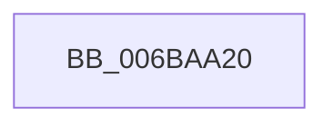

# guard_icall_bugcheck

- RVA: `0x006BAA20`–`0x006BAA40` (길이 `32` bytes)
- VA: `0x00000001406BAA20`
- 실행 섹션: `.text`
- PDB 이름 있음: `예`; PDB Function 태그: `아니요`
- unwind 정보 RVA: `0x000C2578`
- 디코드: `9`개 명령, `32/32` bytes 표시
- 미해석 바이트: `0` (있으면 어셈블리에 `.byte`로 보존)

> 이 문서는 커널 이미지의 기계어와 PDB 기호를 분석해 생성했습니다. 4번과 5번은 함수 원형과 자료형을 바이너리 사용 방식에서 추정한 C 해석이며 원본 소스 복구 결과는 아닙니다.

## 1. Dependencies

- 직접 호출 지점: **1**; 고유 호출 대상: **1**
- 직접 호출자로 확인된 함수: **1**
- RIP 상대 이미지 참조: **0**

### Outgoing calls
- `0x006BAA39` → [KeBugCheckEx](../4F/KeBugCheckEx_function_004FD660.md) (function, `0x004FD660`)

### Direct callers
- [KeCheckStackAndTargetAddress](../43/KeCheckStackAndTargetAddress_function_0043E580.md) at `0x0043E5DA`

### Static image references
- 디코드된 RIP-relative 메모리 참조가 없습니다.

## 2. Other-region calls and transfers

- 다른 실행 섹션으로 향하는 call: **0**
- 별도 외부 분기/꼬리 이동을 확인하지 못했습니다.

## 3. Assembly (complete function range)

```asm
006BAA20  48 83 EC 28                     sub rsp, 0x28
006BAA24  48 89 4C 24 20                  mov qword ptr [rsp + 0x20], rcx
006BAA29  B9 39 01 00 00                  mov ecx, 0x139
006BAA2E  BA 0A 00 00 00                  mov edx, 0xa
006BAA33  4D 33 C0                        xor r8, r8
006BAA36  4D 33 C9                        xor r9, r9
006BAA39  E8 22 2C E4 FF                  call 0x1404fd660
006BAA3E  90                              nop
006BAA3F  C3                              ret
```

## 4. C-style interpretation (structured pseudocode)

```c
__int64 __fastcall guard_icall_bugcheck(__int64 a1, __int64 a2, __int64 a3, __int64 a4)
{
    __int64 result;
    __int64 v_rsp;
    unsigned __int64 v_stack_m8;

    v_rsp = (v_rsp) - (40);
    v_stack_m8 = a1;
    a3 = 0;
    a4 = 0;
    result = KeBugCheckEx(313, 10, a3, a4);
    return result;
}
```

## 5. (Beta) C Style

```c
int64_t guard_icall_bugcheck(int64_t Arg1, int64_t Arg2, int64_t Arg3, int64_t Arg4)
{
    int64_t result;
    int64_t local_rsp;
    uint64_t v_stack_m8;

    local_rsp = (local_rsp) - (40);
    v_stack_m8 = Arg1;
    Arg3 = 0;
    Arg4 = 0;
    result = KeBugCheckEx(313, 10, Arg3, Arg4);
    return result;
}
```

## 6. Execution-region graph

[열기: 2D/3D 그래프와 함수 탐색 컨트롤 패널](../../../control-panel.html?section=text&rva=0x006BAA20&view=graph)

- 2D 그래프는 위에서 아래로 흐르고, 3D 그래프는 빈 공간을 드래그해 회전합니다. Shift+드래그는 이동, 휠은 확대·축소, 함수 노드 선택은 대상 보고서 이동입니다.

### Static fallback


