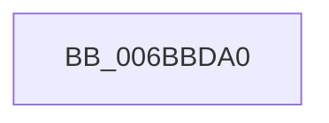

# setjmpex

- RVA: `0x006BBDA0`–`0x006BBE2D` (길이 `141` bytes)
- VA: `0x00000001406BBDA0`
- 실행 섹션: `.text`
- PDB 이름 있음: `예`; PDB Function 태그: `아니요`
- unwind 정보 RVA: `0x000C2640`
- 디코드: `26`개 명령, `141/141` bytes 표시
- 미해석 바이트: `0` (있으면 어셈블리에 `.byte`로 보존)

> 이 문서는 커널 이미지의 기계어와 PDB 기호를 분석해 생성했습니다. 4번과 5번은 함수 원형과 자료형을 바이너리 사용 방식에서 추정한 C 해석이며 원본 소스 복구 결과는 아닙니다.

## 1. Dependencies

- 직접 호출 지점: **0**; 고유 호출 대상: **0**
- 직접 호출자로 확인된 함수: **0**
- RIP 상대 이미지 참조: **0**

### Outgoing calls
- 직접 디코드된 call 명령이 없습니다.

### Direct callers
- 이 함수 시작 RVA로 연결되는 직접 call은 확인되지 않았습니다. 간접 호출은 완전히 역산할 수 없습니다.

### Static image references
- 디코드된 RIP-relative 메모리 참조가 없습니다.

## 2. Other-region calls and transfers

- 다른 실행 섹션으로 향하는 call: **0**
- 별도 외부 분기/꼬리 이동을 확인하지 못했습니다.

## 3. Assembly (complete function range)

```asm
006BBDA0  48 89 11                        mov qword ptr [rcx], rdx
006BBDA3  48 89 59 08                     mov qword ptr [rcx + 8], rbx
006BBDA7  48 89 69 18                     mov qword ptr [rcx + 0x18], rbp
006BBDAB  48 89 71 20                     mov qword ptr [rcx + 0x20], rsi
006BBDAF  48 89 79 28                     mov qword ptr [rcx + 0x28], rdi
006BBDB3  4C 89 61 30                     mov qword ptr [rcx + 0x30], r12
006BBDB7  4C 89 69 38                     mov qword ptr [rcx + 0x38], r13
006BBDBB  4C 89 71 40                     mov qword ptr [rcx + 0x40], r14
006BBDBF  4C 89 79 48                     mov qword ptr [rcx + 0x48], r15
006BBDC3  4C 8D 44 24 08                  lea r8, [rsp + 8]
006BBDC8  4C 89 41 10                     mov qword ptr [rcx + 0x10], r8
006BBDCC  4C 8B 04 24                     mov r8, qword ptr [rsp]
006BBDD0  4C 89 41 50                     mov qword ptr [rcx + 0x50], r8
006BBDD4  0F AE 59 58                     stmxcsr dword ptr [rcx + 0x58]
006BBDD8  66 0F 7F 71 60                  movdqa xmmword ptr [rcx + 0x60], xmm6
006BBDDD  66 0F 7F 79 70                  movdqa xmmword ptr [rcx + 0x70], xmm7
006BBDE2  66 44 0F 7F 81 80 00 00 00      movdqa xmmword ptr [rcx + 0x80], xmm8
006BBDEB  66 44 0F 7F 89 90 00 00 00      movdqa xmmword ptr [rcx + 0x90], xmm9
006BBDF4  66 44 0F 7F 91 A0 00 00 00      movdqa xmmword ptr [rcx + 0xa0], xmm10
006BBDFD  66 44 0F 7F 99 B0 00 00 00      movdqa xmmword ptr [rcx + 0xb0], xmm11
006BBE06  66 44 0F 7F A1 C0 00 00 00      movdqa xmmword ptr [rcx + 0xc0], xmm12
006BBE0F  66 44 0F 7F A9 D0 00 00 00      movdqa xmmword ptr [rcx + 0xd0], xmm13
006BBE18  66 44 0F 7F B1 E0 00 00 00      movdqa xmmword ptr [rcx + 0xe0], xmm14
006BBE21  66 44 0F 7F B9 F0 00 00 00      movdqa xmmword ptr [rcx + 0xf0], xmm15
006BBE2A  33 C0                           xor eax, eax
006BBE2C  C3                              ret
```

## 4. C-style interpretation (structured pseudocode)

```c
__int64 __fastcall setjmpex(__int64 a1, __int64 a2)
{
    __int64 result;
    unsigned __int64 v_stack_p0;
    unsigned __int64 v_stack_p8;

    *(unsigned __int64 *)(a1) = a2;
    *(unsigned __int64 *)(a1 + 8) = v_rbx;
    *(unsigned __int64 *)(a1 + 24) = v_rbp;
    *(unsigned __int64 *)(a1 + 32) = v_rsi;
    *(unsigned __int64 *)(a1 + 40) = v_rdi;
    *(unsigned __int64 *)(a1 + 48) = v_r12;
    *(unsigned __int64 *)(a1 + 56) = v_r13;
    *(unsigned __int64 *)(a1 + 64) = v_r14;
    *(unsigned __int64 *)(a1 + 72) = v_r15;
    *(unsigned __int64 *)(a1 + 16) = v_stack_p8;
    *(unsigned __int64 *)(a1 + 80) = v_stack_p0;
    *(unsigned __int64 *)(a1 + 96) = v_xmm6;
    *(unsigned __int64 *)(a1 + 112) = v_xmm7;
    *(unsigned __int64 *)(a1 + 128) = v_xmm8;
    *(unsigned __int64 *)(a1 + 144) = v_xmm9;
    *(unsigned __int64 *)(a1 + 160) = v_xmm10;
    *(unsigned __int64 *)(a1 + 176) = v_xmm11;
    *(unsigned __int64 *)(a1 + 192) = v_xmm12;
    *(unsigned __int64 *)(a1 + 208) = v_xmm13;
    *(unsigned __int64 *)(a1 + 224) = v_xmm14;
    *(unsigned __int64 *)(a1 + 240) = v_xmm15;
    result = 0;
    return result;
}
```

## 5. (Beta) C Style

```c
int64_t setjmpex(void *Arg1, int64_t Arg2)
{
    uint8_t *arg1 = (uint8_t *)Arg1;

    int64_t result;
    uint64_t v_stack_p0;
    uint64_t v_stack_p8;

    *(uint64_t *)(arg1) = Arg2;
    *(uint64_t *)(arg1 + 0x8) = local_rbx;
    *(uint64_t *)(arg1 + 0x18) = local_rbp;
    *(uint64_t *)(arg1 + 0x20) = local_rsi;
    *(uint64_t *)(arg1 + 0x28) = local_rdi;
    *(uint64_t *)(arg1 + 0x30) = local_r12;
    *(uint64_t *)(arg1 + 0x38) = local_r13;
    *(uint64_t *)(arg1 + 0x40) = local_r14;
    *(uint64_t *)(arg1 + 0x48) = local_r15;
    *(uint64_t *)(arg1 + 0x10) = v_stack_p8;
    *(uint64_t *)(arg1 + 0x50) = v_stack_p0;
    *(uint64_t *)(arg1 + 0x60) = v_xmm6;
    *(uint64_t *)(arg1 + 0x70) = v_xmm7;
    *(uint64_t *)(arg1 + 0x80) = v_xmm8;
    *(uint64_t *)(arg1 + 0x90) = v_xmm9;
    *(uint64_t *)(arg1 + 0xA0) = v_xmm10;
    *(uint64_t *)(arg1 + 0xB0) = v_xmm11;
    *(uint64_t *)(arg1 + 0xC0) = v_xmm12;
    *(uint64_t *)(arg1 + 0xD0) = v_xmm13;
    *(uint64_t *)(arg1 + 0xE0) = v_xmm14;
    *(uint64_t *)(arg1 + 0xF0) = v_xmm15;
    result = 0;
    return result;
}
```

### 관측된 메모리 오프셋

구조체 형식이 확인되지 않은 접근은 인자 기준의 오프셋으로만 기록했습니다.

| 기준 인자 | 오프셋 표현 | 폭 (bit) | 접근 |
|---|---:|---:|---|
| `Arg1` | `+ 0x0` | `64` | `W` |
| `Arg1` | `+ 0x8` | `64` | `W` |
| `Arg1` | `+ 0x10` | `64` | `W` |
| `Arg1` | `+ 0x18` | `64` | `W` |
| `Arg1` | `+ 0x20` | `64` | `W` |
| `Arg1` | `+ 0x28` | `64` | `W` |
| `Arg1` | `+ 0x30` | `64` | `W` |
| `Arg1` | `+ 0x38` | `64` | `W` |
| `Arg1` | `+ 0x40` | `64` | `W` |
| `Arg1` | `+ 0x48` | `64` | `W` |
| `Arg1` | `+ 0x50` | `64` | `W` |
| `Arg1` | `+ 0x58` | `32` | `R` |
| `Arg1` | `+ 0x60` | `128` | `W` |
| `Arg1` | `+ 0x70` | `128` | `W` |
| `Arg1` | `+ 0x80` | `128` | `W` |
| `Arg1` | `+ 0x90` | `128` | `W` |
| `Arg1` | `+ 0xA0` | `128` | `W` |
| `Arg1` | `+ 0xB0` | `128` | `W` |
| `Arg1` | `+ 0xC0` | `128` | `W` |
| `Arg1` | `+ 0xD0` | `128` | `W` |
| `Arg1` | `+ 0xE0` | `128` | `W` |
| `Arg1` | `+ 0xF0` | `128` | `W` |

## 6. Execution-region graph

[열기: 2D/3D 그래프와 함수 탐색 컨트롤 패널](../../../control-panel.html?section=text&rva=0x006BBDA0&view=graph)

- 2D 그래프는 위에서 아래로 흐르고, 3D 그래프는 빈 공간을 드래그해 회전합니다. Shift+드래그는 이동, 휠은 확대·축소, 함수 노드 선택은 대상 보고서 이동입니다.

### Static fallback


