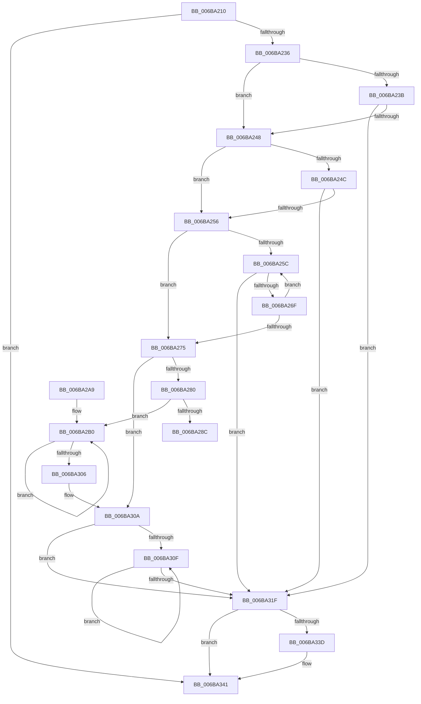

# tcpxsum

- RVA: `0x006BA210`–`0x006BA34D` (길이 `317` bytes)
- VA: `0x00000001406BA210`
- 실행 섹션: `.text`
- PDB 이름 있음: `예`; PDB Function 태그: `아니요`
- unwind 정보 RVA: `0x000C23C0`
- 디코드: `92`개 명령, `317/317` bytes 표시
- 미해석 바이트: `0` (있으면 어셈블리에 `.byte`로 보존)

> 이 문서는 커널 이미지의 기계어와 PDB 기호를 분석해 생성했습니다. 4번과 5번은 함수 원형과 자료형을 바이너리 사용 방식에서 추정한 C 해석이며 원본 소스 복구 결과는 아닙니다.

## 1. Dependencies

- 직접 호출 지점: **0**; 고유 호출 대상: **0**
- 직접 호출자로 확인된 함수: **4**
- RIP 상대 이미지 참조: **1**

### Outgoing calls
- 직접 디코드된 call 명령이 없습니다.

### Direct callers
- [PopHiberChecksumHiberFileData](../../pagelk/B6/PopHiberChecksumHiberFileData_function_00B6DB10.md) at `0x00B6DBCD`
- [PopHiberWriteBootFreePageMap](../../pagelk/B6/PopHiberWriteBootFreePageMap_function_00B6DFAC.md) at `0x00B6E008`
- [PopWriteHeaderPages](../../pagelk/B6/PopWriteHeaderPages_function_00B6FC14.md) at `0x00B6FCB5`
- [PopWriteHeaderPages](../../pagelk/B6/PopWriteHeaderPages_function_00B6FC14.md) at `0x00B6FCE8`
- [PopWriteHeaderPages](../../pagelk/B6/PopWriteHeaderPages_function_00B6FC14.md) at `0x00B6FD62`
- [PopWriteHeaderPages](../../pagelk/B6/PopWriteHeaderPages_function_00B6FC14.md) at `0x00B6FD86`
- [PopWriteHeaderPages](../../pagelk/B6/PopWriteHeaderPages_function_00B6FC14.md) at `0x00B6FDCE`
- [PopWriteImageHeader](../../pagelk/B7/PopWriteImageHeader_function_00B70290.md) at `0x00B70496`

### Static image references
- `0x006BA29B` → RVA `0x006BA2BA` (`tcpxsum_start`; read)

## 2. Other-region calls and transfers

- 다른 실행 섹션으로 향하는 call: **0**
- 별도 외부 분기/꼬리 이동을 확인하지 못했습니다.

## 3. Assembly (complete function range)

```asm
006BA210  48 89 5C 24 08                  mov qword ptr [rsp + 8], rbx
006BA215  0F 18 02                        prefetchnta byte ptr [rdx]
006BA218  0F 18 42 40                     prefetchnta byte ptr [rdx + 0x40]
006BA21C  0F 18 42 7F                     prefetchnta byte ptr [rdx + 0x7f]
006BA220  4C 8B DA                        mov r11, rdx
006BA223  66 8B D9                        mov bx, cx
006BA226  4C 8B D2                        mov r10, rdx
006BA229  41 8B C8                        mov ecx, r8d
006BA22C  33 C0                           xor eax, eax
006BA22E  85 C9                           test ecx, ecx
006BA230  0F 84 0B 01 00 00               je 0x1406ba341
006BA236  F6 C2 01                        test dl, 1
006BA239  74 0D                           je 0x1406ba248
006BA23B  8A 22                           mov ah, byte ptr [rdx]
006BA23D  49 FF C2                        inc r10
006BA240  FF C9                           dec ecx
006BA242  0F 84 D7 00 00 00               je 0x1406ba31f
006BA248  D1 E9                           shr ecx, 1
006BA24A  73 0A                           jae 0x1406ba256
006BA24C  41 8A 04 4A                     mov al, byte ptr [r10 + rcx*2]
006BA250  0F 84 C9 00 00 00               je 0x1406ba31f
006BA256  41 F6 C2 06                     test r10b, 6
006BA25A  74 19                           je 0x1406ba275
006BA25C  66 41 03 02                     add ax, word ptr [r10]
006BA260  83 D0 00                        adc eax, 0
006BA263  49 83 C2 02                     add r10, 2
006BA267  FF C9                           dec ecx
006BA269  0F 84 B0 00 00 00               je 0x1406ba31f
006BA26F  41 F6 C2 06                     test r10b, 6
006BA273  75 E7                           jne 0x1406ba25c
006BA275  8B D1                           mov edx, ecx
006BA277  C1 EA 02                        shr edx, 2
006BA27A  0F 84 8A 00 00 00               je 0x1406ba30a
006BA280  44 8B C2                        mov r8d, edx
006BA283  41 C1 E8 04                     shr r8d, 4
006BA287  83 E2 0F                        and edx, 0xf
006BA28A  74 24                           je 0x1406ba2b0
006BA28C  48 83 EA 10                     sub rdx, 0x10
006BA290  4D 8D 14 D2                     lea r10, [r10 + rdx*8]
006BA294  48 F7 DA                        neg rdx
006BA297  41 83 C0 01                     add r8d, 1
006BA29B  4C 8D 0D 18 00 00 00            lea r9, [rip + 0x18]
006BA2A2  4D 8D 0C 91                     lea r9, [r9 + rdx*4]
006BA2A6  41 FF E1                        jmp r9
006BA2A9  CC                              int3
006BA2AA  CC                              int3
006BA2AB  CC                              int3
006BA2AC  0F 1F 40 00                     nop dword ptr [rax]
006BA2B0  41 0F 18 42 40                  prefetchnta byte ptr [r10 + 0x40]
006BA2B5  41 0F 18 42 7F                  prefetchnta byte ptr [r10 + 0x7f]
006BA2BA  49 13 42 00                     adc rax, qword ptr [r10]
006BA2BE  49 13 42 08                     adc rax, qword ptr [r10 + 8]
006BA2C2  49 13 42 10                     adc rax, qword ptr [r10 + 0x10]
006BA2C6  49 13 42 18                     adc rax, qword ptr [r10 + 0x18]
006BA2CA  49 13 42 20                     adc rax, qword ptr [r10 + 0x20]
006BA2CE  49 13 42 28                     adc rax, qword ptr [r10 + 0x28]
006BA2D2  49 13 42 30                     adc rax, qword ptr [r10 + 0x30]
006BA2D6  49 13 42 38                     adc rax, qword ptr [r10 + 0x38]
006BA2DA  49 13 42 40                     adc rax, qword ptr [r10 + 0x40]
006BA2DE  49 13 42 48                     adc rax, qword ptr [r10 + 0x48]
006BA2E2  49 13 42 50                     adc rax, qword ptr [r10 + 0x50]
006BA2E6  49 13 42 58                     adc rax, qword ptr [r10 + 0x58]
006BA2EA  49 13 42 60                     adc rax, qword ptr [r10 + 0x60]
006BA2EE  49 13 42 68                     adc rax, qword ptr [r10 + 0x68]
006BA2F2  49 13 42 70                     adc rax, qword ptr [r10 + 0x70]
006BA2F6  49 13 42 78                     adc rax, qword ptr [r10 + 0x78]
006BA2FA  4D 8D 92 80 00 00 00            lea r10, [r10 + 0x80]
006BA301  41 FF C8                        dec r8d
006BA304  75 AA                           jne 0x1406ba2b0
006BA306  48 83 D0 00                     adc rax, 0
006BA30A  83 E1 03                        and ecx, 3
006BA30D  74 10                           je 0x1406ba31f
006BA30F  66 41 03 02                     add ax, word ptr [r10]
006BA313  66 83 D0 00                     adc ax, 0
006BA317  49 83 C2 02                     add r10, 2
006BA31B  FF C9                           dec ecx
006BA31D  75 F0                           jne 0x1406ba30f
006BA31F  48 8B C8                        mov rcx, rax
006BA322  48 C1 C9 20                     ror rcx, 0x20
006BA326  48 03 C1                        add rax, rcx
006BA329  48 C1 E8 20                     shr rax, 0x20
006BA32D  8B C8                           mov ecx, eax
006BA32F  C1 C9 10                        ror ecx, 0x10
006BA332  03 C1                           add eax, ecx
006BA334  C1 E8 10                        shr eax, 0x10
006BA337  41 F6 C3 01                     test r11b, 1
006BA33B  74 04                           je 0x1406ba341
006BA33D  66 C1 C8 08                     ror ax, 8
006BA341  66 03 C3                        add ax, bx
006BA344  83 D0 00                        adc eax, 0
006BA347  48 8B 5C 24 08                  mov rbx, qword ptr [rsp + 8]
006BA34C  C3                              ret
```

## 4. C-style interpretation (structured pseudocode)

```c
__int64 __fastcall tcpxsum(unsigned __int16 a1, __int64 a2, int a3)
{
    __int64 result;
    __int64 v_r10;
    unsigned __int64 v_stack_p8;

    v_stack_p8 = v_rbx;
    result = 0;
    if ((unsigned int)((unsigned int)(a3)) == 0) goto loc_006BA341;
    if ((((unsigned __int8)(a2)) & (1)) == 0) goto loc_006BA248;
    v_r10 = (a2) + 1;
    a1 = (unsigned int)(((unsigned int)(a3)) - 1);
    if ((((unsigned __int8)(a2)) & (1)) == 0) goto loc_006BA31F;
loc_006BA248:
    a1 = (unsigned int)((a1) >> (1));
    if (condition_is_above_or_equal) goto loc_006BA256;
    if (condition_is_equal) goto loc_006BA31F;
loc_006BA256:
    if ((((unsigned __int8)(v_r10)) & (6)) == 0) goto loc_006BA275;
loc_006BA25C:
    result = (unsigned __int16)((*(unsigned __int8 *)(v_r10 + a1 * 2)) + (*(unsigned __int16 *)(v_r10)));
    v_r10 = (v_r10) + (2);
    a1 = (unsigned int)((a1) - 1);
    if (condition_is_equal) goto loc_006BA31F;
    if ((((unsigned __int8)(v_r10)) & (6)) != 0) goto loc_006BA25C;
loc_006BA275:
    a2 = (unsigned int)(((unsigned int)(a1)) >> (2));
    if (condition_is_equal) goto loc_006BA30A;
    a3 = (unsigned int)(((unsigned int)((unsigned int)(a2))) >> (4));
    a2 = (unsigned int)((a2) & (15));
    if (condition_is_equal) goto loc_006BA2B0;
    a2 = (a2) - (16);
    a2 = -(a2);
    a3 = (unsigned int)((a3) + (1));
loc_006BA2B0:
    a3 = (unsigned int)((a3) - 1);
    if (condition_is_not_equal) goto loc_006BA2B0;
loc_006BA30A:
    a1 = (unsigned int)((a1) & (3));
    if (condition_is_equal) goto loc_006BA31F;
loc_006BA30F:
    result = (unsigned __int16)((result) + (*(unsigned __int16 *)(v_r10 + a2 * 8 + 128)));
    v_r10 = (v_r10 + a2 * 8 + 128) + (2);
    a1 = (unsigned int)((a1) - 1);
    if (condition_is_not_equal) goto loc_006BA30F;
loc_006BA31F:
    result = (result) + (result);
    result = (result) >> (32);
    result = (unsigned int)((result) + ((unsigned int)((unsigned int)((unsigned int)(result)))));
    result = (unsigned int)((result) >> (16));
    if ((((unsigned __int8)(a2)) & (1)) != 0) {
    }
    result = (unsigned __int16)((result) + (a1));
    return result;
}
```

## 5. (Beta) C Style

```c
int64_t tcpxsum(uint16_t Arg1, void *Arg2, int32_t Arg3)
{
    uint8_t *arg2 = (uint8_t *)Arg2;

    int64_t result;
    int64_t local_r10;
    uint64_t v_stack_p8;

    v_stack_p8 = local_rbx;
    result = 0;
    if ((uint32_t)((uint32_t)(Arg3)) == 0) goto loc_006BA341;
    if ((((uint8_t)(Arg2)) & (1)) == 0) goto loc_006BA248;
    local_r10 = (Arg2) + 1;
    Arg1 = (uint32_t)(((uint32_t)(Arg3)) - 1);
    if ((((uint8_t)(Arg2)) & (1)) == 0) goto loc_006BA31F;
loc_006BA248:
    Arg1 = (uint32_t)((Arg1) >> (1));
    if (condition_is_above_or_equal) goto loc_006BA256;
    if (condition_is_equal) goto loc_006BA31F;
loc_006BA256:
    if ((((uint8_t)(local_r10)) & (6)) == 0) goto loc_006BA275;
loc_006BA25C:
    result = (uint16_t)((*(uint8_t *)(local_r10 + Arg1 * 2)) + (*(uint16_t *)(local_r10)));
    local_r10 = (local_r10) + (2);
    Arg1 = (uint32_t)((Arg1) - 1);
    if (condition_is_equal) goto loc_006BA31F;
    if ((((uint8_t)(local_r10)) & (6)) != 0) goto loc_006BA25C;
loc_006BA275:
    Arg2 = (uint32_t)(((uint32_t)(Arg1)) >> (2));
    if (condition_is_equal) goto loc_006BA30A;
    Arg3 = (uint32_t)(((uint32_t)((uint32_t)(Arg2))) >> (4));
    Arg2 = (uint32_t)((Arg2) & (15));
    if (condition_is_equal) goto loc_006BA2B0;
    Arg2 = (Arg2) - (16);
    Arg2 = -(Arg2);
    Arg3 = (uint32_t)((Arg3) + (1));
loc_006BA2B0:
    Arg3 = (uint32_t)((Arg3) - 1);
    if (condition_is_not_equal) goto loc_006BA2B0;
loc_006BA30A:
    Arg1 = (uint32_t)((Arg1) & (3));
    if (condition_is_equal) goto loc_006BA31F;
loc_006BA30F:
    result = (uint16_t)((result) + (*(uint16_t *)(local_r10 + arg2 * 8 + 0x80)));
    local_r10 = (local_r10 + Arg2 * 8 + 128) + (2);
    Arg1 = (uint32_t)((Arg1) - 1);
    if (condition_is_not_equal) goto loc_006BA30F;
loc_006BA31F:
    result = (result) + (result);
    result = (result) >> (32);
    result = (uint32_t)((result) + ((uint32_t)((uint32_t)((uint32_t)(result)))));
    result = (uint32_t)((result) >> (16));
    if ((((uint8_t)(Arg2)) & (1)) != 0) {
    }
    result = (uint16_t)((result) + (Arg1));
    return result;
}
```

### 관측된 메모리 오프셋

구조체 형식이 확인되지 않은 접근은 인자 기준의 오프셋으로만 기록했습니다.

| 기준 인자 | 오프셋 표현 | 폭 (bit) | 접근 |
|---|---:|---:|---|
| `Arg2` | `+ 0x0` | `8` | `R` |
| `Arg2` | `+ 0x40` | `8` | `R` |
| `Arg2` | `+ 0x7F` | `8` | `R` |

## 6. Execution-region graph

[열기: 2D/3D 그래프와 함수 탐색 컨트롤 패널](../../../control-panel.html?section=text&rva=0x006BA210&view=graph)

- 2D 그래프는 위에서 아래로 흐르고, 3D 그래프는 빈 공간을 드래그해 회전합니다. Shift+드래그는 이동, 휠은 확대·축소, 함수 노드 선택은 대상 보고서 이동입니다.

### Static fallback


