# KiAlignmentFault

- RVA: `0x006C1340`–`0x006C1693` (길이 `851` bytes)
- VA: `0x00000001406C1340`
- 실행 섹션: `.text`
- PDB 이름 있음: `예`; PDB Function 태그: `아니요`
- unwind 정보 RVA: `0x000C1CA8`
- 디코드: `184`개 명령, `851/851` bytes 표시
- 미해석 바이트: `0` (있으면 어셈블리에 `.byte`로 보존)

> 이 문서는 커널 이미지의 기계어와 PDB 기호를 분석해 생성했습니다. 4번과 5번은 함수 원형과 자료형을 바이너리 사용 방식에서 추정한 C 해석이며 원본 소스 복구 결과는 아닙니다.

## 1. Dependencies

- 직접 호출 지점: **36**; 고유 호출 대상: **36**
- 직접 호출자로 확인된 함수: **1**
- RIP 상대 이미지 참조: **3**

### Outgoing calls
- `0x006C1492` → [KiAlignmentFault + 0x265](KiAlignmentFault_function_006C1340.md) (inside-function, `0x006C15A5`)
- `0x006C149B` → [KiAlignmentFault + 0x26E](KiAlignmentFault_function_006C1340.md) (inside-function, `0x006C15AE`)
- `0x006C14A4` → [KiAlignmentFault + 0x157](KiAlignmentFault_function_006C1340.md) (inside-function, `0x006C1497`)
- `0x006C14AD` → [KiAlignmentFault + 0x160](KiAlignmentFault_function_006C1340.md) (inside-function, `0x006C14A0`)
- `0x006C14B6` → [KiAlignmentFault + 0x169](KiAlignmentFault_function_006C1340.md) (inside-function, `0x006C14A9`)
- `0x006C14BF` → [KiAlignmentFault + 0x172](KiAlignmentFault_function_006C1340.md) (inside-function, `0x006C14B2`)
- `0x006C14C8` → [KiAlignmentFault + 0x17B](KiAlignmentFault_function_006C1340.md) (inside-function, `0x006C14BB`)
- `0x006C14D1` → [KiAlignmentFault + 0x184](KiAlignmentFault_function_006C1340.md) (inside-function, `0x006C14C4`)
- `0x006C14DA` → [KiAlignmentFault + 0x18D](KiAlignmentFault_function_006C1340.md) (inside-function, `0x006C14CD`)
- `0x006C14E3` → [KiAlignmentFault + 0x196](KiAlignmentFault_function_006C1340.md) (inside-function, `0x006C14D6`)
- `0x006C14EC` → [KiAlignmentFault + 0x19F](KiAlignmentFault_function_006C1340.md) (inside-function, `0x006C14DF`)
- `0x006C14F5` → [KiAlignmentFault + 0x1A8](KiAlignmentFault_function_006C1340.md) (inside-function, `0x006C14E8`)
- `0x006C14FE` → [KiAlignmentFault + 0x1B1](KiAlignmentFault_function_006C1340.md) (inside-function, `0x006C14F1`)
- `0x006C1507` → [KiAlignmentFault + 0x1BA](KiAlignmentFault_function_006C1340.md) (inside-function, `0x006C14FA`)
- `0x006C1510` → [KiAlignmentFault + 0x1C3](KiAlignmentFault_function_006C1340.md) (inside-function, `0x006C1503`)
- `0x006C1519` → [KiAlignmentFault + 0x1CC](KiAlignmentFault_function_006C1340.md) (inside-function, `0x006C150C`)
- `0x006C1522` → [KiAlignmentFault + 0x1D5](KiAlignmentFault_function_006C1340.md) (inside-function, `0x006C1515`)
- `0x006C152B` → [KiAlignmentFault + 0x1DE](KiAlignmentFault_function_006C1340.md) (inside-function, `0x006C151E`)
- `0x006C1534` → [KiAlignmentFault + 0x1E7](KiAlignmentFault_function_006C1340.md) (inside-function, `0x006C1527`)
- `0x006C153D` → [KiAlignmentFault + 0x1F0](KiAlignmentFault_function_006C1340.md) (inside-function, `0x006C1530`)
- `0x006C1546` → [KiAlignmentFault + 0x1F9](KiAlignmentFault_function_006C1340.md) (inside-function, `0x006C1539`)
- `0x006C154F` → [KiAlignmentFault + 0x202](KiAlignmentFault_function_006C1340.md) (inside-function, `0x006C1542`)
- `0x006C1558` → [KiAlignmentFault + 0x20B](KiAlignmentFault_function_006C1340.md) (inside-function, `0x006C154B`)
- `0x006C1561` → [KiAlignmentFault + 0x214](KiAlignmentFault_function_006C1340.md) (inside-function, `0x006C1554`)
- `0x006C156A` → [KiAlignmentFault + 0x21D](KiAlignmentFault_function_006C1340.md) (inside-function, `0x006C155D`)
- `0x006C1573` → [KiAlignmentFault + 0x226](KiAlignmentFault_function_006C1340.md) (inside-function, `0x006C1566`)
- `0x006C157C` → [KiAlignmentFault + 0x22F](KiAlignmentFault_function_006C1340.md) (inside-function, `0x006C156F`)
- `0x006C1585` → [KiAlignmentFault + 0x238](KiAlignmentFault_function_006C1340.md) (inside-function, `0x006C1578`)
- `0x006C158E` → [KiAlignmentFault + 0x241](KiAlignmentFault_function_006C1340.md) (inside-function, `0x006C1581`)
- `0x006C1597` → [KiAlignmentFault + 0x24A](KiAlignmentFault_function_006C1340.md) (inside-function, `0x006C158A`)
- `0x006C15A0` → [KiAlignmentFault + 0x253](KiAlignmentFault_function_006C1340.md) (inside-function, `0x006C1593`)
- `0x006C15A9` → [KiAlignmentFault + 0x25C](KiAlignmentFault_function_006C1340.md) (inside-function, `0x006C159C`)
- `0x006C15D4` → [KiFlushBhbDuringTrapEntryOrExit](KiFlushBhbDuringTrapEntryOrExit_function_006C6340.md) (function, `0x006C6340`)
- `0x006C161D` → [KiSaveDebugRegisterState](../4F/KiSaveDebugRegisterState_function_004FD960.md) (function, `0x004FD960`)
- `0x006C1651` → [KiSynchronizeUserIsolationDomainExit](../41/KiSynchronizeUserIsolationDomainExit_function_0041BFA0.md) (function, `0x0041BFA0`)
- `0x006C168C` → [KiExceptionDispatch](KiExceptionDispatch_function_006C5900.md) (function, `0x006C5900`)

### Direct callers
- [KiAlignmentFault](KiAlignmentFault_function_006C1340.md) at `0x006C1492`
- [KiAlignmentFault](KiAlignmentFault_function_006C1340.md) at `0x006C149B`
- [KiAlignmentFault](KiAlignmentFault_function_006C1340.md) at `0x006C14A4`
- [KiAlignmentFault](KiAlignmentFault_function_006C1340.md) at `0x006C14AD`
- [KiAlignmentFault](KiAlignmentFault_function_006C1340.md) at `0x006C14B6`
- [KiAlignmentFault](KiAlignmentFault_function_006C1340.md) at `0x006C14BF`
- [KiAlignmentFault](KiAlignmentFault_function_006C1340.md) at `0x006C14C8`
- [KiAlignmentFault](KiAlignmentFault_function_006C1340.md) at `0x006C14D1`
- [KiAlignmentFault](KiAlignmentFault_function_006C1340.md) at `0x006C14DA`
- [KiAlignmentFault](KiAlignmentFault_function_006C1340.md) at `0x006C14E3`
- [KiAlignmentFault](KiAlignmentFault_function_006C1340.md) at `0x006C14EC`
- [KiAlignmentFault](KiAlignmentFault_function_006C1340.md) at `0x006C14F5`
- [KiAlignmentFault](KiAlignmentFault_function_006C1340.md) at `0x006C14FE`
- [KiAlignmentFault](KiAlignmentFault_function_006C1340.md) at `0x006C1507`
- [KiAlignmentFault](KiAlignmentFault_function_006C1340.md) at `0x006C1510`
- [KiAlignmentFault](KiAlignmentFault_function_006C1340.md) at `0x006C1519`
- [KiAlignmentFault](KiAlignmentFault_function_006C1340.md) at `0x006C1522`
- [KiAlignmentFault](KiAlignmentFault_function_006C1340.md) at `0x006C152B`
- [KiAlignmentFault](KiAlignmentFault_function_006C1340.md) at `0x006C1534`
- [KiAlignmentFault](KiAlignmentFault_function_006C1340.md) at `0x006C153D`
- [KiAlignmentFault](KiAlignmentFault_function_006C1340.md) at `0x006C1546`
- [KiAlignmentFault](KiAlignmentFault_function_006C1340.md) at `0x006C154F`
- [KiAlignmentFault](KiAlignmentFault_function_006C1340.md) at `0x006C1558`
- [KiAlignmentFault](KiAlignmentFault_function_006C1340.md) at `0x006C1561`
- [KiAlignmentFault](KiAlignmentFault_function_006C1340.md) at `0x006C156A`
- [KiAlignmentFault](KiAlignmentFault_function_006C1340.md) at `0x006C1573`
- [KiAlignmentFault](KiAlignmentFault_function_006C1340.md) at `0x006C157C`
- [KiAlignmentFault](KiAlignmentFault_function_006C1340.md) at `0x006C1585`
- [KiAlignmentFault](KiAlignmentFault_function_006C1340.md) at `0x006C158E`
- [KiAlignmentFault](KiAlignmentFault_function_006C1340.md) at `0x006C1597`
- [KiAlignmentFault](KiAlignmentFault_function_006C1340.md) at `0x006C15A0`
- [KiAlignmentFault](KiAlignmentFault_function_006C1340.md) at `0x006C15A9`

### Static image references
- `0x006C13B1` → RVA `0x01201840` (`CFGRO`; read)
- `0x006C15E5` → RVA `0x00FC7264` (`ALMOSTRO`; read)
- `0x006C1656` → RVA `0x00FC6BF0` (`ALMOSTRO`; read)

## 2. Other-region calls and transfers

- 다른 실행 섹션으로 향하는 call: **0**
- 별도 외부 분기/꼬리 이동을 확인하지 못했습니다.

## 3. Assembly (complete function range)

```asm
006C1340  55                              push rbp
006C1341  48 81 EC 58 01 00 00            sub rsp, 0x158
006C1348  48 8D AC 24 80 00 00 00         lea rbp, [rsp + 0x80]
006C1350  C6 45 AB 01                     mov byte ptr [rbp - 0x55], 1
006C1354  48 89 45 B0                     mov qword ptr [rbp - 0x50], rax
006C1358  48 89 4D B8                     mov qword ptr [rbp - 0x48], rcx
006C135C  48 89 55 C0                     mov qword ptr [rbp - 0x40], rdx
006C1360  4C 89 45 C8                     mov qword ptr [rbp - 0x38], r8
006C1364  4C 89 4D D0                     mov qword ptr [rbp - 0x30], r9
006C1368  4C 89 55 D8                     mov qword ptr [rbp - 0x28], r10
006C136C  4C 89 5D E0                     mov qword ptr [rbp - 0x20], r11
006C1370  F6 85 F0 00 00 00 01            test byte ptr [rbp + 0xf0], 1
006C1377  75 38                           jne 0x1406c13b1
006C1379  33 D2                           xor edx, edx
006C137B  F3 48 0F 1E CA                  rdsspq rdx
006C1380  48 89 55 58                     mov qword ptr [rbp + 0x58], rdx
006C1384  0F AE E8                        lfence
006C1387  65 F6 04 25 58 08 00 00 01      test byte ptr gs:[0x858], 1
006C1390  75 08                           jne 0x1406c139a
006C1392  0F AE E8                        lfence
006C1395  E9 88 02 00 00                  jmp 0x1406c1622
006C139A  65 0F B7 04 25 66 08 00 00      movzx eax, word ptr gs:[0x866]
006C13A3  B9 48 00 00 00                  mov ecx, 0x48
006C13A8  33 D2                           xor edx, edx
006C13AA  0F 30                           wrmsr
006C13AC  E9 71 02 00 00                  jmp 0x1406c1622
006C13B1  F6 05 88 04 B4 00 01            test byte ptr [rip + 0xb40488], 1
006C13B8  75 03                           jne 0x1406c13bd
006C13BA  0F 01 F8                        swapgs
006C13BD  0F AE E8                        lfence
006C13C0  65 48 8B 0C 25 28 9D 00 00      mov rcx, qword ptr gs:[0x9d28]
006C13C9  48 85 C9                        test rcx, rcx
006C13CC  74 1F                           je 0x1406c13ed
006C13CE  F3 48 0F 1E CA                  rdsspq rdx
006C13D3  65 4C 8B 14 25 20 9D 00 00      mov r10, qword ptr gs:[0x9d20]
006C13DC  49 83 C2 08                     add r10, 8
006C13E0  49 3B D2                        cmp rdx, r10
006C13E3  75 08                           jne 0x1406c13ed
006C13E5  F3 0F 01 29                     rstorssp dword ptr [rcx]
006C13E9  F3 0F 01 EA                     saveprevssp
006C13ED  65 4C 8B 14 25 88 01 00 00      mov r10, qword ptr gs:[0x188]
006C13F6  65 48 8B 0C 25 88 01 00 00      mov rcx, qword ptr gs:[0x188]
006C13FF  48 8B 89 20 02 00 00            mov rcx, qword ptr [rcx + 0x220]
006C1406  48 8B 89 60 07 00 00            mov rcx, qword ptr [rcx + 0x760]
006C140D  65 48 89 0C 25 50 08 00 00      mov qword ptr gs:[0x850], rcx
006C1416  66 65 8B 0C 25 62 08 00 00      mov cx, word ptr gs:[0x862]
006C141F  66 65 89 0C 25 64 08 00 00      mov word ptr gs:[0x864], cx
006C1428  65 8A 0C 25 58 08 00 00         mov cl, byte ptr gs:[0x858]
006C1430  65 88 0C 25 5A 08 00 00         mov byte ptr gs:[0x85a], cl
006C1438  65 0F B7 04 25 68 08 00 00      movzx eax, word ptr gs:[0x868]
006C1441  66 65 39 04 25 66 08 00 00      cmp word ptr gs:[0x866], ax
006C144A  74 12                           je 0x1406c145e
006C144C  66 65 89 04 25 66 08 00 00      mov word ptr gs:[0x866], ax
006C1455  B9 48 00 00 00                  mov ecx, 0x48
006C145A  33 D2                           xor edx, edx
006C145C  0F 30                           wrmsr
006C145E  65 0F B6 14 25 58 08 00 00      movzx edx, byte ptr gs:[0x858]
006C1467  F7 C2 08 00 00 00               test edx, 8
006C146D  74 17                           je 0x1406c1486
006C146F  B8 01 00 00 00                  mov eax, 1
006C1474  33 D2                           xor edx, edx
006C1476  B9 49 00 00 00                  mov ecx, 0x49
006C147B  0F 30                           wrmsr
006C147D  65 0F B6 14 25 58 08 00 00      movzx edx, byte ptr gs:[0x858]
006C1486  F7 C2 02 00 00 00               test edx, 2
006C148C  0F 84 37 01 00 00               je 0x1406c15c9
006C1492  E8 0E 01 00 00                  call 0x1406c15a5
006C1497  48 83 C4 08                     add rsp, 8
006C149B  E8 0E 01 00 00                  call 0x1406c15ae
006C14A0  48 83 C4 08                     add rsp, 8
006C14A4  E8 EE FF FF FF                  call 0x1406c1497
006C14A9  48 83 C4 08                     add rsp, 8
006C14AD  E8 EE FF FF FF                  call 0x1406c14a0
006C14B2  48 83 C4 08                     add rsp, 8
006C14B6  E8 EE FF FF FF                  call 0x1406c14a9
006C14BB  48 83 C4 08                     add rsp, 8
006C14BF  E8 EE FF FF FF                  call 0x1406c14b2
006C14C4  48 83 C4 08                     add rsp, 8
006C14C8  E8 EE FF FF FF                  call 0x1406c14bb
006C14CD  48 83 C4 08                     add rsp, 8
006C14D1  E8 EE FF FF FF                  call 0x1406c14c4
006C14D6  48 83 C4 08                     add rsp, 8
006C14DA  E8 EE FF FF FF                  call 0x1406c14cd
006C14DF  48 83 C4 08                     add rsp, 8
006C14E3  E8 EE FF FF FF                  call 0x1406c14d6
006C14E8  48 83 C4 08                     add rsp, 8
006C14EC  E8 EE FF FF FF                  call 0x1406c14df
006C14F1  48 83 C4 08                     add rsp, 8
006C14F5  E8 EE FF FF FF                  call 0x1406c14e8
006C14FA  48 83 C4 08                     add rsp, 8
006C14FE  E8 EE FF FF FF                  call 0x1406c14f1
006C1503  48 83 C4 08                     add rsp, 8
006C1507  E8 EE FF FF FF                  call 0x1406c14fa
006C150C  48 83 C4 08                     add rsp, 8
006C1510  E8 EE FF FF FF                  call 0x1406c1503
006C1515  48 83 C4 08                     add rsp, 8
006C1519  E8 EE FF FF FF                  call 0x1406c150c
006C151E  48 83 C4 08                     add rsp, 8
006C1522  E8 EE FF FF FF                  call 0x1406c1515
006C1527  48 83 C4 08                     add rsp, 8
006C152B  E8 EE FF FF FF                  call 0x1406c151e
006C1530  48 83 C4 08                     add rsp, 8
006C1534  E8 EE FF FF FF                  call 0x1406c1527
006C1539  48 83 C4 08                     add rsp, 8
006C153D  E8 EE FF FF FF                  call 0x1406c1530
006C1542  48 83 C4 08                     add rsp, 8
006C1546  E8 EE FF FF FF                  call 0x1406c1539
006C154B  48 83 C4 08                     add rsp, 8
006C154F  E8 EE FF FF FF                  call 0x1406c1542
006C1554  48 83 C4 08                     add rsp, 8
006C1558  E8 EE FF FF FF                  call 0x1406c154b
006C155D  48 83 C4 08                     add rsp, 8
006C1561  E8 EE FF FF FF                  call 0x1406c1554
006C1566  48 83 C4 08                     add rsp, 8
006C156A  E8 EE FF FF FF                  call 0x1406c155d
006C156F  48 83 C4 08                     add rsp, 8
006C1573  E8 EE FF FF FF                  call 0x1406c1566
006C1578  48 83 C4 08                     add rsp, 8
006C157C  E8 EE FF FF FF                  call 0x1406c156f
006C1581  48 83 C4 08                     add rsp, 8
006C1585  E8 EE FF FF FF                  call 0x1406c1578
006C158A  48 83 C4 08                     add rsp, 8
006C158E  E8 EE FF FF FF                  call 0x1406c1581
006C1593  48 83 C4 08                     add rsp, 8
006C1597  E8 EE FF FF FF                  call 0x1406c158a
006C159C  48 83 C4 08                     add rsp, 8
006C15A0  E8 EE FF FF FF                  call 0x1406c1593
006C15A5  48 83 C4 08                     add rsp, 8
006C15A9  E8 EE FF FF FF                  call 0x1406c159c
006C15AE  48 83 C4 08                     add rsp, 8
006C15B2  B8 DA DA 00 00                  mov eax, 0xdada
006C15B7  65 F6 04 25 5C 08 00 00 08      test byte ptr gs:[0x85c], 8
006C15C0  74 07                           je 0x1406c15c9
006C15C2  B0 20                           mov al, 0x20
006C15C4  F3 48 0F AE E8                  incsspq rax
006C15C9  F7 C2 80 00 00 00               test edx, 0x80
006C15CF  74 08                           je 0x1406c15d9
006C15D1  0F AE E8                        lfence
006C15D4  E8 67 4D 00 00                  call 0x1406c6340
006C15D9  0F AE E8                        lfence
006C15DC  65 C6 04 25 5E 08 00 00 00      mov byte ptr gs:[0x85e], 0
006C15E5  83 3D 78 5C 90 00 00            cmp dword ptr [rip + 0x905c78], 0
006C15EC  74 1F                           je 0x1406c160d
006C15EE  B9 A7 06 00 00                  mov ecx, 0x6a7
006C15F3  0F 32                           rdmsr
006C15F5  83 FA 00                        cmp edx, 0
006C15F8  74 13                           je 0x1406c160d
006C15FA  8B CA                           mov ecx, edx
006C15FC  23 15 62 5C 90 00               and edx, dword ptr [rip + 0x905c62]
006C1602  3B D1                           cmp edx, ecx
006C1604  74 07                           je 0x1406c160d
006C1606  B9 A7 06 00 00                  mov ecx, 0x6a7
006C160B  0F 30                           wrmsr
006C160D  41 F6 42 03 03                  test byte ptr [r10 + 3], 3
006C1612  66 C7 85 80 00 00 00 00 00      mov word ptr [rbp + 0x80], 0
006C161B  74 05                           je 0x1406c1622
006C161D  E8 3E C3 E3 FF                  call 0x1404fd960
006C1622  FC                              cld
006C1623  0F AE 5D AC                     stmxcsr dword ptr [rbp - 0x54]
006C1627  65 0F AE 14 25 80 01 00 00      ldmxcsr dword ptr gs:[0x180]
006C1630  0F 29 45 F0                     movaps xmmword ptr [rbp - 0x10], xmm0
006C1634  0F 29 4D 00                     movaps xmmword ptr [rbp], xmm1
006C1638  0F 29 55 10                     movaps xmmword ptr [rbp + 0x10], xmm2
006C163C  0F 29 5D 20                     movaps xmmword ptr [rbp + 0x20], xmm3
006C1640  0F 29 65 30                     movaps xmmword ptr [rbp + 0x30], xmm4
006C1644  0F 29 6D 40                     movaps xmmword ptr [rbp + 0x40], xmm5
006C1648  F6 85 F0 00 00 00 01            test byte ptr [rbp + 0xf0], 1
006C164F  74 05                           je 0x1406c1656
006C1651  E8 4A A9 D5 FF                  call 0x14041bfa0
006C1656  F6 05 93 55 90 00 FF            test byte ptr [rip + 0x905593], 0xff
006C165D  74 0C                           je 0x1406c166b
006C165F  F6 85 F0 00 00 00 01            test byte ptr [rbp + 0xf0], 1
006C1666  74 03                           je 0x1406c166b
006C1668  0F 01 CB                        stac
006C166B  8B 85 E0 00 00 00               mov eax, dword ptr [rbp + 0xe0]
006C1671  F7 85 F8 00 00 00 00 02 00 00   test dword ptr [rbp + 0xf8], 0x200
006C167B  74 01                           je 0x1406c167e
006C167D  FB                              sti
006C167E  B9 02 00 00 80                  mov ecx, 0x80000002
006C1683  33 D2                           xor edx, edx
006C1685  4C 8B 85 E8 00 00 00            mov r8, qword ptr [rbp + 0xe8]
006C168C  E8 6F 42 00 00                  call 0x1406c5900
006C1691  90                              nop
006C1692  C3                              ret
```

## 4. C-style interpretation (structured pseudocode)

```c
__int64 __fastcall KiAlignmentFault(__int64 a1, __int64 a2, __int64 a3, __int64 a4)
{
    __int64 result;
    __int64 v_r10;
    __int64 v_rsp;
    unsigned __int64 v_stack_m100;
    unsigned __int64 v_stack_m108;
    unsigned __int64 v_stack_m110;
    unsigned __int64 v_stack_m118;
    unsigned __int64 v_stack_m120;
    unsigned __int64 v_stack_m128;
    unsigned __int64 v_stack_m130;
    unsigned int v_stack_m134;
    unsigned __int8 v_stack_m135;
    unsigned __int16 v_stack_m60;
    unsigned __int64 v_stack_m88;
    unsigned __int64 v_stack_mA0;
    unsigned __int64 v_stack_mB0;
    unsigned __int64 v_stack_mC0;
    unsigned __int64 v_stack_mD0;
    unsigned __int64 v_stack_mE0;
    unsigned __int64 v_stack_mF0;
    unsigned int v_stack_p0;
    unsigned __int8 v_stack_p10;
    unsigned int v_stack_p18;
    unsigned __int64 v_stack_p8;

    v_rsp = (v_rsp) - (344);
    v_stack_m135 = 1;
    v_stack_m130 = result;
    v_stack_m128 = a1;
    v_stack_m120 = a2;
    v_stack_m118 = a3;
    v_stack_m110 = a4;
    v_stack_m108 = v_r10;
    v_stack_m100 = v_r11;
    if (((v_stack_p10) & (1)) != 0) goto loc_006C13B1;
    a2 = 0;
    v_stack_m88 = 0;
    if (((*(unsigned __int8 *)(gs_base + (0 + 2136))) & (1)) != 0) goto loc_006C139A;
    goto loc_006C1622;
loc_006C139A:
    a2 = 0;
    goto loc_006C1622;
loc_006C13B1:
    if (((*(unsigned __int8 *)(v_rip + 11797640)) & (1)) == 0) {
    }
    if (*(unsigned __int64 *)(gs_base + (0 + 40232)) == 0) goto loc_006C13ED;
    v_r10 = (*(unsigned __int64 *)(gs_base + (0 + 40224))) + (8);
    if (0 == v_r10) {
    }
    *(unsigned __int64 *)(gs_base + (0 + 2128)) = *(unsigned __int64 *)(*(unsigned __int64 *)(*(unsigned __int64 *)(gs_base + (0 + 392)) + 544) + 1888);
    *(unsigned __int16 *)(gs_base + (0 + 2148)) = (unsigned __int16)(*(unsigned __int16 *)(gs_base + (0 + 2146)));
    *(unsigned __int8 *)(gs_base + (0 + 2138)) = (unsigned __int8)(*(unsigned __int8 *)(gs_base + (0 + 2136)));
    if ((*(unsigned __int16 *)(gs_base + (0 + 2150))) != ((unsigned __int16)(*(unsigned __int16 *)(gs_base + (0 + 2152))))) {
        *(unsigned __int16 *)(gs_base + (0 + 2150)) = (unsigned __int16)(*(unsigned __int16 *)(gs_base + (0 + 2152)));
        a1 = 72;
        a2 = 0;
    }
    result = *(unsigned __int16 *)(gs_base + (0 + 2152));
    if ((((unsigned int)(*(unsigned __int8 *)(gs_base + (0 + 2136)))) & (8)) != 0) {
        result = 1;
        a2 = 0;
        a1 = 73;
        a2 = *(unsigned __int8 *)(gs_base + (0 + 2136));
    }
    if ((((unsigned int)(a2)) & (2)) == 0) goto loc_006C15C9;
    result = KiAlignmentFault___0x265(a1, a2, a3, a4);
    v_rsp = (v_rsp) + (8);
    result = KiAlignmentFault___0x26E(a1, a2, a3, a4);
    v_rsp = (v_rsp) + (8);
    result = KiAlignmentFault___0x157(a1, a2, a3, a4);
    v_rsp = (v_rsp) + (8);
    result = KiAlignmentFault___0x160(a1, a2, a3, a4);
    v_rsp = (v_rsp) + (8);
    result = KiAlignmentFault___0x169(a1, a2, a3, a4);
    v_rsp = (v_rsp) + (8);
    result = KiAlignmentFault___0x172(a1, a2, a3, a4);
    v_rsp = (v_rsp) + (8);
    result = KiAlignmentFault___0x17B(a1, a2, a3, a4);
    v_rsp = (v_rsp) + (8);
    result = KiAlignmentFault___0x184(a1, a2, a3, a4);
    v_rsp = (v_rsp) + (8);
    result = KiAlignmentFault___0x18D(a1, a2, a3, a4);
    v_rsp = (v_rsp) + (8);
    result = KiAlignmentFault___0x196(a1, a2, a3, a4);
    v_rsp = (v_rsp) + (8);
    result = KiAlignmentFault___0x19F(a1, a2, a3, a4);
    v_rsp = (v_rsp) + (8);
    result = KiAlignmentFault___0x1A8(a1, a2, a3, a4);
    v_rsp = (v_rsp) + (8);
    result = KiAlignmentFault___0x1B1(a1, a2, a3, a4);
    v_rsp = (v_rsp) + (8);
    result = KiAlignmentFault___0x1BA(a1, a2, a3, a4);
    v_rsp = (v_rsp) + (8);
    result = KiAlignmentFault___0x1C3(a1, a2, a3, a4);
    v_rsp = (v_rsp) + (8);
    result = KiAlignmentFault___0x1CC(a1, a2, a3, a4);
    v_rsp = (v_rsp) + (8);
    result = KiAlignmentFault___0x1D5(a1, a2, a3, a4);
    v_rsp = (v_rsp) + (8);
    result = KiAlignmentFault___0x1DE(a1, a2, a3, a4);
    v_rsp = (v_rsp) + (8);
    result = KiAlignmentFault___0x1E7(a1, a2, a3, a4);
    v_rsp = (v_rsp) + (8);
    result = KiAlignmentFault___0x1F0(a1, a2, a3, a4);
    v_rsp = (v_rsp) + (8);
    result = KiAlignmentFault___0x1F9(a1, a2, a3, a4);
    v_rsp = (v_rsp) + (8);
    result = KiAlignmentFault___0x202(a1, a2, a3, a4);
    v_rsp = (v_rsp) + (8);
    result = KiAlignmentFault___0x20B(a1, a2, a3, a4);
    v_rsp = (v_rsp) + (8);
    result = KiAlignmentFault___0x214(a1, a2, a3, a4);
    v_rsp = (v_rsp) + (8);
    result = KiAlignmentFault___0x21D(a1, a2, a3, a4);
    v_rsp = (v_rsp) + (8);
    result = KiAlignmentFault___0x226(a1, a2, a3, a4);
    v_rsp = (v_rsp) + (8);
    result = KiAlignmentFault___0x22F(a1, a2, a3, a4);
    v_rsp = (v_rsp) + (8);
    result = KiAlignmentFault___0x238(a1, a2, a3, a4);
    v_rsp = (v_rsp) + (8);
    result = KiAlignmentFault___0x241(a1, a2, a3, a4);
    v_rsp = (v_rsp) + (8);
    result = KiAlignmentFault___0x24A(a1, a2, a3, a4);
    v_rsp = (v_rsp) + (8);
    result = KiAlignmentFault___0x253(a1, a2, a3, a4);
    v_rsp = (v_rsp) + (8);
    result = KiAlignmentFault___0x25C(a1, a2, a3, a4);
    v_rsp = (v_rsp) + (8);
    result = (unsigned int)(0xDADAULL);
    if (((*(unsigned __int8 *)(gs_base + (0 + 2140))) & (8)) != 0) {
        result = 32;
    }
    if ((((unsigned int)(a2)) & (128)) != 0) {
        result = KiFlushBhbDuringTrapEntryOrExit(a1, a2, a3, a4);
    }
    *(unsigned __int8 *)(gs_base + (0 + 2142)) = 0;
    if ((*(unsigned int *)(v_rip + 9460856)) == 0) goto loc_006C160D;
    if (((unsigned int)(a2)) == 0) goto loc_006C160D;
    a2 = (unsigned int)((a2) & (*(unsigned int *)(v_rip + 9460834)));
    if (((unsigned int)(a2)) != ((unsigned int)((unsigned int)((unsigned int)(a2))))) {
        a1 = 0x6A7ULL;
    }
    v_stack_m60 = 0;
    if (((*(unsigned __int8 *)(*(unsigned __int64 *)(gs_base + (0 + 392)) + 3)) & (3)) != 0) {
        result = KiSaveDebugRegisterState(a1, a2, a3, a4);
    }
    v_stack_mF0 = v_xmm0;
    v_stack_mE0 = v_xmm1;
    v_stack_mD0 = v_xmm2;
    v_stack_mC0 = v_xmm3;
    v_stack_mB0 = v_xmm4;
    v_stack_mA0 = v_xmm5;
    if (((v_stack_p10) & (1)) != 0) {
        result = KiSynchronizeUserIsolationDomainExit(a1, a2, a3, a4);
    }
    if (((*(unsigned __int8 *)(v_rip + 9459091)) & (255)) == 0) goto loc_006C166B;
    if (((v_stack_p10) & (1)) != 0) {
    }
    if (((v_stack_p18) & (512)) != 0) {
    }
    a2 = 0;
    result = KiExceptionDispatch((unsigned int)(0x80000002ULL), a2, v_stack_p8, a4);
    return result;
}
```

## 5. (Beta) C Style

```c
int64_t KiAlignmentFault(int64_t Arg1, int64_t Arg2, int64_t Arg3, int64_t Arg4)
{
    int64_t result;
    int64_t local_r10;
    int64_t local_rsp;
    uint64_t v_stack_m100;
    uint64_t v_stack_m108;
    uint64_t v_stack_m110;
    uint64_t v_stack_m118;
    uint64_t v_stack_m120;
    uint64_t v_stack_m128;
    uint64_t v_stack_m130;
    uint32_t v_stack_m134;
    uint8_t v_stack_m135;
    uint16_t v_stack_m60;
    uint64_t v_stack_m88;
    uint64_t v_stack_mA0;
    uint64_t v_stack_mB0;
    uint64_t v_stack_mC0;
    uint64_t v_stack_mD0;
    uint64_t v_stack_mE0;
    uint64_t v_stack_mF0;
    uint32_t v_stack_p0;
    uint8_t v_stack_p10;
    uint32_t v_stack_p18;
    uint64_t v_stack_p8;

    local_rsp = (local_rsp) - (344);
    v_stack_m135 = 1;
    v_stack_m130 = result;
    v_stack_m128 = Arg1;
    v_stack_m120 = Arg2;
    v_stack_m118 = Arg3;
    v_stack_m110 = Arg4;
    v_stack_m108 = local_r10;
    v_stack_m100 = local_r11;
    if (((v_stack_p10) & (1)) != 0) goto loc_006C13B1;
    Arg2 = 0;
    v_stack_m88 = 0;
    if (((*(uint8_t *)(gs_base + (0 + 0x858))) & (1)) != 0) goto loc_006C139A;
    goto loc_006C1622;
loc_006C139A:
    Arg2 = 0;
    goto loc_006C1622;
loc_006C13B1:
    if (((*(uint8_t *)(v_rip + 0xB40488)) & (1)) == 0) {
    }
    if (*(uint64_t *)(gs_base + (0 + 0x9D28)) == 0) goto loc_006C13ED;
    local_r10 = (*(uint64_t *)(gs_base + (0 + 0x9D20))) + (8);
    if (0 == local_r10) {
    }
    *(uint64_t *)(gs_base + (0 + 0x850)) = *(uint64_t *)(*(uint64_t *)(*(uint64_t *)(gs_base + (0 + 0x188)) + 0x220) + 0x760);
    *(uint16_t *)(gs_base + (0 + 0x864)) = (uint16_t)(*(uint16_t *)(gs_base + (0 + 0x862)));
    *(uint8_t *)(gs_base + (0 + 0x85A)) = (uint8_t)(*(uint8_t *)(gs_base + (0 + 0x858)));
    if ((*(uint16_t *)(gs_base + (0 + 0x866))) != ((uint16_t)(*(uint16_t *)(gs_base + (0 + 0x868))))) {
        *(uint16_t *)(gs_base + (0 + 0x866)) = (uint16_t)(*(uint16_t *)(gs_base + (0 + 0x868)));
        Arg1 = 72;
        Arg2 = 0;
    }
    result = *(uint16_t *)(gs_base + (0 + 0x868));
    if ((((uint32_t)(*(uint8_t *)(gs_base + (0 + 0x858)))) & (8)) != 0) {
        result = 1;
        Arg2 = 0;
        Arg1 = 73;
        Arg2 = *(uint8_t *)(gs_base + (0 + 0x858));
    }
    if ((((uint32_t)(Arg2)) & (2)) == 0) goto loc_006C15C9;
    result = KiAlignmentFault___0x265(Arg1, Arg2, Arg3, Arg4);
    local_rsp = (local_rsp) + (8);
    result = KiAlignmentFault___0x26E(Arg1, Arg2, Arg3, Arg4);
    local_rsp = (local_rsp) + (8);
    result = KiAlignmentFault___0x157(Arg1, Arg2, Arg3, Arg4);
    local_rsp = (local_rsp) + (8);
    result = KiAlignmentFault___0x160(Arg1, Arg2, Arg3, Arg4);
    local_rsp = (local_rsp) + (8);
    result = KiAlignmentFault___0x169(Arg1, Arg2, Arg3, Arg4);
    local_rsp = (local_rsp) + (8);
    result = KiAlignmentFault___0x172(Arg1, Arg2, Arg3, Arg4);
    local_rsp = (local_rsp) + (8);
    result = KiAlignmentFault___0x17B(Arg1, Arg2, Arg3, Arg4);
    local_rsp = (local_rsp) + (8);
    result = KiAlignmentFault___0x184(Arg1, Arg2, Arg3, Arg4);
    local_rsp = (local_rsp) + (8);
    result = KiAlignmentFault___0x18D(Arg1, Arg2, Arg3, Arg4);
    local_rsp = (local_rsp) + (8);
    result = KiAlignmentFault___0x196(Arg1, Arg2, Arg3, Arg4);
    local_rsp = (local_rsp) + (8);
    result = KiAlignmentFault___0x19F(Arg1, Arg2, Arg3, Arg4);
    local_rsp = (local_rsp) + (8);
    result = KiAlignmentFault___0x1A8(Arg1, Arg2, Arg3, Arg4);
    local_rsp = (local_rsp) + (8);
    result = KiAlignmentFault___0x1B1(Arg1, Arg2, Arg3, Arg4);
    local_rsp = (local_rsp) + (8);
    result = KiAlignmentFault___0x1BA(Arg1, Arg2, Arg3, Arg4);
    local_rsp = (local_rsp) + (8);
    result = KiAlignmentFault___0x1C3(Arg1, Arg2, Arg3, Arg4);
    local_rsp = (local_rsp) + (8);
    result = KiAlignmentFault___0x1CC(Arg1, Arg2, Arg3, Arg4);
    local_rsp = (local_rsp) + (8);
    result = KiAlignmentFault___0x1D5(Arg1, Arg2, Arg3, Arg4);
    local_rsp = (local_rsp) + (8);
    result = KiAlignmentFault___0x1DE(Arg1, Arg2, Arg3, Arg4);
    local_rsp = (local_rsp) + (8);
    result = KiAlignmentFault___0x1E7(Arg1, Arg2, Arg3, Arg4);
    local_rsp = (local_rsp) + (8);
    result = KiAlignmentFault___0x1F0(Arg1, Arg2, Arg3, Arg4);
    local_rsp = (local_rsp) + (8);
    result = KiAlignmentFault___0x1F9(Arg1, Arg2, Arg3, Arg4);
    local_rsp = (local_rsp) + (8);
    result = KiAlignmentFault___0x202(Arg1, Arg2, Arg3, Arg4);
    local_rsp = (local_rsp) + (8);
    result = KiAlignmentFault___0x20B(Arg1, Arg2, Arg3, Arg4);
    local_rsp = (local_rsp) + (8);
    result = KiAlignmentFault___0x214(Arg1, Arg2, Arg3, Arg4);
    local_rsp = (local_rsp) + (8);
    result = KiAlignmentFault___0x21D(Arg1, Arg2, Arg3, Arg4);
    local_rsp = (local_rsp) + (8);
    result = KiAlignmentFault___0x226(Arg1, Arg2, Arg3, Arg4);
    local_rsp = (local_rsp) + (8);
    result = KiAlignmentFault___0x22F(Arg1, Arg2, Arg3, Arg4);
    local_rsp = (local_rsp) + (8);
    result = KiAlignmentFault___0x238(Arg1, Arg2, Arg3, Arg4);
    local_rsp = (local_rsp) + (8);
    result = KiAlignmentFault___0x241(Arg1, Arg2, Arg3, Arg4);
    local_rsp = (local_rsp) + (8);
    result = KiAlignmentFault___0x24A(Arg1, Arg2, Arg3, Arg4);
    local_rsp = (local_rsp) + (8);
    result = KiAlignmentFault___0x253(Arg1, Arg2, Arg3, Arg4);
    local_rsp = (local_rsp) + (8);
    result = KiAlignmentFault___0x25C(Arg1, Arg2, Arg3, Arg4);
    local_rsp = (local_rsp) + (8);
    result = (uint32_t)(0xDADAULL);
    if (((*(uint8_t *)(gs_base + (0 + 0x85C))) & (8)) != 0) {
        result = 32;
    }
    if ((((uint32_t)(Arg2)) & (128)) != 0) {
        result = KiFlushBhbDuringTrapEntryOrExit(Arg1, Arg2, Arg3, Arg4);
    }
    *(uint8_t *)(gs_base + (0 + 0x85E)) = 0;
    if ((*(uint32_t *)(v_rip + 0x905C78)) == 0) goto loc_006C160D;
    if (((uint32_t)(Arg2)) == 0) goto loc_006C160D;
    Arg2 = (uint32_t)((Arg2) & (*(uint32_t *)(v_rip + 0x905C62)));
    if (((uint32_t)(Arg2)) != ((uint32_t)((uint32_t)((uint32_t)(Arg2))))) {
        Arg1 = 0x6A7ULL;
    }
    v_stack_m60 = 0;
    if (((*(uint8_t *)(*(uint64_t *)(gs_base + (0 + 0x188)) + 0x3)) & (3)) != 0) {
        result = KiSaveDebugRegisterState(Arg1, Arg2, Arg3, Arg4);
    }
    v_stack_mF0 = v_xmm0;
    v_stack_mE0 = v_xmm1;
    v_stack_mD0 = v_xmm2;
    v_stack_mC0 = v_xmm3;
    v_stack_mB0 = v_xmm4;
    v_stack_mA0 = v_xmm5;
    if (((v_stack_p10) & (1)) != 0) {
        result = KiSynchronizeUserIsolationDomainExit(Arg1, Arg2, Arg3, Arg4);
    }
    if (((*(uint8_t *)(v_rip + 0x905593)) & (255)) == 0) goto loc_006C166B;
    if (((v_stack_p10) & (1)) != 0) {
    }
    if (((v_stack_p18) & (512)) != 0) {
    }
    Arg2 = 0;
    result = KiExceptionDispatch((uint32_t)(0x80000002ULL), Arg2, v_stack_p8, Arg4);
    return result;
}
```

## 6. Execution-region graph

[열기: 2D/3D 그래프와 함수 탐색 컨트롤 패널](../../../control-panel.html?section=text&rva=0x006C1340&view=graph)

- 2D 그래프는 위에서 아래로 흐르고, 3D 그래프는 빈 공간을 드래그해 회전합니다. Shift+드래그는 이동, 휠은 확대·축소, 함수 노드 선택은 대상 보고서 이동입니다.

### Static fallback

```mermaid
flowchart TD
  bb_006C1340[BB_006C1340]
  bb_006C1379[BB_006C1379]
  bb_006C1392[BB_006C1392]
  bb_006C139A[BB_006C139A]
  bb_006C13B1[BB_006C13B1]
  bb_006C13BA[BB_006C13BA]
  bb_006C13BD[BB_006C13BD]
  bb_006C13CE[BB_006C13CE]
  bb_006C13E5[BB_006C13E5]
  bb_006C13ED[BB_006C13ED]
  bb_006C144C[BB_006C144C]
  bb_006C145E[BB_006C145E]
  bb_006C146F[BB_006C146F]
  bb_006C1486[BB_006C1486]
  bb_006C1492[BB_006C1492]
  bb_006C15C2[BB_006C15C2]
  bb_006C15C9[BB_006C15C9]
  bb_006C15D1[BB_006C15D1]
  bb_006C15D9[BB_006C15D9]
  bb_006C15EE[BB_006C15EE]
  bb_006C15FA[BB_006C15FA]
  bb_006C1606[BB_006C1606]
  bb_006C160D[BB_006C160D]
  bb_006C161D[BB_006C161D]
  bb_006C1622[BB_006C1622]
  bb_006C1651[BB_006C1651]
  bb_006C1656[BB_006C1656]
  bb_006C165F[BB_006C165F]
  bb_006C1668[BB_006C1668]
  bb_006C166B[BB_006C166B]
  bb_006C167D[BB_006C167D]
  bb_006C167E[BB_006C167E]
  bb_006C1340 -->|branch| bb_006C13B1
  bb_006C1340 -->|fallthrough| bb_006C1379
  bb_006C1379 -->|branch| bb_006C139A
  bb_006C1379 -->|fallthrough| bb_006C1392
  bb_006C1392 -->|branch| bb_006C1622
  bb_006C139A -->|branch| bb_006C1622
  bb_006C13B1 -->|branch| bb_006C13BD
  bb_006C13B1 -->|fallthrough| bb_006C13BA
  bb_006C13BA -->|flow| bb_006C13BD
  bb_006C13BD -->|branch| bb_006C13ED
  bb_006C13BD -->|fallthrough| bb_006C13CE
  bb_006C13CE -->|branch| bb_006C13ED
  bb_006C13CE -->|fallthrough| bb_006C13E5
  bb_006C13E5 -->|flow| bb_006C13ED
  bb_006C13ED -->|branch| bb_006C145E
  bb_006C13ED -->|fallthrough| bb_006C144C
  bb_006C144C -->|flow| bb_006C145E
  bb_006C145E -->|branch| bb_006C1486
  bb_006C145E -->|fallthrough| bb_006C146F
  bb_006C146F -->|flow| bb_006C1486
  bb_006C1486 -->|branch| bb_006C15C9
  bb_006C1486 -->|fallthrough| bb_006C1492
  bb_006C1492 -->|branch| bb_006C15C9
  bb_006C1492 -->|fallthrough| bb_006C15C2
  bb_006C15C2 -->|flow| bb_006C15C9
  bb_006C15C9 -->|branch| bb_006C15D9
  bb_006C15C9 -->|fallthrough| bb_006C15D1
  bb_006C15D1 -->|flow| bb_006C15D9
  bb_006C15D9 -->|branch| bb_006C160D
  bb_006C15D9 -->|fallthrough| bb_006C15EE
  bb_006C15EE -->|branch| bb_006C160D
  bb_006C15EE -->|fallthrough| bb_006C15FA
  bb_006C15FA -->|branch| bb_006C160D
  bb_006C15FA -->|fallthrough| bb_006C1606
  bb_006C1606 -->|flow| bb_006C160D
  bb_006C160D -->|branch| bb_006C1622
  bb_006C160D -->|fallthrough| bb_006C161D
  bb_006C161D -->|flow| bb_006C1622
  bb_006C1622 -->|branch| bb_006C1656
  bb_006C1622 -->|fallthrough| bb_006C1651
  bb_006C1651 -->|flow| bb_006C1656
  bb_006C1656 -->|branch| bb_006C166B
  bb_006C1656 -->|fallthrough| bb_006C165F
  bb_006C165F -->|branch| bb_006C166B
  bb_006C165F -->|fallthrough| bb_006C1668
  bb_006C1668 -->|flow| bb_006C166B
  bb_006C166B -->|branch| bb_006C167E
  bb_006C166B -->|fallthrough| bb_006C167D
  bb_006C167D -->|flow| bb_006C167E
```


