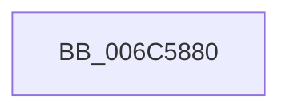

# KiBugCheckDispatch

- RVA: `0x006C5880`–`0x006C58EB` (길이 `107` bytes)
- VA: `0x00000001406C5880`
- 실행 섹션: `.text`
- PDB 이름 있음: `예`; PDB Function 태그: `아니요`
- unwind 정보 RVA: `0x000C1E5C`
- 디코드: `23`개 명령, `107/107` bytes 표시
- 미해석 바이트: `0` (있으면 어셈블리에 `.byte`로 보존)

> 이 문서는 커널 이미지의 기계어와 PDB 기호를 분석해 생성했습니다. 4번과 5번은 함수 원형과 자료형을 바이너리 사용 방식에서 추정한 C 해석이며 원본 소스 복구 결과는 아닙니다.

## 1. Dependencies

- 직접 호출 지점: **1**; 고유 호출 대상: **1**
- 직접 호출자로 확인된 함수: **16**
- RIP 상대 이미지 참조: **0**

### Outgoing calls
- `0x006C58E4` → [KeBugCheckEx](../4F/KeBugCheckEx_function_004FD660.md) (function, `0x004FD660`)

### Direct callers
- [KxIsrLinkage](../6B/KxIsrLinkage_function_006B5680.md) at `0x006B5A76`
- [KiNmiInterrupt](../6B/KiNmiInterrupt_function_006BD3C0.md) at `0x006BD816`
- [KiBoundFault](../6B/KiBoundFault_function_006BE040.md) at `0x006BE3A3`
- [KiNpxNotAvailableFault](../6B/KiNpxNotAvailableFault_function_006BEE00.md) at `0x006BF1AC`
- [KiDoubleFaultAbort](../6B/KiDoubleFaultAbort_function_006BF1C0.md) at `0x006BF50C`
- [KiNpxSegmentOverrunAbort](../6B/KiNpxSegmentOverrunAbort_function_006BF540.md) at `0x006BF895`
- [KiInvalidTssFault](../6B/KiInvalidTssFault_function_006BF8C0.md) at `0x006BFC1A`
- [KiSegmentNotPresentFault](../6B/KiSegmentNotPresentFault_function_006BFC40.md) at `0x006C0013`
- [KiPageFault](KiPageFault_function_006C0740.md) at `0x006C0BA3`
- [KiFloatingErrorFault](KiFloatingErrorFault_function_006C0F40.md) at `0x006C130C`
- [KiXmmException](KiXmmException_function_006C2500.md) at `0x006C28E4`
- [KiVirtualizationException](KiVirtualizationException_function_006C2900.md) at `0x006C300E`
- [KiControlProtectionFault](KiControlProtectionFault_function_006C3040.md) at `0x006C342A`
- [KiSystemServiceHandler](KiSystemServiceHandler_function_006C48C0.md) at `0x006C4937`
- [KiSystemServiceHandler](KiSystemServiceHandler_function_006C48C0.md) at `0x006C4966`
- [KiSystemCall64](KiSystemCall64_function_006C4A40.md) at `0x006C5760`
- [KiSystemCall64](KiSystemCall64_function_006C4A40.md) at `0x006C5780`
- [KiFastFailDispatch](KiFastFailDispatch_function_006C5E40.md) at `0x006C5EED`

### Static image references
- 디코드된 RIP-relative 메모리 참조가 없습니다.

## 2. Other-region calls and transfers

- 다른 실행 섹션으로 향하는 call: **0**
- 별도 외부 분기/꼬리 이동을 확인하지 못했습니다.

## 3. Assembly (complete function range)

```asm
006C5880  48 81 EC 38 01 00 00            sub rsp, 0x138
006C5887  48 8D 84 24 00 01 00 00         lea rax, [rsp + 0x100]
006C588F  0F 29 74 24 30                  movaps xmmword ptr [rsp + 0x30], xmm6
006C5894  0F 29 7C 24 40                  movaps xmmword ptr [rsp + 0x40], xmm7
006C5899  44 0F 29 44 24 50               movaps xmmword ptr [rsp + 0x50], xmm8
006C589F  44 0F 29 4C 24 60               movaps xmmword ptr [rsp + 0x60], xmm9
006C58A5  44 0F 29 54 24 70               movaps xmmword ptr [rsp + 0x70], xmm10
006C58AB  44 0F 29 58 80                  movaps xmmword ptr [rax - 0x80], xmm11
006C58B0  44 0F 29 60 90                  movaps xmmword ptr [rax - 0x70], xmm12
006C58B5  44 0F 29 68 A0                  movaps xmmword ptr [rax - 0x60], xmm13
006C58BA  44 0F 29 70 B0                  movaps xmmword ptr [rax - 0x50], xmm14
006C58BF  44 0F 29 78 C0                  movaps xmmword ptr [rax - 0x40], xmm15
006C58C4  48 89 18                        mov qword ptr [rax], rbx
006C58C7  48 89 78 08                     mov qword ptr [rax + 8], rdi
006C58CB  48 89 70 10                     mov qword ptr [rax + 0x10], rsi
006C58CF  4C 89 60 18                     mov qword ptr [rax + 0x18], r12
006C58D3  4C 89 68 20                     mov qword ptr [rax + 0x20], r13
006C58D7  4C 89 70 28                     mov qword ptr [rax + 0x28], r14
006C58DB  4C 89 78 30                     mov qword ptr [rax + 0x30], r15
006C58DF  4C 89 54 24 20                  mov qword ptr [rsp + 0x20], r10
006C58E4  E8 77 7D E3 FF                  call 0x1404fd660
006C58E9  90                              nop
006C58EA  C3                              ret
```

## 4. C-style interpretation (structured pseudocode)

```c
__int64 __fastcall KiBugCheckDispatch(void)
{
    __int64 result;
    __int64 v_rsp;
    unsigned __int64 v_stack_m108;
    unsigned __int64 v_stack_m118;
    unsigned __int64 v_stack_m38;
    unsigned __int64 v_stack_mC8;
    unsigned __int64 v_stack_mD8;
    unsigned __int64 v_stack_mE8;
    unsigned __int64 v_stack_mF8;

    v_rsp = (v_rsp) - (312);
    v_stack_m108 = v_xmm6;
    v_stack_mF8 = v_xmm7;
    v_stack_mE8 = v_xmm8;
    v_stack_mD8 = v_xmm9;
    v_stack_mC8 = v_xmm10;
    *(unsigned __int64 *)(v_stack_m38 - 128) = v_xmm11;
    *(unsigned __int64 *)(v_stack_m38 - 112) = v_xmm12;
    *(unsigned __int64 *)(v_stack_m38 - 96) = v_xmm13;
    *(unsigned __int64 *)(v_stack_m38 - 80) = v_xmm14;
    *(unsigned __int64 *)(v_stack_m38 - 64) = v_xmm15;
    *(unsigned __int64 *)(v_stack_m38) = v_rbx;
    *(unsigned __int64 *)(v_stack_m38 + 8) = v_rdi;
    *(unsigned __int64 *)(v_stack_m38 + 16) = v_rsi;
    *(unsigned __int64 *)(v_stack_m38 + 24) = v_r12;
    *(unsigned __int64 *)(v_stack_m38 + 32) = v_r13;
    *(unsigned __int64 *)(v_stack_m38 + 40) = v_r14;
    *(unsigned __int64 *)(v_stack_m38 + 48) = v_r15;
    v_stack_m118 = v_r10;
    result = KeBugCheckEx(a1, a2, a3, a4);
    return result;
}
```

## 5. (Beta) C Style

```c
void KiBugCheckDispatch(void)
{
    int64_t result;
    int64_t local_rsp;
    uint64_t v_stack_m108;
    uint64_t v_stack_m118;
    uint64_t v_stack_m38;
    uint64_t v_stack_mC8;
    uint64_t v_stack_mD8;
    uint64_t v_stack_mE8;
    uint64_t v_stack_mF8;

    local_rsp = (local_rsp) - (312);
    v_stack_m108 = v_xmm6;
    v_stack_mF8 = v_xmm7;
    v_stack_mE8 = v_xmm8;
    v_stack_mD8 = v_xmm9;
    v_stack_mC8 = v_xmm10;
    *(uint64_t *)(v_stack_m38 - 0x80) = v_xmm11;
    *(uint64_t *)(v_stack_m38 - 0x70) = v_xmm12;
    *(uint64_t *)(v_stack_m38 - 0x60) = v_xmm13;
    *(uint64_t *)(v_stack_m38 - 0x50) = v_xmm14;
    *(uint64_t *)(v_stack_m38 - 0x40) = v_xmm15;
    *(uint64_t *)(v_stack_m38) = local_rbx;
    *(uint64_t *)(v_stack_m38 + 0x8) = local_rdi;
    *(uint64_t *)(v_stack_m38 + 0x10) = local_rsi;
    *(uint64_t *)(v_stack_m38 + 0x18) = local_r12;
    *(uint64_t *)(v_stack_m38 + 0x20) = local_r13;
    *(uint64_t *)(v_stack_m38 + 0x28) = local_r14;
    *(uint64_t *)(v_stack_m38 + 0x30) = local_r15;
    v_stack_m118 = local_r10;
    result = KeBugCheckEx(a1, a2, a3, a4);
    return result;
}
```

## 6. Execution-region graph

[열기: 2D/3D 그래프와 함수 탐색 컨트롤 패널](../../../control-panel.html?section=text&rva=0x006C5880&view=graph)

- 2D 그래프는 위에서 아래로 흐르고, 3D 그래프는 빈 공간을 드래그해 회전합니다. Shift+드래그는 이동, 휠은 확대·축소, 함수 노드 선택은 대상 보고서 이동입니다.

### Static fallback


