# KiDebugServiceTrap

- RVA: `0x006C3EC0`–`0x006C4229` (길이 `873` bytes)
- VA: `0x00000001406C3EC0`
- 실행 섹션: `.text`
- PDB 이름 있음: `예`; PDB Function 태그: `아니요`
- unwind 정보 RVA: `0x000C1DB0`
- 디코드: `189`개 명령, `873/873` bytes 표시
- 미해석 바이트: `0` (있으면 어셈블리에 `.byte`로 보존)

> 이 문서는 커널 이미지의 기계어와 PDB 기호를 분석해 생성했습니다. 4번과 5번은 함수 원형과 자료형을 바이너리 사용 방식에서 추정한 C 해석이며 원본 소스 복구 결과는 아닙니다.

## 1. Dependencies

- 직접 호출 지점: **36**; 고유 호출 대상: **36**
- 직접 호출자로 확인된 함수: **1**
- RIP 상대 이미지 참조: **3**

### Outgoing calls
- `0x006C4027` → [KiDebugServiceTrap + 0x27A](KiDebugServiceTrap_function_006C3EC0.md) (inside-function, `0x006C413A`)
- `0x006C4030` → [KiDebugServiceTrap + 0x283](KiDebugServiceTrap_function_006C3EC0.md) (inside-function, `0x006C4143`)
- `0x006C4039` → [KiDebugServiceTrap + 0x16C](KiDebugServiceTrap_function_006C3EC0.md) (inside-function, `0x006C402C`)
- `0x006C4042` → [KiDebugServiceTrap + 0x175](KiDebugServiceTrap_function_006C3EC0.md) (inside-function, `0x006C4035`)
- `0x006C404B` → [KiDebugServiceTrap + 0x17E](KiDebugServiceTrap_function_006C3EC0.md) (inside-function, `0x006C403E`)
- `0x006C4054` → [KiDebugServiceTrap + 0x187](KiDebugServiceTrap_function_006C3EC0.md) (inside-function, `0x006C4047`)
- `0x006C405D` → [KiDebugServiceTrap + 0x190](KiDebugServiceTrap_function_006C3EC0.md) (inside-function, `0x006C4050`)
- `0x006C4066` → [KiDebugServiceTrap + 0x199](KiDebugServiceTrap_function_006C3EC0.md) (inside-function, `0x006C4059`)
- `0x006C406F` → [KiDebugServiceTrap + 0x1A2](KiDebugServiceTrap_function_006C3EC0.md) (inside-function, `0x006C4062`)
- `0x006C4078` → [KiDebugServiceTrap + 0x1AB](KiDebugServiceTrap_function_006C3EC0.md) (inside-function, `0x006C406B`)
- `0x006C4081` → [KiDebugServiceTrap + 0x1B4](KiDebugServiceTrap_function_006C3EC0.md) (inside-function, `0x006C4074`)
- `0x006C408A` → [KiDebugServiceTrap + 0x1BD](KiDebugServiceTrap_function_006C3EC0.md) (inside-function, `0x006C407D`)
- `0x006C4093` → [KiDebugServiceTrap + 0x1C6](KiDebugServiceTrap_function_006C3EC0.md) (inside-function, `0x006C4086`)
- `0x006C409C` → [KiDebugServiceTrap + 0x1CF](KiDebugServiceTrap_function_006C3EC0.md) (inside-function, `0x006C408F`)
- `0x006C40A5` → [KiDebugServiceTrap + 0x1D8](KiDebugServiceTrap_function_006C3EC0.md) (inside-function, `0x006C4098`)
- `0x006C40AE` → [KiDebugServiceTrap + 0x1E1](KiDebugServiceTrap_function_006C3EC0.md) (inside-function, `0x006C40A1`)
- `0x006C40B7` → [KiDebugServiceTrap + 0x1EA](KiDebugServiceTrap_function_006C3EC0.md) (inside-function, `0x006C40AA`)
- `0x006C40C0` → [KiDebugServiceTrap + 0x1F3](KiDebugServiceTrap_function_006C3EC0.md) (inside-function, `0x006C40B3`)
- `0x006C40C9` → [KiDebugServiceTrap + 0x1FC](KiDebugServiceTrap_function_006C3EC0.md) (inside-function, `0x006C40BC`)
- `0x006C40D2` → [KiDebugServiceTrap + 0x205](KiDebugServiceTrap_function_006C3EC0.md) (inside-function, `0x006C40C5`)
- `0x006C40DB` → [KiDebugServiceTrap + 0x20E](KiDebugServiceTrap_function_006C3EC0.md) (inside-function, `0x006C40CE`)
- `0x006C40E4` → [KiDebugServiceTrap + 0x217](KiDebugServiceTrap_function_006C3EC0.md) (inside-function, `0x006C40D7`)
- `0x006C40ED` → [KiDebugServiceTrap + 0x220](KiDebugServiceTrap_function_006C3EC0.md) (inside-function, `0x006C40E0`)
- `0x006C40F6` → [KiDebugServiceTrap + 0x229](KiDebugServiceTrap_function_006C3EC0.md) (inside-function, `0x006C40E9`)
- `0x006C40FF` → [KiDebugServiceTrap + 0x232](KiDebugServiceTrap_function_006C3EC0.md) (inside-function, `0x006C40F2`)
- `0x006C4108` → [KiDebugServiceTrap + 0x23B](KiDebugServiceTrap_function_006C3EC0.md) (inside-function, `0x006C40FB`)
- `0x006C4111` → [KiDebugServiceTrap + 0x244](KiDebugServiceTrap_function_006C3EC0.md) (inside-function, `0x006C4104`)
- `0x006C411A` → [KiDebugServiceTrap + 0x24D](KiDebugServiceTrap_function_006C3EC0.md) (inside-function, `0x006C410D`)
- `0x006C4123` → [KiDebugServiceTrap + 0x256](KiDebugServiceTrap_function_006C3EC0.md) (inside-function, `0x006C4116`)
- `0x006C412C` → [KiDebugServiceTrap + 0x25F](KiDebugServiceTrap_function_006C3EC0.md) (inside-function, `0x006C411F`)
- `0x006C4135` → [KiDebugServiceTrap + 0x268](KiDebugServiceTrap_function_006C3EC0.md) (inside-function, `0x006C4128`)
- `0x006C413E` → [KiDebugServiceTrap + 0x271](KiDebugServiceTrap_function_006C3EC0.md) (inside-function, `0x006C4131`)
- `0x006C4169` → [KiFlushBhbDuringTrapEntryOrExit](KiFlushBhbDuringTrapEntryOrExit_function_006C6340.md) (function, `0x006C6340`)
- `0x006C41B2` → [KiSaveDebugRegisterState](../4F/KiSaveDebugRegisterState_function_004FD960.md) (function, `0x004FD960`)
- `0x006C41E6` → [KiSynchronizeUserIsolationDomainExit](../41/KiSynchronizeUserIsolationDomainExit_function_0041BFA0.md) (function, `0x0041BFA0`)
- `0x006C4222` → [KiExceptionDispatch](KiExceptionDispatch_function_006C5900.md) (function, `0x006C5900`)

### Direct callers
- [KiDebugServiceTrap](KiDebugServiceTrap_function_006C3EC0.md) at `0x006C4027`
- [KiDebugServiceTrap](KiDebugServiceTrap_function_006C3EC0.md) at `0x006C4030`
- [KiDebugServiceTrap](KiDebugServiceTrap_function_006C3EC0.md) at `0x006C4039`
- [KiDebugServiceTrap](KiDebugServiceTrap_function_006C3EC0.md) at `0x006C4042`
- [KiDebugServiceTrap](KiDebugServiceTrap_function_006C3EC0.md) at `0x006C404B`
- [KiDebugServiceTrap](KiDebugServiceTrap_function_006C3EC0.md) at `0x006C4054`
- [KiDebugServiceTrap](KiDebugServiceTrap_function_006C3EC0.md) at `0x006C405D`
- [KiDebugServiceTrap](KiDebugServiceTrap_function_006C3EC0.md) at `0x006C4066`
- [KiDebugServiceTrap](KiDebugServiceTrap_function_006C3EC0.md) at `0x006C406F`
- [KiDebugServiceTrap](KiDebugServiceTrap_function_006C3EC0.md) at `0x006C4078`
- [KiDebugServiceTrap](KiDebugServiceTrap_function_006C3EC0.md) at `0x006C4081`
- [KiDebugServiceTrap](KiDebugServiceTrap_function_006C3EC0.md) at `0x006C408A`
- [KiDebugServiceTrap](KiDebugServiceTrap_function_006C3EC0.md) at `0x006C4093`
- [KiDebugServiceTrap](KiDebugServiceTrap_function_006C3EC0.md) at `0x006C409C`
- [KiDebugServiceTrap](KiDebugServiceTrap_function_006C3EC0.md) at `0x006C40A5`
- [KiDebugServiceTrap](KiDebugServiceTrap_function_006C3EC0.md) at `0x006C40AE`
- [KiDebugServiceTrap](KiDebugServiceTrap_function_006C3EC0.md) at `0x006C40B7`
- [KiDebugServiceTrap](KiDebugServiceTrap_function_006C3EC0.md) at `0x006C40C0`
- [KiDebugServiceTrap](KiDebugServiceTrap_function_006C3EC0.md) at `0x006C40C9`
- [KiDebugServiceTrap](KiDebugServiceTrap_function_006C3EC0.md) at `0x006C40D2`
- [KiDebugServiceTrap](KiDebugServiceTrap_function_006C3EC0.md) at `0x006C40DB`
- [KiDebugServiceTrap](KiDebugServiceTrap_function_006C3EC0.md) at `0x006C40E4`
- [KiDebugServiceTrap](KiDebugServiceTrap_function_006C3EC0.md) at `0x006C40ED`
- [KiDebugServiceTrap](KiDebugServiceTrap_function_006C3EC0.md) at `0x006C40F6`
- [KiDebugServiceTrap](KiDebugServiceTrap_function_006C3EC0.md) at `0x006C40FF`
- [KiDebugServiceTrap](KiDebugServiceTrap_function_006C3EC0.md) at `0x006C4108`
- [KiDebugServiceTrap](KiDebugServiceTrap_function_006C3EC0.md) at `0x006C4111`
- [KiDebugServiceTrap](KiDebugServiceTrap_function_006C3EC0.md) at `0x006C411A`
- [KiDebugServiceTrap](KiDebugServiceTrap_function_006C3EC0.md) at `0x006C4123`
- [KiDebugServiceTrap](KiDebugServiceTrap_function_006C3EC0.md) at `0x006C412C`
- [KiDebugServiceTrap](KiDebugServiceTrap_function_006C3EC0.md) at `0x006C4135`
- [KiDebugServiceTrap](KiDebugServiceTrap_function_006C3EC0.md) at `0x006C413E`

### Static image references
- `0x006C3F46` → RVA `0x01201840` (`CFGRO`; read)
- `0x006C417A` → RVA `0x00FC7264` (`ALMOSTRO`; read)
- `0x006C41EB` → RVA `0x00FC6BF0` (`ALMOSTRO`; read)

## 2. Other-region calls and transfers

- 다른 실행 섹션으로 향하는 call: **0**
- 별도 외부 분기/꼬리 이동을 확인하지 못했습니다.

## 3. Assembly (complete function range)

```asm
006C3EC0  48 FF 04 24                     inc qword ptr [rsp]
006C3EC4  66 83 7C 24 08 23               cmp word ptr [rsp + 8], 0x23
006C3ECA  75 05                           jne 0x1406c3ed1
006C3ECC  83 64 24 04 00                  and dword ptr [rsp + 4], 0
006C3ED1  48 83 EC 08                     sub rsp, 8
006C3ED5  55                              push rbp
006C3ED6  48 81 EC 58 01 00 00            sub rsp, 0x158
006C3EDD  48 8D AC 24 80 00 00 00         lea rbp, [rsp + 0x80]
006C3EE5  C6 45 AB 01                     mov byte ptr [rbp - 0x55], 1
006C3EE9  48 89 45 B0                     mov qword ptr [rbp - 0x50], rax
006C3EED  48 89 4D B8                     mov qword ptr [rbp - 0x48], rcx
006C3EF1  48 89 55 C0                     mov qword ptr [rbp - 0x40], rdx
006C3EF5  4C 89 45 C8                     mov qword ptr [rbp - 0x38], r8
006C3EF9  4C 89 4D D0                     mov qword ptr [rbp - 0x30], r9
006C3EFD  4C 89 55 D8                     mov qword ptr [rbp - 0x28], r10
006C3F01  4C 89 5D E0                     mov qword ptr [rbp - 0x20], r11
006C3F05  F6 85 F0 00 00 00 01            test byte ptr [rbp + 0xf0], 1
006C3F0C  75 38                           jne 0x1406c3f46
006C3F0E  33 D2                           xor edx, edx
006C3F10  F3 48 0F 1E CA                  rdsspq rdx
006C3F15  48 89 55 58                     mov qword ptr [rbp + 0x58], rdx
006C3F19  0F AE E8                        lfence
006C3F1C  65 F6 04 25 58 08 00 00 01      test byte ptr gs:[0x858], 1
006C3F25  75 08                           jne 0x1406c3f2f
006C3F27  0F AE E8                        lfence
006C3F2A  E9 88 02 00 00                  jmp 0x1406c41b7
006C3F2F  65 0F B7 04 25 66 08 00 00      movzx eax, word ptr gs:[0x866]
006C3F38  B9 48 00 00 00                  mov ecx, 0x48
006C3F3D  33 D2                           xor edx, edx
006C3F3F  0F 30                           wrmsr
006C3F41  E9 71 02 00 00                  jmp 0x1406c41b7
006C3F46  F6 05 F3 D8 B3 00 01            test byte ptr [rip + 0xb3d8f3], 1
006C3F4D  75 03                           jne 0x1406c3f52
006C3F4F  0F 01 F8                        swapgs
006C3F52  0F AE E8                        lfence
006C3F55  65 48 8B 0C 25 28 9D 00 00      mov rcx, qword ptr gs:[0x9d28]
006C3F5E  48 85 C9                        test rcx, rcx
006C3F61  74 1F                           je 0x1406c3f82
006C3F63  F3 48 0F 1E CA                  rdsspq rdx
006C3F68  65 4C 8B 14 25 20 9D 00 00      mov r10, qword ptr gs:[0x9d20]
006C3F71  49 83 C2 08                     add r10, 8
006C3F75  49 3B D2                        cmp rdx, r10
006C3F78  75 08                           jne 0x1406c3f82
006C3F7A  F3 0F 01 29                     rstorssp dword ptr [rcx]
006C3F7E  F3 0F 01 EA                     saveprevssp
006C3F82  65 4C 8B 14 25 88 01 00 00      mov r10, qword ptr gs:[0x188]
006C3F8B  65 48 8B 0C 25 88 01 00 00      mov rcx, qword ptr gs:[0x188]
006C3F94  48 8B 89 20 02 00 00            mov rcx, qword ptr [rcx + 0x220]
006C3F9B  48 8B 89 60 07 00 00            mov rcx, qword ptr [rcx + 0x760]
006C3FA2  65 48 89 0C 25 50 08 00 00      mov qword ptr gs:[0x850], rcx
006C3FAB  66 65 8B 0C 25 62 08 00 00      mov cx, word ptr gs:[0x862]
006C3FB4  66 65 89 0C 25 64 08 00 00      mov word ptr gs:[0x864], cx
006C3FBD  65 8A 0C 25 58 08 00 00         mov cl, byte ptr gs:[0x858]
006C3FC5  65 88 0C 25 5A 08 00 00         mov byte ptr gs:[0x85a], cl
006C3FCD  65 0F B7 04 25 68 08 00 00      movzx eax, word ptr gs:[0x868]
006C3FD6  66 65 39 04 25 66 08 00 00      cmp word ptr gs:[0x866], ax
006C3FDF  74 12                           je 0x1406c3ff3
006C3FE1  66 65 89 04 25 66 08 00 00      mov word ptr gs:[0x866], ax
006C3FEA  B9 48 00 00 00                  mov ecx, 0x48
006C3FEF  33 D2                           xor edx, edx
006C3FF1  0F 30                           wrmsr
006C3FF3  65 0F B6 14 25 58 08 00 00      movzx edx, byte ptr gs:[0x858]
006C3FFC  F7 C2 08 00 00 00               test edx, 8
006C4002  74 17                           je 0x1406c401b
006C4004  B8 01 00 00 00                  mov eax, 1
006C4009  33 D2                           xor edx, edx
006C400B  B9 49 00 00 00                  mov ecx, 0x49
006C4010  0F 30                           wrmsr
006C4012  65 0F B6 14 25 58 08 00 00      movzx edx, byte ptr gs:[0x858]
006C401B  F7 C2 02 00 00 00               test edx, 2
006C4021  0F 84 37 01 00 00               je 0x1406c415e
006C4027  E8 0E 01 00 00                  call 0x1406c413a
006C402C  48 83 C4 08                     add rsp, 8
006C4030  E8 0E 01 00 00                  call 0x1406c4143
006C4035  48 83 C4 08                     add rsp, 8
006C4039  E8 EE FF FF FF                  call 0x1406c402c
006C403E  48 83 C4 08                     add rsp, 8
006C4042  E8 EE FF FF FF                  call 0x1406c4035
006C4047  48 83 C4 08                     add rsp, 8
006C404B  E8 EE FF FF FF                  call 0x1406c403e
006C4050  48 83 C4 08                     add rsp, 8
006C4054  E8 EE FF FF FF                  call 0x1406c4047
006C4059  48 83 C4 08                     add rsp, 8
006C405D  E8 EE FF FF FF                  call 0x1406c4050
006C4062  48 83 C4 08                     add rsp, 8
006C4066  E8 EE FF FF FF                  call 0x1406c4059
006C406B  48 83 C4 08                     add rsp, 8
006C406F  E8 EE FF FF FF                  call 0x1406c4062
006C4074  48 83 C4 08                     add rsp, 8
006C4078  E8 EE FF FF FF                  call 0x1406c406b
006C407D  48 83 C4 08                     add rsp, 8
006C4081  E8 EE FF FF FF                  call 0x1406c4074
006C4086  48 83 C4 08                     add rsp, 8
006C408A  E8 EE FF FF FF                  call 0x1406c407d
006C408F  48 83 C4 08                     add rsp, 8
006C4093  E8 EE FF FF FF                  call 0x1406c4086
006C4098  48 83 C4 08                     add rsp, 8
006C409C  E8 EE FF FF FF                  call 0x1406c408f
006C40A1  48 83 C4 08                     add rsp, 8
006C40A5  E8 EE FF FF FF                  call 0x1406c4098
006C40AA  48 83 C4 08                     add rsp, 8
006C40AE  E8 EE FF FF FF                  call 0x1406c40a1
006C40B3  48 83 C4 08                     add rsp, 8
006C40B7  E8 EE FF FF FF                  call 0x1406c40aa
006C40BC  48 83 C4 08                     add rsp, 8
006C40C0  E8 EE FF FF FF                  call 0x1406c40b3
006C40C5  48 83 C4 08                     add rsp, 8
006C40C9  E8 EE FF FF FF                  call 0x1406c40bc
006C40CE  48 83 C4 08                     add rsp, 8
006C40D2  E8 EE FF FF FF                  call 0x1406c40c5
006C40D7  48 83 C4 08                     add rsp, 8
006C40DB  E8 EE FF FF FF                  call 0x1406c40ce
006C40E0  48 83 C4 08                     add rsp, 8
006C40E4  E8 EE FF FF FF                  call 0x1406c40d7
006C40E9  48 83 C4 08                     add rsp, 8
006C40ED  E8 EE FF FF FF                  call 0x1406c40e0
006C40F2  48 83 C4 08                     add rsp, 8
006C40F6  E8 EE FF FF FF                  call 0x1406c40e9
006C40FB  48 83 C4 08                     add rsp, 8
006C40FF  E8 EE FF FF FF                  call 0x1406c40f2
006C4104  48 83 C4 08                     add rsp, 8
006C4108  E8 EE FF FF FF                  call 0x1406c40fb
006C410D  48 83 C4 08                     add rsp, 8
006C4111  E8 EE FF FF FF                  call 0x1406c4104
006C4116  48 83 C4 08                     add rsp, 8
006C411A  E8 EE FF FF FF                  call 0x1406c410d
006C411F  48 83 C4 08                     add rsp, 8
006C4123  E8 EE FF FF FF                  call 0x1406c4116
006C4128  48 83 C4 08                     add rsp, 8
006C412C  E8 EE FF FF FF                  call 0x1406c411f
006C4131  48 83 C4 08                     add rsp, 8
006C4135  E8 EE FF FF FF                  call 0x1406c4128
006C413A  48 83 C4 08                     add rsp, 8
006C413E  E8 EE FF FF FF                  call 0x1406c4131
006C4143  48 83 C4 08                     add rsp, 8
006C4147  B8 DA DA 00 00                  mov eax, 0xdada
006C414C  65 F6 04 25 5C 08 00 00 08      test byte ptr gs:[0x85c], 8
006C4155  74 07                           je 0x1406c415e
006C4157  B0 20                           mov al, 0x20
006C4159  F3 48 0F AE E8                  incsspq rax
006C415E  F7 C2 80 00 00 00               test edx, 0x80
006C4164  74 08                           je 0x1406c416e
006C4166  0F AE E8                        lfence
006C4169  E8 D2 21 00 00                  call 0x1406c6340
006C416E  0F AE E8                        lfence
006C4171  65 C6 04 25 5E 08 00 00 00      mov byte ptr gs:[0x85e], 0
006C417A  83 3D E3 30 90 00 00            cmp dword ptr [rip + 0x9030e3], 0
006C4181  74 1F                           je 0x1406c41a2
006C4183  B9 A7 06 00 00                  mov ecx, 0x6a7
006C4188  0F 32                           rdmsr
006C418A  83 FA 00                        cmp edx, 0
006C418D  74 13                           je 0x1406c41a2
006C418F  8B CA                           mov ecx, edx
006C4191  23 15 CD 30 90 00               and edx, dword ptr [rip + 0x9030cd]
006C4197  3B D1                           cmp edx, ecx
006C4199  74 07                           je 0x1406c41a2
006C419B  B9 A7 06 00 00                  mov ecx, 0x6a7
006C41A0  0F 30                           wrmsr
006C41A2  41 F6 42 03 03                  test byte ptr [r10 + 3], 3
006C41A7  66 C7 85 80 00 00 00 00 00      mov word ptr [rbp + 0x80], 0
006C41B0  74 05                           je 0x1406c41b7
006C41B2  E8 A9 97 E3 FF                  call 0x1404fd960
006C41B7  FC                              cld
006C41B8  0F AE 5D AC                     stmxcsr dword ptr [rbp - 0x54]
006C41BC  65 0F AE 14 25 80 01 00 00      ldmxcsr dword ptr gs:[0x180]
006C41C5  0F 29 45 F0                     movaps xmmword ptr [rbp - 0x10], xmm0
006C41C9  0F 29 4D 00                     movaps xmmword ptr [rbp], xmm1
006C41CD  0F 29 55 10                     movaps xmmword ptr [rbp + 0x10], xmm2
006C41D1  0F 29 5D 20                     movaps xmmword ptr [rbp + 0x20], xmm3
006C41D5  0F 29 65 30                     movaps xmmword ptr [rbp + 0x30], xmm4
006C41D9  0F 29 6D 40                     movaps xmmword ptr [rbp + 0x40], xmm5
006C41DD  F6 85 F0 00 00 00 01            test byte ptr [rbp + 0xf0], 1
006C41E4  74 05                           je 0x1406c41eb
006C41E6  E8 B5 7D D5 FF                  call 0x14041bfa0
006C41EB  F6 05 FE 29 90 00 FF            test byte ptr [rip + 0x9029fe], 0xff
006C41F2  74 0C                           je 0x1406c4200
006C41F4  F6 85 F0 00 00 00 01            test byte ptr [rbp + 0xf0], 1
006C41FB  74 03                           je 0x1406c4200
006C41FD  0F 01 CB                        stac
006C4200  F7 85 F8 00 00 00 00 02 00 00   test dword ptr [rbp + 0xf8], 0x200
006C420A  74 01                           je 0x1406c420d
006C420C  FB                              sti
006C420D  B9 03 00 00 80                  mov ecx, 0x80000003
006C4212  BA 01 00 00 00                  mov edx, 1
006C4217  4C 8B 4D B0                     mov r9, qword ptr [rbp - 0x50]
006C421B  4C 8B 85 E8 00 00 00            mov r8, qword ptr [rbp + 0xe8]
006C4222  E8 D9 16 00 00                  call 0x1406c5900
006C4227  90                              nop
006C4228  C3                              ret
```

## 4. C-style interpretation (structured pseudocode)

```c
__int64 __fastcall KiDebugServiceTrap(__int64 a1, __int64 a2, __int64 a3, __int64 a4)
{
    __int64 result;
    __int64 v_r10;
    __int64 v_rsp;
    unsigned __int64 v_stack_m108;
    unsigned __int64 v_stack_m110;
    unsigned __int64 v_stack_m118;
    unsigned __int64 v_stack_m120;
    unsigned __int64 v_stack_m128;
    unsigned __int64 v_stack_m130;
    unsigned __int64 v_stack_m138;
    unsigned int v_stack_m13C;
    unsigned __int8 v_stack_m13D;
    unsigned __int16 v_stack_m68;
    unsigned __int64 v_stack_m90;
    unsigned __int64 v_stack_mA8;
    unsigned __int64 v_stack_mB8;
    unsigned __int64 v_stack_mC8;
    unsigned __int64 v_stack_mD8;
    unsigned __int64 v_stack_mE8;
    unsigned __int64 v_stack_mF8;
    unsigned __int64 v_stack_p0;
    unsigned int v_stack_p10;
    unsigned int v_stack_p4;
    unsigned __int16 v_stack_p8;

    if (v_stack_p8 == 35) {
    }
    v_rsp = (v_rsp) - (8);
    v_rsp = (v_rsp) - (344);
    v_stack_m13D = 1;
    v_stack_m138 = result;
    v_stack_m130 = a1;
    v_stack_m128 = a2;
    v_stack_m120 = a3;
    v_stack_m118 = a4;
    v_stack_m110 = v_r10;
    v_stack_m108 = v_r11;
    if (((v_stack_p8) & (1)) != 0) goto loc_006C3F46;
    a2 = 0;
    v_stack_m90 = 0;
    if (((*(unsigned __int8 *)(gs_base + (0 + 2136))) & (1)) != 0) goto loc_006C3F2F;
    goto loc_006C41B7;
loc_006C3F2F:
    a2 = 0;
    goto loc_006C41B7;
loc_006C3F46:
    if (((*(unsigned __int8 *)(v_rip + 11786483)) & (1)) == 0) {
    }
    if (*(unsigned __int64 *)(gs_base + (0 + 40232)) == 0) goto loc_006C3F82;
    v_r10 = (*(unsigned __int64 *)(gs_base + (0 + 40224))) + (8);
    if (0 == v_r10) {
    }
    *(unsigned __int64 *)(gs_base + (0 + 2128)) = *(unsigned __int64 *)(*(unsigned __int64 *)(*(unsigned __int64 *)(gs_base + (0 + 392)) + 544) + 1888);
    *(unsigned __int16 *)(gs_base + (0 + 2148)) = (unsigned __int16)(*(unsigned __int16 *)(gs_base + (0 + 2146)));
    *(unsigned __int8 *)(gs_base + (0 + 2138)) = (unsigned __int8)(*(unsigned __int8 *)(gs_base + (0 + 2136)));
    if ((*(unsigned __int16 *)(gs_base + (0 + 2150))) != ((unsigned __int16)(*(unsigned __int16 *)(gs_base + (0 + 2152))))) {
        *(unsigned __int16 *)(gs_base + (0 + 2150)) = (unsigned __int16)(*(unsigned __int16 *)(gs_base + (0 + 2152)));
        a1 = 72;
        a2 = 0;
    }
    result = *(unsigned __int16 *)(gs_base + (0 + 2152));
    if ((((unsigned int)(*(unsigned __int8 *)(gs_base + (0 + 2136)))) & (8)) != 0) {
        result = 1;
        a2 = 0;
        a1 = 73;
        a2 = *(unsigned __int8 *)(gs_base + (0 + 2136));
    }
    if ((((unsigned int)(a2)) & (2)) == 0) goto loc_006C415E;
    result = KiDebugServiceTrap___0x27A(a1, a2, a3, a4);
    v_rsp = (v_rsp) + (8);
    result = KiDebugServiceTrap___0x283(a1, a2, a3, a4);
    v_rsp = (v_rsp) + (8);
    result = KiDebugServiceTrap___0x16C(a1, a2, a3, a4);
    v_rsp = (v_rsp) + (8);
    result = KiDebugServiceTrap___0x175(a1, a2, a3, a4);
    v_rsp = (v_rsp) + (8);
    result = KiDebugServiceTrap___0x17E(a1, a2, a3, a4);
    v_rsp = (v_rsp) + (8);
    result = KiDebugServiceTrap___0x187(a1, a2, a3, a4);
    v_rsp = (v_rsp) + (8);
    result = KiDebugServiceTrap___0x190(a1, a2, a3, a4);
    v_rsp = (v_rsp) + (8);
    result = KiDebugServiceTrap___0x199(a1, a2, a3, a4);
    v_rsp = (v_rsp) + (8);
    result = KiDebugServiceTrap___0x1A2(a1, a2, a3, a4);
    v_rsp = (v_rsp) + (8);
    result = KiDebugServiceTrap___0x1AB(a1, a2, a3, a4);
    v_rsp = (v_rsp) + (8);
    result = KiDebugServiceTrap___0x1B4(a1, a2, a3, a4);
    v_rsp = (v_rsp) + (8);
    result = KiDebugServiceTrap___0x1BD(a1, a2, a3, a4);
    v_rsp = (v_rsp) + (8);
    result = KiDebugServiceTrap___0x1C6(a1, a2, a3, a4);
    v_rsp = (v_rsp) + (8);
    result = KiDebugServiceTrap___0x1CF(a1, a2, a3, a4);
    v_rsp = (v_rsp) + (8);
    result = KiDebugServiceTrap___0x1D8(a1, a2, a3, a4);
    v_rsp = (v_rsp) + (8);
    result = KiDebugServiceTrap___0x1E1(a1, a2, a3, a4);
    v_rsp = (v_rsp) + (8);
    result = KiDebugServiceTrap___0x1EA(a1, a2, a3, a4);
    v_rsp = (v_rsp) + (8);
    result = KiDebugServiceTrap___0x1F3(a1, a2, a3, a4);
    v_rsp = (v_rsp) + (8);
    result = KiDebugServiceTrap___0x1FC(a1, a2, a3, a4);
    v_rsp = (v_rsp) + (8);
    result = KiDebugServiceTrap___0x205(a1, a2, a3, a4);
    v_rsp = (v_rsp) + (8);
    result = KiDebugServiceTrap___0x20E(a1, a2, a3, a4);
    v_rsp = (v_rsp) + (8);
    result = KiDebugServiceTrap___0x217(a1, a2, a3, a4);
    v_rsp = (v_rsp) + (8);
    result = KiDebugServiceTrap___0x220(a1, a2, a3, a4);
    v_rsp = (v_rsp) + (8);
    result = KiDebugServiceTrap___0x229(a1, a2, a3, a4);
    v_rsp = (v_rsp) + (8);
    result = KiDebugServiceTrap___0x232(a1, a2, a3, a4);
    v_rsp = (v_rsp) + (8);
    result = KiDebugServiceTrap___0x23B(a1, a2, a3, a4);
    v_rsp = (v_rsp) + (8);
    result = KiDebugServiceTrap___0x244(a1, a2, a3, a4);
    v_rsp = (v_rsp) + (8);
    result = KiDebugServiceTrap___0x24D(a1, a2, a3, a4);
    v_rsp = (v_rsp) + (8);
    result = KiDebugServiceTrap___0x256(a1, a2, a3, a4);
    v_rsp = (v_rsp) + (8);
    result = KiDebugServiceTrap___0x25F(a1, a2, a3, a4);
    v_rsp = (v_rsp) + (8);
    result = KiDebugServiceTrap___0x268(a1, a2, a3, a4);
    v_rsp = (v_rsp) + (8);
    result = KiDebugServiceTrap___0x271(a1, a2, a3, a4);
    v_rsp = (v_rsp) + (8);
    result = (unsigned int)(0xDADAULL);
    if (((*(unsigned __int8 *)(gs_base + (0 + 2140))) & (8)) != 0) {
        result = 32;
    }
    if ((((unsigned int)(a2)) & (128)) != 0) {
        result = KiFlushBhbDuringTrapEntryOrExit(a1, a2, a3, a4);
    }
    *(unsigned __int8 *)(gs_base + (0 + 2142)) = 0;
    if ((*(unsigned int *)(v_rip + 9449699)) == 0) goto loc_006C41A2;
    if (((unsigned int)(a2)) == 0) goto loc_006C41A2;
    a2 = (unsigned int)((a2) & (*(unsigned int *)(v_rip + 9449677)));
    if (((unsigned int)(a2)) != ((unsigned int)((unsigned int)((unsigned int)(a2))))) {
        a1 = 0x6A7ULL;
    }
    v_stack_m68 = 0;
    if (((*(unsigned __int8 *)(*(unsigned __int64 *)(gs_base + (0 + 392)) + 3)) & (3)) != 0) {
        result = KiSaveDebugRegisterState(a1, a2, a3, a4);
    }
    v_stack_mF8 = v_xmm0;
    v_stack_mE8 = v_xmm1;
    v_stack_mD8 = v_xmm2;
    v_stack_mC8 = v_xmm3;
    v_stack_mB8 = v_xmm4;
    v_stack_mA8 = v_xmm5;
    if (((v_stack_p8) & (1)) != 0) {
        result = KiSynchronizeUserIsolationDomainExit(a1, a2, a3, a4);
    }
    if (((*(unsigned __int8 *)(v_rip + 9447934)) & (255)) == 0) goto loc_006C4200;
    if (((v_stack_p8) & (1)) != 0) {
    }
    if (((v_stack_p10) & (512)) != 0) {
    }
    result = KiExceptionDispatch((unsigned int)(0x80000003ULL), 1, v_stack_p0, v_stack_m138);
    return result;
}
```

## 5. (Beta) C Style

```c
int64_t KiDebugServiceTrap(int64_t Arg1, int64_t Arg2, int64_t Arg3, int64_t Arg4)
{
    int64_t result;
    int64_t local_r10;
    int64_t local_rsp;
    uint64_t v_stack_m108;
    uint64_t v_stack_m110;
    uint64_t v_stack_m118;
    uint64_t v_stack_m120;
    uint64_t v_stack_m128;
    uint64_t v_stack_m130;
    uint64_t v_stack_m138;
    uint32_t v_stack_m13C;
    uint8_t v_stack_m13D;
    uint16_t v_stack_m68;
    uint64_t v_stack_m90;
    uint64_t v_stack_mA8;
    uint64_t v_stack_mB8;
    uint64_t v_stack_mC8;
    uint64_t v_stack_mD8;
    uint64_t v_stack_mE8;
    uint64_t v_stack_mF8;
    uint64_t v_stack_p0;
    uint32_t v_stack_p10;
    uint32_t v_stack_p4;
    uint16_t v_stack_p8;

    if (v_stack_p8 == 35) {
    }
    local_rsp = (local_rsp) - (8);
    local_rsp = (local_rsp) - (344);
    v_stack_m13D = 1;
    v_stack_m138 = result;
    v_stack_m130 = Arg1;
    v_stack_m128 = Arg2;
    v_stack_m120 = Arg3;
    v_stack_m118 = Arg4;
    v_stack_m110 = local_r10;
    v_stack_m108 = local_r11;
    if (((v_stack_p8) & (1)) != 0) goto loc_006C3F46;
    Arg2 = 0;
    v_stack_m90 = 0;
    if (((*(uint8_t *)(gs_base + (0 + 0x858))) & (1)) != 0) goto loc_006C3F2F;
    goto loc_006C41B7;
loc_006C3F2F:
    Arg2 = 0;
    goto loc_006C41B7;
loc_006C3F46:
    if (((*(uint8_t *)(v_rip + 0xB3D8F3)) & (1)) == 0) {
    }
    if (*(uint64_t *)(gs_base + (0 + 0x9D28)) == 0) goto loc_006C3F82;
    local_r10 = (*(uint64_t *)(gs_base + (0 + 0x9D20))) + (8);
    if (0 == local_r10) {
    }
    *(uint64_t *)(gs_base + (0 + 0x850)) = *(uint64_t *)(*(uint64_t *)(*(uint64_t *)(gs_base + (0 + 0x188)) + 0x220) + 0x760);
    *(uint16_t *)(gs_base + (0 + 0x864)) = (uint16_t)(*(uint16_t *)(gs_base + (0 + 0x862)));
    *(uint8_t *)(gs_base + (0 + 0x85A)) = (uint8_t)(*(uint8_t *)(gs_base + (0 + 0x858)));
    if ((*(uint16_t *)(gs_base + (0 + 0x866))) != ((uint16_t)(*(uint16_t *)(gs_base + (0 + 0x868))))) {
        *(uint16_t *)(gs_base + (0 + 0x866)) = (uint16_t)(*(uint16_t *)(gs_base + (0 + 0x868)));
        Arg1 = 72;
        Arg2 = 0;
    }
    result = *(uint16_t *)(gs_base + (0 + 0x868));
    if ((((uint32_t)(*(uint8_t *)(gs_base + (0 + 0x858)))) & (8)) != 0) {
        result = 1;
        Arg2 = 0;
        Arg1 = 73;
        Arg2 = *(uint8_t *)(gs_base + (0 + 0x858));
    }
    if ((((uint32_t)(Arg2)) & (2)) == 0) goto loc_006C415E;
    result = KiDebugServiceTrap___0x27A(Arg1, Arg2, Arg3, Arg4);
    local_rsp = (local_rsp) + (8);
    result = KiDebugServiceTrap___0x283(Arg1, Arg2, Arg3, Arg4);
    local_rsp = (local_rsp) + (8);
    result = KiDebugServiceTrap___0x16C(Arg1, Arg2, Arg3, Arg4);
    local_rsp = (local_rsp) + (8);
    result = KiDebugServiceTrap___0x175(Arg1, Arg2, Arg3, Arg4);
    local_rsp = (local_rsp) + (8);
    result = KiDebugServiceTrap___0x17E(Arg1, Arg2, Arg3, Arg4);
    local_rsp = (local_rsp) + (8);
    result = KiDebugServiceTrap___0x187(Arg1, Arg2, Arg3, Arg4);
    local_rsp = (local_rsp) + (8);
    result = KiDebugServiceTrap___0x190(Arg1, Arg2, Arg3, Arg4);
    local_rsp = (local_rsp) + (8);
    result = KiDebugServiceTrap___0x199(Arg1, Arg2, Arg3, Arg4);
    local_rsp = (local_rsp) + (8);
    result = KiDebugServiceTrap___0x1A2(Arg1, Arg2, Arg3, Arg4);
    local_rsp = (local_rsp) + (8);
    result = KiDebugServiceTrap___0x1AB(Arg1, Arg2, Arg3, Arg4);
    local_rsp = (local_rsp) + (8);
    result = KiDebugServiceTrap___0x1B4(Arg1, Arg2, Arg3, Arg4);
    local_rsp = (local_rsp) + (8);
    result = KiDebugServiceTrap___0x1BD(Arg1, Arg2, Arg3, Arg4);
    local_rsp = (local_rsp) + (8);
    result = KiDebugServiceTrap___0x1C6(Arg1, Arg2, Arg3, Arg4);
    local_rsp = (local_rsp) + (8);
    result = KiDebugServiceTrap___0x1CF(Arg1, Arg2, Arg3, Arg4);
    local_rsp = (local_rsp) + (8);
    result = KiDebugServiceTrap___0x1D8(Arg1, Arg2, Arg3, Arg4);
    local_rsp = (local_rsp) + (8);
    result = KiDebugServiceTrap___0x1E1(Arg1, Arg2, Arg3, Arg4);
    local_rsp = (local_rsp) + (8);
    result = KiDebugServiceTrap___0x1EA(Arg1, Arg2, Arg3, Arg4);
    local_rsp = (local_rsp) + (8);
    result = KiDebugServiceTrap___0x1F3(Arg1, Arg2, Arg3, Arg4);
    local_rsp = (local_rsp) + (8);
    result = KiDebugServiceTrap___0x1FC(Arg1, Arg2, Arg3, Arg4);
    local_rsp = (local_rsp) + (8);
    result = KiDebugServiceTrap___0x205(Arg1, Arg2, Arg3, Arg4);
    local_rsp = (local_rsp) + (8);
    result = KiDebugServiceTrap___0x20E(Arg1, Arg2, Arg3, Arg4);
    local_rsp = (local_rsp) + (8);
    result = KiDebugServiceTrap___0x217(Arg1, Arg2, Arg3, Arg4);
    local_rsp = (local_rsp) + (8);
    result = KiDebugServiceTrap___0x220(Arg1, Arg2, Arg3, Arg4);
    local_rsp = (local_rsp) + (8);
    result = KiDebugServiceTrap___0x229(Arg1, Arg2, Arg3, Arg4);
    local_rsp = (local_rsp) + (8);
    result = KiDebugServiceTrap___0x232(Arg1, Arg2, Arg3, Arg4);
    local_rsp = (local_rsp) + (8);
    result = KiDebugServiceTrap___0x23B(Arg1, Arg2, Arg3, Arg4);
    local_rsp = (local_rsp) + (8);
    result = KiDebugServiceTrap___0x244(Arg1, Arg2, Arg3, Arg4);
    local_rsp = (local_rsp) + (8);
    result = KiDebugServiceTrap___0x24D(Arg1, Arg2, Arg3, Arg4);
    local_rsp = (local_rsp) + (8);
    result = KiDebugServiceTrap___0x256(Arg1, Arg2, Arg3, Arg4);
    local_rsp = (local_rsp) + (8);
    result = KiDebugServiceTrap___0x25F(Arg1, Arg2, Arg3, Arg4);
    local_rsp = (local_rsp) + (8);
    result = KiDebugServiceTrap___0x268(Arg1, Arg2, Arg3, Arg4);
    local_rsp = (local_rsp) + (8);
    result = KiDebugServiceTrap___0x271(Arg1, Arg2, Arg3, Arg4);
    local_rsp = (local_rsp) + (8);
    result = (uint32_t)(0xDADAULL);
    if (((*(uint8_t *)(gs_base + (0 + 0x85C))) & (8)) != 0) {
        result = 32;
    }
    if ((((uint32_t)(Arg2)) & (128)) != 0) {
        result = KiFlushBhbDuringTrapEntryOrExit(Arg1, Arg2, Arg3, Arg4);
    }
    *(uint8_t *)(gs_base + (0 + 0x85E)) = 0;
    if ((*(uint32_t *)(v_rip + 0x9030E3)) == 0) goto loc_006C41A2;
    if (((uint32_t)(Arg2)) == 0) goto loc_006C41A2;
    Arg2 = (uint32_t)((Arg2) & (*(uint32_t *)(v_rip + 0x9030CD)));
    if (((uint32_t)(Arg2)) != ((uint32_t)((uint32_t)((uint32_t)(Arg2))))) {
        Arg1 = 0x6A7ULL;
    }
    v_stack_m68 = 0;
    if (((*(uint8_t *)(*(uint64_t *)(gs_base + (0 + 0x188)) + 0x3)) & (3)) != 0) {
        result = KiSaveDebugRegisterState(Arg1, Arg2, Arg3, Arg4);
    }
    v_stack_mF8 = v_xmm0;
    v_stack_mE8 = v_xmm1;
    v_stack_mD8 = v_xmm2;
    v_stack_mC8 = v_xmm3;
    v_stack_mB8 = v_xmm4;
    v_stack_mA8 = v_xmm5;
    if (((v_stack_p8) & (1)) != 0) {
        result = KiSynchronizeUserIsolationDomainExit(Arg1, Arg2, Arg3, Arg4);
    }
    if (((*(uint8_t *)(v_rip + 0x9029FE)) & (255)) == 0) goto loc_006C4200;
    if (((v_stack_p8) & (1)) != 0) {
    }
    if (((v_stack_p10) & (512)) != 0) {
    }
    result = KiExceptionDispatch((uint32_t)(0x80000003ULL), 1, v_stack_p0, v_stack_m138);
    return result;
}
```

## 6. Execution-region graph

[열기: 2D/3D 그래프와 함수 탐색 컨트롤 패널](../../../control-panel.html?section=text&rva=0x006C3EC0&view=graph)

- 2D 그래프는 위에서 아래로 흐르고, 3D 그래프는 빈 공간을 드래그해 회전합니다. Shift+드래그는 이동, 휠은 확대·축소, 함수 노드 선택은 대상 보고서 이동입니다.

### Static fallback

```mermaid
flowchart TD
  bb_006C3EC0[BB_006C3EC0]
  bb_006C3ECC[BB_006C3ECC]
  bb_006C3ED1[BB_006C3ED1]
  bb_006C3F0E[BB_006C3F0E]
  bb_006C3F27[BB_006C3F27]
  bb_006C3F2F[BB_006C3F2F]
  bb_006C3F46[BB_006C3F46]
  bb_006C3F4F[BB_006C3F4F]
  bb_006C3F52[BB_006C3F52]
  bb_006C3F63[BB_006C3F63]
  bb_006C3F7A[BB_006C3F7A]
  bb_006C3F82[BB_006C3F82]
  bb_006C3FE1[BB_006C3FE1]
  bb_006C3FF3[BB_006C3FF3]
  bb_006C4004[BB_006C4004]
  bb_006C401B[BB_006C401B]
  bb_006C4027[BB_006C4027]
  bb_006C4157[BB_006C4157]
  bb_006C415E[BB_006C415E]
  bb_006C4166[BB_006C4166]
  bb_006C416E[BB_006C416E]
  bb_006C4183[BB_006C4183]
  bb_006C418F[BB_006C418F]
  bb_006C419B[BB_006C419B]
  bb_006C41A2[BB_006C41A2]
  bb_006C41B2[BB_006C41B2]
  bb_006C41B7[BB_006C41B7]
  bb_006C41E6[BB_006C41E6]
  bb_006C41EB[BB_006C41EB]
  bb_006C41F4[BB_006C41F4]
  bb_006C41FD[BB_006C41FD]
  bb_006C4200[BB_006C4200]
  bb_006C420C[BB_006C420C]
  bb_006C420D[BB_006C420D]
  bb_006C3EC0 -->|branch| bb_006C3ED1
  bb_006C3EC0 -->|fallthrough| bb_006C3ECC
  bb_006C3ECC -->|flow| bb_006C3ED1
  bb_006C3ED1 -->|branch| bb_006C3F46
  bb_006C3ED1 -->|fallthrough| bb_006C3F0E
  bb_006C3F0E -->|branch| bb_006C3F2F
  bb_006C3F0E -->|fallthrough| bb_006C3F27
  bb_006C3F27 -->|branch| bb_006C41B7
  bb_006C3F2F -->|branch| bb_006C41B7
  bb_006C3F46 -->|branch| bb_006C3F52
  bb_006C3F46 -->|fallthrough| bb_006C3F4F
  bb_006C3F4F -->|flow| bb_006C3F52
  bb_006C3F52 -->|branch| bb_006C3F82
  bb_006C3F52 -->|fallthrough| bb_006C3F63
  bb_006C3F63 -->|branch| bb_006C3F82
  bb_006C3F63 -->|fallthrough| bb_006C3F7A
  bb_006C3F7A -->|flow| bb_006C3F82
  bb_006C3F82 -->|branch| bb_006C3FF3
  bb_006C3F82 -->|fallthrough| bb_006C3FE1
  bb_006C3FE1 -->|flow| bb_006C3FF3
  bb_006C3FF3 -->|branch| bb_006C401B
  bb_006C3FF3 -->|fallthrough| bb_006C4004
  bb_006C4004 -->|flow| bb_006C401B
  bb_006C401B -->|branch| bb_006C415E
  bb_006C401B -->|fallthrough| bb_006C4027
  bb_006C4027 -->|branch| bb_006C415E
  bb_006C4027 -->|fallthrough| bb_006C4157
  bb_006C4157 -->|flow| bb_006C415E
  bb_006C415E -->|branch| bb_006C416E
  bb_006C415E -->|fallthrough| bb_006C4166
  bb_006C4166 -->|flow| bb_006C416E
  bb_006C416E -->|branch| bb_006C41A2
  bb_006C416E -->|fallthrough| bb_006C4183
  bb_006C4183 -->|branch| bb_006C41A2
  bb_006C4183 -->|fallthrough| bb_006C418F
  bb_006C418F -->|branch| bb_006C41A2
  bb_006C418F -->|fallthrough| bb_006C419B
  bb_006C419B -->|flow| bb_006C41A2
  bb_006C41A2 -->|branch| bb_006C41B7
  bb_006C41A2 -->|fallthrough| bb_006C41B2
  bb_006C41B2 -->|flow| bb_006C41B7
  bb_006C41B7 -->|branch| bb_006C41EB
  bb_006C41B7 -->|fallthrough| bb_006C41E6
  bb_006C41E6 -->|flow| bb_006C41EB
  bb_006C41EB -->|branch| bb_006C4200
  bb_006C41EB -->|fallthrough| bb_006C41F4
  bb_006C41F4 -->|branch| bb_006C4200
  bb_006C41F4 -->|fallthrough| bb_006C41FD
  bb_006C41FD -->|flow| bb_006C4200
  bb_006C4200 -->|branch| bb_006C420D
  bb_006C4200 -->|fallthrough| bb_006C420C
  bb_006C420C -->|flow| bb_006C420D
```


