# KiExceptionDispatch

- RVA: `0x006C5900`–`0x006C5E01` (길이 `1,281` bytes)
- VA: `0x00000001406C5900`
- 실행 섹션: `.text`
- PDB 이름 있음: `예`; PDB Function 태그: `아니요`
- unwind 정보 RVA: `0x000C1EAC`
- 디코드: `281`개 명령, `1,281/1,281` bytes 표시
- 미해석 바이트: `0` (있으면 어셈블리에 `.byte`로 보존)

> 이 문서는 커널 이미지의 기계어와 PDB 기호를 분석해 생성했습니다. 4번과 5번은 함수 원형과 자료형을 바이너리 사용 방식에서 추정한 C 해석이며 원본 소스 복구 결과는 아닙니다.

## 1. Dependencies

- 직접 호출 지점: **40**; 고유 호출 대상: **40**
- 직접 호출자로 확인된 함수: **21**
- RIP 상대 이미지 참조: **5**

### Outgoing calls
- `0x006C5A39` → [KiExceptionDispatchOnExceptionStack](../6B/KiExceptionDispatchOnExceptionStack_function_006B1B80.md) (function, `0x006B1B80`)
- `0x006C5A40` → [KiDispatchException](../3D/KiDispatchException_function_003D7650.md) (function, `0x003D7650`)
- `0x006C5AE9` → [KiInitiateUserApc](../6B/KiInitiateUserApc_function_006B6540.md) (function, `0x006B6540`)
- `0x006C5AFA` → [KiSynchronizeUserIsolationDomainEntry](../26/KiSynchronizeUserIsolationDomainEntry_function_00263F60.md) (function, `0x00263F60`)
- `0x006C5B14` → [KiUpdateStibpPairing](../3E/KiUpdateStibpPairing_function_003E71C0.md) (function, `0x003E71C0`)
- `0x006C5B2A` → [KiRestoreSetContextState](../6B/KiRestoreSetContextState_function_006B1CA0.md) (function, `0x006B1CA0`)
- `0x006C5B46` → [KiCopyCounters](../5C/KiCopyCounters_function_005C0710.md) (function, `0x005C0710`)
- `0x006C5B62` → [KiRestoreDebugRegisterState](../4F/KiRestoreDebugRegisterState_function_004FD8E0.md) (function, `0x004FD8E0`)
- `0x006C5BFC` → [KiExceptionDispatch + 0x40F](KiExceptionDispatch_function_006C5900.md) (inside-function, `0x006C5D0F`)
- `0x006C5C05` → [KiExceptionDispatch + 0x418](KiExceptionDispatch_function_006C5900.md) (inside-function, `0x006C5D18`)
- `0x006C5C0E` → [KiExceptionDispatch + 0x301](KiExceptionDispatch_function_006C5900.md) (inside-function, `0x006C5C01`)
- `0x006C5C17` → [KiExceptionDispatch + 0x30A](KiExceptionDispatch_function_006C5900.md) (inside-function, `0x006C5C0A`)
- `0x006C5C20` → [KiExceptionDispatch + 0x313](KiExceptionDispatch_function_006C5900.md) (inside-function, `0x006C5C13`)
- `0x006C5C29` → [KiExceptionDispatch + 0x31C](KiExceptionDispatch_function_006C5900.md) (inside-function, `0x006C5C1C`)
- `0x006C5C32` → [KiExceptionDispatch + 0x325](KiExceptionDispatch_function_006C5900.md) (inside-function, `0x006C5C25`)
- `0x006C5C3B` → [KiExceptionDispatch + 0x32E](KiExceptionDispatch_function_006C5900.md) (inside-function, `0x006C5C2E`)
- `0x006C5C44` → [KiExceptionDispatch + 0x337](KiExceptionDispatch_function_006C5900.md) (inside-function, `0x006C5C37`)
- `0x006C5C4D` → [KiExceptionDispatch + 0x340](KiExceptionDispatch_function_006C5900.md) (inside-function, `0x006C5C40`)
- `0x006C5C56` → [KiExceptionDispatch + 0x349](KiExceptionDispatch_function_006C5900.md) (inside-function, `0x006C5C49`)
- `0x006C5C5F` → [KiExceptionDispatch + 0x352](KiExceptionDispatch_function_006C5900.md) (inside-function, `0x006C5C52`)
- `0x006C5C68` → [KiExceptionDispatch + 0x35B](KiExceptionDispatch_function_006C5900.md) (inside-function, `0x006C5C5B`)
- `0x006C5C71` → [KiExceptionDispatch + 0x364](KiExceptionDispatch_function_006C5900.md) (inside-function, `0x006C5C64`)
- `0x006C5C7A` → [KiExceptionDispatch + 0x36D](KiExceptionDispatch_function_006C5900.md) (inside-function, `0x006C5C6D`)
- `0x006C5C83` → [KiExceptionDispatch + 0x376](KiExceptionDispatch_function_006C5900.md) (inside-function, `0x006C5C76`)
- `0x006C5C8C` → [KiExceptionDispatch + 0x37F](KiExceptionDispatch_function_006C5900.md) (inside-function, `0x006C5C7F`)
- `0x006C5C95` → [KiExceptionDispatch + 0x388](KiExceptionDispatch_function_006C5900.md) (inside-function, `0x006C5C88`)
- `0x006C5C9E` → [KiExceptionDispatch + 0x391](KiExceptionDispatch_function_006C5900.md) (inside-function, `0x006C5C91`)
- `0x006C5CA7` → [KiExceptionDispatch + 0x39A](KiExceptionDispatch_function_006C5900.md) (inside-function, `0x006C5C9A`)
- `0x006C5CB0` → [KiExceptionDispatch + 0x3A3](KiExceptionDispatch_function_006C5900.md) (inside-function, `0x006C5CA3`)
- `0x006C5CB9` → [KiExceptionDispatch + 0x3AC](KiExceptionDispatch_function_006C5900.md) (inside-function, `0x006C5CAC`)
- `0x006C5CC2` → [KiExceptionDispatch + 0x3B5](KiExceptionDispatch_function_006C5900.md) (inside-function, `0x006C5CB5`)
- `0x006C5CCB` → [KiExceptionDispatch + 0x3BE](KiExceptionDispatch_function_006C5900.md) (inside-function, `0x006C5CBE`)
- `0x006C5CD4` → [KiExceptionDispatch + 0x3C7](KiExceptionDispatch_function_006C5900.md) (inside-function, `0x006C5CC7`)
- `0x006C5CDD` → [KiExceptionDispatch + 0x3D0](KiExceptionDispatch_function_006C5900.md) (inside-function, `0x006C5CD0`)
- `0x006C5CE6` → [KiExceptionDispatch + 0x3D9](KiExceptionDispatch_function_006C5900.md) (inside-function, `0x006C5CD9`)
- `0x006C5CEF` → [KiExceptionDispatch + 0x3E2](KiExceptionDispatch_function_006C5900.md) (inside-function, `0x006C5CE2`)
- `0x006C5CF8` → [KiExceptionDispatch + 0x3EB](KiExceptionDispatch_function_006C5900.md) (inside-function, `0x006C5CEB`)
- `0x006C5D01` → [KiExceptionDispatch + 0x3F4](KiExceptionDispatch_function_006C5900.md) (inside-function, `0x006C5CF4`)
- `0x006C5D0A` → [KiExceptionDispatch + 0x3FD](KiExceptionDispatch_function_006C5900.md) (inside-function, `0x006C5CFD`)
- `0x006C5D13` → [KiExceptionDispatch + 0x406](KiExceptionDispatch_function_006C5900.md) (inside-function, `0x006C5D06`)

### Direct callers
- [KiDivideErrorFault](../6B/KiDivideErrorFault_function_006BCA00.md) at `0x006BCD4A`
- [KxDebugTrapOrFault](../6B/KxDebugTrapOrFault_function_006BCF40.md) at `0x006BD380`
- [KiBreakpointTrap](../6B/KiBreakpointTrap_function_006BD940.md) at `0x006BDC96`
- [KiOverflowTrap](../6B/KiOverflowTrap_function_006BDCC0.md) at `0x006BE00D`
- [KiBoundFault](../6B/KiBoundFault_function_006BE040.md) at `0x006BE3D4`
- [KiInvalidOpcodeFault](../6B/KiInvalidOpcodeFault_function_006BE740.md) at `0x006BEA8A`
- [KiNpxNotAvailableFault](../6B/KiNpxNotAvailableFault_function_006BEE00.md) at `0x006BF18D`
- [KiSegmentNotPresentFault](../6B/KiSegmentNotPresentFault_function_006BFC40.md) at `0x006BFFC1`
- [KiSegmentNotPresentFault](../6B/KiSegmentNotPresentFault_function_006BFC40.md) at `0x006BFFF6`
- [KiStackFault](KiStackFault_function_006C0040.md) at `0x006C03B1`
- [KiGeneralProtectionFault](KiGeneralProtectionFault_function_006C03C0.md) at `0x006C0720`
- [KiPageFault](KiPageFault_function_006C0740.md) at `0x006C0B7D`
- [KiFloatingErrorFault](KiFloatingErrorFault_function_006C0F40.md) at `0x006C12EE`
- [KiAlignmentFault](KiAlignmentFault_function_006C1340.md) at `0x006C168C`
- [KiXmmException](KiXmmException_function_006C2500.md) at `0x006C28A4`
- [KiControlProtectionFault](KiControlProtectionFault_function_006C3040.md) at `0x006C343D`
- [KiRaiseAssertion](KiRaiseAssertion_function_006C3B40.md) at `0x006C3E9C`
- [KiDebugServiceTrap](KiDebugServiceTrap_function_006C3EC0.md) at `0x006C4222`
- [KiSystemCall32](KiSystemCall32_function_006C4500.md) at `0x006C4887`
- [KiSystemCall64](KiSystemCall64_function_006C4A40.md) at `0x006C4D83`
- [KiExceptionDispatch](KiExceptionDispatch_function_006C5900.md) at `0x006C5BFC`
- [KiExceptionDispatch](KiExceptionDispatch_function_006C5900.md) at `0x006C5C05`
- [KiExceptionDispatch](KiExceptionDispatch_function_006C5900.md) at `0x006C5C0E`
- [KiExceptionDispatch](KiExceptionDispatch_function_006C5900.md) at `0x006C5C17`
- [KiExceptionDispatch](KiExceptionDispatch_function_006C5900.md) at `0x006C5C20`
- [KiExceptionDispatch](KiExceptionDispatch_function_006C5900.md) at `0x006C5C29`
- [KiExceptionDispatch](KiExceptionDispatch_function_006C5900.md) at `0x006C5C32`
- [KiExceptionDispatch](KiExceptionDispatch_function_006C5900.md) at `0x006C5C3B`
- [KiExceptionDispatch](KiExceptionDispatch_function_006C5900.md) at `0x006C5C44`
- [KiExceptionDispatch](KiExceptionDispatch_function_006C5900.md) at `0x006C5C4D`
- [KiExceptionDispatch](KiExceptionDispatch_function_006C5900.md) at `0x006C5C56`
- [KiExceptionDispatch](KiExceptionDispatch_function_006C5900.md) at `0x006C5C5F`
- [KiExceptionDispatch](KiExceptionDispatch_function_006C5900.md) at `0x006C5C68`
- [KiExceptionDispatch](KiExceptionDispatch_function_006C5900.md) at `0x006C5C71`
- [KiExceptionDispatch](KiExceptionDispatch_function_006C5900.md) at `0x006C5C7A`
- [KiExceptionDispatch](KiExceptionDispatch_function_006C5900.md) at `0x006C5C83`
- [KiExceptionDispatch](KiExceptionDispatch_function_006C5900.md) at `0x006C5C8C`
- [KiExceptionDispatch](KiExceptionDispatch_function_006C5900.md) at `0x006C5C95`
- [KiExceptionDispatch](KiExceptionDispatch_function_006C5900.md) at `0x006C5C9E`
- [KiExceptionDispatch](KiExceptionDispatch_function_006C5900.md) at `0x006C5CA7`
- [KiExceptionDispatch](KiExceptionDispatch_function_006C5900.md) at `0x006C5CB0`
- [KiExceptionDispatch](KiExceptionDispatch_function_006C5900.md) at `0x006C5CB9`
- [KiExceptionDispatch](KiExceptionDispatch_function_006C5900.md) at `0x006C5CC2`
- [KiExceptionDispatch](KiExceptionDispatch_function_006C5900.md) at `0x006C5CCB`
- [KiExceptionDispatch](KiExceptionDispatch_function_006C5900.md) at `0x006C5CD4`
- [KiExceptionDispatch](KiExceptionDispatch_function_006C5900.md) at `0x006C5CDD`
- [KiExceptionDispatch](KiExceptionDispatch_function_006C5900.md) at `0x006C5CE6`
- [KiExceptionDispatch](KiExceptionDispatch_function_006C5900.md) at `0x006C5CEF`
- [KiExceptionDispatch](KiExceptionDispatch_function_006C5900.md) at `0x006C5CF8`
- [KiExceptionDispatch](KiExceptionDispatch_function_006C5900.md) at `0x006C5D01`
- [KiExceptionDispatch](KiExceptionDispatch_function_006C5900.md) at `0x006C5D0A`
- [KiExceptionDispatch](KiExceptionDispatch_function_006C5900.md) at `0x006C5D13`
- [KiSystemCall32Shadow](../../kvascode/BC/KiSystemCall32Shadow_function_00BCCE40.md) at `0x00BCD1BD`

### Static image references
- `0x006C59E0` → RVA `0x00FC507C` (`ALMOSTRO`; read)
- `0x006C59FD` → RVA `0x00FC505C` (`ALMOSTRO`; read)
- `0x006C5A1E` → RVA `0x00FC5060` (`ALMOSTRO`; read)
- `0x006C5AC1` → RVA `0x00FC6BF0` (`ALMOSTRO`; read)
- `0x006C5D91` → RVA `0x01201840` (`CFGRO`; read)

## 2. Other-region calls and transfers

- 다른 실행 섹션으로 향하는 call: **0**
- call이 아닌 외부 분기/꼬리 이동: **1**
  - `0x006C5D9A` → [KiKernelExit](../../kvascode/BC/KiKernelExit_function_00BCCB80.md) (`tail-transfer`)

## 3. Assembly (complete function range)

```asm
006C5900  48 81 EC D8 01 00 00            sub rsp, 0x1d8
006C5907  48 8D 84 24 00 01 00 00         lea rax, [rsp + 0x100]
006C590F  0F 29 74 24 30                  movaps xmmword ptr [rsp + 0x30], xmm6
006C5914  0F 29 7C 24 40                  movaps xmmword ptr [rsp + 0x40], xmm7
006C5919  44 0F 29 44 24 50               movaps xmmword ptr [rsp + 0x50], xmm8
006C591F  44 0F 29 4C 24 60               movaps xmmword ptr [rsp + 0x60], xmm9
006C5925  44 0F 29 54 24 70               movaps xmmword ptr [rsp + 0x70], xmm10
006C592B  44 0F 29 58 80                  movaps xmmword ptr [rax - 0x80], xmm11
006C5930  44 0F 29 60 90                  movaps xmmword ptr [rax - 0x70], xmm12
006C5935  44 0F 29 68 A0                  movaps xmmword ptr [rax - 0x60], xmm13
006C593A  44 0F 29 70 B0                  movaps xmmword ptr [rax - 0x50], xmm14
006C593F  44 0F 29 78 C0                  movaps xmmword ptr [rax - 0x40], xmm15
006C5944  48 89 18                        mov qword ptr [rax], rbx
006C5947  48 89 78 08                     mov qword ptr [rax + 8], rdi
006C594B  48 89 70 10                     mov qword ptr [rax + 0x10], rsi
006C594F  4C 89 60 18                     mov qword ptr [rax + 0x18], r12
006C5953  4C 89 68 20                     mov qword ptr [rax + 0x20], r13
006C5957  4C 89 70 28                     mov qword ptr [rax + 0x28], r14
006C595B  4C 89 78 30                     mov qword ptr [rax + 0x30], r15
006C595F  48 8D 84 24 38 01 00 00         lea rax, [rsp + 0x138]
006C5967  89 08                           mov dword ptr [rax], ecx
006C5969  33 C9                           xor ecx, ecx
006C596B  89 48 04                        mov dword ptr [rax + 4], ecx
006C596E  48 89 48 08                     mov qword ptr [rax + 8], rcx
006C5972  4C 89 40 10                     mov qword ptr [rax + 0x10], r8
006C5976  89 50 18                        mov dword ptr [rax + 0x18], edx
006C5979  4C 89 48 20                     mov qword ptr [rax + 0x20], r9
006C597D  4C 89 50 28                     mov qword ptr [rax + 0x28], r10
006C5981  4C 89 58 30                     mov qword ptr [rax + 0x30], r11
006C5985  44 8A 8D F0 00 00 00            mov r9b, byte ptr [rbp + 0xf0]
006C598C  41 80 E1 01                     and r9b, 1
006C5990  C6 44 24 20 01                  mov byte ptr [rsp + 0x20], 1
006C5995  4C 8D 45 80                     lea r8, [rbp - 0x80]
006C5999  48 8B D4                        mov rdx, rsp
006C599C  48 8B C8                        mov rcx, rax
006C599F  0F 85 9B 00 00 00               jne 0x1406c5a40
006C59A5  45 0F 20 C2                     mov r10, cr8
006C59A9  49 C7 C3 02 00 00 00            mov r11, 2
006C59B0  F7 85 F8 00 00 00 00 02 00 00   test dword ptr [rbp + 0xf8], 0x200
006C59BA  4D 0F 44 D3                     cmove r10, r11
006C59BE  4D 3B D3                        cmp r10, r11
006C59C1  72 7D                           jb 0x1406c5a40
006C59C3  65 80 3C 25 E6 88 00 00 00      cmp byte ptr gs:[0x88e6], 0
006C59CC  75 72                           jne 0x1406c5a40
006C59CE  65 4C 8B 14 25 E8 88 00 00      mov r10, qword ptr gs:[0x88e8]
006C59D7  49 83 C2 50                     add r10, 0x50
006C59DB  49 3B E2                        cmp rsp, r10
006C59DE  77 0F                           ja 0x1406c59ef
006C59E0  44 8B 1D 95 F6 8F 00            mov r11d, dword ptr [rip + 0x8ff695]
006C59E7  4D 2B D3                        sub r10, r11
006C59EA  49 3B E2                        cmp rsp, r10
006C59ED  73 51                           jae 0x1406c5a40
006C59EF  65 4C 8B 14 25 58 91 00 00      mov r10, qword ptr gs:[0x9158]
006C59F8  49 3B E2                        cmp rsp, r10
006C59FB  77 0F                           ja 0x1406c5a0c
006C59FD  44 8B 1D 58 F6 8F 00            mov r11d, dword ptr [rip + 0x8ff658]
006C5A04  4D 2B D3                        sub r10, r11
006C5A07  49 3B E2                        cmp rsp, r10
006C5A0A  73 34                           jae 0x1406c5a40
006C5A0C  65 4C 8B 14 25 08 00 00 00      mov r10, qword ptr gs:[8]
006C5A15  4D 8B 52 24                     mov r10, qword ptr [r10 + 0x24]
006C5A19  49 3B E2                        cmp rsp, r10
006C5A1C  77 0F                           ja 0x1406c5a2d
006C5A1E  44 8B 1D 3B F6 8F 00            mov r11d, dword ptr [rip + 0x8ff63b]
006C5A25  4D 2B D3                        sub r10, r11
006C5A28  49 3B E2                        cmp rsp, r10
006C5A2B  73 13                           jae 0x1406c5a40
006C5A2D  66 65 83 3C 25 26 85 00 00 00   cmp word ptr gs:[0x8526], 0
006C5A37  75 07                           jne 0x1406c5a40
006C5A39  E8 42 C1 FE FF                  call 0x1406b1b80
006C5A3E  EB 05                           jmp 0x1406c5a45
006C5A40  E8 0B 1C D1 FF                  call 0x1403d7650
006C5A45  48 8D 8C 24 00 01 00 00         lea rcx, [rsp + 0x100]
006C5A4D  0F 28 74 24 30                  movaps xmm6, xmmword ptr [rsp + 0x30]
006C5A52  0F 28 7C 24 40                  movaps xmm7, xmmword ptr [rsp + 0x40]
006C5A57  44 0F 28 44 24 50               movaps xmm8, xmmword ptr [rsp + 0x50]
006C5A5D  44 0F 28 4C 24 60               movaps xmm9, xmmword ptr [rsp + 0x60]
006C5A63  44 0F 28 54 24 70               movaps xmm10, xmmword ptr [rsp + 0x70]
006C5A69  44 0F 28 59 80                  movaps xmm11, xmmword ptr [rcx - 0x80]
006C5A6E  44 0F 28 61 90                  movaps xmm12, xmmword ptr [rcx - 0x70]
006C5A73  44 0F 28 69 A0                  movaps xmm13, xmmword ptr [rcx - 0x60]
006C5A78  44 0F 28 71 B0                  movaps xmm14, xmmword ptr [rcx - 0x50]
006C5A7D  44 0F 28 79 C0                  movaps xmm15, xmmword ptr [rcx - 0x40]
006C5A82  48 8B 19                        mov rbx, qword ptr [rcx]
006C5A85  48 8B 79 08                     mov rdi, qword ptr [rcx + 8]
006C5A89  48 8B 71 10                     mov rsi, qword ptr [rcx + 0x10]
006C5A8D  4C 8B 61 18                     mov r12, qword ptr [rcx + 0x18]
006C5A91  4C 8B 69 20                     mov r13, qword ptr [rcx + 0x20]
006C5A95  4C 8B 71 28                     mov r14, qword ptr [rcx + 0x28]
006C5A99  4C 8B 79 30                     mov r15, qword ptr [rcx + 0x30]
006C5A9D  FA                              cli
006C5A9E  33 C9                           xor ecx, ecx
006C5AA0  F3 48 0F 1E C9                  rdsspq rcx
006C5AA5  48 85 C9                        test rcx, rcx
006C5AA8  74 0A                           je 0x1406c5ab4
006C5AAA  B9 01 00 00 00                  mov ecx, 1
006C5AAF  F3 48 0F AE E9                  incsspq rcx
006C5AB4  F6 85 F0 00 00 00 01            test byte ptr [rbp + 0xf0], 1
006C5ABB  0F 84 F5 02 00 00               je 0x1406c5db6
006C5AC1  F6 05 28 11 90 00 FF            test byte ptr [rip + 0x901128], 0xff
006C5AC8  74 03                           je 0x1406c5acd
006C5ACA  0F 01 CB                        stac
006C5ACD  65 48 8B 0C 25 88 01 00 00      mov rcx, qword ptr gs:[0x188]
006C5AD6  F6 81 C2 00 00 00 03            test byte ptr [rcx + 0xc2], 3
006C5ADD  74 1B                           je 0x1406c5afa
006C5ADF  B9 01 00 00 00                  mov ecx, 1
006C5AE4  44 0F 22 C1                     mov cr8, rcx
006C5AE8  FB                              sti
006C5AE9  E8 52 0A FF FF                  call 0x1406b6540
006C5AEE  FA                              cli
006C5AEF  B9 00 00 00 00                  mov ecx, 0
006C5AF4  44 0F 22 C1                     mov cr8, rcx
006C5AF8  EB D3                           jmp 0x1406c5acd
006C5AFA  E8 61 E4 B9 FF                  call 0x140263f60
006C5AFF  85 C0                           test eax, eax
006C5B01  48 8B 45 B0                     mov rax, qword ptr [rbp - 0x50]
006C5B05  75 C6                           jne 0x1406c5acd
006C5B07  65 F6 04 25 60 08 00 00 02      test byte ptr gs:[0x860], 2
006C5B10  74 07                           je 0x1406c5b19
006C5B12  33 C9                           xor ecx, ecx
006C5B14  E8 A7 16 D2 FF                  call 0x1403e71c0
006C5B19  65 48 8B 0C 25 88 01 00 00      mov rcx, qword ptr gs:[0x188]
006C5B22  F7 01 00 00 00 08               test dword ptr [rcx], 0x8000000
006C5B28  74 05                           je 0x1406c5b2f
006C5B2A  E8 71 C1 FE FF                  call 0x1406b1ca0
006C5B2F  65 48 8B 0C 25 88 01 00 00      mov rcx, qword ptr gs:[0x188]
006C5B38  F7 01 00 00 01 00               test dword ptr [rcx], 0x10000
006C5B3E  74 14                           je 0x1406c5b54
006C5B40  F6 41 02 01                     test byte ptr [rcx + 2], 1
006C5B44  74 0E                           je 0x1406c5b54
006C5B46  E8 C5 AB EF FF                  call 0x1405c0710
006C5B4B  65 48 8B 0C 25 88 01 00 00      mov rcx, qword ptr gs:[0x188]
006C5B54  0F AE 55 AC                     ldmxcsr dword ptr [rbp - 0x54]
006C5B58  66 83 BD 80 00 00 00 00         cmp word ptr [rbp + 0x80], 0
006C5B60  74 05                           je 0x1406c5b67
006C5B62  E8 79 7D E3 FF                  call 0x1404fd8e0
006C5B67  65 48 8B 0C 25 88 01 00 00      mov rcx, qword ptr gs:[0x188]
006C5B70  0F BA 61 74 16                  bt dword ptr [rcx + 0x74], 0x16
006C5B75  73 2A                           jae 0x1406c5ba1
006C5B77  33 C9                           xor ecx, ecx
006C5B79  F3 48 0F 1E C9                  rdsspq rcx
006C5B7E  65 4C 8B 04 25 28 9D 00 00      mov r8, qword ptr gs:[0x9d28]
006C5B87  49 83 C0 08                     add r8, 8
006C5B8B  49 3B C8                        cmp rcx, r8
006C5B8E  75 11                           jne 0x1406c5ba1
006C5B90  65 48 8B 0C 25 20 9D 00 00      mov rcx, qword ptr gs:[0x9d20]
006C5B99  F3 0F 01 29                     rstorssp dword ptr [rcx]
006C5B9D  F3 0F 01 EA                     saveprevssp
006C5BA1  65 C6 04 25 5E 08 00 00 00      mov byte ptr gs:[0x85e], 0
006C5BAA  65 0F B7 04 25 6C 08 00 00      movzx eax, word ptr gs:[0x86c]
006C5BB3  66 65 39 04 25 66 08 00 00      cmp word ptr gs:[0x866], ax
006C5BBC  74 12                           je 0x1406c5bd0
006C5BBE  66 65 89 04 25 66 08 00 00      mov word ptr gs:[0x866], ax
006C5BC7  B9 48 00 00 00                  mov ecx, 0x48
006C5BCC  33 D2                           xor edx, edx
006C5BCE  0F 30                           wrmsr
006C5BD0  66 65 0F BA 34 25 58 08 00 00 02  btr word ptr gs:[0x858], 2
006C5BDB  73 0E                           jae 0x1406c5beb
006C5BDD  B8 01 00 00 00                  mov eax, 1
006C5BE2  33 D2                           xor edx, edx
006C5BE4  B9 49 00 00 00                  mov ecx, 0x49
006C5BE9  0F 30                           wrmsr
006C5BEB  66 65 0F BA 34 25 58 08 00 00 05  btr word ptr gs:[0x858], 5
006C5BF6  0F 83 37 01 00 00               jae 0x1406c5d33
006C5BFC  E8 0E 01 00 00                  call 0x1406c5d0f
006C5C01  48 83 C4 08                     add rsp, 8
006C5C05  E8 0E 01 00 00                  call 0x1406c5d18
006C5C0A  48 83 C4 08                     add rsp, 8
006C5C0E  E8 EE FF FF FF                  call 0x1406c5c01
006C5C13  48 83 C4 08                     add rsp, 8
006C5C17  E8 EE FF FF FF                  call 0x1406c5c0a
006C5C1C  48 83 C4 08                     add rsp, 8
006C5C20  E8 EE FF FF FF                  call 0x1406c5c13
006C5C25  48 83 C4 08                     add rsp, 8
006C5C29  E8 EE FF FF FF                  call 0x1406c5c1c
006C5C2E  48 83 C4 08                     add rsp, 8
006C5C32  E8 EE FF FF FF                  call 0x1406c5c25
006C5C37  48 83 C4 08                     add rsp, 8
006C5C3B  E8 EE FF FF FF                  call 0x1406c5c2e
006C5C40  48 83 C4 08                     add rsp, 8
006C5C44  E8 EE FF FF FF                  call 0x1406c5c37
006C5C49  48 83 C4 08                     add rsp, 8
006C5C4D  E8 EE FF FF FF                  call 0x1406c5c40
006C5C52  48 83 C4 08                     add rsp, 8
006C5C56  E8 EE FF FF FF                  call 0x1406c5c49
006C5C5B  48 83 C4 08                     add rsp, 8
006C5C5F  E8 EE FF FF FF                  call 0x1406c5c52
006C5C64  48 83 C4 08                     add rsp, 8
006C5C68  E8 EE FF FF FF                  call 0x1406c5c5b
006C5C6D  48 83 C4 08                     add rsp, 8
006C5C71  E8 EE FF FF FF                  call 0x1406c5c64
006C5C76  48 83 C4 08                     add rsp, 8
006C5C7A  E8 EE FF FF FF                  call 0x1406c5c6d
006C5C7F  48 83 C4 08                     add rsp, 8
006C5C83  E8 EE FF FF FF                  call 0x1406c5c76
006C5C88  48 83 C4 08                     add rsp, 8
006C5C8C  E8 EE FF FF FF                  call 0x1406c5c7f
006C5C91  48 83 C4 08                     add rsp, 8
006C5C95  E8 EE FF FF FF                  call 0x1406c5c88
006C5C9A  48 83 C4 08                     add rsp, 8
006C5C9E  E8 EE FF FF FF                  call 0x1406c5c91
006C5CA3  48 83 C4 08                     add rsp, 8
006C5CA7  E8 EE FF FF FF                  call 0x1406c5c9a
006C5CAC  48 83 C4 08                     add rsp, 8
006C5CB0  E8 EE FF FF FF                  call 0x1406c5ca3
006C5CB5  48 83 C4 08                     add rsp, 8
006C5CB9  E8 EE FF FF FF                  call 0x1406c5cac
006C5CBE  48 83 C4 08                     add rsp, 8
006C5CC2  E8 EE FF FF FF                  call 0x1406c5cb5
006C5CC7  48 83 C4 08                     add rsp, 8
006C5CCB  E8 EE FF FF FF                  call 0x1406c5cbe
006C5CD0  48 83 C4 08                     add rsp, 8
006C5CD4  E8 EE FF FF FF                  call 0x1406c5cc7
006C5CD9  48 83 C4 08                     add rsp, 8
006C5CDD  E8 EE FF FF FF                  call 0x1406c5cd0
006C5CE2  48 83 C4 08                     add rsp, 8
006C5CE6  E8 EE FF FF FF                  call 0x1406c5cd9
006C5CEB  48 83 C4 08                     add rsp, 8
006C5CEF  E8 EE FF FF FF                  call 0x1406c5ce2
006C5CF4  48 83 C4 08                     add rsp, 8
006C5CF8  E8 EE FF FF FF                  call 0x1406c5ceb
006C5CFD  48 83 C4 08                     add rsp, 8
006C5D01  E8 EE FF FF FF                  call 0x1406c5cf4
006C5D06  48 83 C4 08                     add rsp, 8
006C5D0A  E8 EE FF FF FF                  call 0x1406c5cfd
006C5D0F  48 83 C4 08                     add rsp, 8
006C5D13  E8 EE FF FF FF                  call 0x1406c5d06
006C5D18  48 83 C4 08                     add rsp, 8
006C5D1C  B8 DA DA 00 00                  mov eax, 0xdada
006C5D21  65 F6 04 25 5C 08 00 00 08      test byte ptr gs:[0x85c], 8
006C5D2A  74 07                           je 0x1406c5d33
006C5D2C  B0 20                           mov al, 0x20
006C5D2E  F3 48 0F AE E8                  incsspq rax
006C5D33  66 65 F7 04 25 58 08 00 00 00 01  test word ptr gs:[0x858], 0x100
006C5D3E  74 0C                           je 0x1406c5d4c
006C5D40  33 C0                           xor eax, eax
006C5D42  33 D2                           xor edx, edx
006C5D44  B9 01 00 00 00                  mov ecx, 1
006C5D49  48 F7 F1                        div rcx
006C5D4C  0F 28 45 F0                     movaps xmm0, xmmword ptr [rbp - 0x10]
006C5D50  0F 28 4D 00                     movaps xmm1, xmmword ptr [rbp]
006C5D54  0F 28 55 10                     movaps xmm2, xmmword ptr [rbp + 0x10]
006C5D58  0F 28 5D 20                     movaps xmm3, xmmword ptr [rbp + 0x20]
006C5D5C  0F 28 65 30                     movaps xmm4, xmmword ptr [rbp + 0x30]
006C5D60  0F 28 6D 40                     movaps xmm5, xmmword ptr [rbp + 0x40]
006C5D64  4C 8B 5D E0                     mov r11, qword ptr [rbp - 0x20]
006C5D68  4C 8B 55 D8                     mov r10, qword ptr [rbp - 0x28]
006C5D6C  4C 8B 4D D0                     mov r9, qword ptr [rbp - 0x30]
006C5D70  4C 8B 45 C8                     mov r8, qword ptr [rbp - 0x38]
006C5D74  48 8B 55 C0                     mov rdx, qword ptr [rbp - 0x40]
006C5D78  48 8B 4D B8                     mov rcx, qword ptr [rbp - 0x48]
006C5D7C  48 8B 45 B0                     mov rax, qword ptr [rbp - 0x50]
006C5D80  48 8B E5                        mov rsp, rbp
006C5D83  48 8B AD D8 00 00 00            mov rbp, qword ptr [rbp + 0xd8]
006C5D8A  48 81 C4 E8 00 00 00            add rsp, 0xe8
006C5D91  F6 05 A8 BA B3 00 01            test byte ptr [rip + 0xb3baa8], 1
006C5D98  74 05                           je 0x1406c5d9f
006C5D9A  E9 E1 6D 50 00                  jmp 0x140bccb80
006C5D9F  66 65 F7 04 25 58 08 00 00 00 02  test word ptr gs:[0x858], 0x200
006C5DAA  74 05                           je 0x1406c5db1
006C5DAC  0F 00 6C 24 20                  verw word ptr [rsp + 0x20]
006C5DB1  0F 01 F8                        swapgs
006C5DB4  48 CF                           iretq
006C5DB6  0F AE 55 AC                     ldmxcsr dword ptr [rbp - 0x54]
006C5DBA  0F 28 45 F0                     movaps xmm0, xmmword ptr [rbp - 0x10]
006C5DBE  0F 28 4D 00                     movaps xmm1, xmmword ptr [rbp]
006C5DC2  0F 28 55 10                     movaps xmm2, xmmword ptr [rbp + 0x10]
006C5DC6  0F 28 5D 20                     movaps xmm3, xmmword ptr [rbp + 0x20]
006C5DCA  0F 28 65 30                     movaps xmm4, xmmword ptr [rbp + 0x30]
006C5DCE  0F 28 6D 40                     movaps xmm5, xmmword ptr [rbp + 0x40]
006C5DD2  4C 8B 5D E0                     mov r11, qword ptr [rbp - 0x20]
006C5DD6  4C 8B 55 D8                     mov r10, qword ptr [rbp - 0x28]
006C5DDA  4C 8B 4D D0                     mov r9, qword ptr [rbp - 0x30]
006C5DDE  4C 8B 45 C8                     mov r8, qword ptr [rbp - 0x38]
006C5DE2  48 8B 55 C0                     mov rdx, qword ptr [rbp - 0x40]
006C5DE6  48 8B 4D B8                     mov rcx, qword ptr [rbp - 0x48]
006C5DEA  48 8B 45 B0                     mov rax, qword ptr [rbp - 0x50]
006C5DEE  48 8B E5                        mov rsp, rbp
006C5DF1  48 8B AD D8 00 00 00            mov rbp, qword ptr [rbp + 0xd8]
006C5DF8  48 81 C4 E8 00 00 00            add rsp, 0xe8
006C5DFF  48 CF                           iretq
```

## 4. C-style interpretation (structured pseudocode)

```c
__int64 __fastcall KiExceptionDispatch(int a1, int a2, __int64 a3, __int64 a4)
{
    __int64 result;
    __int64 v_r10;
    __int64 v_rsp;
    unsigned __int64 v_stack_m168;
    unsigned __int64 v_stack_m178;
    unsigned __int64 v_stack_m188;
    unsigned __int64 v_stack_m198;
    unsigned __int64 v_stack_m1A8;
    unsigned __int8 v_stack_m1B8;
    unsigned __int64 v_stack_mA0;
    unsigned __int64 v_stack_mD8;
    unsigned __int16 v_stack_p30;

    v_rsp = (v_rsp) - (472);
    v_stack_m1A8 = v_xmm6;
    v_stack_m198 = v_xmm7;
    v_stack_m188 = v_xmm8;
    v_stack_m178 = v_xmm9;
    v_stack_m168 = v_xmm10;
    *(unsigned __int64 *)(v_stack_mD8 - 128) = v_xmm11;
    *(unsigned __int64 *)(v_stack_mD8 - 112) = v_xmm12;
    *(unsigned __int64 *)(v_stack_mD8 - 96) = v_xmm13;
    *(unsigned __int64 *)(v_stack_mD8 - 80) = v_xmm14;
    *(unsigned __int64 *)(v_stack_mD8 - 64) = v_xmm15;
    *(unsigned __int64 *)(v_stack_mD8) = v_rbx;
    *(unsigned __int64 *)(v_stack_mD8 + 8) = v_rdi;
    *(unsigned __int64 *)(v_stack_mD8 + 16) = v_rsi;
    *(unsigned __int64 *)(v_stack_mD8 + 24) = v_r12;
    *(unsigned __int64 *)(v_stack_mD8 + 32) = v_r13;
    *(unsigned __int64 *)(v_stack_mD8 + 40) = v_r14;
    *(unsigned __int64 *)(v_stack_mD8 + 48) = v_r15;
    *(unsigned int *)(v_stack_mA0) = a1;
    a1 = 0;
    *(unsigned int *)(v_stack_mA0 + 4) = 0;
    *(unsigned __int64 *)(v_stack_mA0 + 8) = 0;
    *(unsigned __int64 *)(v_stack_mA0 + 16) = a3;
    *(unsigned int *)(v_stack_mA0 + 24) = a2;
    *(unsigned __int64 *)(v_stack_mA0 + 32) = a4;
    *(unsigned __int64 *)(v_stack_mA0 + 40) = v_r10;
    *(unsigned __int64 *)(v_stack_mA0 + 48) = v_r11;
    a4 = (unsigned __int8)((*(unsigned __int8 *)(v_rbp + 240)) & (1));
    v_stack_m1B8 = 1;
    if (condition_is_not_equal) goto loc_006C5A40;
    v_r10 = v_cr8;
    if (((*(unsigned int *)(v_rbp + 248)) & (512)) == 0) { v_r10 = 2; }
    if (v_r10 < 2) goto loc_006C5A40;
    if ((*(unsigned __int8 *)(gs_base + (0 + 35046))) != 0) goto loc_006C5A40;
    v_r10 = (*(unsigned __int64 *)(gs_base + (0 + 35048))) + (80);
    if (v_rsp > v_r10) goto loc_006C59EF;
    v_r10 = (v_r10) - ((unsigned int)(*(unsigned int *)(v_rip + 9434773)));
    if (v_rsp >= v_r10) goto loc_006C5A40;
loc_006C59EF:
    if (v_rsp > (*(unsigned __int64 *)(gs_base + (0 + 37208)))) goto loc_006C5A0C;
    v_r10 = (*(unsigned __int64 *)(gs_base + (0 + 37208))) - ((unsigned int)(*(unsigned int *)(v_rip + 9434712)));
    if (v_rsp >= v_r10) goto loc_006C5A40;
loc_006C5A0C:
    if (v_rsp > (*(unsigned __int64 *)(*(unsigned __int64 *)(gs_base + (0 + 8)) + 36))) goto loc_006C5A2D;
    v_r10 = (*(unsigned __int64 *)(*(unsigned __int64 *)(gs_base + (0 + 8)) + 36)) - ((unsigned int)(*(unsigned int *)(v_rip + 9434683)));
    if (v_rsp >= v_r10) goto loc_006C5A40;
loc_006C5A2D:
    if ((*(unsigned __int16 *)(gs_base + (0 + 34086))) != 0) goto loc_006C5A40;
    result = KiExceptionDispatchOnExceptionStack(v_stack_mA0, v_rsp, v_rbp - 128, a4);
    goto loc_006C5A45;
loc_006C5A40:
    result = KiDispatchException(v_stack_mA0, v_rsp, v_rbp - 128, a4);
loc_006C5A45:
    a1 = 0;
    if (0 != 0) {
        a1 = 1;
    }
    if (((*(unsigned __int8 *)(v_rbp + 240)) & (1)) == 0) goto loc_006C5DB6;
    if (((*(unsigned __int8 *)(v_rip + 9441576)) & (255)) != 0) {
    }
    if (((*(unsigned __int8 *)(*(unsigned __int64 *)(gs_base + (0 + 392)) + 194)) & (3)) == 0) goto loc_006C5AFA;
    result = KiInitiateUserApc(1, v_rsp, v_rbp - 128, a4);
    goto loc_006C5ACD;
loc_006C5AFA:
    result = KiSynchronizeUserIsolationDomainEntry(0, v_rsp, v_rbp - 128, a4);
    if ((unsigned int)(result) != 0) goto loc_006C5ACD;
    result = *(unsigned __int64 *)(v_rbp - 80);
    if (((*(unsigned __int8 *)(gs_base + (0 + 2144))) & (2)) != 0) {
        a1 = 0;
        result = KiUpdateStibpPairing(a1, v_rsp, v_rbp - 128, a4);
    }
    if (((*(unsigned int *)(*(unsigned __int64 *)(gs_base + (0 + 392)))) & (0x8000000ULL)) != 0) {
        result = KiRestoreSetContextState(*(unsigned __int64 *)(gs_base + (0 + 392)), v_rsp, v_rbp - 128, a4);
    }
    if (((*(unsigned int *)(*(unsigned __int64 *)(gs_base + (0 + 392)))) & (0x10000ULL)) == 0) goto loc_006C5B54;
    if (((*(unsigned __int8 *)(*(unsigned __int64 *)(gs_base + (0 + 392)) + 2)) & (1)) != 0) {
        result = KiCopyCounters(*(unsigned __int64 *)(gs_base + (0 + 392)), v_rsp, v_rbp - 128, a4);
        a1 = *(unsigned __int64 *)(gs_base + (0 + 392));
    }
    if ((*(unsigned __int16 *)(v_rbp + 128)) != 0) {
        result = KiRestoreDebugRegisterState(a1, v_rsp, v_rbp - 128, a4);
    }
    if ((*(unsigned __int16 *)(v_rbp + 128)) >= 0) goto loc_006C5BA1;
    a1 = 0;
    a3 = (*(unsigned __int64 *)(gs_base + (0 + 40232))) + (8);
    if (0 == a3) {
        a1 = *(unsigned __int64 *)(gs_base + (0 + 40224));
    }
    *(unsigned __int8 *)(gs_base + (0 + 2142)) = 0;
    if ((*(unsigned __int16 *)(gs_base + (0 + 2150))) != ((unsigned __int16)(*(unsigned __int16 *)(gs_base + (0 + 2156))))) {
        *(unsigned __int16 *)(gs_base + (0 + 2150)) = (unsigned __int16)(*(unsigned __int16 *)(gs_base + (0 + 2156)));
        a1 = 72;
        a2 = 0;
    }
    result = *(unsigned __int16 *)(gs_base + (0 + 2156));
    if (!(condition_is_above_or_equal)) {
        result = 1;
        a2 = 0;
        a1 = 73;
    }
    if (condition_is_above_or_equal) goto loc_006C5D33;
    result = KiExceptionDispatch___0x40F(a1, a2, a3, a4);
    v_rsp = (v_rsp) + (8);
    result = KiExceptionDispatch___0x418(a1, a2, a3, a4);
    v_rsp = (v_rsp) + (8);
    result = KiExceptionDispatch___0x301(a1, a2, a3, a4);
    v_rsp = (v_rsp) + (8);
    result = KiExceptionDispatch___0x30A(a1, a2, a3, a4);
    v_rsp = (v_rsp) + (8);
    result = KiExceptionDispatch___0x313(a1, a2, a3, a4);
    v_rsp = (v_rsp) + (8);
    result = KiExceptionDispatch___0x31C(a1, a2, a3, a4);
    v_rsp = (v_rsp) + (8);
    result = KiExceptionDispatch___0x325(a1, a2, a3, a4);
    v_rsp = (v_rsp) + (8);
    result = KiExceptionDispatch___0x32E(a1, a2, a3, a4);
    v_rsp = (v_rsp) + (8);
    result = KiExceptionDispatch___0x337(a1, a2, a3, a4);
    v_rsp = (v_rsp) + (8);
    result = KiExceptionDispatch___0x340(a1, a2, a3, a4);
    v_rsp = (v_rsp) + (8);
    result = KiExceptionDispatch___0x349(a1, a2, a3, a4);
    v_rsp = (v_rsp) + (8);
    result = KiExceptionDispatch___0x352(a1, a2, a3, a4);
    v_rsp = (v_rsp) + (8);
    result = KiExceptionDispatch___0x35B(a1, a2, a3, a4);
    v_rsp = (v_rsp) + (8);
    result = KiExceptionDispatch___0x364(a1, a2, a3, a4);
    v_rsp = (v_rsp) + (8);
    result = KiExceptionDispatch___0x36D(a1, a2, a3, a4);
    v_rsp = (v_rsp) + (8);
    result = KiExceptionDispatch___0x376(a1, a2, a3, a4);
    v_rsp = (v_rsp) + (8);
    result = KiExceptionDispatch___0x37F(a1, a2, a3, a4);
    v_rsp = (v_rsp) + (8);
    result = KiExceptionDispatch___0x388(a1, a2, a3, a4);
    v_rsp = (v_rsp) + (8);
    result = KiExceptionDispatch___0x391(a1, a2, a3, a4);
    v_rsp = (v_rsp) + (8);
    result = KiExceptionDispatch___0x39A(a1, a2, a3, a4);
    v_rsp = (v_rsp) + (8);
    result = KiExceptionDispatch___0x3A3(a1, a2, a3, a4);
    v_rsp = (v_rsp) + (8);
    result = KiExceptionDispatch___0x3AC(a1, a2, a3, a4);
    v_rsp = (v_rsp) + (8);
    result = KiExceptionDispatch___0x3B5(a1, a2, a3, a4);
    v_rsp = (v_rsp) + (8);
    result = KiExceptionDispatch___0x3BE(a1, a2, a3, a4);
    v_rsp = (v_rsp) + (8);
    result = KiExceptionDispatch___0x3C7(a1, a2, a3, a4);
    v_rsp = (v_rsp) + (8);
    result = KiExceptionDispatch___0x3D0(a1, a2, a3, a4);
    v_rsp = (v_rsp) + (8);
    result = KiExceptionDispatch___0x3D9(a1, a2, a3, a4);
    v_rsp = (v_rsp) + (8);
    result = KiExceptionDispatch___0x3E2(a1, a2, a3, a4);
    v_rsp = (v_rsp) + (8);
    result = KiExceptionDispatch___0x3EB(a1, a2, a3, a4);
    v_rsp = (v_rsp) + (8);
    result = KiExceptionDispatch___0x3F4(a1, a2, a3, a4);
    v_rsp = (v_rsp) + (8);
    result = KiExceptionDispatch___0x3FD(a1, a2, a3, a4);
    v_rsp = (v_rsp) + (8);
    result = KiExceptionDispatch___0x406(a1, a2, a3, a4);
    v_rsp = (v_rsp) + (8);
    result = (unsigned int)(0xDADAULL);
    if (((*(unsigned __int8 *)(gs_base + (0 + 2140))) & (8)) != 0) {
        result = 32;
    }
    if (((*(unsigned __int16 *)(gs_base + (0 + 2136))) & (256)) != 0) {
        result = 0;
        a2 = 0;
        a1 = 1;
    }
    v_rsp = (v_rbp) + (232);
    if (((*(unsigned __int8 *)(v_rip + 11778728)) & (1)) == 0) goto loc_006C5D9F;
loc_006C5D9F:
    if (((*(unsigned __int16 *)(gs_base + (0 + 2136))) & (512)) != 0) {
    }
loc_006C5DB6:
    v_rsp = (*(unsigned __int64 *)(v_rbp + 216)) + (232);
    return *(unsigned __int64 *)(*(unsigned __int64 *)(v_rbp + 216) - 80);
}
```

## 5. (Beta) C Style

```c
int64_t KiExceptionDispatch(int32_t Arg1, int32_t Arg2, int64_t Arg3, int64_t Arg4)
{
    int64_t result;
    int64_t local_r10;
    int64_t local_rsp;
    uint64_t v_stack_m168;
    uint64_t v_stack_m178;
    uint64_t v_stack_m188;
    uint64_t v_stack_m198;
    uint64_t v_stack_m1A8;
    uint8_t v_stack_m1B8;
    uint64_t v_stack_mA0;
    uint64_t v_stack_mD8;
    uint16_t v_stack_p30;

    local_rsp = (local_rsp) - (472);
    v_stack_m1A8 = v_xmm6;
    v_stack_m198 = v_xmm7;
    v_stack_m188 = v_xmm8;
    v_stack_m178 = v_xmm9;
    v_stack_m168 = v_xmm10;
    *(uint64_t *)(v_stack_mD8 - 0x80) = v_xmm11;
    *(uint64_t *)(v_stack_mD8 - 0x70) = v_xmm12;
    *(uint64_t *)(v_stack_mD8 - 0x60) = v_xmm13;
    *(uint64_t *)(v_stack_mD8 - 0x50) = v_xmm14;
    *(uint64_t *)(v_stack_mD8 - 0x40) = v_xmm15;
    *(uint64_t *)(v_stack_mD8) = local_rbx;
    *(uint64_t *)(v_stack_mD8 + 0x8) = local_rdi;
    *(uint64_t *)(v_stack_mD8 + 0x10) = local_rsi;
    *(uint64_t *)(v_stack_mD8 + 0x18) = local_r12;
    *(uint64_t *)(v_stack_mD8 + 0x20) = local_r13;
    *(uint64_t *)(v_stack_mD8 + 0x28) = local_r14;
    *(uint64_t *)(v_stack_mD8 + 0x30) = local_r15;
    *(uint32_t *)(v_stack_mA0) = Arg1;
    Arg1 = 0;
    *(uint32_t *)(v_stack_mA0 + 0x4) = 0;
    *(uint64_t *)(v_stack_mA0 + 0x8) = 0;
    *(uint64_t *)(v_stack_mA0 + 0x10) = Arg3;
    *(uint32_t *)(v_stack_mA0 + 0x18) = Arg2;
    *(uint64_t *)(v_stack_mA0 + 0x20) = Arg4;
    *(uint64_t *)(v_stack_mA0 + 0x28) = local_r10;
    *(uint64_t *)(v_stack_mA0 + 0x30) = local_r11;
    Arg4 = (uint8_t)((*(uint8_t *)(local_rbp + 0xF0)) & (1));
    v_stack_m1B8 = 1;
    if (condition_is_not_equal) goto loc_006C5A40;
    local_r10 = v_cr8;
    if (((*(uint32_t *)(local_rbp + 0xF8)) & (512)) == 0) { local_r10 = 2; }
    if (local_r10 < 2) goto loc_006C5A40;
    if ((*(uint8_t *)(gs_base + (0 + 0x88E6))) != 0) goto loc_006C5A40;
    local_r10 = (*(uint64_t *)(gs_base + (0 + 0x88E8))) + (80);
    if (local_rsp > local_r10) goto loc_006C59EF;
    local_r10 = (local_r10) - ((uint32_t)(*(uint32_t *)(v_rip + 0x8FF695)));
    if (local_rsp >= local_r10) goto loc_006C5A40;
loc_006C59EF:
    if (local_rsp > (*(uint64_t *)(gs_base + (0 + 0x9158)))) goto loc_006C5A0C;
    local_r10 = (*(uint64_t *)(gs_base + (0 + 0x9158))) - ((uint32_t)(*(uint32_t *)(v_rip + 0x8FF658)));
    if (local_rsp >= local_r10) goto loc_006C5A40;
loc_006C5A0C:
    if (local_rsp > (*(uint64_t *)(*(uint64_t *)(gs_base + (0 + 0x8)) + 0x24))) goto loc_006C5A2D;
    local_r10 = (*(uint64_t *)(*(uint64_t *)(gs_base + (0 + 0x8)) + 0x24)) - ((uint32_t)(*(uint32_t *)(v_rip + 0x8FF63B)));
    if (local_rsp >= local_r10) goto loc_006C5A40;
loc_006C5A2D:
    if ((*(uint16_t *)(gs_base + (0 + 0x8526))) != 0) goto loc_006C5A40;
    result = KiExceptionDispatchOnExceptionStack(v_stack_mA0, local_rsp, local_rbp - 128, Arg4);
    goto loc_006C5A45;
loc_006C5A40:
    result = KiDispatchException(v_stack_mA0, local_rsp, local_rbp - 128, Arg4);
loc_006C5A45:
    Arg1 = 0;
    if (0 != 0) {
        Arg1 = 1;
    }
    if (((*(uint8_t *)(local_rbp + 0xF0)) & (1)) == 0) goto loc_006C5DB6;
    if (((*(uint8_t *)(v_rip + 0x901128)) & (255)) != 0) {
    }
    if (((*(uint8_t *)(*(uint64_t *)(gs_base + (0 + 0x188)) + 0xC2)) & (3)) == 0) goto loc_006C5AFA;
    result = KiInitiateUserApc(1, local_rsp, local_rbp - 128, Arg4);
    goto loc_006C5ACD;
loc_006C5AFA:
    result = KiSynchronizeUserIsolationDomainEntry(0, local_rsp, local_rbp - 128, Arg4);
    if ((uint32_t)(result) != 0) goto loc_006C5ACD;
    result = *(uint64_t *)(local_rbp - 0x50);
    if (((*(uint8_t *)(gs_base + (0 + 0x860))) & (2)) != 0) {
        Arg1 = 0;
        result = KiUpdateStibpPairing(Arg1, local_rsp, local_rbp - 128, Arg4);
    }
    if (((*(uint32_t *)(*(uint64_t *)(gs_base + (0 + 0x188)))) & (0x8000000ULL)) != 0) {
        result = KiRestoreSetContextState(*(uint64_t *)(gs_base + (0 + 0x188)), local_rsp, local_rbp - 128, Arg4);
    }
    if (((*(uint32_t *)(*(uint64_t *)(gs_base + (0 + 0x188)))) & (0x10000ULL)) == 0) goto loc_006C5B54;
    if (((*(uint8_t *)(*(uint64_t *)(gs_base + (0 + 0x188)) + 0x2)) & (1)) != 0) {
        result = KiCopyCounters(*(uint64_t *)(gs_base + (0 + 0x188)), local_rsp, local_rbp - 128, Arg4);
        Arg1 = *(uint64_t *)(gs_base + (0 + 0x188));
    }
    if ((*(uint16_t *)(local_rbp + 0x80)) != 0) {
        result = KiRestoreDebugRegisterState(Arg1, local_rsp, local_rbp - 128, Arg4);
    }
    if ((*(uint16_t *)(local_rbp + 0x80)) >= 0) goto loc_006C5BA1;
    Arg1 = 0;
    Arg3 = (*(uint64_t *)(gs_base + (0 + 0x9D28))) + (8);
    if (0 == Arg3) {
        Arg1 = *(uint64_t *)(gs_base + (0 + 0x9D20));
    }
    *(uint8_t *)(gs_base + (0 + 0x85E)) = 0;
    if ((*(uint16_t *)(gs_base + (0 + 0x866))) != ((uint16_t)(*(uint16_t *)(gs_base + (0 + 0x86C))))) {
        *(uint16_t *)(gs_base + (0 + 0x866)) = (uint16_t)(*(uint16_t *)(gs_base + (0 + 0x86C)));
        Arg1 = 72;
        Arg2 = 0;
    }
    result = *(uint16_t *)(gs_base + (0 + 0x86C));
    if (!(condition_is_above_or_equal)) {
        result = 1;
        Arg2 = 0;
        Arg1 = 73;
    }
    if (condition_is_above_or_equal) goto loc_006C5D33;
    result = KiExceptionDispatch___0x40F(Arg1, Arg2, Arg3, Arg4);
    local_rsp = (local_rsp) + (8);
    result = KiExceptionDispatch___0x418(Arg1, Arg2, Arg3, Arg4);
    local_rsp = (local_rsp) + (8);
    result = KiExceptionDispatch___0x301(Arg1, Arg2, Arg3, Arg4);
    local_rsp = (local_rsp) + (8);
    result = KiExceptionDispatch___0x30A(Arg1, Arg2, Arg3, Arg4);
    local_rsp = (local_rsp) + (8);
    result = KiExceptionDispatch___0x313(Arg1, Arg2, Arg3, Arg4);
    local_rsp = (local_rsp) + (8);
    result = KiExceptionDispatch___0x31C(Arg1, Arg2, Arg3, Arg4);
    local_rsp = (local_rsp) + (8);
    result = KiExceptionDispatch___0x325(Arg1, Arg2, Arg3, Arg4);
    local_rsp = (local_rsp) + (8);
    result = KiExceptionDispatch___0x32E(Arg1, Arg2, Arg3, Arg4);
    local_rsp = (local_rsp) + (8);
    result = KiExceptionDispatch___0x337(Arg1, Arg2, Arg3, Arg4);
    local_rsp = (local_rsp) + (8);
    result = KiExceptionDispatch___0x340(Arg1, Arg2, Arg3, Arg4);
    local_rsp = (local_rsp) + (8);
    result = KiExceptionDispatch___0x349(Arg1, Arg2, Arg3, Arg4);
    local_rsp = (local_rsp) + (8);
    result = KiExceptionDispatch___0x352(Arg1, Arg2, Arg3, Arg4);
    local_rsp = (local_rsp) + (8);
    result = KiExceptionDispatch___0x35B(Arg1, Arg2, Arg3, Arg4);
    local_rsp = (local_rsp) + (8);
    result = KiExceptionDispatch___0x364(Arg1, Arg2, Arg3, Arg4);
    local_rsp = (local_rsp) + (8);
    result = KiExceptionDispatch___0x36D(Arg1, Arg2, Arg3, Arg4);
    local_rsp = (local_rsp) + (8);
    result = KiExceptionDispatch___0x376(Arg1, Arg2, Arg3, Arg4);
    local_rsp = (local_rsp) + (8);
    result = KiExceptionDispatch___0x37F(Arg1, Arg2, Arg3, Arg4);
    local_rsp = (local_rsp) + (8);
    result = KiExceptionDispatch___0x388(Arg1, Arg2, Arg3, Arg4);
    local_rsp = (local_rsp) + (8);
    result = KiExceptionDispatch___0x391(Arg1, Arg2, Arg3, Arg4);
    local_rsp = (local_rsp) + (8);
    result = KiExceptionDispatch___0x39A(Arg1, Arg2, Arg3, Arg4);
    local_rsp = (local_rsp) + (8);
    result = KiExceptionDispatch___0x3A3(Arg1, Arg2, Arg3, Arg4);
    local_rsp = (local_rsp) + (8);
    result = KiExceptionDispatch___0x3AC(Arg1, Arg2, Arg3, Arg4);
    local_rsp = (local_rsp) + (8);
    result = KiExceptionDispatch___0x3B5(Arg1, Arg2, Arg3, Arg4);
    local_rsp = (local_rsp) + (8);
    result = KiExceptionDispatch___0x3BE(Arg1, Arg2, Arg3, Arg4);
    local_rsp = (local_rsp) + (8);
    result = KiExceptionDispatch___0x3C7(Arg1, Arg2, Arg3, Arg4);
    local_rsp = (local_rsp) + (8);
    result = KiExceptionDispatch___0x3D0(Arg1, Arg2, Arg3, Arg4);
    local_rsp = (local_rsp) + (8);
    result = KiExceptionDispatch___0x3D9(Arg1, Arg2, Arg3, Arg4);
    local_rsp = (local_rsp) + (8);
    result = KiExceptionDispatch___0x3E2(Arg1, Arg2, Arg3, Arg4);
    local_rsp = (local_rsp) + (8);
    result = KiExceptionDispatch___0x3EB(Arg1, Arg2, Arg3, Arg4);
    local_rsp = (local_rsp) + (8);
    result = KiExceptionDispatch___0x3F4(Arg1, Arg2, Arg3, Arg4);
    local_rsp = (local_rsp) + (8);
    result = KiExceptionDispatch___0x3FD(Arg1, Arg2, Arg3, Arg4);
    local_rsp = (local_rsp) + (8);
    result = KiExceptionDispatch___0x406(Arg1, Arg2, Arg3, Arg4);
    local_rsp = (local_rsp) + (8);
    result = (uint32_t)(0xDADAULL);
    if (((*(uint8_t *)(gs_base + (0 + 0x85C))) & (8)) != 0) {
        result = 32;
    }
    if (((*(uint16_t *)(gs_base + (0 + 0x858))) & (256)) != 0) {
        result = 0;
        Arg2 = 0;
        Arg1 = 1;
    }
    local_rsp = (local_rbp) + (232);
    if (((*(uint8_t *)(v_rip + 0xB3BAA8)) & (1)) == 0) goto loc_006C5D9F;
loc_006C5D9F:
    if (((*(uint16_t *)(gs_base + (0 + 0x858))) & (512)) != 0) {
    }
loc_006C5DB6:
    local_rsp = (*(uint64_t *)(local_rbp + 0xD8)) + (232);
    return *(uint64_t *)(*(uint64_t *)(local_rbp + 0xD8) - 0x50);
}
```

## 6. Execution-region graph

[열기: 2D/3D 그래프와 함수 탐색 컨트롤 패널](../../../control-panel.html?section=text&rva=0x006C5900&view=graph)

- 2D 그래프는 위에서 아래로 흐르고, 3D 그래프는 빈 공간을 드래그해 회전합니다. Shift+드래그는 이동, 휠은 확대·축소, 함수 노드 선택은 대상 보고서 이동입니다.

### Static fallback

```mermaid
flowchart TD
  bb_006C5900[BB_006C5900]
  bb_006C59A5[BB_006C59A5]
  bb_006C59C3[BB_006C59C3]
  bb_006C59CE[BB_006C59CE]
  bb_006C59E0[BB_006C59E0]
  bb_006C59EF[BB_006C59EF]
  bb_006C59FD[BB_006C59FD]
  bb_006C5A0C[BB_006C5A0C]
  bb_006C5A1E[BB_006C5A1E]
  bb_006C5A2D[BB_006C5A2D]
  bb_006C5A39[BB_006C5A39]
  bb_006C5A40[BB_006C5A40]
  bb_006C5A45[BB_006C5A45]
  bb_006C5AAA[BB_006C5AAA]
  bb_006C5AB4[BB_006C5AB4]
  bb_006C5AC1[BB_006C5AC1]
  bb_006C5ACA[BB_006C5ACA]
  bb_006C5ACD[BB_006C5ACD]
  bb_006C5ADF[BB_006C5ADF]
  bb_006C5AFA[BB_006C5AFA]
  bb_006C5B07[BB_006C5B07]
  bb_006C5B12[BB_006C5B12]
  bb_006C5B19[BB_006C5B19]
  bb_006C5B2A[BB_006C5B2A]
  bb_006C5B2F[BB_006C5B2F]
  bb_006C5B40[BB_006C5B40]
  bb_006C5B46[BB_006C5B46]
  bb_006C5B54[BB_006C5B54]
  bb_006C5B62[BB_006C5B62]
  bb_006C5B67[BB_006C5B67]
  bb_006C5B77[BB_006C5B77]
  bb_006C5B90[BB_006C5B90]
  bb_006C5BA1[BB_006C5BA1]
  bb_006C5BBE[BB_006C5BBE]
  bb_006C5BD0[BB_006C5BD0]
  bb_006C5BDD[BB_006C5BDD]
  bb_006C5BEB[BB_006C5BEB]
  bb_006C5BFC[BB_006C5BFC]
  bb_006C5D2C[BB_006C5D2C]
  bb_006C5D33[BB_006C5D33]
  bb_006C5D40[BB_006C5D40]
  bb_006C5D4C[BB_006C5D4C]
  bb_006C5D9A[BB_006C5D9A]
  bb_006C5D9F[BB_006C5D9F]
  bb_006C5DAC[BB_006C5DAC]
  bb_006C5DB1[BB_006C5DB1]
  bb_006C5DB6[BB_006C5DB6]
  bb_006C5900 -->|branch| bb_006C5A40
  bb_006C5900 -->|fallthrough| bb_006C59A5
  bb_006C59A5 -->|branch| bb_006C5A40
  bb_006C59A5 -->|fallthrough| bb_006C59C3
  bb_006C59C3 -->|branch| bb_006C5A40
  bb_006C59C3 -->|fallthrough| bb_006C59CE
  bb_006C59CE -->|branch| bb_006C59EF
  bb_006C59CE -->|fallthrough| bb_006C59E0
  bb_006C59E0 -->|branch| bb_006C5A40
  bb_006C59E0 -->|fallthrough| bb_006C59EF
  bb_006C59EF -->|branch| bb_006C5A0C
  bb_006C59EF -->|fallthrough| bb_006C59FD
  bb_006C59FD -->|branch| bb_006C5A40
  bb_006C59FD -->|fallthrough| bb_006C5A0C
  bb_006C5A0C -->|branch| bb_006C5A2D
  bb_006C5A0C -->|fallthrough| bb_006C5A1E
  bb_006C5A1E -->|branch| bb_006C5A40
  bb_006C5A1E -->|fallthrough| bb_006C5A2D
  bb_006C5A2D -->|branch| bb_006C5A40
  bb_006C5A2D -->|fallthrough| bb_006C5A39
  bb_006C5A39 -->|branch| bb_006C5A45
  bb_006C5A40 -->|flow| bb_006C5A45
  bb_006C5A45 -->|branch| bb_006C5AB4
  bb_006C5A45 -->|fallthrough| bb_006C5AAA
  bb_006C5AAA -->|flow| bb_006C5AB4
  bb_006C5AB4 -->|branch| bb_006C5DB6
  bb_006C5AB4 -->|fallthrough| bb_006C5AC1
  bb_006C5AC1 -->|branch| bb_006C5ACD
  bb_006C5AC1 -->|fallthrough| bb_006C5ACA
  bb_006C5ACA -->|flow| bb_006C5ACD
  bb_006C5ACD -->|branch| bb_006C5AFA
  bb_006C5ACD -->|fallthrough| bb_006C5ADF
  bb_006C5ADF -->|branch| bb_006C5ACD
  bb_006C5AFA -->|branch| bb_006C5ACD
  bb_006C5AFA -->|fallthrough| bb_006C5B07
  bb_006C5B07 -->|branch| bb_006C5B19
  bb_006C5B07 -->|fallthrough| bb_006C5B12
  bb_006C5B12 -->|flow| bb_006C5B19
  bb_006C5B19 -->|branch| bb_006C5B2F
  bb_006C5B19 -->|fallthrough| bb_006C5B2A
  bb_006C5B2A -->|flow| bb_006C5B2F
  bb_006C5B2F -->|branch| bb_006C5B54
  bb_006C5B2F -->|fallthrough| bb_006C5B40
  bb_006C5B40 -->|branch| bb_006C5B54
  bb_006C5B40 -->|fallthrough| bb_006C5B46
  bb_006C5B46 -->|flow| bb_006C5B54
  bb_006C5B54 -->|branch| bb_006C5B67
  bb_006C5B54 -->|fallthrough| bb_006C5B62
  bb_006C5B62 -->|flow| bb_006C5B67
  bb_006C5B67 -->|branch| bb_006C5BA1
  bb_006C5B67 -->|fallthrough| bb_006C5B77
  bb_006C5B77 -->|branch| bb_006C5BA1
  bb_006C5B77 -->|fallthrough| bb_006C5B90
  bb_006C5B90 -->|flow| bb_006C5BA1
  bb_006C5BA1 -->|branch| bb_006C5BD0
  bb_006C5BA1 -->|fallthrough| bb_006C5BBE
  bb_006C5BBE -->|flow| bb_006C5BD0
  bb_006C5BD0 -->|branch| bb_006C5BEB
  bb_006C5BD0 -->|fallthrough| bb_006C5BDD
  bb_006C5BDD -->|flow| bb_006C5BEB
  bb_006C5BEB -->|branch| bb_006C5D33
  bb_006C5BEB -->|fallthrough| bb_006C5BFC
  bb_006C5BFC -->|branch| bb_006C5D33
  bb_006C5BFC -->|fallthrough| bb_006C5D2C
  bb_006C5D2C -->|flow| bb_006C5D33
  bb_006C5D33 -->|branch| bb_006C5D4C
  bb_006C5D33 -->|fallthrough| bb_006C5D40
  bb_006C5D40 -->|flow| bb_006C5D4C
  bb_006C5D4C -->|branch| bb_006C5D9F
  bb_006C5D4C -->|fallthrough| bb_006C5D9A
  bb_006C5D9F -->|branch| bb_006C5DB1
  bb_006C5D9F -->|fallthrough| bb_006C5DAC
  bb_006C5DAC -->|flow| bb_006C5DB1
  bb_006C5DB1 -->|flow| bb_006C5DB6
```


