# KiFastFailDispatch

- RVA: `0x006C5E40`–`0x006C62C2` (길이 `1,154` bytes)
- VA: `0x00000001406C5E40`
- 실행 섹션: `.text`
- PDB 이름 있음: `예`; PDB Function 태그: `아니요`
- unwind 정보 RVA: `0x000C1F00`
- 디코드: `253`개 명령, `1,154/1,154` bytes 표시
- 미해석 바이트: `0` (있으면 어셈블리에 `.byte`로 보존)

> 이 문서는 커널 이미지의 기계어와 PDB 기호를 분석해 생성했습니다. 4번과 5번은 함수 원형과 자료형을 바이너리 사용 방식에서 추정한 C 해석이며 원본 소스 복구 결과는 아닙니다.

## 1. Dependencies

- 직접 호출 지점: **40**; 고유 호출 대상: **40**
- 직접 호출자로 확인된 함수: **4**
- RIP 상대 이미지 참조: **2**

### Outgoing calls
- `0x006C5EED` → [KiBugCheckDispatch](KiBugCheckDispatch_function_006C5880.md) (function, `0x006C5880`)
- `0x006C5F01` → [KiDispatchException](../3D/KiDispatchException_function_003D7650.md) (function, `0x003D7650`)
- `0x006C5FAA` → [KiInitiateUserApc](../6B/KiInitiateUserApc_function_006B6540.md) (function, `0x006B6540`)
- `0x006C5FBB` → [KiSynchronizeUserIsolationDomainEntry](../26/KiSynchronizeUserIsolationDomainEntry_function_00263F60.md) (function, `0x00263F60`)
- `0x006C5FD5` → [KiUpdateStibpPairing](../3E/KiUpdateStibpPairing_function_003E71C0.md) (function, `0x003E71C0`)
- `0x006C5FEB` → [KiRestoreSetContextState](../6B/KiRestoreSetContextState_function_006B1CA0.md) (function, `0x006B1CA0`)
- `0x006C6007` → [KiCopyCounters](../5C/KiCopyCounters_function_005C0710.md) (function, `0x005C0710`)
- `0x006C6023` → [KiRestoreDebugRegisterState](../4F/KiRestoreDebugRegisterState_function_004FD8E0.md) (function, `0x004FD8E0`)
- `0x006C60BD` → [KiFastFailDispatch + 0x390](KiFastFailDispatch_function_006C5E40.md) (inside-function, `0x006C61D0`)
- `0x006C60C6` → [KiFastFailDispatch + 0x399](KiFastFailDispatch_function_006C5E40.md) (inside-function, `0x006C61D9`)
- `0x006C60CF` → [KiFastFailDispatch + 0x282](KiFastFailDispatch_function_006C5E40.md) (inside-function, `0x006C60C2`)
- `0x006C60D8` → [KiFastFailDispatch + 0x28B](KiFastFailDispatch_function_006C5E40.md) (inside-function, `0x006C60CB`)
- `0x006C60E1` → [KiFastFailDispatch + 0x294](KiFastFailDispatch_function_006C5E40.md) (inside-function, `0x006C60D4`)
- `0x006C60EA` → [KiFastFailDispatch + 0x29D](KiFastFailDispatch_function_006C5E40.md) (inside-function, `0x006C60DD`)
- `0x006C60F3` → [KiFastFailDispatch + 0x2A6](KiFastFailDispatch_function_006C5E40.md) (inside-function, `0x006C60E6`)
- `0x006C60FC` → [KiFastFailDispatch + 0x2AF](KiFastFailDispatch_function_006C5E40.md) (inside-function, `0x006C60EF`)
- `0x006C6105` → [KiFastFailDispatch + 0x2B8](KiFastFailDispatch_function_006C5E40.md) (inside-function, `0x006C60F8`)
- `0x006C610E` → [KiFastFailDispatch + 0x2C1](KiFastFailDispatch_function_006C5E40.md) (inside-function, `0x006C6101`)
- `0x006C6117` → [KiFastFailDispatch + 0x2CA](KiFastFailDispatch_function_006C5E40.md) (inside-function, `0x006C610A`)
- `0x006C6120` → [KiFastFailDispatch + 0x2D3](KiFastFailDispatch_function_006C5E40.md) (inside-function, `0x006C6113`)
- `0x006C6129` → [KiFastFailDispatch + 0x2DC](KiFastFailDispatch_function_006C5E40.md) (inside-function, `0x006C611C`)
- `0x006C6132` → [KiFastFailDispatch + 0x2E5](KiFastFailDispatch_function_006C5E40.md) (inside-function, `0x006C6125`)
- `0x006C613B` → [KiFastFailDispatch + 0x2EE](KiFastFailDispatch_function_006C5E40.md) (inside-function, `0x006C612E`)
- `0x006C6144` → [KiFastFailDispatch + 0x2F7](KiFastFailDispatch_function_006C5E40.md) (inside-function, `0x006C6137`)
- `0x006C614D` → [KiFastFailDispatch + 0x300](KiFastFailDispatch_function_006C5E40.md) (inside-function, `0x006C6140`)
- `0x006C6156` → [KiFastFailDispatch + 0x309](KiFastFailDispatch_function_006C5E40.md) (inside-function, `0x006C6149`)
- `0x006C615F` → [KiFastFailDispatch + 0x312](KiFastFailDispatch_function_006C5E40.md) (inside-function, `0x006C6152`)
- `0x006C6168` → [KiFastFailDispatch + 0x31B](KiFastFailDispatch_function_006C5E40.md) (inside-function, `0x006C615B`)
- `0x006C6171` → [KiFastFailDispatch + 0x324](KiFastFailDispatch_function_006C5E40.md) (inside-function, `0x006C6164`)
- `0x006C617A` → [KiFastFailDispatch + 0x32D](KiFastFailDispatch_function_006C5E40.md) (inside-function, `0x006C616D`)
- `0x006C6183` → [KiFastFailDispatch + 0x336](KiFastFailDispatch_function_006C5E40.md) (inside-function, `0x006C6176`)
- `0x006C618C` → [KiFastFailDispatch + 0x33F](KiFastFailDispatch_function_006C5E40.md) (inside-function, `0x006C617F`)
- `0x006C6195` → [KiFastFailDispatch + 0x348](KiFastFailDispatch_function_006C5E40.md) (inside-function, `0x006C6188`)
- `0x006C619E` → [KiFastFailDispatch + 0x351](KiFastFailDispatch_function_006C5E40.md) (inside-function, `0x006C6191`)
- `0x006C61A7` → [KiFastFailDispatch + 0x35A](KiFastFailDispatch_function_006C5E40.md) (inside-function, `0x006C619A`)
- `0x006C61B0` → [KiFastFailDispatch + 0x363](KiFastFailDispatch_function_006C5E40.md) (inside-function, `0x006C61A3`)
- `0x006C61B9` → [KiFastFailDispatch + 0x36C](KiFastFailDispatch_function_006C5E40.md) (inside-function, `0x006C61AC`)
- `0x006C61C2` → [KiFastFailDispatch + 0x375](KiFastFailDispatch_function_006C5E40.md) (inside-function, `0x006C61B5`)
- `0x006C61CB` → [KiFastFailDispatch + 0x37E](KiFastFailDispatch_function_006C5E40.md) (inside-function, `0x006C61BE`)
- `0x006C61D4` → [KiFastFailDispatch + 0x387](KiFastFailDispatch_function_006C5E40.md) (inside-function, `0x006C61C7`)

### Direct callers
- [KiBoundFault](../6B/KiBoundFault_function_006BE040.md) at `0x006BE3C0`
- [KiControlProtectionFault](KiControlProtectionFault_function_006C3040.md) at `0x006C341A`
- [KiRaiseSecurityCheckFailure](KiRaiseSecurityCheckFailure_function_006C37C0.md) at `0x006C3B23`
- [KiFastFailDispatch](KiFastFailDispatch_function_006C5E40.md) at `0x006C60BD`
- [KiFastFailDispatch](KiFastFailDispatch_function_006C5E40.md) at `0x006C60C6`
- [KiFastFailDispatch](KiFastFailDispatch_function_006C5E40.md) at `0x006C60CF`
- [KiFastFailDispatch](KiFastFailDispatch_function_006C5E40.md) at `0x006C60D8`
- [KiFastFailDispatch](KiFastFailDispatch_function_006C5E40.md) at `0x006C60E1`
- [KiFastFailDispatch](KiFastFailDispatch_function_006C5E40.md) at `0x006C60EA`
- [KiFastFailDispatch](KiFastFailDispatch_function_006C5E40.md) at `0x006C60F3`
- [KiFastFailDispatch](KiFastFailDispatch_function_006C5E40.md) at `0x006C60FC`
- [KiFastFailDispatch](KiFastFailDispatch_function_006C5E40.md) at `0x006C6105`
- [KiFastFailDispatch](KiFastFailDispatch_function_006C5E40.md) at `0x006C610E`
- [KiFastFailDispatch](KiFastFailDispatch_function_006C5E40.md) at `0x006C6117`
- [KiFastFailDispatch](KiFastFailDispatch_function_006C5E40.md) at `0x006C6120`
- [KiFastFailDispatch](KiFastFailDispatch_function_006C5E40.md) at `0x006C6129`
- [KiFastFailDispatch](KiFastFailDispatch_function_006C5E40.md) at `0x006C6132`
- [KiFastFailDispatch](KiFastFailDispatch_function_006C5E40.md) at `0x006C613B`
- [KiFastFailDispatch](KiFastFailDispatch_function_006C5E40.md) at `0x006C6144`
- [KiFastFailDispatch](KiFastFailDispatch_function_006C5E40.md) at `0x006C614D`
- [KiFastFailDispatch](KiFastFailDispatch_function_006C5E40.md) at `0x006C6156`
- [KiFastFailDispatch](KiFastFailDispatch_function_006C5E40.md) at `0x006C615F`
- [KiFastFailDispatch](KiFastFailDispatch_function_006C5E40.md) at `0x006C6168`
- [KiFastFailDispatch](KiFastFailDispatch_function_006C5E40.md) at `0x006C6171`
- [KiFastFailDispatch](KiFastFailDispatch_function_006C5E40.md) at `0x006C617A`
- [KiFastFailDispatch](KiFastFailDispatch_function_006C5E40.md) at `0x006C6183`
- [KiFastFailDispatch](KiFastFailDispatch_function_006C5E40.md) at `0x006C618C`
- [KiFastFailDispatch](KiFastFailDispatch_function_006C5E40.md) at `0x006C6195`
- [KiFastFailDispatch](KiFastFailDispatch_function_006C5E40.md) at `0x006C619E`
- [KiFastFailDispatch](KiFastFailDispatch_function_006C5E40.md) at `0x006C61A7`
- [KiFastFailDispatch](KiFastFailDispatch_function_006C5E40.md) at `0x006C61B0`
- [KiFastFailDispatch](KiFastFailDispatch_function_006C5E40.md) at `0x006C61B9`
- [KiFastFailDispatch](KiFastFailDispatch_function_006C5E40.md) at `0x006C61C2`
- [KiFastFailDispatch](KiFastFailDispatch_function_006C5E40.md) at `0x006C61CB`
- [KiFastFailDispatch](KiFastFailDispatch_function_006C5E40.md) at `0x006C61D4`

### Static image references
- `0x006C5F82` → RVA `0x00FC6BF0` (`ALMOSTRO`; read)
- `0x006C6252` → RVA `0x01201840` (`CFGRO`; read)

## 2. Other-region calls and transfers

- 다른 실행 섹션으로 향하는 call: **0**
- call이 아닌 외부 분기/꼬리 이동: **1**
  - `0x006C625B` → [KiKernelExit](../../kvascode/BC/KiKernelExit_function_00BCCB80.md) (`tail-transfer`)

## 3. Assembly (complete function range)

```asm
006C5E40  48 81 EC D8 01 00 00            sub rsp, 0x1d8
006C5E47  48 8D 84 24 00 01 00 00         lea rax, [rsp + 0x100]
006C5E4F  0F 29 74 24 30                  movaps xmmword ptr [rsp + 0x30], xmm6
006C5E54  0F 29 7C 24 40                  movaps xmmword ptr [rsp + 0x40], xmm7
006C5E59  44 0F 29 44 24 50               movaps xmmword ptr [rsp + 0x50], xmm8
006C5E5F  44 0F 29 4C 24 60               movaps xmmword ptr [rsp + 0x60], xmm9
006C5E65  44 0F 29 54 24 70               movaps xmmword ptr [rsp + 0x70], xmm10
006C5E6B  44 0F 29 58 80                  movaps xmmword ptr [rax - 0x80], xmm11
006C5E70  44 0F 29 60 90                  movaps xmmword ptr [rax - 0x70], xmm12
006C5E75  44 0F 29 68 A0                  movaps xmmword ptr [rax - 0x60], xmm13
006C5E7A  44 0F 29 70 B0                  movaps xmmword ptr [rax - 0x50], xmm14
006C5E7F  44 0F 29 78 C0                  movaps xmmword ptr [rax - 0x40], xmm15
006C5E84  48 89 18                        mov qword ptr [rax], rbx
006C5E87  48 89 78 08                     mov qword ptr [rax + 8], rdi
006C5E8B  48 89 70 10                     mov qword ptr [rax + 0x10], rsi
006C5E8F  4C 89 60 18                     mov qword ptr [rax + 0x18], r12
006C5E93  4C 89 68 20                     mov qword ptr [rax + 0x20], r13
006C5E97  4C 89 70 28                     mov qword ptr [rax + 0x28], r14
006C5E9B  4C 89 78 30                     mov qword ptr [rax + 0x30], r15
006C5E9F  48 8D 84 24 38 01 00 00         lea rax, [rsp + 0x138]
006C5EA7  89 08                           mov dword ptr [rax], ecx
006C5EA9  33 C9                           xor ecx, ecx
006C5EAB  C7 40 04 01 00 00 00            mov dword ptr [rax + 4], 1
006C5EB2  48 89 48 08                     mov qword ptr [rax + 8], rcx
006C5EB6  4C 89 40 10                     mov qword ptr [rax + 0x10], r8
006C5EBA  89 50 18                        mov dword ptr [rax + 0x18], edx
006C5EBD  4C 89 48 20                     mov qword ptr [rax + 0x20], r9
006C5EC1  4C 89 50 28                     mov qword ptr [rax + 0x28], r10
006C5EC5  4C 89 58 30                     mov qword ptr [rax + 0x30], r11
006C5EC9  44 8A 8D F0 00 00 00            mov r9b, byte ptr [rbp + 0xf0]
006C5ED0  41 80 E1 01                     and r9b, 1
006C5ED4  41 80 F9 00                     cmp r9b, 0
006C5ED8  75 18                           jne 0x1406c5ef2
006C5EDA  48 8B 50 20                     mov rdx, qword ptr [rax + 0x20]
006C5EDE  4D 33 D2                        xor r10, r10
006C5EE1  4C 8B C8                        mov r9, rax
006C5EE4  4C 8D 45 80                     lea r8, [rbp - 0x80]
006C5EE8  B9 39 01 00 00                  mov ecx, 0x139
006C5EED  E8 8E F9 FF FF                  call 0x1406c5880
006C5EF2  C6 44 24 20 00                  mov byte ptr [rsp + 0x20], 0
006C5EF7  4C 8D 45 80                     lea r8, [rbp - 0x80]
006C5EFB  48 8B D4                        mov rdx, rsp
006C5EFE  48 8B C8                        mov rcx, rax
006C5F01  E8 4A 17 D1 FF                  call 0x1403d7650
006C5F06  48 8D 8C 24 00 01 00 00         lea rcx, [rsp + 0x100]
006C5F0E  0F 28 74 24 30                  movaps xmm6, xmmword ptr [rsp + 0x30]
006C5F13  0F 28 7C 24 40                  movaps xmm7, xmmword ptr [rsp + 0x40]
006C5F18  44 0F 28 44 24 50               movaps xmm8, xmmword ptr [rsp + 0x50]
006C5F1E  44 0F 28 4C 24 60               movaps xmm9, xmmword ptr [rsp + 0x60]
006C5F24  44 0F 28 54 24 70               movaps xmm10, xmmword ptr [rsp + 0x70]
006C5F2A  44 0F 28 59 80                  movaps xmm11, xmmword ptr [rcx - 0x80]
006C5F2F  44 0F 28 61 90                  movaps xmm12, xmmword ptr [rcx - 0x70]
006C5F34  44 0F 28 69 A0                  movaps xmm13, xmmword ptr [rcx - 0x60]
006C5F39  44 0F 28 71 B0                  movaps xmm14, xmmword ptr [rcx - 0x50]
006C5F3E  44 0F 28 79 C0                  movaps xmm15, xmmword ptr [rcx - 0x40]
006C5F43  48 8B 19                        mov rbx, qword ptr [rcx]
006C5F46  48 8B 79 08                     mov rdi, qword ptr [rcx + 8]
006C5F4A  48 8B 71 10                     mov rsi, qword ptr [rcx + 0x10]
006C5F4E  4C 8B 61 18                     mov r12, qword ptr [rcx + 0x18]
006C5F52  4C 8B 69 20                     mov r13, qword ptr [rcx + 0x20]
006C5F56  4C 8B 71 28                     mov r14, qword ptr [rcx + 0x28]
006C5F5A  4C 8B 79 30                     mov r15, qword ptr [rcx + 0x30]
006C5F5E  FA                              cli
006C5F5F  33 C9                           xor ecx, ecx
006C5F61  F3 48 0F 1E C9                  rdsspq rcx
006C5F66  48 85 C9                        test rcx, rcx
006C5F69  74 0A                           je 0x1406c5f75
006C5F6B  B9 01 00 00 00                  mov ecx, 1
006C5F70  F3 48 0F AE E9                  incsspq rcx
006C5F75  F6 85 F0 00 00 00 01            test byte ptr [rbp + 0xf0], 1
006C5F7C  0F 84 F5 02 00 00               je 0x1406c6277
006C5F82  F6 05 67 0C 90 00 FF            test byte ptr [rip + 0x900c67], 0xff
006C5F89  74 03                           je 0x1406c5f8e
006C5F8B  0F 01 CB                        stac
006C5F8E  65 48 8B 0C 25 88 01 00 00      mov rcx, qword ptr gs:[0x188]
006C5F97  F6 81 C2 00 00 00 03            test byte ptr [rcx + 0xc2], 3
006C5F9E  74 1B                           je 0x1406c5fbb
006C5FA0  B9 01 00 00 00                  mov ecx, 1
006C5FA5  44 0F 22 C1                     mov cr8, rcx
006C5FA9  FB                              sti
006C5FAA  E8 91 05 FF FF                  call 0x1406b6540
006C5FAF  FA                              cli
006C5FB0  B9 00 00 00 00                  mov ecx, 0
006C5FB5  44 0F 22 C1                     mov cr8, rcx
006C5FB9  EB D3                           jmp 0x1406c5f8e
006C5FBB  E8 A0 DF B9 FF                  call 0x140263f60
006C5FC0  85 C0                           test eax, eax
006C5FC2  48 8B 45 B0                     mov rax, qword ptr [rbp - 0x50]
006C5FC6  75 C6                           jne 0x1406c5f8e
006C5FC8  65 F6 04 25 60 08 00 00 02      test byte ptr gs:[0x860], 2
006C5FD1  74 07                           je 0x1406c5fda
006C5FD3  33 C9                           xor ecx, ecx
006C5FD5  E8 E6 11 D2 FF                  call 0x1403e71c0
006C5FDA  65 48 8B 0C 25 88 01 00 00      mov rcx, qword ptr gs:[0x188]
006C5FE3  F7 01 00 00 00 08               test dword ptr [rcx], 0x8000000
006C5FE9  74 05                           je 0x1406c5ff0
006C5FEB  E8 B0 BC FE FF                  call 0x1406b1ca0
006C5FF0  65 48 8B 0C 25 88 01 00 00      mov rcx, qword ptr gs:[0x188]
006C5FF9  F7 01 00 00 01 00               test dword ptr [rcx], 0x10000
006C5FFF  74 14                           je 0x1406c6015
006C6001  F6 41 02 01                     test byte ptr [rcx + 2], 1
006C6005  74 0E                           je 0x1406c6015
006C6007  E8 04 A7 EF FF                  call 0x1405c0710
006C600C  65 48 8B 0C 25 88 01 00 00      mov rcx, qword ptr gs:[0x188]
006C6015  0F AE 55 AC                     ldmxcsr dword ptr [rbp - 0x54]
006C6019  66 83 BD 80 00 00 00 00         cmp word ptr [rbp + 0x80], 0
006C6021  74 05                           je 0x1406c6028
006C6023  E8 B8 78 E3 FF                  call 0x1404fd8e0
006C6028  65 48 8B 0C 25 88 01 00 00      mov rcx, qword ptr gs:[0x188]
006C6031  0F BA 61 74 16                  bt dword ptr [rcx + 0x74], 0x16
006C6036  73 2A                           jae 0x1406c6062
006C6038  33 C9                           xor ecx, ecx
006C603A  F3 48 0F 1E C9                  rdsspq rcx
006C603F  65 4C 8B 04 25 28 9D 00 00      mov r8, qword ptr gs:[0x9d28]
006C6048  49 83 C0 08                     add r8, 8
006C604C  49 3B C8                        cmp rcx, r8
006C604F  75 11                           jne 0x1406c6062
006C6051  65 48 8B 0C 25 20 9D 00 00      mov rcx, qword ptr gs:[0x9d20]
006C605A  F3 0F 01 29                     rstorssp dword ptr [rcx]
006C605E  F3 0F 01 EA                     saveprevssp
006C6062  65 C6 04 25 5E 08 00 00 00      mov byte ptr gs:[0x85e], 0
006C606B  65 0F B7 04 25 6C 08 00 00      movzx eax, word ptr gs:[0x86c]
006C6074  66 65 39 04 25 66 08 00 00      cmp word ptr gs:[0x866], ax
006C607D  74 12                           je 0x1406c6091
006C607F  66 65 89 04 25 66 08 00 00      mov word ptr gs:[0x866], ax
006C6088  B9 48 00 00 00                  mov ecx, 0x48
006C608D  33 D2                           xor edx, edx
006C608F  0F 30                           wrmsr
006C6091  66 65 0F BA 34 25 58 08 00 00 02  btr word ptr gs:[0x858], 2
006C609C  73 0E                           jae 0x1406c60ac
006C609E  B8 01 00 00 00                  mov eax, 1
006C60A3  33 D2                           xor edx, edx
006C60A5  B9 49 00 00 00                  mov ecx, 0x49
006C60AA  0F 30                           wrmsr
006C60AC  66 65 0F BA 34 25 58 08 00 00 05  btr word ptr gs:[0x858], 5
006C60B7  0F 83 37 01 00 00               jae 0x1406c61f4
006C60BD  E8 0E 01 00 00                  call 0x1406c61d0
006C60C2  48 83 C4 08                     add rsp, 8
006C60C6  E8 0E 01 00 00                  call 0x1406c61d9
006C60CB  48 83 C4 08                     add rsp, 8
006C60CF  E8 EE FF FF FF                  call 0x1406c60c2
006C60D4  48 83 C4 08                     add rsp, 8
006C60D8  E8 EE FF FF FF                  call 0x1406c60cb
006C60DD  48 83 C4 08                     add rsp, 8
006C60E1  E8 EE FF FF FF                  call 0x1406c60d4
006C60E6  48 83 C4 08                     add rsp, 8
006C60EA  E8 EE FF FF FF                  call 0x1406c60dd
006C60EF  48 83 C4 08                     add rsp, 8
006C60F3  E8 EE FF FF FF                  call 0x1406c60e6
006C60F8  48 83 C4 08                     add rsp, 8
006C60FC  E8 EE FF FF FF                  call 0x1406c60ef
006C6101  48 83 C4 08                     add rsp, 8
006C6105  E8 EE FF FF FF                  call 0x1406c60f8
006C610A  48 83 C4 08                     add rsp, 8
006C610E  E8 EE FF FF FF                  call 0x1406c6101
006C6113  48 83 C4 08                     add rsp, 8
006C6117  E8 EE FF FF FF                  call 0x1406c610a
006C611C  48 83 C4 08                     add rsp, 8
006C6120  E8 EE FF FF FF                  call 0x1406c6113
006C6125  48 83 C4 08                     add rsp, 8
006C6129  E8 EE FF FF FF                  call 0x1406c611c
006C612E  48 83 C4 08                     add rsp, 8
006C6132  E8 EE FF FF FF                  call 0x1406c6125
006C6137  48 83 C4 08                     add rsp, 8
006C613B  E8 EE FF FF FF                  call 0x1406c612e
006C6140  48 83 C4 08                     add rsp, 8
006C6144  E8 EE FF FF FF                  call 0x1406c6137
006C6149  48 83 C4 08                     add rsp, 8
006C614D  E8 EE FF FF FF                  call 0x1406c6140
006C6152  48 83 C4 08                     add rsp, 8
006C6156  E8 EE FF FF FF                  call 0x1406c6149
006C615B  48 83 C4 08                     add rsp, 8
006C615F  E8 EE FF FF FF                  call 0x1406c6152
006C6164  48 83 C4 08                     add rsp, 8
006C6168  E8 EE FF FF FF                  call 0x1406c615b
006C616D  48 83 C4 08                     add rsp, 8
006C6171  E8 EE FF FF FF                  call 0x1406c6164
006C6176  48 83 C4 08                     add rsp, 8
006C617A  E8 EE FF FF FF                  call 0x1406c616d
006C617F  48 83 C4 08                     add rsp, 8
006C6183  E8 EE FF FF FF                  call 0x1406c6176
006C6188  48 83 C4 08                     add rsp, 8
006C618C  E8 EE FF FF FF                  call 0x1406c617f
006C6191  48 83 C4 08                     add rsp, 8
006C6195  E8 EE FF FF FF                  call 0x1406c6188
006C619A  48 83 C4 08                     add rsp, 8
006C619E  E8 EE FF FF FF                  call 0x1406c6191
006C61A3  48 83 C4 08                     add rsp, 8
006C61A7  E8 EE FF FF FF                  call 0x1406c619a
006C61AC  48 83 C4 08                     add rsp, 8
006C61B0  E8 EE FF FF FF                  call 0x1406c61a3
006C61B5  48 83 C4 08                     add rsp, 8
006C61B9  E8 EE FF FF FF                  call 0x1406c61ac
006C61BE  48 83 C4 08                     add rsp, 8
006C61C2  E8 EE FF FF FF                  call 0x1406c61b5
006C61C7  48 83 C4 08                     add rsp, 8
006C61CB  E8 EE FF FF FF                  call 0x1406c61be
006C61D0  48 83 C4 08                     add rsp, 8
006C61D4  E8 EE FF FF FF                  call 0x1406c61c7
006C61D9  48 83 C4 08                     add rsp, 8
006C61DD  B8 DA DA 00 00                  mov eax, 0xdada
006C61E2  65 F6 04 25 5C 08 00 00 08      test byte ptr gs:[0x85c], 8
006C61EB  74 07                           je 0x1406c61f4
006C61ED  B0 20                           mov al, 0x20
006C61EF  F3 48 0F AE E8                  incsspq rax
006C61F4  66 65 F7 04 25 58 08 00 00 00 01  test word ptr gs:[0x858], 0x100
006C61FF  74 0C                           je 0x1406c620d
006C6201  33 C0                           xor eax, eax
006C6203  33 D2                           xor edx, edx
006C6205  B9 01 00 00 00                  mov ecx, 1
006C620A  48 F7 F1                        div rcx
006C620D  0F 28 45 F0                     movaps xmm0, xmmword ptr [rbp - 0x10]
006C6211  0F 28 4D 00                     movaps xmm1, xmmword ptr [rbp]
006C6215  0F 28 55 10                     movaps xmm2, xmmword ptr [rbp + 0x10]
006C6219  0F 28 5D 20                     movaps xmm3, xmmword ptr [rbp + 0x20]
006C621D  0F 28 65 30                     movaps xmm4, xmmword ptr [rbp + 0x30]
006C6221  0F 28 6D 40                     movaps xmm5, xmmword ptr [rbp + 0x40]
006C6225  4C 8B 5D E0                     mov r11, qword ptr [rbp - 0x20]
006C6229  4C 8B 55 D8                     mov r10, qword ptr [rbp - 0x28]
006C622D  4C 8B 4D D0                     mov r9, qword ptr [rbp - 0x30]
006C6231  4C 8B 45 C8                     mov r8, qword ptr [rbp - 0x38]
006C6235  48 8B 55 C0                     mov rdx, qword ptr [rbp - 0x40]
006C6239  48 8B 4D B8                     mov rcx, qword ptr [rbp - 0x48]
006C623D  48 8B 45 B0                     mov rax, qword ptr [rbp - 0x50]
006C6241  48 8B E5                        mov rsp, rbp
006C6244  48 8B AD D8 00 00 00            mov rbp, qword ptr [rbp + 0xd8]
006C624B  48 81 C4 E8 00 00 00            add rsp, 0xe8
006C6252  F6 05 E7 B5 B3 00 01            test byte ptr [rip + 0xb3b5e7], 1
006C6259  74 05                           je 0x1406c6260
006C625B  E9 20 69 50 00                  jmp 0x140bccb80
006C6260  66 65 F7 04 25 58 08 00 00 00 02  test word ptr gs:[0x858], 0x200
006C626B  74 05                           je 0x1406c6272
006C626D  0F 00 6C 24 20                  verw word ptr [rsp + 0x20]
006C6272  0F 01 F8                        swapgs
006C6275  48 CF                           iretq
006C6277  0F AE 55 AC                     ldmxcsr dword ptr [rbp - 0x54]
006C627B  0F 28 45 F0                     movaps xmm0, xmmword ptr [rbp - 0x10]
006C627F  0F 28 4D 00                     movaps xmm1, xmmword ptr [rbp]
006C6283  0F 28 55 10                     movaps xmm2, xmmword ptr [rbp + 0x10]
006C6287  0F 28 5D 20                     movaps xmm3, xmmword ptr [rbp + 0x20]
006C628B  0F 28 65 30                     movaps xmm4, xmmword ptr [rbp + 0x30]
006C628F  0F 28 6D 40                     movaps xmm5, xmmword ptr [rbp + 0x40]
006C6293  4C 8B 5D E0                     mov r11, qword ptr [rbp - 0x20]
006C6297  4C 8B 55 D8                     mov r10, qword ptr [rbp - 0x28]
006C629B  4C 8B 4D D0                     mov r9, qword ptr [rbp - 0x30]
006C629F  4C 8B 45 C8                     mov r8, qword ptr [rbp - 0x38]
006C62A3  48 8B 55 C0                     mov rdx, qword ptr [rbp - 0x40]
006C62A7  48 8B 4D B8                     mov rcx, qword ptr [rbp - 0x48]
006C62AB  48 8B 45 B0                     mov rax, qword ptr [rbp - 0x50]
006C62AF  48 8B E5                        mov rsp, rbp
006C62B2  48 8B AD D8 00 00 00            mov rbp, qword ptr [rbp + 0xd8]
006C62B9  48 81 C4 E8 00 00 00            add rsp, 0xe8
006C62C0  48 CF                           iretq
```

## 4. C-style interpretation (structured pseudocode)

```c
__int64 __fastcall KiFastFailDispatch(int a1, int a2, __int64 a3, __int64 a4)
{
    __int64 result;
    __int64 v_r10;
    __int64 v_rsp;
    unsigned __int64 v_stack_m168;
    unsigned __int64 v_stack_m178;
    unsigned __int64 v_stack_m188;
    unsigned __int64 v_stack_m198;
    unsigned __int64 v_stack_m1A8;
    unsigned __int8 v_stack_m1B8;
    unsigned __int64 v_stack_mA0;
    unsigned __int64 v_stack_mD8;
    unsigned __int16 v_stack_p30;

    v_rsp = (v_rsp) - (472);
    v_stack_m1A8 = v_xmm6;
    v_stack_m198 = v_xmm7;
    v_stack_m188 = v_xmm8;
    v_stack_m178 = v_xmm9;
    v_stack_m168 = v_xmm10;
    *(unsigned __int64 *)(v_stack_mD8 - 128) = v_xmm11;
    *(unsigned __int64 *)(v_stack_mD8 - 112) = v_xmm12;
    *(unsigned __int64 *)(v_stack_mD8 - 96) = v_xmm13;
    *(unsigned __int64 *)(v_stack_mD8 - 80) = v_xmm14;
    *(unsigned __int64 *)(v_stack_mD8 - 64) = v_xmm15;
    *(unsigned __int64 *)(v_stack_mD8) = v_rbx;
    *(unsigned __int64 *)(v_stack_mD8 + 8) = v_rdi;
    *(unsigned __int64 *)(v_stack_mD8 + 16) = v_rsi;
    *(unsigned __int64 *)(v_stack_mD8 + 24) = v_r12;
    *(unsigned __int64 *)(v_stack_mD8 + 32) = v_r13;
    *(unsigned __int64 *)(v_stack_mD8 + 40) = v_r14;
    *(unsigned __int64 *)(v_stack_mD8 + 48) = v_r15;
    *(unsigned int *)(v_stack_mA0) = a1;
    a1 = 0;
    *(unsigned int *)(v_stack_mA0 + 4) = 1;
    *(unsigned __int64 *)(v_stack_mA0 + 8) = 0;
    *(unsigned __int64 *)(v_stack_mA0 + 16) = a3;
    *(unsigned int *)(v_stack_mA0 + 24) = a2;
    *(unsigned __int64 *)(v_stack_mA0 + 32) = a4;
    *(unsigned __int64 *)(v_stack_mA0 + 40) = v_r10;
    *(unsigned __int64 *)(v_stack_mA0 + 48) = v_r11;
    a4 = (unsigned __int8)((*(unsigned __int8 *)(v_rbp + 240)) & (1));
    result = v_stack_mA0;
    if (((unsigned __int8)(a4)) == 0) {
        a2 = *(unsigned __int64 *)(v_stack_mA0 + 32);
        v_r10 = 0;
        a4 = v_stack_mA0;
        a3 = v_rbp - 128;
        a1 = 313;
        result = KiBugCheckDispatch(a1, a2, a3, a4);
    }
    v_stack_m1B8 = 0;
    result = KiDispatchException(result, v_rsp, v_rbp - 128, a4);
    a1 = 0;
    if (0 != 0) {
        a1 = 1;
    }
    if (((*(unsigned __int8 *)(v_rbp + 240)) & (1)) == 0) goto loc_006C6277;
    if (((*(unsigned __int8 *)(v_rip + 9440359)) & (255)) != 0) {
    }
    if (((*(unsigned __int8 *)(*(unsigned __int64 *)(gs_base + (0 + 392)) + 194)) & (3)) == 0) goto loc_006C5FBB;
    result = KiInitiateUserApc(1, v_rsp, v_rbp - 128, a4);
    goto loc_006C5F8E;
loc_006C5FBB:
    result = KiSynchronizeUserIsolationDomainEntry(0, v_rsp, v_rbp - 128, a4);
    if ((unsigned int)(result) != 0) goto loc_006C5F8E;
    result = *(unsigned __int64 *)(v_rbp - 80);
    if (((*(unsigned __int8 *)(gs_base + (0 + 2144))) & (2)) != 0) {
        a1 = 0;
        result = KiUpdateStibpPairing(a1, v_rsp, v_rbp - 128, a4);
    }
    if (((*(unsigned int *)(*(unsigned __int64 *)(gs_base + (0 + 392)))) & (0x8000000ULL)) != 0) {
        result = KiRestoreSetContextState(*(unsigned __int64 *)(gs_base + (0 + 392)), v_rsp, v_rbp - 128, a4);
    }
    if (((*(unsigned int *)(*(unsigned __int64 *)(gs_base + (0 + 392)))) & (0x10000ULL)) == 0) goto loc_006C6015;
    if (((*(unsigned __int8 *)(*(unsigned __int64 *)(gs_base + (0 + 392)) + 2)) & (1)) != 0) {
        result = KiCopyCounters(*(unsigned __int64 *)(gs_base + (0 + 392)), v_rsp, v_rbp - 128, a4);
        a1 = *(unsigned __int64 *)(gs_base + (0 + 392));
    }
    if ((*(unsigned __int16 *)(v_rbp + 128)) != 0) {
        result = KiRestoreDebugRegisterState(a1, v_rsp, v_rbp - 128, a4);
    }
    if ((*(unsigned __int16 *)(v_rbp + 128)) >= 0) goto loc_006C6062;
    a1 = 0;
    a3 = (*(unsigned __int64 *)(gs_base + (0 + 40232))) + (8);
    if (0 == a3) {
        a1 = *(unsigned __int64 *)(gs_base + (0 + 40224));
    }
    *(unsigned __int8 *)(gs_base + (0 + 2142)) = 0;
    if ((*(unsigned __int16 *)(gs_base + (0 + 2150))) != ((unsigned __int16)(*(unsigned __int16 *)(gs_base + (0 + 2156))))) {
        *(unsigned __int16 *)(gs_base + (0 + 2150)) = (unsigned __int16)(*(unsigned __int16 *)(gs_base + (0 + 2156)));
        a1 = 72;
        a2 = 0;
    }
    result = *(unsigned __int16 *)(gs_base + (0 + 2156));
    if (!(condition_is_above_or_equal)) {
        result = 1;
        a2 = 0;
        a1 = 73;
    }
    if (condition_is_above_or_equal) goto loc_006C61F4;
    result = KiFastFailDispatch___0x390(a1, a2, a3, a4);
    v_rsp = (v_rsp) + (8);
    result = KiFastFailDispatch___0x399(a1, a2, a3, a4);
    v_rsp = (v_rsp) + (8);
    result = KiFastFailDispatch___0x282(a1, a2, a3, a4);
    v_rsp = (v_rsp) + (8);
    result = KiFastFailDispatch___0x28B(a1, a2, a3, a4);
    v_rsp = (v_rsp) + (8);
    result = KiFastFailDispatch___0x294(a1, a2, a3, a4);
    v_rsp = (v_rsp) + (8);
    result = KiFastFailDispatch___0x29D(a1, a2, a3, a4);
    v_rsp = (v_rsp) + (8);
    result = KiFastFailDispatch___0x2A6(a1, a2, a3, a4);
    v_rsp = (v_rsp) + (8);
    result = KiFastFailDispatch___0x2AF(a1, a2, a3, a4);
    v_rsp = (v_rsp) + (8);
    result = KiFastFailDispatch___0x2B8(a1, a2, a3, a4);
    v_rsp = (v_rsp) + (8);
    result = KiFastFailDispatch___0x2C1(a1, a2, a3, a4);
    v_rsp = (v_rsp) + (8);
    result = KiFastFailDispatch___0x2CA(a1, a2, a3, a4);
    v_rsp = (v_rsp) + (8);
    result = KiFastFailDispatch___0x2D3(a1, a2, a3, a4);
    v_rsp = (v_rsp) + (8);
    result = KiFastFailDispatch___0x2DC(a1, a2, a3, a4);
    v_rsp = (v_rsp) + (8);
    result = KiFastFailDispatch___0x2E5(a1, a2, a3, a4);
    v_rsp = (v_rsp) + (8);
    result = KiFastFailDispatch___0x2EE(a1, a2, a3, a4);
    v_rsp = (v_rsp) + (8);
    result = KiFastFailDispatch___0x2F7(a1, a2, a3, a4);
    v_rsp = (v_rsp) + (8);
    result = KiFastFailDispatch___0x300(a1, a2, a3, a4);
    v_rsp = (v_rsp) + (8);
    result = KiFastFailDispatch___0x309(a1, a2, a3, a4);
    v_rsp = (v_rsp) + (8);
    result = KiFastFailDispatch___0x312(a1, a2, a3, a4);
    v_rsp = (v_rsp) + (8);
    result = KiFastFailDispatch___0x31B(a1, a2, a3, a4);
    v_rsp = (v_rsp) + (8);
    result = KiFastFailDispatch___0x324(a1, a2, a3, a4);
    v_rsp = (v_rsp) + (8);
    result = KiFastFailDispatch___0x32D(a1, a2, a3, a4);
    v_rsp = (v_rsp) + (8);
    result = KiFastFailDispatch___0x336(a1, a2, a3, a4);
    v_rsp = (v_rsp) + (8);
    result = KiFastFailDispatch___0x33F(a1, a2, a3, a4);
    v_rsp = (v_rsp) + (8);
    result = KiFastFailDispatch___0x348(a1, a2, a3, a4);
    v_rsp = (v_rsp) + (8);
    result = KiFastFailDispatch___0x351(a1, a2, a3, a4);
    v_rsp = (v_rsp) + (8);
    result = KiFastFailDispatch___0x35A(a1, a2, a3, a4);
    v_rsp = (v_rsp) + (8);
    result = KiFastFailDispatch___0x363(a1, a2, a3, a4);
    v_rsp = (v_rsp) + (8);
    result = KiFastFailDispatch___0x36C(a1, a2, a3, a4);
    v_rsp = (v_rsp) + (8);
    result = KiFastFailDispatch___0x375(a1, a2, a3, a4);
    v_rsp = (v_rsp) + (8);
    result = KiFastFailDispatch___0x37E(a1, a2, a3, a4);
    v_rsp = (v_rsp) + (8);
    result = KiFastFailDispatch___0x387(a1, a2, a3, a4);
    v_rsp = (v_rsp) + (8);
    result = (unsigned int)(0xDADAULL);
    if (((*(unsigned __int8 *)(gs_base + (0 + 2140))) & (8)) != 0) {
        result = 32;
    }
    if (((*(unsigned __int16 *)(gs_base + (0 + 2136))) & (256)) != 0) {
        result = 0;
        a2 = 0;
        a1 = 1;
    }
    v_rsp = (v_rbp) + (232);
    if (((*(unsigned __int8 *)(v_rip + 11777511)) & (1)) == 0) goto loc_006C6260;
loc_006C6260:
    if (((*(unsigned __int16 *)(gs_base + (0 + 2136))) & (512)) != 0) {
    }
loc_006C6277:
    v_rsp = (*(unsigned __int64 *)(v_rbp + 216)) + (232);
    return *(unsigned __int64 *)(*(unsigned __int64 *)(v_rbp + 216) - 80);
}
```

## 5. (Beta) C Style

```c
int64_t KiFastFailDispatch(int32_t Arg1, int32_t Arg2, int64_t Arg3, int64_t Arg4)
{
    int64_t result;
    int64_t local_r10;
    int64_t local_rsp;
    uint64_t v_stack_m168;
    uint64_t v_stack_m178;
    uint64_t v_stack_m188;
    uint64_t v_stack_m198;
    uint64_t v_stack_m1A8;
    uint8_t v_stack_m1B8;
    uint64_t v_stack_mA0;
    uint64_t v_stack_mD8;
    uint16_t v_stack_p30;

    local_rsp = (local_rsp) - (472);
    v_stack_m1A8 = v_xmm6;
    v_stack_m198 = v_xmm7;
    v_stack_m188 = v_xmm8;
    v_stack_m178 = v_xmm9;
    v_stack_m168 = v_xmm10;
    *(uint64_t *)(v_stack_mD8 - 0x80) = v_xmm11;
    *(uint64_t *)(v_stack_mD8 - 0x70) = v_xmm12;
    *(uint64_t *)(v_stack_mD8 - 0x60) = v_xmm13;
    *(uint64_t *)(v_stack_mD8 - 0x50) = v_xmm14;
    *(uint64_t *)(v_stack_mD8 - 0x40) = v_xmm15;
    *(uint64_t *)(v_stack_mD8) = local_rbx;
    *(uint64_t *)(v_stack_mD8 + 0x8) = local_rdi;
    *(uint64_t *)(v_stack_mD8 + 0x10) = local_rsi;
    *(uint64_t *)(v_stack_mD8 + 0x18) = local_r12;
    *(uint64_t *)(v_stack_mD8 + 0x20) = local_r13;
    *(uint64_t *)(v_stack_mD8 + 0x28) = local_r14;
    *(uint64_t *)(v_stack_mD8 + 0x30) = local_r15;
    *(uint32_t *)(v_stack_mA0) = Arg1;
    Arg1 = 0;
    *(uint32_t *)(v_stack_mA0 + 0x4) = 1;
    *(uint64_t *)(v_stack_mA0 + 0x8) = 0;
    *(uint64_t *)(v_stack_mA0 + 0x10) = Arg3;
    *(uint32_t *)(v_stack_mA0 + 0x18) = Arg2;
    *(uint64_t *)(v_stack_mA0 + 0x20) = Arg4;
    *(uint64_t *)(v_stack_mA0 + 0x28) = local_r10;
    *(uint64_t *)(v_stack_mA0 + 0x30) = local_r11;
    Arg4 = (uint8_t)((*(uint8_t *)(local_rbp + 0xF0)) & (1));
    result = v_stack_mA0;
    if (((uint8_t)(Arg4)) == 0) {
        Arg2 = *(uint64_t *)(v_stack_mA0 + 0x20);
        local_r10 = 0;
        Arg4 = v_stack_mA0;
        Arg3 = local_rbp - 128;
        Arg1 = 313;
        result = KiBugCheckDispatch(Arg1, Arg2, Arg3, Arg4);
    }
    v_stack_m1B8 = 0;
    result = KiDispatchException(result, local_rsp, local_rbp - 128, Arg4);
    Arg1 = 0;
    if (0 != 0) {
        Arg1 = 1;
    }
    if (((*(uint8_t *)(local_rbp + 0xF0)) & (1)) == 0) goto loc_006C6277;
    if (((*(uint8_t *)(v_rip + 0x900C67)) & (255)) != 0) {
    }
    if (((*(uint8_t *)(*(uint64_t *)(gs_base + (0 + 0x188)) + 0xC2)) & (3)) == 0) goto loc_006C5FBB;
    result = KiInitiateUserApc(1, local_rsp, local_rbp - 128, Arg4);
    goto loc_006C5F8E;
loc_006C5FBB:
    result = KiSynchronizeUserIsolationDomainEntry(0, local_rsp, local_rbp - 128, Arg4);
    if ((uint32_t)(result) != 0) goto loc_006C5F8E;
    result = *(uint64_t *)(local_rbp - 0x50);
    if (((*(uint8_t *)(gs_base + (0 + 0x860))) & (2)) != 0) {
        Arg1 = 0;
        result = KiUpdateStibpPairing(Arg1, local_rsp, local_rbp - 128, Arg4);
    }
    if (((*(uint32_t *)(*(uint64_t *)(gs_base + (0 + 0x188)))) & (0x8000000ULL)) != 0) {
        result = KiRestoreSetContextState(*(uint64_t *)(gs_base + (0 + 0x188)), local_rsp, local_rbp - 128, Arg4);
    }
    if (((*(uint32_t *)(*(uint64_t *)(gs_base + (0 + 0x188)))) & (0x10000ULL)) == 0) goto loc_006C6015;
    if (((*(uint8_t *)(*(uint64_t *)(gs_base + (0 + 0x188)) + 0x2)) & (1)) != 0) {
        result = KiCopyCounters(*(uint64_t *)(gs_base + (0 + 0x188)), local_rsp, local_rbp - 128, Arg4);
        Arg1 = *(uint64_t *)(gs_base + (0 + 0x188));
    }
    if ((*(uint16_t *)(local_rbp + 0x80)) != 0) {
        result = KiRestoreDebugRegisterState(Arg1, local_rsp, local_rbp - 128, Arg4);
    }
    if ((*(uint16_t *)(local_rbp + 0x80)) >= 0) goto loc_006C6062;
    Arg1 = 0;
    Arg3 = (*(uint64_t *)(gs_base + (0 + 0x9D28))) + (8);
    if (0 == Arg3) {
        Arg1 = *(uint64_t *)(gs_base + (0 + 0x9D20));
    }
    *(uint8_t *)(gs_base + (0 + 0x85E)) = 0;
    if ((*(uint16_t *)(gs_base + (0 + 0x866))) != ((uint16_t)(*(uint16_t *)(gs_base + (0 + 0x86C))))) {
        *(uint16_t *)(gs_base + (0 + 0x866)) = (uint16_t)(*(uint16_t *)(gs_base + (0 + 0x86C)));
        Arg1 = 72;
        Arg2 = 0;
    }
    result = *(uint16_t *)(gs_base + (0 + 0x86C));
    if (!(condition_is_above_or_equal)) {
        result = 1;
        Arg2 = 0;
        Arg1 = 73;
    }
    if (condition_is_above_or_equal) goto loc_006C61F4;
    result = KiFastFailDispatch___0x390(Arg1, Arg2, Arg3, Arg4);
    local_rsp = (local_rsp) + (8);
    result = KiFastFailDispatch___0x399(Arg1, Arg2, Arg3, Arg4);
    local_rsp = (local_rsp) + (8);
    result = KiFastFailDispatch___0x282(Arg1, Arg2, Arg3, Arg4);
    local_rsp = (local_rsp) + (8);
    result = KiFastFailDispatch___0x28B(Arg1, Arg2, Arg3, Arg4);
    local_rsp = (local_rsp) + (8);
    result = KiFastFailDispatch___0x294(Arg1, Arg2, Arg3, Arg4);
    local_rsp = (local_rsp) + (8);
    result = KiFastFailDispatch___0x29D(Arg1, Arg2, Arg3, Arg4);
    local_rsp = (local_rsp) + (8);
    result = KiFastFailDispatch___0x2A6(Arg1, Arg2, Arg3, Arg4);
    local_rsp = (local_rsp) + (8);
    result = KiFastFailDispatch___0x2AF(Arg1, Arg2, Arg3, Arg4);
    local_rsp = (local_rsp) + (8);
    result = KiFastFailDispatch___0x2B8(Arg1, Arg2, Arg3, Arg4);
    local_rsp = (local_rsp) + (8);
    result = KiFastFailDispatch___0x2C1(Arg1, Arg2, Arg3, Arg4);
    local_rsp = (local_rsp) + (8);
    result = KiFastFailDispatch___0x2CA(Arg1, Arg2, Arg3, Arg4);
    local_rsp = (local_rsp) + (8);
    result = KiFastFailDispatch___0x2D3(Arg1, Arg2, Arg3, Arg4);
    local_rsp = (local_rsp) + (8);
    result = KiFastFailDispatch___0x2DC(Arg1, Arg2, Arg3, Arg4);
    local_rsp = (local_rsp) + (8);
    result = KiFastFailDispatch___0x2E5(Arg1, Arg2, Arg3, Arg4);
    local_rsp = (local_rsp) + (8);
    result = KiFastFailDispatch___0x2EE(Arg1, Arg2, Arg3, Arg4);
    local_rsp = (local_rsp) + (8);
    result = KiFastFailDispatch___0x2F7(Arg1, Arg2, Arg3, Arg4);
    local_rsp = (local_rsp) + (8);
    result = KiFastFailDispatch___0x300(Arg1, Arg2, Arg3, Arg4);
    local_rsp = (local_rsp) + (8);
    result = KiFastFailDispatch___0x309(Arg1, Arg2, Arg3, Arg4);
    local_rsp = (local_rsp) + (8);
    result = KiFastFailDispatch___0x312(Arg1, Arg2, Arg3, Arg4);
    local_rsp = (local_rsp) + (8);
    result = KiFastFailDispatch___0x31B(Arg1, Arg2, Arg3, Arg4);
    local_rsp = (local_rsp) + (8);
    result = KiFastFailDispatch___0x324(Arg1, Arg2, Arg3, Arg4);
    local_rsp = (local_rsp) + (8);
    result = KiFastFailDispatch___0x32D(Arg1, Arg2, Arg3, Arg4);
    local_rsp = (local_rsp) + (8);
    result = KiFastFailDispatch___0x336(Arg1, Arg2, Arg3, Arg4);
    local_rsp = (local_rsp) + (8);
    result = KiFastFailDispatch___0x33F(Arg1, Arg2, Arg3, Arg4);
    local_rsp = (local_rsp) + (8);
    result = KiFastFailDispatch___0x348(Arg1, Arg2, Arg3, Arg4);
    local_rsp = (local_rsp) + (8);
    result = KiFastFailDispatch___0x351(Arg1, Arg2, Arg3, Arg4);
    local_rsp = (local_rsp) + (8);
    result = KiFastFailDispatch___0x35A(Arg1, Arg2, Arg3, Arg4);
    local_rsp = (local_rsp) + (8);
    result = KiFastFailDispatch___0x363(Arg1, Arg2, Arg3, Arg4);
    local_rsp = (local_rsp) + (8);
    result = KiFastFailDispatch___0x36C(Arg1, Arg2, Arg3, Arg4);
    local_rsp = (local_rsp) + (8);
    result = KiFastFailDispatch___0x375(Arg1, Arg2, Arg3, Arg4);
    local_rsp = (local_rsp) + (8);
    result = KiFastFailDispatch___0x37E(Arg1, Arg2, Arg3, Arg4);
    local_rsp = (local_rsp) + (8);
    result = KiFastFailDispatch___0x387(Arg1, Arg2, Arg3, Arg4);
    local_rsp = (local_rsp) + (8);
    result = (uint32_t)(0xDADAULL);
    if (((*(uint8_t *)(gs_base + (0 + 0x85C))) & (8)) != 0) {
        result = 32;
    }
    if (((*(uint16_t *)(gs_base + (0 + 0x858))) & (256)) != 0) {
        result = 0;
        Arg2 = 0;
        Arg1 = 1;
    }
    local_rsp = (local_rbp) + (232);
    if (((*(uint8_t *)(v_rip + 0xB3B5E7)) & (1)) == 0) goto loc_006C6260;
loc_006C6260:
    if (((*(uint16_t *)(gs_base + (0 + 0x858))) & (512)) != 0) {
    }
loc_006C6277:
    local_rsp = (*(uint64_t *)(local_rbp + 0xD8)) + (232);
    return *(uint64_t *)(*(uint64_t *)(local_rbp + 0xD8) - 0x50);
}
```

## 6. Execution-region graph

[열기: 2D/3D 그래프와 함수 탐색 컨트롤 패널](../../../control-panel.html?section=text&rva=0x006C5E40&view=graph)

- 2D 그래프는 위에서 아래로 흐르고, 3D 그래프는 빈 공간을 드래그해 회전합니다. Shift+드래그는 이동, 휠은 확대·축소, 함수 노드 선택은 대상 보고서 이동입니다.

### Static fallback

```mermaid
flowchart TD
  bb_006C5E40[BB_006C5E40]
  bb_006C5EDA[BB_006C5EDA]
  bb_006C5EF2[BB_006C5EF2]
  bb_006C5F6B[BB_006C5F6B]
  bb_006C5F75[BB_006C5F75]
  bb_006C5F82[BB_006C5F82]
  bb_006C5F8B[BB_006C5F8B]
  bb_006C5F8E[BB_006C5F8E]
  bb_006C5FA0[BB_006C5FA0]
  bb_006C5FBB[BB_006C5FBB]
  bb_006C5FC8[BB_006C5FC8]
  bb_006C5FD3[BB_006C5FD3]
  bb_006C5FDA[BB_006C5FDA]
  bb_006C5FEB[BB_006C5FEB]
  bb_006C5FF0[BB_006C5FF0]
  bb_006C6001[BB_006C6001]
  bb_006C6007[BB_006C6007]
  bb_006C6015[BB_006C6015]
  bb_006C6023[BB_006C6023]
  bb_006C6028[BB_006C6028]
  bb_006C6038[BB_006C6038]
  bb_006C6051[BB_006C6051]
  bb_006C6062[BB_006C6062]
  bb_006C607F[BB_006C607F]
  bb_006C6091[BB_006C6091]
  bb_006C609E[BB_006C609E]
  bb_006C60AC[BB_006C60AC]
  bb_006C60BD[BB_006C60BD]
  bb_006C61ED[BB_006C61ED]
  bb_006C61F4[BB_006C61F4]
  bb_006C6201[BB_006C6201]
  bb_006C620D[BB_006C620D]
  bb_006C625B[BB_006C625B]
  bb_006C6260[BB_006C6260]
  bb_006C626D[BB_006C626D]
  bb_006C6272[BB_006C6272]
  bb_006C6277[BB_006C6277]
  bb_006C5E40 -->|branch| bb_006C5EF2
  bb_006C5E40 -->|fallthrough| bb_006C5EDA
  bb_006C5EDA -->|flow| bb_006C5EF2
  bb_006C5EF2 -->|branch| bb_006C5F75
  bb_006C5EF2 -->|fallthrough| bb_006C5F6B
  bb_006C5F6B -->|flow| bb_006C5F75
  bb_006C5F75 -->|branch| bb_006C6277
  bb_006C5F75 -->|fallthrough| bb_006C5F82
  bb_006C5F82 -->|branch| bb_006C5F8E
  bb_006C5F82 -->|fallthrough| bb_006C5F8B
  bb_006C5F8B -->|flow| bb_006C5F8E
  bb_006C5F8E -->|branch| bb_006C5FBB
  bb_006C5F8E -->|fallthrough| bb_006C5FA0
  bb_006C5FA0 -->|branch| bb_006C5F8E
  bb_006C5FBB -->|branch| bb_006C5F8E
  bb_006C5FBB -->|fallthrough| bb_006C5FC8
  bb_006C5FC8 -->|branch| bb_006C5FDA
  bb_006C5FC8 -->|fallthrough| bb_006C5FD3
  bb_006C5FD3 -->|flow| bb_006C5FDA
  bb_006C5FDA -->|branch| bb_006C5FF0
  bb_006C5FDA -->|fallthrough| bb_006C5FEB
  bb_006C5FEB -->|flow| bb_006C5FF0
  bb_006C5FF0 -->|branch| bb_006C6015
  bb_006C5FF0 -->|fallthrough| bb_006C6001
  bb_006C6001 -->|branch| bb_006C6015
  bb_006C6001 -->|fallthrough| bb_006C6007
  bb_006C6007 -->|flow| bb_006C6015
  bb_006C6015 -->|branch| bb_006C6028
  bb_006C6015 -->|fallthrough| bb_006C6023
  bb_006C6023 -->|flow| bb_006C6028
  bb_006C6028 -->|branch| bb_006C6062
  bb_006C6028 -->|fallthrough| bb_006C6038
  bb_006C6038 -->|branch| bb_006C6062
  bb_006C6038 -->|fallthrough| bb_006C6051
  bb_006C6051 -->|flow| bb_006C6062
  bb_006C6062 -->|branch| bb_006C6091
  bb_006C6062 -->|fallthrough| bb_006C607F
  bb_006C607F -->|flow| bb_006C6091
  bb_006C6091 -->|branch| bb_006C60AC
  bb_006C6091 -->|fallthrough| bb_006C609E
  bb_006C609E -->|flow| bb_006C60AC
  bb_006C60AC -->|branch| bb_006C61F4
  bb_006C60AC -->|fallthrough| bb_006C60BD
  bb_006C60BD -->|branch| bb_006C61F4
  bb_006C60BD -->|fallthrough| bb_006C61ED
  bb_006C61ED -->|flow| bb_006C61F4
  bb_006C61F4 -->|branch| bb_006C620D
  bb_006C61F4 -->|fallthrough| bb_006C6201
  bb_006C6201 -->|flow| bb_006C620D
  bb_006C620D -->|branch| bb_006C6260
  bb_006C620D -->|fallthrough| bb_006C625B
  bb_006C6260 -->|branch| bb_006C6272
  bb_006C6260 -->|fallthrough| bb_006C626D
  bb_006C626D -->|flow| bb_006C6272
  bb_006C6272 -->|flow| bb_006C6277
```


