# KiFloatingErrorFault

- RVA: `0x006C0F40`–`0x006C1313` (길이 `979` bytes)
- VA: `0x00000001406C0F40`
- 실행 섹션: `.text`
- PDB 이름 있음: `예`; PDB Function 태그: `아니요`
- unwind 정보 RVA: `0x000C1C94`
- 디코드: `220`개 명령, `979/979` bytes 표시
- 미해석 바이트: `0` (있으면 어셈블리에 `.byte`로 보존)

> 이 문서는 커널 이미지의 기계어와 PDB 기호를 분석해 생성했습니다. 4번과 5번은 함수 원형과 자료형을 바이너리 사용 방식에서 추정한 C 해석이며 원본 소스 복구 결과는 아닙니다.

## 1. Dependencies

- 직접 호출 지점: **37**; 고유 호출 대상: **37**
- 직접 호출자로 확인된 함수: **1**
- RIP 상대 이미지 참조: **3**

### Outgoing calls
- `0x006C1096` → [KiFloatingErrorFault + 0x269](KiFloatingErrorFault_function_006C0F40.md) (inside-function, `0x006C11A9`)
- `0x006C109F` → [KiFloatingErrorFault + 0x272](KiFloatingErrorFault_function_006C0F40.md) (inside-function, `0x006C11B2`)
- `0x006C10A8` → [KiFloatingErrorFault + 0x15B](KiFloatingErrorFault_function_006C0F40.md) (inside-function, `0x006C109B`)
- `0x006C10B1` → [KiFloatingErrorFault + 0x164](KiFloatingErrorFault_function_006C0F40.md) (inside-function, `0x006C10A4`)
- `0x006C10BA` → [KiFloatingErrorFault + 0x16D](KiFloatingErrorFault_function_006C0F40.md) (inside-function, `0x006C10AD`)
- `0x006C10C3` → [KiFloatingErrorFault + 0x176](KiFloatingErrorFault_function_006C0F40.md) (inside-function, `0x006C10B6`)
- `0x006C10CC` → [KiFloatingErrorFault + 0x17F](KiFloatingErrorFault_function_006C0F40.md) (inside-function, `0x006C10BF`)
- `0x006C10D5` → [KiFloatingErrorFault + 0x188](KiFloatingErrorFault_function_006C0F40.md) (inside-function, `0x006C10C8`)
- `0x006C10DE` → [KiFloatingErrorFault + 0x191](KiFloatingErrorFault_function_006C0F40.md) (inside-function, `0x006C10D1`)
- `0x006C10E7` → [KiFloatingErrorFault + 0x19A](KiFloatingErrorFault_function_006C0F40.md) (inside-function, `0x006C10DA`)
- `0x006C10F0` → [KiFloatingErrorFault + 0x1A3](KiFloatingErrorFault_function_006C0F40.md) (inside-function, `0x006C10E3`)
- `0x006C10F9` → [KiFloatingErrorFault + 0x1AC](KiFloatingErrorFault_function_006C0F40.md) (inside-function, `0x006C10EC`)
- `0x006C1102` → [KiFloatingErrorFault + 0x1B5](KiFloatingErrorFault_function_006C0F40.md) (inside-function, `0x006C10F5`)
- `0x006C110B` → [KiFloatingErrorFault + 0x1BE](KiFloatingErrorFault_function_006C0F40.md) (inside-function, `0x006C10FE`)
- `0x006C1114` → [KiFloatingErrorFault + 0x1C7](KiFloatingErrorFault_function_006C0F40.md) (inside-function, `0x006C1107`)
- `0x006C111D` → [KiFloatingErrorFault + 0x1D0](KiFloatingErrorFault_function_006C0F40.md) (inside-function, `0x006C1110`)
- `0x006C1126` → [KiFloatingErrorFault + 0x1D9](KiFloatingErrorFault_function_006C0F40.md) (inside-function, `0x006C1119`)
- `0x006C112F` → [KiFloatingErrorFault + 0x1E2](KiFloatingErrorFault_function_006C0F40.md) (inside-function, `0x006C1122`)
- `0x006C1138` → [KiFloatingErrorFault + 0x1EB](KiFloatingErrorFault_function_006C0F40.md) (inside-function, `0x006C112B`)
- `0x006C1141` → [KiFloatingErrorFault + 0x1F4](KiFloatingErrorFault_function_006C0F40.md) (inside-function, `0x006C1134`)
- `0x006C114A` → [KiFloatingErrorFault + 0x1FD](KiFloatingErrorFault_function_006C0F40.md) (inside-function, `0x006C113D`)
- `0x006C1153` → [KiFloatingErrorFault + 0x206](KiFloatingErrorFault_function_006C0F40.md) (inside-function, `0x006C1146`)
- `0x006C115C` → [KiFloatingErrorFault + 0x20F](KiFloatingErrorFault_function_006C0F40.md) (inside-function, `0x006C114F`)
- `0x006C1165` → [KiFloatingErrorFault + 0x218](KiFloatingErrorFault_function_006C0F40.md) (inside-function, `0x006C1158`)
- `0x006C116E` → [KiFloatingErrorFault + 0x221](KiFloatingErrorFault_function_006C0F40.md) (inside-function, `0x006C1161`)
- `0x006C1177` → [KiFloatingErrorFault + 0x22A](KiFloatingErrorFault_function_006C0F40.md) (inside-function, `0x006C116A`)
- `0x006C1180` → [KiFloatingErrorFault + 0x233](KiFloatingErrorFault_function_006C0F40.md) (inside-function, `0x006C1173`)
- `0x006C1189` → [KiFloatingErrorFault + 0x23C](KiFloatingErrorFault_function_006C0F40.md) (inside-function, `0x006C117C`)
- `0x006C1192` → [KiFloatingErrorFault + 0x245](KiFloatingErrorFault_function_006C0F40.md) (inside-function, `0x006C1185`)
- `0x006C119B` → [KiFloatingErrorFault + 0x24E](KiFloatingErrorFault_function_006C0F40.md) (inside-function, `0x006C118E`)
- `0x006C11A4` → [KiFloatingErrorFault + 0x257](KiFloatingErrorFault_function_006C0F40.md) (inside-function, `0x006C1197`)
- `0x006C11AD` → [KiFloatingErrorFault + 0x260](KiFloatingErrorFault_function_006C0F40.md) (inside-function, `0x006C11A0`)
- `0x006C11D8` → [KiFlushBhbDuringTrapEntryOrExit](KiFlushBhbDuringTrapEntryOrExit_function_006C6340.md) (function, `0x006C6340`)
- `0x006C1221` → [KiSaveDebugRegisterState](../4F/KiSaveDebugRegisterState_function_004FD960.md) (function, `0x004FD960`)
- `0x006C1255` → [KiSynchronizeUserIsolationDomainExit](../41/KiSynchronizeUserIsolationDomainExit_function_0041BFA0.md) (function, `0x0041BFA0`)
- `0x006C12EE` → [KiExceptionDispatch](KiExceptionDispatch_function_006C5900.md) (function, `0x006C5900`)
- `0x006C130C` → [KiBugCheckDispatch](KiBugCheckDispatch_function_006C5880.md) (function, `0x006C5880`)

### Direct callers
- [KiFloatingErrorFault](KiFloatingErrorFault_function_006C0F40.md) at `0x006C1096`
- [KiFloatingErrorFault](KiFloatingErrorFault_function_006C0F40.md) at `0x006C109F`
- [KiFloatingErrorFault](KiFloatingErrorFault_function_006C0F40.md) at `0x006C10A8`
- [KiFloatingErrorFault](KiFloatingErrorFault_function_006C0F40.md) at `0x006C10B1`
- [KiFloatingErrorFault](KiFloatingErrorFault_function_006C0F40.md) at `0x006C10BA`
- [KiFloatingErrorFault](KiFloatingErrorFault_function_006C0F40.md) at `0x006C10C3`
- [KiFloatingErrorFault](KiFloatingErrorFault_function_006C0F40.md) at `0x006C10CC`
- [KiFloatingErrorFault](KiFloatingErrorFault_function_006C0F40.md) at `0x006C10D5`
- [KiFloatingErrorFault](KiFloatingErrorFault_function_006C0F40.md) at `0x006C10DE`
- [KiFloatingErrorFault](KiFloatingErrorFault_function_006C0F40.md) at `0x006C10E7`
- [KiFloatingErrorFault](KiFloatingErrorFault_function_006C0F40.md) at `0x006C10F0`
- [KiFloatingErrorFault](KiFloatingErrorFault_function_006C0F40.md) at `0x006C10F9`
- [KiFloatingErrorFault](KiFloatingErrorFault_function_006C0F40.md) at `0x006C1102`
- [KiFloatingErrorFault](KiFloatingErrorFault_function_006C0F40.md) at `0x006C110B`
- [KiFloatingErrorFault](KiFloatingErrorFault_function_006C0F40.md) at `0x006C1114`
- [KiFloatingErrorFault](KiFloatingErrorFault_function_006C0F40.md) at `0x006C111D`
- [KiFloatingErrorFault](KiFloatingErrorFault_function_006C0F40.md) at `0x006C1126`
- [KiFloatingErrorFault](KiFloatingErrorFault_function_006C0F40.md) at `0x006C112F`
- [KiFloatingErrorFault](KiFloatingErrorFault_function_006C0F40.md) at `0x006C1138`
- [KiFloatingErrorFault](KiFloatingErrorFault_function_006C0F40.md) at `0x006C1141`
- [KiFloatingErrorFault](KiFloatingErrorFault_function_006C0F40.md) at `0x006C114A`
- [KiFloatingErrorFault](KiFloatingErrorFault_function_006C0F40.md) at `0x006C1153`
- [KiFloatingErrorFault](KiFloatingErrorFault_function_006C0F40.md) at `0x006C115C`
- [KiFloatingErrorFault](KiFloatingErrorFault_function_006C0F40.md) at `0x006C1165`
- [KiFloatingErrorFault](KiFloatingErrorFault_function_006C0F40.md) at `0x006C116E`
- [KiFloatingErrorFault](KiFloatingErrorFault_function_006C0F40.md) at `0x006C1177`
- [KiFloatingErrorFault](KiFloatingErrorFault_function_006C0F40.md) at `0x006C1180`
- [KiFloatingErrorFault](KiFloatingErrorFault_function_006C0F40.md) at `0x006C1189`
- [KiFloatingErrorFault](KiFloatingErrorFault_function_006C0F40.md) at `0x006C1192`
- [KiFloatingErrorFault](KiFloatingErrorFault_function_006C0F40.md) at `0x006C119B`
- [KiFloatingErrorFault](KiFloatingErrorFault_function_006C0F40.md) at `0x006C11A4`
- [KiFloatingErrorFault](KiFloatingErrorFault_function_006C0F40.md) at `0x006C11AD`

### Static image references
- `0x006C0FB5` → RVA `0x01201840` (`CFGRO`; read)
- `0x006C11E9` → RVA `0x00FC7264` (`ALMOSTRO`; read)
- `0x006C125A` → RVA `0x00FC6BF0` (`ALMOSTRO`; read)

## 2. Other-region calls and transfers

- 다른 실행 섹션으로 향하는 call: **0**
- 별도 외부 분기/꼬리 이동을 확인하지 못했습니다.

## 3. Assembly (complete function range)

```asm
006C0F40  48 83 EC 08                     sub rsp, 8
006C0F44  55                              push rbp
006C0F45  48 81 EC 58 01 00 00            sub rsp, 0x158
006C0F4C  48 8D AC 24 80 00 00 00         lea rbp, [rsp + 0x80]
006C0F54  C6 45 AB 01                     mov byte ptr [rbp - 0x55], 1
006C0F58  48 89 45 B0                     mov qword ptr [rbp - 0x50], rax
006C0F5C  48 89 4D B8                     mov qword ptr [rbp - 0x48], rcx
006C0F60  48 89 55 C0                     mov qword ptr [rbp - 0x40], rdx
006C0F64  4C 89 45 C8                     mov qword ptr [rbp - 0x38], r8
006C0F68  4C 89 4D D0                     mov qword ptr [rbp - 0x30], r9
006C0F6C  4C 89 55 D8                     mov qword ptr [rbp - 0x28], r10
006C0F70  4C 89 5D E0                     mov qword ptr [rbp - 0x20], r11
006C0F74  F6 85 F0 00 00 00 01            test byte ptr [rbp + 0xf0], 1
006C0F7B  75 38                           jne 0x1406c0fb5
006C0F7D  33 D2                           xor edx, edx
006C0F7F  F3 48 0F 1E CA                  rdsspq rdx
006C0F84  48 89 55 58                     mov qword ptr [rbp + 0x58], rdx
006C0F88  0F AE E8                        lfence
006C0F8B  65 F6 04 25 58 08 00 00 01      test byte ptr gs:[0x858], 1
006C0F94  75 08                           jne 0x1406c0f9e
006C0F96  0F AE E8                        lfence
006C0F99  E9 88 02 00 00                  jmp 0x1406c1226
006C0F9E  65 0F B7 04 25 66 08 00 00      movzx eax, word ptr gs:[0x866]
006C0FA7  B9 48 00 00 00                  mov ecx, 0x48
006C0FAC  33 D2                           xor edx, edx
006C0FAE  0F 30                           wrmsr
006C0FB0  E9 71 02 00 00                  jmp 0x1406c1226
006C0FB5  F6 05 84 08 B4 00 01            test byte ptr [rip + 0xb40884], 1
006C0FBC  75 03                           jne 0x1406c0fc1
006C0FBE  0F 01 F8                        swapgs
006C0FC1  0F AE E8                        lfence
006C0FC4  65 48 8B 0C 25 28 9D 00 00      mov rcx, qword ptr gs:[0x9d28]
006C0FCD  48 85 C9                        test rcx, rcx
006C0FD0  74 1F                           je 0x1406c0ff1
006C0FD2  F3 48 0F 1E CA                  rdsspq rdx
006C0FD7  65 4C 8B 14 25 20 9D 00 00      mov r10, qword ptr gs:[0x9d20]
006C0FE0  49 83 C2 08                     add r10, 8
006C0FE4  49 3B D2                        cmp rdx, r10
006C0FE7  75 08                           jne 0x1406c0ff1
006C0FE9  F3 0F 01 29                     rstorssp dword ptr [rcx]
006C0FED  F3 0F 01 EA                     saveprevssp
006C0FF1  65 4C 8B 14 25 88 01 00 00      mov r10, qword ptr gs:[0x188]
006C0FFA  65 48 8B 0C 25 88 01 00 00      mov rcx, qword ptr gs:[0x188]
006C1003  48 8B 89 20 02 00 00            mov rcx, qword ptr [rcx + 0x220]
006C100A  48 8B 89 60 07 00 00            mov rcx, qword ptr [rcx + 0x760]
006C1011  65 48 89 0C 25 50 08 00 00      mov qword ptr gs:[0x850], rcx
006C101A  66 65 8B 0C 25 62 08 00 00      mov cx, word ptr gs:[0x862]
006C1023  66 65 89 0C 25 64 08 00 00      mov word ptr gs:[0x864], cx
006C102C  65 8A 0C 25 58 08 00 00         mov cl, byte ptr gs:[0x858]
006C1034  65 88 0C 25 5A 08 00 00         mov byte ptr gs:[0x85a], cl
006C103C  65 0F B7 04 25 68 08 00 00      movzx eax, word ptr gs:[0x868]
006C1045  66 65 39 04 25 66 08 00 00      cmp word ptr gs:[0x866], ax
006C104E  74 12                           je 0x1406c1062
006C1050  66 65 89 04 25 66 08 00 00      mov word ptr gs:[0x866], ax
006C1059  B9 48 00 00 00                  mov ecx, 0x48
006C105E  33 D2                           xor edx, edx
006C1060  0F 30                           wrmsr
006C1062  65 0F B6 14 25 58 08 00 00      movzx edx, byte ptr gs:[0x858]
006C106B  F7 C2 08 00 00 00               test edx, 8
006C1071  74 17                           je 0x1406c108a
006C1073  B8 01 00 00 00                  mov eax, 1
006C1078  33 D2                           xor edx, edx
006C107A  B9 49 00 00 00                  mov ecx, 0x49
006C107F  0F 30                           wrmsr
006C1081  65 0F B6 14 25 58 08 00 00      movzx edx, byte ptr gs:[0x858]
006C108A  F7 C2 02 00 00 00               test edx, 2
006C1090  0F 84 37 01 00 00               je 0x1406c11cd
006C1096  E8 0E 01 00 00                  call 0x1406c11a9
006C109B  48 83 C4 08                     add rsp, 8
006C109F  E8 0E 01 00 00                  call 0x1406c11b2
006C10A4  48 83 C4 08                     add rsp, 8
006C10A8  E8 EE FF FF FF                  call 0x1406c109b
006C10AD  48 83 C4 08                     add rsp, 8
006C10B1  E8 EE FF FF FF                  call 0x1406c10a4
006C10B6  48 83 C4 08                     add rsp, 8
006C10BA  E8 EE FF FF FF                  call 0x1406c10ad
006C10BF  48 83 C4 08                     add rsp, 8
006C10C3  E8 EE FF FF FF                  call 0x1406c10b6
006C10C8  48 83 C4 08                     add rsp, 8
006C10CC  E8 EE FF FF FF                  call 0x1406c10bf
006C10D1  48 83 C4 08                     add rsp, 8
006C10D5  E8 EE FF FF FF                  call 0x1406c10c8
006C10DA  48 83 C4 08                     add rsp, 8
006C10DE  E8 EE FF FF FF                  call 0x1406c10d1
006C10E3  48 83 C4 08                     add rsp, 8
006C10E7  E8 EE FF FF FF                  call 0x1406c10da
006C10EC  48 83 C4 08                     add rsp, 8
006C10F0  E8 EE FF FF FF                  call 0x1406c10e3
006C10F5  48 83 C4 08                     add rsp, 8
006C10F9  E8 EE FF FF FF                  call 0x1406c10ec
006C10FE  48 83 C4 08                     add rsp, 8
006C1102  E8 EE FF FF FF                  call 0x1406c10f5
006C1107  48 83 C4 08                     add rsp, 8
006C110B  E8 EE FF FF FF                  call 0x1406c10fe
006C1110  48 83 C4 08                     add rsp, 8
006C1114  E8 EE FF FF FF                  call 0x1406c1107
006C1119  48 83 C4 08                     add rsp, 8
006C111D  E8 EE FF FF FF                  call 0x1406c1110
006C1122  48 83 C4 08                     add rsp, 8
006C1126  E8 EE FF FF FF                  call 0x1406c1119
006C112B  48 83 C4 08                     add rsp, 8
006C112F  E8 EE FF FF FF                  call 0x1406c1122
006C1134  48 83 C4 08                     add rsp, 8
006C1138  E8 EE FF FF FF                  call 0x1406c112b
006C113D  48 83 C4 08                     add rsp, 8
006C1141  E8 EE FF FF FF                  call 0x1406c1134
006C1146  48 83 C4 08                     add rsp, 8
006C114A  E8 EE FF FF FF                  call 0x1406c113d
006C114F  48 83 C4 08                     add rsp, 8
006C1153  E8 EE FF FF FF                  call 0x1406c1146
006C1158  48 83 C4 08                     add rsp, 8
006C115C  E8 EE FF FF FF                  call 0x1406c114f
006C1161  48 83 C4 08                     add rsp, 8
006C1165  E8 EE FF FF FF                  call 0x1406c1158
006C116A  48 83 C4 08                     add rsp, 8
006C116E  E8 EE FF FF FF                  call 0x1406c1161
006C1173  48 83 C4 08                     add rsp, 8
006C1177  E8 EE FF FF FF                  call 0x1406c116a
006C117C  48 83 C4 08                     add rsp, 8
006C1180  E8 EE FF FF FF                  call 0x1406c1173
006C1185  48 83 C4 08                     add rsp, 8
006C1189  E8 EE FF FF FF                  call 0x1406c117c
006C118E  48 83 C4 08                     add rsp, 8
006C1192  E8 EE FF FF FF                  call 0x1406c1185
006C1197  48 83 C4 08                     add rsp, 8
006C119B  E8 EE FF FF FF                  call 0x1406c118e
006C11A0  48 83 C4 08                     add rsp, 8
006C11A4  E8 EE FF FF FF                  call 0x1406c1197
006C11A9  48 83 C4 08                     add rsp, 8
006C11AD  E8 EE FF FF FF                  call 0x1406c11a0
006C11B2  48 83 C4 08                     add rsp, 8
006C11B6  B8 DA DA 00 00                  mov eax, 0xdada
006C11BB  65 F6 04 25 5C 08 00 00 08      test byte ptr gs:[0x85c], 8
006C11C4  74 07                           je 0x1406c11cd
006C11C6  B0 20                           mov al, 0x20
006C11C8  F3 48 0F AE E8                  incsspq rax
006C11CD  F7 C2 80 00 00 00               test edx, 0x80
006C11D3  74 08                           je 0x1406c11dd
006C11D5  0F AE E8                        lfence
006C11D8  E8 63 51 00 00                  call 0x1406c6340
006C11DD  0F AE E8                        lfence
006C11E0  65 C6 04 25 5E 08 00 00 00      mov byte ptr gs:[0x85e], 0
006C11E9  83 3D 74 60 90 00 00            cmp dword ptr [rip + 0x906074], 0
006C11F0  74 1F                           je 0x1406c1211
006C11F2  B9 A7 06 00 00                  mov ecx, 0x6a7
006C11F7  0F 32                           rdmsr
006C11F9  83 FA 00                        cmp edx, 0
006C11FC  74 13                           je 0x1406c1211
006C11FE  8B CA                           mov ecx, edx
006C1200  23 15 5E 60 90 00               and edx, dword ptr [rip + 0x90605e]
006C1206  3B D1                           cmp edx, ecx
006C1208  74 07                           je 0x1406c1211
006C120A  B9 A7 06 00 00                  mov ecx, 0x6a7
006C120F  0F 30                           wrmsr
006C1211  41 F6 42 03 03                  test byte ptr [r10 + 3], 3
006C1216  66 C7 85 80 00 00 00 00 00      mov word ptr [rbp + 0x80], 0
006C121F  74 05                           je 0x1406c1226
006C1221  E8 3A C7 E3 FF                  call 0x1404fd960
006C1226  FC                              cld
006C1227  0F AE 5D AC                     stmxcsr dword ptr [rbp - 0x54]
006C122B  65 0F AE 14 25 80 01 00 00      ldmxcsr dword ptr gs:[0x180]
006C1234  0F 29 45 F0                     movaps xmmword ptr [rbp - 0x10], xmm0
006C1238  0F 29 4D 00                     movaps xmmword ptr [rbp], xmm1
006C123C  0F 29 55 10                     movaps xmmword ptr [rbp + 0x10], xmm2
006C1240  0F 29 5D 20                     movaps xmmword ptr [rbp + 0x20], xmm3
006C1244  0F 29 65 30                     movaps xmmword ptr [rbp + 0x30], xmm4
006C1248  0F 29 6D 40                     movaps xmmword ptr [rbp + 0x40], xmm5
006C124C  F6 85 F0 00 00 00 01            test byte ptr [rbp + 0xf0], 1
006C1253  74 05                           je 0x1406c125a
006C1255  E8 46 AD D5 FF                  call 0x14041bfa0
006C125A  F6 05 8F 59 90 00 FF            test byte ptr [rip + 0x90598f], 0xff
006C1261  74 0C                           je 0x1406c126f
006C1263  F6 85 F0 00 00 00 01            test byte ptr [rbp + 0xf0], 1
006C126A  74 03                           je 0x1406c126f
006C126C  0F 01 CB                        stac
006C126F  F7 85 F8 00 00 00 00 02 00 00   test dword ptr [rbp + 0xf8], 0x200
006C1279  74 01                           je 0x1406c127c
006C127B  FB                              sti
006C127C  F6 85 F0 00 00 00 01            test byte ptr [rbp + 0xf0], 1
006C1283  74 6E                           je 0x1406c12f3
006C1285  D9 BD E0 00 00 00               fnstcw word ptr [rbp + 0xe0]
006C128B  DF E0                           fnstsw ax
006C128D  66 8B 8D E0 00 00 00            mov cx, word ptr [rbp + 0xe0]
006C1294  66 83 E1 3F                     and cx, 0x3f
006C1298  66 F7 D1                        not cx
006C129B  66 23 C1                        and ax, cx
006C129E  B9 90 00 00 C0                  mov ecx, 0xc0000090
006C12A3  4D 33 C9                        xor r9, r9
006C12A6  BA 01 00 00 00                  mov edx, 1
006C12AB  4C 8B 85 E8 00 00 00            mov r8, qword ptr [rbp + 0xe8]
006C12B2  A8 01                           test al, 1
006C12B4  74 0B                           je 0x1406c12c1
006C12B6  A8 40                           test al, 0x40
006C12B8  74 34                           je 0x1406c12ee
006C12BA  B9 92 00 00 C0                  mov ecx, 0xc0000092
006C12BF  EB 2D                           jmp 0x1406c12ee
006C12C1  B9 8E 00 00 C0                  mov ecx, 0xc000008e
006C12C6  A8 04                           test al, 4
006C12C8  75 24                           jne 0x1406c12ee
006C12CA  B9 90 00 00 C0                  mov ecx, 0xc0000090
006C12CF  A8 02                           test al, 2
006C12D1  75 1B                           jne 0x1406c12ee
006C12D3  B9 91 00 00 C0                  mov ecx, 0xc0000091
006C12D8  A8 08                           test al, 8
006C12DA  75 12                           jne 0x1406c12ee
006C12DC  B9 93 00 00 C0                  mov ecx, 0xc0000093
006C12E1  A8 10                           test al, 0x10
006C12E3  75 09                           jne 0x1406c12ee
006C12E5  B9 8F 00 00 C0                  mov ecx, 0xc000008f
006C12EA  A8 20                           test al, 0x20
006C12EC  74 05                           je 0x1406c12f3
006C12EE  E8 0D 46 00 00                  call 0x1406c5900
006C12F3  BA 10 00 00 00                  mov edx, 0x10
006C12F8  4C 8B 95 E8 00 00 00            mov r10, qword ptr [rbp + 0xe8]
006C12FF  41 0F 20 E1                     mov r9, cr4
006C1303  41 0F 20 C0                     mov r8, cr0
006C1307  B9 7F 00 00 00                  mov ecx, 0x7f
006C130C  E8 6F 45 00 00                  call 0x1406c5880
006C1311  90                              nop
006C1312  C3                              ret
```

## 4. C-style interpretation (structured pseudocode)

```c
__int64 __fastcall KiFloatingErrorFault(__int64 a1, __int64 a2, __int64 a3, __int64 a4)
{
    __int64 result;
    __int64 v_r10;
    __int64 v_rsp;
    unsigned __int64 v_stack_m108;
    unsigned __int64 v_stack_m110;
    unsigned __int64 v_stack_m118;
    unsigned __int64 v_stack_m120;
    unsigned __int64 v_stack_m128;
    unsigned __int64 v_stack_m130;
    unsigned __int64 v_stack_m138;
    unsigned int v_stack_m13C;
    unsigned __int8 v_stack_m13D;
    unsigned __int16 v_stack_m68;
    unsigned __int16 v_stack_m8;
    unsigned __int64 v_stack_m90;
    unsigned __int64 v_stack_mA8;
    unsigned __int64 v_stack_mB8;
    unsigned __int64 v_stack_mC8;
    unsigned __int64 v_stack_mD8;
    unsigned __int64 v_stack_mE8;
    unsigned __int64 v_stack_mF8;
    unsigned __int64 v_stack_p0;
    unsigned int v_stack_p10;
    unsigned __int8 v_stack_p8;

    v_rsp = (v_rsp) - (8);
    v_rsp = (v_rsp) - (344);
    v_stack_m13D = 1;
    v_stack_m138 = result;
    v_stack_m130 = a1;
    v_stack_m128 = a2;
    v_stack_m120 = a3;
    v_stack_m118 = a4;
    v_stack_m110 = v_r10;
    v_stack_m108 = v_r11;
    if (((v_stack_p8) & (1)) != 0) goto loc_006C0FB5;
    a2 = 0;
    v_stack_m90 = 0;
    if (((*(unsigned __int8 *)(gs_base + (0 + 2136))) & (1)) != 0) goto loc_006C0F9E;
    goto loc_006C1226;
loc_006C0F9E:
    a2 = 0;
    goto loc_006C1226;
loc_006C0FB5:
    if (((*(unsigned __int8 *)(v_rip + 11798660)) & (1)) == 0) {
    }
    if (*(unsigned __int64 *)(gs_base + (0 + 40232)) == 0) goto loc_006C0FF1;
    v_r10 = (*(unsigned __int64 *)(gs_base + (0 + 40224))) + (8);
    if (0 == v_r10) {
    }
    *(unsigned __int64 *)(gs_base + (0 + 2128)) = *(unsigned __int64 *)(*(unsigned __int64 *)(*(unsigned __int64 *)(gs_base + (0 + 392)) + 544) + 1888);
    *(unsigned __int16 *)(gs_base + (0 + 2148)) = (unsigned __int16)(*(unsigned __int16 *)(gs_base + (0 + 2146)));
    *(unsigned __int8 *)(gs_base + (0 + 2138)) = (unsigned __int8)(*(unsigned __int8 *)(gs_base + (0 + 2136)));
    if ((*(unsigned __int16 *)(gs_base + (0 + 2150))) != ((unsigned __int16)(*(unsigned __int16 *)(gs_base + (0 + 2152))))) {
        *(unsigned __int16 *)(gs_base + (0 + 2150)) = (unsigned __int16)(*(unsigned __int16 *)(gs_base + (0 + 2152)));
        a1 = 72;
        a2 = 0;
    }
    result = *(unsigned __int16 *)(gs_base + (0 + 2152));
    if ((((unsigned int)(*(unsigned __int8 *)(gs_base + (0 + 2136)))) & (8)) != 0) {
        result = 1;
        a2 = 0;
        a1 = 73;
        a2 = *(unsigned __int8 *)(gs_base + (0 + 2136));
    }
    if ((((unsigned int)(a2)) & (2)) == 0) goto loc_006C11CD;
    result = KiFloatingErrorFault___0x269(a1, a2, a3, a4);
    v_rsp = (v_rsp) + (8);
    result = KiFloatingErrorFault___0x272(a1, a2, a3, a4);
    v_rsp = (v_rsp) + (8);
    result = KiFloatingErrorFault___0x15B(a1, a2, a3, a4);
    v_rsp = (v_rsp) + (8);
    result = KiFloatingErrorFault___0x164(a1, a2, a3, a4);
    v_rsp = (v_rsp) + (8);
    result = KiFloatingErrorFault___0x16D(a1, a2, a3, a4);
    v_rsp = (v_rsp) + (8);
    result = KiFloatingErrorFault___0x176(a1, a2, a3, a4);
    v_rsp = (v_rsp) + (8);
    result = KiFloatingErrorFault___0x17F(a1, a2, a3, a4);
    v_rsp = (v_rsp) + (8);
    result = KiFloatingErrorFault___0x188(a1, a2, a3, a4);
    v_rsp = (v_rsp) + (8);
    result = KiFloatingErrorFault___0x191(a1, a2, a3, a4);
    v_rsp = (v_rsp) + (8);
    result = KiFloatingErrorFault___0x19A(a1, a2, a3, a4);
    v_rsp = (v_rsp) + (8);
    result = KiFloatingErrorFault___0x1A3(a1, a2, a3, a4);
    v_rsp = (v_rsp) + (8);
    result = KiFloatingErrorFault___0x1AC(a1, a2, a3, a4);
    v_rsp = (v_rsp) + (8);
    result = KiFloatingErrorFault___0x1B5(a1, a2, a3, a4);
    v_rsp = (v_rsp) + (8);
    result = KiFloatingErrorFault___0x1BE(a1, a2, a3, a4);
    v_rsp = (v_rsp) + (8);
    result = KiFloatingErrorFault___0x1C7(a1, a2, a3, a4);
    v_rsp = (v_rsp) + (8);
    result = KiFloatingErrorFault___0x1D0(a1, a2, a3, a4);
    v_rsp = (v_rsp) + (8);
    result = KiFloatingErrorFault___0x1D9(a1, a2, a3, a4);
    v_rsp = (v_rsp) + (8);
    result = KiFloatingErrorFault___0x1E2(a1, a2, a3, a4);
    v_rsp = (v_rsp) + (8);
    result = KiFloatingErrorFault___0x1EB(a1, a2, a3, a4);
    v_rsp = (v_rsp) + (8);
    result = KiFloatingErrorFault___0x1F4(a1, a2, a3, a4);
    v_rsp = (v_rsp) + (8);
    result = KiFloatingErrorFault___0x1FD(a1, a2, a3, a4);
    v_rsp = (v_rsp) + (8);
    result = KiFloatingErrorFault___0x206(a1, a2, a3, a4);
    v_rsp = (v_rsp) + (8);
    result = KiFloatingErrorFault___0x20F(a1, a2, a3, a4);
    v_rsp = (v_rsp) + (8);
    result = KiFloatingErrorFault___0x218(a1, a2, a3, a4);
    v_rsp = (v_rsp) + (8);
    result = KiFloatingErrorFault___0x221(a1, a2, a3, a4);
    v_rsp = (v_rsp) + (8);
    result = KiFloatingErrorFault___0x22A(a1, a2, a3, a4);
    v_rsp = (v_rsp) + (8);
    result = KiFloatingErrorFault___0x233(a1, a2, a3, a4);
    v_rsp = (v_rsp) + (8);
    result = KiFloatingErrorFault___0x23C(a1, a2, a3, a4);
    v_rsp = (v_rsp) + (8);
    result = KiFloatingErrorFault___0x245(a1, a2, a3, a4);
    v_rsp = (v_rsp) + (8);
    result = KiFloatingErrorFault___0x24E(a1, a2, a3, a4);
    v_rsp = (v_rsp) + (8);
    result = KiFloatingErrorFault___0x257(a1, a2, a3, a4);
    v_rsp = (v_rsp) + (8);
    result = KiFloatingErrorFault___0x260(a1, a2, a3, a4);
    v_rsp = (v_rsp) + (8);
    result = (unsigned int)(0xDADAULL);
    if (((*(unsigned __int8 *)(gs_base + (0 + 2140))) & (8)) != 0) {
        result = 32;
    }
    if ((((unsigned int)(a2)) & (128)) != 0) {
        result = KiFlushBhbDuringTrapEntryOrExit(a1, a2, a3, a4);
    }
    *(unsigned __int8 *)(gs_base + (0 + 2142)) = 0;
    if ((*(unsigned int *)(v_rip + 9461876)) == 0) goto loc_006C1211;
    if (((unsigned int)(a2)) == 0) goto loc_006C1211;
    a2 = (unsigned int)((a2) & (*(unsigned int *)(v_rip + 9461854)));
    if (((unsigned int)(a2)) != ((unsigned int)((unsigned int)((unsigned int)(a2))))) {
        a1 = 0x6A7ULL;
    }
    v_stack_m68 = 0;
    if (((*(unsigned __int8 *)(*(unsigned __int64 *)(gs_base + (0 + 392)) + 3)) & (3)) != 0) {
        result = KiSaveDebugRegisterState(a1, a2, a3, a4);
    }
    v_stack_mF8 = v_xmm0;
    v_stack_mE8 = v_xmm1;
    v_stack_mD8 = v_xmm2;
    v_stack_mC8 = v_xmm3;
    v_stack_mB8 = v_xmm4;
    v_stack_mA8 = v_xmm5;
    if (((v_stack_p8) & (1)) != 0) {
        result = KiSynchronizeUserIsolationDomainExit(a1, a2, a3, a4);
    }
    if (((*(unsigned __int8 *)(v_rip + 9460111)) & (255)) == 0) goto loc_006C126F;
    if (((v_stack_p8) & (1)) != 0) {
    }
    if (((v_stack_p10) & (512)) != 0) {
    }
    if (((v_stack_p8) & (1)) == 0) goto loc_006C12F3;
    a1 = (unsigned __int16)((v_stack_m8) & (63));
    a1 = (unsigned __int16)(~(a1));
    result = (unsigned __int16)((result) & ((unsigned __int16)(a1)));
    a4 = 0;
    if ((((unsigned __int8)(result)) & (1)) == 0) goto loc_006C12C1;
    if ((((unsigned __int8)(result)) & (64)) == 0) goto loc_006C12EE;
    goto loc_006C12EE;
loc_006C12C1:
    if ((((unsigned __int8)(result)) & (4)) != 0) goto loc_006C12EE;
    if ((((unsigned __int8)(result)) & (2)) != 0) goto loc_006C12EE;
    if ((((unsigned __int8)(result)) & (8)) != 0) goto loc_006C12EE;
    if ((((unsigned __int8)(result)) & (16)) != 0) goto loc_006C12EE;
    if ((((unsigned __int8)(result)) & (32)) != 0) {
        result = KiExceptionDispatch((unsigned int)(0xC000008FULL), 1, v_stack_p0, a4);
    }
    result = KiBugCheckDispatch(127, 16, v_cr0, v_cr4);
    return result;
}
```

## 5. (Beta) C Style

```c
int64_t KiFloatingErrorFault(int64_t Arg1, int64_t Arg2, int64_t Arg3, int64_t Arg4)
{
    int64_t result;
    int64_t local_r10;
    int64_t local_rsp;
    uint64_t v_stack_m108;
    uint64_t v_stack_m110;
    uint64_t v_stack_m118;
    uint64_t v_stack_m120;
    uint64_t v_stack_m128;
    uint64_t v_stack_m130;
    uint64_t v_stack_m138;
    uint32_t v_stack_m13C;
    uint8_t v_stack_m13D;
    uint16_t v_stack_m68;
    uint16_t v_stack_m8;
    uint64_t v_stack_m90;
    uint64_t v_stack_mA8;
    uint64_t v_stack_mB8;
    uint64_t v_stack_mC8;
    uint64_t v_stack_mD8;
    uint64_t v_stack_mE8;
    uint64_t v_stack_mF8;
    uint64_t v_stack_p0;
    uint32_t v_stack_p10;
    uint8_t v_stack_p8;

    local_rsp = (local_rsp) - (8);
    local_rsp = (local_rsp) - (344);
    v_stack_m13D = 1;
    v_stack_m138 = result;
    v_stack_m130 = Arg1;
    v_stack_m128 = Arg2;
    v_stack_m120 = Arg3;
    v_stack_m118 = Arg4;
    v_stack_m110 = local_r10;
    v_stack_m108 = local_r11;
    if (((v_stack_p8) & (1)) != 0) goto loc_006C0FB5;
    Arg2 = 0;
    v_stack_m90 = 0;
    if (((*(uint8_t *)(gs_base + (0 + 0x858))) & (1)) != 0) goto loc_006C0F9E;
    goto loc_006C1226;
loc_006C0F9E:
    Arg2 = 0;
    goto loc_006C1226;
loc_006C0FB5:
    if (((*(uint8_t *)(v_rip + 0xB40884)) & (1)) == 0) {
    }
    if (*(uint64_t *)(gs_base + (0 + 0x9D28)) == 0) goto loc_006C0FF1;
    local_r10 = (*(uint64_t *)(gs_base + (0 + 0x9D20))) + (8);
    if (0 == local_r10) {
    }
    *(uint64_t *)(gs_base + (0 + 0x850)) = *(uint64_t *)(*(uint64_t *)(*(uint64_t *)(gs_base + (0 + 0x188)) + 0x220) + 0x760);
    *(uint16_t *)(gs_base + (0 + 0x864)) = (uint16_t)(*(uint16_t *)(gs_base + (0 + 0x862)));
    *(uint8_t *)(gs_base + (0 + 0x85A)) = (uint8_t)(*(uint8_t *)(gs_base + (0 + 0x858)));
    if ((*(uint16_t *)(gs_base + (0 + 0x866))) != ((uint16_t)(*(uint16_t *)(gs_base + (0 + 0x868))))) {
        *(uint16_t *)(gs_base + (0 + 0x866)) = (uint16_t)(*(uint16_t *)(gs_base + (0 + 0x868)));
        Arg1 = 72;
        Arg2 = 0;
    }
    result = *(uint16_t *)(gs_base + (0 + 0x868));
    if ((((uint32_t)(*(uint8_t *)(gs_base + (0 + 0x858)))) & (8)) != 0) {
        result = 1;
        Arg2 = 0;
        Arg1 = 73;
        Arg2 = *(uint8_t *)(gs_base + (0 + 0x858));
    }
    if ((((uint32_t)(Arg2)) & (2)) == 0) goto loc_006C11CD;
    result = KiFloatingErrorFault___0x269(Arg1, Arg2, Arg3, Arg4);
    local_rsp = (local_rsp) + (8);
    result = KiFloatingErrorFault___0x272(Arg1, Arg2, Arg3, Arg4);
    local_rsp = (local_rsp) + (8);
    result = KiFloatingErrorFault___0x15B(Arg1, Arg2, Arg3, Arg4);
    local_rsp = (local_rsp) + (8);
    result = KiFloatingErrorFault___0x164(Arg1, Arg2, Arg3, Arg4);
    local_rsp = (local_rsp) + (8);
    result = KiFloatingErrorFault___0x16D(Arg1, Arg2, Arg3, Arg4);
    local_rsp = (local_rsp) + (8);
    result = KiFloatingErrorFault___0x176(Arg1, Arg2, Arg3, Arg4);
    local_rsp = (local_rsp) + (8);
    result = KiFloatingErrorFault___0x17F(Arg1, Arg2, Arg3, Arg4);
    local_rsp = (local_rsp) + (8);
    result = KiFloatingErrorFault___0x188(Arg1, Arg2, Arg3, Arg4);
    local_rsp = (local_rsp) + (8);
    result = KiFloatingErrorFault___0x191(Arg1, Arg2, Arg3, Arg4);
    local_rsp = (local_rsp) + (8);
    result = KiFloatingErrorFault___0x19A(Arg1, Arg2, Arg3, Arg4);
    local_rsp = (local_rsp) + (8);
    result = KiFloatingErrorFault___0x1A3(Arg1, Arg2, Arg3, Arg4);
    local_rsp = (local_rsp) + (8);
    result = KiFloatingErrorFault___0x1AC(Arg1, Arg2, Arg3, Arg4);
    local_rsp = (local_rsp) + (8);
    result = KiFloatingErrorFault___0x1B5(Arg1, Arg2, Arg3, Arg4);
    local_rsp = (local_rsp) + (8);
    result = KiFloatingErrorFault___0x1BE(Arg1, Arg2, Arg3, Arg4);
    local_rsp = (local_rsp) + (8);
    result = KiFloatingErrorFault___0x1C7(Arg1, Arg2, Arg3, Arg4);
    local_rsp = (local_rsp) + (8);
    result = KiFloatingErrorFault___0x1D0(Arg1, Arg2, Arg3, Arg4);
    local_rsp = (local_rsp) + (8);
    result = KiFloatingErrorFault___0x1D9(Arg1, Arg2, Arg3, Arg4);
    local_rsp = (local_rsp) + (8);
    result = KiFloatingErrorFault___0x1E2(Arg1, Arg2, Arg3, Arg4);
    local_rsp = (local_rsp) + (8);
    result = KiFloatingErrorFault___0x1EB(Arg1, Arg2, Arg3, Arg4);
    local_rsp = (local_rsp) + (8);
    result = KiFloatingErrorFault___0x1F4(Arg1, Arg2, Arg3, Arg4);
    local_rsp = (local_rsp) + (8);
    result = KiFloatingErrorFault___0x1FD(Arg1, Arg2, Arg3, Arg4);
    local_rsp = (local_rsp) + (8);
    result = KiFloatingErrorFault___0x206(Arg1, Arg2, Arg3, Arg4);
    local_rsp = (local_rsp) + (8);
    result = KiFloatingErrorFault___0x20F(Arg1, Arg2, Arg3, Arg4);
    local_rsp = (local_rsp) + (8);
    result = KiFloatingErrorFault___0x218(Arg1, Arg2, Arg3, Arg4);
    local_rsp = (local_rsp) + (8);
    result = KiFloatingErrorFault___0x221(Arg1, Arg2, Arg3, Arg4);
    local_rsp = (local_rsp) + (8);
    result = KiFloatingErrorFault___0x22A(Arg1, Arg2, Arg3, Arg4);
    local_rsp = (local_rsp) + (8);
    result = KiFloatingErrorFault___0x233(Arg1, Arg2, Arg3, Arg4);
    local_rsp = (local_rsp) + (8);
    result = KiFloatingErrorFault___0x23C(Arg1, Arg2, Arg3, Arg4);
    local_rsp = (local_rsp) + (8);
    result = KiFloatingErrorFault___0x245(Arg1, Arg2, Arg3, Arg4);
    local_rsp = (local_rsp) + (8);
    result = KiFloatingErrorFault___0x24E(Arg1, Arg2, Arg3, Arg4);
    local_rsp = (local_rsp) + (8);
    result = KiFloatingErrorFault___0x257(Arg1, Arg2, Arg3, Arg4);
    local_rsp = (local_rsp) + (8);
    result = KiFloatingErrorFault___0x260(Arg1, Arg2, Arg3, Arg4);
    local_rsp = (local_rsp) + (8);
    result = (uint32_t)(0xDADAULL);
    if (((*(uint8_t *)(gs_base + (0 + 0x85C))) & (8)) != 0) {
        result = 32;
    }
    if ((((uint32_t)(Arg2)) & (128)) != 0) {
        result = KiFlushBhbDuringTrapEntryOrExit(Arg1, Arg2, Arg3, Arg4);
    }
    *(uint8_t *)(gs_base + (0 + 0x85E)) = 0;
    if ((*(uint32_t *)(v_rip + 0x906074)) == 0) goto loc_006C1211;
    if (((uint32_t)(Arg2)) == 0) goto loc_006C1211;
    Arg2 = (uint32_t)((Arg2) & (*(uint32_t *)(v_rip + 0x90605E)));
    if (((uint32_t)(Arg2)) != ((uint32_t)((uint32_t)((uint32_t)(Arg2))))) {
        Arg1 = 0x6A7ULL;
    }
    v_stack_m68 = 0;
    if (((*(uint8_t *)(*(uint64_t *)(gs_base + (0 + 0x188)) + 0x3)) & (3)) != 0) {
        result = KiSaveDebugRegisterState(Arg1, Arg2, Arg3, Arg4);
    }
    v_stack_mF8 = v_xmm0;
    v_stack_mE8 = v_xmm1;
    v_stack_mD8 = v_xmm2;
    v_stack_mC8 = v_xmm3;
    v_stack_mB8 = v_xmm4;
    v_stack_mA8 = v_xmm5;
    if (((v_stack_p8) & (1)) != 0) {
        result = KiSynchronizeUserIsolationDomainExit(Arg1, Arg2, Arg3, Arg4);
    }
    if (((*(uint8_t *)(v_rip + 0x90598F)) & (255)) == 0) goto loc_006C126F;
    if (((v_stack_p8) & (1)) != 0) {
    }
    if (((v_stack_p10) & (512)) != 0) {
    }
    if (((v_stack_p8) & (1)) == 0) goto loc_006C12F3;
    Arg1 = (uint16_t)((v_stack_m8) & (63));
    Arg1 = (uint16_t)(~(Arg1));
    result = (uint16_t)((result) & ((uint16_t)(Arg1)));
    Arg4 = 0;
    if ((((uint8_t)(result)) & (1)) == 0) goto loc_006C12C1;
    if ((((uint8_t)(result)) & (64)) == 0) goto loc_006C12EE;
    goto loc_006C12EE;
loc_006C12C1:
    if ((((uint8_t)(result)) & (4)) != 0) goto loc_006C12EE;
    if ((((uint8_t)(result)) & (2)) != 0) goto loc_006C12EE;
    if ((((uint8_t)(result)) & (8)) != 0) goto loc_006C12EE;
    if ((((uint8_t)(result)) & (16)) != 0) goto loc_006C12EE;
    if ((((uint8_t)(result)) & (32)) != 0) {
        result = KiExceptionDispatch((uint32_t)(0xC000008FULL), 1, v_stack_p0, Arg4);
    }
    result = KiBugCheckDispatch(127, 16, v_cr0, v_cr4);
    return result;
}
```

## 6. Execution-region graph

[열기: 2D/3D 그래프와 함수 탐색 컨트롤 패널](../../../control-panel.html?section=text&rva=0x006C0F40&view=graph)

- 2D 그래프는 위에서 아래로 흐르고, 3D 그래프는 빈 공간을 드래그해 회전합니다. Shift+드래그는 이동, 휠은 확대·축소, 함수 노드 선택은 대상 보고서 이동입니다.

### Static fallback

```mermaid
flowchart TD
  bb_006C0F40[BB_006C0F40]
  bb_006C0F7D[BB_006C0F7D]
  bb_006C0F96[BB_006C0F96]
  bb_006C0F9E[BB_006C0F9E]
  bb_006C0FB5[BB_006C0FB5]
  bb_006C0FBE[BB_006C0FBE]
  bb_006C0FC1[BB_006C0FC1]
  bb_006C0FD2[BB_006C0FD2]
  bb_006C0FE9[BB_006C0FE9]
  bb_006C0FF1[BB_006C0FF1]
  bb_006C1050[BB_006C1050]
  bb_006C1062[BB_006C1062]
  bb_006C1073[BB_006C1073]
  bb_006C108A[BB_006C108A]
  bb_006C1096[BB_006C1096]
  bb_006C11C6[BB_006C11C6]
  bb_006C11CD[BB_006C11CD]
  bb_006C11D5[BB_006C11D5]
  bb_006C11DD[BB_006C11DD]
  bb_006C11F2[BB_006C11F2]
  bb_006C11FE[BB_006C11FE]
  bb_006C120A[BB_006C120A]
  bb_006C1211[BB_006C1211]
  bb_006C1221[BB_006C1221]
  bb_006C1226[BB_006C1226]
  bb_006C1255[BB_006C1255]
  bb_006C125A[BB_006C125A]
  bb_006C1263[BB_006C1263]
  bb_006C126C[BB_006C126C]
  bb_006C126F[BB_006C126F]
  bb_006C127B[BB_006C127B]
  bb_006C127C[BB_006C127C]
  bb_006C1285[BB_006C1285]
  bb_006C12B6[BB_006C12B6]
  bb_006C12BA[BB_006C12BA]
  bb_006C12C1[BB_006C12C1]
  bb_006C12CA[BB_006C12CA]
  bb_006C12D3[BB_006C12D3]
  bb_006C12DC[BB_006C12DC]
  bb_006C12E5[BB_006C12E5]
  bb_006C12EE[BB_006C12EE]
  bb_006C12F3[BB_006C12F3]
  bb_006C0F40 -->|branch| bb_006C0FB5
  bb_006C0F40 -->|fallthrough| bb_006C0F7D
  bb_006C0F7D -->|branch| bb_006C0F9E
  bb_006C0F7D -->|fallthrough| bb_006C0F96
  bb_006C0F96 -->|branch| bb_006C1226
  bb_006C0F9E -->|branch| bb_006C1226
  bb_006C0FB5 -->|branch| bb_006C0FC1
  bb_006C0FB5 -->|fallthrough| bb_006C0FBE
  bb_006C0FBE -->|flow| bb_006C0FC1
  bb_006C0FC1 -->|branch| bb_006C0FF1
  bb_006C0FC1 -->|fallthrough| bb_006C0FD2
  bb_006C0FD2 -->|branch| bb_006C0FF1
  bb_006C0FD2 -->|fallthrough| bb_006C0FE9
  bb_006C0FE9 -->|flow| bb_006C0FF1
  bb_006C0FF1 -->|branch| bb_006C1062
  bb_006C0FF1 -->|fallthrough| bb_006C1050
  bb_006C1050 -->|flow| bb_006C1062
  bb_006C1062 -->|branch| bb_006C108A
  bb_006C1062 -->|fallthrough| bb_006C1073
  bb_006C1073 -->|flow| bb_006C108A
  bb_006C108A -->|branch| bb_006C11CD
  bb_006C108A -->|fallthrough| bb_006C1096
  bb_006C1096 -->|branch| bb_006C11CD
  bb_006C1096 -->|fallthrough| bb_006C11C6
  bb_006C11C6 -->|flow| bb_006C11CD
  bb_006C11CD -->|branch| bb_006C11DD
  bb_006C11CD -->|fallthrough| bb_006C11D5
  bb_006C11D5 -->|flow| bb_006C11DD
  bb_006C11DD -->|branch| bb_006C1211
  bb_006C11DD -->|fallthrough| bb_006C11F2
  bb_006C11F2 -->|branch| bb_006C1211
  bb_006C11F2 -->|fallthrough| bb_006C11FE
  bb_006C11FE -->|branch| bb_006C1211
  bb_006C11FE -->|fallthrough| bb_006C120A
  bb_006C120A -->|flow| bb_006C1211
  bb_006C1211 -->|branch| bb_006C1226
  bb_006C1211 -->|fallthrough| bb_006C1221
  bb_006C1221 -->|flow| bb_006C1226
  bb_006C1226 -->|branch| bb_006C125A
  bb_006C1226 -->|fallthrough| bb_006C1255
  bb_006C1255 -->|flow| bb_006C125A
  bb_006C125A -->|branch| bb_006C126F
  bb_006C125A -->|fallthrough| bb_006C1263
  bb_006C1263 -->|branch| bb_006C126F
  bb_006C1263 -->|fallthrough| bb_006C126C
  bb_006C126C -->|flow| bb_006C126F
  bb_006C126F -->|branch| bb_006C127C
  bb_006C126F -->|fallthrough| bb_006C127B
  bb_006C127B -->|flow| bb_006C127C
  bb_006C127C -->|branch| bb_006C12F3
  bb_006C127C -->|fallthrough| bb_006C1285
  bb_006C1285 -->|branch| bb_006C12C1
  bb_006C1285 -->|fallthrough| bb_006C12B6
  bb_006C12B6 -->|branch| bb_006C12EE
  bb_006C12B6 -->|fallthrough| bb_006C12BA
  bb_006C12BA -->|branch| bb_006C12EE
  bb_006C12C1 -->|branch| bb_006C12EE
  bb_006C12C1 -->|fallthrough| bb_006C12CA
  bb_006C12CA -->|branch| bb_006C12EE
  bb_006C12CA -->|fallthrough| bb_006C12D3
  bb_006C12D3 -->|branch| bb_006C12EE
  bb_006C12D3 -->|fallthrough| bb_006C12DC
  bb_006C12DC -->|branch| bb_006C12EE
  bb_006C12DC -->|fallthrough| bb_006C12E5
  bb_006C12E5 -->|branch| bb_006C12F3
  bb_006C12E5 -->|fallthrough| bb_006C12EE
  bb_006C12EE -->|flow| bb_006C12F3
```


