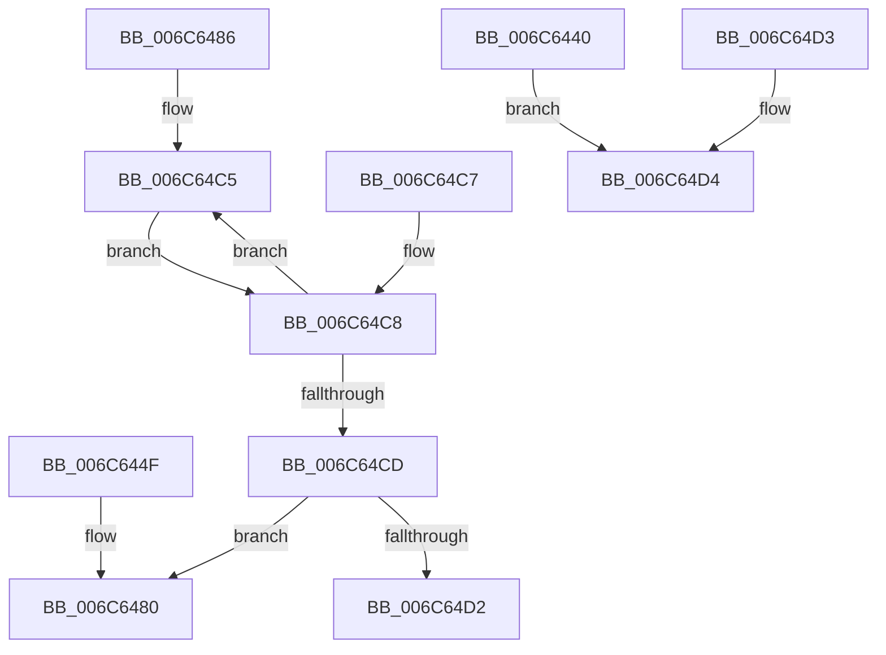

# KiFlushBhbDuringTrapEntryOrExitAlderLake

- RVA: `0x006C6440`–`0x006C64D5` (길이 `149` bytes)
- VA: `0x00000001406C6440`
- 실행 섹션: `.text`
- PDB 이름 있음: `예`; PDB Function 태그: `아니요`
- unwind 정보 RVA: `0x000C1F68`
- 디코드: `25`개 명령, `149/149` bytes 표시
- 미해석 바이트: `0` (있으면 어셈블리에 `.byte`로 보존)

> 이 문서는 커널 이미지의 기계어와 PDB 기호를 분석해 생성했습니다. 4번과 5번은 함수 원형과 자료형을 바이너리 사용 방식에서 추정한 C 해석이며 원본 소스 복구 결과는 아닙니다.

## 1. Dependencies

- 직접 호출 지점: **2**; 고유 호출 대상: **2**
- 직접 호출자로 확인된 함수: **1**
- RIP 상대 이미지 참조: **0**

### Outgoing calls
- `0x006C6445` → [KiFlushBhbDuringTrapEntryOrExitAlderLake + 0x40](KiFlushBhbDuringTrapEntryOrExitAlderLake_function_006C6440.md) (inside-function, `0x006C6480`)
- `0x006C6480` → [KiFlushBhbDuringTrapEntryOrExitAlderLake + 0x80](KiFlushBhbDuringTrapEntryOrExitAlderLake_function_006C6440.md) (inside-function, `0x006C64C0`)

### Direct callers
- [KiFlushBhbDuringTrapEntryOrExitAlderLake](KiFlushBhbDuringTrapEntryOrExitAlderLake_function_006C6440.md) at `0x006C6445`
- [KiFlushBhbDuringTrapEntryOrExitAlderLake](KiFlushBhbDuringTrapEntryOrExitAlderLake_function_006C6440.md) at `0x006C6480`

### Static image references
- 디코드된 RIP-relative 메모리 참조가 없습니다.

## 2. Other-region calls and transfers

- 다른 실행 섹션으로 향하는 call: **0**
- 별도 외부 분기/꼬리 이동을 확인하지 못했습니다.

## 3. Assembly (complete function range)

```asm
006C6440  B9 0C 00 00 00                  mov ecx, 0xc
006C6445  E8 36 00 00 00                  call 0x1406c6480
006C644A  E9 85 00 00 00                  jmp 0x1406c64d4
006C644F  CC                              int3
006C6450  66 66 66 66 66 66 66 0F 1F 84 00 00 00 00 00  nop word ptr [rax + rax]
006C645F  66 66 66 66 66 66 66 0F 1F 84 00 00 00 00 00  nop word ptr [rax + rax]
006C646E  66 66 66 66 66 66 66 0F 1F 84 00 00 00 00 00  nop word ptr [rax + rax]
006C647D  0F 1F 00                        nop dword ptr [rax]
006C6480  E8 3B 00 00 00                  call 0x1406c64c0
006C6485  C3                              ret
006C6486  CC                              int3
006C6487  66 66 66 66 66 66 66 0F 1F 84 00 00 00 00 00  nop word ptr [rax + rax]
006C6496  66 66 66 66 66 66 66 0F 1F 84 00 00 00 00 00  nop word ptr [rax + rax]
006C64A5  66 66 66 66 66 66 66 0F 1F 84 00 00 00 00 00  nop word ptr [rax + rax]
006C64B4  66 66 66 66 0F 1F 84 00 00 00 00 00  nop word ptr [rax + rax]
006C64C0  B8 07 00 00 00                  mov eax, 7
006C64C5  EB 01                           jmp 0x1406c64c8
006C64C7  90                              nop
006C64C8  83 E8 01                        sub eax, 1
006C64CB  75 F8                           jne 0x1406c64c5
006C64CD  83 E9 01                        sub ecx, 1
006C64D0  75 AE                           jne 0x1406c6480
006C64D2  C3                              ret
006C64D3  CC                              int3
006C64D4  C3                              ret
```

## 4. C-style interpretation (structured pseudocode)

```c
__int64 __fastcall KiFlushBhbDuringTrapEntryOrExitAlderLake(void)
{
    __int64 result;

    result = KiFlushBhbDuringTrapEntryOrExitAlderLake___0x40(12, a2, a3, a4);
    goto loc_006C64D4;
loc_006C64D4:
    return result;
}
```

## 5. (Beta) C Style

```c
void KiFlushBhbDuringTrapEntryOrExitAlderLake(void)
{
    int64_t result;

    result = KiFlushBhbDuringTrapEntryOrExitAlderLake___0x40(12, a2, a3, a4);
    goto loc_006C64D4;
loc_006C64D4:
    return result;
}
```

## 6. Execution-region graph

[열기: 2D/3D 그래프와 함수 탐색 컨트롤 패널](../../../control-panel.html?section=text&rva=0x006C6440&view=graph)

- 2D 그래프는 위에서 아래로 흐르고, 3D 그래프는 빈 공간을 드래그해 회전합니다. Shift+드래그는 이동, 휠은 확대·축소, 함수 노드 선택은 대상 보고서 이동입니다.

### Static fallback


