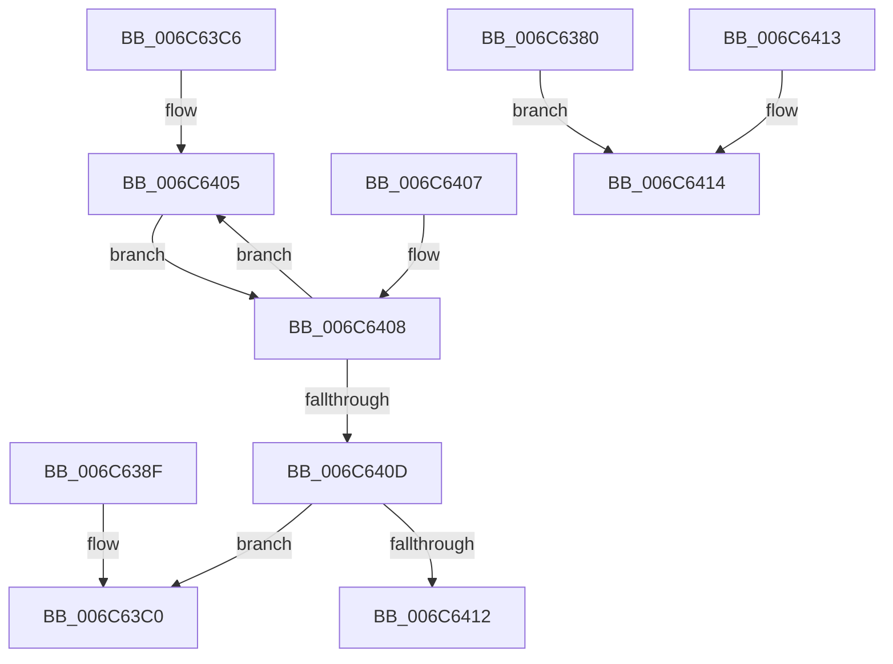

# KiFlushBhbDuringTrapEntryOrExitPreAlderLake

- RVA: `0x006C6380`–`0x006C6415` (길이 `149` bytes)
- VA: `0x00000001406C6380`
- 실행 섹션: `.text`
- PDB 이름 있음: `예`; PDB Function 태그: `아니요`
- unwind 정보 RVA: `0x000C1F64`
- 디코드: `25`개 명령, `149/149` bytes 표시
- 미해석 바이트: `0` (있으면 어셈블리에 `.byte`로 보존)

> 이 문서는 커널 이미지의 기계어와 PDB 기호를 분석해 생성했습니다. 4번과 5번은 함수 원형과 자료형을 바이너리 사용 방식에서 추정한 C 해석이며 원본 소스 복구 결과는 아닙니다.

## 1. Dependencies

- 직접 호출 지점: **2**; 고유 호출 대상: **2**
- 직접 호출자로 확인된 함수: **1**
- RIP 상대 이미지 참조: **0**

### Outgoing calls
- `0x006C6385` → [KiFlushBhbDuringTrapEntryOrExitPreAlderLake + 0x40](KiFlushBhbDuringTrapEntryOrExitPreAlderLake_function_006C6380.md) (inside-function, `0x006C63C0`)
- `0x006C63C0` → [KiFlushBhbDuringTrapEntryOrExitPreAlderLake + 0x80](KiFlushBhbDuringTrapEntryOrExitPreAlderLake_function_006C6380.md) (inside-function, `0x006C6400`)

### Direct callers
- [KiFlushBhbDuringTrapEntryOrExitPreAlderLake](KiFlushBhbDuringTrapEntryOrExitPreAlderLake_function_006C6380.md) at `0x006C6385`
- [KiFlushBhbDuringTrapEntryOrExitPreAlderLake](KiFlushBhbDuringTrapEntryOrExitPreAlderLake_function_006C6380.md) at `0x006C63C0`

### Static image references
- 디코드된 RIP-relative 메모리 참조가 없습니다.

## 2. Other-region calls and transfers

- 다른 실행 섹션으로 향하는 call: **0**
- 별도 외부 분기/꼬리 이동을 확인하지 못했습니다.

## 3. Assembly (complete function range)

```asm
006C6380  B9 05 00 00 00                  mov ecx, 5
006C6385  E8 36 00 00 00                  call 0x1406c63c0
006C638A  E9 85 00 00 00                  jmp 0x1406c6414
006C638F  CC                              int3
006C6390  66 66 66 66 66 66 66 0F 1F 84 00 00 00 00 00  nop word ptr [rax + rax]
006C639F  66 66 66 66 66 66 66 0F 1F 84 00 00 00 00 00  nop word ptr [rax + rax]
006C63AE  66 66 66 66 66 66 66 0F 1F 84 00 00 00 00 00  nop word ptr [rax + rax]
006C63BD  0F 1F 00                        nop dword ptr [rax]
006C63C0  E8 3B 00 00 00                  call 0x1406c6400
006C63C5  C3                              ret
006C63C6  CC                              int3
006C63C7  66 66 66 66 66 66 66 0F 1F 84 00 00 00 00 00  nop word ptr [rax + rax]
006C63D6  66 66 66 66 66 66 66 0F 1F 84 00 00 00 00 00  nop word ptr [rax + rax]
006C63E5  66 66 66 66 66 66 66 0F 1F 84 00 00 00 00 00  nop word ptr [rax + rax]
006C63F4  66 66 66 66 0F 1F 84 00 00 00 00 00  nop word ptr [rax + rax]
006C6400  B8 05 00 00 00                  mov eax, 5
006C6405  EB 01                           jmp 0x1406c6408
006C6407  90                              nop
006C6408  83 E8 01                        sub eax, 1
006C640B  75 F8                           jne 0x1406c6405
006C640D  83 E9 01                        sub ecx, 1
006C6410  75 AE                           jne 0x1406c63c0
006C6412  C3                              ret
006C6413  CC                              int3
006C6414  C3                              ret
```

## 4. C-style interpretation (structured pseudocode)

```c
__int64 __fastcall KiFlushBhbDuringTrapEntryOrExitPreAlderLake(void)
{
    __int64 result;

    result = KiFlushBhbDuringTrapEntryOrExitPreAlderLake___0x40(5, a2, a3, a4);
    goto loc_006C6414;
loc_006C6414:
    return result;
}
```

## 5. (Beta) C Style

```c
void KiFlushBhbDuringTrapEntryOrExitPreAlderLake(void)
{
    int64_t result;

    result = KiFlushBhbDuringTrapEntryOrExitPreAlderLake___0x40(5, a2, a3, a4);
    goto loc_006C6414;
loc_006C6414:
    return result;
}
```

## 6. Execution-region graph

[열기: 2D/3D 그래프와 함수 탐색 컨트롤 패널](../../../control-panel.html?section=text&rva=0x006C6380&view=graph)

- 2D 그래프는 위에서 아래로 흐르고, 3D 그래프는 빈 공간을 드래그해 회전합니다. Shift+드래그는 이동, 휠은 확대·축소, 함수 노드 선택은 대상 보고서 이동입니다.

### Static fallback


