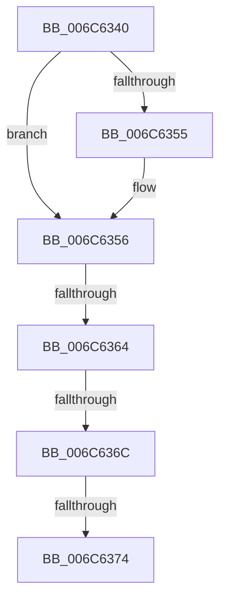

# KiFlushBhbDuringTrapEntryOrExit

- RVA: `0x006C6340`–`0x006C6376` (길이 `54` bytes)
- VA: `0x00000001406C6340`
- 실행 섹션: `.text`
- PDB 이름 있음: `예`; PDB Function 태그: `아니요`
- unwind 정보 RVA: `0x000C1F60`
- 디코드: `15`개 명령, `54/54` bytes 표시
- 미해석 바이트: `0` (있으면 어셈블리에 `.byte`로 보존)

> 이 문서는 커널 이미지의 기계어와 PDB 기호를 분석해 생성했습니다. 4번과 5번은 함수 원형과 자료형을 바이너리 사용 방식에서 추정한 C 해석이며 원본 소스 복구 결과는 아닙니다.

## 1. Dependencies

- 직접 호출 지점: **0**; 고유 호출 대상: **0**
- 직접 호출자로 확인된 함수: **39**
- RIP 상대 이미지 참조: **0**

### Outgoing calls
- 직접 디코드된 call 명령이 없습니다.

### Direct callers
- [KyStartUserThread](../6B/KyStartUserThread_function_006B2AF0.md) at `0x006B2D88`
- [KxIsrLinkage](../6B/KxIsrLinkage_function_006B5680.md) at `0x006B5915`
- [KiApcInterrupt](../6B/KiApcInterrupt_function_006B5E20.md) at `0x006B60B9`
- [KiHvInterrupt](../6B/KiHvInterrupt_function_006B6620.md) at `0x006B68B7`
- [KiVmbusInterrupt0](../6B/KiVmbusInterrupt0_function_006B6990.md) at `0x006B6C27`
- [KiVmbusInterrupt1](../6B/KiVmbusInterrupt1_function_006B6D00.md) at `0x006B6F97`
- [KiVmbusInterrupt2](../6B/KiVmbusInterrupt2_function_006B7070.md) at `0x006B7307`
- [KiVmbusInterrupt3](../6B/KiVmbusInterrupt3_function_006B73E0.md) at `0x006B7677`
- [KiSwInterrupt](../6B/KiSwInterrupt_function_006B8070.md) at `0x006B8309`
- [KiDpcInterrupt](../6B/KiDpcInterrupt_function_006B87C0.md) at `0x006B8A59`
- [KiIpiInterrupt](../6B/KiIpiInterrupt_function_006B8F20.md) at `0x006B91B9`
- [KiDivideErrorFault](../6B/KiDivideErrorFault_function_006BCA00.md) at `0x006BCC98`
- [KxDebugTrapOrFault](../6B/KxDebugTrapOrFault_function_006BCF40.md) at `0x006BD1D8`
- [KiBreakpointTrap](../6B/KiBreakpointTrap_function_006BD940.md) at `0x006BDBD8`
- [KiOverflowTrap](../6B/KiOverflowTrap_function_006BDCC0.md) at `0x006BDF58`
- [KiBoundFault](../6B/KiBoundFault_function_006BE040.md) at `0x006BE2D8`
- [KiInvalidOpcodeFault](../6B/KiInvalidOpcodeFault_function_006BE740.md) at `0x006BE9D8`
- [KiNpxNotAvailableFault](../6B/KiNpxNotAvailableFault_function_006BEE00.md) at `0x006BF098`
- [KiDoubleFaultAbort](../6B/KiDoubleFaultAbort_function_006BF1C0.md) at `0x006BF454`
- [KiNpxSegmentOverrunAbort](../6B/KiNpxSegmentOverrunAbort_function_006BF540.md) at `0x006BF7D8`
- [KiInvalidTssFault](../6B/KiInvalidTssFault_function_006BF8C0.md) at `0x006BFB54`
- [KiSegmentNotPresentFault](../6B/KiSegmentNotPresentFault_function_006BFC40.md) at `0x006BFED4`
- [KiStackFault](KiStackFault_function_006C0040.md) at `0x006C02D4`
- [KiGeneralProtectionFault](KiGeneralProtectionFault_function_006C03C0.md) at `0x006C0654`
- [KiPageFault](KiPageFault_function_006C0740.md) at `0x006C09D4`
- [KiFloatingErrorFault](KiFloatingErrorFault_function_006C0F40.md) at `0x006C11D8`
- [KiAlignmentFault](KiAlignmentFault_function_006C1340.md) at `0x006C15D4`
- [KxMcheckAlternateReturn](KxMcheckAlternateReturn_function_006C1E00.md) at `0x006C20B1`
- [KiXmmException](KiXmmException_function_006C2500.md) at `0x006C2798`
- [KiVirtualizationException](KiVirtualizationException_function_006C2900.md) at `0x006C2B98`
- [KiControlProtectionFault](KiControlProtectionFault_function_006C3040.md) at `0x006C32D4`
- [KiRaiseSecurityCheckFailure](KiRaiseSecurityCheckFailure_function_006C37C0.md) at `0x006C3A6A`
- [KiRaiseAssertion](KiRaiseAssertion_function_006C3B40.md) at `0x006C3DEA`
- [KiDebugServiceTrap](KiDebugServiceTrap_function_006C3EC0.md) at `0x006C4169`
- [KiSystemService](KiSystemService_function_006C4240.md) at `0x006C449D`
- [KiSystemCall32](KiSystemCall32_function_006C4500.md) at `0x006C47D2`
- [KiSystemCall64](KiSystemCall64_function_006C4A40.md) at `0x006C4CA9`
- [KiSystemCall32Shadow](../../kvascode/BC/KiSystemCall32Shadow_function_00BCCE40.md) at `0x00BCD108`
- [KiSystemCall64Shadow](../../kvascode/BC/KiSystemCall64Shadow_function_00BCD200.md) at `0x00BCD481`

### Static image references
- 디코드된 RIP-relative 메모리 참조가 없습니다.

## 2. Other-region calls and transfers

- 다른 실행 섹션으로 향하는 call: **0**
- call이 아닌 외부 분기/꼬리 이동: **3**
  - `0x006C6362` → [KiFlushBhbDuringTrapEntryOrExitPreAlderLake](KiFlushBhbDuringTrapEntryOrExitPreAlderLake_function_006C6380.md) (`tail-transfer`)
  - `0x006C6366` → [KiFlushBhbDuringTrapEntryOrExitAlderLake](KiFlushBhbDuringTrapEntryOrExitAlderLake_function_006C6440.md) (`tail-transfer`)
  - `0x006C636E` → [KiFlushBhbDuringTrapEntryOrExitTsx](KiFlushBhbDuringTrapEntryOrExitTsx_function_006C6500.md) (`tail-transfer`)

## 3. Assembly (complete function range)

```asm
006C6340  B8 DA DA 00 00                  mov eax, 0xdada
006C6345  B9 DA DA 00 00                  mov ecx, 0xdada
006C634A  65 F6 04 25 5C 08 00 00 30      test byte ptr gs:[0x85c], 0x30
006C6353  75 01                           jne 0x1406c6356
006C6355  CC                              int3
006C6356  65 8A 04 25 5C 08 00 00         mov al, byte ptr gs:[0x85c]
006C635E  24 30                           and al, 0x30
006C6360  3C 10                           cmp al, 0x10
006C6362  74 1C                           je 0x1406c6380
006C6364  3C 20                           cmp al, 0x20
006C6366  0F 84 D4 00 00 00               je 0x1406c6440
006C636C  3C 30                           cmp al, 0x30
006C636E  0F 84 8C 01 00 00               je 0x1406c6500
006C6374  CC                              int3
006C6375  C3                              ret
```

## 4. C-style interpretation (structured pseudocode)

```c
__int64 __fastcall KiFlushBhbDuringTrapEntryOrExit(void)
{
    __int64 result;

    if (((*(unsigned __int8 *)(gs_base + (0 + 2140))) & (48)) == 0) {
    }
    result = (unsigned __int8)((*(unsigned __int8 *)(gs_base + (0 + 2140))) & (48));
    return result;
}
```

## 5. (Beta) C Style

```c
void KiFlushBhbDuringTrapEntryOrExit(void)
{
    int64_t result;

    if (((*(uint8_t *)(gs_base + (0 + 0x85C))) & (48)) == 0) {
    }
    result = (uint8_t)((*(uint8_t *)(gs_base + (0 + 0x85C))) & (48));
    return result;
}
```

## 6. Execution-region graph

[열기: 2D/3D 그래프와 함수 탐색 컨트롤 패널](../../../control-panel.html?section=text&rva=0x006C6340&view=graph)

- 2D 그래프는 위에서 아래로 흐르고, 3D 그래프는 빈 공간을 드래그해 회전합니다. Shift+드래그는 이동, 휠은 확대·축소, 함수 노드 선택은 대상 보고서 이동입니다.

### Static fallback


