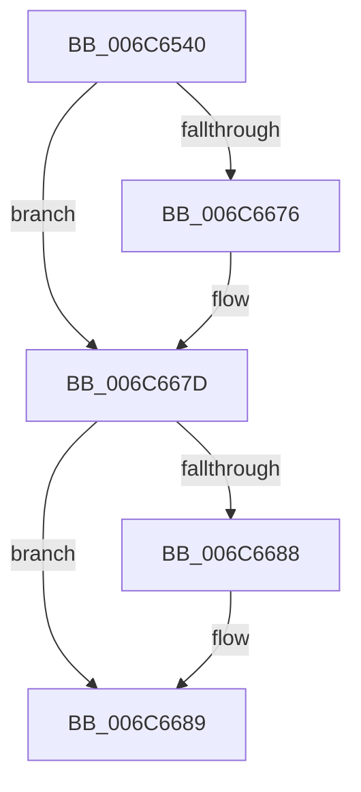

# KiFlushCurrentRsb

- RVA: `0x006C6540`–`0x006C668E` (길이 `334` bytes)
- VA: `0x00000001406C6540`
- 실행 섹션: `.text`
- PDB 이름 있음: `예`; PDB Function 태그: `아니요`
- unwind 정보 RVA: `0x000C1F70`
- 디코드: `78`개 명령, `334/334` bytes 표시
- 미해석 바이트: `0` (있으면 어셈블리에 `.byte`로 보존)

> 이 문서는 커널 이미지의 기계어와 PDB 기호를 분석해 생성했습니다. 4번과 5번은 함수 원형과 자료형을 바이너리 사용 방식에서 추정한 C 해석이며 원본 소스 복구 결과는 아닙니다.

## 1. Dependencies

- 직접 호출 지점: **32**; 고유 호출 대상: **32**
- 직접 호출자로 확인된 함수: **9**
- RIP 상대 이미지 참조: **0**

### Outgoing calls
- `0x006C6546` → [KiFlushCurrentRsb + 0x119](KiFlushCurrentRsb_function_006C6540.md) (inside-function, `0x006C6659`)
- `0x006C654F` → [KiFlushCurrentRsb + 0x122](KiFlushCurrentRsb_function_006C6540.md) (inside-function, `0x006C6662`)
- `0x006C6558` → [KiFlushCurrentRsb + 0xB](KiFlushCurrentRsb_function_006C6540.md) (inside-function, `0x006C654B`)
- `0x006C6561` → [KiFlushCurrentRsb + 0x14](KiFlushCurrentRsb_function_006C6540.md) (inside-function, `0x006C6554`)
- `0x006C656A` → [KiFlushCurrentRsb + 0x1D](KiFlushCurrentRsb_function_006C6540.md) (inside-function, `0x006C655D`)
- `0x006C6573` → [KiFlushCurrentRsb + 0x26](KiFlushCurrentRsb_function_006C6540.md) (inside-function, `0x006C6566`)
- `0x006C657C` → [KiFlushCurrentRsb + 0x2F](KiFlushCurrentRsb_function_006C6540.md) (inside-function, `0x006C656F`)
- `0x006C6585` → [KiFlushCurrentRsb + 0x38](KiFlushCurrentRsb_function_006C6540.md) (inside-function, `0x006C6578`)
- `0x006C658E` → [KiFlushCurrentRsb + 0x41](KiFlushCurrentRsb_function_006C6540.md) (inside-function, `0x006C6581`)
- `0x006C6597` → [KiFlushCurrentRsb + 0x4A](KiFlushCurrentRsb_function_006C6540.md) (inside-function, `0x006C658A`)
- `0x006C65A0` → [KiFlushCurrentRsb + 0x53](KiFlushCurrentRsb_function_006C6540.md) (inside-function, `0x006C6593`)
- `0x006C65A9` → [KiFlushCurrentRsb + 0x5C](KiFlushCurrentRsb_function_006C6540.md) (inside-function, `0x006C659C`)
- `0x006C65B2` → [KiFlushCurrentRsb + 0x65](KiFlushCurrentRsb_function_006C6540.md) (inside-function, `0x006C65A5`)
- `0x006C65BB` → [KiFlushCurrentRsb + 0x6E](KiFlushCurrentRsb_function_006C6540.md) (inside-function, `0x006C65AE`)
- `0x006C65C4` → [KiFlushCurrentRsb + 0x77](KiFlushCurrentRsb_function_006C6540.md) (inside-function, `0x006C65B7`)
- `0x006C65CD` → [KiFlushCurrentRsb + 0x80](KiFlushCurrentRsb_function_006C6540.md) (inside-function, `0x006C65C0`)
- `0x006C65D6` → [KiFlushCurrentRsb + 0x89](KiFlushCurrentRsb_function_006C6540.md) (inside-function, `0x006C65C9`)
- `0x006C65DF` → [KiFlushCurrentRsb + 0x92](KiFlushCurrentRsb_function_006C6540.md) (inside-function, `0x006C65D2`)
- `0x006C65E8` → [KiFlushCurrentRsb + 0x9B](KiFlushCurrentRsb_function_006C6540.md) (inside-function, `0x006C65DB`)
- `0x006C65F1` → [KiFlushCurrentRsb + 0xA4](KiFlushCurrentRsb_function_006C6540.md) (inside-function, `0x006C65E4`)
- `0x006C65FA` → [KiFlushCurrentRsb + 0xAD](KiFlushCurrentRsb_function_006C6540.md) (inside-function, `0x006C65ED`)
- `0x006C6603` → [KiFlushCurrentRsb + 0xB6](KiFlushCurrentRsb_function_006C6540.md) (inside-function, `0x006C65F6`)
- `0x006C660C` → [KiFlushCurrentRsb + 0xBF](KiFlushCurrentRsb_function_006C6540.md) (inside-function, `0x006C65FF`)
- `0x006C6615` → [KiFlushCurrentRsb + 0xC8](KiFlushCurrentRsb_function_006C6540.md) (inside-function, `0x006C6608`)
- `0x006C661E` → [KiFlushCurrentRsb + 0xD1](KiFlushCurrentRsb_function_006C6540.md) (inside-function, `0x006C6611`)
- `0x006C6627` → [KiFlushCurrentRsb + 0xDA](KiFlushCurrentRsb_function_006C6540.md) (inside-function, `0x006C661A`)
- `0x006C6630` → [KiFlushCurrentRsb + 0xE3](KiFlushCurrentRsb_function_006C6540.md) (inside-function, `0x006C6623`)
- `0x006C6639` → [KiFlushCurrentRsb + 0xEC](KiFlushCurrentRsb_function_006C6540.md) (inside-function, `0x006C662C`)
- `0x006C6642` → [KiFlushCurrentRsb + 0xF5](KiFlushCurrentRsb_function_006C6540.md) (inside-function, `0x006C6635`)
- `0x006C664B` → [KiFlushCurrentRsb + 0xFE](KiFlushCurrentRsb_function_006C6540.md) (inside-function, `0x006C663E`)
- `0x006C6654` → [KiFlushCurrentRsb + 0x107](KiFlushCurrentRsb_function_006C6540.md) (inside-function, `0x006C6647`)
- `0x006C665D` → [KiFlushCurrentRsb + 0x110](KiFlushCurrentRsb_function_006C6540.md) (inside-function, `0x006C6650`)

### Direct callers
- [sub_003E6C44](../3E/Unknown_function_003E6C44.md) at `0x003E6D81`
- [KiUpdateStibpPairing](../3E/KiUpdateStibpPairing_function_003E71C0.md) at `0x003E7273`
- [KiUpdateStibpPairing](../3E/KiUpdateStibpPairing_function_003E71C0.md) at `0x003E733F`
- [KePrepareToDispatchVirtualProcessor](../44/KePrepareToDispatchVirtualProcessor_function_0044B3C0.md) at `0x0044B455`
- [KiFlushRsbTarget](../4D/KiFlushRsbTarget_function_004DB4D0.md) at `0x004DB4D4`
- [KiHandleMcheck](../5B/KiHandleMcheck_function_005B88F0.md) at `0x005B8907`
- [KiProcessNMI](../5B/KiProcessNMI_function_005B8950.md) at `0x005B898F`
- [KeFlushRsb](../5B/KeFlushRsb_function_005BE8E4.md) at `0x005BE92C`
- [KiFlushCurrentRsb](KiFlushCurrentRsb_function_006C6540.md) at `0x006C6546`
- [KiFlushCurrentRsb](KiFlushCurrentRsb_function_006C6540.md) at `0x006C654F`
- [KiFlushCurrentRsb](KiFlushCurrentRsb_function_006C6540.md) at `0x006C6558`
- [KiFlushCurrentRsb](KiFlushCurrentRsb_function_006C6540.md) at `0x006C6561`
- [KiFlushCurrentRsb](KiFlushCurrentRsb_function_006C6540.md) at `0x006C656A`
- [KiFlushCurrentRsb](KiFlushCurrentRsb_function_006C6540.md) at `0x006C6573`
- [KiFlushCurrentRsb](KiFlushCurrentRsb_function_006C6540.md) at `0x006C657C`
- [KiFlushCurrentRsb](KiFlushCurrentRsb_function_006C6540.md) at `0x006C6585`
- [KiFlushCurrentRsb](KiFlushCurrentRsb_function_006C6540.md) at `0x006C658E`
- [KiFlushCurrentRsb](KiFlushCurrentRsb_function_006C6540.md) at `0x006C6597`
- [KiFlushCurrentRsb](KiFlushCurrentRsb_function_006C6540.md) at `0x006C65A0`
- [KiFlushCurrentRsb](KiFlushCurrentRsb_function_006C6540.md) at `0x006C65A9`
- [KiFlushCurrentRsb](KiFlushCurrentRsb_function_006C6540.md) at `0x006C65B2`
- [KiFlushCurrentRsb](KiFlushCurrentRsb_function_006C6540.md) at `0x006C65BB`
- [KiFlushCurrentRsb](KiFlushCurrentRsb_function_006C6540.md) at `0x006C65C4`
- [KiFlushCurrentRsb](KiFlushCurrentRsb_function_006C6540.md) at `0x006C65CD`
- [KiFlushCurrentRsb](KiFlushCurrentRsb_function_006C6540.md) at `0x006C65D6`
- [KiFlushCurrentRsb](KiFlushCurrentRsb_function_006C6540.md) at `0x006C65DF`
- [KiFlushCurrentRsb](KiFlushCurrentRsb_function_006C6540.md) at `0x006C65E8`
- [KiFlushCurrentRsb](KiFlushCurrentRsb_function_006C6540.md) at `0x006C65F1`
- [KiFlushCurrentRsb](KiFlushCurrentRsb_function_006C6540.md) at `0x006C65FA`
- [KiFlushCurrentRsb](KiFlushCurrentRsb_function_006C6540.md) at `0x006C6603`
- [KiFlushCurrentRsb](KiFlushCurrentRsb_function_006C6540.md) at `0x006C660C`
- [KiFlushCurrentRsb](KiFlushCurrentRsb_function_006C6540.md) at `0x006C6615`
- [KiFlushCurrentRsb](KiFlushCurrentRsb_function_006C6540.md) at `0x006C661E`
- [KiFlushCurrentRsb](KiFlushCurrentRsb_function_006C6540.md) at `0x006C6627`
- [KiFlushCurrentRsb](KiFlushCurrentRsb_function_006C6540.md) at `0x006C6630`
- [KiFlushCurrentRsb](KiFlushCurrentRsb_function_006C6540.md) at `0x006C6639`
- [KiFlushCurrentRsb](KiFlushCurrentRsb_function_006C6540.md) at `0x006C6642`
- [KiFlushCurrentRsb](KiFlushCurrentRsb_function_006C6540.md) at `0x006C664B`
- [KiFlushCurrentRsb](KiFlushCurrentRsb_function_006C6540.md) at `0x006C6654`
- [KiFlushCurrentRsb](KiFlushCurrentRsb_function_006C6540.md) at `0x006C665D`
- [sub_006F0CB7](../6F/Unknown_function_006F0CB7.md) at `0x006F0CFD`

### Static image references
- 디코드된 RIP-relative 메모리 참조가 없습니다.

## 2. Other-region calls and transfers

- 다른 실행 섹션으로 향하는 call: **0**
- 별도 외부 분기/꼬리 이동을 확인하지 못했습니다.

## 3. Assembly (complete function range)

```asm
006C6540  48 83 EC 08                     sub rsp, 8
006C6544  9C                              pushfq
006C6545  FA                              cli
006C6546  E8 0E 01 00 00                  call 0x1406c6659
006C654B  48 83 C4 08                     add rsp, 8
006C654F  E8 0E 01 00 00                  call 0x1406c6662
006C6554  48 83 C4 08                     add rsp, 8
006C6558  E8 EE FF FF FF                  call 0x1406c654b
006C655D  48 83 C4 08                     add rsp, 8
006C6561  E8 EE FF FF FF                  call 0x1406c6554
006C6566  48 83 C4 08                     add rsp, 8
006C656A  E8 EE FF FF FF                  call 0x1406c655d
006C656F  48 83 C4 08                     add rsp, 8
006C6573  E8 EE FF FF FF                  call 0x1406c6566
006C6578  48 83 C4 08                     add rsp, 8
006C657C  E8 EE FF FF FF                  call 0x1406c656f
006C6581  48 83 C4 08                     add rsp, 8
006C6585  E8 EE FF FF FF                  call 0x1406c6578
006C658A  48 83 C4 08                     add rsp, 8
006C658E  E8 EE FF FF FF                  call 0x1406c6581
006C6593  48 83 C4 08                     add rsp, 8
006C6597  E8 EE FF FF FF                  call 0x1406c658a
006C659C  48 83 C4 08                     add rsp, 8
006C65A0  E8 EE FF FF FF                  call 0x1406c6593
006C65A5  48 83 C4 08                     add rsp, 8
006C65A9  E8 EE FF FF FF                  call 0x1406c659c
006C65AE  48 83 C4 08                     add rsp, 8
006C65B2  E8 EE FF FF FF                  call 0x1406c65a5
006C65B7  48 83 C4 08                     add rsp, 8
006C65BB  E8 EE FF FF FF                  call 0x1406c65ae
006C65C0  48 83 C4 08                     add rsp, 8
006C65C4  E8 EE FF FF FF                  call 0x1406c65b7
006C65C9  48 83 C4 08                     add rsp, 8
006C65CD  E8 EE FF FF FF                  call 0x1406c65c0
006C65D2  48 83 C4 08                     add rsp, 8
006C65D6  E8 EE FF FF FF                  call 0x1406c65c9
006C65DB  48 83 C4 08                     add rsp, 8
006C65DF  E8 EE FF FF FF                  call 0x1406c65d2
006C65E4  48 83 C4 08                     add rsp, 8
006C65E8  E8 EE FF FF FF                  call 0x1406c65db
006C65ED  48 83 C4 08                     add rsp, 8
006C65F1  E8 EE FF FF FF                  call 0x1406c65e4
006C65F6  48 83 C4 08                     add rsp, 8
006C65FA  E8 EE FF FF FF                  call 0x1406c65ed
006C65FF  48 83 C4 08                     add rsp, 8
006C6603  E8 EE FF FF FF                  call 0x1406c65f6
006C6608  48 83 C4 08                     add rsp, 8
006C660C  E8 EE FF FF FF                  call 0x1406c65ff
006C6611  48 83 C4 08                     add rsp, 8
006C6615  E8 EE FF FF FF                  call 0x1406c6608
006C661A  48 83 C4 08                     add rsp, 8
006C661E  E8 EE FF FF FF                  call 0x1406c6611
006C6623  48 83 C4 08                     add rsp, 8
006C6627  E8 EE FF FF FF                  call 0x1406c661a
006C662C  48 83 C4 08                     add rsp, 8
006C6630  E8 EE FF FF FF                  call 0x1406c6623
006C6635  48 83 C4 08                     add rsp, 8
006C6639  E8 EE FF FF FF                  call 0x1406c662c
006C663E  48 83 C4 08                     add rsp, 8
006C6642  E8 EE FF FF FF                  call 0x1406c6635
006C6647  48 83 C4 08                     add rsp, 8
006C664B  E8 EE FF FF FF                  call 0x1406c663e
006C6650  48 83 C4 08                     add rsp, 8
006C6654  E8 EE FF FF FF                  call 0x1406c6647
006C6659  48 83 C4 08                     add rsp, 8
006C665D  E8 EE FF FF FF                  call 0x1406c6650
006C6662  48 83 C4 08                     add rsp, 8
006C6666  B8 DA DA 00 00                  mov eax, 0xdada
006C666B  65 F6 04 25 5C 08 00 00 08      test byte ptr gs:[0x85c], 8
006C6674  74 07                           je 0x1406c667d
006C6676  B0 20                           mov al, 0x20
006C6678  F3 48 0F AE E8                  incsspq rax
006C667D  0F AE E8                        lfence
006C6680  48 0F BA 24 24 09               bt qword ptr [rsp], 9
006C6686  73 01                           jae 0x1406c6689
006C6688  FB                              sti
006C6689  48 83 C4 10                     add rsp, 0x10
006C668D  C3                              ret
```

## 4. C-style interpretation (structured pseudocode)

```c
__int64 __fastcall KiFlushCurrentRsb(__int64 a1, __int64 a2, __int64 a3, __int64 a4, __int64 a5, __int64 a6, __int64 a7, __int64 a8, __int64 a9, __int64 a10, __int64 a11, __int64 a12, __int64 a13, __int64 a14, __int64 a15, __int64 a16, __int64 a17, __int64 a18, __int64 a19, __int64 a20, __int64 a21, __int64 a22, __int64 a23, __int64 a24, __int64 a25, __int64 a26, __int64 a27, __int64 a28, __int64 a29, __int64 a30, __int64 a31)
{
    __int64 result;
    __int64 v_rsp;

    v_rsp = (v_rsp) - (8);
    result = KiFlushCurrentRsb___0x119(a1, a2, a3, a4);
    v_rsp = (v_rsp) + (8);
    result = KiFlushCurrentRsb___0x122(a1, a2, a3, a4);
    v_rsp = (v_rsp) + (8);
    result = KiFlushCurrentRsb___0xB(a1, a2, a3, a4);
    v_rsp = (v_rsp) + (8);
    result = KiFlushCurrentRsb___0x14(a1, a2, a3, a4);
    v_rsp = (v_rsp) + (8);
    result = KiFlushCurrentRsb___0x1D(a1, a2, a3, a4);
    v_rsp = (v_rsp) + (8);
    result = KiFlushCurrentRsb___0x26(a1, a2, a3, a4);
    v_rsp = (v_rsp) + (8);
    result = KiFlushCurrentRsb___0x2F(a1, a2, a3, a4);
    v_rsp = (v_rsp) + (8);
    result = KiFlushCurrentRsb___0x38(a1, a2, a3, a4);
    v_rsp = (v_rsp) + (8);
    result = KiFlushCurrentRsb___0x41(a1, a2, a3, a4);
    v_rsp = (v_rsp) + (8);
    result = KiFlushCurrentRsb___0x4A(a1, a2, a3, a4);
    v_rsp = (v_rsp) + (8);
    result = KiFlushCurrentRsb___0x53(a1, a2, a3, a4);
    v_rsp = (v_rsp) + (8);
    result = KiFlushCurrentRsb___0x5C(a1, a2, a3, a4);
    v_rsp = (v_rsp) + (8);
    result = KiFlushCurrentRsb___0x65(a1, a2, a3, a4);
    v_rsp = (v_rsp) + (8);
    result = KiFlushCurrentRsb___0x6E(a1, a2, a3, a4);
    v_rsp = (v_rsp) + (8);
    result = KiFlushCurrentRsb___0x77(a1, a2, a3, a4);
    v_rsp = (v_rsp) + (8);
    result = KiFlushCurrentRsb___0x80(a1, a2, a3, a4);
    v_rsp = (v_rsp) + (8);
    result = KiFlushCurrentRsb___0x89(a1, a2, a3, a4);
    v_rsp = (v_rsp) + (8);
    result = KiFlushCurrentRsb___0x92(a1, a2, a3, a4);
    v_rsp = (v_rsp) + (8);
    result = KiFlushCurrentRsb___0x9B(a1, a2, a3, a4);
    v_rsp = (v_rsp) + (8);
    result = KiFlushCurrentRsb___0xA4(a1, a2, a3, a4);
    v_rsp = (v_rsp) + (8);
    result = KiFlushCurrentRsb___0xAD(a1, a2, a3, a4);
    v_rsp = (v_rsp) + (8);
    result = KiFlushCurrentRsb___0xB6(a1, a2, a3, a4);
    v_rsp = (v_rsp) + (8);
    result = KiFlushCurrentRsb___0xBF(a1, a2, a3, a4);
    v_rsp = (v_rsp) + (8);
    result = KiFlushCurrentRsb___0xC8(a1, a2, a3, a4);
    v_rsp = (v_rsp) + (8);
    result = KiFlushCurrentRsb___0xD1(a1, a2, a3, a4);
    v_rsp = (v_rsp) + (8);
    result = KiFlushCurrentRsb___0xDA(a1, a2, a3, a4);
    v_rsp = (v_rsp) + (8);
    result = KiFlushCurrentRsb___0xE3(a1, a2, a3, a4);
    v_rsp = (v_rsp) + (8);
    result = KiFlushCurrentRsb___0xEC(a1, a2, a3, a4);
    v_rsp = (v_rsp) + (8);
    result = KiFlushCurrentRsb___0xF5(a1, a2, a3, a4);
    v_rsp = (v_rsp) + (8);
    result = KiFlushCurrentRsb___0xFE(a1, a2, a3, a4);
    v_rsp = (v_rsp) + (8);
    result = KiFlushCurrentRsb___0x107(a1, a2, a3, a4);
    v_rsp = (v_rsp) + (8);
    result = KiFlushCurrentRsb___0x110(a1, a2, a3, a4);
    v_rsp = (v_rsp) + (8);
    result = (unsigned int)(0xDADAULL);
    if (((*(unsigned __int8 *)(gs_base + (0 + 2140))) & (8)) != 0) {
        result = 32;
    }
    if (!(condition_is_above_or_equal)) {
    }
    v_rsp = (v_rsp) + (16);
    return result;
}
```

## 5. (Beta) C Style

```c
int64_t KiFlushCurrentRsb(int64_t Arg1, int64_t Arg2, int64_t Arg3, int64_t Arg4, uint64_t Arg5, uint64_t Arg6, uint64_t Arg7, uint64_t Arg8, uint64_t Arg9, uint64_t Arg10, uint64_t Arg11, uint64_t Arg12, uint64_t Arg13, uint64_t Arg14, uint64_t Arg15, uint64_t Arg16, uint64_t Arg17, uint64_t Arg18, uint64_t Arg19, uint64_t Arg20, uint64_t Arg21, uint64_t Arg22, uint64_t Arg23, uint64_t Arg24, uint64_t Arg25, uint64_t Arg26, uint64_t Arg27, uint64_t Arg28, uint64_t Arg29, uint64_t Arg30, int64_t Arg31)
{
    int64_t result;
    int64_t local_rsp;

    local_rsp = (local_rsp) - (8);
    result = KiFlushCurrentRsb___0x119(Arg1, Arg2, Arg3, Arg4);
    local_rsp = (local_rsp) + (8);
    result = KiFlushCurrentRsb___0x122(Arg1, Arg2, Arg3, Arg4);
    local_rsp = (local_rsp) + (8);
    result = KiFlushCurrentRsb___0xB(Arg1, Arg2, Arg3, Arg4);
    local_rsp = (local_rsp) + (8);
    result = KiFlushCurrentRsb___0x14(Arg1, Arg2, Arg3, Arg4);
    local_rsp = (local_rsp) + (8);
    result = KiFlushCurrentRsb___0x1D(Arg1, Arg2, Arg3, Arg4);
    local_rsp = (local_rsp) + (8);
    result = KiFlushCurrentRsb___0x26(Arg1, Arg2, Arg3, Arg4);
    local_rsp = (local_rsp) + (8);
    result = KiFlushCurrentRsb___0x2F(Arg1, Arg2, Arg3, Arg4);
    local_rsp = (local_rsp) + (8);
    result = KiFlushCurrentRsb___0x38(Arg1, Arg2, Arg3, Arg4);
    local_rsp = (local_rsp) + (8);
    result = KiFlushCurrentRsb___0x41(Arg1, Arg2, Arg3, Arg4);
    local_rsp = (local_rsp) + (8);
    result = KiFlushCurrentRsb___0x4A(Arg1, Arg2, Arg3, Arg4);
    local_rsp = (local_rsp) + (8);
    result = KiFlushCurrentRsb___0x53(Arg1, Arg2, Arg3, Arg4);
    local_rsp = (local_rsp) + (8);
    result = KiFlushCurrentRsb___0x5C(Arg1, Arg2, Arg3, Arg4);
    local_rsp = (local_rsp) + (8);
    result = KiFlushCurrentRsb___0x65(Arg1, Arg2, Arg3, Arg4);
    local_rsp = (local_rsp) + (8);
    result = KiFlushCurrentRsb___0x6E(Arg1, Arg2, Arg3, Arg4);
    local_rsp = (local_rsp) + (8);
    result = KiFlushCurrentRsb___0x77(Arg1, Arg2, Arg3, Arg4);
    local_rsp = (local_rsp) + (8);
    result = KiFlushCurrentRsb___0x80(Arg1, Arg2, Arg3, Arg4);
    local_rsp = (local_rsp) + (8);
    result = KiFlushCurrentRsb___0x89(Arg1, Arg2, Arg3, Arg4);
    local_rsp = (local_rsp) + (8);
    result = KiFlushCurrentRsb___0x92(Arg1, Arg2, Arg3, Arg4);
    local_rsp = (local_rsp) + (8);
    result = KiFlushCurrentRsb___0x9B(Arg1, Arg2, Arg3, Arg4);
    local_rsp = (local_rsp) + (8);
    result = KiFlushCurrentRsb___0xA4(Arg1, Arg2, Arg3, Arg4);
    local_rsp = (local_rsp) + (8);
    result = KiFlushCurrentRsb___0xAD(Arg1, Arg2, Arg3, Arg4);
    local_rsp = (local_rsp) + (8);
    result = KiFlushCurrentRsb___0xB6(Arg1, Arg2, Arg3, Arg4);
    local_rsp = (local_rsp) + (8);
    result = KiFlushCurrentRsb___0xBF(Arg1, Arg2, Arg3, Arg4);
    local_rsp = (local_rsp) + (8);
    result = KiFlushCurrentRsb___0xC8(Arg1, Arg2, Arg3, Arg4);
    local_rsp = (local_rsp) + (8);
    result = KiFlushCurrentRsb___0xD1(Arg1, Arg2, Arg3, Arg4);
    local_rsp = (local_rsp) + (8);
    result = KiFlushCurrentRsb___0xDA(Arg1, Arg2, Arg3, Arg4);
    local_rsp = (local_rsp) + (8);
    result = KiFlushCurrentRsb___0xE3(Arg1, Arg2, Arg3, Arg4);
    local_rsp = (local_rsp) + (8);
    result = KiFlushCurrentRsb___0xEC(Arg1, Arg2, Arg3, Arg4);
    local_rsp = (local_rsp) + (8);
    result = KiFlushCurrentRsb___0xF5(Arg1, Arg2, Arg3, Arg4);
    local_rsp = (local_rsp) + (8);
    result = KiFlushCurrentRsb___0xFE(Arg1, Arg2, Arg3, Arg4);
    local_rsp = (local_rsp) + (8);
    result = KiFlushCurrentRsb___0x107(Arg1, Arg2, Arg3, Arg4);
    local_rsp = (local_rsp) + (8);
    result = KiFlushCurrentRsb___0x110(Arg1, Arg2, Arg3, Arg4);
    local_rsp = (local_rsp) + (8);
    result = (uint32_t)(0xDADAULL);
    if (((*(uint8_t *)(gs_base + (0 + 0x85C))) & (8)) != 0) {
        result = 32;
    }
    if (!(condition_is_above_or_equal)) {
    }
    local_rsp = (local_rsp) + (16);
    return result;
}
```

## 6. Execution-region graph

[열기: 2D/3D 그래프와 함수 탐색 컨트롤 패널](../../../control-panel.html?section=text&rva=0x006C6540&view=graph)

- 2D 그래프는 위에서 아래로 흐르고, 3D 그래프는 빈 공간을 드래그해 회전합니다. Shift+드래그는 이동, 휠은 확대·축소, 함수 노드 선택은 대상 보고서 이동입니다.

### Static fallback


