# KiGeneralProtectionFault

- RVA: `0x006C03C0`–`0x006C0727` (길이 `871` bytes)
- VA: `0x00000001406C03C0`
- 실행 섹션: `.text`
- PDB 이름 있음: `예`; PDB Function 태그: `아니요`
- unwind 정보 RVA: `0x000C1C68`
- 디코드: `187`개 명령, `871/871` bytes 표시
- 미해석 바이트: `0` (있으면 어셈블리에 `.byte`로 보존)

> 이 문서는 커널 이미지의 기계어와 PDB 기호를 분석해 생성했습니다. 4번과 5번은 함수 원형과 자료형을 바이너리 사용 방식에서 추정한 C 해석이며 원본 소스 복구 결과는 아닙니다.

## 1. Dependencies

- 직접 호출 지점: **36**; 고유 호출 대상: **36**
- 직접 호출자로 확인된 함수: **1**
- RIP 상대 이미지 참조: **3**

### Outgoing calls
- `0x006C0512` → [KiGeneralProtectionFault + 0x265](KiGeneralProtectionFault_function_006C03C0.md) (inside-function, `0x006C0625`)
- `0x006C051B` → [KiGeneralProtectionFault + 0x26E](KiGeneralProtectionFault_function_006C03C0.md) (inside-function, `0x006C062E`)
- `0x006C0524` → [KiGeneralProtectionFault + 0x157](KiGeneralProtectionFault_function_006C03C0.md) (inside-function, `0x006C0517`)
- `0x006C052D` → [KiGeneralProtectionFault + 0x160](KiGeneralProtectionFault_function_006C03C0.md) (inside-function, `0x006C0520`)
- `0x006C0536` → [KiGeneralProtectionFault + 0x169](KiGeneralProtectionFault_function_006C03C0.md) (inside-function, `0x006C0529`)
- `0x006C053F` → [KiGeneralProtectionFault + 0x172](KiGeneralProtectionFault_function_006C03C0.md) (inside-function, `0x006C0532`)
- `0x006C0548` → [KiGeneralProtectionFault + 0x17B](KiGeneralProtectionFault_function_006C03C0.md) (inside-function, `0x006C053B`)
- `0x006C0551` → [KiGeneralProtectionFault + 0x184](KiGeneralProtectionFault_function_006C03C0.md) (inside-function, `0x006C0544`)
- `0x006C055A` → [KiGeneralProtectionFault + 0x18D](KiGeneralProtectionFault_function_006C03C0.md) (inside-function, `0x006C054D`)
- `0x006C0563` → [KiGeneralProtectionFault + 0x196](KiGeneralProtectionFault_function_006C03C0.md) (inside-function, `0x006C0556`)
- `0x006C056C` → [KiGeneralProtectionFault + 0x19F](KiGeneralProtectionFault_function_006C03C0.md) (inside-function, `0x006C055F`)
- `0x006C0575` → [KiGeneralProtectionFault + 0x1A8](KiGeneralProtectionFault_function_006C03C0.md) (inside-function, `0x006C0568`)
- `0x006C057E` → [KiGeneralProtectionFault + 0x1B1](KiGeneralProtectionFault_function_006C03C0.md) (inside-function, `0x006C0571`)
- `0x006C0587` → [KiGeneralProtectionFault + 0x1BA](KiGeneralProtectionFault_function_006C03C0.md) (inside-function, `0x006C057A`)
- `0x006C0590` → [KiGeneralProtectionFault + 0x1C3](KiGeneralProtectionFault_function_006C03C0.md) (inside-function, `0x006C0583`)
- `0x006C0599` → [KiGeneralProtectionFault + 0x1CC](KiGeneralProtectionFault_function_006C03C0.md) (inside-function, `0x006C058C`)
- `0x006C05A2` → [KiGeneralProtectionFault + 0x1D5](KiGeneralProtectionFault_function_006C03C0.md) (inside-function, `0x006C0595`)
- `0x006C05AB` → [KiGeneralProtectionFault + 0x1DE](KiGeneralProtectionFault_function_006C03C0.md) (inside-function, `0x006C059E`)
- `0x006C05B4` → [KiGeneralProtectionFault + 0x1E7](KiGeneralProtectionFault_function_006C03C0.md) (inside-function, `0x006C05A7`)
- `0x006C05BD` → [KiGeneralProtectionFault + 0x1F0](KiGeneralProtectionFault_function_006C03C0.md) (inside-function, `0x006C05B0`)
- `0x006C05C6` → [KiGeneralProtectionFault + 0x1F9](KiGeneralProtectionFault_function_006C03C0.md) (inside-function, `0x006C05B9`)
- `0x006C05CF` → [KiGeneralProtectionFault + 0x202](KiGeneralProtectionFault_function_006C03C0.md) (inside-function, `0x006C05C2`)
- `0x006C05D8` → [KiGeneralProtectionFault + 0x20B](KiGeneralProtectionFault_function_006C03C0.md) (inside-function, `0x006C05CB`)
- `0x006C05E1` → [KiGeneralProtectionFault + 0x214](KiGeneralProtectionFault_function_006C03C0.md) (inside-function, `0x006C05D4`)
- `0x006C05EA` → [KiGeneralProtectionFault + 0x21D](KiGeneralProtectionFault_function_006C03C0.md) (inside-function, `0x006C05DD`)
- `0x006C05F3` → [KiGeneralProtectionFault + 0x226](KiGeneralProtectionFault_function_006C03C0.md) (inside-function, `0x006C05E6`)
- `0x006C05FC` → [KiGeneralProtectionFault + 0x22F](KiGeneralProtectionFault_function_006C03C0.md) (inside-function, `0x006C05EF`)
- `0x006C0605` → [KiGeneralProtectionFault + 0x238](KiGeneralProtectionFault_function_006C03C0.md) (inside-function, `0x006C05F8`)
- `0x006C060E` → [KiGeneralProtectionFault + 0x241](KiGeneralProtectionFault_function_006C03C0.md) (inside-function, `0x006C0601`)
- `0x006C0617` → [KiGeneralProtectionFault + 0x24A](KiGeneralProtectionFault_function_006C03C0.md) (inside-function, `0x006C060A`)
- `0x006C0620` → [KiGeneralProtectionFault + 0x253](KiGeneralProtectionFault_function_006C03C0.md) (inside-function, `0x006C0613`)
- `0x006C0629` → [KiGeneralProtectionFault + 0x25C](KiGeneralProtectionFault_function_006C03C0.md) (inside-function, `0x006C061C`)
- `0x006C0654` → [KiFlushBhbDuringTrapEntryOrExit](KiFlushBhbDuringTrapEntryOrExit_function_006C6340.md) (function, `0x006C6340`)
- `0x006C069D` → [KiSaveDebugRegisterState](../4F/KiSaveDebugRegisterState_function_004FD960.md) (function, `0x004FD960`)
- `0x006C06D1` → [KiSynchronizeUserIsolationDomainExit](../41/KiSynchronizeUserIsolationDomainExit_function_0041BFA0.md) (function, `0x0041BFA0`)
- `0x006C0720` → [KiExceptionDispatch](KiExceptionDispatch_function_006C5900.md) (function, `0x006C5900`)

### Direct callers
- [KiGeneralProtectionFault](KiGeneralProtectionFault_function_006C03C0.md) at `0x006C0512`
- [KiGeneralProtectionFault](KiGeneralProtectionFault_function_006C03C0.md) at `0x006C051B`
- [KiGeneralProtectionFault](KiGeneralProtectionFault_function_006C03C0.md) at `0x006C0524`
- [KiGeneralProtectionFault](KiGeneralProtectionFault_function_006C03C0.md) at `0x006C052D`
- [KiGeneralProtectionFault](KiGeneralProtectionFault_function_006C03C0.md) at `0x006C0536`
- [KiGeneralProtectionFault](KiGeneralProtectionFault_function_006C03C0.md) at `0x006C053F`
- [KiGeneralProtectionFault](KiGeneralProtectionFault_function_006C03C0.md) at `0x006C0548`
- [KiGeneralProtectionFault](KiGeneralProtectionFault_function_006C03C0.md) at `0x006C0551`
- [KiGeneralProtectionFault](KiGeneralProtectionFault_function_006C03C0.md) at `0x006C055A`
- [KiGeneralProtectionFault](KiGeneralProtectionFault_function_006C03C0.md) at `0x006C0563`
- [KiGeneralProtectionFault](KiGeneralProtectionFault_function_006C03C0.md) at `0x006C056C`
- [KiGeneralProtectionFault](KiGeneralProtectionFault_function_006C03C0.md) at `0x006C0575`
- [KiGeneralProtectionFault](KiGeneralProtectionFault_function_006C03C0.md) at `0x006C057E`
- [KiGeneralProtectionFault](KiGeneralProtectionFault_function_006C03C0.md) at `0x006C0587`
- [KiGeneralProtectionFault](KiGeneralProtectionFault_function_006C03C0.md) at `0x006C0590`
- [KiGeneralProtectionFault](KiGeneralProtectionFault_function_006C03C0.md) at `0x006C0599`
- [KiGeneralProtectionFault](KiGeneralProtectionFault_function_006C03C0.md) at `0x006C05A2`
- [KiGeneralProtectionFault](KiGeneralProtectionFault_function_006C03C0.md) at `0x006C05AB`
- [KiGeneralProtectionFault](KiGeneralProtectionFault_function_006C03C0.md) at `0x006C05B4`
- [KiGeneralProtectionFault](KiGeneralProtectionFault_function_006C03C0.md) at `0x006C05BD`
- [KiGeneralProtectionFault](KiGeneralProtectionFault_function_006C03C0.md) at `0x006C05C6`
- [KiGeneralProtectionFault](KiGeneralProtectionFault_function_006C03C0.md) at `0x006C05CF`
- [KiGeneralProtectionFault](KiGeneralProtectionFault_function_006C03C0.md) at `0x006C05D8`
- [KiGeneralProtectionFault](KiGeneralProtectionFault_function_006C03C0.md) at `0x006C05E1`
- [KiGeneralProtectionFault](KiGeneralProtectionFault_function_006C03C0.md) at `0x006C05EA`
- [KiGeneralProtectionFault](KiGeneralProtectionFault_function_006C03C0.md) at `0x006C05F3`
- [KiGeneralProtectionFault](KiGeneralProtectionFault_function_006C03C0.md) at `0x006C05FC`
- [KiGeneralProtectionFault](KiGeneralProtectionFault_function_006C03C0.md) at `0x006C0605`
- [KiGeneralProtectionFault](KiGeneralProtectionFault_function_006C03C0.md) at `0x006C060E`
- [KiGeneralProtectionFault](KiGeneralProtectionFault_function_006C03C0.md) at `0x006C0617`
- [KiGeneralProtectionFault](KiGeneralProtectionFault_function_006C03C0.md) at `0x006C0620`
- [KiGeneralProtectionFault](KiGeneralProtectionFault_function_006C03C0.md) at `0x006C0629`

### Static image references
- `0x006C0431` → RVA `0x01201840` (`CFGRO`; read)
- `0x006C0665` → RVA `0x00FC7264` (`ALMOSTRO`; read)
- `0x006C06D6` → RVA `0x00FC6BF0` (`ALMOSTRO`; read)

## 2. Other-region calls and transfers

- 다른 실행 섹션으로 향하는 call: **0**
- 별도 외부 분기/꼬리 이동을 확인하지 못했습니다.

## 3. Assembly (complete function range)

```asm
006C03C0  55                              push rbp
006C03C1  48 81 EC 58 01 00 00            sub rsp, 0x158
006C03C8  48 8D AC 24 80 00 00 00         lea rbp, [rsp + 0x80]
006C03D0  C6 45 AB 01                     mov byte ptr [rbp - 0x55], 1
006C03D4  48 89 45 B0                     mov qword ptr [rbp - 0x50], rax
006C03D8  48 89 4D B8                     mov qword ptr [rbp - 0x48], rcx
006C03DC  48 89 55 C0                     mov qword ptr [rbp - 0x40], rdx
006C03E0  4C 89 45 C8                     mov qword ptr [rbp - 0x38], r8
006C03E4  4C 89 4D D0                     mov qword ptr [rbp - 0x30], r9
006C03E8  4C 89 55 D8                     mov qword ptr [rbp - 0x28], r10
006C03EC  4C 89 5D E0                     mov qword ptr [rbp - 0x20], r11
006C03F0  F6 85 F0 00 00 00 01            test byte ptr [rbp + 0xf0], 1
006C03F7  75 38                           jne 0x1406c0431
006C03F9  33 D2                           xor edx, edx
006C03FB  F3 48 0F 1E CA                  rdsspq rdx
006C0400  48 89 55 58                     mov qword ptr [rbp + 0x58], rdx
006C0404  0F AE E8                        lfence
006C0407  65 F6 04 25 58 08 00 00 01      test byte ptr gs:[0x858], 1
006C0410  75 08                           jne 0x1406c041a
006C0412  0F AE E8                        lfence
006C0415  E9 88 02 00 00                  jmp 0x1406c06a2
006C041A  65 0F B7 04 25 66 08 00 00      movzx eax, word ptr gs:[0x866]
006C0423  B9 48 00 00 00                  mov ecx, 0x48
006C0428  33 D2                           xor edx, edx
006C042A  0F 30                           wrmsr
006C042C  E9 71 02 00 00                  jmp 0x1406c06a2
006C0431  F6 05 08 14 B4 00 01            test byte ptr [rip + 0xb41408], 1
006C0438  75 03                           jne 0x1406c043d
006C043A  0F 01 F8                        swapgs
006C043D  0F AE E8                        lfence
006C0440  65 48 8B 0C 25 28 9D 00 00      mov rcx, qword ptr gs:[0x9d28]
006C0449  48 85 C9                        test rcx, rcx
006C044C  74 1F                           je 0x1406c046d
006C044E  F3 48 0F 1E CA                  rdsspq rdx
006C0453  65 4C 8B 14 25 20 9D 00 00      mov r10, qword ptr gs:[0x9d20]
006C045C  49 83 C2 08                     add r10, 8
006C0460  49 3B D2                        cmp rdx, r10
006C0463  75 08                           jne 0x1406c046d
006C0465  F3 0F 01 29                     rstorssp dword ptr [rcx]
006C0469  F3 0F 01 EA                     saveprevssp
006C046D  65 4C 8B 14 25 88 01 00 00      mov r10, qword ptr gs:[0x188]
006C0476  65 48 8B 0C 25 88 01 00 00      mov rcx, qword ptr gs:[0x188]
006C047F  48 8B 89 20 02 00 00            mov rcx, qword ptr [rcx + 0x220]
006C0486  48 8B 89 60 07 00 00            mov rcx, qword ptr [rcx + 0x760]
006C048D  65 48 89 0C 25 50 08 00 00      mov qword ptr gs:[0x850], rcx
006C0496  66 65 8B 0C 25 62 08 00 00      mov cx, word ptr gs:[0x862]
006C049F  66 65 89 0C 25 64 08 00 00      mov word ptr gs:[0x864], cx
006C04A8  65 8A 0C 25 58 08 00 00         mov cl, byte ptr gs:[0x858]
006C04B0  65 88 0C 25 5A 08 00 00         mov byte ptr gs:[0x85a], cl
006C04B8  65 0F B7 04 25 68 08 00 00      movzx eax, word ptr gs:[0x868]
006C04C1  66 65 39 04 25 66 08 00 00      cmp word ptr gs:[0x866], ax
006C04CA  74 12                           je 0x1406c04de
006C04CC  66 65 89 04 25 66 08 00 00      mov word ptr gs:[0x866], ax
006C04D5  B9 48 00 00 00                  mov ecx, 0x48
006C04DA  33 D2                           xor edx, edx
006C04DC  0F 30                           wrmsr
006C04DE  65 0F B6 14 25 58 08 00 00      movzx edx, byte ptr gs:[0x858]
006C04E7  F7 C2 08 00 00 00               test edx, 8
006C04ED  74 17                           je 0x1406c0506
006C04EF  B8 01 00 00 00                  mov eax, 1
006C04F4  33 D2                           xor edx, edx
006C04F6  B9 49 00 00 00                  mov ecx, 0x49
006C04FB  0F 30                           wrmsr
006C04FD  65 0F B6 14 25 58 08 00 00      movzx edx, byte ptr gs:[0x858]
006C0506  F7 C2 02 00 00 00               test edx, 2
006C050C  0F 84 37 01 00 00               je 0x1406c0649
006C0512  E8 0E 01 00 00                  call 0x1406c0625
006C0517  48 83 C4 08                     add rsp, 8
006C051B  E8 0E 01 00 00                  call 0x1406c062e
006C0520  48 83 C4 08                     add rsp, 8
006C0524  E8 EE FF FF FF                  call 0x1406c0517
006C0529  48 83 C4 08                     add rsp, 8
006C052D  E8 EE FF FF FF                  call 0x1406c0520
006C0532  48 83 C4 08                     add rsp, 8
006C0536  E8 EE FF FF FF                  call 0x1406c0529
006C053B  48 83 C4 08                     add rsp, 8
006C053F  E8 EE FF FF FF                  call 0x1406c0532
006C0544  48 83 C4 08                     add rsp, 8
006C0548  E8 EE FF FF FF                  call 0x1406c053b
006C054D  48 83 C4 08                     add rsp, 8
006C0551  E8 EE FF FF FF                  call 0x1406c0544
006C0556  48 83 C4 08                     add rsp, 8
006C055A  E8 EE FF FF FF                  call 0x1406c054d
006C055F  48 83 C4 08                     add rsp, 8
006C0563  E8 EE FF FF FF                  call 0x1406c0556
006C0568  48 83 C4 08                     add rsp, 8
006C056C  E8 EE FF FF FF                  call 0x1406c055f
006C0571  48 83 C4 08                     add rsp, 8
006C0575  E8 EE FF FF FF                  call 0x1406c0568
006C057A  48 83 C4 08                     add rsp, 8
006C057E  E8 EE FF FF FF                  call 0x1406c0571
006C0583  48 83 C4 08                     add rsp, 8
006C0587  E8 EE FF FF FF                  call 0x1406c057a
006C058C  48 83 C4 08                     add rsp, 8
006C0590  E8 EE FF FF FF                  call 0x1406c0583
006C0595  48 83 C4 08                     add rsp, 8
006C0599  E8 EE FF FF FF                  call 0x1406c058c
006C059E  48 83 C4 08                     add rsp, 8
006C05A2  E8 EE FF FF FF                  call 0x1406c0595
006C05A7  48 83 C4 08                     add rsp, 8
006C05AB  E8 EE FF FF FF                  call 0x1406c059e
006C05B0  48 83 C4 08                     add rsp, 8
006C05B4  E8 EE FF FF FF                  call 0x1406c05a7
006C05B9  48 83 C4 08                     add rsp, 8
006C05BD  E8 EE FF FF FF                  call 0x1406c05b0
006C05C2  48 83 C4 08                     add rsp, 8
006C05C6  E8 EE FF FF FF                  call 0x1406c05b9
006C05CB  48 83 C4 08                     add rsp, 8
006C05CF  E8 EE FF FF FF                  call 0x1406c05c2
006C05D4  48 83 C4 08                     add rsp, 8
006C05D8  E8 EE FF FF FF                  call 0x1406c05cb
006C05DD  48 83 C4 08                     add rsp, 8
006C05E1  E8 EE FF FF FF                  call 0x1406c05d4
006C05E6  48 83 C4 08                     add rsp, 8
006C05EA  E8 EE FF FF FF                  call 0x1406c05dd
006C05EF  48 83 C4 08                     add rsp, 8
006C05F3  E8 EE FF FF FF                  call 0x1406c05e6
006C05F8  48 83 C4 08                     add rsp, 8
006C05FC  E8 EE FF FF FF                  call 0x1406c05ef
006C0601  48 83 C4 08                     add rsp, 8
006C0605  E8 EE FF FF FF                  call 0x1406c05f8
006C060A  48 83 C4 08                     add rsp, 8
006C060E  E8 EE FF FF FF                  call 0x1406c0601
006C0613  48 83 C4 08                     add rsp, 8
006C0617  E8 EE FF FF FF                  call 0x1406c060a
006C061C  48 83 C4 08                     add rsp, 8
006C0620  E8 EE FF FF FF                  call 0x1406c0613
006C0625  48 83 C4 08                     add rsp, 8
006C0629  E8 EE FF FF FF                  call 0x1406c061c
006C062E  48 83 C4 08                     add rsp, 8
006C0632  B8 DA DA 00 00                  mov eax, 0xdada
006C0637  65 F6 04 25 5C 08 00 00 08      test byte ptr gs:[0x85c], 8
006C0640  74 07                           je 0x1406c0649
006C0642  B0 20                           mov al, 0x20
006C0644  F3 48 0F AE E8                  incsspq rax
006C0649  F7 C2 80 00 00 00               test edx, 0x80
006C064F  74 08                           je 0x1406c0659
006C0651  0F AE E8                        lfence
006C0654  E8 E7 5C 00 00                  call 0x1406c6340
006C0659  0F AE E8                        lfence
006C065C  65 C6 04 25 5E 08 00 00 00      mov byte ptr gs:[0x85e], 0
006C0665  83 3D F8 6B 90 00 00            cmp dword ptr [rip + 0x906bf8], 0
006C066C  74 1F                           je 0x1406c068d
006C066E  B9 A7 06 00 00                  mov ecx, 0x6a7
006C0673  0F 32                           rdmsr
006C0675  83 FA 00                        cmp edx, 0
006C0678  74 13                           je 0x1406c068d
006C067A  8B CA                           mov ecx, edx
006C067C  23 15 E2 6B 90 00               and edx, dword ptr [rip + 0x906be2]
006C0682  3B D1                           cmp edx, ecx
006C0684  74 07                           je 0x1406c068d
006C0686  B9 A7 06 00 00                  mov ecx, 0x6a7
006C068B  0F 30                           wrmsr
006C068D  41 F6 42 03 03                  test byte ptr [r10 + 3], 3
006C0692  66 C7 85 80 00 00 00 00 00      mov word ptr [rbp + 0x80], 0
006C069B  74 05                           je 0x1406c06a2
006C069D  E8 BE D2 E3 FF                  call 0x1404fd960
006C06A2  FC                              cld
006C06A3  0F AE 5D AC                     stmxcsr dword ptr [rbp - 0x54]
006C06A7  65 0F AE 14 25 80 01 00 00      ldmxcsr dword ptr gs:[0x180]
006C06B0  0F 29 45 F0                     movaps xmmword ptr [rbp - 0x10], xmm0
006C06B4  0F 29 4D 00                     movaps xmmword ptr [rbp], xmm1
006C06B8  0F 29 55 10                     movaps xmmword ptr [rbp + 0x10], xmm2
006C06BC  0F 29 5D 20                     movaps xmmword ptr [rbp + 0x20], xmm3
006C06C0  0F 29 65 30                     movaps xmmword ptr [rbp + 0x30], xmm4
006C06C4  0F 29 6D 40                     movaps xmmword ptr [rbp + 0x40], xmm5
006C06C8  F6 85 F0 00 00 00 01            test byte ptr [rbp + 0xf0], 1
006C06CF  74 05                           je 0x1406c06d6
006C06D1  E8 CA B8 D5 FF                  call 0x14041bfa0
006C06D6  F6 05 13 65 90 00 FF            test byte ptr [rip + 0x906513], 0xff
006C06DD  74 0C                           je 0x1406c06eb
006C06DF  F6 85 F0 00 00 00 01            test byte ptr [rbp + 0xf0], 1
006C06E6  74 03                           je 0x1406c06eb
006C06E8  0F 01 CB                        stac
006C06EB  8B 85 E0 00 00 00               mov eax, dword ptr [rbp + 0xe0]
006C06F1  F7 85 F8 00 00 00 00 02 00 00   test dword ptr [rbp + 0xf8], 0x200
006C06FB  74 01                           je 0x1406c06fe
006C06FD  FB                              sti
006C06FE  B9 01 00 00 10                  mov ecx, 0x10000001
006C0703  BA 02 00 00 00                  mov edx, 2
006C0708  44 8B 8D E0 00 00 00            mov r9d, dword ptr [rbp + 0xe0]
006C070F  41 81 E1 FF FF 00 00            and r9d, 0xffff
006C0716  4D 33 D2                        xor r10, r10
006C0719  4C 8B 85 E8 00 00 00            mov r8, qword ptr [rbp + 0xe8]
006C0720  E8 DB 51 00 00                  call 0x1406c5900
006C0725  90                              nop
006C0726  C3                              ret
```

## 4. C-style interpretation (structured pseudocode)

```c
__int64 __fastcall KiGeneralProtectionFault(__int64 a1, __int64 a2, __int64 a3, __int64 a4)
{
    __int64 result;
    __int64 v_r10;
    __int64 v_rsp;
    unsigned __int64 v_stack_m100;
    unsigned __int64 v_stack_m108;
    unsigned __int64 v_stack_m110;
    unsigned __int64 v_stack_m118;
    unsigned __int64 v_stack_m120;
    unsigned __int64 v_stack_m128;
    unsigned __int64 v_stack_m130;
    unsigned int v_stack_m134;
    unsigned __int8 v_stack_m135;
    unsigned __int16 v_stack_m60;
    unsigned __int64 v_stack_m88;
    unsigned __int64 v_stack_mA0;
    unsigned __int64 v_stack_mB0;
    unsigned __int64 v_stack_mC0;
    unsigned __int64 v_stack_mD0;
    unsigned __int64 v_stack_mE0;
    unsigned __int64 v_stack_mF0;
    unsigned int v_stack_p0;
    unsigned __int8 v_stack_p10;
    unsigned int v_stack_p18;
    unsigned __int64 v_stack_p8;

    v_rsp = (v_rsp) - (344);
    v_stack_m135 = 1;
    v_stack_m130 = result;
    v_stack_m128 = a1;
    v_stack_m120 = a2;
    v_stack_m118 = a3;
    v_stack_m110 = a4;
    v_stack_m108 = v_r10;
    v_stack_m100 = v_r11;
    if (((v_stack_p10) & (1)) != 0) goto loc_006C0431;
    a2 = 0;
    v_stack_m88 = 0;
    if (((*(unsigned __int8 *)(gs_base + (0 + 2136))) & (1)) != 0) goto loc_006C041A;
    goto loc_006C06A2;
loc_006C041A:
    a2 = 0;
    goto loc_006C06A2;
loc_006C0431:
    if (((*(unsigned __int8 *)(v_rip + 11801608)) & (1)) == 0) {
    }
    if (*(unsigned __int64 *)(gs_base + (0 + 40232)) == 0) goto loc_006C046D;
    v_r10 = (*(unsigned __int64 *)(gs_base + (0 + 40224))) + (8);
    if (0 == v_r10) {
    }
    *(unsigned __int64 *)(gs_base + (0 + 2128)) = *(unsigned __int64 *)(*(unsigned __int64 *)(*(unsigned __int64 *)(gs_base + (0 + 392)) + 544) + 1888);
    *(unsigned __int16 *)(gs_base + (0 + 2148)) = (unsigned __int16)(*(unsigned __int16 *)(gs_base + (0 + 2146)));
    *(unsigned __int8 *)(gs_base + (0 + 2138)) = (unsigned __int8)(*(unsigned __int8 *)(gs_base + (0 + 2136)));
    if ((*(unsigned __int16 *)(gs_base + (0 + 2150))) != ((unsigned __int16)(*(unsigned __int16 *)(gs_base + (0 + 2152))))) {
        *(unsigned __int16 *)(gs_base + (0 + 2150)) = (unsigned __int16)(*(unsigned __int16 *)(gs_base + (0 + 2152)));
        a1 = 72;
        a2 = 0;
    }
    result = *(unsigned __int16 *)(gs_base + (0 + 2152));
    if ((((unsigned int)(*(unsigned __int8 *)(gs_base + (0 + 2136)))) & (8)) != 0) {
        result = 1;
        a2 = 0;
        a1 = 73;
        a2 = *(unsigned __int8 *)(gs_base + (0 + 2136));
    }
    if ((((unsigned int)(a2)) & (2)) == 0) goto loc_006C0649;
    result = KiGeneralProtectionFault___0x265(a1, a2, a3, a4);
    v_rsp = (v_rsp) + (8);
    result = KiGeneralProtectionFault___0x26E(a1, a2, a3, a4);
    v_rsp = (v_rsp) + (8);
    result = KiGeneralProtectionFault___0x157(a1, a2, a3, a4);
    v_rsp = (v_rsp) + (8);
    result = KiGeneralProtectionFault___0x160(a1, a2, a3, a4);
    v_rsp = (v_rsp) + (8);
    result = KiGeneralProtectionFault___0x169(a1, a2, a3, a4);
    v_rsp = (v_rsp) + (8);
    result = KiGeneralProtectionFault___0x172(a1, a2, a3, a4);
    v_rsp = (v_rsp) + (8);
    result = KiGeneralProtectionFault___0x17B(a1, a2, a3, a4);
    v_rsp = (v_rsp) + (8);
    result = KiGeneralProtectionFault___0x184(a1, a2, a3, a4);
    v_rsp = (v_rsp) + (8);
    result = KiGeneralProtectionFault___0x18D(a1, a2, a3, a4);
    v_rsp = (v_rsp) + (8);
    result = KiGeneralProtectionFault___0x196(a1, a2, a3, a4);
    v_rsp = (v_rsp) + (8);
    result = KiGeneralProtectionFault___0x19F(a1, a2, a3, a4);
    v_rsp = (v_rsp) + (8);
    result = KiGeneralProtectionFault___0x1A8(a1, a2, a3, a4);
    v_rsp = (v_rsp) + (8);
    result = KiGeneralProtectionFault___0x1B1(a1, a2, a3, a4);
    v_rsp = (v_rsp) + (8);
    result = KiGeneralProtectionFault___0x1BA(a1, a2, a3, a4);
    v_rsp = (v_rsp) + (8);
    result = KiGeneralProtectionFault___0x1C3(a1, a2, a3, a4);
    v_rsp = (v_rsp) + (8);
    result = KiGeneralProtectionFault___0x1CC(a1, a2, a3, a4);
    v_rsp = (v_rsp) + (8);
    result = KiGeneralProtectionFault___0x1D5(a1, a2, a3, a4);
    v_rsp = (v_rsp) + (8);
    result = KiGeneralProtectionFault___0x1DE(a1, a2, a3, a4);
    v_rsp = (v_rsp) + (8);
    result = KiGeneralProtectionFault___0x1E7(a1, a2, a3, a4);
    v_rsp = (v_rsp) + (8);
    result = KiGeneralProtectionFault___0x1F0(a1, a2, a3, a4);
    v_rsp = (v_rsp) + (8);
    result = KiGeneralProtectionFault___0x1F9(a1, a2, a3, a4);
    v_rsp = (v_rsp) + (8);
    result = KiGeneralProtectionFault___0x202(a1, a2, a3, a4);
    v_rsp = (v_rsp) + (8);
    result = KiGeneralProtectionFault___0x20B(a1, a2, a3, a4);
    v_rsp = (v_rsp) + (8);
    result = KiGeneralProtectionFault___0x214(a1, a2, a3, a4);
    v_rsp = (v_rsp) + (8);
    result = KiGeneralProtectionFault___0x21D(a1, a2, a3, a4);
    v_rsp = (v_rsp) + (8);
    result = KiGeneralProtectionFault___0x226(a1, a2, a3, a4);
    v_rsp = (v_rsp) + (8);
    result = KiGeneralProtectionFault___0x22F(a1, a2, a3, a4);
    v_rsp = (v_rsp) + (8);
    result = KiGeneralProtectionFault___0x238(a1, a2, a3, a4);
    v_rsp = (v_rsp) + (8);
    result = KiGeneralProtectionFault___0x241(a1, a2, a3, a4);
    v_rsp = (v_rsp) + (8);
    result = KiGeneralProtectionFault___0x24A(a1, a2, a3, a4);
    v_rsp = (v_rsp) + (8);
    result = KiGeneralProtectionFault___0x253(a1, a2, a3, a4);
    v_rsp = (v_rsp) + (8);
    result = KiGeneralProtectionFault___0x25C(a1, a2, a3, a4);
    v_rsp = (v_rsp) + (8);
    result = (unsigned int)(0xDADAULL);
    if (((*(unsigned __int8 *)(gs_base + (0 + 2140))) & (8)) != 0) {
        result = 32;
    }
    if ((((unsigned int)(a2)) & (128)) != 0) {
        result = KiFlushBhbDuringTrapEntryOrExit(a1, a2, a3, a4);
    }
    *(unsigned __int8 *)(gs_base + (0 + 2142)) = 0;
    if ((*(unsigned int *)(v_rip + 9464824)) == 0) goto loc_006C068D;
    if (((unsigned int)(a2)) == 0) goto loc_006C068D;
    a2 = (unsigned int)((a2) & (*(unsigned int *)(v_rip + 9464802)));
    if (((unsigned int)(a2)) != ((unsigned int)((unsigned int)((unsigned int)(a2))))) {
        a1 = 0x6A7ULL;
    }
    v_stack_m60 = 0;
    if (((*(unsigned __int8 *)(*(unsigned __int64 *)(gs_base + (0 + 392)) + 3)) & (3)) != 0) {
        result = KiSaveDebugRegisterState(a1, a2, a3, a4);
    }
    v_stack_mF0 = v_xmm0;
    v_stack_mE0 = v_xmm1;
    v_stack_mD0 = v_xmm2;
    v_stack_mC0 = v_xmm3;
    v_stack_mB0 = v_xmm4;
    v_stack_mA0 = v_xmm5;
    if (((v_stack_p10) & (1)) != 0) {
        result = KiSynchronizeUserIsolationDomainExit(a1, a2, a3, a4);
    }
    if (((*(unsigned __int8 *)(v_rip + 9463059)) & (255)) == 0) goto loc_006C06EB;
    if (((v_stack_p10) & (1)) != 0) {
    }
    if (((v_stack_p18) & (512)) != 0) {
    }
    a4 = (unsigned int)(((unsigned int)(v_stack_p0)) & (0xFFFFULL));
    v_r10 = 0;
    result = KiExceptionDispatch((unsigned int)(0x10000001ULL), 2, v_stack_p8, a4);
    return result;
}
```

## 5. (Beta) C Style

```c
int64_t KiGeneralProtectionFault(int64_t Arg1, int64_t Arg2, int64_t Arg3, int64_t Arg4)
{
    int64_t result;
    int64_t local_r10;
    int64_t local_rsp;
    uint64_t v_stack_m100;
    uint64_t v_stack_m108;
    uint64_t v_stack_m110;
    uint64_t v_stack_m118;
    uint64_t v_stack_m120;
    uint64_t v_stack_m128;
    uint64_t v_stack_m130;
    uint32_t v_stack_m134;
    uint8_t v_stack_m135;
    uint16_t v_stack_m60;
    uint64_t v_stack_m88;
    uint64_t v_stack_mA0;
    uint64_t v_stack_mB0;
    uint64_t v_stack_mC0;
    uint64_t v_stack_mD0;
    uint64_t v_stack_mE0;
    uint64_t v_stack_mF0;
    uint32_t v_stack_p0;
    uint8_t v_stack_p10;
    uint32_t v_stack_p18;
    uint64_t v_stack_p8;

    local_rsp = (local_rsp) - (344);
    v_stack_m135 = 1;
    v_stack_m130 = result;
    v_stack_m128 = Arg1;
    v_stack_m120 = Arg2;
    v_stack_m118 = Arg3;
    v_stack_m110 = Arg4;
    v_stack_m108 = local_r10;
    v_stack_m100 = local_r11;
    if (((v_stack_p10) & (1)) != 0) goto loc_006C0431;
    Arg2 = 0;
    v_stack_m88 = 0;
    if (((*(uint8_t *)(gs_base + (0 + 0x858))) & (1)) != 0) goto loc_006C041A;
    goto loc_006C06A2;
loc_006C041A:
    Arg2 = 0;
    goto loc_006C06A2;
loc_006C0431:
    if (((*(uint8_t *)(v_rip + 0xB41408)) & (1)) == 0) {
    }
    if (*(uint64_t *)(gs_base + (0 + 0x9D28)) == 0) goto loc_006C046D;
    local_r10 = (*(uint64_t *)(gs_base + (0 + 0x9D20))) + (8);
    if (0 == local_r10) {
    }
    *(uint64_t *)(gs_base + (0 + 0x850)) = *(uint64_t *)(*(uint64_t *)(*(uint64_t *)(gs_base + (0 + 0x188)) + 0x220) + 0x760);
    *(uint16_t *)(gs_base + (0 + 0x864)) = (uint16_t)(*(uint16_t *)(gs_base + (0 + 0x862)));
    *(uint8_t *)(gs_base + (0 + 0x85A)) = (uint8_t)(*(uint8_t *)(gs_base + (0 + 0x858)));
    if ((*(uint16_t *)(gs_base + (0 + 0x866))) != ((uint16_t)(*(uint16_t *)(gs_base + (0 + 0x868))))) {
        *(uint16_t *)(gs_base + (0 + 0x866)) = (uint16_t)(*(uint16_t *)(gs_base + (0 + 0x868)));
        Arg1 = 72;
        Arg2 = 0;
    }
    result = *(uint16_t *)(gs_base + (0 + 0x868));
    if ((((uint32_t)(*(uint8_t *)(gs_base + (0 + 0x858)))) & (8)) != 0) {
        result = 1;
        Arg2 = 0;
        Arg1 = 73;
        Arg2 = *(uint8_t *)(gs_base + (0 + 0x858));
    }
    if ((((uint32_t)(Arg2)) & (2)) == 0) goto loc_006C0649;
    result = KiGeneralProtectionFault___0x265(Arg1, Arg2, Arg3, Arg4);
    local_rsp = (local_rsp) + (8);
    result = KiGeneralProtectionFault___0x26E(Arg1, Arg2, Arg3, Arg4);
    local_rsp = (local_rsp) + (8);
    result = KiGeneralProtectionFault___0x157(Arg1, Arg2, Arg3, Arg4);
    local_rsp = (local_rsp) + (8);
    result = KiGeneralProtectionFault___0x160(Arg1, Arg2, Arg3, Arg4);
    local_rsp = (local_rsp) + (8);
    result = KiGeneralProtectionFault___0x169(Arg1, Arg2, Arg3, Arg4);
    local_rsp = (local_rsp) + (8);
    result = KiGeneralProtectionFault___0x172(Arg1, Arg2, Arg3, Arg4);
    local_rsp = (local_rsp) + (8);
    result = KiGeneralProtectionFault___0x17B(Arg1, Arg2, Arg3, Arg4);
    local_rsp = (local_rsp) + (8);
    result = KiGeneralProtectionFault___0x184(Arg1, Arg2, Arg3, Arg4);
    local_rsp = (local_rsp) + (8);
    result = KiGeneralProtectionFault___0x18D(Arg1, Arg2, Arg3, Arg4);
    local_rsp = (local_rsp) + (8);
    result = KiGeneralProtectionFault___0x196(Arg1, Arg2, Arg3, Arg4);
    local_rsp = (local_rsp) + (8);
    result = KiGeneralProtectionFault___0x19F(Arg1, Arg2, Arg3, Arg4);
    local_rsp = (local_rsp) + (8);
    result = KiGeneralProtectionFault___0x1A8(Arg1, Arg2, Arg3, Arg4);
    local_rsp = (local_rsp) + (8);
    result = KiGeneralProtectionFault___0x1B1(Arg1, Arg2, Arg3, Arg4);
    local_rsp = (local_rsp) + (8);
    result = KiGeneralProtectionFault___0x1BA(Arg1, Arg2, Arg3, Arg4);
    local_rsp = (local_rsp) + (8);
    result = KiGeneralProtectionFault___0x1C3(Arg1, Arg2, Arg3, Arg4);
    local_rsp = (local_rsp) + (8);
    result = KiGeneralProtectionFault___0x1CC(Arg1, Arg2, Arg3, Arg4);
    local_rsp = (local_rsp) + (8);
    result = KiGeneralProtectionFault___0x1D5(Arg1, Arg2, Arg3, Arg4);
    local_rsp = (local_rsp) + (8);
    result = KiGeneralProtectionFault___0x1DE(Arg1, Arg2, Arg3, Arg4);
    local_rsp = (local_rsp) + (8);
    result = KiGeneralProtectionFault___0x1E7(Arg1, Arg2, Arg3, Arg4);
    local_rsp = (local_rsp) + (8);
    result = KiGeneralProtectionFault___0x1F0(Arg1, Arg2, Arg3, Arg4);
    local_rsp = (local_rsp) + (8);
    result = KiGeneralProtectionFault___0x1F9(Arg1, Arg2, Arg3, Arg4);
    local_rsp = (local_rsp) + (8);
    result = KiGeneralProtectionFault___0x202(Arg1, Arg2, Arg3, Arg4);
    local_rsp = (local_rsp) + (8);
    result = KiGeneralProtectionFault___0x20B(Arg1, Arg2, Arg3, Arg4);
    local_rsp = (local_rsp) + (8);
    result = KiGeneralProtectionFault___0x214(Arg1, Arg2, Arg3, Arg4);
    local_rsp = (local_rsp) + (8);
    result = KiGeneralProtectionFault___0x21D(Arg1, Arg2, Arg3, Arg4);
    local_rsp = (local_rsp) + (8);
    result = KiGeneralProtectionFault___0x226(Arg1, Arg2, Arg3, Arg4);
    local_rsp = (local_rsp) + (8);
    result = KiGeneralProtectionFault___0x22F(Arg1, Arg2, Arg3, Arg4);
    local_rsp = (local_rsp) + (8);
    result = KiGeneralProtectionFault___0x238(Arg1, Arg2, Arg3, Arg4);
    local_rsp = (local_rsp) + (8);
    result = KiGeneralProtectionFault___0x241(Arg1, Arg2, Arg3, Arg4);
    local_rsp = (local_rsp) + (8);
    result = KiGeneralProtectionFault___0x24A(Arg1, Arg2, Arg3, Arg4);
    local_rsp = (local_rsp) + (8);
    result = KiGeneralProtectionFault___0x253(Arg1, Arg2, Arg3, Arg4);
    local_rsp = (local_rsp) + (8);
    result = KiGeneralProtectionFault___0x25C(Arg1, Arg2, Arg3, Arg4);
    local_rsp = (local_rsp) + (8);
    result = (uint32_t)(0xDADAULL);
    if (((*(uint8_t *)(gs_base + (0 + 0x85C))) & (8)) != 0) {
        result = 32;
    }
    if ((((uint32_t)(Arg2)) & (128)) != 0) {
        result = KiFlushBhbDuringTrapEntryOrExit(Arg1, Arg2, Arg3, Arg4);
    }
    *(uint8_t *)(gs_base + (0 + 0x85E)) = 0;
    if ((*(uint32_t *)(v_rip + 0x906BF8)) == 0) goto loc_006C068D;
    if (((uint32_t)(Arg2)) == 0) goto loc_006C068D;
    Arg2 = (uint32_t)((Arg2) & (*(uint32_t *)(v_rip + 0x906BE2)));
    if (((uint32_t)(Arg2)) != ((uint32_t)((uint32_t)((uint32_t)(Arg2))))) {
        Arg1 = 0x6A7ULL;
    }
    v_stack_m60 = 0;
    if (((*(uint8_t *)(*(uint64_t *)(gs_base + (0 + 0x188)) + 0x3)) & (3)) != 0) {
        result = KiSaveDebugRegisterState(Arg1, Arg2, Arg3, Arg4);
    }
    v_stack_mF0 = v_xmm0;
    v_stack_mE0 = v_xmm1;
    v_stack_mD0 = v_xmm2;
    v_stack_mC0 = v_xmm3;
    v_stack_mB0 = v_xmm4;
    v_stack_mA0 = v_xmm5;
    if (((v_stack_p10) & (1)) != 0) {
        result = KiSynchronizeUserIsolationDomainExit(Arg1, Arg2, Arg3, Arg4);
    }
    if (((*(uint8_t *)(v_rip + 0x906513)) & (255)) == 0) goto loc_006C06EB;
    if (((v_stack_p10) & (1)) != 0) {
    }
    if (((v_stack_p18) & (512)) != 0) {
    }
    Arg4 = (uint32_t)(((uint32_t)(v_stack_p0)) & (0xFFFFULL));
    local_r10 = 0;
    result = KiExceptionDispatch((uint32_t)(0x10000001ULL), 2, v_stack_p8, Arg4);
    return result;
}
```

## 6. Execution-region graph

[열기: 2D/3D 그래프와 함수 탐색 컨트롤 패널](../../../control-panel.html?section=text&rva=0x006C03C0&view=graph)

- 2D 그래프는 위에서 아래로 흐르고, 3D 그래프는 빈 공간을 드래그해 회전합니다. Shift+드래그는 이동, 휠은 확대·축소, 함수 노드 선택은 대상 보고서 이동입니다.

### Static fallback

```mermaid
flowchart TD
  bb_006C03C0[BB_006C03C0]
  bb_006C03F9[BB_006C03F9]
  bb_006C0412[BB_006C0412]
  bb_006C041A[BB_006C041A]
  bb_006C0431[BB_006C0431]
  bb_006C043A[BB_006C043A]
  bb_006C043D[BB_006C043D]
  bb_006C044E[BB_006C044E]
  bb_006C0465[BB_006C0465]
  bb_006C046D[BB_006C046D]
  bb_006C04CC[BB_006C04CC]
  bb_006C04DE[BB_006C04DE]
  bb_006C04EF[BB_006C04EF]
  bb_006C0506[BB_006C0506]
  bb_006C0512[BB_006C0512]
  bb_006C0642[BB_006C0642]
  bb_006C0649[BB_006C0649]
  bb_006C0651[BB_006C0651]
  bb_006C0659[BB_006C0659]
  bb_006C066E[BB_006C066E]
  bb_006C067A[BB_006C067A]
  bb_006C0686[BB_006C0686]
  bb_006C068D[BB_006C068D]
  bb_006C069D[BB_006C069D]
  bb_006C06A2[BB_006C06A2]
  bb_006C06D1[BB_006C06D1]
  bb_006C06D6[BB_006C06D6]
  bb_006C06DF[BB_006C06DF]
  bb_006C06E8[BB_006C06E8]
  bb_006C06EB[BB_006C06EB]
  bb_006C06FD[BB_006C06FD]
  bb_006C06FE[BB_006C06FE]
  bb_006C03C0 -->|branch| bb_006C0431
  bb_006C03C0 -->|fallthrough| bb_006C03F9
  bb_006C03F9 -->|branch| bb_006C041A
  bb_006C03F9 -->|fallthrough| bb_006C0412
  bb_006C0412 -->|branch| bb_006C06A2
  bb_006C041A -->|branch| bb_006C06A2
  bb_006C0431 -->|branch| bb_006C043D
  bb_006C0431 -->|fallthrough| bb_006C043A
  bb_006C043A -->|flow| bb_006C043D
  bb_006C043D -->|branch| bb_006C046D
  bb_006C043D -->|fallthrough| bb_006C044E
  bb_006C044E -->|branch| bb_006C046D
  bb_006C044E -->|fallthrough| bb_006C0465
  bb_006C0465 -->|flow| bb_006C046D
  bb_006C046D -->|branch| bb_006C04DE
  bb_006C046D -->|fallthrough| bb_006C04CC
  bb_006C04CC -->|flow| bb_006C04DE
  bb_006C04DE -->|branch| bb_006C0506
  bb_006C04DE -->|fallthrough| bb_006C04EF
  bb_006C04EF -->|flow| bb_006C0506
  bb_006C0506 -->|branch| bb_006C0649
  bb_006C0506 -->|fallthrough| bb_006C0512
  bb_006C0512 -->|branch| bb_006C0649
  bb_006C0512 -->|fallthrough| bb_006C0642
  bb_006C0642 -->|flow| bb_006C0649
  bb_006C0649 -->|branch| bb_006C0659
  bb_006C0649 -->|fallthrough| bb_006C0651
  bb_006C0651 -->|flow| bb_006C0659
  bb_006C0659 -->|branch| bb_006C068D
  bb_006C0659 -->|fallthrough| bb_006C066E
  bb_006C066E -->|branch| bb_006C068D
  bb_006C066E -->|fallthrough| bb_006C067A
  bb_006C067A -->|branch| bb_006C068D
  bb_006C067A -->|fallthrough| bb_006C0686
  bb_006C0686 -->|flow| bb_006C068D
  bb_006C068D -->|branch| bb_006C06A2
  bb_006C068D -->|fallthrough| bb_006C069D
  bb_006C069D -->|flow| bb_006C06A2
  bb_006C06A2 -->|branch| bb_006C06D6
  bb_006C06A2 -->|fallthrough| bb_006C06D1
  bb_006C06D1 -->|flow| bb_006C06D6
  bb_006C06D6 -->|branch| bb_006C06EB
  bb_006C06D6 -->|fallthrough| bb_006C06DF
  bb_006C06DF -->|branch| bb_006C06EB
  bb_006C06DF -->|fallthrough| bb_006C06E8
  bb_006C06E8 -->|flow| bb_006C06EB
  bb_006C06EB -->|branch| bb_006C06FE
  bb_006C06EB -->|fallthrough| bb_006C06FD
  bb_006C06FD -->|flow| bb_006C06FE
```


