# KiRaiseAssertion

- RVA: `0x006C3B40`–`0x006C3EA3` (길이 `867` bytes)
- VA: `0x00000001406C3B40`
- 실행 섹션: `.text`
- PDB 이름 있음: `예`; PDB Function 태그: `아니요`
- unwind 정보 RVA: `0x000C1D9C`
- 디코드: `188`개 명령, `867/867` bytes 표시
- 미해석 바이트: `0` (있으면 어셈블리에 `.byte`로 보존)

> 이 문서는 커널 이미지의 기계어와 PDB 기호를 분석해 생성했습니다. 4번과 5번은 함수 원형과 자료형을 바이너리 사용 방식에서 추정한 C 해석이며 원본 소스 복구 결과는 아닙니다.

## 1. Dependencies

- 직접 호출 지점: **36**; 고유 호출 대상: **36**
- 직접 호출자로 확인된 함수: **1**
- RIP 상대 이미지 참조: **3**

### Outgoing calls
- `0x006C3CA8` → [KiRaiseAssertion + 0x27B](KiRaiseAssertion_function_006C3B40.md) (inside-function, `0x006C3DBB`)
- `0x006C3CB1` → [KiRaiseAssertion + 0x284](KiRaiseAssertion_function_006C3B40.md) (inside-function, `0x006C3DC4`)
- `0x006C3CBA` → [KiRaiseAssertion + 0x16D](KiRaiseAssertion_function_006C3B40.md) (inside-function, `0x006C3CAD`)
- `0x006C3CC3` → [KiRaiseAssertion + 0x176](KiRaiseAssertion_function_006C3B40.md) (inside-function, `0x006C3CB6`)
- `0x006C3CCC` → [KiRaiseAssertion + 0x17F](KiRaiseAssertion_function_006C3B40.md) (inside-function, `0x006C3CBF`)
- `0x006C3CD5` → [KiRaiseAssertion + 0x188](KiRaiseAssertion_function_006C3B40.md) (inside-function, `0x006C3CC8`)
- `0x006C3CDE` → [KiRaiseAssertion + 0x191](KiRaiseAssertion_function_006C3B40.md) (inside-function, `0x006C3CD1`)
- `0x006C3CE7` → [KiRaiseAssertion + 0x19A](KiRaiseAssertion_function_006C3B40.md) (inside-function, `0x006C3CDA`)
- `0x006C3CF0` → [KiRaiseAssertion + 0x1A3](KiRaiseAssertion_function_006C3B40.md) (inside-function, `0x006C3CE3`)
- `0x006C3CF9` → [KiRaiseAssertion + 0x1AC](KiRaiseAssertion_function_006C3B40.md) (inside-function, `0x006C3CEC`)
- `0x006C3D02` → [KiRaiseAssertion + 0x1B5](KiRaiseAssertion_function_006C3B40.md) (inside-function, `0x006C3CF5`)
- `0x006C3D0B` → [KiRaiseAssertion + 0x1BE](KiRaiseAssertion_function_006C3B40.md) (inside-function, `0x006C3CFE`)
- `0x006C3D14` → [KiRaiseAssertion + 0x1C7](KiRaiseAssertion_function_006C3B40.md) (inside-function, `0x006C3D07`)
- `0x006C3D1D` → [KiRaiseAssertion + 0x1D0](KiRaiseAssertion_function_006C3B40.md) (inside-function, `0x006C3D10`)
- `0x006C3D26` → [KiRaiseAssertion + 0x1D9](KiRaiseAssertion_function_006C3B40.md) (inside-function, `0x006C3D19`)
- `0x006C3D2F` → [KiRaiseAssertion + 0x1E2](KiRaiseAssertion_function_006C3B40.md) (inside-function, `0x006C3D22`)
- `0x006C3D38` → [KiRaiseAssertion + 0x1EB](KiRaiseAssertion_function_006C3B40.md) (inside-function, `0x006C3D2B`)
- `0x006C3D41` → [KiRaiseAssertion + 0x1F4](KiRaiseAssertion_function_006C3B40.md) (inside-function, `0x006C3D34`)
- `0x006C3D4A` → [KiRaiseAssertion + 0x1FD](KiRaiseAssertion_function_006C3B40.md) (inside-function, `0x006C3D3D`)
- `0x006C3D53` → [KiRaiseAssertion + 0x206](KiRaiseAssertion_function_006C3B40.md) (inside-function, `0x006C3D46`)
- `0x006C3D5C` → [KiRaiseAssertion + 0x20F](KiRaiseAssertion_function_006C3B40.md) (inside-function, `0x006C3D4F`)
- `0x006C3D65` → [KiRaiseAssertion + 0x218](KiRaiseAssertion_function_006C3B40.md) (inside-function, `0x006C3D58`)
- `0x006C3D6E` → [KiRaiseAssertion + 0x221](KiRaiseAssertion_function_006C3B40.md) (inside-function, `0x006C3D61`)
- `0x006C3D77` → [KiRaiseAssertion + 0x22A](KiRaiseAssertion_function_006C3B40.md) (inside-function, `0x006C3D6A`)
- `0x006C3D80` → [KiRaiseAssertion + 0x233](KiRaiseAssertion_function_006C3B40.md) (inside-function, `0x006C3D73`)
- `0x006C3D89` → [KiRaiseAssertion + 0x23C](KiRaiseAssertion_function_006C3B40.md) (inside-function, `0x006C3D7C`)
- `0x006C3D92` → [KiRaiseAssertion + 0x245](KiRaiseAssertion_function_006C3B40.md) (inside-function, `0x006C3D85`)
- `0x006C3D9B` → [KiRaiseAssertion + 0x24E](KiRaiseAssertion_function_006C3B40.md) (inside-function, `0x006C3D8E`)
- `0x006C3DA4` → [KiRaiseAssertion + 0x257](KiRaiseAssertion_function_006C3B40.md) (inside-function, `0x006C3D97`)
- `0x006C3DAD` → [KiRaiseAssertion + 0x260](KiRaiseAssertion_function_006C3B40.md) (inside-function, `0x006C3DA0`)
- `0x006C3DB6` → [KiRaiseAssertion + 0x269](KiRaiseAssertion_function_006C3B40.md) (inside-function, `0x006C3DA9`)
- `0x006C3DBF` → [KiRaiseAssertion + 0x272](KiRaiseAssertion_function_006C3B40.md) (inside-function, `0x006C3DB2`)
- `0x006C3DEA` → [KiFlushBhbDuringTrapEntryOrExit](KiFlushBhbDuringTrapEntryOrExit_function_006C6340.md) (function, `0x006C6340`)
- `0x006C3E33` → [KiSaveDebugRegisterState](../4F/KiSaveDebugRegisterState_function_004FD960.md) (function, `0x004FD960`)
- `0x006C3E67` → [KiSynchronizeUserIsolationDomainExit](../41/KiSynchronizeUserIsolationDomainExit_function_0041BFA0.md) (function, `0x0041BFA0`)
- `0x006C3E9C` → [KiExceptionDispatch](KiExceptionDispatch_function_006C5900.md) (function, `0x006C5900`)

### Direct callers
- [KiRaiseAssertion](KiRaiseAssertion_function_006C3B40.md) at `0x006C3CA8`
- [KiRaiseAssertion](KiRaiseAssertion_function_006C3B40.md) at `0x006C3CB1`
- [KiRaiseAssertion](KiRaiseAssertion_function_006C3B40.md) at `0x006C3CBA`
- [KiRaiseAssertion](KiRaiseAssertion_function_006C3B40.md) at `0x006C3CC3`
- [KiRaiseAssertion](KiRaiseAssertion_function_006C3B40.md) at `0x006C3CCC`
- [KiRaiseAssertion](KiRaiseAssertion_function_006C3B40.md) at `0x006C3CD5`
- [KiRaiseAssertion](KiRaiseAssertion_function_006C3B40.md) at `0x006C3CDE`
- [KiRaiseAssertion](KiRaiseAssertion_function_006C3B40.md) at `0x006C3CE7`
- [KiRaiseAssertion](KiRaiseAssertion_function_006C3B40.md) at `0x006C3CF0`
- [KiRaiseAssertion](KiRaiseAssertion_function_006C3B40.md) at `0x006C3CF9`
- [KiRaiseAssertion](KiRaiseAssertion_function_006C3B40.md) at `0x006C3D02`
- [KiRaiseAssertion](KiRaiseAssertion_function_006C3B40.md) at `0x006C3D0B`
- [KiRaiseAssertion](KiRaiseAssertion_function_006C3B40.md) at `0x006C3D14`
- [KiRaiseAssertion](KiRaiseAssertion_function_006C3B40.md) at `0x006C3D1D`
- [KiRaiseAssertion](KiRaiseAssertion_function_006C3B40.md) at `0x006C3D26`
- [KiRaiseAssertion](KiRaiseAssertion_function_006C3B40.md) at `0x006C3D2F`
- [KiRaiseAssertion](KiRaiseAssertion_function_006C3B40.md) at `0x006C3D38`
- [KiRaiseAssertion](KiRaiseAssertion_function_006C3B40.md) at `0x006C3D41`
- [KiRaiseAssertion](KiRaiseAssertion_function_006C3B40.md) at `0x006C3D4A`
- [KiRaiseAssertion](KiRaiseAssertion_function_006C3B40.md) at `0x006C3D53`
- [KiRaiseAssertion](KiRaiseAssertion_function_006C3B40.md) at `0x006C3D5C`
- [KiRaiseAssertion](KiRaiseAssertion_function_006C3B40.md) at `0x006C3D65`
- [KiRaiseAssertion](KiRaiseAssertion_function_006C3B40.md) at `0x006C3D6E`
- [KiRaiseAssertion](KiRaiseAssertion_function_006C3B40.md) at `0x006C3D77`
- [KiRaiseAssertion](KiRaiseAssertion_function_006C3B40.md) at `0x006C3D80`
- [KiRaiseAssertion](KiRaiseAssertion_function_006C3B40.md) at `0x006C3D89`
- [KiRaiseAssertion](KiRaiseAssertion_function_006C3B40.md) at `0x006C3D92`
- [KiRaiseAssertion](KiRaiseAssertion_function_006C3B40.md) at `0x006C3D9B`
- [KiRaiseAssertion](KiRaiseAssertion_function_006C3B40.md) at `0x006C3DA4`
- [KiRaiseAssertion](KiRaiseAssertion_function_006C3B40.md) at `0x006C3DAD`
- [KiRaiseAssertion](KiRaiseAssertion_function_006C3B40.md) at `0x006C3DB6`
- [KiRaiseAssertion](KiRaiseAssertion_function_006C3B40.md) at `0x006C3DBF`

### Static image references
- `0x006C3BC7` → RVA `0x01201840` (`CFGRO`; read)
- `0x006C3DFB` → RVA `0x00FC7264` (`ALMOSTRO`; read)
- `0x006C3E6C` → RVA `0x00FC6BF0` (`ALMOSTRO`; read)

## 2. Other-region calls and transfers

- 다른 실행 섹션으로 향하는 call: **0**
- 별도 외부 분기/꼬리 이동을 확인하지 못했습니다.

## 3. Assembly (complete function range)

```asm
006C3B40  48 83 2C 24 02                  sub qword ptr [rsp], 2
006C3B45  66 83 7C 24 08 23               cmp word ptr [rsp + 8], 0x23
006C3B4B  75 05                           jne 0x1406c3b52
006C3B4D  83 64 24 04 00                  and dword ptr [rsp + 4], 0
006C3B52  48 83 EC 08                     sub rsp, 8
006C3B56  55                              push rbp
006C3B57  48 81 EC 58 01 00 00            sub rsp, 0x158
006C3B5E  48 8D AC 24 80 00 00 00         lea rbp, [rsp + 0x80]
006C3B66  C6 45 AB 01                     mov byte ptr [rbp - 0x55], 1
006C3B6A  48 89 45 B0                     mov qword ptr [rbp - 0x50], rax
006C3B6E  48 89 4D B8                     mov qword ptr [rbp - 0x48], rcx
006C3B72  48 89 55 C0                     mov qword ptr [rbp - 0x40], rdx
006C3B76  4C 89 45 C8                     mov qword ptr [rbp - 0x38], r8
006C3B7A  4C 89 4D D0                     mov qword ptr [rbp - 0x30], r9
006C3B7E  4C 89 55 D8                     mov qword ptr [rbp - 0x28], r10
006C3B82  4C 89 5D E0                     mov qword ptr [rbp - 0x20], r11
006C3B86  F6 85 F0 00 00 00 01            test byte ptr [rbp + 0xf0], 1
006C3B8D  75 38                           jne 0x1406c3bc7
006C3B8F  33 D2                           xor edx, edx
006C3B91  F3 48 0F 1E CA                  rdsspq rdx
006C3B96  48 89 55 58                     mov qword ptr [rbp + 0x58], rdx
006C3B9A  0F AE E8                        lfence
006C3B9D  65 F6 04 25 58 08 00 00 01      test byte ptr gs:[0x858], 1
006C3BA6  75 08                           jne 0x1406c3bb0
006C3BA8  0F AE E8                        lfence
006C3BAB  E9 88 02 00 00                  jmp 0x1406c3e38
006C3BB0  65 0F B7 04 25 66 08 00 00      movzx eax, word ptr gs:[0x866]
006C3BB9  B9 48 00 00 00                  mov ecx, 0x48
006C3BBE  33 D2                           xor edx, edx
006C3BC0  0F 30                           wrmsr
006C3BC2  E9 71 02 00 00                  jmp 0x1406c3e38
006C3BC7  F6 05 72 DC B3 00 01            test byte ptr [rip + 0xb3dc72], 1
006C3BCE  75 03                           jne 0x1406c3bd3
006C3BD0  0F 01 F8                        swapgs
006C3BD3  0F AE E8                        lfence
006C3BD6  65 48 8B 0C 25 28 9D 00 00      mov rcx, qword ptr gs:[0x9d28]
006C3BDF  48 85 C9                        test rcx, rcx
006C3BE2  74 1F                           je 0x1406c3c03
006C3BE4  F3 48 0F 1E CA                  rdsspq rdx
006C3BE9  65 4C 8B 14 25 20 9D 00 00      mov r10, qword ptr gs:[0x9d20]
006C3BF2  49 83 C2 08                     add r10, 8
006C3BF6  49 3B D2                        cmp rdx, r10
006C3BF9  75 08                           jne 0x1406c3c03
006C3BFB  F3 0F 01 29                     rstorssp dword ptr [rcx]
006C3BFF  F3 0F 01 EA                     saveprevssp
006C3C03  65 4C 8B 14 25 88 01 00 00      mov r10, qword ptr gs:[0x188]
006C3C0C  65 48 8B 0C 25 88 01 00 00      mov rcx, qword ptr gs:[0x188]
006C3C15  48 8B 89 20 02 00 00            mov rcx, qword ptr [rcx + 0x220]
006C3C1C  48 8B 89 60 07 00 00            mov rcx, qword ptr [rcx + 0x760]
006C3C23  65 48 89 0C 25 50 08 00 00      mov qword ptr gs:[0x850], rcx
006C3C2C  66 65 8B 0C 25 62 08 00 00      mov cx, word ptr gs:[0x862]
006C3C35  66 65 89 0C 25 64 08 00 00      mov word ptr gs:[0x864], cx
006C3C3E  65 8A 0C 25 58 08 00 00         mov cl, byte ptr gs:[0x858]
006C3C46  65 88 0C 25 5A 08 00 00         mov byte ptr gs:[0x85a], cl
006C3C4E  65 0F B7 04 25 68 08 00 00      movzx eax, word ptr gs:[0x868]
006C3C57  66 65 39 04 25 66 08 00 00      cmp word ptr gs:[0x866], ax
006C3C60  74 12                           je 0x1406c3c74
006C3C62  66 65 89 04 25 66 08 00 00      mov word ptr gs:[0x866], ax
006C3C6B  B9 48 00 00 00                  mov ecx, 0x48
006C3C70  33 D2                           xor edx, edx
006C3C72  0F 30                           wrmsr
006C3C74  65 0F B6 14 25 58 08 00 00      movzx edx, byte ptr gs:[0x858]
006C3C7D  F7 C2 08 00 00 00               test edx, 8
006C3C83  74 17                           je 0x1406c3c9c
006C3C85  B8 01 00 00 00                  mov eax, 1
006C3C8A  33 D2                           xor edx, edx
006C3C8C  B9 49 00 00 00                  mov ecx, 0x49
006C3C91  0F 30                           wrmsr
006C3C93  65 0F B6 14 25 58 08 00 00      movzx edx, byte ptr gs:[0x858]
006C3C9C  F7 C2 02 00 00 00               test edx, 2
006C3CA2  0F 84 37 01 00 00               je 0x1406c3ddf
006C3CA8  E8 0E 01 00 00                  call 0x1406c3dbb
006C3CAD  48 83 C4 08                     add rsp, 8
006C3CB1  E8 0E 01 00 00                  call 0x1406c3dc4
006C3CB6  48 83 C4 08                     add rsp, 8
006C3CBA  E8 EE FF FF FF                  call 0x1406c3cad
006C3CBF  48 83 C4 08                     add rsp, 8
006C3CC3  E8 EE FF FF FF                  call 0x1406c3cb6
006C3CC8  48 83 C4 08                     add rsp, 8
006C3CCC  E8 EE FF FF FF                  call 0x1406c3cbf
006C3CD1  48 83 C4 08                     add rsp, 8
006C3CD5  E8 EE FF FF FF                  call 0x1406c3cc8
006C3CDA  48 83 C4 08                     add rsp, 8
006C3CDE  E8 EE FF FF FF                  call 0x1406c3cd1
006C3CE3  48 83 C4 08                     add rsp, 8
006C3CE7  E8 EE FF FF FF                  call 0x1406c3cda
006C3CEC  48 83 C4 08                     add rsp, 8
006C3CF0  E8 EE FF FF FF                  call 0x1406c3ce3
006C3CF5  48 83 C4 08                     add rsp, 8
006C3CF9  E8 EE FF FF FF                  call 0x1406c3cec
006C3CFE  48 83 C4 08                     add rsp, 8
006C3D02  E8 EE FF FF FF                  call 0x1406c3cf5
006C3D07  48 83 C4 08                     add rsp, 8
006C3D0B  E8 EE FF FF FF                  call 0x1406c3cfe
006C3D10  48 83 C4 08                     add rsp, 8
006C3D14  E8 EE FF FF FF                  call 0x1406c3d07
006C3D19  48 83 C4 08                     add rsp, 8
006C3D1D  E8 EE FF FF FF                  call 0x1406c3d10
006C3D22  48 83 C4 08                     add rsp, 8
006C3D26  E8 EE FF FF FF                  call 0x1406c3d19
006C3D2B  48 83 C4 08                     add rsp, 8
006C3D2F  E8 EE FF FF FF                  call 0x1406c3d22
006C3D34  48 83 C4 08                     add rsp, 8
006C3D38  E8 EE FF FF FF                  call 0x1406c3d2b
006C3D3D  48 83 C4 08                     add rsp, 8
006C3D41  E8 EE FF FF FF                  call 0x1406c3d34
006C3D46  48 83 C4 08                     add rsp, 8
006C3D4A  E8 EE FF FF FF                  call 0x1406c3d3d
006C3D4F  48 83 C4 08                     add rsp, 8
006C3D53  E8 EE FF FF FF                  call 0x1406c3d46
006C3D58  48 83 C4 08                     add rsp, 8
006C3D5C  E8 EE FF FF FF                  call 0x1406c3d4f
006C3D61  48 83 C4 08                     add rsp, 8
006C3D65  E8 EE FF FF FF                  call 0x1406c3d58
006C3D6A  48 83 C4 08                     add rsp, 8
006C3D6E  E8 EE FF FF FF                  call 0x1406c3d61
006C3D73  48 83 C4 08                     add rsp, 8
006C3D77  E8 EE FF FF FF                  call 0x1406c3d6a
006C3D7C  48 83 C4 08                     add rsp, 8
006C3D80  E8 EE FF FF FF                  call 0x1406c3d73
006C3D85  48 83 C4 08                     add rsp, 8
006C3D89  E8 EE FF FF FF                  call 0x1406c3d7c
006C3D8E  48 83 C4 08                     add rsp, 8
006C3D92  E8 EE FF FF FF                  call 0x1406c3d85
006C3D97  48 83 C4 08                     add rsp, 8
006C3D9B  E8 EE FF FF FF                  call 0x1406c3d8e
006C3DA0  48 83 C4 08                     add rsp, 8
006C3DA4  E8 EE FF FF FF                  call 0x1406c3d97
006C3DA9  48 83 C4 08                     add rsp, 8
006C3DAD  E8 EE FF FF FF                  call 0x1406c3da0
006C3DB2  48 83 C4 08                     add rsp, 8
006C3DB6  E8 EE FF FF FF                  call 0x1406c3da9
006C3DBB  48 83 C4 08                     add rsp, 8
006C3DBF  E8 EE FF FF FF                  call 0x1406c3db2
006C3DC4  48 83 C4 08                     add rsp, 8
006C3DC8  B8 DA DA 00 00                  mov eax, 0xdada
006C3DCD  65 F6 04 25 5C 08 00 00 08      test byte ptr gs:[0x85c], 8
006C3DD6  74 07                           je 0x1406c3ddf
006C3DD8  B0 20                           mov al, 0x20
006C3DDA  F3 48 0F AE E8                  incsspq rax
006C3DDF  F7 C2 80 00 00 00               test edx, 0x80
006C3DE5  74 08                           je 0x1406c3def
006C3DE7  0F AE E8                        lfence
006C3DEA  E8 51 25 00 00                  call 0x1406c6340
006C3DEF  0F AE E8                        lfence
006C3DF2  65 C6 04 25 5E 08 00 00 00      mov byte ptr gs:[0x85e], 0
006C3DFB  83 3D 62 34 90 00 00            cmp dword ptr [rip + 0x903462], 0
006C3E02  74 1F                           je 0x1406c3e23
006C3E04  B9 A7 06 00 00                  mov ecx, 0x6a7
006C3E09  0F 32                           rdmsr
006C3E0B  83 FA 00                        cmp edx, 0
006C3E0E  74 13                           je 0x1406c3e23
006C3E10  8B CA                           mov ecx, edx
006C3E12  23 15 4C 34 90 00               and edx, dword ptr [rip + 0x90344c]
006C3E18  3B D1                           cmp edx, ecx
006C3E1A  74 07                           je 0x1406c3e23
006C3E1C  B9 A7 06 00 00                  mov ecx, 0x6a7
006C3E21  0F 30                           wrmsr
006C3E23  41 F6 42 03 03                  test byte ptr [r10 + 3], 3
006C3E28  66 C7 85 80 00 00 00 00 00      mov word ptr [rbp + 0x80], 0
006C3E31  74 05                           je 0x1406c3e38
006C3E33  E8 28 9B E3 FF                  call 0x1404fd960
006C3E38  FC                              cld
006C3E39  0F AE 5D AC                     stmxcsr dword ptr [rbp - 0x54]
006C3E3D  65 0F AE 14 25 80 01 00 00      ldmxcsr dword ptr gs:[0x180]
006C3E46  0F 29 45 F0                     movaps xmmword ptr [rbp - 0x10], xmm0
006C3E4A  0F 29 4D 00                     movaps xmmword ptr [rbp], xmm1
006C3E4E  0F 29 55 10                     movaps xmmword ptr [rbp + 0x10], xmm2
006C3E52  0F 29 5D 20                     movaps xmmword ptr [rbp + 0x20], xmm3
006C3E56  0F 29 65 30                     movaps xmmword ptr [rbp + 0x30], xmm4
006C3E5A  0F 29 6D 40                     movaps xmmword ptr [rbp + 0x40], xmm5
006C3E5E  F6 85 F0 00 00 00 01            test byte ptr [rbp + 0xf0], 1
006C3E65  74 05                           je 0x1406c3e6c
006C3E67  E8 34 81 D5 FF                  call 0x14041bfa0
006C3E6C  F6 05 7D 2D 90 00 FF            test byte ptr [rip + 0x902d7d], 0xff
006C3E73  74 0C                           je 0x1406c3e81
006C3E75  F6 85 F0 00 00 00 01            test byte ptr [rbp + 0xf0], 1
006C3E7C  74 03                           je 0x1406c3e81
006C3E7E  0F 01 CB                        stac
006C3E81  F7 85 F8 00 00 00 00 02 00 00   test dword ptr [rbp + 0xf8], 0x200
006C3E8B  74 01                           je 0x1406c3e8e
006C3E8D  FB                              sti
006C3E8E  B9 20 04 00 C0                  mov ecx, 0xc0000420
006C3E93  33 D2                           xor edx, edx
006C3E95  4C 8B 85 E8 00 00 00            mov r8, qword ptr [rbp + 0xe8]
006C3E9C  E8 5F 1A 00 00                  call 0x1406c5900
006C3EA1  90                              nop
006C3EA2  C3                              ret
```

## 4. C-style interpretation (structured pseudocode)

```c
__int64 __fastcall KiRaiseAssertion(__int64 a1, __int64 a2, __int64 a3, __int64 a4)
{
    __int64 result;
    __int64 v_r10;
    __int64 v_rsp;
    unsigned __int64 v_stack_m108;
    unsigned __int64 v_stack_m110;
    unsigned __int64 v_stack_m118;
    unsigned __int64 v_stack_m120;
    unsigned __int64 v_stack_m128;
    unsigned __int64 v_stack_m130;
    unsigned __int64 v_stack_m138;
    unsigned int v_stack_m13C;
    unsigned __int8 v_stack_m13D;
    unsigned __int16 v_stack_m68;
    unsigned __int64 v_stack_m90;
    unsigned __int64 v_stack_mA8;
    unsigned __int64 v_stack_mB8;
    unsigned __int64 v_stack_mC8;
    unsigned __int64 v_stack_mD8;
    unsigned __int64 v_stack_mE8;
    unsigned __int64 v_stack_mF8;
    unsigned __int64 v_stack_p0;
    unsigned int v_stack_p10;
    unsigned int v_stack_p4;
    unsigned __int16 v_stack_p8;

    if (v_stack_p8 == 35) {
    }
    v_rsp = (v_rsp) - (8);
    v_rsp = (v_rsp) - (344);
    v_stack_m13D = 1;
    v_stack_m138 = result;
    v_stack_m130 = a1;
    v_stack_m128 = a2;
    v_stack_m120 = a3;
    v_stack_m118 = a4;
    v_stack_m110 = v_r10;
    v_stack_m108 = v_r11;
    if (((v_stack_p8) & (1)) != 0) goto loc_006C3BC7;
    a2 = 0;
    v_stack_m90 = 0;
    if (((*(unsigned __int8 *)(gs_base + (0 + 2136))) & (1)) != 0) goto loc_006C3BB0;
    goto loc_006C3E38;
loc_006C3BB0:
    a2 = 0;
    goto loc_006C3E38;
loc_006C3BC7:
    if (((*(unsigned __int8 *)(v_rip + 11787378)) & (1)) == 0) {
    }
    if (*(unsigned __int64 *)(gs_base + (0 + 40232)) == 0) goto loc_006C3C03;
    v_r10 = (*(unsigned __int64 *)(gs_base + (0 + 40224))) + (8);
    if (0 == v_r10) {
    }
    *(unsigned __int64 *)(gs_base + (0 + 2128)) = *(unsigned __int64 *)(*(unsigned __int64 *)(*(unsigned __int64 *)(gs_base + (0 + 392)) + 544) + 1888);
    *(unsigned __int16 *)(gs_base + (0 + 2148)) = (unsigned __int16)(*(unsigned __int16 *)(gs_base + (0 + 2146)));
    *(unsigned __int8 *)(gs_base + (0 + 2138)) = (unsigned __int8)(*(unsigned __int8 *)(gs_base + (0 + 2136)));
    if ((*(unsigned __int16 *)(gs_base + (0 + 2150))) != ((unsigned __int16)(*(unsigned __int16 *)(gs_base + (0 + 2152))))) {
        *(unsigned __int16 *)(gs_base + (0 + 2150)) = (unsigned __int16)(*(unsigned __int16 *)(gs_base + (0 + 2152)));
        a1 = 72;
        a2 = 0;
    }
    result = *(unsigned __int16 *)(gs_base + (0 + 2152));
    if ((((unsigned int)(*(unsigned __int8 *)(gs_base + (0 + 2136)))) & (8)) != 0) {
        result = 1;
        a2 = 0;
        a1 = 73;
        a2 = *(unsigned __int8 *)(gs_base + (0 + 2136));
    }
    if ((((unsigned int)(a2)) & (2)) == 0) goto loc_006C3DDF;
    result = KiRaiseAssertion___0x27B(a1, a2, a3, a4);
    v_rsp = (v_rsp) + (8);
    result = KiRaiseAssertion___0x284(a1, a2, a3, a4);
    v_rsp = (v_rsp) + (8);
    result = KiRaiseAssertion___0x16D(a1, a2, a3, a4);
    v_rsp = (v_rsp) + (8);
    result = KiRaiseAssertion___0x176(a1, a2, a3, a4);
    v_rsp = (v_rsp) + (8);
    result = KiRaiseAssertion___0x17F(a1, a2, a3, a4);
    v_rsp = (v_rsp) + (8);
    result = KiRaiseAssertion___0x188(a1, a2, a3, a4);
    v_rsp = (v_rsp) + (8);
    result = KiRaiseAssertion___0x191(a1, a2, a3, a4);
    v_rsp = (v_rsp) + (8);
    result = KiRaiseAssertion___0x19A(a1, a2, a3, a4);
    v_rsp = (v_rsp) + (8);
    result = KiRaiseAssertion___0x1A3(a1, a2, a3, a4);
    v_rsp = (v_rsp) + (8);
    result = KiRaiseAssertion___0x1AC(a1, a2, a3, a4);
    v_rsp = (v_rsp) + (8);
    result = KiRaiseAssertion___0x1B5(a1, a2, a3, a4);
    v_rsp = (v_rsp) + (8);
    result = KiRaiseAssertion___0x1BE(a1, a2, a3, a4);
    v_rsp = (v_rsp) + (8);
    result = KiRaiseAssertion___0x1C7(a1, a2, a3, a4);
    v_rsp = (v_rsp) + (8);
    result = KiRaiseAssertion___0x1D0(a1, a2, a3, a4);
    v_rsp = (v_rsp) + (8);
    result = KiRaiseAssertion___0x1D9(a1, a2, a3, a4);
    v_rsp = (v_rsp) + (8);
    result = KiRaiseAssertion___0x1E2(a1, a2, a3, a4);
    v_rsp = (v_rsp) + (8);
    result = KiRaiseAssertion___0x1EB(a1, a2, a3, a4);
    v_rsp = (v_rsp) + (8);
    result = KiRaiseAssertion___0x1F4(a1, a2, a3, a4);
    v_rsp = (v_rsp) + (8);
    result = KiRaiseAssertion___0x1FD(a1, a2, a3, a4);
    v_rsp = (v_rsp) + (8);
    result = KiRaiseAssertion___0x206(a1, a2, a3, a4);
    v_rsp = (v_rsp) + (8);
    result = KiRaiseAssertion___0x20F(a1, a2, a3, a4);
    v_rsp = (v_rsp) + (8);
    result = KiRaiseAssertion___0x218(a1, a2, a3, a4);
    v_rsp = (v_rsp) + (8);
    result = KiRaiseAssertion___0x221(a1, a2, a3, a4);
    v_rsp = (v_rsp) + (8);
    result = KiRaiseAssertion___0x22A(a1, a2, a3, a4);
    v_rsp = (v_rsp) + (8);
    result = KiRaiseAssertion___0x233(a1, a2, a3, a4);
    v_rsp = (v_rsp) + (8);
    result = KiRaiseAssertion___0x23C(a1, a2, a3, a4);
    v_rsp = (v_rsp) + (8);
    result = KiRaiseAssertion___0x245(a1, a2, a3, a4);
    v_rsp = (v_rsp) + (8);
    result = KiRaiseAssertion___0x24E(a1, a2, a3, a4);
    v_rsp = (v_rsp) + (8);
    result = KiRaiseAssertion___0x257(a1, a2, a3, a4);
    v_rsp = (v_rsp) + (8);
    result = KiRaiseAssertion___0x260(a1, a2, a3, a4);
    v_rsp = (v_rsp) + (8);
    result = KiRaiseAssertion___0x269(a1, a2, a3, a4);
    v_rsp = (v_rsp) + (8);
    result = KiRaiseAssertion___0x272(a1, a2, a3, a4);
    v_rsp = (v_rsp) + (8);
    result = (unsigned int)(0xDADAULL);
    if (((*(unsigned __int8 *)(gs_base + (0 + 2140))) & (8)) != 0) {
        result = 32;
    }
    if ((((unsigned int)(a2)) & (128)) != 0) {
        result = KiFlushBhbDuringTrapEntryOrExit(a1, a2, a3, a4);
    }
    *(unsigned __int8 *)(gs_base + (0 + 2142)) = 0;
    if ((*(unsigned int *)(v_rip + 9450594)) == 0) goto loc_006C3E23;
    if (((unsigned int)(a2)) == 0) goto loc_006C3E23;
    a2 = (unsigned int)((a2) & (*(unsigned int *)(v_rip + 9450572)));
    if (((unsigned int)(a2)) != ((unsigned int)((unsigned int)((unsigned int)(a2))))) {
        a1 = 0x6A7ULL;
    }
    v_stack_m68 = 0;
    if (((*(unsigned __int8 *)(*(unsigned __int64 *)(gs_base + (0 + 392)) + 3)) & (3)) != 0) {
        result = KiSaveDebugRegisterState(a1, a2, a3, a4);
    }
    v_stack_mF8 = v_xmm0;
    v_stack_mE8 = v_xmm1;
    v_stack_mD8 = v_xmm2;
    v_stack_mC8 = v_xmm3;
    v_stack_mB8 = v_xmm4;
    v_stack_mA8 = v_xmm5;
    if (((v_stack_p8) & (1)) != 0) {
        result = KiSynchronizeUserIsolationDomainExit(a1, a2, a3, a4);
    }
    if (((*(unsigned __int8 *)(v_rip + 9448829)) & (255)) == 0) goto loc_006C3E81;
    if (((v_stack_p8) & (1)) != 0) {
    }
    if (((v_stack_p10) & (512)) != 0) {
    }
    a2 = 0;
    result = KiExceptionDispatch((unsigned int)(0xC0000420ULL), a2, v_stack_p0, a4);
    return result;
}
```

## 5. (Beta) C Style

```c
int64_t KiRaiseAssertion(int64_t Arg1, int64_t Arg2, int64_t Arg3, int64_t Arg4)
{
    int64_t result;
    int64_t local_r10;
    int64_t local_rsp;
    uint64_t v_stack_m108;
    uint64_t v_stack_m110;
    uint64_t v_stack_m118;
    uint64_t v_stack_m120;
    uint64_t v_stack_m128;
    uint64_t v_stack_m130;
    uint64_t v_stack_m138;
    uint32_t v_stack_m13C;
    uint8_t v_stack_m13D;
    uint16_t v_stack_m68;
    uint64_t v_stack_m90;
    uint64_t v_stack_mA8;
    uint64_t v_stack_mB8;
    uint64_t v_stack_mC8;
    uint64_t v_stack_mD8;
    uint64_t v_stack_mE8;
    uint64_t v_stack_mF8;
    uint64_t v_stack_p0;
    uint32_t v_stack_p10;
    uint32_t v_stack_p4;
    uint16_t v_stack_p8;

    if (v_stack_p8 == 35) {
    }
    local_rsp = (local_rsp) - (8);
    local_rsp = (local_rsp) - (344);
    v_stack_m13D = 1;
    v_stack_m138 = result;
    v_stack_m130 = Arg1;
    v_stack_m128 = Arg2;
    v_stack_m120 = Arg3;
    v_stack_m118 = Arg4;
    v_stack_m110 = local_r10;
    v_stack_m108 = local_r11;
    if (((v_stack_p8) & (1)) != 0) goto loc_006C3BC7;
    Arg2 = 0;
    v_stack_m90 = 0;
    if (((*(uint8_t *)(gs_base + (0 + 0x858))) & (1)) != 0) goto loc_006C3BB0;
    goto loc_006C3E38;
loc_006C3BB0:
    Arg2 = 0;
    goto loc_006C3E38;
loc_006C3BC7:
    if (((*(uint8_t *)(v_rip + 0xB3DC72)) & (1)) == 0) {
    }
    if (*(uint64_t *)(gs_base + (0 + 0x9D28)) == 0) goto loc_006C3C03;
    local_r10 = (*(uint64_t *)(gs_base + (0 + 0x9D20))) + (8);
    if (0 == local_r10) {
    }
    *(uint64_t *)(gs_base + (0 + 0x850)) = *(uint64_t *)(*(uint64_t *)(*(uint64_t *)(gs_base + (0 + 0x188)) + 0x220) + 0x760);
    *(uint16_t *)(gs_base + (0 + 0x864)) = (uint16_t)(*(uint16_t *)(gs_base + (0 + 0x862)));
    *(uint8_t *)(gs_base + (0 + 0x85A)) = (uint8_t)(*(uint8_t *)(gs_base + (0 + 0x858)));
    if ((*(uint16_t *)(gs_base + (0 + 0x866))) != ((uint16_t)(*(uint16_t *)(gs_base + (0 + 0x868))))) {
        *(uint16_t *)(gs_base + (0 + 0x866)) = (uint16_t)(*(uint16_t *)(gs_base + (0 + 0x868)));
        Arg1 = 72;
        Arg2 = 0;
    }
    result = *(uint16_t *)(gs_base + (0 + 0x868));
    if ((((uint32_t)(*(uint8_t *)(gs_base + (0 + 0x858)))) & (8)) != 0) {
        result = 1;
        Arg2 = 0;
        Arg1 = 73;
        Arg2 = *(uint8_t *)(gs_base + (0 + 0x858));
    }
    if ((((uint32_t)(Arg2)) & (2)) == 0) goto loc_006C3DDF;
    result = KiRaiseAssertion___0x27B(Arg1, Arg2, Arg3, Arg4);
    local_rsp = (local_rsp) + (8);
    result = KiRaiseAssertion___0x284(Arg1, Arg2, Arg3, Arg4);
    local_rsp = (local_rsp) + (8);
    result = KiRaiseAssertion___0x16D(Arg1, Arg2, Arg3, Arg4);
    local_rsp = (local_rsp) + (8);
    result = KiRaiseAssertion___0x176(Arg1, Arg2, Arg3, Arg4);
    local_rsp = (local_rsp) + (8);
    result = KiRaiseAssertion___0x17F(Arg1, Arg2, Arg3, Arg4);
    local_rsp = (local_rsp) + (8);
    result = KiRaiseAssertion___0x188(Arg1, Arg2, Arg3, Arg4);
    local_rsp = (local_rsp) + (8);
    result = KiRaiseAssertion___0x191(Arg1, Arg2, Arg3, Arg4);
    local_rsp = (local_rsp) + (8);
    result = KiRaiseAssertion___0x19A(Arg1, Arg2, Arg3, Arg4);
    local_rsp = (local_rsp) + (8);
    result = KiRaiseAssertion___0x1A3(Arg1, Arg2, Arg3, Arg4);
    local_rsp = (local_rsp) + (8);
    result = KiRaiseAssertion___0x1AC(Arg1, Arg2, Arg3, Arg4);
    local_rsp = (local_rsp) + (8);
    result = KiRaiseAssertion___0x1B5(Arg1, Arg2, Arg3, Arg4);
    local_rsp = (local_rsp) + (8);
    result = KiRaiseAssertion___0x1BE(Arg1, Arg2, Arg3, Arg4);
    local_rsp = (local_rsp) + (8);
    result = KiRaiseAssertion___0x1C7(Arg1, Arg2, Arg3, Arg4);
    local_rsp = (local_rsp) + (8);
    result = KiRaiseAssertion___0x1D0(Arg1, Arg2, Arg3, Arg4);
    local_rsp = (local_rsp) + (8);
    result = KiRaiseAssertion___0x1D9(Arg1, Arg2, Arg3, Arg4);
    local_rsp = (local_rsp) + (8);
    result = KiRaiseAssertion___0x1E2(Arg1, Arg2, Arg3, Arg4);
    local_rsp = (local_rsp) + (8);
    result = KiRaiseAssertion___0x1EB(Arg1, Arg2, Arg3, Arg4);
    local_rsp = (local_rsp) + (8);
    result = KiRaiseAssertion___0x1F4(Arg1, Arg2, Arg3, Arg4);
    local_rsp = (local_rsp) + (8);
    result = KiRaiseAssertion___0x1FD(Arg1, Arg2, Arg3, Arg4);
    local_rsp = (local_rsp) + (8);
    result = KiRaiseAssertion___0x206(Arg1, Arg2, Arg3, Arg4);
    local_rsp = (local_rsp) + (8);
    result = KiRaiseAssertion___0x20F(Arg1, Arg2, Arg3, Arg4);
    local_rsp = (local_rsp) + (8);
    result = KiRaiseAssertion___0x218(Arg1, Arg2, Arg3, Arg4);
    local_rsp = (local_rsp) + (8);
    result = KiRaiseAssertion___0x221(Arg1, Arg2, Arg3, Arg4);
    local_rsp = (local_rsp) + (8);
    result = KiRaiseAssertion___0x22A(Arg1, Arg2, Arg3, Arg4);
    local_rsp = (local_rsp) + (8);
    result = KiRaiseAssertion___0x233(Arg1, Arg2, Arg3, Arg4);
    local_rsp = (local_rsp) + (8);
    result = KiRaiseAssertion___0x23C(Arg1, Arg2, Arg3, Arg4);
    local_rsp = (local_rsp) + (8);
    result = KiRaiseAssertion___0x245(Arg1, Arg2, Arg3, Arg4);
    local_rsp = (local_rsp) + (8);
    result = KiRaiseAssertion___0x24E(Arg1, Arg2, Arg3, Arg4);
    local_rsp = (local_rsp) + (8);
    result = KiRaiseAssertion___0x257(Arg1, Arg2, Arg3, Arg4);
    local_rsp = (local_rsp) + (8);
    result = KiRaiseAssertion___0x260(Arg1, Arg2, Arg3, Arg4);
    local_rsp = (local_rsp) + (8);
    result = KiRaiseAssertion___0x269(Arg1, Arg2, Arg3, Arg4);
    local_rsp = (local_rsp) + (8);
    result = KiRaiseAssertion___0x272(Arg1, Arg2, Arg3, Arg4);
    local_rsp = (local_rsp) + (8);
    result = (uint32_t)(0xDADAULL);
    if (((*(uint8_t *)(gs_base + (0 + 0x85C))) & (8)) != 0) {
        result = 32;
    }
    if ((((uint32_t)(Arg2)) & (128)) != 0) {
        result = KiFlushBhbDuringTrapEntryOrExit(Arg1, Arg2, Arg3, Arg4);
    }
    *(uint8_t *)(gs_base + (0 + 0x85E)) = 0;
    if ((*(uint32_t *)(v_rip + 0x903462)) == 0) goto loc_006C3E23;
    if (((uint32_t)(Arg2)) == 0) goto loc_006C3E23;
    Arg2 = (uint32_t)((Arg2) & (*(uint32_t *)(v_rip + 0x90344C)));
    if (((uint32_t)(Arg2)) != ((uint32_t)((uint32_t)((uint32_t)(Arg2))))) {
        Arg1 = 0x6A7ULL;
    }
    v_stack_m68 = 0;
    if (((*(uint8_t *)(*(uint64_t *)(gs_base + (0 + 0x188)) + 0x3)) & (3)) != 0) {
        result = KiSaveDebugRegisterState(Arg1, Arg2, Arg3, Arg4);
    }
    v_stack_mF8 = v_xmm0;
    v_stack_mE8 = v_xmm1;
    v_stack_mD8 = v_xmm2;
    v_stack_mC8 = v_xmm3;
    v_stack_mB8 = v_xmm4;
    v_stack_mA8 = v_xmm5;
    if (((v_stack_p8) & (1)) != 0) {
        result = KiSynchronizeUserIsolationDomainExit(Arg1, Arg2, Arg3, Arg4);
    }
    if (((*(uint8_t *)(v_rip + 0x902D7D)) & (255)) == 0) goto loc_006C3E81;
    if (((v_stack_p8) & (1)) != 0) {
    }
    if (((v_stack_p10) & (512)) != 0) {
    }
    Arg2 = 0;
    result = KiExceptionDispatch((uint32_t)(0xC0000420ULL), Arg2, v_stack_p0, Arg4);
    return result;
}
```

## 6. Execution-region graph

[열기: 2D/3D 그래프와 함수 탐색 컨트롤 패널](../../../control-panel.html?section=text&rva=0x006C3B40&view=graph)

- 2D 그래프는 위에서 아래로 흐르고, 3D 그래프는 빈 공간을 드래그해 회전합니다. Shift+드래그는 이동, 휠은 확대·축소, 함수 노드 선택은 대상 보고서 이동입니다.

### Static fallback

```mermaid
flowchart TD
  bb_006C3B40[BB_006C3B40]
  bb_006C3B4D[BB_006C3B4D]
  bb_006C3B52[BB_006C3B52]
  bb_006C3B8F[BB_006C3B8F]
  bb_006C3BA8[BB_006C3BA8]
  bb_006C3BB0[BB_006C3BB0]
  bb_006C3BC7[BB_006C3BC7]
  bb_006C3BD0[BB_006C3BD0]
  bb_006C3BD3[BB_006C3BD3]
  bb_006C3BE4[BB_006C3BE4]
  bb_006C3BFB[BB_006C3BFB]
  bb_006C3C03[BB_006C3C03]
  bb_006C3C62[BB_006C3C62]
  bb_006C3C74[BB_006C3C74]
  bb_006C3C85[BB_006C3C85]
  bb_006C3C9C[BB_006C3C9C]
  bb_006C3CA8[BB_006C3CA8]
  bb_006C3DD8[BB_006C3DD8]
  bb_006C3DDF[BB_006C3DDF]
  bb_006C3DE7[BB_006C3DE7]
  bb_006C3DEF[BB_006C3DEF]
  bb_006C3E04[BB_006C3E04]
  bb_006C3E10[BB_006C3E10]
  bb_006C3E1C[BB_006C3E1C]
  bb_006C3E23[BB_006C3E23]
  bb_006C3E33[BB_006C3E33]
  bb_006C3E38[BB_006C3E38]
  bb_006C3E67[BB_006C3E67]
  bb_006C3E6C[BB_006C3E6C]
  bb_006C3E75[BB_006C3E75]
  bb_006C3E7E[BB_006C3E7E]
  bb_006C3E81[BB_006C3E81]
  bb_006C3E8D[BB_006C3E8D]
  bb_006C3E8E[BB_006C3E8E]
  bb_006C3B40 -->|branch| bb_006C3B52
  bb_006C3B40 -->|fallthrough| bb_006C3B4D
  bb_006C3B4D -->|flow| bb_006C3B52
  bb_006C3B52 -->|branch| bb_006C3BC7
  bb_006C3B52 -->|fallthrough| bb_006C3B8F
  bb_006C3B8F -->|branch| bb_006C3BB0
  bb_006C3B8F -->|fallthrough| bb_006C3BA8
  bb_006C3BA8 -->|branch| bb_006C3E38
  bb_006C3BB0 -->|branch| bb_006C3E38
  bb_006C3BC7 -->|branch| bb_006C3BD3
  bb_006C3BC7 -->|fallthrough| bb_006C3BD0
  bb_006C3BD0 -->|flow| bb_006C3BD3
  bb_006C3BD3 -->|branch| bb_006C3C03
  bb_006C3BD3 -->|fallthrough| bb_006C3BE4
  bb_006C3BE4 -->|branch| bb_006C3C03
  bb_006C3BE4 -->|fallthrough| bb_006C3BFB
  bb_006C3BFB -->|flow| bb_006C3C03
  bb_006C3C03 -->|branch| bb_006C3C74
  bb_006C3C03 -->|fallthrough| bb_006C3C62
  bb_006C3C62 -->|flow| bb_006C3C74
  bb_006C3C74 -->|branch| bb_006C3C9C
  bb_006C3C74 -->|fallthrough| bb_006C3C85
  bb_006C3C85 -->|flow| bb_006C3C9C
  bb_006C3C9C -->|branch| bb_006C3DDF
  bb_006C3C9C -->|fallthrough| bb_006C3CA8
  bb_006C3CA8 -->|branch| bb_006C3DDF
  bb_006C3CA8 -->|fallthrough| bb_006C3DD8
  bb_006C3DD8 -->|flow| bb_006C3DDF
  bb_006C3DDF -->|branch| bb_006C3DEF
  bb_006C3DDF -->|fallthrough| bb_006C3DE7
  bb_006C3DE7 -->|flow| bb_006C3DEF
  bb_006C3DEF -->|branch| bb_006C3E23
  bb_006C3DEF -->|fallthrough| bb_006C3E04
  bb_006C3E04 -->|branch| bb_006C3E23
  bb_006C3E04 -->|fallthrough| bb_006C3E10
  bb_006C3E10 -->|branch| bb_006C3E23
  bb_006C3E10 -->|fallthrough| bb_006C3E1C
  bb_006C3E1C -->|flow| bb_006C3E23
  bb_006C3E23 -->|branch| bb_006C3E38
  bb_006C3E23 -->|fallthrough| bb_006C3E33
  bb_006C3E33 -->|flow| bb_006C3E38
  bb_006C3E38 -->|branch| bb_006C3E6C
  bb_006C3E38 -->|fallthrough| bb_006C3E67
  bb_006C3E67 -->|flow| bb_006C3E6C
  bb_006C3E6C -->|branch| bb_006C3E81
  bb_006C3E6C -->|fallthrough| bb_006C3E75
  bb_006C3E75 -->|branch| bb_006C3E81
  bb_006C3E75 -->|fallthrough| bb_006C3E7E
  bb_006C3E7E -->|flow| bb_006C3E81
  bb_006C3E81 -->|branch| bb_006C3E8E
  bb_006C3E81 -->|fallthrough| bb_006C3E8D
  bb_006C3E8D -->|flow| bb_006C3E8E
```


