# KiRaiseSecurityCheckFailure

- RVA: `0x006C37C0`–`0x006C3B2A` (길이 `874` bytes)
- VA: `0x00000001406C37C0`
- 실행 섹션: `.text`
- PDB 이름 있음: `예`; PDB Function 태그: `아니요`
- unwind 정보 RVA: `0x000C1D88`
- 디코드: `189`개 명령, `874/874` bytes 표시
- 미해석 바이트: `0` (있으면 어셈블리에 `.byte`로 보존)

> 이 문서는 커널 이미지의 기계어와 PDB 기호를 분석해 생성했습니다. 4번과 5번은 함수 원형과 자료형을 바이너리 사용 방식에서 추정한 C 해석이며 원본 소스 복구 결과는 아닙니다.

## 1. Dependencies

- 직접 호출 지점: **36**; 고유 호출 대상: **36**
- 직접 호출자로 확인된 함수: **1**
- RIP 상대 이미지 참조: **3**

### Outgoing calls
- `0x006C3928` → [KiRaiseSecurityCheckFailure + 0x27B](KiRaiseSecurityCheckFailure_function_006C37C0.md) (inside-function, `0x006C3A3B`)
- `0x006C3931` → [KiRaiseSecurityCheckFailure + 0x284](KiRaiseSecurityCheckFailure_function_006C37C0.md) (inside-function, `0x006C3A44`)
- `0x006C393A` → [KiRaiseSecurityCheckFailure + 0x16D](KiRaiseSecurityCheckFailure_function_006C37C0.md) (inside-function, `0x006C392D`)
- `0x006C3943` → [KiRaiseSecurityCheckFailure + 0x176](KiRaiseSecurityCheckFailure_function_006C37C0.md) (inside-function, `0x006C3936`)
- `0x006C394C` → [KiRaiseSecurityCheckFailure + 0x17F](KiRaiseSecurityCheckFailure_function_006C37C0.md) (inside-function, `0x006C393F`)
- `0x006C3955` → [KiRaiseSecurityCheckFailure + 0x188](KiRaiseSecurityCheckFailure_function_006C37C0.md) (inside-function, `0x006C3948`)
- `0x006C395E` → [KiRaiseSecurityCheckFailure + 0x191](KiRaiseSecurityCheckFailure_function_006C37C0.md) (inside-function, `0x006C3951`)
- `0x006C3967` → [KiRaiseSecurityCheckFailure + 0x19A](KiRaiseSecurityCheckFailure_function_006C37C0.md) (inside-function, `0x006C395A`)
- `0x006C3970` → [KiRaiseSecurityCheckFailure + 0x1A3](KiRaiseSecurityCheckFailure_function_006C37C0.md) (inside-function, `0x006C3963`)
- `0x006C3979` → [KiRaiseSecurityCheckFailure + 0x1AC](KiRaiseSecurityCheckFailure_function_006C37C0.md) (inside-function, `0x006C396C`)
- `0x006C3982` → [KiRaiseSecurityCheckFailure + 0x1B5](KiRaiseSecurityCheckFailure_function_006C37C0.md) (inside-function, `0x006C3975`)
- `0x006C398B` → [KiRaiseSecurityCheckFailure + 0x1BE](KiRaiseSecurityCheckFailure_function_006C37C0.md) (inside-function, `0x006C397E`)
- `0x006C3994` → [KiRaiseSecurityCheckFailure + 0x1C7](KiRaiseSecurityCheckFailure_function_006C37C0.md) (inside-function, `0x006C3987`)
- `0x006C399D` → [KiRaiseSecurityCheckFailure + 0x1D0](KiRaiseSecurityCheckFailure_function_006C37C0.md) (inside-function, `0x006C3990`)
- `0x006C39A6` → [KiRaiseSecurityCheckFailure + 0x1D9](KiRaiseSecurityCheckFailure_function_006C37C0.md) (inside-function, `0x006C3999`)
- `0x006C39AF` → [KiRaiseSecurityCheckFailure + 0x1E2](KiRaiseSecurityCheckFailure_function_006C37C0.md) (inside-function, `0x006C39A2`)
- `0x006C39B8` → [KiRaiseSecurityCheckFailure + 0x1EB](KiRaiseSecurityCheckFailure_function_006C37C0.md) (inside-function, `0x006C39AB`)
- `0x006C39C1` → [KiRaiseSecurityCheckFailure + 0x1F4](KiRaiseSecurityCheckFailure_function_006C37C0.md) (inside-function, `0x006C39B4`)
- `0x006C39CA` → [KiRaiseSecurityCheckFailure + 0x1FD](KiRaiseSecurityCheckFailure_function_006C37C0.md) (inside-function, `0x006C39BD`)
- `0x006C39D3` → [KiRaiseSecurityCheckFailure + 0x206](KiRaiseSecurityCheckFailure_function_006C37C0.md) (inside-function, `0x006C39C6`)
- `0x006C39DC` → [KiRaiseSecurityCheckFailure + 0x20F](KiRaiseSecurityCheckFailure_function_006C37C0.md) (inside-function, `0x006C39CF`)
- `0x006C39E5` → [KiRaiseSecurityCheckFailure + 0x218](KiRaiseSecurityCheckFailure_function_006C37C0.md) (inside-function, `0x006C39D8`)
- `0x006C39EE` → [KiRaiseSecurityCheckFailure + 0x221](KiRaiseSecurityCheckFailure_function_006C37C0.md) (inside-function, `0x006C39E1`)
- `0x006C39F7` → [KiRaiseSecurityCheckFailure + 0x22A](KiRaiseSecurityCheckFailure_function_006C37C0.md) (inside-function, `0x006C39EA`)
- `0x006C3A00` → [KiRaiseSecurityCheckFailure + 0x233](KiRaiseSecurityCheckFailure_function_006C37C0.md) (inside-function, `0x006C39F3`)
- `0x006C3A09` → [KiRaiseSecurityCheckFailure + 0x23C](KiRaiseSecurityCheckFailure_function_006C37C0.md) (inside-function, `0x006C39FC`)
- `0x006C3A12` → [KiRaiseSecurityCheckFailure + 0x245](KiRaiseSecurityCheckFailure_function_006C37C0.md) (inside-function, `0x006C3A05`)
- `0x006C3A1B` → [KiRaiseSecurityCheckFailure + 0x24E](KiRaiseSecurityCheckFailure_function_006C37C0.md) (inside-function, `0x006C3A0E`)
- `0x006C3A24` → [KiRaiseSecurityCheckFailure + 0x257](KiRaiseSecurityCheckFailure_function_006C37C0.md) (inside-function, `0x006C3A17`)
- `0x006C3A2D` → [KiRaiseSecurityCheckFailure + 0x260](KiRaiseSecurityCheckFailure_function_006C37C0.md) (inside-function, `0x006C3A20`)
- `0x006C3A36` → [KiRaiseSecurityCheckFailure + 0x269](KiRaiseSecurityCheckFailure_function_006C37C0.md) (inside-function, `0x006C3A29`)
- `0x006C3A3F` → [KiRaiseSecurityCheckFailure + 0x272](KiRaiseSecurityCheckFailure_function_006C37C0.md) (inside-function, `0x006C3A32`)
- `0x006C3A6A` → [KiFlushBhbDuringTrapEntryOrExit](KiFlushBhbDuringTrapEntryOrExit_function_006C6340.md) (function, `0x006C6340`)
- `0x006C3AB3` → [KiSaveDebugRegisterState](../4F/KiSaveDebugRegisterState_function_004FD960.md) (function, `0x004FD960`)
- `0x006C3AE7` → [KiSynchronizeUserIsolationDomainExit](../41/KiSynchronizeUserIsolationDomainExit_function_0041BFA0.md) (function, `0x0041BFA0`)
- `0x006C3B23` → [KiFastFailDispatch](KiFastFailDispatch_function_006C5E40.md) (function, `0x006C5E40`)

### Direct callers
- [KiRaiseSecurityCheckFailure](KiRaiseSecurityCheckFailure_function_006C37C0.md) at `0x006C3928`
- [KiRaiseSecurityCheckFailure](KiRaiseSecurityCheckFailure_function_006C37C0.md) at `0x006C3931`
- [KiRaiseSecurityCheckFailure](KiRaiseSecurityCheckFailure_function_006C37C0.md) at `0x006C393A`
- [KiRaiseSecurityCheckFailure](KiRaiseSecurityCheckFailure_function_006C37C0.md) at `0x006C3943`
- [KiRaiseSecurityCheckFailure](KiRaiseSecurityCheckFailure_function_006C37C0.md) at `0x006C394C`
- [KiRaiseSecurityCheckFailure](KiRaiseSecurityCheckFailure_function_006C37C0.md) at `0x006C3955`
- [KiRaiseSecurityCheckFailure](KiRaiseSecurityCheckFailure_function_006C37C0.md) at `0x006C395E`
- [KiRaiseSecurityCheckFailure](KiRaiseSecurityCheckFailure_function_006C37C0.md) at `0x006C3967`
- [KiRaiseSecurityCheckFailure](KiRaiseSecurityCheckFailure_function_006C37C0.md) at `0x006C3970`
- [KiRaiseSecurityCheckFailure](KiRaiseSecurityCheckFailure_function_006C37C0.md) at `0x006C3979`
- [KiRaiseSecurityCheckFailure](KiRaiseSecurityCheckFailure_function_006C37C0.md) at `0x006C3982`
- [KiRaiseSecurityCheckFailure](KiRaiseSecurityCheckFailure_function_006C37C0.md) at `0x006C398B`
- [KiRaiseSecurityCheckFailure](KiRaiseSecurityCheckFailure_function_006C37C0.md) at `0x006C3994`
- [KiRaiseSecurityCheckFailure](KiRaiseSecurityCheckFailure_function_006C37C0.md) at `0x006C399D`
- [KiRaiseSecurityCheckFailure](KiRaiseSecurityCheckFailure_function_006C37C0.md) at `0x006C39A6`
- [KiRaiseSecurityCheckFailure](KiRaiseSecurityCheckFailure_function_006C37C0.md) at `0x006C39AF`
- [KiRaiseSecurityCheckFailure](KiRaiseSecurityCheckFailure_function_006C37C0.md) at `0x006C39B8`
- [KiRaiseSecurityCheckFailure](KiRaiseSecurityCheckFailure_function_006C37C0.md) at `0x006C39C1`
- [KiRaiseSecurityCheckFailure](KiRaiseSecurityCheckFailure_function_006C37C0.md) at `0x006C39CA`
- [KiRaiseSecurityCheckFailure](KiRaiseSecurityCheckFailure_function_006C37C0.md) at `0x006C39D3`
- [KiRaiseSecurityCheckFailure](KiRaiseSecurityCheckFailure_function_006C37C0.md) at `0x006C39DC`
- [KiRaiseSecurityCheckFailure](KiRaiseSecurityCheckFailure_function_006C37C0.md) at `0x006C39E5`
- [KiRaiseSecurityCheckFailure](KiRaiseSecurityCheckFailure_function_006C37C0.md) at `0x006C39EE`
- [KiRaiseSecurityCheckFailure](KiRaiseSecurityCheckFailure_function_006C37C0.md) at `0x006C39F7`
- [KiRaiseSecurityCheckFailure](KiRaiseSecurityCheckFailure_function_006C37C0.md) at `0x006C3A00`
- [KiRaiseSecurityCheckFailure](KiRaiseSecurityCheckFailure_function_006C37C0.md) at `0x006C3A09`
- [KiRaiseSecurityCheckFailure](KiRaiseSecurityCheckFailure_function_006C37C0.md) at `0x006C3A12`
- [KiRaiseSecurityCheckFailure](KiRaiseSecurityCheckFailure_function_006C37C0.md) at `0x006C3A1B`
- [KiRaiseSecurityCheckFailure](KiRaiseSecurityCheckFailure_function_006C37C0.md) at `0x006C3A24`
- [KiRaiseSecurityCheckFailure](KiRaiseSecurityCheckFailure_function_006C37C0.md) at `0x006C3A2D`
- [KiRaiseSecurityCheckFailure](KiRaiseSecurityCheckFailure_function_006C37C0.md) at `0x006C3A36`
- [KiRaiseSecurityCheckFailure](KiRaiseSecurityCheckFailure_function_006C37C0.md) at `0x006C3A3F`

### Static image references
- `0x006C3847` → RVA `0x01201840` (`CFGRO`; read)
- `0x006C3A7B` → RVA `0x00FC7264` (`ALMOSTRO`; read)
- `0x006C3AEC` → RVA `0x00FC6BF0` (`ALMOSTRO`; read)

## 2. Other-region calls and transfers

- 다른 실행 섹션으로 향하는 call: **0**
- 별도 외부 분기/꼬리 이동을 확인하지 못했습니다.

## 3. Assembly (complete function range)

```asm
006C37C0  48 83 2C 24 02                  sub qword ptr [rsp], 2
006C37C5  66 83 7C 24 08 23               cmp word ptr [rsp + 8], 0x23
006C37CB  75 05                           jne 0x1406c37d2
006C37CD  83 64 24 04 00                  and dword ptr [rsp + 4], 0
006C37D2  48 83 EC 08                     sub rsp, 8
006C37D6  55                              push rbp
006C37D7  48 81 EC 58 01 00 00            sub rsp, 0x158
006C37DE  48 8D AC 24 80 00 00 00         lea rbp, [rsp + 0x80]
006C37E6  C6 45 AB 01                     mov byte ptr [rbp - 0x55], 1
006C37EA  48 89 45 B0                     mov qword ptr [rbp - 0x50], rax
006C37EE  48 89 4D B8                     mov qword ptr [rbp - 0x48], rcx
006C37F2  48 89 55 C0                     mov qword ptr [rbp - 0x40], rdx
006C37F6  4C 89 45 C8                     mov qword ptr [rbp - 0x38], r8
006C37FA  4C 89 4D D0                     mov qword ptr [rbp - 0x30], r9
006C37FE  4C 89 55 D8                     mov qword ptr [rbp - 0x28], r10
006C3802  4C 89 5D E0                     mov qword ptr [rbp - 0x20], r11
006C3806  F6 85 F0 00 00 00 01            test byte ptr [rbp + 0xf0], 1
006C380D  75 38                           jne 0x1406c3847
006C380F  33 D2                           xor edx, edx
006C3811  F3 48 0F 1E CA                  rdsspq rdx
006C3816  48 89 55 58                     mov qword ptr [rbp + 0x58], rdx
006C381A  0F AE E8                        lfence
006C381D  65 F6 04 25 58 08 00 00 01      test byte ptr gs:[0x858], 1
006C3826  75 08                           jne 0x1406c3830
006C3828  0F AE E8                        lfence
006C382B  E9 88 02 00 00                  jmp 0x1406c3ab8
006C3830  65 0F B7 04 25 66 08 00 00      movzx eax, word ptr gs:[0x866]
006C3839  B9 48 00 00 00                  mov ecx, 0x48
006C383E  33 D2                           xor edx, edx
006C3840  0F 30                           wrmsr
006C3842  E9 71 02 00 00                  jmp 0x1406c3ab8
006C3847  F6 05 F2 DF B3 00 01            test byte ptr [rip + 0xb3dff2], 1
006C384E  75 03                           jne 0x1406c3853
006C3850  0F 01 F8                        swapgs
006C3853  0F AE E8                        lfence
006C3856  65 48 8B 0C 25 28 9D 00 00      mov rcx, qword ptr gs:[0x9d28]
006C385F  48 85 C9                        test rcx, rcx
006C3862  74 1F                           je 0x1406c3883
006C3864  F3 48 0F 1E CA                  rdsspq rdx
006C3869  65 4C 8B 14 25 20 9D 00 00      mov r10, qword ptr gs:[0x9d20]
006C3872  49 83 C2 08                     add r10, 8
006C3876  49 3B D2                        cmp rdx, r10
006C3879  75 08                           jne 0x1406c3883
006C387B  F3 0F 01 29                     rstorssp dword ptr [rcx]
006C387F  F3 0F 01 EA                     saveprevssp
006C3883  65 4C 8B 14 25 88 01 00 00      mov r10, qword ptr gs:[0x188]
006C388C  65 48 8B 0C 25 88 01 00 00      mov rcx, qword ptr gs:[0x188]
006C3895  48 8B 89 20 02 00 00            mov rcx, qword ptr [rcx + 0x220]
006C389C  48 8B 89 60 07 00 00            mov rcx, qword ptr [rcx + 0x760]
006C38A3  65 48 89 0C 25 50 08 00 00      mov qword ptr gs:[0x850], rcx
006C38AC  66 65 8B 0C 25 62 08 00 00      mov cx, word ptr gs:[0x862]
006C38B5  66 65 89 0C 25 64 08 00 00      mov word ptr gs:[0x864], cx
006C38BE  65 8A 0C 25 58 08 00 00         mov cl, byte ptr gs:[0x858]
006C38C6  65 88 0C 25 5A 08 00 00         mov byte ptr gs:[0x85a], cl
006C38CE  65 0F B7 04 25 68 08 00 00      movzx eax, word ptr gs:[0x868]
006C38D7  66 65 39 04 25 66 08 00 00      cmp word ptr gs:[0x866], ax
006C38E0  74 12                           je 0x1406c38f4
006C38E2  66 65 89 04 25 66 08 00 00      mov word ptr gs:[0x866], ax
006C38EB  B9 48 00 00 00                  mov ecx, 0x48
006C38F0  33 D2                           xor edx, edx
006C38F2  0F 30                           wrmsr
006C38F4  65 0F B6 14 25 58 08 00 00      movzx edx, byte ptr gs:[0x858]
006C38FD  F7 C2 08 00 00 00               test edx, 8
006C3903  74 17                           je 0x1406c391c
006C3905  B8 01 00 00 00                  mov eax, 1
006C390A  33 D2                           xor edx, edx
006C390C  B9 49 00 00 00                  mov ecx, 0x49
006C3911  0F 30                           wrmsr
006C3913  65 0F B6 14 25 58 08 00 00      movzx edx, byte ptr gs:[0x858]
006C391C  F7 C2 02 00 00 00               test edx, 2
006C3922  0F 84 37 01 00 00               je 0x1406c3a5f
006C3928  E8 0E 01 00 00                  call 0x1406c3a3b
006C392D  48 83 C4 08                     add rsp, 8
006C3931  E8 0E 01 00 00                  call 0x1406c3a44
006C3936  48 83 C4 08                     add rsp, 8
006C393A  E8 EE FF FF FF                  call 0x1406c392d
006C393F  48 83 C4 08                     add rsp, 8
006C3943  E8 EE FF FF FF                  call 0x1406c3936
006C3948  48 83 C4 08                     add rsp, 8
006C394C  E8 EE FF FF FF                  call 0x1406c393f
006C3951  48 83 C4 08                     add rsp, 8
006C3955  E8 EE FF FF FF                  call 0x1406c3948
006C395A  48 83 C4 08                     add rsp, 8
006C395E  E8 EE FF FF FF                  call 0x1406c3951
006C3963  48 83 C4 08                     add rsp, 8
006C3967  E8 EE FF FF FF                  call 0x1406c395a
006C396C  48 83 C4 08                     add rsp, 8
006C3970  E8 EE FF FF FF                  call 0x1406c3963
006C3975  48 83 C4 08                     add rsp, 8
006C3979  E8 EE FF FF FF                  call 0x1406c396c
006C397E  48 83 C4 08                     add rsp, 8
006C3982  E8 EE FF FF FF                  call 0x1406c3975
006C3987  48 83 C4 08                     add rsp, 8
006C398B  E8 EE FF FF FF                  call 0x1406c397e
006C3990  48 83 C4 08                     add rsp, 8
006C3994  E8 EE FF FF FF                  call 0x1406c3987
006C3999  48 83 C4 08                     add rsp, 8
006C399D  E8 EE FF FF FF                  call 0x1406c3990
006C39A2  48 83 C4 08                     add rsp, 8
006C39A6  E8 EE FF FF FF                  call 0x1406c3999
006C39AB  48 83 C4 08                     add rsp, 8
006C39AF  E8 EE FF FF FF                  call 0x1406c39a2
006C39B4  48 83 C4 08                     add rsp, 8
006C39B8  E8 EE FF FF FF                  call 0x1406c39ab
006C39BD  48 83 C4 08                     add rsp, 8
006C39C1  E8 EE FF FF FF                  call 0x1406c39b4
006C39C6  48 83 C4 08                     add rsp, 8
006C39CA  E8 EE FF FF FF                  call 0x1406c39bd
006C39CF  48 83 C4 08                     add rsp, 8
006C39D3  E8 EE FF FF FF                  call 0x1406c39c6
006C39D8  48 83 C4 08                     add rsp, 8
006C39DC  E8 EE FF FF FF                  call 0x1406c39cf
006C39E1  48 83 C4 08                     add rsp, 8
006C39E5  E8 EE FF FF FF                  call 0x1406c39d8
006C39EA  48 83 C4 08                     add rsp, 8
006C39EE  E8 EE FF FF FF                  call 0x1406c39e1
006C39F3  48 83 C4 08                     add rsp, 8
006C39F7  E8 EE FF FF FF                  call 0x1406c39ea
006C39FC  48 83 C4 08                     add rsp, 8
006C3A00  E8 EE FF FF FF                  call 0x1406c39f3
006C3A05  48 83 C4 08                     add rsp, 8
006C3A09  E8 EE FF FF FF                  call 0x1406c39fc
006C3A0E  48 83 C4 08                     add rsp, 8
006C3A12  E8 EE FF FF FF                  call 0x1406c3a05
006C3A17  48 83 C4 08                     add rsp, 8
006C3A1B  E8 EE FF FF FF                  call 0x1406c3a0e
006C3A20  48 83 C4 08                     add rsp, 8
006C3A24  E8 EE FF FF FF                  call 0x1406c3a17
006C3A29  48 83 C4 08                     add rsp, 8
006C3A2D  E8 EE FF FF FF                  call 0x1406c3a20
006C3A32  48 83 C4 08                     add rsp, 8
006C3A36  E8 EE FF FF FF                  call 0x1406c3a29
006C3A3B  48 83 C4 08                     add rsp, 8
006C3A3F  E8 EE FF FF FF                  call 0x1406c3a32
006C3A44  48 83 C4 08                     add rsp, 8
006C3A48  B8 DA DA 00 00                  mov eax, 0xdada
006C3A4D  65 F6 04 25 5C 08 00 00 08      test byte ptr gs:[0x85c], 8
006C3A56  74 07                           je 0x1406c3a5f
006C3A58  B0 20                           mov al, 0x20
006C3A5A  F3 48 0F AE E8                  incsspq rax
006C3A5F  F7 C2 80 00 00 00               test edx, 0x80
006C3A65  74 08                           je 0x1406c3a6f
006C3A67  0F AE E8                        lfence
006C3A6A  E8 D1 28 00 00                  call 0x1406c6340
006C3A6F  0F AE E8                        lfence
006C3A72  65 C6 04 25 5E 08 00 00 00      mov byte ptr gs:[0x85e], 0
006C3A7B  83 3D E2 37 90 00 00            cmp dword ptr [rip + 0x9037e2], 0
006C3A82  74 1F                           je 0x1406c3aa3
006C3A84  B9 A7 06 00 00                  mov ecx, 0x6a7
006C3A89  0F 32                           rdmsr
006C3A8B  83 FA 00                        cmp edx, 0
006C3A8E  74 13                           je 0x1406c3aa3
006C3A90  8B CA                           mov ecx, edx
006C3A92  23 15 CC 37 90 00               and edx, dword ptr [rip + 0x9037cc]
006C3A98  3B D1                           cmp edx, ecx
006C3A9A  74 07                           je 0x1406c3aa3
006C3A9C  B9 A7 06 00 00                  mov ecx, 0x6a7
006C3AA1  0F 30                           wrmsr
006C3AA3  41 F6 42 03 03                  test byte ptr [r10 + 3], 3
006C3AA8  66 C7 85 80 00 00 00 00 00      mov word ptr [rbp + 0x80], 0
006C3AB1  74 05                           je 0x1406c3ab8
006C3AB3  E8 A8 9E E3 FF                  call 0x1404fd960
006C3AB8  FC                              cld
006C3AB9  0F AE 5D AC                     stmxcsr dword ptr [rbp - 0x54]
006C3ABD  65 0F AE 14 25 80 01 00 00      ldmxcsr dword ptr gs:[0x180]
006C3AC6  0F 29 45 F0                     movaps xmmword ptr [rbp - 0x10], xmm0
006C3ACA  0F 29 4D 00                     movaps xmmword ptr [rbp], xmm1
006C3ACE  0F 29 55 10                     movaps xmmword ptr [rbp + 0x10], xmm2
006C3AD2  0F 29 5D 20                     movaps xmmword ptr [rbp + 0x20], xmm3
006C3AD6  0F 29 65 30                     movaps xmmword ptr [rbp + 0x30], xmm4
006C3ADA  0F 29 6D 40                     movaps xmmword ptr [rbp + 0x40], xmm5
006C3ADE  F6 85 F0 00 00 00 01            test byte ptr [rbp + 0xf0], 1
006C3AE5  74 05                           je 0x1406c3aec
006C3AE7  E8 B4 84 D5 FF                  call 0x14041bfa0
006C3AEC  F6 05 FD 30 90 00 FF            test byte ptr [rip + 0x9030fd], 0xff
006C3AF3  74 0C                           je 0x1406c3b01
006C3AF5  F6 85 F0 00 00 00 01            test byte ptr [rbp + 0xf0], 1
006C3AFC  74 03                           je 0x1406c3b01
006C3AFE  0F 01 CB                        stac
006C3B01  F7 85 F8 00 00 00 00 02 00 00   test dword ptr [rbp + 0xf8], 0x200
006C3B0B  74 01                           je 0x1406c3b0e
006C3B0D  FB                              sti
006C3B0E  4C 8B 4D B8                     mov r9, qword ptr [rbp - 0x48]
006C3B12  B9 09 04 00 C0                  mov ecx, 0xc0000409
006C3B17  BA 01 00 00 00                  mov edx, 1
006C3B1C  4C 8B 85 E8 00 00 00            mov r8, qword ptr [rbp + 0xe8]
006C3B23  E8 18 23 00 00                  call 0x1406c5e40
006C3B28  90                              nop
006C3B29  C3                              ret
```

## 4. C-style interpretation (structured pseudocode)

```c
__int64 __fastcall KiRaiseSecurityCheckFailure(__int64 a1, __int64 a2, __int64 a3, __int64 a4)
{
    __int64 result;
    __int64 v_r10;
    __int64 v_rsp;
    unsigned __int64 v_stack_m108;
    unsigned __int64 v_stack_m110;
    unsigned __int64 v_stack_m118;
    unsigned __int64 v_stack_m120;
    unsigned __int64 v_stack_m128;
    unsigned __int64 v_stack_m130;
    unsigned __int64 v_stack_m138;
    unsigned int v_stack_m13C;
    unsigned __int8 v_stack_m13D;
    unsigned __int16 v_stack_m68;
    unsigned __int64 v_stack_m90;
    unsigned __int64 v_stack_mA8;
    unsigned __int64 v_stack_mB8;
    unsigned __int64 v_stack_mC8;
    unsigned __int64 v_stack_mD8;
    unsigned __int64 v_stack_mE8;
    unsigned __int64 v_stack_mF8;
    unsigned __int64 v_stack_p0;
    unsigned int v_stack_p10;
    unsigned int v_stack_p4;
    unsigned __int16 v_stack_p8;

    if (v_stack_p8 == 35) {
    }
    v_rsp = (v_rsp) - (8);
    v_rsp = (v_rsp) - (344);
    v_stack_m13D = 1;
    v_stack_m138 = result;
    v_stack_m130 = a1;
    v_stack_m128 = a2;
    v_stack_m120 = a3;
    v_stack_m118 = a4;
    v_stack_m110 = v_r10;
    v_stack_m108 = v_r11;
    if (((v_stack_p8) & (1)) != 0) goto loc_006C3847;
    a2 = 0;
    v_stack_m90 = 0;
    if (((*(unsigned __int8 *)(gs_base + (0 + 2136))) & (1)) != 0) goto loc_006C3830;
    goto loc_006C3AB8;
loc_006C3830:
    a2 = 0;
    goto loc_006C3AB8;
loc_006C3847:
    if (((*(unsigned __int8 *)(v_rip + 11788274)) & (1)) == 0) {
    }
    if (*(unsigned __int64 *)(gs_base + (0 + 40232)) == 0) goto loc_006C3883;
    v_r10 = (*(unsigned __int64 *)(gs_base + (0 + 40224))) + (8);
    if (0 == v_r10) {
    }
    *(unsigned __int64 *)(gs_base + (0 + 2128)) = *(unsigned __int64 *)(*(unsigned __int64 *)(*(unsigned __int64 *)(gs_base + (0 + 392)) + 544) + 1888);
    *(unsigned __int16 *)(gs_base + (0 + 2148)) = (unsigned __int16)(*(unsigned __int16 *)(gs_base + (0 + 2146)));
    *(unsigned __int8 *)(gs_base + (0 + 2138)) = (unsigned __int8)(*(unsigned __int8 *)(gs_base + (0 + 2136)));
    if ((*(unsigned __int16 *)(gs_base + (0 + 2150))) != ((unsigned __int16)(*(unsigned __int16 *)(gs_base + (0 + 2152))))) {
        *(unsigned __int16 *)(gs_base + (0 + 2150)) = (unsigned __int16)(*(unsigned __int16 *)(gs_base + (0 + 2152)));
        a1 = 72;
        a2 = 0;
    }
    result = *(unsigned __int16 *)(gs_base + (0 + 2152));
    if ((((unsigned int)(*(unsigned __int8 *)(gs_base + (0 + 2136)))) & (8)) != 0) {
        result = 1;
        a2 = 0;
        a1 = 73;
        a2 = *(unsigned __int8 *)(gs_base + (0 + 2136));
    }
    if ((((unsigned int)(a2)) & (2)) == 0) goto loc_006C3A5F;
    result = KiRaiseSecurityCheckFailure___0x27B(a1, a2, a3, a4);
    v_rsp = (v_rsp) + (8);
    result = KiRaiseSecurityCheckFailure___0x284(a1, a2, a3, a4);
    v_rsp = (v_rsp) + (8);
    result = KiRaiseSecurityCheckFailure___0x16D(a1, a2, a3, a4);
    v_rsp = (v_rsp) + (8);
    result = KiRaiseSecurityCheckFailure___0x176(a1, a2, a3, a4);
    v_rsp = (v_rsp) + (8);
    result = KiRaiseSecurityCheckFailure___0x17F(a1, a2, a3, a4);
    v_rsp = (v_rsp) + (8);
    result = KiRaiseSecurityCheckFailure___0x188(a1, a2, a3, a4);
    v_rsp = (v_rsp) + (8);
    result = KiRaiseSecurityCheckFailure___0x191(a1, a2, a3, a4);
    v_rsp = (v_rsp) + (8);
    result = KiRaiseSecurityCheckFailure___0x19A(a1, a2, a3, a4);
    v_rsp = (v_rsp) + (8);
    result = KiRaiseSecurityCheckFailure___0x1A3(a1, a2, a3, a4);
    v_rsp = (v_rsp) + (8);
    result = KiRaiseSecurityCheckFailure___0x1AC(a1, a2, a3, a4);
    v_rsp = (v_rsp) + (8);
    result = KiRaiseSecurityCheckFailure___0x1B5(a1, a2, a3, a4);
    v_rsp = (v_rsp) + (8);
    result = KiRaiseSecurityCheckFailure___0x1BE(a1, a2, a3, a4);
    v_rsp = (v_rsp) + (8);
    result = KiRaiseSecurityCheckFailure___0x1C7(a1, a2, a3, a4);
    v_rsp = (v_rsp) + (8);
    result = KiRaiseSecurityCheckFailure___0x1D0(a1, a2, a3, a4);
    v_rsp = (v_rsp) + (8);
    result = KiRaiseSecurityCheckFailure___0x1D9(a1, a2, a3, a4);
    v_rsp = (v_rsp) + (8);
    result = KiRaiseSecurityCheckFailure___0x1E2(a1, a2, a3, a4);
    v_rsp = (v_rsp) + (8);
    result = KiRaiseSecurityCheckFailure___0x1EB(a1, a2, a3, a4);
    v_rsp = (v_rsp) + (8);
    result = KiRaiseSecurityCheckFailure___0x1F4(a1, a2, a3, a4);
    v_rsp = (v_rsp) + (8);
    result = KiRaiseSecurityCheckFailure___0x1FD(a1, a2, a3, a4);
    v_rsp = (v_rsp) + (8);
    result = KiRaiseSecurityCheckFailure___0x206(a1, a2, a3, a4);
    v_rsp = (v_rsp) + (8);
    result = KiRaiseSecurityCheckFailure___0x20F(a1, a2, a3, a4);
    v_rsp = (v_rsp) + (8);
    result = KiRaiseSecurityCheckFailure___0x218(a1, a2, a3, a4);
    v_rsp = (v_rsp) + (8);
    result = KiRaiseSecurityCheckFailure___0x221(a1, a2, a3, a4);
    v_rsp = (v_rsp) + (8);
    result = KiRaiseSecurityCheckFailure___0x22A(a1, a2, a3, a4);
    v_rsp = (v_rsp) + (8);
    result = KiRaiseSecurityCheckFailure___0x233(a1, a2, a3, a4);
    v_rsp = (v_rsp) + (8);
    result = KiRaiseSecurityCheckFailure___0x23C(a1, a2, a3, a4);
    v_rsp = (v_rsp) + (8);
    result = KiRaiseSecurityCheckFailure___0x245(a1, a2, a3, a4);
    v_rsp = (v_rsp) + (8);
    result = KiRaiseSecurityCheckFailure___0x24E(a1, a2, a3, a4);
    v_rsp = (v_rsp) + (8);
    result = KiRaiseSecurityCheckFailure___0x257(a1, a2, a3, a4);
    v_rsp = (v_rsp) + (8);
    result = KiRaiseSecurityCheckFailure___0x260(a1, a2, a3, a4);
    v_rsp = (v_rsp) + (8);
    result = KiRaiseSecurityCheckFailure___0x269(a1, a2, a3, a4);
    v_rsp = (v_rsp) + (8);
    result = KiRaiseSecurityCheckFailure___0x272(a1, a2, a3, a4);
    v_rsp = (v_rsp) + (8);
    result = (unsigned int)(0xDADAULL);
    if (((*(unsigned __int8 *)(gs_base + (0 + 2140))) & (8)) != 0) {
        result = 32;
    }
    if ((((unsigned int)(a2)) & (128)) != 0) {
        result = KiFlushBhbDuringTrapEntryOrExit(a1, a2, a3, a4);
    }
    *(unsigned __int8 *)(gs_base + (0 + 2142)) = 0;
    if ((*(unsigned int *)(v_rip + 9451490)) == 0) goto loc_006C3AA3;
    if (((unsigned int)(a2)) == 0) goto loc_006C3AA3;
    a2 = (unsigned int)((a2) & (*(unsigned int *)(v_rip + 9451468)));
    if (((unsigned int)(a2)) != ((unsigned int)((unsigned int)((unsigned int)(a2))))) {
        a1 = 0x6A7ULL;
    }
    v_stack_m68 = 0;
    if (((*(unsigned __int8 *)(*(unsigned __int64 *)(gs_base + (0 + 392)) + 3)) & (3)) != 0) {
        result = KiSaveDebugRegisterState(a1, a2, a3, a4);
    }
    v_stack_mF8 = v_xmm0;
    v_stack_mE8 = v_xmm1;
    v_stack_mD8 = v_xmm2;
    v_stack_mC8 = v_xmm3;
    v_stack_mB8 = v_xmm4;
    v_stack_mA8 = v_xmm5;
    if (((v_stack_p8) & (1)) != 0) {
        result = KiSynchronizeUserIsolationDomainExit(a1, a2, a3, a4);
    }
    if (((*(unsigned __int8 *)(v_rip + 9449725)) & (255)) == 0) goto loc_006C3B01;
    if (((v_stack_p8) & (1)) != 0) {
    }
    if (((v_stack_p10) & (512)) != 0) {
    }
    result = KiFastFailDispatch((unsigned int)(0xC0000409ULL), 1, v_stack_p0, v_stack_m130);
    return result;
}
```

## 5. (Beta) C Style

```c
int64_t KiRaiseSecurityCheckFailure(int64_t Arg1, int64_t Arg2, int64_t Arg3, int64_t Arg4)
{
    int64_t result;
    int64_t local_r10;
    int64_t local_rsp;
    uint64_t v_stack_m108;
    uint64_t v_stack_m110;
    uint64_t v_stack_m118;
    uint64_t v_stack_m120;
    uint64_t v_stack_m128;
    uint64_t v_stack_m130;
    uint64_t v_stack_m138;
    uint32_t v_stack_m13C;
    uint8_t v_stack_m13D;
    uint16_t v_stack_m68;
    uint64_t v_stack_m90;
    uint64_t v_stack_mA8;
    uint64_t v_stack_mB8;
    uint64_t v_stack_mC8;
    uint64_t v_stack_mD8;
    uint64_t v_stack_mE8;
    uint64_t v_stack_mF8;
    uint64_t v_stack_p0;
    uint32_t v_stack_p10;
    uint32_t v_stack_p4;
    uint16_t v_stack_p8;

    if (v_stack_p8 == 35) {
    }
    local_rsp = (local_rsp) - (8);
    local_rsp = (local_rsp) - (344);
    v_stack_m13D = 1;
    v_stack_m138 = result;
    v_stack_m130 = Arg1;
    v_stack_m128 = Arg2;
    v_stack_m120 = Arg3;
    v_stack_m118 = Arg4;
    v_stack_m110 = local_r10;
    v_stack_m108 = local_r11;
    if (((v_stack_p8) & (1)) != 0) goto loc_006C3847;
    Arg2 = 0;
    v_stack_m90 = 0;
    if (((*(uint8_t *)(gs_base + (0 + 0x858))) & (1)) != 0) goto loc_006C3830;
    goto loc_006C3AB8;
loc_006C3830:
    Arg2 = 0;
    goto loc_006C3AB8;
loc_006C3847:
    if (((*(uint8_t *)(v_rip + 0xB3DFF2)) & (1)) == 0) {
    }
    if (*(uint64_t *)(gs_base + (0 + 0x9D28)) == 0) goto loc_006C3883;
    local_r10 = (*(uint64_t *)(gs_base + (0 + 0x9D20))) + (8);
    if (0 == local_r10) {
    }
    *(uint64_t *)(gs_base + (0 + 0x850)) = *(uint64_t *)(*(uint64_t *)(*(uint64_t *)(gs_base + (0 + 0x188)) + 0x220) + 0x760);
    *(uint16_t *)(gs_base + (0 + 0x864)) = (uint16_t)(*(uint16_t *)(gs_base + (0 + 0x862)));
    *(uint8_t *)(gs_base + (0 + 0x85A)) = (uint8_t)(*(uint8_t *)(gs_base + (0 + 0x858)));
    if ((*(uint16_t *)(gs_base + (0 + 0x866))) != ((uint16_t)(*(uint16_t *)(gs_base + (0 + 0x868))))) {
        *(uint16_t *)(gs_base + (0 + 0x866)) = (uint16_t)(*(uint16_t *)(gs_base + (0 + 0x868)));
        Arg1 = 72;
        Arg2 = 0;
    }
    result = *(uint16_t *)(gs_base + (0 + 0x868));
    if ((((uint32_t)(*(uint8_t *)(gs_base + (0 + 0x858)))) & (8)) != 0) {
        result = 1;
        Arg2 = 0;
        Arg1 = 73;
        Arg2 = *(uint8_t *)(gs_base + (0 + 0x858));
    }
    if ((((uint32_t)(Arg2)) & (2)) == 0) goto loc_006C3A5F;
    result = KiRaiseSecurityCheckFailure___0x27B(Arg1, Arg2, Arg3, Arg4);
    local_rsp = (local_rsp) + (8);
    result = KiRaiseSecurityCheckFailure___0x284(Arg1, Arg2, Arg3, Arg4);
    local_rsp = (local_rsp) + (8);
    result = KiRaiseSecurityCheckFailure___0x16D(Arg1, Arg2, Arg3, Arg4);
    local_rsp = (local_rsp) + (8);
    result = KiRaiseSecurityCheckFailure___0x176(Arg1, Arg2, Arg3, Arg4);
    local_rsp = (local_rsp) + (8);
    result = KiRaiseSecurityCheckFailure___0x17F(Arg1, Arg2, Arg3, Arg4);
    local_rsp = (local_rsp) + (8);
    result = KiRaiseSecurityCheckFailure___0x188(Arg1, Arg2, Arg3, Arg4);
    local_rsp = (local_rsp) + (8);
    result = KiRaiseSecurityCheckFailure___0x191(Arg1, Arg2, Arg3, Arg4);
    local_rsp = (local_rsp) + (8);
    result = KiRaiseSecurityCheckFailure___0x19A(Arg1, Arg2, Arg3, Arg4);
    local_rsp = (local_rsp) + (8);
    result = KiRaiseSecurityCheckFailure___0x1A3(Arg1, Arg2, Arg3, Arg4);
    local_rsp = (local_rsp) + (8);
    result = KiRaiseSecurityCheckFailure___0x1AC(Arg1, Arg2, Arg3, Arg4);
    local_rsp = (local_rsp) + (8);
    result = KiRaiseSecurityCheckFailure___0x1B5(Arg1, Arg2, Arg3, Arg4);
    local_rsp = (local_rsp) + (8);
    result = KiRaiseSecurityCheckFailure___0x1BE(Arg1, Arg2, Arg3, Arg4);
    local_rsp = (local_rsp) + (8);
    result = KiRaiseSecurityCheckFailure___0x1C7(Arg1, Arg2, Arg3, Arg4);
    local_rsp = (local_rsp) + (8);
    result = KiRaiseSecurityCheckFailure___0x1D0(Arg1, Arg2, Arg3, Arg4);
    local_rsp = (local_rsp) + (8);
    result = KiRaiseSecurityCheckFailure___0x1D9(Arg1, Arg2, Arg3, Arg4);
    local_rsp = (local_rsp) + (8);
    result = KiRaiseSecurityCheckFailure___0x1E2(Arg1, Arg2, Arg3, Arg4);
    local_rsp = (local_rsp) + (8);
    result = KiRaiseSecurityCheckFailure___0x1EB(Arg1, Arg2, Arg3, Arg4);
    local_rsp = (local_rsp) + (8);
    result = KiRaiseSecurityCheckFailure___0x1F4(Arg1, Arg2, Arg3, Arg4);
    local_rsp = (local_rsp) + (8);
    result = KiRaiseSecurityCheckFailure___0x1FD(Arg1, Arg2, Arg3, Arg4);
    local_rsp = (local_rsp) + (8);
    result = KiRaiseSecurityCheckFailure___0x206(Arg1, Arg2, Arg3, Arg4);
    local_rsp = (local_rsp) + (8);
    result = KiRaiseSecurityCheckFailure___0x20F(Arg1, Arg2, Arg3, Arg4);
    local_rsp = (local_rsp) + (8);
    result = KiRaiseSecurityCheckFailure___0x218(Arg1, Arg2, Arg3, Arg4);
    local_rsp = (local_rsp) + (8);
    result = KiRaiseSecurityCheckFailure___0x221(Arg1, Arg2, Arg3, Arg4);
    local_rsp = (local_rsp) + (8);
    result = KiRaiseSecurityCheckFailure___0x22A(Arg1, Arg2, Arg3, Arg4);
    local_rsp = (local_rsp) + (8);
    result = KiRaiseSecurityCheckFailure___0x233(Arg1, Arg2, Arg3, Arg4);
    local_rsp = (local_rsp) + (8);
    result = KiRaiseSecurityCheckFailure___0x23C(Arg1, Arg2, Arg3, Arg4);
    local_rsp = (local_rsp) + (8);
    result = KiRaiseSecurityCheckFailure___0x245(Arg1, Arg2, Arg3, Arg4);
    local_rsp = (local_rsp) + (8);
    result = KiRaiseSecurityCheckFailure___0x24E(Arg1, Arg2, Arg3, Arg4);
    local_rsp = (local_rsp) + (8);
    result = KiRaiseSecurityCheckFailure___0x257(Arg1, Arg2, Arg3, Arg4);
    local_rsp = (local_rsp) + (8);
    result = KiRaiseSecurityCheckFailure___0x260(Arg1, Arg2, Arg3, Arg4);
    local_rsp = (local_rsp) + (8);
    result = KiRaiseSecurityCheckFailure___0x269(Arg1, Arg2, Arg3, Arg4);
    local_rsp = (local_rsp) + (8);
    result = KiRaiseSecurityCheckFailure___0x272(Arg1, Arg2, Arg3, Arg4);
    local_rsp = (local_rsp) + (8);
    result = (uint32_t)(0xDADAULL);
    if (((*(uint8_t *)(gs_base + (0 + 0x85C))) & (8)) != 0) {
        result = 32;
    }
    if ((((uint32_t)(Arg2)) & (128)) != 0) {
        result = KiFlushBhbDuringTrapEntryOrExit(Arg1, Arg2, Arg3, Arg4);
    }
    *(uint8_t *)(gs_base + (0 + 0x85E)) = 0;
    if ((*(uint32_t *)(v_rip + 0x9037E2)) == 0) goto loc_006C3AA3;
    if (((uint32_t)(Arg2)) == 0) goto loc_006C3AA3;
    Arg2 = (uint32_t)((Arg2) & (*(uint32_t *)(v_rip + 0x9037CC)));
    if (((uint32_t)(Arg2)) != ((uint32_t)((uint32_t)((uint32_t)(Arg2))))) {
        Arg1 = 0x6A7ULL;
    }
    v_stack_m68 = 0;
    if (((*(uint8_t *)(*(uint64_t *)(gs_base + (0 + 0x188)) + 0x3)) & (3)) != 0) {
        result = KiSaveDebugRegisterState(Arg1, Arg2, Arg3, Arg4);
    }
    v_stack_mF8 = v_xmm0;
    v_stack_mE8 = v_xmm1;
    v_stack_mD8 = v_xmm2;
    v_stack_mC8 = v_xmm3;
    v_stack_mB8 = v_xmm4;
    v_stack_mA8 = v_xmm5;
    if (((v_stack_p8) & (1)) != 0) {
        result = KiSynchronizeUserIsolationDomainExit(Arg1, Arg2, Arg3, Arg4);
    }
    if (((*(uint8_t *)(v_rip + 0x9030FD)) & (255)) == 0) goto loc_006C3B01;
    if (((v_stack_p8) & (1)) != 0) {
    }
    if (((v_stack_p10) & (512)) != 0) {
    }
    result = KiFastFailDispatch((uint32_t)(0xC0000409ULL), 1, v_stack_p0, v_stack_m130);
    return result;
}
```

## 6. Execution-region graph

[열기: 2D/3D 그래프와 함수 탐색 컨트롤 패널](../../../control-panel.html?section=text&rva=0x006C37C0&view=graph)

- 2D 그래프는 위에서 아래로 흐르고, 3D 그래프는 빈 공간을 드래그해 회전합니다. Shift+드래그는 이동, 휠은 확대·축소, 함수 노드 선택은 대상 보고서 이동입니다.

### Static fallback

```mermaid
flowchart TD
  bb_006C37C0[BB_006C37C0]
  bb_006C37CD[BB_006C37CD]
  bb_006C37D2[BB_006C37D2]
  bb_006C380F[BB_006C380F]
  bb_006C3828[BB_006C3828]
  bb_006C3830[BB_006C3830]
  bb_006C3847[BB_006C3847]
  bb_006C3850[BB_006C3850]
  bb_006C3853[BB_006C3853]
  bb_006C3864[BB_006C3864]
  bb_006C387B[BB_006C387B]
  bb_006C3883[BB_006C3883]
  bb_006C38E2[BB_006C38E2]
  bb_006C38F4[BB_006C38F4]
  bb_006C3905[BB_006C3905]
  bb_006C391C[BB_006C391C]
  bb_006C3928[BB_006C3928]
  bb_006C3A58[BB_006C3A58]
  bb_006C3A5F[BB_006C3A5F]
  bb_006C3A67[BB_006C3A67]
  bb_006C3A6F[BB_006C3A6F]
  bb_006C3A84[BB_006C3A84]
  bb_006C3A90[BB_006C3A90]
  bb_006C3A9C[BB_006C3A9C]
  bb_006C3AA3[BB_006C3AA3]
  bb_006C3AB3[BB_006C3AB3]
  bb_006C3AB8[BB_006C3AB8]
  bb_006C3AE7[BB_006C3AE7]
  bb_006C3AEC[BB_006C3AEC]
  bb_006C3AF5[BB_006C3AF5]
  bb_006C3AFE[BB_006C3AFE]
  bb_006C3B01[BB_006C3B01]
  bb_006C3B0D[BB_006C3B0D]
  bb_006C3B0E[BB_006C3B0E]
  bb_006C37C0 -->|branch| bb_006C37D2
  bb_006C37C0 -->|fallthrough| bb_006C37CD
  bb_006C37CD -->|flow| bb_006C37D2
  bb_006C37D2 -->|branch| bb_006C3847
  bb_006C37D2 -->|fallthrough| bb_006C380F
  bb_006C380F -->|branch| bb_006C3830
  bb_006C380F -->|fallthrough| bb_006C3828
  bb_006C3828 -->|branch| bb_006C3AB8
  bb_006C3830 -->|branch| bb_006C3AB8
  bb_006C3847 -->|branch| bb_006C3853
  bb_006C3847 -->|fallthrough| bb_006C3850
  bb_006C3850 -->|flow| bb_006C3853
  bb_006C3853 -->|branch| bb_006C3883
  bb_006C3853 -->|fallthrough| bb_006C3864
  bb_006C3864 -->|branch| bb_006C3883
  bb_006C3864 -->|fallthrough| bb_006C387B
  bb_006C387B -->|flow| bb_006C3883
  bb_006C3883 -->|branch| bb_006C38F4
  bb_006C3883 -->|fallthrough| bb_006C38E2
  bb_006C38E2 -->|flow| bb_006C38F4
  bb_006C38F4 -->|branch| bb_006C391C
  bb_006C38F4 -->|fallthrough| bb_006C3905
  bb_006C3905 -->|flow| bb_006C391C
  bb_006C391C -->|branch| bb_006C3A5F
  bb_006C391C -->|fallthrough| bb_006C3928
  bb_006C3928 -->|branch| bb_006C3A5F
  bb_006C3928 -->|fallthrough| bb_006C3A58
  bb_006C3A58 -->|flow| bb_006C3A5F
  bb_006C3A5F -->|branch| bb_006C3A6F
  bb_006C3A5F -->|fallthrough| bb_006C3A67
  bb_006C3A67 -->|flow| bb_006C3A6F
  bb_006C3A6F -->|branch| bb_006C3AA3
  bb_006C3A6F -->|fallthrough| bb_006C3A84
  bb_006C3A84 -->|branch| bb_006C3AA3
  bb_006C3A84 -->|fallthrough| bb_006C3A90
  bb_006C3A90 -->|branch| bb_006C3AA3
  bb_006C3A90 -->|fallthrough| bb_006C3A9C
  bb_006C3A9C -->|flow| bb_006C3AA3
  bb_006C3AA3 -->|branch| bb_006C3AB8
  bb_006C3AA3 -->|fallthrough| bb_006C3AB3
  bb_006C3AB3 -->|flow| bb_006C3AB8
  bb_006C3AB8 -->|branch| bb_006C3AEC
  bb_006C3AB8 -->|fallthrough| bb_006C3AE7
  bb_006C3AE7 -->|flow| bb_006C3AEC
  bb_006C3AEC -->|branch| bb_006C3B01
  bb_006C3AEC -->|fallthrough| bb_006C3AF5
  bb_006C3AF5 -->|branch| bb_006C3B01
  bb_006C3AF5 -->|fallthrough| bb_006C3AFE
  bb_006C3AFE -->|flow| bb_006C3B01
  bb_006C3B01 -->|branch| bb_006C3B0E
  bb_006C3B01 -->|fallthrough| bb_006C3B0D
  bb_006C3B0D -->|flow| bb_006C3B0E
```


