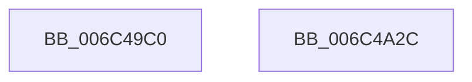

# KiServiceInternal

- RVA: `0x006C49C0`–`0x006C4A30` (길이 `112` bytes)
- VA: `0x00000001406C49C0`
- 실행 섹션: `.text`
- PDB 이름 있음: `예`; PDB Function 태그: `아니요`
- unwind 정보 RVA: `0x000C1E10`
- 디코드: `22`개 명령, `112/112` bytes 표시
- 미해석 바이트: `0` (있으면 어셈블리에 `.byte`로 보존)

> 이 문서는 커널 이미지의 기계어와 PDB 기호를 분석해 생성했습니다. 4번과 5번은 함수 원형과 자료형을 바이너리 사용 방식에서 추정한 C 해석이며 원본 소스 복구 결과는 아닙니다.

## 1. Dependencies

- 직접 호출 지점: **0**; 고유 호출 대상: **0**
- 직접 호출자로 확인된 함수: **0**
- RIP 상대 이미지 참조: **1**

### Outgoing calls
- 직접 디코드된 call 명령이 없습니다.

### Direct callers
- 이 함수 시작 RVA로 연결되는 직접 call은 확인되지 않았습니다. 간접 호출은 완전히 역산할 수 없습니다.

### Static image references
- `0x006C4A22` → RVA `0x006C4DC0` (`KiSystemServiceStart`; read)

## 2. Other-region calls and transfers

- 다른 실행 섹션으로 향하는 call: **0**
- 별도 외부 분기/꼬리 이동을 확인하지 못했습니다.

## 3. Assembly (complete function range)

```asm
006C49C0  48 83 EC 08                     sub rsp, 8
006C49C4  55                              push rbp
006C49C5  48 81 EC 58 01 00 00            sub rsp, 0x158
006C49CC  48 8D AC 24 80 00 00 00         lea rbp, [rsp + 0x80]
006C49D4  48 89 9D C0 00 00 00            mov qword ptr [rbp + 0xc0], rbx
006C49DB  48 89 BD C8 00 00 00            mov qword ptr [rbp + 0xc8], rdi
006C49E2  48 89 B5 D0 00 00 00            mov qword ptr [rbp + 0xd0], rsi
006C49E9  48 C7 45 58 00 00 00 00         mov qword ptr [rbp + 0x58], 0
006C49F1  FB                              sti
006C49F2  65 48 8B 1C 25 88 01 00 00      mov rbx, qword ptr gs:[0x188]
006C49FB  0F 0D 8B 90 00 00 00            prefetchw byte ptr [rbx + 0x90]
006C4A02  0F B6 BB 32 02 00 00            movzx edi, byte ptr [rbx + 0x232]
006C4A09  40 88 7D A8                     mov byte ptr [rbp - 0x58], dil
006C4A0D  C6 83 32 02 00 00 00            mov byte ptr [rbx + 0x232], 0
006C4A14  4C 8B 93 90 00 00 00            mov r10, qword ptr [rbx + 0x90]
006C4A1B  4C 89 95 B8 00 00 00            mov qword ptr [rbp + 0xb8], r10
006C4A22  4C 8D 1D 97 03 00 00            lea r11, [rip + 0x397]
006C4A29  41 FF E3                        jmp r11
006C4A2C  CC                              int3
006C4A2D  CC                              int3
006C4A2E  CC                              int3
006C4A2F  C3                              ret
```

## 4. C-style interpretation (structured pseudocode)

```c
void __fastcall KiServiceInternal(void)
{
    __int64 v_rsp;
    unsigned __int8 v_stack_m140;
    unsigned __int64 v_stack_m18;
    unsigned __int64 v_stack_m20;
    unsigned __int64 v_stack_m28;
    unsigned __int64 v_stack_m30;
    unsigned __int64 v_stack_m90;
    unsigned __int64 v_stack_mE8;

    v_rsp = (v_rsp) - (8);
    v_rsp = (v_rsp) - (344);
    v_stack_m28 = v_rbx;
    v_stack_m20 = v_rdi;
    v_stack_m18 = v_rsi;
    v_stack_m90 = 0;
    v_stack_m140 = (unsigned __int8)(*(unsigned __int8 *)(*(unsigned __int64 *)(gs_base + (0 + 392)) + 562));
    *(unsigned __int8 *)(*(unsigned __int64 *)(gs_base + (0 + 392)) + 562) = 0;
    v_stack_m30 = *(unsigned __int64 *)(*(unsigned __int64 *)(gs_base + (0 + 392)) + 144);
}
```

## 5. (Beta) C Style

```c
void KiServiceInternal(void)
{
    int64_t local_rsp;
    uint8_t v_stack_m140;
    uint64_t v_stack_m18;
    uint64_t v_stack_m20;
    uint64_t v_stack_m28;
    uint64_t v_stack_m30;
    uint64_t v_stack_m90;
    uint64_t v_stack_mE8;

    local_rsp = (local_rsp) - (8);
    local_rsp = (local_rsp) - (344);
    v_stack_m28 = local_rbx;
    v_stack_m20 = local_rdi;
    v_stack_m18 = local_rsi;
    v_stack_m90 = 0;
    v_stack_m140 = (uint8_t)(*(uint8_t *)(*(uint64_t *)(gs_base + (0 + 0x188)) + 0x232));
    *(uint8_t *)(*(uint64_t *)(gs_base + (0 + 0x188)) + 0x232) = 0;
    v_stack_m30 = *(uint64_t *)(*(uint64_t *)(gs_base + (0 + 0x188)) + 0x90);
}
```

## 6. Execution-region graph

[열기: 2D/3D 그래프와 함수 탐색 컨트롤 패널](../../../control-panel.html?section=text&rva=0x006C49C0&view=graph)

- 2D 그래프는 위에서 아래로 흐르고, 3D 그래프는 빈 공간을 드래그해 회전합니다. Shift+드래그는 이동, 휠은 확대·축소, 함수 노드 선택은 대상 보고서 이동입니다.

### Static fallback


