# KiStackFault

- RVA: `0x006C0040`–`0x006C03B8` (길이 `888` bytes)
- VA: `0x00000001406C0040`
- 실행 섹션: `.text`
- PDB 이름 있음: `예`; PDB Function 태그: `아니요`
- unwind 정보 RVA: `0x000C1C54`
- 디코드: `191`개 명령, `888/888` bytes 표시
- 미해석 바이트: `0` (있으면 어셈블리에 `.byte`로 보존)

> 이 문서는 커널 이미지의 기계어와 PDB 기호를 분석해 생성했습니다. 4번과 5번은 함수 원형과 자료형을 바이너리 사용 방식에서 추정한 C 해석이며 원본 소스 복구 결과는 아닙니다.

## 1. Dependencies

- 직접 호출 지점: **36**; 고유 호출 대상: **36**
- 직접 호출자로 확인된 함수: **1**
- RIP 상대 이미지 참조: **3**

### Outgoing calls
- `0x006C0192` → [KiStackFault + 0x265](KiStackFault_function_006C0040.md) (inside-function, `0x006C02A5`)
- `0x006C019B` → [KiStackFault + 0x26E](KiStackFault_function_006C0040.md) (inside-function, `0x006C02AE`)
- `0x006C01A4` → [KiStackFault + 0x157](KiStackFault_function_006C0040.md) (inside-function, `0x006C0197`)
- `0x006C01AD` → [KiStackFault + 0x160](KiStackFault_function_006C0040.md) (inside-function, `0x006C01A0`)
- `0x006C01B6` → [KiStackFault + 0x169](KiStackFault_function_006C0040.md) (inside-function, `0x006C01A9`)
- `0x006C01BF` → [KiStackFault + 0x172](KiStackFault_function_006C0040.md) (inside-function, `0x006C01B2`)
- `0x006C01C8` → [KiStackFault + 0x17B](KiStackFault_function_006C0040.md) (inside-function, `0x006C01BB`)
- `0x006C01D1` → [KiStackFault + 0x184](KiStackFault_function_006C0040.md) (inside-function, `0x006C01C4`)
- `0x006C01DA` → [KiStackFault + 0x18D](KiStackFault_function_006C0040.md) (inside-function, `0x006C01CD`)
- `0x006C01E3` → [KiStackFault + 0x196](KiStackFault_function_006C0040.md) (inside-function, `0x006C01D6`)
- `0x006C01EC` → [KiStackFault + 0x19F](KiStackFault_function_006C0040.md) (inside-function, `0x006C01DF`)
- `0x006C01F5` → [KiStackFault + 0x1A8](KiStackFault_function_006C0040.md) (inside-function, `0x006C01E8`)
- `0x006C01FE` → [KiStackFault + 0x1B1](KiStackFault_function_006C0040.md) (inside-function, `0x006C01F1`)
- `0x006C0207` → [KiStackFault + 0x1BA](KiStackFault_function_006C0040.md) (inside-function, `0x006C01FA`)
- `0x006C0210` → [KiStackFault + 0x1C3](KiStackFault_function_006C0040.md) (inside-function, `0x006C0203`)
- `0x006C0219` → [KiStackFault + 0x1CC](KiStackFault_function_006C0040.md) (inside-function, `0x006C020C`)
- `0x006C0222` → [KiStackFault + 0x1D5](KiStackFault_function_006C0040.md) (inside-function, `0x006C0215`)
- `0x006C022B` → [KiStackFault + 0x1DE](KiStackFault_function_006C0040.md) (inside-function, `0x006C021E`)
- `0x006C0234` → [KiStackFault + 0x1E7](KiStackFault_function_006C0040.md) (inside-function, `0x006C0227`)
- `0x006C023D` → [KiStackFault + 0x1F0](KiStackFault_function_006C0040.md) (inside-function, `0x006C0230`)
- `0x006C0246` → [KiStackFault + 0x1F9](KiStackFault_function_006C0040.md) (inside-function, `0x006C0239`)
- `0x006C024F` → [KiStackFault + 0x202](KiStackFault_function_006C0040.md) (inside-function, `0x006C0242`)
- `0x006C0258` → [KiStackFault + 0x20B](KiStackFault_function_006C0040.md) (inside-function, `0x006C024B`)
- `0x006C0261` → [KiStackFault + 0x214](KiStackFault_function_006C0040.md) (inside-function, `0x006C0254`)
- `0x006C026A` → [KiStackFault + 0x21D](KiStackFault_function_006C0040.md) (inside-function, `0x006C025D`)
- `0x006C0273` → [KiStackFault + 0x226](KiStackFault_function_006C0040.md) (inside-function, `0x006C0266`)
- `0x006C027C` → [KiStackFault + 0x22F](KiStackFault_function_006C0040.md) (inside-function, `0x006C026F`)
- `0x006C0285` → [KiStackFault + 0x238](KiStackFault_function_006C0040.md) (inside-function, `0x006C0278`)
- `0x006C028E` → [KiStackFault + 0x241](KiStackFault_function_006C0040.md) (inside-function, `0x006C0281`)
- `0x006C0297` → [KiStackFault + 0x24A](KiStackFault_function_006C0040.md) (inside-function, `0x006C028A`)
- `0x006C02A0` → [KiStackFault + 0x253](KiStackFault_function_006C0040.md) (inside-function, `0x006C0293`)
- `0x006C02A9` → [KiStackFault + 0x25C](KiStackFault_function_006C0040.md) (inside-function, `0x006C029C`)
- `0x006C02D4` → [KiFlushBhbDuringTrapEntryOrExit](KiFlushBhbDuringTrapEntryOrExit_function_006C6340.md) (function, `0x006C6340`)
- `0x006C031D` → [KiSaveDebugRegisterState](../4F/KiSaveDebugRegisterState_function_004FD960.md) (function, `0x004FD960`)
- `0x006C0351` → [KiSynchronizeUserIsolationDomainExit](../41/KiSynchronizeUserIsolationDomainExit_function_0041BFA0.md) (function, `0x0041BFA0`)
- `0x006C03B1` → [KiExceptionDispatch](KiExceptionDispatch_function_006C5900.md) (function, `0x006C5900`)

### Direct callers
- [KiStackFault](KiStackFault_function_006C0040.md) at `0x006C0192`
- [KiStackFault](KiStackFault_function_006C0040.md) at `0x006C019B`
- [KiStackFault](KiStackFault_function_006C0040.md) at `0x006C01A4`
- [KiStackFault](KiStackFault_function_006C0040.md) at `0x006C01AD`
- [KiStackFault](KiStackFault_function_006C0040.md) at `0x006C01B6`
- [KiStackFault](KiStackFault_function_006C0040.md) at `0x006C01BF`
- [KiStackFault](KiStackFault_function_006C0040.md) at `0x006C01C8`
- [KiStackFault](KiStackFault_function_006C0040.md) at `0x006C01D1`
- [KiStackFault](KiStackFault_function_006C0040.md) at `0x006C01DA`
- [KiStackFault](KiStackFault_function_006C0040.md) at `0x006C01E3`
- [KiStackFault](KiStackFault_function_006C0040.md) at `0x006C01EC`
- [KiStackFault](KiStackFault_function_006C0040.md) at `0x006C01F5`
- [KiStackFault](KiStackFault_function_006C0040.md) at `0x006C01FE`
- [KiStackFault](KiStackFault_function_006C0040.md) at `0x006C0207`
- [KiStackFault](KiStackFault_function_006C0040.md) at `0x006C0210`
- [KiStackFault](KiStackFault_function_006C0040.md) at `0x006C0219`
- [KiStackFault](KiStackFault_function_006C0040.md) at `0x006C0222`
- [KiStackFault](KiStackFault_function_006C0040.md) at `0x006C022B`
- [KiStackFault](KiStackFault_function_006C0040.md) at `0x006C0234`
- [KiStackFault](KiStackFault_function_006C0040.md) at `0x006C023D`
- [KiStackFault](KiStackFault_function_006C0040.md) at `0x006C0246`
- [KiStackFault](KiStackFault_function_006C0040.md) at `0x006C024F`
- [KiStackFault](KiStackFault_function_006C0040.md) at `0x006C0258`
- [KiStackFault](KiStackFault_function_006C0040.md) at `0x006C0261`
- [KiStackFault](KiStackFault_function_006C0040.md) at `0x006C026A`
- [KiStackFault](KiStackFault_function_006C0040.md) at `0x006C0273`
- [KiStackFault](KiStackFault_function_006C0040.md) at `0x006C027C`
- [KiStackFault](KiStackFault_function_006C0040.md) at `0x006C0285`
- [KiStackFault](KiStackFault_function_006C0040.md) at `0x006C028E`
- [KiStackFault](KiStackFault_function_006C0040.md) at `0x006C0297`
- [KiStackFault](KiStackFault_function_006C0040.md) at `0x006C02A0`
- [KiStackFault](KiStackFault_function_006C0040.md) at `0x006C02A9`

### Static image references
- `0x006C00B1` → RVA `0x01201840` (`CFGRO`; read)
- `0x006C02E5` → RVA `0x00FC7264` (`ALMOSTRO`; read)
- `0x006C0356` → RVA `0x00FC6BF0` (`ALMOSTRO`; read)

## 2. Other-region calls and transfers

- 다른 실행 섹션으로 향하는 call: **0**
- 별도 외부 분기/꼬리 이동을 확인하지 못했습니다.

## 3. Assembly (complete function range)

```asm
006C0040  55                              push rbp
006C0041  48 81 EC 58 01 00 00            sub rsp, 0x158
006C0048  48 8D AC 24 80 00 00 00         lea rbp, [rsp + 0x80]
006C0050  C6 45 AB 01                     mov byte ptr [rbp - 0x55], 1
006C0054  48 89 45 B0                     mov qword ptr [rbp - 0x50], rax
006C0058  48 89 4D B8                     mov qword ptr [rbp - 0x48], rcx
006C005C  48 89 55 C0                     mov qword ptr [rbp - 0x40], rdx
006C0060  4C 89 45 C8                     mov qword ptr [rbp - 0x38], r8
006C0064  4C 89 4D D0                     mov qword ptr [rbp - 0x30], r9
006C0068  4C 89 55 D8                     mov qword ptr [rbp - 0x28], r10
006C006C  4C 89 5D E0                     mov qword ptr [rbp - 0x20], r11
006C0070  F6 85 F0 00 00 00 01            test byte ptr [rbp + 0xf0], 1
006C0077  75 38                           jne 0x1406c00b1
006C0079  33 D2                           xor edx, edx
006C007B  F3 48 0F 1E CA                  rdsspq rdx
006C0080  48 89 55 58                     mov qword ptr [rbp + 0x58], rdx
006C0084  0F AE E8                        lfence
006C0087  65 F6 04 25 58 08 00 00 01      test byte ptr gs:[0x858], 1
006C0090  75 08                           jne 0x1406c009a
006C0092  0F AE E8                        lfence
006C0095  E9 88 02 00 00                  jmp 0x1406c0322
006C009A  65 0F B7 04 25 66 08 00 00      movzx eax, word ptr gs:[0x866]
006C00A3  B9 48 00 00 00                  mov ecx, 0x48
006C00A8  33 D2                           xor edx, edx
006C00AA  0F 30                           wrmsr
006C00AC  E9 71 02 00 00                  jmp 0x1406c0322
006C00B1  F6 05 88 17 B4 00 01            test byte ptr [rip + 0xb41788], 1
006C00B8  75 03                           jne 0x1406c00bd
006C00BA  0F 01 F8                        swapgs
006C00BD  0F AE E8                        lfence
006C00C0  65 48 8B 0C 25 28 9D 00 00      mov rcx, qword ptr gs:[0x9d28]
006C00C9  48 85 C9                        test rcx, rcx
006C00CC  74 1F                           je 0x1406c00ed
006C00CE  F3 48 0F 1E CA                  rdsspq rdx
006C00D3  65 4C 8B 14 25 20 9D 00 00      mov r10, qword ptr gs:[0x9d20]
006C00DC  49 83 C2 08                     add r10, 8
006C00E0  49 3B D2                        cmp rdx, r10
006C00E3  75 08                           jne 0x1406c00ed
006C00E5  F3 0F 01 29                     rstorssp dword ptr [rcx]
006C00E9  F3 0F 01 EA                     saveprevssp
006C00ED  65 4C 8B 14 25 88 01 00 00      mov r10, qword ptr gs:[0x188]
006C00F6  65 48 8B 0C 25 88 01 00 00      mov rcx, qword ptr gs:[0x188]
006C00FF  48 8B 89 20 02 00 00            mov rcx, qword ptr [rcx + 0x220]
006C0106  48 8B 89 60 07 00 00            mov rcx, qword ptr [rcx + 0x760]
006C010D  65 48 89 0C 25 50 08 00 00      mov qword ptr gs:[0x850], rcx
006C0116  66 65 8B 0C 25 62 08 00 00      mov cx, word ptr gs:[0x862]
006C011F  66 65 89 0C 25 64 08 00 00      mov word ptr gs:[0x864], cx
006C0128  65 8A 0C 25 58 08 00 00         mov cl, byte ptr gs:[0x858]
006C0130  65 88 0C 25 5A 08 00 00         mov byte ptr gs:[0x85a], cl
006C0138  65 0F B7 04 25 68 08 00 00      movzx eax, word ptr gs:[0x868]
006C0141  66 65 39 04 25 66 08 00 00      cmp word ptr gs:[0x866], ax
006C014A  74 12                           je 0x1406c015e
006C014C  66 65 89 04 25 66 08 00 00      mov word ptr gs:[0x866], ax
006C0155  B9 48 00 00 00                  mov ecx, 0x48
006C015A  33 D2                           xor edx, edx
006C015C  0F 30                           wrmsr
006C015E  65 0F B6 14 25 58 08 00 00      movzx edx, byte ptr gs:[0x858]
006C0167  F7 C2 08 00 00 00               test edx, 8
006C016D  74 17                           je 0x1406c0186
006C016F  B8 01 00 00 00                  mov eax, 1
006C0174  33 D2                           xor edx, edx
006C0176  B9 49 00 00 00                  mov ecx, 0x49
006C017B  0F 30                           wrmsr
006C017D  65 0F B6 14 25 58 08 00 00      movzx edx, byte ptr gs:[0x858]
006C0186  F7 C2 02 00 00 00               test edx, 2
006C018C  0F 84 37 01 00 00               je 0x1406c02c9
006C0192  E8 0E 01 00 00                  call 0x1406c02a5
006C0197  48 83 C4 08                     add rsp, 8
006C019B  E8 0E 01 00 00                  call 0x1406c02ae
006C01A0  48 83 C4 08                     add rsp, 8
006C01A4  E8 EE FF FF FF                  call 0x1406c0197
006C01A9  48 83 C4 08                     add rsp, 8
006C01AD  E8 EE FF FF FF                  call 0x1406c01a0
006C01B2  48 83 C4 08                     add rsp, 8
006C01B6  E8 EE FF FF FF                  call 0x1406c01a9
006C01BB  48 83 C4 08                     add rsp, 8
006C01BF  E8 EE FF FF FF                  call 0x1406c01b2
006C01C4  48 83 C4 08                     add rsp, 8
006C01C8  E8 EE FF FF FF                  call 0x1406c01bb
006C01CD  48 83 C4 08                     add rsp, 8
006C01D1  E8 EE FF FF FF                  call 0x1406c01c4
006C01D6  48 83 C4 08                     add rsp, 8
006C01DA  E8 EE FF FF FF                  call 0x1406c01cd
006C01DF  48 83 C4 08                     add rsp, 8
006C01E3  E8 EE FF FF FF                  call 0x1406c01d6
006C01E8  48 83 C4 08                     add rsp, 8
006C01EC  E8 EE FF FF FF                  call 0x1406c01df
006C01F1  48 83 C4 08                     add rsp, 8
006C01F5  E8 EE FF FF FF                  call 0x1406c01e8
006C01FA  48 83 C4 08                     add rsp, 8
006C01FE  E8 EE FF FF FF                  call 0x1406c01f1
006C0203  48 83 C4 08                     add rsp, 8
006C0207  E8 EE FF FF FF                  call 0x1406c01fa
006C020C  48 83 C4 08                     add rsp, 8
006C0210  E8 EE FF FF FF                  call 0x1406c0203
006C0215  48 83 C4 08                     add rsp, 8
006C0219  E8 EE FF FF FF                  call 0x1406c020c
006C021E  48 83 C4 08                     add rsp, 8
006C0222  E8 EE FF FF FF                  call 0x1406c0215
006C0227  48 83 C4 08                     add rsp, 8
006C022B  E8 EE FF FF FF                  call 0x1406c021e
006C0230  48 83 C4 08                     add rsp, 8
006C0234  E8 EE FF FF FF                  call 0x1406c0227
006C0239  48 83 C4 08                     add rsp, 8
006C023D  E8 EE FF FF FF                  call 0x1406c0230
006C0242  48 83 C4 08                     add rsp, 8
006C0246  E8 EE FF FF FF                  call 0x1406c0239
006C024B  48 83 C4 08                     add rsp, 8
006C024F  E8 EE FF FF FF                  call 0x1406c0242
006C0254  48 83 C4 08                     add rsp, 8
006C0258  E8 EE FF FF FF                  call 0x1406c024b
006C025D  48 83 C4 08                     add rsp, 8
006C0261  E8 EE FF FF FF                  call 0x1406c0254
006C0266  48 83 C4 08                     add rsp, 8
006C026A  E8 EE FF FF FF                  call 0x1406c025d
006C026F  48 83 C4 08                     add rsp, 8
006C0273  E8 EE FF FF FF                  call 0x1406c0266
006C0278  48 83 C4 08                     add rsp, 8
006C027C  E8 EE FF FF FF                  call 0x1406c026f
006C0281  48 83 C4 08                     add rsp, 8
006C0285  E8 EE FF FF FF                  call 0x1406c0278
006C028A  48 83 C4 08                     add rsp, 8
006C028E  E8 EE FF FF FF                  call 0x1406c0281
006C0293  48 83 C4 08                     add rsp, 8
006C0297  E8 EE FF FF FF                  call 0x1406c028a
006C029C  48 83 C4 08                     add rsp, 8
006C02A0  E8 EE FF FF FF                  call 0x1406c0293
006C02A5  48 83 C4 08                     add rsp, 8
006C02A9  E8 EE FF FF FF                  call 0x1406c029c
006C02AE  48 83 C4 08                     add rsp, 8
006C02B2  B8 DA DA 00 00                  mov eax, 0xdada
006C02B7  65 F6 04 25 5C 08 00 00 08      test byte ptr gs:[0x85c], 8
006C02C0  74 07                           je 0x1406c02c9
006C02C2  B0 20                           mov al, 0x20
006C02C4  F3 48 0F AE E8                  incsspq rax
006C02C9  F7 C2 80 00 00 00               test edx, 0x80
006C02CF  74 08                           je 0x1406c02d9
006C02D1  0F AE E8                        lfence
006C02D4  E8 67 60 00 00                  call 0x1406c6340
006C02D9  0F AE E8                        lfence
006C02DC  65 C6 04 25 5E 08 00 00 00      mov byte ptr gs:[0x85e], 0
006C02E5  83 3D 78 6F 90 00 00            cmp dword ptr [rip + 0x906f78], 0
006C02EC  74 1F                           je 0x1406c030d
006C02EE  B9 A7 06 00 00                  mov ecx, 0x6a7
006C02F3  0F 32                           rdmsr
006C02F5  83 FA 00                        cmp edx, 0
006C02F8  74 13                           je 0x1406c030d
006C02FA  8B CA                           mov ecx, edx
006C02FC  23 15 62 6F 90 00               and edx, dword ptr [rip + 0x906f62]
006C0302  3B D1                           cmp edx, ecx
006C0304  74 07                           je 0x1406c030d
006C0306  B9 A7 06 00 00                  mov ecx, 0x6a7
006C030B  0F 30                           wrmsr
006C030D  41 F6 42 03 03                  test byte ptr [r10 + 3], 3
006C0312  66 C7 85 80 00 00 00 00 00      mov word ptr [rbp + 0x80], 0
006C031B  74 05                           je 0x1406c0322
006C031D  E8 3E D6 E3 FF                  call 0x1404fd960
006C0322  FC                              cld
006C0323  0F AE 5D AC                     stmxcsr dword ptr [rbp - 0x54]
006C0327  65 0F AE 14 25 80 01 00 00      ldmxcsr dword ptr gs:[0x180]
006C0330  0F 29 45 F0                     movaps xmmword ptr [rbp - 0x10], xmm0
006C0334  0F 29 4D 00                     movaps xmmword ptr [rbp], xmm1
006C0338  0F 29 55 10                     movaps xmmword ptr [rbp + 0x10], xmm2
006C033C  0F 29 5D 20                     movaps xmmword ptr [rbp + 0x20], xmm3
006C0340  0F 29 65 30                     movaps xmmword ptr [rbp + 0x30], xmm4
006C0344  0F 29 6D 40                     movaps xmmword ptr [rbp + 0x40], xmm5
006C0348  F6 85 F0 00 00 00 01            test byte ptr [rbp + 0xf0], 1
006C034F  74 05                           je 0x1406c0356
006C0351  E8 4A BC D5 FF                  call 0x14041bfa0
006C0356  F6 05 93 68 90 00 FF            test byte ptr [rip + 0x906893], 0xff
006C035D  74 0C                           je 0x1406c036b
006C035F  F6 85 F0 00 00 00 01            test byte ptr [rbp + 0xf0], 1
006C0366  74 03                           je 0x1406c036b
006C0368  0F 01 CB                        stac
006C036B  8B 85 E0 00 00 00               mov eax, dword ptr [rbp + 0xe0]
006C0371  F7 85 F8 00 00 00 00 02 00 00   test dword ptr [rbp + 0xf8], 0x200
006C037B  74 01                           je 0x1406c037e
006C037D  FB                              sti
006C037E  B9 05 00 00 C0                  mov ecx, 0xc0000005
006C0383  BA 02 00 00 00                  mov edx, 2
006C0388  4C 8B 85 E8 00 00 00            mov r8, qword ptr [rbp + 0xe8]
006C038F  44 8B 8D E0 00 00 00            mov r9d, dword ptr [rbp + 0xe0]
006C0396  41 83 C9 03                     or r9d, 3
006C039A  41 81 E1 FF FF 00 00            and r9d, 0xffff
006C03A1  F6 85 F0 00 00 00 01            test byte ptr [rbp + 0xf0], 1
006C03A8  75 04                           jne 0x1406c03ae
006C03AA  49 83 C9 FF                     or r9, 0xffffffffffffffff
006C03AE  4D 33 D2                        xor r10, r10
006C03B1  E8 4A 55 00 00                  call 0x1406c5900
006C03B6  90                              nop
006C03B7  C3                              ret
```

## 4. C-style interpretation (structured pseudocode)

```c
__int64 __fastcall KiStackFault(__int64 a1, __int64 a2, __int64 a3, __int64 a4)
{
    __int64 result;
    __int64 v_r10;
    __int64 v_rsp;
    unsigned __int64 v_stack_m100;
    unsigned __int64 v_stack_m108;
    unsigned __int64 v_stack_m110;
    unsigned __int64 v_stack_m118;
    unsigned __int64 v_stack_m120;
    unsigned __int64 v_stack_m128;
    unsigned __int64 v_stack_m130;
    unsigned int v_stack_m134;
    unsigned __int8 v_stack_m135;
    unsigned __int16 v_stack_m60;
    unsigned __int64 v_stack_m88;
    unsigned __int64 v_stack_mA0;
    unsigned __int64 v_stack_mB0;
    unsigned __int64 v_stack_mC0;
    unsigned __int64 v_stack_mD0;
    unsigned __int64 v_stack_mE0;
    unsigned __int64 v_stack_mF0;
    unsigned int v_stack_p0;
    unsigned __int8 v_stack_p10;
    unsigned int v_stack_p18;
    unsigned __int64 v_stack_p8;

    v_rsp = (v_rsp) - (344);
    v_stack_m135 = 1;
    v_stack_m130 = result;
    v_stack_m128 = a1;
    v_stack_m120 = a2;
    v_stack_m118 = a3;
    v_stack_m110 = a4;
    v_stack_m108 = v_r10;
    v_stack_m100 = v_r11;
    if (((v_stack_p10) & (1)) != 0) goto loc_006C00B1;
    a2 = 0;
    v_stack_m88 = 0;
    if (((*(unsigned __int8 *)(gs_base + (0 + 2136))) & (1)) != 0) goto loc_006C009A;
    goto loc_006C0322;
loc_006C009A:
    a2 = 0;
    goto loc_006C0322;
loc_006C00B1:
    if (((*(unsigned __int8 *)(v_rip + 11802504)) & (1)) == 0) {
    }
    if (*(unsigned __int64 *)(gs_base + (0 + 40232)) == 0) goto loc_006C00ED;
    v_r10 = (*(unsigned __int64 *)(gs_base + (0 + 40224))) + (8);
    if (0 == v_r10) {
    }
    *(unsigned __int64 *)(gs_base + (0 + 2128)) = *(unsigned __int64 *)(*(unsigned __int64 *)(*(unsigned __int64 *)(gs_base + (0 + 392)) + 544) + 1888);
    *(unsigned __int16 *)(gs_base + (0 + 2148)) = (unsigned __int16)(*(unsigned __int16 *)(gs_base + (0 + 2146)));
    *(unsigned __int8 *)(gs_base + (0 + 2138)) = (unsigned __int8)(*(unsigned __int8 *)(gs_base + (0 + 2136)));
    if ((*(unsigned __int16 *)(gs_base + (0 + 2150))) != ((unsigned __int16)(*(unsigned __int16 *)(gs_base + (0 + 2152))))) {
        *(unsigned __int16 *)(gs_base + (0 + 2150)) = (unsigned __int16)(*(unsigned __int16 *)(gs_base + (0 + 2152)));
        a1 = 72;
        a2 = 0;
    }
    result = *(unsigned __int16 *)(gs_base + (0 + 2152));
    if ((((unsigned int)(*(unsigned __int8 *)(gs_base + (0 + 2136)))) & (8)) != 0) {
        result = 1;
        a2 = 0;
        a1 = 73;
        a2 = *(unsigned __int8 *)(gs_base + (0 + 2136));
    }
    if ((((unsigned int)(a2)) & (2)) == 0) goto loc_006C02C9;
    result = KiStackFault___0x265(a1, a2, a3, a4);
    v_rsp = (v_rsp) + (8);
    result = KiStackFault___0x26E(a1, a2, a3, a4);
    v_rsp = (v_rsp) + (8);
    result = KiStackFault___0x157(a1, a2, a3, a4);
    v_rsp = (v_rsp) + (8);
    result = KiStackFault___0x160(a1, a2, a3, a4);
    v_rsp = (v_rsp) + (8);
    result = KiStackFault___0x169(a1, a2, a3, a4);
    v_rsp = (v_rsp) + (8);
    result = KiStackFault___0x172(a1, a2, a3, a4);
    v_rsp = (v_rsp) + (8);
    result = KiStackFault___0x17B(a1, a2, a3, a4);
    v_rsp = (v_rsp) + (8);
    result = KiStackFault___0x184(a1, a2, a3, a4);
    v_rsp = (v_rsp) + (8);
    result = KiStackFault___0x18D(a1, a2, a3, a4);
    v_rsp = (v_rsp) + (8);
    result = KiStackFault___0x196(a1, a2, a3, a4);
    v_rsp = (v_rsp) + (8);
    result = KiStackFault___0x19F(a1, a2, a3, a4);
    v_rsp = (v_rsp) + (8);
    result = KiStackFault___0x1A8(a1, a2, a3, a4);
    v_rsp = (v_rsp) + (8);
    result = KiStackFault___0x1B1(a1, a2, a3, a4);
    v_rsp = (v_rsp) + (8);
    result = KiStackFault___0x1BA(a1, a2, a3, a4);
    v_rsp = (v_rsp) + (8);
    result = KiStackFault___0x1C3(a1, a2, a3, a4);
    v_rsp = (v_rsp) + (8);
    result = KiStackFault___0x1CC(a1, a2, a3, a4);
    v_rsp = (v_rsp) + (8);
    result = KiStackFault___0x1D5(a1, a2, a3, a4);
    v_rsp = (v_rsp) + (8);
    result = KiStackFault___0x1DE(a1, a2, a3, a4);
    v_rsp = (v_rsp) + (8);
    result = KiStackFault___0x1E7(a1, a2, a3, a4);
    v_rsp = (v_rsp) + (8);
    result = KiStackFault___0x1F0(a1, a2, a3, a4);
    v_rsp = (v_rsp) + (8);
    result = KiStackFault___0x1F9(a1, a2, a3, a4);
    v_rsp = (v_rsp) + (8);
    result = KiStackFault___0x202(a1, a2, a3, a4);
    v_rsp = (v_rsp) + (8);
    result = KiStackFault___0x20B(a1, a2, a3, a4);
    v_rsp = (v_rsp) + (8);
    result = KiStackFault___0x214(a1, a2, a3, a4);
    v_rsp = (v_rsp) + (8);
    result = KiStackFault___0x21D(a1, a2, a3, a4);
    v_rsp = (v_rsp) + (8);
    result = KiStackFault___0x226(a1, a2, a3, a4);
    v_rsp = (v_rsp) + (8);
    result = KiStackFault___0x22F(a1, a2, a3, a4);
    v_rsp = (v_rsp) + (8);
    result = KiStackFault___0x238(a1, a2, a3, a4);
    v_rsp = (v_rsp) + (8);
    result = KiStackFault___0x241(a1, a2, a3, a4);
    v_rsp = (v_rsp) + (8);
    result = KiStackFault___0x24A(a1, a2, a3, a4);
    v_rsp = (v_rsp) + (8);
    result = KiStackFault___0x253(a1, a2, a3, a4);
    v_rsp = (v_rsp) + (8);
    result = KiStackFault___0x25C(a1, a2, a3, a4);
    v_rsp = (v_rsp) + (8);
    result = (unsigned int)(0xDADAULL);
    if (((*(unsigned __int8 *)(gs_base + (0 + 2140))) & (8)) != 0) {
        result = 32;
    }
    if ((((unsigned int)(a2)) & (128)) != 0) {
        result = KiFlushBhbDuringTrapEntryOrExit(a1, a2, a3, a4);
    }
    *(unsigned __int8 *)(gs_base + (0 + 2142)) = 0;
    if ((*(unsigned int *)(v_rip + 9465720)) == 0) goto loc_006C030D;
    if (((unsigned int)(a2)) == 0) goto loc_006C030D;
    a2 = (unsigned int)((a2) & (*(unsigned int *)(v_rip + 9465698)));
    if (((unsigned int)(a2)) != ((unsigned int)((unsigned int)((unsigned int)(a2))))) {
        a1 = 0x6A7ULL;
    }
    v_stack_m60 = 0;
    if (((*(unsigned __int8 *)(*(unsigned __int64 *)(gs_base + (0 + 392)) + 3)) & (3)) != 0) {
        result = KiSaveDebugRegisterState(a1, a2, a3, a4);
    }
    v_stack_mF0 = v_xmm0;
    v_stack_mE0 = v_xmm1;
    v_stack_mD0 = v_xmm2;
    v_stack_mC0 = v_xmm3;
    v_stack_mB0 = v_xmm4;
    v_stack_mA0 = v_xmm5;
    if (((v_stack_p10) & (1)) != 0) {
        result = KiSynchronizeUserIsolationDomainExit(a1, a2, a3, a4);
    }
    if (((*(unsigned __int8 *)(v_rip + 9463955)) & (255)) == 0) goto loc_006C036B;
    if (((v_stack_p10) & (1)) != 0) {
    }
    if (((v_stack_p18) & (512)) != 0) {
    }
    a4 = (unsigned int)(((unsigned int)(v_stack_p0)) | (3));
    a4 = (unsigned int)((a4) & (0xFFFFULL));
    if (((v_stack_p10) & (1)) == 0) {
        a4 = (a4) | (-1);
    }
    v_r10 = 0;
    result = KiExceptionDispatch((unsigned int)(0xC0000005ULL), 2, v_stack_p8, a4);
    return result;
}
```

## 5. (Beta) C Style

```c
int64_t KiStackFault(int64_t Arg1, int64_t Arg2, int64_t Arg3, int64_t Arg4)
{
    int64_t result;
    int64_t local_r10;
    int64_t local_rsp;
    uint64_t v_stack_m100;
    uint64_t v_stack_m108;
    uint64_t v_stack_m110;
    uint64_t v_stack_m118;
    uint64_t v_stack_m120;
    uint64_t v_stack_m128;
    uint64_t v_stack_m130;
    uint32_t v_stack_m134;
    uint8_t v_stack_m135;
    uint16_t v_stack_m60;
    uint64_t v_stack_m88;
    uint64_t v_stack_mA0;
    uint64_t v_stack_mB0;
    uint64_t v_stack_mC0;
    uint64_t v_stack_mD0;
    uint64_t v_stack_mE0;
    uint64_t v_stack_mF0;
    uint32_t v_stack_p0;
    uint8_t v_stack_p10;
    uint32_t v_stack_p18;
    uint64_t v_stack_p8;

    local_rsp = (local_rsp) - (344);
    v_stack_m135 = 1;
    v_stack_m130 = result;
    v_stack_m128 = Arg1;
    v_stack_m120 = Arg2;
    v_stack_m118 = Arg3;
    v_stack_m110 = Arg4;
    v_stack_m108 = local_r10;
    v_stack_m100 = local_r11;
    if (((v_stack_p10) & (1)) != 0) goto loc_006C00B1;
    Arg2 = 0;
    v_stack_m88 = 0;
    if (((*(uint8_t *)(gs_base + (0 + 0x858))) & (1)) != 0) goto loc_006C009A;
    goto loc_006C0322;
loc_006C009A:
    Arg2 = 0;
    goto loc_006C0322;
loc_006C00B1:
    if (((*(uint8_t *)(v_rip + 0xB41788)) & (1)) == 0) {
    }
    if (*(uint64_t *)(gs_base + (0 + 0x9D28)) == 0) goto loc_006C00ED;
    local_r10 = (*(uint64_t *)(gs_base + (0 + 0x9D20))) + (8);
    if (0 == local_r10) {
    }
    *(uint64_t *)(gs_base + (0 + 0x850)) = *(uint64_t *)(*(uint64_t *)(*(uint64_t *)(gs_base + (0 + 0x188)) + 0x220) + 0x760);
    *(uint16_t *)(gs_base + (0 + 0x864)) = (uint16_t)(*(uint16_t *)(gs_base + (0 + 0x862)));
    *(uint8_t *)(gs_base + (0 + 0x85A)) = (uint8_t)(*(uint8_t *)(gs_base + (0 + 0x858)));
    if ((*(uint16_t *)(gs_base + (0 + 0x866))) != ((uint16_t)(*(uint16_t *)(gs_base + (0 + 0x868))))) {
        *(uint16_t *)(gs_base + (0 + 0x866)) = (uint16_t)(*(uint16_t *)(gs_base + (0 + 0x868)));
        Arg1 = 72;
        Arg2 = 0;
    }
    result = *(uint16_t *)(gs_base + (0 + 0x868));
    if ((((uint32_t)(*(uint8_t *)(gs_base + (0 + 0x858)))) & (8)) != 0) {
        result = 1;
        Arg2 = 0;
        Arg1 = 73;
        Arg2 = *(uint8_t *)(gs_base + (0 + 0x858));
    }
    if ((((uint32_t)(Arg2)) & (2)) == 0) goto loc_006C02C9;
    result = KiStackFault___0x265(Arg1, Arg2, Arg3, Arg4);
    local_rsp = (local_rsp) + (8);
    result = KiStackFault___0x26E(Arg1, Arg2, Arg3, Arg4);
    local_rsp = (local_rsp) + (8);
    result = KiStackFault___0x157(Arg1, Arg2, Arg3, Arg4);
    local_rsp = (local_rsp) + (8);
    result = KiStackFault___0x160(Arg1, Arg2, Arg3, Arg4);
    local_rsp = (local_rsp) + (8);
    result = KiStackFault___0x169(Arg1, Arg2, Arg3, Arg4);
    local_rsp = (local_rsp) + (8);
    result = KiStackFault___0x172(Arg1, Arg2, Arg3, Arg4);
    local_rsp = (local_rsp) + (8);
    result = KiStackFault___0x17B(Arg1, Arg2, Arg3, Arg4);
    local_rsp = (local_rsp) + (8);
    result = KiStackFault___0x184(Arg1, Arg2, Arg3, Arg4);
    local_rsp = (local_rsp) + (8);
    result = KiStackFault___0x18D(Arg1, Arg2, Arg3, Arg4);
    local_rsp = (local_rsp) + (8);
    result = KiStackFault___0x196(Arg1, Arg2, Arg3, Arg4);
    local_rsp = (local_rsp) + (8);
    result = KiStackFault___0x19F(Arg1, Arg2, Arg3, Arg4);
    local_rsp = (local_rsp) + (8);
    result = KiStackFault___0x1A8(Arg1, Arg2, Arg3, Arg4);
    local_rsp = (local_rsp) + (8);
    result = KiStackFault___0x1B1(Arg1, Arg2, Arg3, Arg4);
    local_rsp = (local_rsp) + (8);
    result = KiStackFault___0x1BA(Arg1, Arg2, Arg3, Arg4);
    local_rsp = (local_rsp) + (8);
    result = KiStackFault___0x1C3(Arg1, Arg2, Arg3, Arg4);
    local_rsp = (local_rsp) + (8);
    result = KiStackFault___0x1CC(Arg1, Arg2, Arg3, Arg4);
    local_rsp = (local_rsp) + (8);
    result = KiStackFault___0x1D5(Arg1, Arg2, Arg3, Arg4);
    local_rsp = (local_rsp) + (8);
    result = KiStackFault___0x1DE(Arg1, Arg2, Arg3, Arg4);
    local_rsp = (local_rsp) + (8);
    result = KiStackFault___0x1E7(Arg1, Arg2, Arg3, Arg4);
    local_rsp = (local_rsp) + (8);
    result = KiStackFault___0x1F0(Arg1, Arg2, Arg3, Arg4);
    local_rsp = (local_rsp) + (8);
    result = KiStackFault___0x1F9(Arg1, Arg2, Arg3, Arg4);
    local_rsp = (local_rsp) + (8);
    result = KiStackFault___0x202(Arg1, Arg2, Arg3, Arg4);
    local_rsp = (local_rsp) + (8);
    result = KiStackFault___0x20B(Arg1, Arg2, Arg3, Arg4);
    local_rsp = (local_rsp) + (8);
    result = KiStackFault___0x214(Arg1, Arg2, Arg3, Arg4);
    local_rsp = (local_rsp) + (8);
    result = KiStackFault___0x21D(Arg1, Arg2, Arg3, Arg4);
    local_rsp = (local_rsp) + (8);
    result = KiStackFault___0x226(Arg1, Arg2, Arg3, Arg4);
    local_rsp = (local_rsp) + (8);
    result = KiStackFault___0x22F(Arg1, Arg2, Arg3, Arg4);
    local_rsp = (local_rsp) + (8);
    result = KiStackFault___0x238(Arg1, Arg2, Arg3, Arg4);
    local_rsp = (local_rsp) + (8);
    result = KiStackFault___0x241(Arg1, Arg2, Arg3, Arg4);
    local_rsp = (local_rsp) + (8);
    result = KiStackFault___0x24A(Arg1, Arg2, Arg3, Arg4);
    local_rsp = (local_rsp) + (8);
    result = KiStackFault___0x253(Arg1, Arg2, Arg3, Arg4);
    local_rsp = (local_rsp) + (8);
    result = KiStackFault___0x25C(Arg1, Arg2, Arg3, Arg4);
    local_rsp = (local_rsp) + (8);
    result = (uint32_t)(0xDADAULL);
    if (((*(uint8_t *)(gs_base + (0 + 0x85C))) & (8)) != 0) {
        result = 32;
    }
    if ((((uint32_t)(Arg2)) & (128)) != 0) {
        result = KiFlushBhbDuringTrapEntryOrExit(Arg1, Arg2, Arg3, Arg4);
    }
    *(uint8_t *)(gs_base + (0 + 0x85E)) = 0;
    if ((*(uint32_t *)(v_rip + 0x906F78)) == 0) goto loc_006C030D;
    if (((uint32_t)(Arg2)) == 0) goto loc_006C030D;
    Arg2 = (uint32_t)((Arg2) & (*(uint32_t *)(v_rip + 0x906F62)));
    if (((uint32_t)(Arg2)) != ((uint32_t)((uint32_t)((uint32_t)(Arg2))))) {
        Arg1 = 0x6A7ULL;
    }
    v_stack_m60 = 0;
    if (((*(uint8_t *)(*(uint64_t *)(gs_base + (0 + 0x188)) + 0x3)) & (3)) != 0) {
        result = KiSaveDebugRegisterState(Arg1, Arg2, Arg3, Arg4);
    }
    v_stack_mF0 = v_xmm0;
    v_stack_mE0 = v_xmm1;
    v_stack_mD0 = v_xmm2;
    v_stack_mC0 = v_xmm3;
    v_stack_mB0 = v_xmm4;
    v_stack_mA0 = v_xmm5;
    if (((v_stack_p10) & (1)) != 0) {
        result = KiSynchronizeUserIsolationDomainExit(Arg1, Arg2, Arg3, Arg4);
    }
    if (((*(uint8_t *)(v_rip + 0x906893)) & (255)) == 0) goto loc_006C036B;
    if (((v_stack_p10) & (1)) != 0) {
    }
    if (((v_stack_p18) & (512)) != 0) {
    }
    Arg4 = (uint32_t)(((uint32_t)(v_stack_p0)) | (3));
    Arg4 = (uint32_t)((Arg4) & (0xFFFFULL));
    if (((v_stack_p10) & (1)) == 0) {
        Arg4 = (Arg4) | (-1);
    }
    local_r10 = 0;
    result = KiExceptionDispatch((uint32_t)(0xC0000005ULL), 2, v_stack_p8, Arg4);
    return result;
}
```

## 6. Execution-region graph

[열기: 2D/3D 그래프와 함수 탐색 컨트롤 패널](../../../control-panel.html?section=text&rva=0x006C0040&view=graph)

- 2D 그래프는 위에서 아래로 흐르고, 3D 그래프는 빈 공간을 드래그해 회전합니다. Shift+드래그는 이동, 휠은 확대·축소, 함수 노드 선택은 대상 보고서 이동입니다.

### Static fallback

```mermaid
flowchart TD
  bb_006C0040[BB_006C0040]
  bb_006C0079[BB_006C0079]
  bb_006C0092[BB_006C0092]
  bb_006C009A[BB_006C009A]
  bb_006C00B1[BB_006C00B1]
  bb_006C00BA[BB_006C00BA]
  bb_006C00BD[BB_006C00BD]
  bb_006C00CE[BB_006C00CE]
  bb_006C00E5[BB_006C00E5]
  bb_006C00ED[BB_006C00ED]
  bb_006C014C[BB_006C014C]
  bb_006C015E[BB_006C015E]
  bb_006C016F[BB_006C016F]
  bb_006C0186[BB_006C0186]
  bb_006C0192[BB_006C0192]
  bb_006C02C2[BB_006C02C2]
  bb_006C02C9[BB_006C02C9]
  bb_006C02D1[BB_006C02D1]
  bb_006C02D9[BB_006C02D9]
  bb_006C02EE[BB_006C02EE]
  bb_006C02FA[BB_006C02FA]
  bb_006C0306[BB_006C0306]
  bb_006C030D[BB_006C030D]
  bb_006C031D[BB_006C031D]
  bb_006C0322[BB_006C0322]
  bb_006C0351[BB_006C0351]
  bb_006C0356[BB_006C0356]
  bb_006C035F[BB_006C035F]
  bb_006C0368[BB_006C0368]
  bb_006C036B[BB_006C036B]
  bb_006C037D[BB_006C037D]
  bb_006C037E[BB_006C037E]
  bb_006C03AA[BB_006C03AA]
  bb_006C03AE[BB_006C03AE]
  bb_006C0040 -->|branch| bb_006C00B1
  bb_006C0040 -->|fallthrough| bb_006C0079
  bb_006C0079 -->|branch| bb_006C009A
  bb_006C0079 -->|fallthrough| bb_006C0092
  bb_006C0092 -->|branch| bb_006C0322
  bb_006C009A -->|branch| bb_006C0322
  bb_006C00B1 -->|branch| bb_006C00BD
  bb_006C00B1 -->|fallthrough| bb_006C00BA
  bb_006C00BA -->|flow| bb_006C00BD
  bb_006C00BD -->|branch| bb_006C00ED
  bb_006C00BD -->|fallthrough| bb_006C00CE
  bb_006C00CE -->|branch| bb_006C00ED
  bb_006C00CE -->|fallthrough| bb_006C00E5
  bb_006C00E5 -->|flow| bb_006C00ED
  bb_006C00ED -->|branch| bb_006C015E
  bb_006C00ED -->|fallthrough| bb_006C014C
  bb_006C014C -->|flow| bb_006C015E
  bb_006C015E -->|branch| bb_006C0186
  bb_006C015E -->|fallthrough| bb_006C016F
  bb_006C016F -->|flow| bb_006C0186
  bb_006C0186 -->|branch| bb_006C02C9
  bb_006C0186 -->|fallthrough| bb_006C0192
  bb_006C0192 -->|branch| bb_006C02C9
  bb_006C0192 -->|fallthrough| bb_006C02C2
  bb_006C02C2 -->|flow| bb_006C02C9
  bb_006C02C9 -->|branch| bb_006C02D9
  bb_006C02C9 -->|fallthrough| bb_006C02D1
  bb_006C02D1 -->|flow| bb_006C02D9
  bb_006C02D9 -->|branch| bb_006C030D
  bb_006C02D9 -->|fallthrough| bb_006C02EE
  bb_006C02EE -->|branch| bb_006C030D
  bb_006C02EE -->|fallthrough| bb_006C02FA
  bb_006C02FA -->|branch| bb_006C030D
  bb_006C02FA -->|fallthrough| bb_006C0306
  bb_006C0306 -->|flow| bb_006C030D
  bb_006C030D -->|branch| bb_006C0322
  bb_006C030D -->|fallthrough| bb_006C031D
  bb_006C031D -->|flow| bb_006C0322
  bb_006C0322 -->|branch| bb_006C0356
  bb_006C0322 -->|fallthrough| bb_006C0351
  bb_006C0351 -->|flow| bb_006C0356
  bb_006C0356 -->|branch| bb_006C036B
  bb_006C0356 -->|fallthrough| bb_006C035F
  bb_006C035F -->|branch| bb_006C036B
  bb_006C035F -->|fallthrough| bb_006C0368
  bb_006C0368 -->|flow| bb_006C036B
  bb_006C036B -->|branch| bb_006C037E
  bb_006C036B -->|fallthrough| bb_006C037D
  bb_006C037D -->|flow| bb_006C037E
  bb_006C037E -->|branch| bb_006C03AE
  bb_006C037E -->|fallthrough| bb_006C03AA
  bb_006C03AA -->|flow| bb_006C03AE
```


