# KiSystemCall32

- RVA: `0x006C4500`–`0x006C488E` (길이 `910` bytes)
- VA: `0x00000001406C4500`
- 실행 섹션: `.text`
- PDB 이름 있음: `예`; PDB Function 태그: `아니요`
- unwind 정보 RVA: `0x000C1DE4`
- 디코드: `197`개 명령, `910/910` bytes 표시
- 미해석 바이트: `0` (있으면 어셈블리에 `.byte`로 보존)

> 이 문서는 커널 이미지의 기계어와 PDB 기호를 분석해 생성했습니다. 4번과 5번은 함수 원형과 자료형을 바이너리 사용 방식에서 추정한 C 해석이며 원본 소스 복구 결과는 아닙니다.

## 1. Dependencies

- 직접 호출 지점: **36**; 고유 호출 대상: **36**
- 직접 호출자로 확인된 함수: **1**
- RIP 상대 이미지 참조: **3**

### Outgoing calls
- `0x006C4690` → [KiSystemCall32 + 0x2A3](KiSystemCall32_function_006C4500.md) (inside-function, `0x006C47A3`)
- `0x006C4699` → [KiSystemCall32 + 0x2AC](KiSystemCall32_function_006C4500.md) (inside-function, `0x006C47AC`)
- `0x006C46A2` → [KiSystemCall32 + 0x195](KiSystemCall32_function_006C4500.md) (inside-function, `0x006C4695`)
- `0x006C46AB` → [KiSystemCall32 + 0x19E](KiSystemCall32_function_006C4500.md) (inside-function, `0x006C469E`)
- `0x006C46B4` → [KiSystemCall32 + 0x1A7](KiSystemCall32_function_006C4500.md) (inside-function, `0x006C46A7`)
- `0x006C46BD` → [KiSystemCall32 + 0x1B0](KiSystemCall32_function_006C4500.md) (inside-function, `0x006C46B0`)
- `0x006C46C6` → [KiSystemCall32 + 0x1B9](KiSystemCall32_function_006C4500.md) (inside-function, `0x006C46B9`)
- `0x006C46CF` → [KiSystemCall32 + 0x1C2](KiSystemCall32_function_006C4500.md) (inside-function, `0x006C46C2`)
- `0x006C46D8` → [KiSystemCall32 + 0x1CB](KiSystemCall32_function_006C4500.md) (inside-function, `0x006C46CB`)
- `0x006C46E1` → [KiSystemCall32 + 0x1D4](KiSystemCall32_function_006C4500.md) (inside-function, `0x006C46D4`)
- `0x006C46EA` → [KiSystemCall32 + 0x1DD](KiSystemCall32_function_006C4500.md) (inside-function, `0x006C46DD`)
- `0x006C46F3` → [KiSystemCall32 + 0x1E6](KiSystemCall32_function_006C4500.md) (inside-function, `0x006C46E6`)
- `0x006C46FC` → [KiSystemCall32 + 0x1EF](KiSystemCall32_function_006C4500.md) (inside-function, `0x006C46EF`)
- `0x006C4705` → [KiSystemCall32 + 0x1F8](KiSystemCall32_function_006C4500.md) (inside-function, `0x006C46F8`)
- `0x006C470E` → [KiSystemCall32 + 0x201](KiSystemCall32_function_006C4500.md) (inside-function, `0x006C4701`)
- `0x006C4717` → [KiSystemCall32 + 0x20A](KiSystemCall32_function_006C4500.md) (inside-function, `0x006C470A`)
- `0x006C4720` → [KiSystemCall32 + 0x213](KiSystemCall32_function_006C4500.md) (inside-function, `0x006C4713`)
- `0x006C4729` → [KiSystemCall32 + 0x21C](KiSystemCall32_function_006C4500.md) (inside-function, `0x006C471C`)
- `0x006C4732` → [KiSystemCall32 + 0x225](KiSystemCall32_function_006C4500.md) (inside-function, `0x006C4725`)
- `0x006C473B` → [KiSystemCall32 + 0x22E](KiSystemCall32_function_006C4500.md) (inside-function, `0x006C472E`)
- `0x006C4744` → [KiSystemCall32 + 0x237](KiSystemCall32_function_006C4500.md) (inside-function, `0x006C4737`)
- `0x006C474D` → [KiSystemCall32 + 0x240](KiSystemCall32_function_006C4500.md) (inside-function, `0x006C4740`)
- `0x006C4756` → [KiSystemCall32 + 0x249](KiSystemCall32_function_006C4500.md) (inside-function, `0x006C4749`)
- `0x006C475F` → [KiSystemCall32 + 0x252](KiSystemCall32_function_006C4500.md) (inside-function, `0x006C4752`)
- `0x006C4768` → [KiSystemCall32 + 0x25B](KiSystemCall32_function_006C4500.md) (inside-function, `0x006C475B`)
- `0x006C4771` → [KiSystemCall32 + 0x264](KiSystemCall32_function_006C4500.md) (inside-function, `0x006C4764`)
- `0x006C477A` → [KiSystemCall32 + 0x26D](KiSystemCall32_function_006C4500.md) (inside-function, `0x006C476D`)
- `0x006C4783` → [KiSystemCall32 + 0x276](KiSystemCall32_function_006C4500.md) (inside-function, `0x006C4776`)
- `0x006C478C` → [KiSystemCall32 + 0x27F](KiSystemCall32_function_006C4500.md) (inside-function, `0x006C477F`)
- `0x006C4795` → [KiSystemCall32 + 0x288](KiSystemCall32_function_006C4500.md) (inside-function, `0x006C4788`)
- `0x006C479E` → [KiSystemCall32 + 0x291](KiSystemCall32_function_006C4500.md) (inside-function, `0x006C4791`)
- `0x006C47A7` → [KiSystemCall32 + 0x29A](KiSystemCall32_function_006C4500.md) (inside-function, `0x006C479A`)
- `0x006C47D2` → [KiFlushBhbDuringTrapEntryOrExit](KiFlushBhbDuringTrapEntryOrExit_function_006C6340.md) (function, `0x006C6340`)
- `0x006C481B` → [KiSaveDebugRegisterState](../4F/KiSaveDebugRegisterState_function_004FD960.md) (function, `0x004FD960`)
- `0x006C484F` → [KiSynchronizeUserIsolationDomainExit](../41/KiSynchronizeUserIsolationDomainExit_function_0041BFA0.md) (function, `0x0041BFA0`)
- `0x006C4887` → [KiExceptionDispatch](KiExceptionDispatch_function_006C5900.md) (function, `0x006C5900`)

### Direct callers
- [KiSystemCall32](KiSystemCall32_function_006C4500.md) at `0x006C4690`
- [KiSystemCall32](KiSystemCall32_function_006C4500.md) at `0x006C4699`
- [KiSystemCall32](KiSystemCall32_function_006C4500.md) at `0x006C46A2`
- [KiSystemCall32](KiSystemCall32_function_006C4500.md) at `0x006C46AB`
- [KiSystemCall32](KiSystemCall32_function_006C4500.md) at `0x006C46B4`
- [KiSystemCall32](KiSystemCall32_function_006C4500.md) at `0x006C46BD`
- [KiSystemCall32](KiSystemCall32_function_006C4500.md) at `0x006C46C6`
- [KiSystemCall32](KiSystemCall32_function_006C4500.md) at `0x006C46CF`
- [KiSystemCall32](KiSystemCall32_function_006C4500.md) at `0x006C46D8`
- [KiSystemCall32](KiSystemCall32_function_006C4500.md) at `0x006C46E1`
- [KiSystemCall32](KiSystemCall32_function_006C4500.md) at `0x006C46EA`
- [KiSystemCall32](KiSystemCall32_function_006C4500.md) at `0x006C46F3`
- [KiSystemCall32](KiSystemCall32_function_006C4500.md) at `0x006C46FC`
- [KiSystemCall32](KiSystemCall32_function_006C4500.md) at `0x006C4705`
- [KiSystemCall32](KiSystemCall32_function_006C4500.md) at `0x006C470E`
- [KiSystemCall32](KiSystemCall32_function_006C4500.md) at `0x006C4717`
- [KiSystemCall32](KiSystemCall32_function_006C4500.md) at `0x006C4720`
- [KiSystemCall32](KiSystemCall32_function_006C4500.md) at `0x006C4729`
- [KiSystemCall32](KiSystemCall32_function_006C4500.md) at `0x006C4732`
- [KiSystemCall32](KiSystemCall32_function_006C4500.md) at `0x006C473B`
- [KiSystemCall32](KiSystemCall32_function_006C4500.md) at `0x006C4744`
- [KiSystemCall32](KiSystemCall32_function_006C4500.md) at `0x006C474D`
- [KiSystemCall32](KiSystemCall32_function_006C4500.md) at `0x006C4756`
- [KiSystemCall32](KiSystemCall32_function_006C4500.md) at `0x006C475F`
- [KiSystemCall32](KiSystemCall32_function_006C4500.md) at `0x006C4768`
- [KiSystemCall32](KiSystemCall32_function_006C4500.md) at `0x006C4771`
- [KiSystemCall32](KiSystemCall32_function_006C4500.md) at `0x006C477A`
- [KiSystemCall32](KiSystemCall32_function_006C4500.md) at `0x006C4783`
- [KiSystemCall32](KiSystemCall32_function_006C4500.md) at `0x006C478C`
- [KiSystemCall32](KiSystemCall32_function_006C4500.md) at `0x006C4795`
- [KiSystemCall32](KiSystemCall32_function_006C4500.md) at `0x006C479E`
- [KiSystemCall32](KiSystemCall32_function_006C4500.md) at `0x006C47A7`

### Static image references
- `0x006C45AF` → RVA `0x01201840` (`CFGRO`; read)
- `0x006C47E3` → RVA `0x00FC7264` (`ALMOSTRO`; read)
- `0x006C4854` → RVA `0x00FC6BF0` (`ALMOSTRO`; read)

## 2. Other-region calls and transfers

- 다른 실행 섹션으로 향하는 call: **0**
- 별도 외부 분기/꼬리 이동을 확인하지 못했습니다.

## 3. Assembly (complete function range)

```asm
006C4500  0F 01 F8                        swapgs
006C4503  65 48 89 24 25 10 00 00 00      mov qword ptr gs:[0x10], rsp
006C450C  65 48 8B 24 25 A8 01 00 00      mov rsp, qword ptr gs:[0x1a8]
006C4515  6A 2B                           push 0x2b
006C4517  65 FF 34 25 10 00 00 00         push qword ptr gs:[0x10]
006C451F  41 53                           push r11
006C4521  6A 23                           push 0x23
006C4523  51                              push rcx
006C4524  65 48 83 3C 25 28 9D 00 00 00   cmp qword ptr gs:[0x9d28], 0
006C452E  74 04                           je 0x1406c4534
006C4530  F3 0F 01 E8                     setssbsy
006C4534  0F 01 F8                        swapgs
006C4537  0F AE E8                        lfence
006C453A  48 83 EC 08                     sub rsp, 8
006C453E  55                              push rbp
006C453F  48 81 EC 58 01 00 00            sub rsp, 0x158
006C4546  48 8D AC 24 80 00 00 00         lea rbp, [rsp + 0x80]
006C454E  C6 45 AB 01                     mov byte ptr [rbp - 0x55], 1
006C4552  48 89 45 B0                     mov qword ptr [rbp - 0x50], rax
006C4556  48 89 4D B8                     mov qword ptr [rbp - 0x48], rcx
006C455A  48 89 55 C0                     mov qword ptr [rbp - 0x40], rdx
006C455E  4C 89 45 C8                     mov qword ptr [rbp - 0x38], r8
006C4562  4C 89 4D D0                     mov qword ptr [rbp - 0x30], r9
006C4566  4C 89 55 D8                     mov qword ptr [rbp - 0x28], r10
006C456A  4C 89 5D E0                     mov qword ptr [rbp - 0x20], r11
006C456E  F6 85 F0 00 00 00 01            test byte ptr [rbp + 0xf0], 1
006C4575  75 38                           jne 0x1406c45af
006C4577  33 D2                           xor edx, edx
006C4579  F3 48 0F 1E CA                  rdsspq rdx
006C457E  48 89 55 58                     mov qword ptr [rbp + 0x58], rdx
006C4582  0F AE E8                        lfence
006C4585  65 F6 04 25 58 08 00 00 01      test byte ptr gs:[0x858], 1
006C458E  75 08                           jne 0x1406c4598
006C4590  0F AE E8                        lfence
006C4593  E9 88 02 00 00                  jmp 0x1406c4820
006C4598  65 0F B7 04 25 66 08 00 00      movzx eax, word ptr gs:[0x866]
006C45A1  B9 48 00 00 00                  mov ecx, 0x48
006C45A6  33 D2                           xor edx, edx
006C45A8  0F 30                           wrmsr
006C45AA  E9 71 02 00 00                  jmp 0x1406c4820
006C45AF  F6 05 8A D2 B3 00 01            test byte ptr [rip + 0xb3d28a], 1
006C45B6  75 03                           jne 0x1406c45bb
006C45B8  0F 01 F8                        swapgs
006C45BB  0F AE E8                        lfence
006C45BE  65 48 8B 0C 25 28 9D 00 00      mov rcx, qword ptr gs:[0x9d28]
006C45C7  48 85 C9                        test rcx, rcx
006C45CA  74 1F                           je 0x1406c45eb
006C45CC  F3 48 0F 1E CA                  rdsspq rdx
006C45D1  65 4C 8B 14 25 20 9D 00 00      mov r10, qword ptr gs:[0x9d20]
006C45DA  49 83 C2 08                     add r10, 8
006C45DE  49 3B D2                        cmp rdx, r10
006C45E1  75 08                           jne 0x1406c45eb
006C45E3  F3 0F 01 29                     rstorssp dword ptr [rcx]
006C45E7  F3 0F 01 EA                     saveprevssp
006C45EB  65 4C 8B 14 25 88 01 00 00      mov r10, qword ptr gs:[0x188]
006C45F4  65 48 8B 0C 25 88 01 00 00      mov rcx, qword ptr gs:[0x188]
006C45FD  48 8B 89 20 02 00 00            mov rcx, qword ptr [rcx + 0x220]
006C4604  48 8B 89 60 07 00 00            mov rcx, qword ptr [rcx + 0x760]
006C460B  65 48 89 0C 25 50 08 00 00      mov qword ptr gs:[0x850], rcx
006C4614  66 65 8B 0C 25 62 08 00 00      mov cx, word ptr gs:[0x862]
006C461D  66 65 89 0C 25 64 08 00 00      mov word ptr gs:[0x864], cx
006C4626  65 8A 0C 25 58 08 00 00         mov cl, byte ptr gs:[0x858]
006C462E  65 88 0C 25 5A 08 00 00         mov byte ptr gs:[0x85a], cl
006C4636  65 0F B7 04 25 68 08 00 00      movzx eax, word ptr gs:[0x868]
006C463F  66 65 39 04 25 66 08 00 00      cmp word ptr gs:[0x866], ax
006C4648  74 12                           je 0x1406c465c
006C464A  66 65 89 04 25 66 08 00 00      mov word ptr gs:[0x866], ax
006C4653  B9 48 00 00 00                  mov ecx, 0x48
006C4658  33 D2                           xor edx, edx
006C465A  0F 30                           wrmsr
006C465C  65 0F B6 14 25 58 08 00 00      movzx edx, byte ptr gs:[0x858]
006C4665  F7 C2 08 00 00 00               test edx, 8
006C466B  74 17                           je 0x1406c4684
006C466D  B8 01 00 00 00                  mov eax, 1
006C4672  33 D2                           xor edx, edx
006C4674  B9 49 00 00 00                  mov ecx, 0x49
006C4679  0F 30                           wrmsr
006C467B  65 0F B6 14 25 58 08 00 00      movzx edx, byte ptr gs:[0x858]
006C4684  F7 C2 02 00 00 00               test edx, 2
006C468A  0F 84 37 01 00 00               je 0x1406c47c7
006C4690  E8 0E 01 00 00                  call 0x1406c47a3
006C4695  48 83 C4 08                     add rsp, 8
006C4699  E8 0E 01 00 00                  call 0x1406c47ac
006C469E  48 83 C4 08                     add rsp, 8
006C46A2  E8 EE FF FF FF                  call 0x1406c4695
006C46A7  48 83 C4 08                     add rsp, 8
006C46AB  E8 EE FF FF FF                  call 0x1406c469e
006C46B0  48 83 C4 08                     add rsp, 8
006C46B4  E8 EE FF FF FF                  call 0x1406c46a7
006C46B9  48 83 C4 08                     add rsp, 8
006C46BD  E8 EE FF FF FF                  call 0x1406c46b0
006C46C2  48 83 C4 08                     add rsp, 8
006C46C6  E8 EE FF FF FF                  call 0x1406c46b9
006C46CB  48 83 C4 08                     add rsp, 8
006C46CF  E8 EE FF FF FF                  call 0x1406c46c2
006C46D4  48 83 C4 08                     add rsp, 8
006C46D8  E8 EE FF FF FF                  call 0x1406c46cb
006C46DD  48 83 C4 08                     add rsp, 8
006C46E1  E8 EE FF FF FF                  call 0x1406c46d4
006C46E6  48 83 C4 08                     add rsp, 8
006C46EA  E8 EE FF FF FF                  call 0x1406c46dd
006C46EF  48 83 C4 08                     add rsp, 8
006C46F3  E8 EE FF FF FF                  call 0x1406c46e6
006C46F8  48 83 C4 08                     add rsp, 8
006C46FC  E8 EE FF FF FF                  call 0x1406c46ef
006C4701  48 83 C4 08                     add rsp, 8
006C4705  E8 EE FF FF FF                  call 0x1406c46f8
006C470A  48 83 C4 08                     add rsp, 8
006C470E  E8 EE FF FF FF                  call 0x1406c4701
006C4713  48 83 C4 08                     add rsp, 8
006C4717  E8 EE FF FF FF                  call 0x1406c470a
006C471C  48 83 C4 08                     add rsp, 8
006C4720  E8 EE FF FF FF                  call 0x1406c4713
006C4725  48 83 C4 08                     add rsp, 8
006C4729  E8 EE FF FF FF                  call 0x1406c471c
006C472E  48 83 C4 08                     add rsp, 8
006C4732  E8 EE FF FF FF                  call 0x1406c4725
006C4737  48 83 C4 08                     add rsp, 8
006C473B  E8 EE FF FF FF                  call 0x1406c472e
006C4740  48 83 C4 08                     add rsp, 8
006C4744  E8 EE FF FF FF                  call 0x1406c4737
006C4749  48 83 C4 08                     add rsp, 8
006C474D  E8 EE FF FF FF                  call 0x1406c4740
006C4752  48 83 C4 08                     add rsp, 8
006C4756  E8 EE FF FF FF                  call 0x1406c4749
006C475B  48 83 C4 08                     add rsp, 8
006C475F  E8 EE FF FF FF                  call 0x1406c4752
006C4764  48 83 C4 08                     add rsp, 8
006C4768  E8 EE FF FF FF                  call 0x1406c475b
006C476D  48 83 C4 08                     add rsp, 8
006C4771  E8 EE FF FF FF                  call 0x1406c4764
006C4776  48 83 C4 08                     add rsp, 8
006C477A  E8 EE FF FF FF                  call 0x1406c476d
006C477F  48 83 C4 08                     add rsp, 8
006C4783  E8 EE FF FF FF                  call 0x1406c4776
006C4788  48 83 C4 08                     add rsp, 8
006C478C  E8 EE FF FF FF                  call 0x1406c477f
006C4791  48 83 C4 08                     add rsp, 8
006C4795  E8 EE FF FF FF                  call 0x1406c4788
006C479A  48 83 C4 08                     add rsp, 8
006C479E  E8 EE FF FF FF                  call 0x1406c4791
006C47A3  48 83 C4 08                     add rsp, 8
006C47A7  E8 EE FF FF FF                  call 0x1406c479a
006C47AC  48 83 C4 08                     add rsp, 8
006C47B0  B8 DA DA 00 00                  mov eax, 0xdada
006C47B5  65 F6 04 25 5C 08 00 00 08      test byte ptr gs:[0x85c], 8
006C47BE  74 07                           je 0x1406c47c7
006C47C0  B0 20                           mov al, 0x20
006C47C2  F3 48 0F AE E8                  incsspq rax
006C47C7  F7 C2 80 00 00 00               test edx, 0x80
006C47CD  74 08                           je 0x1406c47d7
006C47CF  0F AE E8                        lfence
006C47D2  E8 69 1B 00 00                  call 0x1406c6340
006C47D7  0F AE E8                        lfence
006C47DA  65 C6 04 25 5E 08 00 00 00      mov byte ptr gs:[0x85e], 0
006C47E3  83 3D 7A 2A 90 00 00            cmp dword ptr [rip + 0x902a7a], 0
006C47EA  74 1F                           je 0x1406c480b
006C47EC  B9 A7 06 00 00                  mov ecx, 0x6a7
006C47F1  0F 32                           rdmsr
006C47F3  83 FA 00                        cmp edx, 0
006C47F6  74 13                           je 0x1406c480b
006C47F8  8B CA                           mov ecx, edx
006C47FA  23 15 64 2A 90 00               and edx, dword ptr [rip + 0x902a64]
006C4800  3B D1                           cmp edx, ecx
006C4802  74 07                           je 0x1406c480b
006C4804  B9 A7 06 00 00                  mov ecx, 0x6a7
006C4809  0F 30                           wrmsr
006C480B  41 F6 42 03 03                  test byte ptr [r10 + 3], 3
006C4810  66 C7 85 80 00 00 00 00 00      mov word ptr [rbp + 0x80], 0
006C4819  74 05                           je 0x1406c4820
006C481B  E8 40 91 E3 FF                  call 0x1404fd960
006C4820  FC                              cld
006C4821  0F AE 5D AC                     stmxcsr dword ptr [rbp - 0x54]
006C4825  65 0F AE 14 25 80 01 00 00      ldmxcsr dword ptr gs:[0x180]
006C482E  0F 29 45 F0                     movaps xmmword ptr [rbp - 0x10], xmm0
006C4832  0F 29 4D 00                     movaps xmmword ptr [rbp], xmm1
006C4836  0F 29 55 10                     movaps xmmword ptr [rbp + 0x10], xmm2
006C483A  0F 29 5D 20                     movaps xmmword ptr [rbp + 0x20], xmm3
006C483E  0F 29 65 30                     movaps xmmword ptr [rbp + 0x30], xmm4
006C4842  0F 29 6D 40                     movaps xmmword ptr [rbp + 0x40], xmm5
006C4846  F6 85 F0 00 00 00 01            test byte ptr [rbp + 0xf0], 1
006C484D  74 05                           je 0x1406c4854
006C484F  E8 4C 77 D5 FF                  call 0x14041bfa0
006C4854  F6 05 95 23 90 00 FF            test byte ptr [rip + 0x902395], 0xff
006C485B  74 0C                           je 0x1406c4869
006C485D  F6 85 F0 00 00 00 01            test byte ptr [rbp + 0xf0], 1
006C4864  74 03                           je 0x1406c4869
006C4866  0F 01 CB                        stac
006C4869  48 83 AD E8 00 00 00 02         sub qword ptr [rbp + 0xe8], 2
006C4871  83 A5 EC 00 00 00 00            and dword ptr [rbp + 0xec], 0
006C4878  FB                              sti
006C4879  B9 1D 00 00 C0                  mov ecx, 0xc000001d
006C487E  33 D2                           xor edx, edx
006C4880  4C 8B 85 E8 00 00 00            mov r8, qword ptr [rbp + 0xe8]
006C4887  E8 74 10 00 00                  call 0x1406c5900
006C488C  90                              nop
006C488D  C3                              ret
```

## 4. C-style interpretation (structured pseudocode)

```c
__int64 __fastcall KiSystemCall32(__int64 a1, __int64 a2, __int64 a3, __int64 a4)
{
    __int64 result;
    __int64 v_r10;
    __int64 v_rsp;
    unsigned __int64 v_stack_m100;
    unsigned __int64 v_stack_m110;
    unsigned __int64 v_stack_m120;
    unsigned __int64 v_stack_m130;
    unsigned __int64 v_stack_m138;
    unsigned __int64 v_stack_m140;
    unsigned __int64 v_stack_m148;
    unsigned __int64 v_stack_m150;
    unsigned __int64 v_stack_m158;
    unsigned __int64 v_stack_m160;
    unsigned int v_stack_m164;
    unsigned __int8 v_stack_m165;
    unsigned __int8 v_stack_m20;
    unsigned int v_stack_m24;
    unsigned __int64 v_stack_m28;
    unsigned __int16 v_stack_m90;
    unsigned __int64 v_stack_mB8;
    unsigned __int64 v_stack_mD0;
    unsigned __int64 v_stack_mE0;
    unsigned __int64 v_stack_mF0;

    *(unsigned __int64 *)(gs_base + (0 + 16)) = v_rsp;
    if ((*(unsigned __int64 *)(gs_base + (0 + 40232))) != 0) {
    }
    v_rsp = (*(unsigned __int64 *)(gs_base + (0 + 424))) - (8);
    v_rsp = (v_rsp) - (344);
    v_stack_m165 = 1;
    v_stack_m160 = result;
    v_stack_m158 = a1;
    v_stack_m150 = a2;
    v_stack_m148 = a3;
    v_stack_m140 = a4;
    v_stack_m138 = v_r10;
    v_stack_m130 = v_r11;
    if (((v_stack_m20) & (1)) != 0) goto loc_006C45AF;
    a2 = 0;
    v_stack_mB8 = 0;
    if (((*(unsigned __int8 *)(gs_base + (0 + 2136))) & (1)) != 0) goto loc_006C4598;
    goto loc_006C4820;
loc_006C4598:
    a2 = 0;
    goto loc_006C4820;
loc_006C45AF:
    if (((*(unsigned __int8 *)(v_rip + 11784842)) & (1)) == 0) {
    }
    if (*(unsigned __int64 *)(gs_base + (0 + 40232)) == 0) goto loc_006C45EB;
    v_r10 = (*(unsigned __int64 *)(gs_base + (0 + 40224))) + (8);
    if (0 == v_r10) {
    }
    *(unsigned __int64 *)(gs_base + (0 + 2128)) = *(unsigned __int64 *)(*(unsigned __int64 *)(*(unsigned __int64 *)(gs_base + (0 + 392)) + 544) + 1888);
    *(unsigned __int16 *)(gs_base + (0 + 2148)) = (unsigned __int16)(*(unsigned __int16 *)(gs_base + (0 + 2146)));
    *(unsigned __int8 *)(gs_base + (0 + 2138)) = (unsigned __int8)(*(unsigned __int8 *)(gs_base + (0 + 2136)));
    if ((*(unsigned __int16 *)(gs_base + (0 + 2150))) != ((unsigned __int16)(*(unsigned __int16 *)(gs_base + (0 + 2152))))) {
        *(unsigned __int16 *)(gs_base + (0 + 2150)) = (unsigned __int16)(*(unsigned __int16 *)(gs_base + (0 + 2152)));
        a1 = 72;
        a2 = 0;
    }
    result = *(unsigned __int16 *)(gs_base + (0 + 2152));
    if ((((unsigned int)(*(unsigned __int8 *)(gs_base + (0 + 2136)))) & (8)) != 0) {
        result = 1;
        a2 = 0;
        a1 = 73;
        a2 = *(unsigned __int8 *)(gs_base + (0 + 2136));
    }
    if ((((unsigned int)(a2)) & (2)) == 0) goto loc_006C47C7;
    result = KiSystemCall32___0x2A3(a1, a2, a3, a4);
    v_rsp = (v_rsp) + (8);
    result = KiSystemCall32___0x2AC(a1, a2, a3, a4);
    v_rsp = (v_rsp) + (8);
    result = KiSystemCall32___0x195(a1, a2, a3, a4);
    v_rsp = (v_rsp) + (8);
    result = KiSystemCall32___0x19E(a1, a2, a3, a4);
    v_rsp = (v_rsp) + (8);
    result = KiSystemCall32___0x1A7(a1, a2, a3, a4);
    v_rsp = (v_rsp) + (8);
    result = KiSystemCall32___0x1B0(a1, a2, a3, a4);
    v_rsp = (v_rsp) + (8);
    result = KiSystemCall32___0x1B9(a1, a2, a3, a4);
    v_rsp = (v_rsp) + (8);
    result = KiSystemCall32___0x1C2(a1, a2, a3, a4);
    v_rsp = (v_rsp) + (8);
    result = KiSystemCall32___0x1CB(a1, a2, a3, a4);
    v_rsp = (v_rsp) + (8);
    result = KiSystemCall32___0x1D4(a1, a2, a3, a4);
    v_rsp = (v_rsp) + (8);
    result = KiSystemCall32___0x1DD(a1, a2, a3, a4);
    v_rsp = (v_rsp) + (8);
    result = KiSystemCall32___0x1E6(a1, a2, a3, a4);
    v_rsp = (v_rsp) + (8);
    result = KiSystemCall32___0x1EF(a1, a2, a3, a4);
    v_rsp = (v_rsp) + (8);
    result = KiSystemCall32___0x1F8(a1, a2, a3, a4);
    v_rsp = (v_rsp) + (8);
    result = KiSystemCall32___0x201(a1, a2, a3, a4);
    v_rsp = (v_rsp) + (8);
    result = KiSystemCall32___0x20A(a1, a2, a3, a4);
    v_rsp = (v_rsp) + (8);
    result = KiSystemCall32___0x213(a1, a2, a3, a4);
    v_rsp = (v_rsp) + (8);
    result = KiSystemCall32___0x21C(a1, a2, a3, a4);
    v_rsp = (v_rsp) + (8);
    result = KiSystemCall32___0x225(a1, a2, a3, a4);
    v_rsp = (v_rsp) + (8);
    result = KiSystemCall32___0x22E(a1, a2, a3, a4);
    v_rsp = (v_rsp) + (8);
    result = KiSystemCall32___0x237(a1, a2, a3, a4);
    v_rsp = (v_rsp) + (8);
    result = KiSystemCall32___0x240(a1, a2, a3, a4);
    v_rsp = (v_rsp) + (8);
    result = KiSystemCall32___0x249(a1, a2, a3, a4);
    v_rsp = (v_rsp) + (8);
    result = KiSystemCall32___0x252(a1, a2, a3, a4);
    v_rsp = (v_rsp) + (8);
    result = KiSystemCall32___0x25B(a1, a2, a3, a4);
    v_rsp = (v_rsp) + (8);
    result = KiSystemCall32___0x264(a1, a2, a3, a4);
    v_rsp = (v_rsp) + (8);
    result = KiSystemCall32___0x26D(a1, a2, a3, a4);
    v_rsp = (v_rsp) + (8);
    result = KiSystemCall32___0x276(a1, a2, a3, a4);
    v_rsp = (v_rsp) + (8);
    result = KiSystemCall32___0x27F(a1, a2, a3, a4);
    v_rsp = (v_rsp) + (8);
    result = KiSystemCall32___0x288(a1, a2, a3, a4);
    v_rsp = (v_rsp) + (8);
    result = KiSystemCall32___0x291(a1, a2, a3, a4);
    v_rsp = (v_rsp) + (8);
    result = KiSystemCall32___0x29A(a1, a2, a3, a4);
    v_rsp = (v_rsp) + (8);
    result = (unsigned int)(0xDADAULL);
    if (((*(unsigned __int8 *)(gs_base + (0 + 2140))) & (8)) != 0) {
        result = 32;
    }
    if ((((unsigned int)(a2)) & (128)) != 0) {
        result = KiFlushBhbDuringTrapEntryOrExit(a1, a2, a3, a4);
    }
    *(unsigned __int8 *)(gs_base + (0 + 2142)) = 0;
    if ((*(unsigned int *)(v_rip + 9448058)) == 0) goto loc_006C480B;
    if (((unsigned int)(a2)) == 0) goto loc_006C480B;
    a2 = (unsigned int)((a2) & (*(unsigned int *)(v_rip + 9448036)));
    if (((unsigned int)(a2)) != ((unsigned int)((unsigned int)((unsigned int)(a2))))) {
        a1 = 0x6A7ULL;
    }
    v_stack_m90 = 0;
    if (((*(unsigned __int8 *)(*(unsigned __int64 *)(gs_base + (0 + 392)) + 3)) & (3)) != 0) {
        result = KiSaveDebugRegisterState(a1, a2, a3, a4);
    }
    v_stack_m120 = v_xmm0;
    v_stack_m110 = v_xmm1;
    v_stack_m100 = v_xmm2;
    v_stack_mF0 = v_xmm3;
    v_stack_mE0 = v_xmm4;
    v_stack_mD0 = v_xmm5;
    if (((v_stack_m20) & (1)) != 0) {
        result = KiSynchronizeUserIsolationDomainExit(a1, a2, a3, a4);
    }
    if (((*(unsigned __int8 *)(v_rip + 9446293)) & (255)) == 0) goto loc_006C4869;
    if (((v_stack_m20) & (1)) != 0) {
    }
    a2 = 0;
    result = KiExceptionDispatch((unsigned int)(0xC000001DULL), a2, v_stack_m28, a4);
    return result;
}
```

## 5. (Beta) C Style

```c
int64_t KiSystemCall32(int64_t Arg1, int64_t Arg2, int64_t Arg3, int64_t Arg4)
{
    int64_t result;
    int64_t local_r10;
    int64_t local_rsp;
    uint64_t v_stack_m100;
    uint64_t v_stack_m110;
    uint64_t v_stack_m120;
    uint64_t v_stack_m130;
    uint64_t v_stack_m138;
    uint64_t v_stack_m140;
    uint64_t v_stack_m148;
    uint64_t v_stack_m150;
    uint64_t v_stack_m158;
    uint64_t v_stack_m160;
    uint32_t v_stack_m164;
    uint8_t v_stack_m165;
    uint8_t v_stack_m20;
    uint32_t v_stack_m24;
    uint64_t v_stack_m28;
    uint16_t v_stack_m90;
    uint64_t v_stack_mB8;
    uint64_t v_stack_mD0;
    uint64_t v_stack_mE0;
    uint64_t v_stack_mF0;

    *(uint64_t *)(gs_base + (0 + 0x10)) = local_rsp;
    if ((*(uint64_t *)(gs_base + (0 + 0x9D28))) != 0) {
    }
    local_rsp = (*(uint64_t *)(gs_base + (0 + 0x1A8))) - (8);
    local_rsp = (local_rsp) - (344);
    v_stack_m165 = 1;
    v_stack_m160 = result;
    v_stack_m158 = Arg1;
    v_stack_m150 = Arg2;
    v_stack_m148 = Arg3;
    v_stack_m140 = Arg4;
    v_stack_m138 = local_r10;
    v_stack_m130 = local_r11;
    if (((v_stack_m20) & (1)) != 0) goto loc_006C45AF;
    Arg2 = 0;
    v_stack_mB8 = 0;
    if (((*(uint8_t *)(gs_base + (0 + 0x858))) & (1)) != 0) goto loc_006C4598;
    goto loc_006C4820;
loc_006C4598:
    Arg2 = 0;
    goto loc_006C4820;
loc_006C45AF:
    if (((*(uint8_t *)(v_rip + 0xB3D28A)) & (1)) == 0) {
    }
    if (*(uint64_t *)(gs_base + (0 + 0x9D28)) == 0) goto loc_006C45EB;
    local_r10 = (*(uint64_t *)(gs_base + (0 + 0x9D20))) + (8);
    if (0 == local_r10) {
    }
    *(uint64_t *)(gs_base + (0 + 0x850)) = *(uint64_t *)(*(uint64_t *)(*(uint64_t *)(gs_base + (0 + 0x188)) + 0x220) + 0x760);
    *(uint16_t *)(gs_base + (0 + 0x864)) = (uint16_t)(*(uint16_t *)(gs_base + (0 + 0x862)));
    *(uint8_t *)(gs_base + (0 + 0x85A)) = (uint8_t)(*(uint8_t *)(gs_base + (0 + 0x858)));
    if ((*(uint16_t *)(gs_base + (0 + 0x866))) != ((uint16_t)(*(uint16_t *)(gs_base + (0 + 0x868))))) {
        *(uint16_t *)(gs_base + (0 + 0x866)) = (uint16_t)(*(uint16_t *)(gs_base + (0 + 0x868)));
        Arg1 = 72;
        Arg2 = 0;
    }
    result = *(uint16_t *)(gs_base + (0 + 0x868));
    if ((((uint32_t)(*(uint8_t *)(gs_base + (0 + 0x858)))) & (8)) != 0) {
        result = 1;
        Arg2 = 0;
        Arg1 = 73;
        Arg2 = *(uint8_t *)(gs_base + (0 + 0x858));
    }
    if ((((uint32_t)(Arg2)) & (2)) == 0) goto loc_006C47C7;
    result = KiSystemCall32___0x2A3(Arg1, Arg2, Arg3, Arg4);
    local_rsp = (local_rsp) + (8);
    result = KiSystemCall32___0x2AC(Arg1, Arg2, Arg3, Arg4);
    local_rsp = (local_rsp) + (8);
    result = KiSystemCall32___0x195(Arg1, Arg2, Arg3, Arg4);
    local_rsp = (local_rsp) + (8);
    result = KiSystemCall32___0x19E(Arg1, Arg2, Arg3, Arg4);
    local_rsp = (local_rsp) + (8);
    result = KiSystemCall32___0x1A7(Arg1, Arg2, Arg3, Arg4);
    local_rsp = (local_rsp) + (8);
    result = KiSystemCall32___0x1B0(Arg1, Arg2, Arg3, Arg4);
    local_rsp = (local_rsp) + (8);
    result = KiSystemCall32___0x1B9(Arg1, Arg2, Arg3, Arg4);
    local_rsp = (local_rsp) + (8);
    result = KiSystemCall32___0x1C2(Arg1, Arg2, Arg3, Arg4);
    local_rsp = (local_rsp) + (8);
    result = KiSystemCall32___0x1CB(Arg1, Arg2, Arg3, Arg4);
    local_rsp = (local_rsp) + (8);
    result = KiSystemCall32___0x1D4(Arg1, Arg2, Arg3, Arg4);
    local_rsp = (local_rsp) + (8);
    result = KiSystemCall32___0x1DD(Arg1, Arg2, Arg3, Arg4);
    local_rsp = (local_rsp) + (8);
    result = KiSystemCall32___0x1E6(Arg1, Arg2, Arg3, Arg4);
    local_rsp = (local_rsp) + (8);
    result = KiSystemCall32___0x1EF(Arg1, Arg2, Arg3, Arg4);
    local_rsp = (local_rsp) + (8);
    result = KiSystemCall32___0x1F8(Arg1, Arg2, Arg3, Arg4);
    local_rsp = (local_rsp) + (8);
    result = KiSystemCall32___0x201(Arg1, Arg2, Arg3, Arg4);
    local_rsp = (local_rsp) + (8);
    result = KiSystemCall32___0x20A(Arg1, Arg2, Arg3, Arg4);
    local_rsp = (local_rsp) + (8);
    result = KiSystemCall32___0x213(Arg1, Arg2, Arg3, Arg4);
    local_rsp = (local_rsp) + (8);
    result = KiSystemCall32___0x21C(Arg1, Arg2, Arg3, Arg4);
    local_rsp = (local_rsp) + (8);
    result = KiSystemCall32___0x225(Arg1, Arg2, Arg3, Arg4);
    local_rsp = (local_rsp) + (8);
    result = KiSystemCall32___0x22E(Arg1, Arg2, Arg3, Arg4);
    local_rsp = (local_rsp) + (8);
    result = KiSystemCall32___0x237(Arg1, Arg2, Arg3, Arg4);
    local_rsp = (local_rsp) + (8);
    result = KiSystemCall32___0x240(Arg1, Arg2, Arg3, Arg4);
    local_rsp = (local_rsp) + (8);
    result = KiSystemCall32___0x249(Arg1, Arg2, Arg3, Arg4);
    local_rsp = (local_rsp) + (8);
    result = KiSystemCall32___0x252(Arg1, Arg2, Arg3, Arg4);
    local_rsp = (local_rsp) + (8);
    result = KiSystemCall32___0x25B(Arg1, Arg2, Arg3, Arg4);
    local_rsp = (local_rsp) + (8);
    result = KiSystemCall32___0x264(Arg1, Arg2, Arg3, Arg4);
    local_rsp = (local_rsp) + (8);
    result = KiSystemCall32___0x26D(Arg1, Arg2, Arg3, Arg4);
    local_rsp = (local_rsp) + (8);
    result = KiSystemCall32___0x276(Arg1, Arg2, Arg3, Arg4);
    local_rsp = (local_rsp) + (8);
    result = KiSystemCall32___0x27F(Arg1, Arg2, Arg3, Arg4);
    local_rsp = (local_rsp) + (8);
    result = KiSystemCall32___0x288(Arg1, Arg2, Arg3, Arg4);
    local_rsp = (local_rsp) + (8);
    result = KiSystemCall32___0x291(Arg1, Arg2, Arg3, Arg4);
    local_rsp = (local_rsp) + (8);
    result = KiSystemCall32___0x29A(Arg1, Arg2, Arg3, Arg4);
    local_rsp = (local_rsp) + (8);
    result = (uint32_t)(0xDADAULL);
    if (((*(uint8_t *)(gs_base + (0 + 0x85C))) & (8)) != 0) {
        result = 32;
    }
    if ((((uint32_t)(Arg2)) & (128)) != 0) {
        result = KiFlushBhbDuringTrapEntryOrExit(Arg1, Arg2, Arg3, Arg4);
    }
    *(uint8_t *)(gs_base + (0 + 0x85E)) = 0;
    if ((*(uint32_t *)(v_rip + 0x902A7A)) == 0) goto loc_006C480B;
    if (((uint32_t)(Arg2)) == 0) goto loc_006C480B;
    Arg2 = (uint32_t)((Arg2) & (*(uint32_t *)(v_rip + 0x902A64)));
    if (((uint32_t)(Arg2)) != ((uint32_t)((uint32_t)((uint32_t)(Arg2))))) {
        Arg1 = 0x6A7ULL;
    }
    v_stack_m90 = 0;
    if (((*(uint8_t *)(*(uint64_t *)(gs_base + (0 + 0x188)) + 0x3)) & (3)) != 0) {
        result = KiSaveDebugRegisterState(Arg1, Arg2, Arg3, Arg4);
    }
    v_stack_m120 = v_xmm0;
    v_stack_m110 = v_xmm1;
    v_stack_m100 = v_xmm2;
    v_stack_mF0 = v_xmm3;
    v_stack_mE0 = v_xmm4;
    v_stack_mD0 = v_xmm5;
    if (((v_stack_m20) & (1)) != 0) {
        result = KiSynchronizeUserIsolationDomainExit(Arg1, Arg2, Arg3, Arg4);
    }
    if (((*(uint8_t *)(v_rip + 0x902395)) & (255)) == 0) goto loc_006C4869;
    if (((v_stack_m20) & (1)) != 0) {
    }
    Arg2 = 0;
    result = KiExceptionDispatch((uint32_t)(0xC000001DULL), Arg2, v_stack_m28, Arg4);
    return result;
}
```

## 6. Execution-region graph

[열기: 2D/3D 그래프와 함수 탐색 컨트롤 패널](../../../control-panel.html?section=text&rva=0x006C4500&view=graph)

- 2D 그래프는 위에서 아래로 흐르고, 3D 그래프는 빈 공간을 드래그해 회전합니다. Shift+드래그는 이동, 휠은 확대·축소, 함수 노드 선택은 대상 보고서 이동입니다.

### Static fallback

```mermaid
flowchart TD
  bb_006C4500[BB_006C4500]
  bb_006C4530[BB_006C4530]
  bb_006C4534[BB_006C4534]
  bb_006C4577[BB_006C4577]
  bb_006C4590[BB_006C4590]
  bb_006C4598[BB_006C4598]
  bb_006C45AF[BB_006C45AF]
  bb_006C45B8[BB_006C45B8]
  bb_006C45BB[BB_006C45BB]
  bb_006C45CC[BB_006C45CC]
  bb_006C45E3[BB_006C45E3]
  bb_006C45EB[BB_006C45EB]
  bb_006C464A[BB_006C464A]
  bb_006C465C[BB_006C465C]
  bb_006C466D[BB_006C466D]
  bb_006C4684[BB_006C4684]
  bb_006C4690[BB_006C4690]
  bb_006C47C0[BB_006C47C0]
  bb_006C47C7[BB_006C47C7]
  bb_006C47CF[BB_006C47CF]
  bb_006C47D7[BB_006C47D7]
  bb_006C47EC[BB_006C47EC]
  bb_006C47F8[BB_006C47F8]
  bb_006C4804[BB_006C4804]
  bb_006C480B[BB_006C480B]
  bb_006C481B[BB_006C481B]
  bb_006C4820[BB_006C4820]
  bb_006C484F[BB_006C484F]
  bb_006C4854[BB_006C4854]
  bb_006C485D[BB_006C485D]
  bb_006C4866[BB_006C4866]
  bb_006C4869[BB_006C4869]
  bb_006C4500 -->|branch| bb_006C4534
  bb_006C4500 -->|fallthrough| bb_006C4530
  bb_006C4530 -->|flow| bb_006C4534
  bb_006C4534 -->|branch| bb_006C45AF
  bb_006C4534 -->|fallthrough| bb_006C4577
  bb_006C4577 -->|branch| bb_006C4598
  bb_006C4577 -->|fallthrough| bb_006C4590
  bb_006C4590 -->|branch| bb_006C4820
  bb_006C4598 -->|branch| bb_006C4820
  bb_006C45AF -->|branch| bb_006C45BB
  bb_006C45AF -->|fallthrough| bb_006C45B8
  bb_006C45B8 -->|flow| bb_006C45BB
  bb_006C45BB -->|branch| bb_006C45EB
  bb_006C45BB -->|fallthrough| bb_006C45CC
  bb_006C45CC -->|branch| bb_006C45EB
  bb_006C45CC -->|fallthrough| bb_006C45E3
  bb_006C45E3 -->|flow| bb_006C45EB
  bb_006C45EB -->|branch| bb_006C465C
  bb_006C45EB -->|fallthrough| bb_006C464A
  bb_006C464A -->|flow| bb_006C465C
  bb_006C465C -->|branch| bb_006C4684
  bb_006C465C -->|fallthrough| bb_006C466D
  bb_006C466D -->|flow| bb_006C4684
  bb_006C4684 -->|branch| bb_006C47C7
  bb_006C4684 -->|fallthrough| bb_006C4690
  bb_006C4690 -->|branch| bb_006C47C7
  bb_006C4690 -->|fallthrough| bb_006C47C0
  bb_006C47C0 -->|flow| bb_006C47C7
  bb_006C47C7 -->|branch| bb_006C47D7
  bb_006C47C7 -->|fallthrough| bb_006C47CF
  bb_006C47CF -->|flow| bb_006C47D7
  bb_006C47D7 -->|branch| bb_006C480B
  bb_006C47D7 -->|fallthrough| bb_006C47EC
  bb_006C47EC -->|branch| bb_006C480B
  bb_006C47EC -->|fallthrough| bb_006C47F8
  bb_006C47F8 -->|branch| bb_006C480B
  bb_006C47F8 -->|fallthrough| bb_006C4804
  bb_006C4804 -->|flow| bb_006C480B
  bb_006C480B -->|branch| bb_006C4820
  bb_006C480B -->|fallthrough| bb_006C481B
  bb_006C481B -->|flow| bb_006C4820
  bb_006C4820 -->|branch| bb_006C4854
  bb_006C4820 -->|fallthrough| bb_006C484F
  bb_006C484F -->|flow| bb_006C4854
  bb_006C4854 -->|branch| bb_006C4869
  bb_006C4854 -->|fallthrough| bb_006C485D
  bb_006C485D -->|branch| bb_006C4869
  bb_006C485D -->|fallthrough| bb_006C4866
  bb_006C4866 -->|flow| bb_006C4869
```


