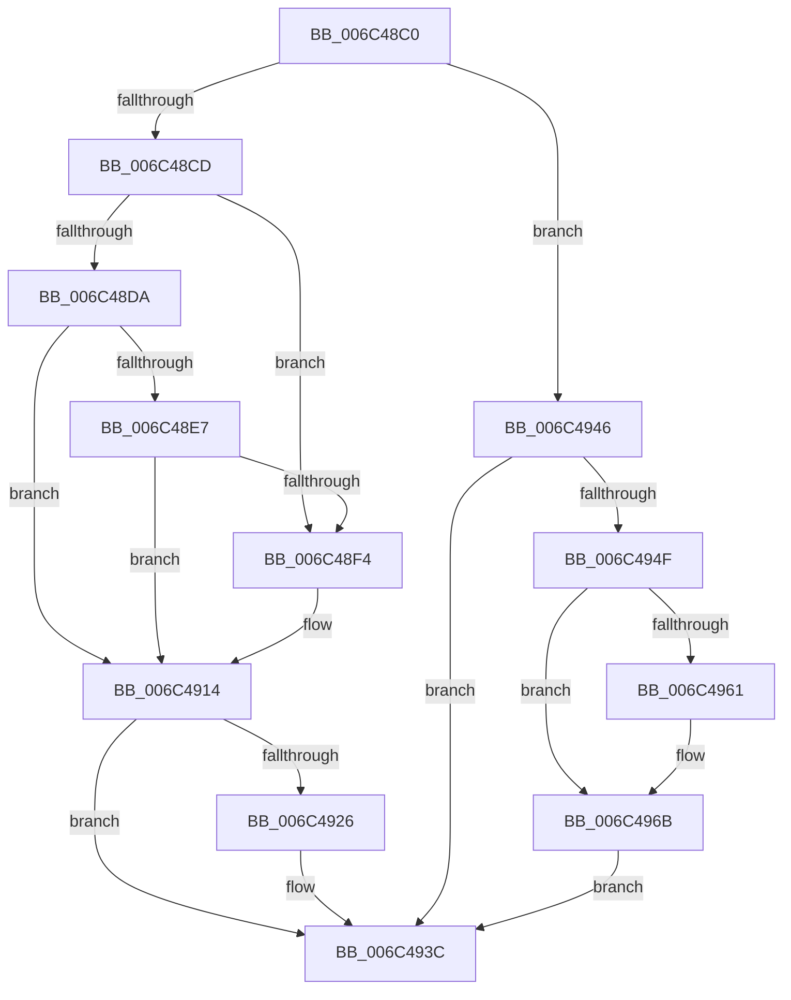

# KiSystemServiceHandler

- RVA: `0x006C48C0`–`0x006C498B` (길이 `203` bytes)
- VA: `0x00000001406C48C0`
- 실행 섹션: `.text`
- PDB 이름 있음: `예`; PDB Function 태그: `아니요`
- unwind 정보 RVA: `0x000C1E04`
- 디코드: `44`개 명령, `203/203` bytes 표시
- 미해석 바이트: `0` (있으면 어셈블리에 `.byte`로 보존)

> 이 문서는 커널 이미지의 기계어와 PDB 기호를 분석해 생성했습니다. 4번과 5번은 함수 원형과 자료형을 바이너리 사용 방식에서 추정한 C 해석이며 원본 소스 복구 결과는 아닙니다.

## 1. Dependencies

- 직접 호출 지점: **3**; 고유 호출 대상: **2**
- 직접 호출자로 확인된 함수: **0**
- RIP 상대 이미지 참조: **4**

### Outgoing calls
- `0x006C490F` → [RtlUnwindEx](../2F/RtlUnwindEx_function_002F2830.md) (function, `0x002F2830`)
- `0x006C4937` → [KiBugCheckDispatch](KiBugCheckDispatch_function_006C5880.md) (function, `0x006C5880`)
- `0x006C4966` → [KiBugCheckDispatch](KiBugCheckDispatch_function_006C5880.md) (function, `0x006C5880`)

### Direct callers
- 이 함수 시작 RVA로 연결되는 직접 call은 확인되지 않았습니다. 간접 호출은 완전히 역산할 수 없습니다.

### Static image references
- `0x006C48CD` → RVA `0x006C4E27` (`KiSystemServiceGdiTebAccess`; read)
- `0x006C48DA` → RVA `0x006C4EC0` (`KiSystemServiceCopyStart`; read)
- `0x006C48E7` → RVA `0x006C4F30` (`KiSystemServiceCopyEnd`; read)
- `0x006C4908` → RVA `0x006C4F60` (`KiSystemServiceExit`; read)

## 2. Other-region calls and transfers

- 다른 실행 섹션으로 향하는 call: **0**
- 별도 외부 분기/꼬리 이동을 확인하지 못했습니다.

## 3. Assembly (complete function range)

```asm
006C48C0  48 83 EC 38                     sub rsp, 0x38
006C48C4  F7 41 04 66 00 00 00            test dword ptr [rcx + 4], 0x66
006C48CB  75 79                           jne 0x1406c4946
006C48CD  48 8D 05 53 05 00 00            lea rax, [rip + 0x553]
006C48D4  48 3B 41 10                     cmp rax, qword ptr [rcx + 0x10]
006C48D8  74 1A                           je 0x1406c48f4
006C48DA  48 8D 05 DF 05 00 00            lea rax, [rip + 0x5df]
006C48E1  48 3B 41 10                     cmp rax, qword ptr [rcx + 0x10]
006C48E5  77 2D                           ja 0x1406c4914
006C48E7  48 8D 05 42 06 00 00            lea rax, [rip + 0x642]
006C48EE  48 3B 41 10                     cmp rax, qword ptr [rcx + 0x10]
006C48F2  76 20                           jbe 0x1406c4914
006C48F4  48 83 64 24 28 00               and qword ptr [rsp + 0x28], 0
006C48FA  4C 89 44 24 20                  mov qword ptr [rsp + 0x20], r8
006C48FF  44 8B 09                        mov r9d, dword ptr [rcx]
006C4902  4C 8B C1                        mov r8, rcx
006C4905  48 8B CA                        mov rcx, rdx
006C4908  48 8D 15 51 06 00 00            lea rdx, [rip + 0x651]
006C490F  E8 1C DF C2 FF                  call 0x1402f2830
006C4914  65 48 8B 04 25 88 01 00 00      mov rax, qword ptr gs:[0x188]
006C491D  80 B8 32 02 00 00 00            cmp byte ptr [rax + 0x232], 0
006C4924  74 16                           je 0x1406c493c
006C4926  4D 33 D2                        xor r10, r10
006C4929  4D 8B C8                        mov r9, r8
006C492C  4C 8B 41 10                     mov r8, qword ptr [rcx + 0x10]
006C4930  8B 11                           mov edx, dword ptr [rcx]
006C4932  B9 3B 00 00 00                  mov ecx, 0x3b
006C4937  E8 44 0F 00 00                  call 0x1406c5880
006C493C  B8 01 00 00 00                  mov eax, 1
006C4941  48 83 C4 38                     add rsp, 0x38
006C4945  C3                              ret
006C4946  F7 41 04 20 00 00 00            test dword ptr [rcx + 4], 0x20
006C494D  75 ED                           jne 0x1406c493c
006C494F  65 48 8B 04 25 88 01 00 00      mov rax, qword ptr gs:[0x188]
006C4958  80 B8 32 02 00 00 00            cmp byte ptr [rax + 0x232], 0
006C495F  74 0A                           je 0x1406c496b
006C4961  B9 3A 00 00 00                  mov ecx, 0x3a
006C4966  E8 15 0F 00 00                  call 0x1406c5880
006C496B  48 8B 88 90 00 00 00            mov rcx, qword ptr [rax + 0x90]
006C4972  48 8B 91 38 01 00 00            mov rdx, qword ptr [rcx + 0x138]
006C4979  48 89 90 90 00 00 00            mov qword ptr [rax + 0x90], rdx
006C4980  8A 51 28                        mov dl, byte ptr [rcx + 0x28]
006C4983  88 90 32 02 00 00               mov byte ptr [rax + 0x232], dl
006C4989  EB B1                           jmp 0x1406c493c
```

## 4. C-style interpretation (structured pseudocode)

```c
__int64 __fastcall KiSystemServiceHandler(__int64 a1, __int64 a2, __int64 a3)
{
    __int64 result;
    __int64 v_r10;
    __int64 v_rsp;
    unsigned __int64 v_stack_m10;
    unsigned __int64 v_stack_m18;

    v_rsp = (v_rsp) - (56);
    if (((*(unsigned int *)(a1 + 4)) & (102)) != 0) goto loc_006C4946;
    if ((v_rip + 1363) == (*(unsigned __int64 *)(a1 + 16))) goto loc_006C48F4;
    if ((v_rip + 1503) > (*(unsigned __int64 *)(a1 + 16))) goto loc_006C4914;
    result = v_rip + 1602;
    if ((v_rip + 1602) >= = (*(unsigned __int64 *)(a1 + 16))) {
        v_stack_m18 = a3;
        a4 = *(unsigned int *)(a1);
        a3 = a1;
        a1 = a2;
        a2 = v_rip + 1617;
        result = RtlUnwindEx(a1, a2, a3, a4);
    }
    result = *(unsigned __int64 *)(gs_base + (0 + 392));
    if ((*(unsigned __int8 *)(*(unsigned __int64 *)(gs_base + (0 + 392)) + 562)) != 0) {
        v_r10 = 0;
        a4 = a3;
        a3 = *(unsigned __int64 *)(a1 + 16);
        a2 = *(unsigned int *)(a1);
        a1 = 59;
        result = KiBugCheckDispatch(a1, a2, a3, a4);
    }
    v_rsp = (v_rsp) + (56);
    return 1;
loc_006C4946:
    if (((*(unsigned int *)(a1 + 4)) & (32)) != 0) goto loc_006C493C;
    result = *(unsigned __int64 *)(gs_base + (0 + 392));
    if ((*(unsigned __int8 *)(*(unsigned __int64 *)(gs_base + (0 + 392)) + 562)) != 0) {
        a1 = 58;
        result = KiBugCheckDispatch(a1, a2, a3, a4);
    }
    *(unsigned __int64 *)(result + 144) = *(unsigned __int64 *)(*(unsigned __int64 *)(result + 144) + 312);
    *(unsigned __int8 *)(result + 562) = (unsigned __int8)(*(unsigned __int8 *)(*(unsigned __int64 *)(result + 144) + 40));
    goto loc_006C493C;
}
```

## 5. (Beta) C Style

```c
int64_t KiSystemServiceHandler(void *Arg1, int64_t Arg2, int64_t Arg3)
{
    uint8_t *arg1 = (uint8_t *)Arg1;

    int64_t result;
    int64_t local_r10;
    int64_t local_rsp;
    uint64_t v_stack_m10;
    uint64_t v_stack_m18;

    local_rsp = (local_rsp) - (56);
    if (((*(uint32_t *)(arg1 + 0x4)) & (102)) != 0) goto loc_006C4946;
    if ((v_rip + 1363) == (*(uint64_t *)(arg1 + 0x10))) goto loc_006C48F4;
    if ((v_rip + 1503) > (*(uint64_t *)(arg1 + 0x10))) goto loc_006C4914;
    result = v_rip + 1602;
    if ((v_rip + 1602) >= = (*(uint64_t *)(arg1 + 0x10))) {
        v_stack_m18 = Arg3;
        a4 = *(uint32_t *)(arg1);
        Arg3 = Arg1;
        Arg1 = Arg2;
        Arg2 = v_rip + 1617;
        result = RtlUnwindEx(Arg1, Arg2, Arg3, a4);
    }
    result = *(uint64_t *)(gs_base + (0 + 0x188));
    if ((*(uint8_t *)(*(uint64_t *)(gs_base + (0 + 0x188)) + 0x232)) != 0) {
        local_r10 = 0;
        a4 = Arg3;
        Arg3 = *(uint64_t *)(arg1 + 0x10);
        Arg2 = *(uint32_t *)(arg1);
        Arg1 = 59;
        result = KiBugCheckDispatch(Arg1, Arg2, Arg3, a4);
    }
    local_rsp = (local_rsp) + (56);
    return 1;
loc_006C4946:
    if (((*(uint32_t *)(arg1 + 0x4)) & (32)) != 0) goto loc_006C493C;
    result = *(uint64_t *)(gs_base + (0 + 0x188));
    if ((*(uint8_t *)(*(uint64_t *)(gs_base + (0 + 0x188)) + 0x232)) != 0) {
        Arg1 = 58;
        result = KiBugCheckDispatch(Arg1, Arg2, Arg3, a4);
    }
    *(uint64_t *)(result + 0x90) = *(uint64_t *)(*(uint64_t *)(result + 0x90) + 0x138);
    *(uint8_t *)(result + 0x232) = (uint8_t)(*(uint8_t *)(*(uint64_t *)(result + 0x90) + 0x28));
    goto loc_006C493C;
}
```

### 관측된 메모리 오프셋

구조체 형식이 확인되지 않은 접근은 인자 기준의 오프셋으로만 기록했습니다.

| 기준 인자 | 오프셋 표현 | 폭 (bit) | 접근 |
|---|---:|---:|---|
| `Arg1` | `+ 0x0` | `32` | `R` |
| `Arg1` | `+ 0x4` | `32` | `R` |
| `Arg1` | `+ 0x10` | `64` | `R` |

## 6. Execution-region graph

[열기: 2D/3D 그래프와 함수 탐색 컨트롤 패널](../../../control-panel.html?section=text&rva=0x006C48C0&view=graph)

- 2D 그래프는 위에서 아래로 흐르고, 3D 그래프는 빈 공간을 드래그해 회전합니다. Shift+드래그는 이동, 휠은 확대·축소, 함수 노드 선택은 대상 보고서 이동입니다.

### Static fallback


