# KiSystemService

- RVA: `0x006C4240`–`0x006C44DC` (길이 `668` bytes)
- VA: `0x00000001406C4240`
- 실행 섹션: `.text`
- PDB 이름 있음: `예`; PDB Function 태그: `아니요`
- unwind 정보 RVA: `0x000C1DC4`
- 디코드: `142`개 명령, `668/668` bytes 표시
- 미해석 바이트: `0` (있으면 어셈블리에 `.byte`로 보존)

> 이 문서는 커널 이미지의 기계어와 PDB 기호를 분석해 생성했습니다. 4번과 5번은 함수 원형과 자료형을 바이너리 사용 방식에서 추정한 C 해석이며 원본 소스 복구 결과는 아닙니다.

## 1. Dependencies

- 직접 호출 지점: **33**; 고유 호출 대상: **33**
- 직접 호출자로 확인된 함수: **1**
- RIP 상대 이미지 참조: **3**

### Outgoing calls
- `0x006C435B` → [KiSystemService + 0x22E](KiSystemService_function_006C4240.md) (inside-function, `0x006C446E`)
- `0x006C4364` → [KiSystemService + 0x237](KiSystemService_function_006C4240.md) (inside-function, `0x006C4477`)
- `0x006C436D` → [KiSystemService + 0x120](KiSystemService_function_006C4240.md) (inside-function, `0x006C4360`)
- `0x006C4376` → [KiSystemService + 0x129](KiSystemService_function_006C4240.md) (inside-function, `0x006C4369`)
- `0x006C437F` → [KiSystemService + 0x132](KiSystemService_function_006C4240.md) (inside-function, `0x006C4372`)
- `0x006C4388` → [KiSystemService + 0x13B](KiSystemService_function_006C4240.md) (inside-function, `0x006C437B`)
- `0x006C4391` → [KiSystemService + 0x144](KiSystemService_function_006C4240.md) (inside-function, `0x006C4384`)
- `0x006C439A` → [KiSystemService + 0x14D](KiSystemService_function_006C4240.md) (inside-function, `0x006C438D`)
- `0x006C43A3` → [KiSystemService + 0x156](KiSystemService_function_006C4240.md) (inside-function, `0x006C4396`)
- `0x006C43AC` → [KiSystemService + 0x15F](KiSystemService_function_006C4240.md) (inside-function, `0x006C439F`)
- `0x006C43B5` → [KiSystemService + 0x168](KiSystemService_function_006C4240.md) (inside-function, `0x006C43A8`)
- `0x006C43BE` → [KiSystemService + 0x171](KiSystemService_function_006C4240.md) (inside-function, `0x006C43B1`)
- `0x006C43C7` → [KiSystemService + 0x17A](KiSystemService_function_006C4240.md) (inside-function, `0x006C43BA`)
- `0x006C43D0` → [KiSystemService + 0x183](KiSystemService_function_006C4240.md) (inside-function, `0x006C43C3`)
- `0x006C43D9` → [KiSystemService + 0x18C](KiSystemService_function_006C4240.md) (inside-function, `0x006C43CC`)
- `0x006C43E2` → [KiSystemService + 0x195](KiSystemService_function_006C4240.md) (inside-function, `0x006C43D5`)
- `0x006C43EB` → [KiSystemService + 0x19E](KiSystemService_function_006C4240.md) (inside-function, `0x006C43DE`)
- `0x006C43F4` → [KiSystemService + 0x1A7](KiSystemService_function_006C4240.md) (inside-function, `0x006C43E7`)
- `0x006C43FD` → [KiSystemService + 0x1B0](KiSystemService_function_006C4240.md) (inside-function, `0x006C43F0`)
- `0x006C4406` → [KiSystemService + 0x1B9](KiSystemService_function_006C4240.md) (inside-function, `0x006C43F9`)
- `0x006C440F` → [KiSystemService + 0x1C2](KiSystemService_function_006C4240.md) (inside-function, `0x006C4402`)
- `0x006C4418` → [KiSystemService + 0x1CB](KiSystemService_function_006C4240.md) (inside-function, `0x006C440B`)
- `0x006C4421` → [KiSystemService + 0x1D4](KiSystemService_function_006C4240.md) (inside-function, `0x006C4414`)
- `0x006C442A` → [KiSystemService + 0x1DD](KiSystemService_function_006C4240.md) (inside-function, `0x006C441D`)
- `0x006C4433` → [KiSystemService + 0x1E6](KiSystemService_function_006C4240.md) (inside-function, `0x006C4426`)
- `0x006C443C` → [KiSystemService + 0x1EF](KiSystemService_function_006C4240.md) (inside-function, `0x006C442F`)
- `0x006C4445` → [KiSystemService + 0x1F8](KiSystemService_function_006C4240.md) (inside-function, `0x006C4438`)
- `0x006C444E` → [KiSystemService + 0x201](KiSystemService_function_006C4240.md) (inside-function, `0x006C4441`)
- `0x006C4457` → [KiSystemService + 0x20A](KiSystemService_function_006C4240.md) (inside-function, `0x006C444A`)
- `0x006C4460` → [KiSystemService + 0x213](KiSystemService_function_006C4240.md) (inside-function, `0x006C4453`)
- `0x006C4469` → [KiSystemService + 0x21C](KiSystemService_function_006C4240.md) (inside-function, `0x006C445C`)
- `0x006C4472` → [KiSystemService + 0x225](KiSystemService_function_006C4240.md) (inside-function, `0x006C4465`)
- `0x006C449D` → [KiFlushBhbDuringTrapEntryOrExit](KiFlushBhbDuringTrapEntryOrExit_function_006C6340.md) (function, `0x006C6340`)

### Direct callers
- [KiSystemService](KiSystemService_function_006C4240.md) at `0x006C435B`
- [KiSystemService](KiSystemService_function_006C4240.md) at `0x006C4364`
- [KiSystemService](KiSystemService_function_006C4240.md) at `0x006C436D`
- [KiSystemService](KiSystemService_function_006C4240.md) at `0x006C4376`
- [KiSystemService](KiSystemService_function_006C4240.md) at `0x006C437F`
- [KiSystemService](KiSystemService_function_006C4240.md) at `0x006C4388`
- [KiSystemService](KiSystemService_function_006C4240.md) at `0x006C4391`
- [KiSystemService](KiSystemService_function_006C4240.md) at `0x006C439A`
- [KiSystemService](KiSystemService_function_006C4240.md) at `0x006C43A3`
- [KiSystemService](KiSystemService_function_006C4240.md) at `0x006C43AC`
- [KiSystemService](KiSystemService_function_006C4240.md) at `0x006C43B5`
- [KiSystemService](KiSystemService_function_006C4240.md) at `0x006C43BE`
- [KiSystemService](KiSystemService_function_006C4240.md) at `0x006C43C7`
- [KiSystemService](KiSystemService_function_006C4240.md) at `0x006C43D0`
- [KiSystemService](KiSystemService_function_006C4240.md) at `0x006C43D9`
- [KiSystemService](KiSystemService_function_006C4240.md) at `0x006C43E2`
- [KiSystemService](KiSystemService_function_006C4240.md) at `0x006C43EB`
- [KiSystemService](KiSystemService_function_006C4240.md) at `0x006C43F4`
- [KiSystemService](KiSystemService_function_006C4240.md) at `0x006C43FD`
- [KiSystemService](KiSystemService_function_006C4240.md) at `0x006C4406`
- [KiSystemService](KiSystemService_function_006C4240.md) at `0x006C440F`
- [KiSystemService](KiSystemService_function_006C4240.md) at `0x006C4418`
- [KiSystemService](KiSystemService_function_006C4240.md) at `0x006C4421`
- [KiSystemService](KiSystemService_function_006C4240.md) at `0x006C442A`
- [KiSystemService](KiSystemService_function_006C4240.md) at `0x006C4433`
- [KiSystemService](KiSystemService_function_006C4240.md) at `0x006C443C`
- [KiSystemService](KiSystemService_function_006C4240.md) at `0x006C4445`
- [KiSystemService](KiSystemService_function_006C4240.md) at `0x006C444E`
- [KiSystemService](KiSystemService_function_006C4240.md) at `0x006C4457`
- [KiSystemService](KiSystemService_function_006C4240.md) at `0x006C4460`
- [KiSystemService](KiSystemService_function_006C4240.md) at `0x006C4469`
- [KiSystemService](KiSystemService_function_006C4240.md) at `0x006C4472`

### Static image references
- `0x006C424C` → RVA `0x01201840` (`CFGRO`; read)
- `0x006C429E` → RVA `0x00FC6BF0` (`ALMOSTRO`; read)
- `0x006C44AE` → RVA `0x00FC7264` (`ALMOSTRO`; read)

## 2. Other-region calls and transfers

- 다른 실행 섹션으로 향하는 call: **0**
- call이 아닌 외부 분기/꼬리 이동: **2**
  - `0x006C4246` → [KiSystemCall32 + 0x37](KiSystemCall32_function_006C4500.md) (`tail-transfer`)
  - `0x006C44D6` → [KiSystemCall64 + 0x2A2](KiSystemCall64_function_006C4A40.md) (`tail-transfer`)

## 3. Assembly (complete function range)

```asm
006C4240  66 83 7C 24 08 23               cmp word ptr [rsp + 8], 0x23
006C4246  0F 84 EB 02 00 00               je 0x1406c4537
006C424C  F6 05 ED D5 B3 00 01            test byte ptr [rip + 0xb3d5ed], 1
006C4253  75 03                           jne 0x1406c4258
006C4255  0F 01 F8                        swapgs
006C4258  0F AE E8                        lfence
006C425B  65 48 8B 0C 25 28 9D 00 00      mov rcx, qword ptr gs:[0x9d28]
006C4264  48 85 C9                        test rcx, rcx
006C4267  74 08                           je 0x1406c4271
006C4269  F3 0F 01 29                     rstorssp dword ptr [rcx]
006C426D  F3 0F 01 EA                     saveprevssp
006C4271  49 8B CA                        mov rcx, r10
006C4274  48 83 EC 08                     sub rsp, 8
006C4278  55                              push rbp
006C4279  48 81 EC 58 01 00 00            sub rsp, 0x158
006C4280  48 8D AC 24 80 00 00 00         lea rbp, [rsp + 0x80]
006C4288  48 89 9D C0 00 00 00            mov qword ptr [rbp + 0xc0], rbx
006C428F  48 89 BD C8 00 00 00            mov qword ptr [rbp + 0xc8], rdi
006C4296  48 89 B5 D0 00 00 00            mov qword ptr [rbp + 0xd0], rsi
006C429D  FC                              cld
006C429E  F6 05 4B 29 90 00 FF            test byte ptr [rip + 0x90294b], 0xff
006C42A5  74 0C                           je 0x1406c42b3
006C42A7  F6 85 F0 00 00 00 01            test byte ptr [rbp + 0xf0], 1
006C42AE  74 03                           je 0x1406c42b3
006C42B0  0F 01 CB                        stac
006C42B3  48 89 45 B0                     mov qword ptr [rbp - 0x50], rax
006C42B7  48 89 4D B8                     mov qword ptr [rbp - 0x48], rcx
006C42BB  48 89 55 C0                     mov qword ptr [rbp - 0x40], rdx
006C42BF  65 48 8B 0C 25 88 01 00 00      mov rcx, qword ptr gs:[0x188]
006C42C8  48 8B 89 20 02 00 00            mov rcx, qword ptr [rcx + 0x220]
006C42CF  48 8B 89 60 07 00 00            mov rcx, qword ptr [rcx + 0x760]
006C42D6  65 48 89 0C 25 50 08 00 00      mov qword ptr gs:[0x850], rcx
006C42DF  66 65 8B 0C 25 62 08 00 00      mov cx, word ptr gs:[0x862]
006C42E8  66 65 89 0C 25 64 08 00 00      mov word ptr gs:[0x864], cx
006C42F1  65 8A 0C 25 58 08 00 00         mov cl, byte ptr gs:[0x858]
006C42F9  65 88 0C 25 5A 08 00 00         mov byte ptr gs:[0x85a], cl
006C4301  65 0F B7 04 25 68 08 00 00      movzx eax, word ptr gs:[0x868]
006C430A  66 65 39 04 25 66 08 00 00      cmp word ptr gs:[0x866], ax
006C4313  74 12                           je 0x1406c4327
006C4315  66 65 89 04 25 66 08 00 00      mov word ptr gs:[0x866], ax
006C431E  B9 48 00 00 00                  mov ecx, 0x48
006C4323  33 D2                           xor edx, edx
006C4325  0F 30                           wrmsr
006C4327  65 0F B6 14 25 58 08 00 00      movzx edx, byte ptr gs:[0x858]
006C4330  F7 C2 08 00 00 00               test edx, 8
006C4336  74 17                           je 0x1406c434f
006C4338  B8 01 00 00 00                  mov eax, 1
006C433D  33 D2                           xor edx, edx
006C433F  B9 49 00 00 00                  mov ecx, 0x49
006C4344  0F 30                           wrmsr
006C4346  65 0F B6 14 25 58 08 00 00      movzx edx, byte ptr gs:[0x858]
006C434F  F7 C2 02 00 00 00               test edx, 2
006C4355  0F 84 37 01 00 00               je 0x1406c4492
006C435B  E8 0E 01 00 00                  call 0x1406c446e
006C4360  48 83 C4 08                     add rsp, 8
006C4364  E8 0E 01 00 00                  call 0x1406c4477
006C4369  48 83 C4 08                     add rsp, 8
006C436D  E8 EE FF FF FF                  call 0x1406c4360
006C4372  48 83 C4 08                     add rsp, 8
006C4376  E8 EE FF FF FF                  call 0x1406c4369
006C437B  48 83 C4 08                     add rsp, 8
006C437F  E8 EE FF FF FF                  call 0x1406c4372
006C4384  48 83 C4 08                     add rsp, 8
006C4388  E8 EE FF FF FF                  call 0x1406c437b
006C438D  48 83 C4 08                     add rsp, 8
006C4391  E8 EE FF FF FF                  call 0x1406c4384
006C4396  48 83 C4 08                     add rsp, 8
006C439A  E8 EE FF FF FF                  call 0x1406c438d
006C439F  48 83 C4 08                     add rsp, 8
006C43A3  E8 EE FF FF FF                  call 0x1406c4396
006C43A8  48 83 C4 08                     add rsp, 8
006C43AC  E8 EE FF FF FF                  call 0x1406c439f
006C43B1  48 83 C4 08                     add rsp, 8
006C43B5  E8 EE FF FF FF                  call 0x1406c43a8
006C43BA  48 83 C4 08                     add rsp, 8
006C43BE  E8 EE FF FF FF                  call 0x1406c43b1
006C43C3  48 83 C4 08                     add rsp, 8
006C43C7  E8 EE FF FF FF                  call 0x1406c43ba
006C43CC  48 83 C4 08                     add rsp, 8
006C43D0  E8 EE FF FF FF                  call 0x1406c43c3
006C43D5  48 83 C4 08                     add rsp, 8
006C43D9  E8 EE FF FF FF                  call 0x1406c43cc
006C43DE  48 83 C4 08                     add rsp, 8
006C43E2  E8 EE FF FF FF                  call 0x1406c43d5
006C43E7  48 83 C4 08                     add rsp, 8
006C43EB  E8 EE FF FF FF                  call 0x1406c43de
006C43F0  48 83 C4 08                     add rsp, 8
006C43F4  E8 EE FF FF FF                  call 0x1406c43e7
006C43F9  48 83 C4 08                     add rsp, 8
006C43FD  E8 EE FF FF FF                  call 0x1406c43f0
006C4402  48 83 C4 08                     add rsp, 8
006C4406  E8 EE FF FF FF                  call 0x1406c43f9
006C440B  48 83 C4 08                     add rsp, 8
006C440F  E8 EE FF FF FF                  call 0x1406c4402
006C4414  48 83 C4 08                     add rsp, 8
006C4418  E8 EE FF FF FF                  call 0x1406c440b
006C441D  48 83 C4 08                     add rsp, 8
006C4421  E8 EE FF FF FF                  call 0x1406c4414
006C4426  48 83 C4 08                     add rsp, 8
006C442A  E8 EE FF FF FF                  call 0x1406c441d
006C442F  48 83 C4 08                     add rsp, 8
006C4433  E8 EE FF FF FF                  call 0x1406c4426
006C4438  48 83 C4 08                     add rsp, 8
006C443C  E8 EE FF FF FF                  call 0x1406c442f
006C4441  48 83 C4 08                     add rsp, 8
006C4445  E8 EE FF FF FF                  call 0x1406c4438
006C444A  48 83 C4 08                     add rsp, 8
006C444E  E8 EE FF FF FF                  call 0x1406c4441
006C4453  48 83 C4 08                     add rsp, 8
006C4457  E8 EE FF FF FF                  call 0x1406c444a
006C445C  48 83 C4 08                     add rsp, 8
006C4460  E8 EE FF FF FF                  call 0x1406c4453
006C4465  48 83 C4 08                     add rsp, 8
006C4469  E8 EE FF FF FF                  call 0x1406c445c
006C446E  48 83 C4 08                     add rsp, 8
006C4472  E8 EE FF FF FF                  call 0x1406c4465
006C4477  48 83 C4 08                     add rsp, 8
006C447B  B8 DA DA 00 00                  mov eax, 0xdada
006C4480  65 F6 04 25 5C 08 00 00 08      test byte ptr gs:[0x85c], 8
006C4489  74 07                           je 0x1406c4492
006C448B  B0 20                           mov al, 0x20
006C448D  F3 48 0F AE E8                  incsspq rax
006C4492  F7 C2 80 00 00 00               test edx, 0x80
006C4498  74 08                           je 0x1406c44a2
006C449A  0F AE E8                        lfence
006C449D  E8 9E 1E 00 00                  call 0x1406c6340
006C44A2  0F AE E8                        lfence
006C44A5  65 C6 04 25 5E 08 00 00 00      mov byte ptr gs:[0x85e], 0
006C44AE  83 3D AF 2D 90 00 00            cmp dword ptr [rip + 0x902daf], 0
006C44B5  74 1F                           je 0x1406c44d6
006C44B7  B9 A7 06 00 00                  mov ecx, 0x6a7
006C44BC  0F 32                           rdmsr
006C44BE  83 FA 00                        cmp edx, 0
006C44C1  74 13                           je 0x1406c44d6
006C44C3  8B CA                           mov ecx, edx
006C44C5  23 15 99 2D 90 00               and edx, dword ptr [rip + 0x902d99]
006C44CB  3B D1                           cmp edx, ecx
006C44CD  74 07                           je 0x1406c44d6
006C44CF  B9 A7 06 00 00                  mov ecx, 0x6a7
006C44D4  0F 30                           wrmsr
006C44D6  E9 07 08 00 00                  jmp 0x1406c4ce2
006C44DB  C3                              ret
```

## 4. C-style interpretation (structured pseudocode)

```c
__int64 __fastcall KiSystemService(__int64 a1, __int64 a2)
{
    __int64 result;
    __int64 v_rsp;
    unsigned __int64 v_stack_m128;
    unsigned __int64 v_stack_m130;
    unsigned __int64 v_stack_m138;
    unsigned __int64 v_stack_m18;
    unsigned __int64 v_stack_m20;
    unsigned __int64 v_stack_m28;
    unsigned __int64 v_stack_mE8;
    unsigned __int16 v_stack_p8;

    if (((*(unsigned __int8 *)(v_rip + 11785709)) & (1)) == 0) {
    }
    if (*(unsigned __int64 *)(gs_base + (0 + 40232)) != 0) {
    }
    v_rsp = (v_rsp) - (8);
    v_rsp = (v_rsp) - (344);
    v_stack_m28 = v_rbx;
    v_stack_m20 = v_rdi;
    v_stack_m18 = v_rsi;
    if (((*(unsigned __int8 *)(v_rip + 9447755)) & (255)) == 0) goto loc_006C42B3;
    if (((v_stack_p8) & (1)) != 0) {
    }
    v_stack_m138 = result;
    v_stack_m130 = v_r10;
    v_stack_m128 = a2;
    *(unsigned __int64 *)(gs_base + (0 + 2128)) = *(unsigned __int64 *)(*(unsigned __int64 *)(*(unsigned __int64 *)(gs_base + (0 + 392)) + 544) + 1888);
    *(unsigned __int16 *)(gs_base + (0 + 2148)) = (unsigned __int16)(*(unsigned __int16 *)(gs_base + (0 + 2146)));
    *(unsigned __int8 *)(gs_base + (0 + 2138)) = (unsigned __int8)(*(unsigned __int8 *)(gs_base + (0 + 2136)));
    if ((*(unsigned __int16 *)(gs_base + (0 + 2150))) != ((unsigned __int16)(*(unsigned __int16 *)(gs_base + (0 + 2152))))) {
        *(unsigned __int16 *)(gs_base + (0 + 2150)) = (unsigned __int16)(*(unsigned __int16 *)(gs_base + (0 + 2152)));
        a1 = 72;
        a2 = 0;
    }
    result = *(unsigned __int16 *)(gs_base + (0 + 2152));
    if ((((unsigned int)(*(unsigned __int8 *)(gs_base + (0 + 2136)))) & (8)) != 0) {
        result = 1;
        a2 = 0;
        a1 = 73;
        a2 = *(unsigned __int8 *)(gs_base + (0 + 2136));
    }
    if ((((unsigned int)(a2)) & (2)) == 0) goto loc_006C4492;
    result = KiSystemService___0x22E(a1, a2, a3, a4);
    v_rsp = (v_rsp) + (8);
    result = KiSystemService___0x237(a1, a2, a3, a4);
    v_rsp = (v_rsp) + (8);
    result = KiSystemService___0x120(a1, a2, a3, a4);
    v_rsp = (v_rsp) + (8);
    result = KiSystemService___0x129(a1, a2, a3, a4);
    v_rsp = (v_rsp) + (8);
    result = KiSystemService___0x132(a1, a2, a3, a4);
    v_rsp = (v_rsp) + (8);
    result = KiSystemService___0x13B(a1, a2, a3, a4);
    v_rsp = (v_rsp) + (8);
    result = KiSystemService___0x144(a1, a2, a3, a4);
    v_rsp = (v_rsp) + (8);
    result = KiSystemService___0x14D(a1, a2, a3, a4);
    v_rsp = (v_rsp) + (8);
    result = KiSystemService___0x156(a1, a2, a3, a4);
    v_rsp = (v_rsp) + (8);
    result = KiSystemService___0x15F(a1, a2, a3, a4);
    v_rsp = (v_rsp) + (8);
    result = KiSystemService___0x168(a1, a2, a3, a4);
    v_rsp = (v_rsp) + (8);
    result = KiSystemService___0x171(a1, a2, a3, a4);
    v_rsp = (v_rsp) + (8);
    result = KiSystemService___0x17A(a1, a2, a3, a4);
    v_rsp = (v_rsp) + (8);
    result = KiSystemService___0x183(a1, a2, a3, a4);
    v_rsp = (v_rsp) + (8);
    result = KiSystemService___0x18C(a1, a2, a3, a4);
    v_rsp = (v_rsp) + (8);
    result = KiSystemService___0x195(a1, a2, a3, a4);
    v_rsp = (v_rsp) + (8);
    result = KiSystemService___0x19E(a1, a2, a3, a4);
    v_rsp = (v_rsp) + (8);
    result = KiSystemService___0x1A7(a1, a2, a3, a4);
    v_rsp = (v_rsp) + (8);
    result = KiSystemService___0x1B0(a1, a2, a3, a4);
    v_rsp = (v_rsp) + (8);
    result = KiSystemService___0x1B9(a1, a2, a3, a4);
    v_rsp = (v_rsp) + (8);
    result = KiSystemService___0x1C2(a1, a2, a3, a4);
    v_rsp = (v_rsp) + (8);
    result = KiSystemService___0x1CB(a1, a2, a3, a4);
    v_rsp = (v_rsp) + (8);
    result = KiSystemService___0x1D4(a1, a2, a3, a4);
    v_rsp = (v_rsp) + (8);
    result = KiSystemService___0x1DD(a1, a2, a3, a4);
    v_rsp = (v_rsp) + (8);
    result = KiSystemService___0x1E6(a1, a2, a3, a4);
    v_rsp = (v_rsp) + (8);
    result = KiSystemService___0x1EF(a1, a2, a3, a4);
    v_rsp = (v_rsp) + (8);
    result = KiSystemService___0x1F8(a1, a2, a3, a4);
    v_rsp = (v_rsp) + (8);
    result = KiSystemService___0x201(a1, a2, a3, a4);
    v_rsp = (v_rsp) + (8);
    result = KiSystemService___0x20A(a1, a2, a3, a4);
    v_rsp = (v_rsp) + (8);
    result = KiSystemService___0x213(a1, a2, a3, a4);
    v_rsp = (v_rsp) + (8);
    result = KiSystemService___0x21C(a1, a2, a3, a4);
    v_rsp = (v_rsp) + (8);
    result = KiSystemService___0x225(a1, a2, a3, a4);
    v_rsp = (v_rsp) + (8);
    result = (unsigned int)(0xDADAULL);
    if (((*(unsigned __int8 *)(gs_base + (0 + 2140))) & (8)) != 0) {
        result = 32;
    }
    if ((((unsigned int)(a2)) & (128)) != 0) {
        result = KiFlushBhbDuringTrapEntryOrExit(a1, a2, a3, a4);
    }
    *(unsigned __int8 *)(gs_base + (0 + 2142)) = 0;
    if ((*(unsigned int *)(v_rip + 9448879)) == 0) goto loc_006C44D6;
    if (((unsigned int)(a2)) == 0) goto loc_006C44D6;
    a2 = (unsigned int)((a2) & (*(unsigned int *)(v_rip + 9448857)));
    if (((unsigned int)(a2)) != ((unsigned int)((unsigned int)((unsigned int)(a2))))) {
        a1 = 0x6A7ULL;
    }
}
```

## 5. (Beta) C Style

```c
int64_t KiSystemService(int64_t Arg1, int64_t Arg2)
{
    int64_t result;
    int64_t local_rsp;
    uint64_t v_stack_m128;
    uint64_t v_stack_m130;
    uint64_t v_stack_m138;
    uint64_t v_stack_m18;
    uint64_t v_stack_m20;
    uint64_t v_stack_m28;
    uint64_t v_stack_mE8;
    uint16_t v_stack_p8;

    if (((*(uint8_t *)(v_rip + 0xB3D5ED)) & (1)) == 0) {
    }
    if (*(uint64_t *)(gs_base + (0 + 0x9D28)) != 0) {
    }
    local_rsp = (local_rsp) - (8);
    local_rsp = (local_rsp) - (344);
    v_stack_m28 = local_rbx;
    v_stack_m20 = local_rdi;
    v_stack_m18 = local_rsi;
    if (((*(uint8_t *)(v_rip + 0x90294B)) & (255)) == 0) goto loc_006C42B3;
    if (((v_stack_p8) & (1)) != 0) {
    }
    v_stack_m138 = result;
    v_stack_m130 = local_r10;
    v_stack_m128 = Arg2;
    *(uint64_t *)(gs_base + (0 + 0x850)) = *(uint64_t *)(*(uint64_t *)(*(uint64_t *)(gs_base + (0 + 0x188)) + 0x220) + 0x760);
    *(uint16_t *)(gs_base + (0 + 0x864)) = (uint16_t)(*(uint16_t *)(gs_base + (0 + 0x862)));
    *(uint8_t *)(gs_base + (0 + 0x85A)) = (uint8_t)(*(uint8_t *)(gs_base + (0 + 0x858)));
    if ((*(uint16_t *)(gs_base + (0 + 0x866))) != ((uint16_t)(*(uint16_t *)(gs_base + (0 + 0x868))))) {
        *(uint16_t *)(gs_base + (0 + 0x866)) = (uint16_t)(*(uint16_t *)(gs_base + (0 + 0x868)));
        Arg1 = 72;
        Arg2 = 0;
    }
    result = *(uint16_t *)(gs_base + (0 + 0x868));
    if ((((uint32_t)(*(uint8_t *)(gs_base + (0 + 0x858)))) & (8)) != 0) {
        result = 1;
        Arg2 = 0;
        Arg1 = 73;
        Arg2 = *(uint8_t *)(gs_base + (0 + 0x858));
    }
    if ((((uint32_t)(Arg2)) & (2)) == 0) goto loc_006C4492;
    result = KiSystemService___0x22E(Arg1, Arg2, a3, a4);
    local_rsp = (local_rsp) + (8);
    result = KiSystemService___0x237(Arg1, Arg2, a3, a4);
    local_rsp = (local_rsp) + (8);
    result = KiSystemService___0x120(Arg1, Arg2, a3, a4);
    local_rsp = (local_rsp) + (8);
    result = KiSystemService___0x129(Arg1, Arg2, a3, a4);
    local_rsp = (local_rsp) + (8);
    result = KiSystemService___0x132(Arg1, Arg2, a3, a4);
    local_rsp = (local_rsp) + (8);
    result = KiSystemService___0x13B(Arg1, Arg2, a3, a4);
    local_rsp = (local_rsp) + (8);
    result = KiSystemService___0x144(Arg1, Arg2, a3, a4);
    local_rsp = (local_rsp) + (8);
    result = KiSystemService___0x14D(Arg1, Arg2, a3, a4);
    local_rsp = (local_rsp) + (8);
    result = KiSystemService___0x156(Arg1, Arg2, a3, a4);
    local_rsp = (local_rsp) + (8);
    result = KiSystemService___0x15F(Arg1, Arg2, a3, a4);
    local_rsp = (local_rsp) + (8);
    result = KiSystemService___0x168(Arg1, Arg2, a3, a4);
    local_rsp = (local_rsp) + (8);
    result = KiSystemService___0x171(Arg1, Arg2, a3, a4);
    local_rsp = (local_rsp) + (8);
    result = KiSystemService___0x17A(Arg1, Arg2, a3, a4);
    local_rsp = (local_rsp) + (8);
    result = KiSystemService___0x183(Arg1, Arg2, a3, a4);
    local_rsp = (local_rsp) + (8);
    result = KiSystemService___0x18C(Arg1, Arg2, a3, a4);
    local_rsp = (local_rsp) + (8);
    result = KiSystemService___0x195(Arg1, Arg2, a3, a4);
    local_rsp = (local_rsp) + (8);
    result = KiSystemService___0x19E(Arg1, Arg2, a3, a4);
    local_rsp = (local_rsp) + (8);
    result = KiSystemService___0x1A7(Arg1, Arg2, a3, a4);
    local_rsp = (local_rsp) + (8);
    result = KiSystemService___0x1B0(Arg1, Arg2, a3, a4);
    local_rsp = (local_rsp) + (8);
    result = KiSystemService___0x1B9(Arg1, Arg2, a3, a4);
    local_rsp = (local_rsp) + (8);
    result = KiSystemService___0x1C2(Arg1, Arg2, a3, a4);
    local_rsp = (local_rsp) + (8);
    result = KiSystemService___0x1CB(Arg1, Arg2, a3, a4);
    local_rsp = (local_rsp) + (8);
    result = KiSystemService___0x1D4(Arg1, Arg2, a3, a4);
    local_rsp = (local_rsp) + (8);
    result = KiSystemService___0x1DD(Arg1, Arg2, a3, a4);
    local_rsp = (local_rsp) + (8);
    result = KiSystemService___0x1E6(Arg1, Arg2, a3, a4);
    local_rsp = (local_rsp) + (8);
    result = KiSystemService___0x1EF(Arg1, Arg2, a3, a4);
    local_rsp = (local_rsp) + (8);
    result = KiSystemService___0x1F8(Arg1, Arg2, a3, a4);
    local_rsp = (local_rsp) + (8);
    result = KiSystemService___0x201(Arg1, Arg2, a3, a4);
    local_rsp = (local_rsp) + (8);
    result = KiSystemService___0x20A(Arg1, Arg2, a3, a4);
    local_rsp = (local_rsp) + (8);
    result = KiSystemService___0x213(Arg1, Arg2, a3, a4);
    local_rsp = (local_rsp) + (8);
    result = KiSystemService___0x21C(Arg1, Arg2, a3, a4);
    local_rsp = (local_rsp) + (8);
    result = KiSystemService___0x225(Arg1, Arg2, a3, a4);
    local_rsp = (local_rsp) + (8);
    result = (uint32_t)(0xDADAULL);
    if (((*(uint8_t *)(gs_base + (0 + 0x85C))) & (8)) != 0) {
        result = 32;
    }
    if ((((uint32_t)(Arg2)) & (128)) != 0) {
        result = KiFlushBhbDuringTrapEntryOrExit(Arg1, Arg2, a3, a4);
    }
    *(uint8_t *)(gs_base + (0 + 0x85E)) = 0;
    if ((*(uint32_t *)(v_rip + 0x902DAF)) == 0) goto loc_006C44D6;
    if (((uint32_t)(Arg2)) == 0) goto loc_006C44D6;
    Arg2 = (uint32_t)((Arg2) & (*(uint32_t *)(v_rip + 0x902D99)));
    if (((uint32_t)(Arg2)) != ((uint32_t)((uint32_t)((uint32_t)(Arg2))))) {
        Arg1 = 0x6A7ULL;
    }
}
```

## 6. Execution-region graph

[열기: 2D/3D 그래프와 함수 탐색 컨트롤 패널](../../../control-panel.html?section=text&rva=0x006C4240&view=graph)

- 2D 그래프는 위에서 아래로 흐르고, 3D 그래프는 빈 공간을 드래그해 회전합니다. Shift+드래그는 이동, 휠은 확대·축소, 함수 노드 선택은 대상 보고서 이동입니다.

### Static fallback

```mermaid
flowchart TD
  bb_006C4240[BB_006C4240]
  bb_006C424C[BB_006C424C]
  bb_006C4255[BB_006C4255]
  bb_006C4258[BB_006C4258]
  bb_006C4269[BB_006C4269]
  bb_006C4271[BB_006C4271]
  bb_006C42A7[BB_006C42A7]
  bb_006C42B0[BB_006C42B0]
  bb_006C42B3[BB_006C42B3]
  bb_006C4315[BB_006C4315]
  bb_006C4327[BB_006C4327]
  bb_006C4338[BB_006C4338]
  bb_006C434F[BB_006C434F]
  bb_006C435B[BB_006C435B]
  bb_006C448B[BB_006C448B]
  bb_006C4492[BB_006C4492]
  bb_006C449A[BB_006C449A]
  bb_006C44A2[BB_006C44A2]
  bb_006C44B7[BB_006C44B7]
  bb_006C44C3[BB_006C44C3]
  bb_006C44CF[BB_006C44CF]
  bb_006C44D6[BB_006C44D6]
  bb_006C44DB[BB_006C44DB]
  bb_006C4240 -->|fallthrough| bb_006C424C
  bb_006C424C -->|branch| bb_006C4258
  bb_006C424C -->|fallthrough| bb_006C4255
  bb_006C4255 -->|flow| bb_006C4258
  bb_006C4258 -->|branch| bb_006C4271
  bb_006C4258 -->|fallthrough| bb_006C4269
  bb_006C4269 -->|flow| bb_006C4271
  bb_006C4271 -->|branch| bb_006C42B3
  bb_006C4271 -->|fallthrough| bb_006C42A7
  bb_006C42A7 -->|branch| bb_006C42B3
  bb_006C42A7 -->|fallthrough| bb_006C42B0
  bb_006C42B0 -->|flow| bb_006C42B3
  bb_006C42B3 -->|branch| bb_006C4327
  bb_006C42B3 -->|fallthrough| bb_006C4315
  bb_006C4315 -->|flow| bb_006C4327
  bb_006C4327 -->|branch| bb_006C434F
  bb_006C4327 -->|fallthrough| bb_006C4338
  bb_006C4338 -->|flow| bb_006C434F
  bb_006C434F -->|branch| bb_006C4492
  bb_006C434F -->|fallthrough| bb_006C435B
  bb_006C435B -->|branch| bb_006C4492
  bb_006C435B -->|fallthrough| bb_006C448B
  bb_006C448B -->|flow| bb_006C4492
  bb_006C4492 -->|branch| bb_006C44A2
  bb_006C4492 -->|fallthrough| bb_006C449A
  bb_006C449A -->|flow| bb_006C44A2
  bb_006C44A2 -->|branch| bb_006C44D6
  bb_006C44A2 -->|fallthrough| bb_006C44B7
  bb_006C44B7 -->|branch| bb_006C44D6
  bb_006C44B7 -->|fallthrough| bb_006C44C3
  bb_006C44C3 -->|branch| bb_006C44D6
  bb_006C44C3 -->|fallthrough| bb_006C44CF
  bb_006C44CF -->|flow| bb_006C44D6
```


