# KiXmmException

- RVA: `0x006C2500`–`0x006C28EB` (길이 `1,003` bytes)
- VA: `0x00000001406C2500`
- 실행 섹션: `.text`
- PDB 이름 있음: `예`; PDB Function 태그: `아니요`
- unwind 정보 RVA: `0x000C1D44`
- 디코드: `231`개 명령, `1,003/1,003` bytes 표시
- 미해석 바이트: `0` (있으면 어셈블리에 `.byte`로 보존)

> 이 문서는 커널 이미지의 기계어와 PDB 기호를 분석해 생성했습니다. 4번과 5번은 함수 원형과 자료형을 바이너리 사용 방식에서 추정한 C 해석이며 원본 소스 복구 결과는 아닙니다.

## 1. Dependencies

- 직접 호출 지점: **37**; 고유 호출 대상: **37**
- 직접 호출자로 확인된 함수: **1**
- RIP 상대 이미지 참조: **3**

### Outgoing calls
- `0x006C2656` → [KiXmmException + 0x269](KiXmmException_function_006C2500.md) (inside-function, `0x006C2769`)
- `0x006C265F` → [KiXmmException + 0x272](KiXmmException_function_006C2500.md) (inside-function, `0x006C2772`)
- `0x006C2668` → [KiXmmException + 0x15B](KiXmmException_function_006C2500.md) (inside-function, `0x006C265B`)
- `0x006C2671` → [KiXmmException + 0x164](KiXmmException_function_006C2500.md) (inside-function, `0x006C2664`)
- `0x006C267A` → [KiXmmException + 0x16D](KiXmmException_function_006C2500.md) (inside-function, `0x006C266D`)
- `0x006C2683` → [KiXmmException + 0x176](KiXmmException_function_006C2500.md) (inside-function, `0x006C2676`)
- `0x006C268C` → [KiXmmException + 0x17F](KiXmmException_function_006C2500.md) (inside-function, `0x006C267F`)
- `0x006C2695` → [KiXmmException + 0x188](KiXmmException_function_006C2500.md) (inside-function, `0x006C2688`)
- `0x006C269E` → [KiXmmException + 0x191](KiXmmException_function_006C2500.md) (inside-function, `0x006C2691`)
- `0x006C26A7` → [KiXmmException + 0x19A](KiXmmException_function_006C2500.md) (inside-function, `0x006C269A`)
- `0x006C26B0` → [KiXmmException + 0x1A3](KiXmmException_function_006C2500.md) (inside-function, `0x006C26A3`)
- `0x006C26B9` → [KiXmmException + 0x1AC](KiXmmException_function_006C2500.md) (inside-function, `0x006C26AC`)
- `0x006C26C2` → [KiXmmException + 0x1B5](KiXmmException_function_006C2500.md) (inside-function, `0x006C26B5`)
- `0x006C26CB` → [KiXmmException + 0x1BE](KiXmmException_function_006C2500.md) (inside-function, `0x006C26BE`)
- `0x006C26D4` → [KiXmmException + 0x1C7](KiXmmException_function_006C2500.md) (inside-function, `0x006C26C7`)
- `0x006C26DD` → [KiXmmException + 0x1D0](KiXmmException_function_006C2500.md) (inside-function, `0x006C26D0`)
- `0x006C26E6` → [KiXmmException + 0x1D9](KiXmmException_function_006C2500.md) (inside-function, `0x006C26D9`)
- `0x006C26EF` → [KiXmmException + 0x1E2](KiXmmException_function_006C2500.md) (inside-function, `0x006C26E2`)
- `0x006C26F8` → [KiXmmException + 0x1EB](KiXmmException_function_006C2500.md) (inside-function, `0x006C26EB`)
- `0x006C2701` → [KiXmmException + 0x1F4](KiXmmException_function_006C2500.md) (inside-function, `0x006C26F4`)
- `0x006C270A` → [KiXmmException + 0x1FD](KiXmmException_function_006C2500.md) (inside-function, `0x006C26FD`)
- `0x006C2713` → [KiXmmException + 0x206](KiXmmException_function_006C2500.md) (inside-function, `0x006C2706`)
- `0x006C271C` → [KiXmmException + 0x20F](KiXmmException_function_006C2500.md) (inside-function, `0x006C270F`)
- `0x006C2725` → [KiXmmException + 0x218](KiXmmException_function_006C2500.md) (inside-function, `0x006C2718`)
- `0x006C272E` → [KiXmmException + 0x221](KiXmmException_function_006C2500.md) (inside-function, `0x006C2721`)
- `0x006C2737` → [KiXmmException + 0x22A](KiXmmException_function_006C2500.md) (inside-function, `0x006C272A`)
- `0x006C2740` → [KiXmmException + 0x233](KiXmmException_function_006C2500.md) (inside-function, `0x006C2733`)
- `0x006C2749` → [KiXmmException + 0x23C](KiXmmException_function_006C2500.md) (inside-function, `0x006C273C`)
- `0x006C2752` → [KiXmmException + 0x245](KiXmmException_function_006C2500.md) (inside-function, `0x006C2745`)
- `0x006C275B` → [KiXmmException + 0x24E](KiXmmException_function_006C2500.md) (inside-function, `0x006C274E`)
- `0x006C2764` → [KiXmmException + 0x257](KiXmmException_function_006C2500.md) (inside-function, `0x006C2757`)
- `0x006C276D` → [KiXmmException + 0x260](KiXmmException_function_006C2500.md) (inside-function, `0x006C2760`)
- `0x006C2798` → [KiFlushBhbDuringTrapEntryOrExit](KiFlushBhbDuringTrapEntryOrExit_function_006C6340.md) (function, `0x006C6340`)
- `0x006C27E1` → [KiSaveDebugRegisterState](../4F/KiSaveDebugRegisterState_function_004FD960.md) (function, `0x004FD960`)
- `0x006C2815` → [KiSynchronizeUserIsolationDomainExit](../41/KiSynchronizeUserIsolationDomainExit_function_0041BFA0.md) (function, `0x0041BFA0`)
- `0x006C28A4` → [KiExceptionDispatch](KiExceptionDispatch_function_006C5900.md) (function, `0x006C5900`)
- `0x006C28E4` → [KiBugCheckDispatch](KiBugCheckDispatch_function_006C5880.md) (function, `0x006C5880`)

### Direct callers
- [KiXmmException](KiXmmException_function_006C2500.md) at `0x006C2656`
- [KiXmmException](KiXmmException_function_006C2500.md) at `0x006C265F`
- [KiXmmException](KiXmmException_function_006C2500.md) at `0x006C2668`
- [KiXmmException](KiXmmException_function_006C2500.md) at `0x006C2671`
- [KiXmmException](KiXmmException_function_006C2500.md) at `0x006C267A`
- [KiXmmException](KiXmmException_function_006C2500.md) at `0x006C2683`
- [KiXmmException](KiXmmException_function_006C2500.md) at `0x006C268C`
- [KiXmmException](KiXmmException_function_006C2500.md) at `0x006C2695`
- [KiXmmException](KiXmmException_function_006C2500.md) at `0x006C269E`
- [KiXmmException](KiXmmException_function_006C2500.md) at `0x006C26A7`
- [KiXmmException](KiXmmException_function_006C2500.md) at `0x006C26B0`
- [KiXmmException](KiXmmException_function_006C2500.md) at `0x006C26B9`
- [KiXmmException](KiXmmException_function_006C2500.md) at `0x006C26C2`
- [KiXmmException](KiXmmException_function_006C2500.md) at `0x006C26CB`
- [KiXmmException](KiXmmException_function_006C2500.md) at `0x006C26D4`
- [KiXmmException](KiXmmException_function_006C2500.md) at `0x006C26DD`
- [KiXmmException](KiXmmException_function_006C2500.md) at `0x006C26E6`
- [KiXmmException](KiXmmException_function_006C2500.md) at `0x006C26EF`
- [KiXmmException](KiXmmException_function_006C2500.md) at `0x006C26F8`
- [KiXmmException](KiXmmException_function_006C2500.md) at `0x006C2701`
- [KiXmmException](KiXmmException_function_006C2500.md) at `0x006C270A`
- [KiXmmException](KiXmmException_function_006C2500.md) at `0x006C2713`
- [KiXmmException](KiXmmException_function_006C2500.md) at `0x006C271C`
- [KiXmmException](KiXmmException_function_006C2500.md) at `0x006C2725`
- [KiXmmException](KiXmmException_function_006C2500.md) at `0x006C272E`
- [KiXmmException](KiXmmException_function_006C2500.md) at `0x006C2737`
- [KiXmmException](KiXmmException_function_006C2500.md) at `0x006C2740`
- [KiXmmException](KiXmmException_function_006C2500.md) at `0x006C2749`
- [KiXmmException](KiXmmException_function_006C2500.md) at `0x006C2752`
- [KiXmmException](KiXmmException_function_006C2500.md) at `0x006C275B`
- [KiXmmException](KiXmmException_function_006C2500.md) at `0x006C2764`
- [KiXmmException](KiXmmException_function_006C2500.md) at `0x006C276D`

### Static image references
- `0x006C2575` → RVA `0x01201840` (`CFGRO`; read)
- `0x006C27A9` → RVA `0x00FC7264` (`ALMOSTRO`; read)
- `0x006C281A` → RVA `0x00FC6BF0` (`ALMOSTRO`; read)

## 2. Other-region calls and transfers

- 다른 실행 섹션으로 향하는 call: **0**
- 별도 외부 분기/꼬리 이동을 확인하지 못했습니다.

## 3. Assembly (complete function range)

```asm
006C2500  48 83 EC 08                     sub rsp, 8
006C2504  55                              push rbp
006C2505  48 81 EC 58 01 00 00            sub rsp, 0x158
006C250C  48 8D AC 24 80 00 00 00         lea rbp, [rsp + 0x80]
006C2514  C6 45 AB 01                     mov byte ptr [rbp - 0x55], 1
006C2518  48 89 45 B0                     mov qword ptr [rbp - 0x50], rax
006C251C  48 89 4D B8                     mov qword ptr [rbp - 0x48], rcx
006C2520  48 89 55 C0                     mov qword ptr [rbp - 0x40], rdx
006C2524  4C 89 45 C8                     mov qword ptr [rbp - 0x38], r8
006C2528  4C 89 4D D0                     mov qword ptr [rbp - 0x30], r9
006C252C  4C 89 55 D8                     mov qword ptr [rbp - 0x28], r10
006C2530  4C 89 5D E0                     mov qword ptr [rbp - 0x20], r11
006C2534  F6 85 F0 00 00 00 01            test byte ptr [rbp + 0xf0], 1
006C253B  75 38                           jne 0x1406c2575
006C253D  33 D2                           xor edx, edx
006C253F  F3 48 0F 1E CA                  rdsspq rdx
006C2544  48 89 55 58                     mov qword ptr [rbp + 0x58], rdx
006C2548  0F AE E8                        lfence
006C254B  65 F6 04 25 58 08 00 00 01      test byte ptr gs:[0x858], 1
006C2554  75 08                           jne 0x1406c255e
006C2556  0F AE E8                        lfence
006C2559  E9 88 02 00 00                  jmp 0x1406c27e6
006C255E  65 0F B7 04 25 66 08 00 00      movzx eax, word ptr gs:[0x866]
006C2567  B9 48 00 00 00                  mov ecx, 0x48
006C256C  33 D2                           xor edx, edx
006C256E  0F 30                           wrmsr
006C2570  E9 71 02 00 00                  jmp 0x1406c27e6
006C2575  F6 05 C4 F2 B3 00 01            test byte ptr [rip + 0xb3f2c4], 1
006C257C  75 03                           jne 0x1406c2581
006C257E  0F 01 F8                        swapgs
006C2581  0F AE E8                        lfence
006C2584  65 48 8B 0C 25 28 9D 00 00      mov rcx, qword ptr gs:[0x9d28]
006C258D  48 85 C9                        test rcx, rcx
006C2590  74 1F                           je 0x1406c25b1
006C2592  F3 48 0F 1E CA                  rdsspq rdx
006C2597  65 4C 8B 14 25 20 9D 00 00      mov r10, qword ptr gs:[0x9d20]
006C25A0  49 83 C2 08                     add r10, 8
006C25A4  49 3B D2                        cmp rdx, r10
006C25A7  75 08                           jne 0x1406c25b1
006C25A9  F3 0F 01 29                     rstorssp dword ptr [rcx]
006C25AD  F3 0F 01 EA                     saveprevssp
006C25B1  65 4C 8B 14 25 88 01 00 00      mov r10, qword ptr gs:[0x188]
006C25BA  65 48 8B 0C 25 88 01 00 00      mov rcx, qword ptr gs:[0x188]
006C25C3  48 8B 89 20 02 00 00            mov rcx, qword ptr [rcx + 0x220]
006C25CA  48 8B 89 60 07 00 00            mov rcx, qword ptr [rcx + 0x760]
006C25D1  65 48 89 0C 25 50 08 00 00      mov qword ptr gs:[0x850], rcx
006C25DA  66 65 8B 0C 25 62 08 00 00      mov cx, word ptr gs:[0x862]
006C25E3  66 65 89 0C 25 64 08 00 00      mov word ptr gs:[0x864], cx
006C25EC  65 8A 0C 25 58 08 00 00         mov cl, byte ptr gs:[0x858]
006C25F4  65 88 0C 25 5A 08 00 00         mov byte ptr gs:[0x85a], cl
006C25FC  65 0F B7 04 25 68 08 00 00      movzx eax, word ptr gs:[0x868]
006C2605  66 65 39 04 25 66 08 00 00      cmp word ptr gs:[0x866], ax
006C260E  74 12                           je 0x1406c2622
006C2610  66 65 89 04 25 66 08 00 00      mov word ptr gs:[0x866], ax
006C2619  B9 48 00 00 00                  mov ecx, 0x48
006C261E  33 D2                           xor edx, edx
006C2620  0F 30                           wrmsr
006C2622  65 0F B6 14 25 58 08 00 00      movzx edx, byte ptr gs:[0x858]
006C262B  F7 C2 08 00 00 00               test edx, 8
006C2631  74 17                           je 0x1406c264a
006C2633  B8 01 00 00 00                  mov eax, 1
006C2638  33 D2                           xor edx, edx
006C263A  B9 49 00 00 00                  mov ecx, 0x49
006C263F  0F 30                           wrmsr
006C2641  65 0F B6 14 25 58 08 00 00      movzx edx, byte ptr gs:[0x858]
006C264A  F7 C2 02 00 00 00               test edx, 2
006C2650  0F 84 37 01 00 00               je 0x1406c278d
006C2656  E8 0E 01 00 00                  call 0x1406c2769
006C265B  48 83 C4 08                     add rsp, 8
006C265F  E8 0E 01 00 00                  call 0x1406c2772
006C2664  48 83 C4 08                     add rsp, 8
006C2668  E8 EE FF FF FF                  call 0x1406c265b
006C266D  48 83 C4 08                     add rsp, 8
006C2671  E8 EE FF FF FF                  call 0x1406c2664
006C2676  48 83 C4 08                     add rsp, 8
006C267A  E8 EE FF FF FF                  call 0x1406c266d
006C267F  48 83 C4 08                     add rsp, 8
006C2683  E8 EE FF FF FF                  call 0x1406c2676
006C2688  48 83 C4 08                     add rsp, 8
006C268C  E8 EE FF FF FF                  call 0x1406c267f
006C2691  48 83 C4 08                     add rsp, 8
006C2695  E8 EE FF FF FF                  call 0x1406c2688
006C269A  48 83 C4 08                     add rsp, 8
006C269E  E8 EE FF FF FF                  call 0x1406c2691
006C26A3  48 83 C4 08                     add rsp, 8
006C26A7  E8 EE FF FF FF                  call 0x1406c269a
006C26AC  48 83 C4 08                     add rsp, 8
006C26B0  E8 EE FF FF FF                  call 0x1406c26a3
006C26B5  48 83 C4 08                     add rsp, 8
006C26B9  E8 EE FF FF FF                  call 0x1406c26ac
006C26BE  48 83 C4 08                     add rsp, 8
006C26C2  E8 EE FF FF FF                  call 0x1406c26b5
006C26C7  48 83 C4 08                     add rsp, 8
006C26CB  E8 EE FF FF FF                  call 0x1406c26be
006C26D0  48 83 C4 08                     add rsp, 8
006C26D4  E8 EE FF FF FF                  call 0x1406c26c7
006C26D9  48 83 C4 08                     add rsp, 8
006C26DD  E8 EE FF FF FF                  call 0x1406c26d0
006C26E2  48 83 C4 08                     add rsp, 8
006C26E6  E8 EE FF FF FF                  call 0x1406c26d9
006C26EB  48 83 C4 08                     add rsp, 8
006C26EF  E8 EE FF FF FF                  call 0x1406c26e2
006C26F4  48 83 C4 08                     add rsp, 8
006C26F8  E8 EE FF FF FF                  call 0x1406c26eb
006C26FD  48 83 C4 08                     add rsp, 8
006C2701  E8 EE FF FF FF                  call 0x1406c26f4
006C2706  48 83 C4 08                     add rsp, 8
006C270A  E8 EE FF FF FF                  call 0x1406c26fd
006C270F  48 83 C4 08                     add rsp, 8
006C2713  E8 EE FF FF FF                  call 0x1406c2706
006C2718  48 83 C4 08                     add rsp, 8
006C271C  E8 EE FF FF FF                  call 0x1406c270f
006C2721  48 83 C4 08                     add rsp, 8
006C2725  E8 EE FF FF FF                  call 0x1406c2718
006C272A  48 83 C4 08                     add rsp, 8
006C272E  E8 EE FF FF FF                  call 0x1406c2721
006C2733  48 83 C4 08                     add rsp, 8
006C2737  E8 EE FF FF FF                  call 0x1406c272a
006C273C  48 83 C4 08                     add rsp, 8
006C2740  E8 EE FF FF FF                  call 0x1406c2733
006C2745  48 83 C4 08                     add rsp, 8
006C2749  E8 EE FF FF FF                  call 0x1406c273c
006C274E  48 83 C4 08                     add rsp, 8
006C2752  E8 EE FF FF FF                  call 0x1406c2745
006C2757  48 83 C4 08                     add rsp, 8
006C275B  E8 EE FF FF FF                  call 0x1406c274e
006C2760  48 83 C4 08                     add rsp, 8
006C2764  E8 EE FF FF FF                  call 0x1406c2757
006C2769  48 83 C4 08                     add rsp, 8
006C276D  E8 EE FF FF FF                  call 0x1406c2760
006C2772  48 83 C4 08                     add rsp, 8
006C2776  B8 DA DA 00 00                  mov eax, 0xdada
006C277B  65 F6 04 25 5C 08 00 00 08      test byte ptr gs:[0x85c], 8
006C2784  74 07                           je 0x1406c278d
006C2786  B0 20                           mov al, 0x20
006C2788  F3 48 0F AE E8                  incsspq rax
006C278D  F7 C2 80 00 00 00               test edx, 0x80
006C2793  74 08                           je 0x1406c279d
006C2795  0F AE E8                        lfence
006C2798  E8 A3 3B 00 00                  call 0x1406c6340
006C279D  0F AE E8                        lfence
006C27A0  65 C6 04 25 5E 08 00 00 00      mov byte ptr gs:[0x85e], 0
006C27A9  83 3D B4 4A 90 00 00            cmp dword ptr [rip + 0x904ab4], 0
006C27B0  74 1F                           je 0x1406c27d1
006C27B2  B9 A7 06 00 00                  mov ecx, 0x6a7
006C27B7  0F 32                           rdmsr
006C27B9  83 FA 00                        cmp edx, 0
006C27BC  74 13                           je 0x1406c27d1
006C27BE  8B CA                           mov ecx, edx
006C27C0  23 15 9E 4A 90 00               and edx, dword ptr [rip + 0x904a9e]
006C27C6  3B D1                           cmp edx, ecx
006C27C8  74 07                           je 0x1406c27d1
006C27CA  B9 A7 06 00 00                  mov ecx, 0x6a7
006C27CF  0F 30                           wrmsr
006C27D1  41 F6 42 03 03                  test byte ptr [r10 + 3], 3
006C27D6  66 C7 85 80 00 00 00 00 00      mov word ptr [rbp + 0x80], 0
006C27DF  74 05                           je 0x1406c27e6
006C27E1  E8 7A B1 E3 FF                  call 0x1404fd960
006C27E6  FC                              cld
006C27E7  0F AE 5D AC                     stmxcsr dword ptr [rbp - 0x54]
006C27EB  65 0F AE 14 25 80 01 00 00      ldmxcsr dword ptr gs:[0x180]
006C27F4  0F 29 45 F0                     movaps xmmword ptr [rbp - 0x10], xmm0
006C27F8  0F 29 4D 00                     movaps xmmword ptr [rbp], xmm1
006C27FC  0F 29 55 10                     movaps xmmword ptr [rbp + 0x10], xmm2
006C2800  0F 29 5D 20                     movaps xmmword ptr [rbp + 0x20], xmm3
006C2804  0F 29 65 30                     movaps xmmword ptr [rbp + 0x30], xmm4
006C2808  0F 29 6D 40                     movaps xmmword ptr [rbp + 0x40], xmm5
006C280C  F6 85 F0 00 00 00 01            test byte ptr [rbp + 0xf0], 1
006C2813  74 05                           je 0x1406c281a
006C2815  E8 86 97 D5 FF                  call 0x14041bfa0
006C281A  F6 05 CF 43 90 00 FF            test byte ptr [rip + 0x9043cf], 0xff
006C2821  74 0C                           je 0x1406c282f
006C2823  F6 85 F0 00 00 00 01            test byte ptr [rbp + 0xf0], 1
006C282A  74 03                           je 0x1406c282f
006C282C  0F 01 CB                        stac
006C282F  66 8B 45 AC                     mov ax, word ptr [rbp - 0x54]
006C2833  F7 85 F8 00 00 00 00 02 00 00   test dword ptr [rbp + 0xf8], 0x200
006C283D  74 01                           je 0x1406c2840
006C283F  FB                              sti
006C2840  66 8B C8                        mov cx, ax
006C2843  66 C1 E9 07                     shr cx, 7
006C2847  66 83 E1 3F                     and cx, 0x3f
006C284B  66 F7 D1                        not cx
006C284E  44 0F B7 D0                     movzx r10d, ax
006C2852  66 23 C1                        and ax, cx
006C2855  BA 02 00 00 00                  mov edx, 2
006C285A  4C 8B 85 E8 00 00 00            mov r8, qword ptr [rbp + 0xe8]
006C2861  4D 33 C9                        xor r9, r9
006C2864  66 83 BD F0 00 00 00 23         cmp word ptr [rbp + 0xf0], 0x23
006C286C  74 3B                           je 0x1406c28a9
006C286E  B9 90 00 00 C0                  mov ecx, 0xc0000090
006C2873  A8 01                           test al, 1
006C2875  75 2D                           jne 0x1406c28a4
006C2877  B9 8E 00 00 C0                  mov ecx, 0xc000008e
006C287C  A8 04                           test al, 4
006C287E  75 24                           jne 0x1406c28a4
006C2880  B9 90 00 00 C0                  mov ecx, 0xc0000090
006C2885  A8 02                           test al, 2
006C2887  75 1B                           jne 0x1406c28a4
006C2889  B9 91 00 00 C0                  mov ecx, 0xc0000091
006C288E  A8 08                           test al, 8
006C2890  75 12                           jne 0x1406c28a4
006C2892  B9 93 00 00 C0                  mov ecx, 0xc0000093
006C2897  A8 10                           test al, 0x10
006C2899  75 09                           jne 0x1406c28a4
006C289B  B9 8F 00 00 C0                  mov ecx, 0xc000008f
006C28A0  A8 20                           test al, 0x20
006C28A2  74 27                           je 0x1406c28cb
006C28A4  E8 57 30 00 00                  call 0x1406c5900
006C28A9  B9 B5 02 00 C0                  mov ecx, 0xc00002b5
006C28AE  A8 01                           test al, 1
006C28B0  75 F2                           jne 0x1406c28a4
006C28B2  A8 04                           test al, 4
006C28B4  75 EE                           jne 0x1406c28a4
006C28B6  A8 02                           test al, 2
006C28B8  75 EA                           jne 0x1406c28a4
006C28BA  B9 B4 02 00 C0                  mov ecx, 0xc00002b4
006C28BF  A8 08                           test al, 8
006C28C1  75 E1                           jne 0x1406c28a4
006C28C3  A8 10                           test al, 0x10
006C28C5  75 DD                           jne 0x1406c28a4
006C28C7  A8 20                           test al, 0x20
006C28C9  75 D9                           jne 0x1406c28a4
006C28CB  4C 8B 95 E8 00 00 00            mov r10, qword ptr [rbp + 0xe8]
006C28D2  41 0F 20 E1                     mov r9, cr4
006C28D6  41 0F 20 C0                     mov r8, cr0
006C28DA  BA 09 00 00 00                  mov edx, 9
006C28DF  B9 7F 00 00 00                  mov ecx, 0x7f
006C28E4  E8 97 2F 00 00                  call 0x1406c5880
006C28E9  90                              nop
006C28EA  C3                              ret
```

## 4. C-style interpretation (structured pseudocode)

```c
__int64 __fastcall KiXmmException(__int64 a1, __int64 a2, __int64 a3, __int64 a4)
{
    __int64 result;
    __int64 v_r10;
    __int64 v_rsp;
    unsigned __int64 v_stack_m108;
    unsigned __int64 v_stack_m110;
    unsigned __int64 v_stack_m118;
    unsigned __int64 v_stack_m120;
    unsigned __int64 v_stack_m128;
    unsigned __int64 v_stack_m130;
    unsigned __int64 v_stack_m138;
    unsigned int v_stack_m13C;
    unsigned __int8 v_stack_m13D;
    unsigned __int16 v_stack_m68;
    unsigned __int64 v_stack_m90;
    unsigned __int64 v_stack_mA8;
    unsigned __int64 v_stack_mB8;
    unsigned __int64 v_stack_mC8;
    unsigned __int64 v_stack_mD8;
    unsigned __int64 v_stack_mE8;
    unsigned __int64 v_stack_mF8;
    unsigned __int64 v_stack_p0;
    unsigned int v_stack_p10;
    unsigned __int8 v_stack_p8;

    v_rsp = (v_rsp) - (8);
    v_rsp = (v_rsp) - (344);
    v_stack_m13D = 1;
    v_stack_m138 = result;
    v_stack_m130 = a1;
    v_stack_m128 = a2;
    v_stack_m120 = a3;
    v_stack_m118 = a4;
    v_stack_m110 = v_r10;
    v_stack_m108 = v_r11;
    if (((v_stack_p8) & (1)) != 0) goto loc_006C2575;
    a2 = 0;
    v_stack_m90 = 0;
    if (((*(unsigned __int8 *)(gs_base + (0 + 2136))) & (1)) != 0) goto loc_006C255E;
    goto loc_006C27E6;
loc_006C255E:
    a2 = 0;
    goto loc_006C27E6;
loc_006C2575:
    if (((*(unsigned __int8 *)(v_rip + 11793092)) & (1)) == 0) {
    }
    if (*(unsigned __int64 *)(gs_base + (0 + 40232)) == 0) goto loc_006C25B1;
    v_r10 = (*(unsigned __int64 *)(gs_base + (0 + 40224))) + (8);
    if (0 == v_r10) {
    }
    *(unsigned __int64 *)(gs_base + (0 + 2128)) = *(unsigned __int64 *)(*(unsigned __int64 *)(*(unsigned __int64 *)(gs_base + (0 + 392)) + 544) + 1888);
    *(unsigned __int16 *)(gs_base + (0 + 2148)) = (unsigned __int16)(*(unsigned __int16 *)(gs_base + (0 + 2146)));
    *(unsigned __int8 *)(gs_base + (0 + 2138)) = (unsigned __int8)(*(unsigned __int8 *)(gs_base + (0 + 2136)));
    if ((*(unsigned __int16 *)(gs_base + (0 + 2150))) != ((unsigned __int16)(*(unsigned __int16 *)(gs_base + (0 + 2152))))) {
        *(unsigned __int16 *)(gs_base + (0 + 2150)) = (unsigned __int16)(*(unsigned __int16 *)(gs_base + (0 + 2152)));
        a1 = 72;
        a2 = 0;
    }
    result = *(unsigned __int16 *)(gs_base + (0 + 2152));
    if ((((unsigned int)(*(unsigned __int8 *)(gs_base + (0 + 2136)))) & (8)) != 0) {
        result = 1;
        a2 = 0;
        a1 = 73;
        a2 = *(unsigned __int8 *)(gs_base + (0 + 2136));
    }
    if ((((unsigned int)(a2)) & (2)) == 0) goto loc_006C278D;
    result = KiXmmException___0x269(a1, a2, a3, a4);
    v_rsp = (v_rsp) + (8);
    result = KiXmmException___0x272(a1, a2, a3, a4);
    v_rsp = (v_rsp) + (8);
    result = KiXmmException___0x15B(a1, a2, a3, a4);
    v_rsp = (v_rsp) + (8);
    result = KiXmmException___0x164(a1, a2, a3, a4);
    v_rsp = (v_rsp) + (8);
    result = KiXmmException___0x16D(a1, a2, a3, a4);
    v_rsp = (v_rsp) + (8);
    result = KiXmmException___0x176(a1, a2, a3, a4);
    v_rsp = (v_rsp) + (8);
    result = KiXmmException___0x17F(a1, a2, a3, a4);
    v_rsp = (v_rsp) + (8);
    result = KiXmmException___0x188(a1, a2, a3, a4);
    v_rsp = (v_rsp) + (8);
    result = KiXmmException___0x191(a1, a2, a3, a4);
    v_rsp = (v_rsp) + (8);
    result = KiXmmException___0x19A(a1, a2, a3, a4);
    v_rsp = (v_rsp) + (8);
    result = KiXmmException___0x1A3(a1, a2, a3, a4);
    v_rsp = (v_rsp) + (8);
    result = KiXmmException___0x1AC(a1, a2, a3, a4);
    v_rsp = (v_rsp) + (8);
    result = KiXmmException___0x1B5(a1, a2, a3, a4);
    v_rsp = (v_rsp) + (8);
    result = KiXmmException___0x1BE(a1, a2, a3, a4);
    v_rsp = (v_rsp) + (8);
    result = KiXmmException___0x1C7(a1, a2, a3, a4);
    v_rsp = (v_rsp) + (8);
    result = KiXmmException___0x1D0(a1, a2, a3, a4);
    v_rsp = (v_rsp) + (8);
    result = KiXmmException___0x1D9(a1, a2, a3, a4);
    v_rsp = (v_rsp) + (8);
    result = KiXmmException___0x1E2(a1, a2, a3, a4);
    v_rsp = (v_rsp) + (8);
    result = KiXmmException___0x1EB(a1, a2, a3, a4);
    v_rsp = (v_rsp) + (8);
    result = KiXmmException___0x1F4(a1, a2, a3, a4);
    v_rsp = (v_rsp) + (8);
    result = KiXmmException___0x1FD(a1, a2, a3, a4);
    v_rsp = (v_rsp) + (8);
    result = KiXmmException___0x206(a1, a2, a3, a4);
    v_rsp = (v_rsp) + (8);
    result = KiXmmException___0x20F(a1, a2, a3, a4);
    v_rsp = (v_rsp) + (8);
    result = KiXmmException___0x218(a1, a2, a3, a4);
    v_rsp = (v_rsp) + (8);
    result = KiXmmException___0x221(a1, a2, a3, a4);
    v_rsp = (v_rsp) + (8);
    result = KiXmmException___0x22A(a1, a2, a3, a4);
    v_rsp = (v_rsp) + (8);
    result = KiXmmException___0x233(a1, a2, a3, a4);
    v_rsp = (v_rsp) + (8);
    result = KiXmmException___0x23C(a1, a2, a3, a4);
    v_rsp = (v_rsp) + (8);
    result = KiXmmException___0x245(a1, a2, a3, a4);
    v_rsp = (v_rsp) + (8);
    result = KiXmmException___0x24E(a1, a2, a3, a4);
    v_rsp = (v_rsp) + (8);
    result = KiXmmException___0x257(a1, a2, a3, a4);
    v_rsp = (v_rsp) + (8);
    result = KiXmmException___0x260(a1, a2, a3, a4);
    v_rsp = (v_rsp) + (8);
    result = (unsigned int)(0xDADAULL);
    if (((*(unsigned __int8 *)(gs_base + (0 + 2140))) & (8)) != 0) {
        result = 32;
    }
    if ((((unsigned int)(a2)) & (128)) != 0) {
        result = KiFlushBhbDuringTrapEntryOrExit(a1, a2, a3, a4);
    }
    *(unsigned __int8 *)(gs_base + (0 + 2142)) = 0;
    if ((*(unsigned int *)(v_rip + 9456308)) == 0) goto loc_006C27D1;
    if (((unsigned int)(a2)) == 0) goto loc_006C27D1;
    a2 = (unsigned int)((a2) & (*(unsigned int *)(v_rip + 9456286)));
    if (((unsigned int)(a2)) != ((unsigned int)((unsigned int)((unsigned int)(a2))))) {
        a1 = 0x6A7ULL;
    }
    v_stack_m68 = 0;
    if (((*(unsigned __int8 *)(*(unsigned __int64 *)(gs_base + (0 + 392)) + 3)) & (3)) != 0) {
        result = KiSaveDebugRegisterState(a1, a2, a3, a4);
    }
    v_stack_mF8 = v_xmm0;
    v_stack_mE8 = v_xmm1;
    v_stack_mD8 = v_xmm2;
    v_stack_mC8 = v_xmm3;
    v_stack_mB8 = v_xmm4;
    v_stack_mA8 = v_xmm5;
    if (((v_stack_p8) & (1)) != 0) {
        result = KiSynchronizeUserIsolationDomainExit(a1, a2, a3, a4);
    }
    if (((*(unsigned __int8 *)(v_rip + 9454543)) & (255)) == 0) goto loc_006C282F;
    if (((v_stack_p8) & (1)) != 0) {
    }
    if (((v_stack_p10) & (512)) != 0) {
    }
    a1 = (unsigned __int16)(((unsigned __int16)(v_stack_m13C)) >> (7));
    a1 = (unsigned __int16)((a1) & (63));
    a1 = (unsigned __int16)(~(a1));
    result = (unsigned __int16)((v_stack_m13C) & ((unsigned __int16)(a1)));
    a4 = 0;
    if (v_stack_p8 == 35) goto loc_006C28A9;
    if ((((unsigned __int8)(result)) & (1)) != 0) goto loc_006C28A4;
    if ((((unsigned __int8)(result)) & (4)) != 0) goto loc_006C28A4;
    if ((((unsigned __int8)(result)) & (2)) != 0) goto loc_006C28A4;
    if ((((unsigned __int8)(result)) & (8)) != 0) goto loc_006C28A4;
    if ((((unsigned __int8)(result)) & (16)) != 0) goto loc_006C28A4;
    if ((((unsigned __int8)(result)) & (32)) == 0) goto loc_006C28CB;
loc_006C28A4:
    result = KiExceptionDispatch((unsigned int)(0xC000008FULL), 2, v_stack_p0, a4);
loc_006C28A9:
    if ((((unsigned __int8)(result)) & (1)) != 0) goto loc_006C28A4;
    if ((((unsigned __int8)(result)) & (4)) != 0) goto loc_006C28A4;
    if ((((unsigned __int8)(result)) & (2)) != 0) goto loc_006C28A4;
    if ((((unsigned __int8)(result)) & (8)) != 0) goto loc_006C28A4;
    if ((((unsigned __int8)(result)) & (16)) != 0) goto loc_006C28A4;
    if ((((unsigned __int8)(result)) & (32)) != 0) goto loc_006C28A4;
loc_006C28CB:
    result = KiBugCheckDispatch(127, 9, v_cr0, v_cr4);
    return result;
}
```

## 5. (Beta) C Style

```c
int64_t KiXmmException(int64_t Arg1, int64_t Arg2, int64_t Arg3, int64_t Arg4)
{
    int64_t result;
    int64_t local_r10;
    int64_t local_rsp;
    uint64_t v_stack_m108;
    uint64_t v_stack_m110;
    uint64_t v_stack_m118;
    uint64_t v_stack_m120;
    uint64_t v_stack_m128;
    uint64_t v_stack_m130;
    uint64_t v_stack_m138;
    uint32_t v_stack_m13C;
    uint8_t v_stack_m13D;
    uint16_t v_stack_m68;
    uint64_t v_stack_m90;
    uint64_t v_stack_mA8;
    uint64_t v_stack_mB8;
    uint64_t v_stack_mC8;
    uint64_t v_stack_mD8;
    uint64_t v_stack_mE8;
    uint64_t v_stack_mF8;
    uint64_t v_stack_p0;
    uint32_t v_stack_p10;
    uint8_t v_stack_p8;

    local_rsp = (local_rsp) - (8);
    local_rsp = (local_rsp) - (344);
    v_stack_m13D = 1;
    v_stack_m138 = result;
    v_stack_m130 = Arg1;
    v_stack_m128 = Arg2;
    v_stack_m120 = Arg3;
    v_stack_m118 = Arg4;
    v_stack_m110 = local_r10;
    v_stack_m108 = local_r11;
    if (((v_stack_p8) & (1)) != 0) goto loc_006C2575;
    Arg2 = 0;
    v_stack_m90 = 0;
    if (((*(uint8_t *)(gs_base + (0 + 0x858))) & (1)) != 0) goto loc_006C255E;
    goto loc_006C27E6;
loc_006C255E:
    Arg2 = 0;
    goto loc_006C27E6;
loc_006C2575:
    if (((*(uint8_t *)(v_rip + 0xB3F2C4)) & (1)) == 0) {
    }
    if (*(uint64_t *)(gs_base + (0 + 0x9D28)) == 0) goto loc_006C25B1;
    local_r10 = (*(uint64_t *)(gs_base + (0 + 0x9D20))) + (8);
    if (0 == local_r10) {
    }
    *(uint64_t *)(gs_base + (0 + 0x850)) = *(uint64_t *)(*(uint64_t *)(*(uint64_t *)(gs_base + (0 + 0x188)) + 0x220) + 0x760);
    *(uint16_t *)(gs_base + (0 + 0x864)) = (uint16_t)(*(uint16_t *)(gs_base + (0 + 0x862)));
    *(uint8_t *)(gs_base + (0 + 0x85A)) = (uint8_t)(*(uint8_t *)(gs_base + (0 + 0x858)));
    if ((*(uint16_t *)(gs_base + (0 + 0x866))) != ((uint16_t)(*(uint16_t *)(gs_base + (0 + 0x868))))) {
        *(uint16_t *)(gs_base + (0 + 0x866)) = (uint16_t)(*(uint16_t *)(gs_base + (0 + 0x868)));
        Arg1 = 72;
        Arg2 = 0;
    }
    result = *(uint16_t *)(gs_base + (0 + 0x868));
    if ((((uint32_t)(*(uint8_t *)(gs_base + (0 + 0x858)))) & (8)) != 0) {
        result = 1;
        Arg2 = 0;
        Arg1 = 73;
        Arg2 = *(uint8_t *)(gs_base + (0 + 0x858));
    }
    if ((((uint32_t)(Arg2)) & (2)) == 0) goto loc_006C278D;
    result = KiXmmException___0x269(Arg1, Arg2, Arg3, Arg4);
    local_rsp = (local_rsp) + (8);
    result = KiXmmException___0x272(Arg1, Arg2, Arg3, Arg4);
    local_rsp = (local_rsp) + (8);
    result = KiXmmException___0x15B(Arg1, Arg2, Arg3, Arg4);
    local_rsp = (local_rsp) + (8);
    result = KiXmmException___0x164(Arg1, Arg2, Arg3, Arg4);
    local_rsp = (local_rsp) + (8);
    result = KiXmmException___0x16D(Arg1, Arg2, Arg3, Arg4);
    local_rsp = (local_rsp) + (8);
    result = KiXmmException___0x176(Arg1, Arg2, Arg3, Arg4);
    local_rsp = (local_rsp) + (8);
    result = KiXmmException___0x17F(Arg1, Arg2, Arg3, Arg4);
    local_rsp = (local_rsp) + (8);
    result = KiXmmException___0x188(Arg1, Arg2, Arg3, Arg4);
    local_rsp = (local_rsp) + (8);
    result = KiXmmException___0x191(Arg1, Arg2, Arg3, Arg4);
    local_rsp = (local_rsp) + (8);
    result = KiXmmException___0x19A(Arg1, Arg2, Arg3, Arg4);
    local_rsp = (local_rsp) + (8);
    result = KiXmmException___0x1A3(Arg1, Arg2, Arg3, Arg4);
    local_rsp = (local_rsp) + (8);
    result = KiXmmException___0x1AC(Arg1, Arg2, Arg3, Arg4);
    local_rsp = (local_rsp) + (8);
    result = KiXmmException___0x1B5(Arg1, Arg2, Arg3, Arg4);
    local_rsp = (local_rsp) + (8);
    result = KiXmmException___0x1BE(Arg1, Arg2, Arg3, Arg4);
    local_rsp = (local_rsp) + (8);
    result = KiXmmException___0x1C7(Arg1, Arg2, Arg3, Arg4);
    local_rsp = (local_rsp) + (8);
    result = KiXmmException___0x1D0(Arg1, Arg2, Arg3, Arg4);
    local_rsp = (local_rsp) + (8);
    result = KiXmmException___0x1D9(Arg1, Arg2, Arg3, Arg4);
    local_rsp = (local_rsp) + (8);
    result = KiXmmException___0x1E2(Arg1, Arg2, Arg3, Arg4);
    local_rsp = (local_rsp) + (8);
    result = KiXmmException___0x1EB(Arg1, Arg2, Arg3, Arg4);
    local_rsp = (local_rsp) + (8);
    result = KiXmmException___0x1F4(Arg1, Arg2, Arg3, Arg4);
    local_rsp = (local_rsp) + (8);
    result = KiXmmException___0x1FD(Arg1, Arg2, Arg3, Arg4);
    local_rsp = (local_rsp) + (8);
    result = KiXmmException___0x206(Arg1, Arg2, Arg3, Arg4);
    local_rsp = (local_rsp) + (8);
    result = KiXmmException___0x20F(Arg1, Arg2, Arg3, Arg4);
    local_rsp = (local_rsp) + (8);
    result = KiXmmException___0x218(Arg1, Arg2, Arg3, Arg4);
    local_rsp = (local_rsp) + (8);
    result = KiXmmException___0x221(Arg1, Arg2, Arg3, Arg4);
    local_rsp = (local_rsp) + (8);
    result = KiXmmException___0x22A(Arg1, Arg2, Arg3, Arg4);
    local_rsp = (local_rsp) + (8);
    result = KiXmmException___0x233(Arg1, Arg2, Arg3, Arg4);
    local_rsp = (local_rsp) + (8);
    result = KiXmmException___0x23C(Arg1, Arg2, Arg3, Arg4);
    local_rsp = (local_rsp) + (8);
    result = KiXmmException___0x245(Arg1, Arg2, Arg3, Arg4);
    local_rsp = (local_rsp) + (8);
    result = KiXmmException___0x24E(Arg1, Arg2, Arg3, Arg4);
    local_rsp = (local_rsp) + (8);
    result = KiXmmException___0x257(Arg1, Arg2, Arg3, Arg4);
    local_rsp = (local_rsp) + (8);
    result = KiXmmException___0x260(Arg1, Arg2, Arg3, Arg4);
    local_rsp = (local_rsp) + (8);
    result = (uint32_t)(0xDADAULL);
    if (((*(uint8_t *)(gs_base + (0 + 0x85C))) & (8)) != 0) {
        result = 32;
    }
    if ((((uint32_t)(Arg2)) & (128)) != 0) {
        result = KiFlushBhbDuringTrapEntryOrExit(Arg1, Arg2, Arg3, Arg4);
    }
    *(uint8_t *)(gs_base + (0 + 0x85E)) = 0;
    if ((*(uint32_t *)(v_rip + 0x904AB4)) == 0) goto loc_006C27D1;
    if (((uint32_t)(Arg2)) == 0) goto loc_006C27D1;
    Arg2 = (uint32_t)((Arg2) & (*(uint32_t *)(v_rip + 0x904A9E)));
    if (((uint32_t)(Arg2)) != ((uint32_t)((uint32_t)((uint32_t)(Arg2))))) {
        Arg1 = 0x6A7ULL;
    }
    v_stack_m68 = 0;
    if (((*(uint8_t *)(*(uint64_t *)(gs_base + (0 + 0x188)) + 0x3)) & (3)) != 0) {
        result = KiSaveDebugRegisterState(Arg1, Arg2, Arg3, Arg4);
    }
    v_stack_mF8 = v_xmm0;
    v_stack_mE8 = v_xmm1;
    v_stack_mD8 = v_xmm2;
    v_stack_mC8 = v_xmm3;
    v_stack_mB8 = v_xmm4;
    v_stack_mA8 = v_xmm5;
    if (((v_stack_p8) & (1)) != 0) {
        result = KiSynchronizeUserIsolationDomainExit(Arg1, Arg2, Arg3, Arg4);
    }
    if (((*(uint8_t *)(v_rip + 0x9043CF)) & (255)) == 0) goto loc_006C282F;
    if (((v_stack_p8) & (1)) != 0) {
    }
    if (((v_stack_p10) & (512)) != 0) {
    }
    Arg1 = (uint16_t)(((uint16_t)(v_stack_m13C)) >> (7));
    Arg1 = (uint16_t)((Arg1) & (63));
    Arg1 = (uint16_t)(~(Arg1));
    result = (uint16_t)((v_stack_m13C) & ((uint16_t)(Arg1)));
    Arg4 = 0;
    if (v_stack_p8 == 35) goto loc_006C28A9;
    if ((((uint8_t)(result)) & (1)) != 0) goto loc_006C28A4;
    if ((((uint8_t)(result)) & (4)) != 0) goto loc_006C28A4;
    if ((((uint8_t)(result)) & (2)) != 0) goto loc_006C28A4;
    if ((((uint8_t)(result)) & (8)) != 0) goto loc_006C28A4;
    if ((((uint8_t)(result)) & (16)) != 0) goto loc_006C28A4;
    if ((((uint8_t)(result)) & (32)) == 0) goto loc_006C28CB;
loc_006C28A4:
    result = KiExceptionDispatch((uint32_t)(0xC000008FULL), 2, v_stack_p0, Arg4);
loc_006C28A9:
    if ((((uint8_t)(result)) & (1)) != 0) goto loc_006C28A4;
    if ((((uint8_t)(result)) & (4)) != 0) goto loc_006C28A4;
    if ((((uint8_t)(result)) & (2)) != 0) goto loc_006C28A4;
    if ((((uint8_t)(result)) & (8)) != 0) goto loc_006C28A4;
    if ((((uint8_t)(result)) & (16)) != 0) goto loc_006C28A4;
    if ((((uint8_t)(result)) & (32)) != 0) goto loc_006C28A4;
loc_006C28CB:
    result = KiBugCheckDispatch(127, 9, v_cr0, v_cr4);
    return result;
}
```

## 6. Execution-region graph

[열기: 2D/3D 그래프와 함수 탐색 컨트롤 패널](../../../control-panel.html?section=text&rva=0x006C2500&view=graph)

- 2D 그래프는 위에서 아래로 흐르고, 3D 그래프는 빈 공간을 드래그해 회전합니다. Shift+드래그는 이동, 휠은 확대·축소, 함수 노드 선택은 대상 보고서 이동입니다.

### Static fallback

```mermaid
flowchart TD
  bb_006C2500[BB_006C2500]
  bb_006C253D[BB_006C253D]
  bb_006C2556[BB_006C2556]
  bb_006C255E[BB_006C255E]
  bb_006C2575[BB_006C2575]
  bb_006C257E[BB_006C257E]
  bb_006C2581[BB_006C2581]
  bb_006C2592[BB_006C2592]
  bb_006C25A9[BB_006C25A9]
  bb_006C25B1[BB_006C25B1]
  bb_006C2610[BB_006C2610]
  bb_006C2622[BB_006C2622]
  bb_006C2633[BB_006C2633]
  bb_006C264A[BB_006C264A]
  bb_006C2656[BB_006C2656]
  bb_006C2786[BB_006C2786]
  bb_006C278D[BB_006C278D]
  bb_006C2795[BB_006C2795]
  bb_006C279D[BB_006C279D]
  bb_006C27B2[BB_006C27B2]
  bb_006C27BE[BB_006C27BE]
  bb_006C27CA[BB_006C27CA]
  bb_006C27D1[BB_006C27D1]
  bb_006C27E1[BB_006C27E1]
  bb_006C27E6[BB_006C27E6]
  bb_006C2815[BB_006C2815]
  bb_006C281A[BB_006C281A]
  bb_006C2823[BB_006C2823]
  bb_006C282C[BB_006C282C]
  bb_006C282F[BB_006C282F]
  bb_006C283F[BB_006C283F]
  bb_006C2840[BB_006C2840]
  bb_006C286E[BB_006C286E]
  bb_006C2877[BB_006C2877]
  bb_006C2880[BB_006C2880]
  bb_006C2889[BB_006C2889]
  bb_006C2892[BB_006C2892]
  bb_006C289B[BB_006C289B]
  bb_006C28A4[BB_006C28A4]
  bb_006C28A9[BB_006C28A9]
  bb_006C28B2[BB_006C28B2]
  bb_006C28B6[BB_006C28B6]
  bb_006C28BA[BB_006C28BA]
  bb_006C28C3[BB_006C28C3]
  bb_006C28C7[BB_006C28C7]
  bb_006C28CB[BB_006C28CB]
  bb_006C2500 -->|branch| bb_006C2575
  bb_006C2500 -->|fallthrough| bb_006C253D
  bb_006C253D -->|branch| bb_006C255E
  bb_006C253D -->|fallthrough| bb_006C2556
  bb_006C2556 -->|branch| bb_006C27E6
  bb_006C255E -->|branch| bb_006C27E6
  bb_006C2575 -->|branch| bb_006C2581
  bb_006C2575 -->|fallthrough| bb_006C257E
  bb_006C257E -->|flow| bb_006C2581
  bb_006C2581 -->|branch| bb_006C25B1
  bb_006C2581 -->|fallthrough| bb_006C2592
  bb_006C2592 -->|branch| bb_006C25B1
  bb_006C2592 -->|fallthrough| bb_006C25A9
  bb_006C25A9 -->|flow| bb_006C25B1
  bb_006C25B1 -->|branch| bb_006C2622
  bb_006C25B1 -->|fallthrough| bb_006C2610
  bb_006C2610 -->|flow| bb_006C2622
  bb_006C2622 -->|branch| bb_006C264A
  bb_006C2622 -->|fallthrough| bb_006C2633
  bb_006C2633 -->|flow| bb_006C264A
  bb_006C264A -->|branch| bb_006C278D
  bb_006C264A -->|fallthrough| bb_006C2656
  bb_006C2656 -->|branch| bb_006C278D
  bb_006C2656 -->|fallthrough| bb_006C2786
  bb_006C2786 -->|flow| bb_006C278D
  bb_006C278D -->|branch| bb_006C279D
  bb_006C278D -->|fallthrough| bb_006C2795
  bb_006C2795 -->|flow| bb_006C279D
  bb_006C279D -->|branch| bb_006C27D1
  bb_006C279D -->|fallthrough| bb_006C27B2
  bb_006C27B2 -->|branch| bb_006C27D1
  bb_006C27B2 -->|fallthrough| bb_006C27BE
  bb_006C27BE -->|branch| bb_006C27D1
  bb_006C27BE -->|fallthrough| bb_006C27CA
  bb_006C27CA -->|flow| bb_006C27D1
  bb_006C27D1 -->|branch| bb_006C27E6
  bb_006C27D1 -->|fallthrough| bb_006C27E1
  bb_006C27E1 -->|flow| bb_006C27E6
  bb_006C27E6 -->|branch| bb_006C281A
  bb_006C27E6 -->|fallthrough| bb_006C2815
  bb_006C2815 -->|flow| bb_006C281A
  bb_006C281A -->|branch| bb_006C282F
  bb_006C281A -->|fallthrough| bb_006C2823
  bb_006C2823 -->|branch| bb_006C282F
  bb_006C2823 -->|fallthrough| bb_006C282C
  bb_006C282C -->|flow| bb_006C282F
  bb_006C282F -->|branch| bb_006C2840
  bb_006C282F -->|fallthrough| bb_006C283F
  bb_006C283F -->|flow| bb_006C2840
  bb_006C2840 -->|branch| bb_006C28A9
  bb_006C2840 -->|fallthrough| bb_006C286E
  bb_006C286E -->|branch| bb_006C28A4
  bb_006C286E -->|fallthrough| bb_006C2877
  bb_006C2877 -->|branch| bb_006C28A4
  bb_006C2877 -->|fallthrough| bb_006C2880
  bb_006C2880 -->|branch| bb_006C28A4
  bb_006C2880 -->|fallthrough| bb_006C2889
  bb_006C2889 -->|branch| bb_006C28A4
  bb_006C2889 -->|fallthrough| bb_006C2892
  bb_006C2892 -->|branch| bb_006C28A4
  bb_006C2892 -->|fallthrough| bb_006C289B
  bb_006C289B -->|branch| bb_006C28CB
  bb_006C289B -->|fallthrough| bb_006C28A4
  bb_006C28A4 -->|flow| bb_006C28A9
  bb_006C28A9 -->|branch| bb_006C28A4
  bb_006C28A9 -->|fallthrough| bb_006C28B2
  bb_006C28B2 -->|branch| bb_006C28A4
  bb_006C28B2 -->|fallthrough| bb_006C28B6
  bb_006C28B6 -->|branch| bb_006C28A4
  bb_006C28B6 -->|fallthrough| bb_006C28BA
  bb_006C28BA -->|branch| bb_006C28A4
  bb_006C28BA -->|fallthrough| bb_006C28C3
  bb_006C28C3 -->|branch| bb_006C28A4
  bb_006C28C3 -->|fallthrough| bb_006C28C7
  bb_006C28C7 -->|branch| bb_006C28A4
  bb_006C28C7 -->|fallthrough| bb_006C28CB
```


