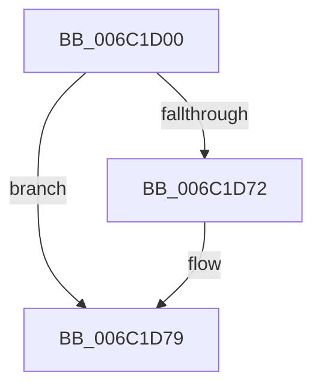

# KxMcheckAbort

- RVA: `0x006C1D00`–`0x006C1DDE` (길이 `222` bytes)
- VA: `0x00000001406C1D00`
- 실행 섹션: `.text`
- PDB 이름 있음: `예`; PDB Function 태그: `아니요`
- unwind 정보 RVA: `0x000C1CDC`
- 디코드: `45`개 명령, `222/222` bytes 표시
- 미해석 바이트: `0` (있으면 어셈블리에 `.byte`로 보존)

> 이 문서는 커널 이미지의 기계어와 PDB 기호를 분석해 생성했습니다. 4번과 5번은 함수 원형과 자료형을 바이너리 사용 방식에서 추정한 C 해석이며 원본 소스 복구 결과는 아닙니다.

## 1. Dependencies

- 직접 호출 지점: **1**; 고유 호출 대상: **1**
- 직접 호출자로 확인된 함수: **1**
- RIP 상대 이미지 참조: **0**

### Outgoing calls
- `0x006C1D79` → [KiHandleMcheck](../5B/KiHandleMcheck_function_005B88F0.md) (function, `0x005B88F0`)

### Direct callers
- [KiMcheckAbort](KiMcheckAbort_function_006C16C0.md) at `0x006C1994`

### Static image references
- 디코드된 RIP-relative 메모리 참조가 없습니다.

## 2. Other-region calls and transfers

- 다른 실행 섹션으로 향하는 call: **0**
- 별도 외부 분기/꼬리 이동을 확인하지 못했습니다.

## 3. Assembly (complete function range)

```asm
006C1D00  48 81 EC 38 01 00 00            sub rsp, 0x138
006C1D07  48 8D 84 24 00 01 00 00         lea rax, [rsp + 0x100]
006C1D0F  0F 29 74 24 30                  movaps xmmword ptr [rsp + 0x30], xmm6
006C1D14  0F 29 7C 24 40                  movaps xmmword ptr [rsp + 0x40], xmm7
006C1D19  44 0F 29 44 24 50               movaps xmmword ptr [rsp + 0x50], xmm8
006C1D1F  44 0F 29 4C 24 60               movaps xmmword ptr [rsp + 0x60], xmm9
006C1D25  44 0F 29 54 24 70               movaps xmmword ptr [rsp + 0x70], xmm10
006C1D2B  44 0F 29 58 80                  movaps xmmword ptr [rax - 0x80], xmm11
006C1D30  44 0F 29 60 90                  movaps xmmword ptr [rax - 0x70], xmm12
006C1D35  44 0F 29 68 A0                  movaps xmmword ptr [rax - 0x60], xmm13
006C1D3A  44 0F 29 70 B0                  movaps xmmword ptr [rax - 0x50], xmm14
006C1D3F  44 0F 29 78 C0                  movaps xmmword ptr [rax - 0x40], xmm15
006C1D44  48 89 18                        mov qword ptr [rax], rbx
006C1D47  48 89 78 08                     mov qword ptr [rax + 8], rdi
006C1D4B  48 89 70 10                     mov qword ptr [rax + 0x10], rsi
006C1D4F  4C 89 60 18                     mov qword ptr [rax + 0x18], r12
006C1D53  4C 89 68 20                     mov qword ptr [rax + 0x20], r13
006C1D57  4C 89 70 28                     mov qword ptr [rax + 0x28], r14
006C1D5B  4C 89 78 30                     mov qword ptr [rax + 0x30], r15
006C1D5F  48 8B D4                        mov rdx, rsp
006C1D62  41 C7 00 00 00 00 00            mov dword ptr [r8], 0
006C1D69  F6 85 F0 00 00 00 01            test byte ptr [rbp + 0xf0], 1
006C1D70  75 07                           jne 0x1406c1d79
006C1D72  41 C7 00 10 00 00 00            mov dword ptr [r8], 0x10
006C1D79  E8 72 6B EF FF                  call 0x1405b88f0
006C1D7E  48 8D 8C 24 00 01 00 00         lea rcx, [rsp + 0x100]
006C1D86  0F 28 74 24 30                  movaps xmm6, xmmword ptr [rsp + 0x30]
006C1D8B  0F 28 7C 24 40                  movaps xmm7, xmmword ptr [rsp + 0x40]
006C1D90  44 0F 28 44 24 50               movaps xmm8, xmmword ptr [rsp + 0x50]
006C1D96  44 0F 28 4C 24 60               movaps xmm9, xmmword ptr [rsp + 0x60]
006C1D9C  44 0F 28 54 24 70               movaps xmm10, xmmword ptr [rsp + 0x70]
006C1DA2  44 0F 28 59 80                  movaps xmm11, xmmword ptr [rcx - 0x80]
006C1DA7  44 0F 28 61 90                  movaps xmm12, xmmword ptr [rcx - 0x70]
006C1DAC  44 0F 28 69 A0                  movaps xmm13, xmmword ptr [rcx - 0x60]
006C1DB1  44 0F 28 71 B0                  movaps xmm14, xmmword ptr [rcx - 0x50]
006C1DB6  44 0F 28 79 C0                  movaps xmm15, xmmword ptr [rcx - 0x40]
006C1DBB  48 8B 19                        mov rbx, qword ptr [rcx]
006C1DBE  48 8B 79 08                     mov rdi, qword ptr [rcx + 8]
006C1DC2  48 8B 71 10                     mov rsi, qword ptr [rcx + 0x10]
006C1DC6  4C 8B 61 18                     mov r12, qword ptr [rcx + 0x18]
006C1DCA  4C 8B 69 20                     mov r13, qword ptr [rcx + 0x20]
006C1DCE  4C 8B 71 28                     mov r14, qword ptr [rcx + 0x28]
006C1DD2  4C 8B 79 30                     mov r15, qword ptr [rcx + 0x30]
006C1DD6  48 81 C4 38 01 00 00            add rsp, 0x138
006C1DDD  C3                              ret
```

## 4. C-style interpretation (structured pseudocode)

```c
__int64 __fastcall KxMcheckAbort(__int64 a1, __int64 a2, __int64 a3)
{
    __int64 result;
    __int64 v_rsp;
    unsigned __int64 v_stack_m108;
    unsigned __int64 v_stack_m38;
    unsigned __int64 v_stack_mC8;
    unsigned __int64 v_stack_mD8;
    unsigned __int64 v_stack_mE8;
    unsigned __int64 v_stack_mF8;

    v_rsp = (v_rsp) - (312);
    v_stack_m108 = v_xmm6;
    v_stack_mF8 = v_xmm7;
    v_stack_mE8 = v_xmm8;
    v_stack_mD8 = v_xmm9;
    v_stack_mC8 = v_xmm10;
    *(unsigned __int64 *)(v_stack_m38 - 128) = v_xmm11;
    *(unsigned __int64 *)(v_stack_m38 - 112) = v_xmm12;
    *(unsigned __int64 *)(v_stack_m38 - 96) = v_xmm13;
    *(unsigned __int64 *)(v_stack_m38 - 80) = v_xmm14;
    *(unsigned __int64 *)(v_stack_m38 - 64) = v_xmm15;
    *(unsigned __int64 *)(v_stack_m38) = v_rbx;
    *(unsigned __int64 *)(v_stack_m38 + 8) = v_rdi;
    *(unsigned __int64 *)(v_stack_m38 + 16) = v_rsi;
    *(unsigned __int64 *)(v_stack_m38 + 24) = v_r12;
    *(unsigned __int64 *)(v_stack_m38 + 32) = v_r13;
    *(unsigned __int64 *)(v_stack_m38 + 40) = v_r14;
    *(unsigned __int64 *)(v_stack_m38 + 48) = v_r15;
    *(unsigned int *)(a3) = 0;
    if (((*(unsigned __int8 *)(v_rbp + 240)) & (1)) == 0) {
        *(unsigned int *)(a3) = 16;
    }
    result = KiHandleMcheck(a1, v_rsp, a3, a4);
    v_rsp = (v_rsp) + (312);
    return result;
}
```

## 5. (Beta) C Style

```c
int64_t KxMcheckAbort(int64_t Arg1, int64_t Arg2, void *Arg3)
{
    uint8_t *arg3 = (uint8_t *)Arg3;

    int64_t result;
    int64_t local_rsp;
    uint64_t v_stack_m108;
    uint64_t v_stack_m38;
    uint64_t v_stack_mC8;
    uint64_t v_stack_mD8;
    uint64_t v_stack_mE8;
    uint64_t v_stack_mF8;

    local_rsp = (local_rsp) - (312);
    v_stack_m108 = v_xmm6;
    v_stack_mF8 = v_xmm7;
    v_stack_mE8 = v_xmm8;
    v_stack_mD8 = v_xmm9;
    v_stack_mC8 = v_xmm10;
    *(uint64_t *)(v_stack_m38 - 0x80) = v_xmm11;
    *(uint64_t *)(v_stack_m38 - 0x70) = v_xmm12;
    *(uint64_t *)(v_stack_m38 - 0x60) = v_xmm13;
    *(uint64_t *)(v_stack_m38 - 0x50) = v_xmm14;
    *(uint64_t *)(v_stack_m38 - 0x40) = v_xmm15;
    *(uint64_t *)(v_stack_m38) = local_rbx;
    *(uint64_t *)(v_stack_m38 + 0x8) = local_rdi;
    *(uint64_t *)(v_stack_m38 + 0x10) = local_rsi;
    *(uint64_t *)(v_stack_m38 + 0x18) = local_r12;
    *(uint64_t *)(v_stack_m38 + 0x20) = local_r13;
    *(uint64_t *)(v_stack_m38 + 0x28) = local_r14;
    *(uint64_t *)(v_stack_m38 + 0x30) = local_r15;
    *(uint32_t *)(arg3) = 0;
    if (((*(uint8_t *)(local_rbp + 0xF0)) & (1)) == 0) {
        *(uint32_t *)(arg3) = 16;
    }
    result = KiHandleMcheck(Arg1, local_rsp, Arg3, a4);
    local_rsp = (local_rsp) + (312);
    return result;
}
```

### 관측된 메모리 오프셋

구조체 형식이 확인되지 않은 접근은 인자 기준의 오프셋으로만 기록했습니다.

| 기준 인자 | 오프셋 표현 | 폭 (bit) | 접근 |
|---|---:|---:|---|
| `Arg3` | `+ 0x0` | `32` | `W` |

## 6. Execution-region graph

[열기: 2D/3D 그래프와 함수 탐색 컨트롤 패널](../../../control-panel.html?section=text&rva=0x006C1D00&view=graph)

- 2D 그래프는 위에서 아래로 흐르고, 3D 그래프는 빈 공간을 드래그해 회전합니다. Shift+드래그는 이동, 휠은 확대·축소, 함수 노드 선택은 대상 보고서 이동입니다.

### Static fallback


