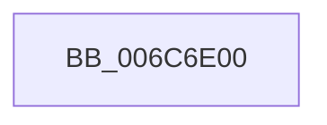

# _memset_query

- RVA: `0x006C6E00`–`0x006C6E26` (길이 `38` bytes)
- VA: `0x00000001406C6E00`
- 실행 섹션: `.text`
- PDB 이름 있음: `예`; PDB Function 태그: `아니요`
- unwind 정보 RVA: `0x000C2680`
- 디코드: `16`개 명령, `38/38` bytes 표시
- 미해석 바이트: `0` (있으면 어셈블리에 `.byte`로 보존)

> 이 문서는 커널 이미지의 기계어와 PDB 기호를 분석해 생성했습니다. 4번과 5번은 함수 원형과 자료형을 바이너리 사용 방식에서 추정한 C 해석이며 원본 소스 복구 결과는 아닙니다.

## 1. Dependencies

- 직접 호출 지점: **1**; 고유 호출 대상: **1**
- 직접 호출자로 확인된 함수: **1**
- RIP 상대 이미지 참조: **0**

### Outgoing calls
- `0x006C6E10` → [_cpu_features_init](../50/_cpu_features_init_function_00503D10.md) (function, `0x00503D10`)

### Direct callers
- [_memset_repmovs](_memset_repmovs_function_006C6D80.md) at `0x006C6DBC`

### Static image references
- 디코드된 RIP-relative 메모리 참조가 없습니다.

## 2. Other-region calls and transfers

- 다른 실행 섹션으로 향하는 call: **0**
- 별도 외부 분기/꼬리 이동을 확인하지 못했습니다.

## 3. Assembly (complete function range)

```asm
006C6E00  41 51                           push r9
006C6E02  41 50                           push r8
006C6E04  52                              push rdx
006C6E05  51                              push rcx
006C6E06  50                              push rax
006C6E07  48 83 EC 30                     sub rsp, 0x30
006C6E0B  0F 29 44 24 20                  movaps xmmword ptr [rsp + 0x20], xmm0
006C6E10  E8 FB CE E3 FF                  call 0x140503d10
006C6E15  0F 28 44 24 20                  movaps xmm0, xmmword ptr [rsp + 0x20]
006C6E1A  48 83 C4 30                     add rsp, 0x30
006C6E1E  58                              pop rax
006C6E1F  59                              pop rcx
006C6E20  5A                              pop rdx
006C6E21  41 58                           pop r8
006C6E23  41 59                           pop r9
006C6E25  C3                              ret
```

## 4. C-style interpretation (structured pseudocode)

```c
__int64 __fastcall _memset_query(__int64 a1, __int64 a2, __int64 a3, __int64 a4)
{
    __int64 result;
    __int64 v_rsp;
    unsigned __int64 v_stack_m38;

    v_rsp = (v_rsp) - (48);
    v_stack_m38 = v_xmm0;
    result = _cpu_features_init(a1, a2, a3, a4);
    v_rsp = (v_rsp) + (48);
    return result;
}
```

## 5. (Beta) C Style

```c
int64_t _memset_query(int64_t Arg1, int64_t Arg2, int64_t Arg3, int64_t Arg4)
{
    int64_t result;
    int64_t local_rsp;
    uint64_t v_stack_m38;

    local_rsp = (local_rsp) - (48);
    v_stack_m38 = v_xmm0;
    result = _cpu_features_init(Arg1, Arg2, Arg3, Arg4);
    local_rsp = (local_rsp) + (48);
    return result;
}
```

## 6. Execution-region graph

[열기: 2D/3D 그래프와 함수 탐색 컨트롤 패널](../../../control-panel.html?section=text&rva=0x006C6E00&view=graph)

- 2D 그래프는 위에서 아래로 흐르고, 3D 그래프는 빈 공간을 드래그해 회전합니다. Shift+드래그는 이동, 휠은 확대·축소, 함수 노드 선택은 대상 보고서 이동입니다.

### Static fallback


