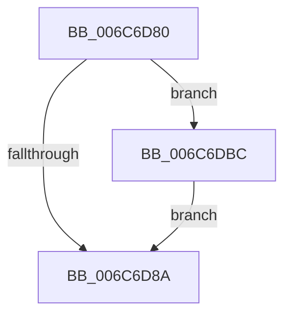

# _memset_repmovs

- RVA: `0x006C6D80`–`0x006C6DC3` (길이 `67` bytes)
- VA: `0x00000001406C6D80`
- 실행 섹션: `.text`
- PDB 이름 있음: `예`; PDB Function 태그: `아니요`
- unwind 정보 RVA: `0x000C2670`
- 디코드: `21`개 명령, `67/67` bytes 표시
- 미해석 바이트: `0` (있으면 어셈블리에 `.byte`로 보존)

> 이 문서는 커널 이미지의 기계어와 PDB 기호를 분석해 생성했습니다. 4번과 5번은 함수 원형과 자료형을 바이너리 사용 방식에서 추정한 C 해석이며 원본 소스 복구 결과는 아닙니다.

## 1. Dependencies

- 직접 호출 지점: **1**; 고유 호출 대상: **1**
- 직접 호출자로 확인된 함수: **0**
- RIP 상대 이미지 참조: **1**

### Outgoing calls
- `0x006C6DBC` → [_memset_query](_memset_query_function_006C6E00.md) (function, `0x006C6E00`)

### Direct callers
- 이 함수 시작 RVA로 연결되는 직접 call은 확인되지 않았습니다. 간접 호출은 완전히 역산할 수 없습니다.

### Static image references
- `0x006C6D81` → RVA `0x00E0A6C0` (`.data`; read)

## 2. Other-region calls and transfers

- 다른 실행 섹션으로 향하는 call: **0**
- 별도 외부 분기/꼬리 이동을 확인하지 못했습니다.

## 3. Assembly (complete function range)

```asm
006C6D80  57                              push rdi
006C6D81  F6 05 38 39 74 00 01            test byte ptr [rip + 0x743938], 1
006C6D88  74 32                           je 0x1406c6dbc
006C6D8A  48 8B F9                        mov rdi, rcx
006C6D8D  4C 03 C1                        add r8, rcx
006C6D90  0F 11 01                        movups xmmword ptr [rcx], xmm0
006C6D93  48 83 C7 40                     add rdi, 0x40
006C6D97  0F 11 41 10                     movups xmmword ptr [rcx + 0x10], xmm0
006C6D9B  48 83 E7 C0                     and rdi, 0xffffffffffffffc0
006C6D9F  0F 11 41 20                     movups xmmword ptr [rcx + 0x20], xmm0
006C6DA3  4C 2B C7                        sub r8, rdi
006C6DA6  0F 11 41 30                     movups xmmword ptr [rcx + 0x30], xmm0
006C6DAA  49 8B C8                        mov rcx, r8
006C6DAD  4C 8B C8                        mov r9, rax
006C6DB0  66 48 0F 7E C0                  movq rax, xmm0
006C6DB5  F3 AA                           rep stosb byte ptr [rdi], al
006C6DB7  49 8B C1                        mov rax, r9
006C6DBA  5F                              pop rdi
006C6DBB  C3                              ret
006C6DBC  E8 3F 00 00 00                  call 0x1406c6e00
006C6DC1  EB C7                           jmp 0x1406c6d8a
```

## 4. C-style interpretation (structured pseudocode)

```c
__int64 __fastcall _memset_repmovs(__int64 a1, __int64 a2, __int64 a3)
{
    __int64 result;
    __int64 v_rdi;

    if (((*(unsigned __int8 *)(v_rip + 7616824)) & (1)) == 0) goto loc_006C6DBC;
loc_006C6D8A:
    a3 = (a3) + (a1);
    *(unsigned __int64 *)(a1) = v_xmm0;
    v_rdi = (a1) + (64);
    *(unsigned __int64 *)(a1 + 16) = v_xmm0;
    v_rdi = (v_rdi) & (-64);
    *(unsigned __int64 *)(a1 + 32) = v_xmm0;
    a3 = (a3) - (v_rdi);
    *(unsigned __int64 *)(a1 + 48) = v_xmm0;
    return result;
loc_006C6DBC:
    result = _memset_query(a3, a2, a3, result);
    goto loc_006C6D8A;
}
```

## 5. (Beta) C Style

```c
int64_t _memset_repmovs(int64_t Arg1, int64_t Arg2, int64_t Arg3)
{
    int64_t result;
    int64_t local_rdi;

    if (((*(uint8_t *)(v_rip + 0x743938)) & (1)) == 0) goto loc_006C6DBC;
loc_006C6D8A:
    Arg3 = (Arg3) + (Arg1);
    *(uint64_t *)(Arg1) = v_xmm0;
    local_rdi = (Arg1) + (64);
    *(uint64_t *)(Arg1 + 0x10) = v_xmm0;
    local_rdi = (local_rdi) & (-64);
    *(uint64_t *)(Arg1 + 0x20) = v_xmm0;
    Arg3 = (Arg3) - (local_rdi);
    *(uint64_t *)(Arg1 + 0x30) = v_xmm0;
    return result;
loc_006C6DBC:
    result = _memset_query(Arg3, Arg2, Arg3, result);
    goto loc_006C6D8A;
}
```

## 6. Execution-region graph

[열기: 2D/3D 그래프와 함수 탐색 컨트롤 패널](../../../control-panel.html?section=text&rva=0x006C6D80&view=graph)

- 2D 그래프는 위에서 아래로 흐르고, 3D 그래프는 빈 공간을 드래그해 회전합니다. Shift+드래그는 이동, 휠은 확대·축소, 함수 노드 선택은 대상 보고서 이동입니다.

### Static fallback


